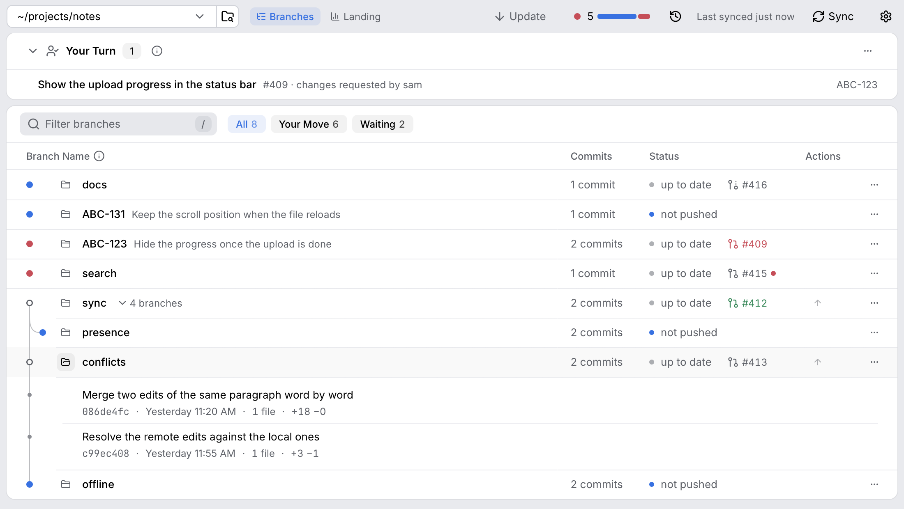

# Branch Deck

Commit everything on one branch and get a branch and a pull request per feature. Start a commit subject with `(auth)`
or an issue key like `ABC-123`, and Branch Deck builds a real Git branch for each group, ready to push and review.
Your working tree and your checked-out branch stay as they are, so the IDE, your build and other agents in the same
checkout don't notice.

Every operation runs through the Git CLI, so it stays fast on very large repositories. macOS (Apple silicon), Windows
and Linux (x86_64). Early: version 0.x, the builds are not signed yet.

<picture>
  <source media="(prefers-color-scheme: dark)" srcset="docs/screenshots/branch-deck-dark.png">
  
</picture>

## How It Works

Your branch, `master` here, has four commits ahead of `origin/master`, the **baseline**:

```
(auth) Add login form
ABC-123 Fix the token refresh
(auth) Validate the email field
Bump the timeout
```

A sync turns them into two branches, each built on the baseline from its commits alone:

- `alex/virtual/auth`: `Add login form`, `Validate the email field` (the prefix is dropped);
- `alex/virtual/ABC-123`: `ABC-123 Fix the token refresh`.

`Bump the timeout` has neither a prefix nor an issue key: it stays **unassigned** until you move it to a branch.
`alex` is your **branch prefix**, the namespace of your branches; set it in the field next to the repository selector
or with `git config --global branchdeck.branchPrefix alex`.

The rules, checked on the first line of the message:

1. A `(name)` prefix wins.
2. Otherwise an issue key groups the commit, into a branch of the key or into the branch its
   [issue group](spec/branch/issue-groups.spec.md) names. A leading `[subsystem]` tag is skipped.
3. `fixup!`, `squash!` and `amend!` commits go with the commit they fix.

Nothing here writes to your files: syncs and history rewrites (reword, move, squash, amend) build commits with
`git merge-tree` and `git replay` and move refs, and what you staged on other files stays staged. Update Project is the one
operation that writes files, and only the files upstream changed and you didn't. See
[Git Operations](docs/design/git-operations.md) and [Virtual Branches](docs/design/virtual-branches.md).

## Install

```sh
# macOS, Linux
curl -fsSL https://raw.githubusercontent.com/develar/branch-deck/master/install.sh | sh
```

```powershell
# Windows
irm https://raw.githubusercontent.com/develar/branch-deck/master/install.ps1 | iex
```

Run the same command to upgrade. You need **Git 2.54 or newer** (`brew install git`; on Ubuntu the
[git-core PPA](https://launchpad.net/~git-core/+archive/ubuntu/ppa); [Git for Windows](https://git-scm.com/downloads/win))
and a Git identity (`user.name`, `user.email`). Optional: a GitHub token for pull requests, which the app takes from
[`gh`](https://cli.github.com), `GH_TOKEN` or the HTTPS credentials git stores for github.com, or gets by its own
[sign-in](spec/repository/github-sign-in.spec.md), and [Claude Code](https://code.claude.com/docs/en/setup) for branch name suggestions.

<details>
<summary>Why a script, the options, and installing by hand</summary>

A browser marks a download as quarantined (macOS) or as coming from the internet (Windows), and Gatekeeper or
SmartScreen then blocks the unsigned app. A download by `curl` or PowerShell has no such mark, the same as the app's
own updates. Read [install.sh](install.sh) and [install.ps1](install.ps1) before you pipe them into a shell. They
install:

- **macOS**: `BranchDeck.app` into `/Applications` (`~/Applications` when that is not writable), and restart a running
  Branch Deck.
- **Linux**: the `.deb` with `apt-get`, the `.rpm` with `dnf` or `zypper` (through `sudo`), else the AppImage into
  `~/.local/bin` with a menu entry; `BRANCH_DECK_FORMAT=appimage` picks the AppImage anyway.
- **Windows**: the per-user installer, silently, without administrator rights.

`--with-cli` (`-WithCli`) also installs the [agent CLI](#agent-cli), `--version 0.11.0` (`-Version`) an older release:

```sh
curl -fsSL https://raw.githubusercontent.com/develar/branch-deck/master/install.sh | sh -s -- --with-cli
```

```powershell
& ([scriptblock]::Create((irm https://raw.githubusercontent.com/develar/branch-deck/master/install.ps1))) -WithCli
```

To install by hand, [download the release](https://github.com/develar/branch-deck/releases/latest) (`.dmg`, `.exe`,
`.msi`, AppImage, `.deb`, `.rpm`). On macOS, move `BranchDeck.app` to Applications and run
`xattr -dr com.apple.quarantine /Applications/BranchDeck.app` once. On Windows, SmartScreen warns about an unknown
publisher: choose More info → Run anyway.

</details>

## Getting Started

1. Open a repository with the selector in the header or the folder button.
2. Save the branch prefix the welcome card suggests (the name part of your Git email), or type another one.
3. Commit as usual, with a `(name)` prefix or an issue key in the subject.
4. Sync (⌘R / Ctrl+R): each group becomes a local branch `<prefix>/virtual/<name>`.
5. Push a branch from its row and open its pull request from the toast.

## Features

- **Grouping and moving**: drag commits or whole branches onto a branch, or choose Move to…; a preview says what the
  move changes, and one Undo takes it back. Moving whole issues writes an
  [issue group](spec/branch/issue-groups.spec.md) instead of rewriting their subjects. Claude Code can suggest two
  names for a new branch ([move](spec/branch/move-commits.spec.md), [names](spec/branch/branch-name-suggestions.spec.md)).
  A branch that conflicts says which branches have what it needs and offers the regroup a trial build verified, with
  Undo ([conflict fix](spec/branch/conflict-fix.spec.md)).
- **Stacked branches** (`git config branchdeck.stacks true`): `(auth/login)` builds `login` on top of `auth`. The table
  draws a stack as one line, as Sapling and jj do, headed by its root ("22 branches", which collapses the stack), and
  hovering a branch lights the path down to it, what its push sends; a push sends the parents first, and each pull
  request goes into master with what it lands, the commits of the branches below it
  ([spec](spec/branch/stacked-branches.spec.md)). Stack On and Unstack store the parent in
  `refs/branch-deck/stack-parents`, not in the subjects, so stacking an issue branch on another one rewrites no commit
  ([stack parents](spec/branch/stack-parents.spec.md)). A whole stack, side branches included, lands in one Safe Push
  from its header ([whole stack](spec/branch/whole-stack.spec.md)).
- **Push and pull requests**: what each branch has to push, and which pushes would drop remote commits; the pull
  request, its review state and checks from GitHub; Create Pull Request into master with the suggested code owners
  asked to review. Each row shows its next step, such as the review it waits for, and never offers a push that is
  known to fail
  ([outgoing](spec/repository/outgoing.spec.md), [pull requests](spec/branch/pull-requests.spec.md), [next step](spec/branch/next-step.spec.md)).
- **Staying up to date**: Update Project (⌘T / Ctrl+T) fetches the baseline and rebases your commits, and says
  beforehand whether that is clean. On a conflict nothing changes, and a coding agent can resolve it commit by commit
  outside the working tree. Branches that were merged, rebased or squashed upstream are detected and archived, and
  the header says which of your commits landed ([update](spec/repository/update-project.spec.md),
  [landed](spec/repository/landed-commits.spec.md), [detection](docs/design/integration-detection.md)).
- **Review**: the changed files of a commit as a tree with diffs; `D` reviews a commit or a whole branch in a window
  of its own, one scrolling view (`J`/`K` files, `N`/`P` changes). Your Turn lists the pull requests that wait for your
  review and opens them in the same window to approve or request changes ([commit](spec/commit/commit-review.spec.md), [branch](spec/branch/branch-review.spec.md),
  [Your Turn](spec/repository/review-requests.spec.md)).
- **History editing with Undo**: reword, amend uncommitted changes into a branch, squash commits even when others lie
  between them, fold fixup commits, unapply a branch. Activity lists what Branch Deck did, with Undo while it lasts
  ([squash](spec/commit/squash.spec.md), [fixups](spec/commit/fixups.spec.md), [activity](spec/repository/activity.spec.md)).
- **At home next to IntelliJ**: the Islands colours and density, light and dark, the toolbar in the title bar, issue
  links from the IDE's issue navigation (`.idea/vcs.xml`), zoom from 67% to 150%, and a Settings window with a page
  per subject ([settings](spec/repository/settings.spec.md)).

## Agent CLI

`bd` gives a coding agent what the app sees, as JSON: the commits ahead of the baseline, their files, the
dependencies between them, by lines and by the names they declare and use in Kotlin, Java, Rust and TypeScript
([symbol dependencies](spec/commit/symbol-dependencies.spec.md)), and the branches. It suggests a grouping checked by
a trial sync, applies it as one rewrite of the commit messages that can be undone, pushes and updates:

```sh
bd suggest | jq .plan > plan.json                       # a grouping, already checked by a trial sync
bd check --plan plan.json                               # after an edit: does every branch still build?
bd group --expect-head <head> --sync --plan plan.json   # rewrite the prefixes and build the branches
bd push auth ABC-123                                    # push, parents first
bd update                                               # onto the baseline; a conflict opens a resolve session
```

Help → Install Agent CLI… (or `bd install`) puts `bd` on `PATH` and a skill into `~/.claude/skills` and
`~/.agents/skills`, so agents know when to use it; `bd help agent` prints the workflow. On macOS and Linux `bd` is
the app binary (`branch-deck cli`), on Windows `bd.exe` next to it. See the [Agent CLI](docs/guidelines/agent-cli.md).

## Compared To

- **ghstack, spr**: one pull request per commit. Branch Deck puts any number of commits into a branch by their
  subject, and the branches are plain Git branches.
- **Graphite**: you create a branch per change and check it out to work on it; here you never switch.
- **Sapling, jj**: another version control front end. Branch Deck keeps plain Git and your IDE's Git integration.
- **[GitButler](https://gitbutler.com)**: applies virtual branches in the working tree with its own state; Branch
  Deck keeps the working tree and stores its state in Git refs and notes. Branch Deck began as a way around GitButler's
  [performance](https://github.com/gitbutlerapp/gitbutler/issues/3235)
  [issues](https://github.com/gitbutlerapp/gitbutler/issues/9018) on large repositories: every operation here runs
  through the Git CLI.

## Documentation

- [Design docs](docs/design/): [Virtual Branches](docs/design/virtual-branches.md),
  [Git Operations](docs/design/git-operations.md), [Integration Detection](docs/design/integration-detection.md),
  [Remote Status](docs/design/remote-status.md) and more.
- [Specs](spec/): the exact behaviour of every feature.
- [DEVELOPMENT.md](DEVELOPMENT.md): building, testing and contributing.

## License

[MIT](LICENSE)
