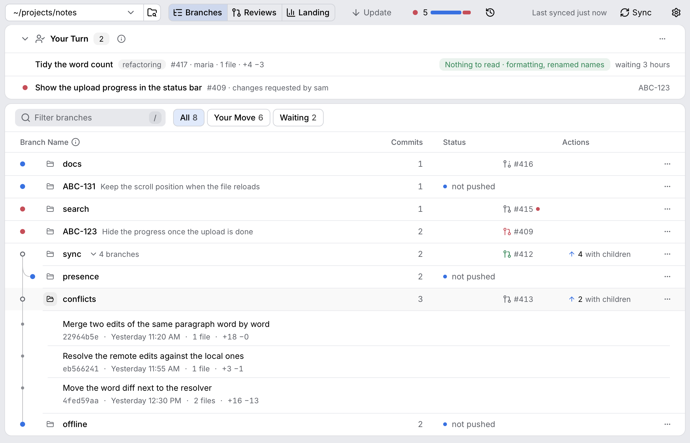
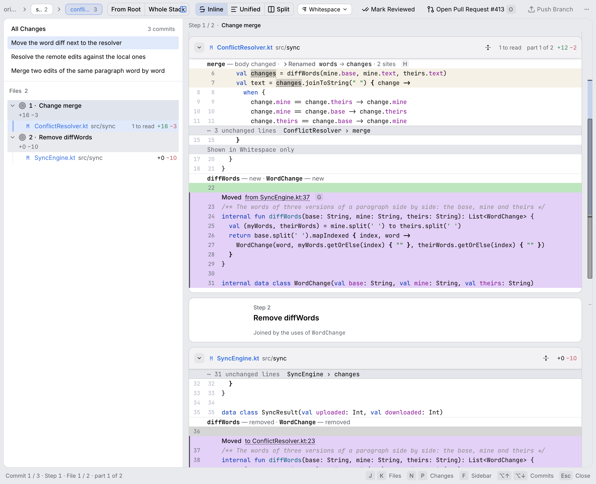

# Branch Deck

Commit everything on one branch and get a branch and a pull request per feature. Start a commit subject with `(auth)`
or an issue key like `ABC-123`, and Branch Deck builds a real Git branch for each group, ready to push and review.
Your working tree and your checked-out branch stay as they are, so the IDE, your build and other agents in the same
checkout don't notice.

Every operation runs through the Git CLI, so it stays fast on very large repositories. macOS (Apple silicon), Windows
and Linux (x86_64).

<picture>
  <source media="(prefers-color-scheme: dark)" srcset="docs/screenshots/branch-deck-dark.png">
  
</picture>

## How It Works

Your branch, `master` here, has four commits ahead of `origin/master`, the **baseline**:

```
(auth) Add login form
ABC-123 Fix the token refresh
(auth) Validate the email field
Bump the timeout
```

A sync turns them into two branches, each built on the baseline from its commits alone:

- `alex/virtual/auth`: `Add login form`, `Validate the email field` (the prefix is dropped);
- `alex/virtual/ABC-123`: `ABC-123 Fix the token refresh`.

`Bump the timeout` has neither a prefix nor an issue key: it stays **unassigned** until you move it to a branch.
`alex` is your **branch prefix**, the namespace of your branches; set it in the field next to the repository selector
or with `git config --global branchdeck.branchPrefix alex`.

The first line of the message decides:

1. A `(name)` prefix wins; `(auth/login)` builds `login` on top of `auth`.
2. Otherwise an issue key groups the commit, into a branch of the key or of its
   [issue group](openspec/specs/branch/issue-groups/spec.md). A leading `[subsystem]` tag is skipped.
3. `fixup!`, `squash!` and `amend!` commits go with the commit they fix.

Nothing here writes to your files. Syncs and history rewrites build commits with `git merge-tree` and `git replay`
and move refs, and what you staged stays staged; only Update Project writes files, and only those upstream changed and
you didn't ([Virtual Branches](docs/design/virtual-branches.md), [Git Operations](docs/design/git-operations.md)).

## A Review That Reads the Change

A diff shows every line that changed; the review of Branch Deck says which of them you have to read. Lines that moved
to another file are named at both ends, "Moved to ConflictResolver.kt:23" where they left and "Moved from
SyncEngine.kt:37" where they stand now, and shown once. A renamed name is named once, at its declaration, and marked at
every site instead of shown as a change; lines that changed only their formatting are played down and skipped. What
is left is counted per file, per pull request and per layer of a stack, so Your Turn can say "Nothing to read ·
formatting, renamed names" of a refactoring before you open it, and flag a "refactoring" label its diff contradicts
([quiet changes](openspec/specs/commit/quiet-changes/spec.md), [what is left to read](openspec/specs/review/range-reading/spec.md)).

The review opens on a commit, a branch, a whole stack or a pull request waiting for you, in a window of its own: one
scrolling view of every file, coloured as IntelliJ colours the code, with Go to Declaration and Find Usages, and
Approve or Request Changes for a pull request. Its plan cuts the change into steps by what ties the files together,
says which change no test reaches, and Mark Reviewed makes the next review show only what came since
([review window](openspec/specs/review/review-window/spec.md), [review plan](openspec/specs/branch/review-plan/spec.md),
[navigation](openspec/specs/commit/symbol-navigation/spec.md), [Your Turn](openspec/specs/repository/review-requests/spec.md)).

<picture>
  <source media="(prefers-color-scheme: dark)" srcset="docs/screenshots/review-dark.png">
  
</picture>

## Install

```sh
# macOS, Linux
curl -fsSL https://raw.githubusercontent.com/develar/branch-deck/master/install.sh | sh
```

```powershell
# Windows
irm https://raw.githubusercontent.com/develar/branch-deck/master/install.ps1 | iex
```

Run the same command to upgrade. You need **Git 2.54 or newer** (`brew install git`; on Ubuntu the
[git-core PPA](https://launchpad.net/~git-core/+archive/ubuntu/ppa); [Git for Windows](https://git-scm.com/downloads/win))
and a Git identity (`user.name`, `user.email`). Optional: a GitHub token for pull requests, which the app takes from
[`gh`](https://cli.github.com), `GH_TOKEN` or the HTTPS credentials git stores for github.com, or gets by its own
[sign-in](openspec/specs/repository/github-sign-in/spec.md), and [Claude Code](https://code.claude.com/docs/en/setup) for branch name suggestions.

<details>
<summary>Why a script, the options, and installing by hand</summary>

A browser marks a download as quarantined (macOS) or as coming from the internet (Windows), and Gatekeeper or
SmartScreen can block unsigned builds. A download by `curl` or PowerShell has no such mark, the same as the app's
own updates. Read [install.sh](install.sh) and [install.ps1](install.ps1) before you pipe them into a shell. They
install:

- **macOS**: `BranchDeck.app` into `/Applications` (`~/Applications` when that is not writable), and restart a running
  Branch Deck.
- **Linux**: the `.deb` with `apt-get`, the `.rpm` with `dnf` or `zypper` (through `sudo`), else the AppImage into
  `~/.local/bin` with a menu entry; `BRANCH_DECK_FORMAT=appimage` picks the AppImage anyway.
- **Windows**: the per-user installer, silently, without administrator rights.

`--with-cli` (`-WithCli`) also installs the [agent CLI](docs/guide/agent-cli.md), `--version 0.11.0` (`-Version`) an older release:

```sh
curl -fsSL https://raw.githubusercontent.com/develar/branch-deck/master/install.sh | sh -s -- --with-cli
```

```powershell
& ([scriptblock]::Create((irm https://raw.githubusercontent.com/develar/branch-deck/master/install.ps1))) -WithCli
```

To install by hand, [download the release](https://github.com/develar/branch-deck/releases/latest) (`.dmg`, `.exe`,
`.msi`, AppImage, `.deb`, `.rpm`). On macOS, move `BranchDeck.app` to Applications and run
`xattr -dr com.apple.quarantine /Applications/BranchDeck.app` once. On Windows, SmartScreen warns about an unknown
publisher: choose More info → Run anyway.

</details>

## Getting Started

1. Open a repository with the selector in the header or the folder button.
2. Save the branch prefix the welcome card suggests (the name part of your Git email), or type another one.
3. Commit as usual, with a `(name)` prefix or an issue key in the subject.
4. Sync (⌘R / Ctrl+R): each group becomes a local branch `<prefix>/virtual/<name>`.
5. Push a branch from its row and open its pull request from the toast.
6. Let coding agents work beside you: Help → Install Agent CLI… ([Coding Agents](#coding-agents)).

## Features

- **Grouping and moving**: drag commits or whole branches onto a branch, or choose Move to…; a preview says what the
  move changes, and Undo takes it back. Whole issues move by an issue group, with no subject rewritten, and a branch
  that conflicts offers the regroup a trial build verified ([move](openspec/specs/branch/move-commits/spec.md),
  [issue groups](openspec/specs/branch/issue-groups/spec.md), [conflict fix](openspec/specs/branch/conflict-fix/spec.md)).
- **Stacks**: a stack is drawn as one line headed by its root, hovering a branch lights what its push sends, and Stack
  On, Unstack and Stack Together change the parents without rewriting a commit. On GitHub a straight chain is a
  stack of pull requests; a stack that forks lands whole from its header
  ([stacked branches](openspec/specs/branch/stacked-branches/spec.md), [stack parents](openspec/specs/branch/stack-parents/spec.md),
  [whole stack](openspec/specs/branch/whole-stack/spec.md), [GitHub stacks](docs/design/github-stacks.md)).
- **Push and pull requests**: each row says its next step on the way into master, such as the review it waits for,
  and never offers a push that is known to fail; a commit a colleague pushed to your pull request shows up before you
  push over it ([next step](openspec/specs/branch/next-step/spec.md), [pull requests](openspec/specs/branch/pull-requests/spec.md),
  [outgoing](openspec/specs/repository/outgoing/spec.md#remote-commits-of-others)). Park a branch you keep only locally,
  and declare with `brd need` an order of landing no build sees ([parked](openspec/specs/branch/parked-branches/spec.md),
  [declared needs](openspec/specs/branch/declared-needs/spec.md)).
- **Staying up to date**: Update Project fetches the baseline and rebases your commits, and says beforehand whether
  that is clean; on a conflict nothing changes, and an agent can resolve it commit by commit outside the working tree.
  Branches merged, rebased or squashed upstream are detected and archived
  ([update](openspec/specs/repository/update-project/spec.md), [landed](openspec/specs/repository/landed-commits/spec.md),
  [detection](docs/design/integration-detection.md)).
- **History editing with Undo**: reword, amend into a branch, squash commits with others between them, fold fixups,
  drop a commit that must not land, unapply a branch and reapply it later; Activity lists each with its Undo
  ([squash](openspec/specs/commit/squash/spec.md), [fixups](openspec/specs/commit/fixups/spec.md), [drop](openspec/specs/commit/drop/spec.md),
  [unapply](openspec/specs/branch/unapply/spec.md), [activity](openspec/specs/repository/activity/spec.md)).
- **At home next to IntelliJ**: the Islands colours and density in light and dark, issue links from the IDE's issue
  navigation, YouTrack issues on hover, a command palette and a Settings window
  ([settings](openspec/specs/repository/settings/spec.md), [command palette](openspec/specs/repository/command-palette/spec.md),
  [YouTrack](openspec/specs/repository/youtrack/spec.md)).

## Coding Agents

`brd`, the agent CLI, gives a coding agent what the app sees, as JSON, and the operations the app runs. With it
installed (Help → Install Agent CLI…), each agent session works in a worktree of its own, lands each commit on your
branch the moment it passes its tests and names its branch in the subject; you review and push its work in the app as
your own. The commits it reads come with what ties them together, by lines and by the names they declare and use in
Kotlin, Java, C#, Rust and TypeScript, so its grouping is checked by a trial sync before it rewrites anything. Settings
→ Agents switches each rule. See [Coding Agents and the Agent CLI](docs/guide/agent-cli.md).

## Compared To

- **ghstack, spr**: one pull request per commit. Branch Deck puts any number of commits into a branch by their
  subject, and the branches are plain Git branches.
- **Graphite**: you create a branch per change and check it out to work on it; here you never switch.
- **Sapling, jj**: another version control front end. Branch Deck keeps plain Git and your IDE's Git integration.
- **[GitButler](https://gitbutler.com)**: applies virtual branches in the working tree with its own state; Branch
  Deck keeps the working tree and stores its state in Git refs and notes. Branch Deck began as a way around GitButler's
  [performance](https://github.com/gitbutlerapp/gitbutler/issues/3235)
  [issues](https://github.com/gitbutlerapp/gitbutler/issues/9018) on large repositories: every operation here runs
  through the Git CLI.

## Documentation

- [Guides](docs/guide/): [Coding Agents and the Agent CLI](docs/guide/agent-cli.md),
  [The Commit Body a Review Reads](docs/guide/commit-bodies.md), [Runs on Another Mac](docs/guide/host-runs.md).
- [Design docs](docs/design/): [Landing](docs/design/landing.md), [Virtual Branches](docs/design/virtual-branches.md),
  [Git Operations](docs/design/git-operations.md), [Change Review](docs/design/change-review.md) and more.
- [Specs](openspec/specs/): the exact behaviour of every feature, in the [OpenSpec](https://github.com/Fission-AI/OpenSpec) format.
- [DEVELOPMENT.md](DEVELOPMENT.md): building, testing and contributing.

## License

[MIT](LICENSE)
