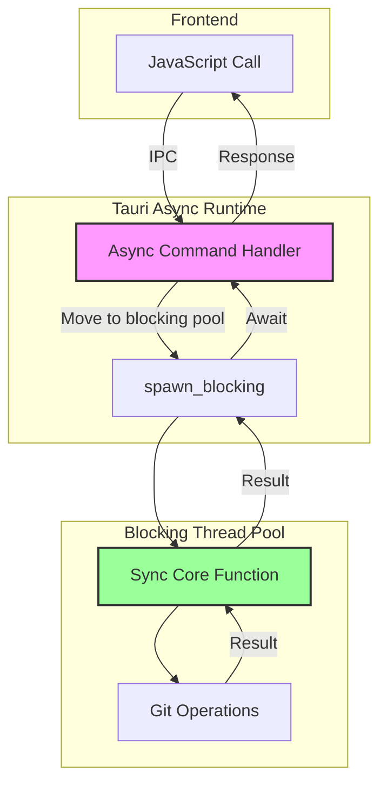
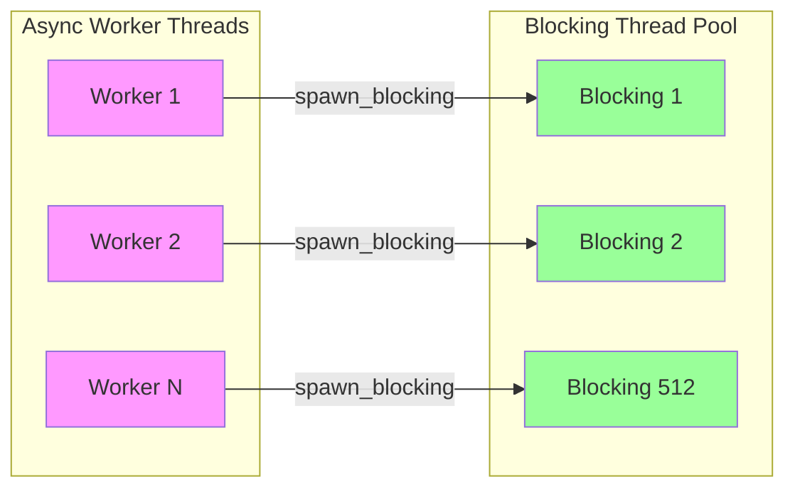

# Async Patterns and spawn_blocking

**Status:** Implemented  
**Updated:** 2025-08-23  
**Tags:** [async, performance, tauri]

## Problem

Tauri commands must be async to avoid blocking the UI thread, but git operations are inherently blocking I/O using synchronous system calls. Running blocking operations directly in async functions blocks the async worker threads, starving the runtime and degrading performance.

The challenge: How to bridge async Tauri commands with synchronous git operations without blocking async threads or adding unnecessary complexity?

## Solution Overview

Use `spawn_blocking` to move all blocking I/O to dedicated thread pools. Tauri commands become thin async wrappers that immediately delegate to synchronous core functions running on blocking threads. This maintains clean separation between async coordination and blocking execution.

## Design

### Architecture

### Thread Pool Architecture

### Key Decisions

1. **Decision**: Synchronous GitCommandExecutor
   **Rationale**: Git operations are blocking; no benefit from async complexity

2. **Decision**: spawn_blocking in every Tauri command that runs git or reads files
   **Rationale**: Consistent pattern, prevents async thread blocking. A command that talks HTTP (Patronus,
   `src-tauri/src/commands/patronus.rs`) awaits the request on the async runtime with one shared `reqwest::Client`,
   and only its git part (which repository) goes through `run_blocking`.

3. **Decision**: Separate core functions from command handlers
   **Rationale**: Core logic is testable without async runtime

4. **Decision**: Clone state for 'static lifetime
   **Rationale**: spawn_blocking requires 'static, State is not 'static

5. **Decision**: JoinSet.spawn_blocking for parallel operations
   **Rationale**: Direct spawning without double-async wrapper

### Implementation Notes

Pattern structure:
- **Tauri Command**: Async wrapper with `#[tauri::command]` (see `src-tauri/src/commands/`)
- **Core Function**: Synchronous implementation with actual logic
- **State Cloning**: Clone `State<T>` before moving to blocking thread
- **Error Mapping**: Convert JoinError to user-friendly message

Parallel operations:
- Use `JoinSet::spawn_blocking` directly
- Avoid `spawn(async { spawn_blocking(...) })` double-spawning
- Semaphore for concurrency limiting when needed (`max_parallel_git_processes()` in `git_executor::concurrency`)

Sync pipeline (`sync_core::sync::sync_branches`):
- Phase 1, one `spawn_blocking`: issue config, baseline, commit grouping; sends `IssueNavigationConfig`,
  `UnassignedCommits` and `BranchesGrouped` (also when empty) before any per-branch work starts, so the
  frontend always knows the branch set before per-branch events arrive
- Phase 2, concurrently: integration detection in one `spawn_blocking`, and branch processing as
  semaphore-bounded `JoinSet::spawn_blocking` tasks; joined with `tokio::join!` so one failure doesn't orphan the other

### Operation spans

Every Tauri command that can fail (`Result<_, CommandError>`) and every `bd` run is an operation with an id of its own
(`sync_utils::operation_id::OperationId`, a ULID: 48 bits of milliseconds, 80 random bits, so the ids of the app and
of every `bd` process never collide and sort by time). `src-tauri/src/command_scan_test.rs` checks the commands:
- Every command has an `#[instrument]` span, its `State`, `AppHandle` and window arguments skipped. An argument that
  holds a collection (a `Vec`, a map, through nested structs) is skipped too, with a field or two in its place
  (`skip_all, fields(repository_path = %params.repository_path, robots = params.robots.len())`), because every line of
  the log repeats the fields of the spans it is in: `get_repository_view` with the robots and the remote facts of 141
  branches would write tens of KB per call. `#[instrument]` with `fields` comes before `#[specta::specta]`, which
  rejects the `%` of a field.
- The body of an async command runs in `operation(async move { … }).await`, of a synchronous one (on the main thread) in
  `operation_now(|| { … })` (`src-tauri/src/operation.rs`): the span `operation{operation_id}`, a child of the command's
  span, so a line reads `get_pull_requests{…}:operation{operation_id=…}: message`. A blocking step of the body, git or
  the file system, runs through `run_blocking` on the pool, inside the caller's span; a command whose body is that one
  step needs no `operation`: `run_blocking` alone is the operation then (a task-local tells it whether one is open).
- An error leaves with the id: `CommandError.operation_id` (an error that names one keeps it), which the page records
  with its Activity entry (`operationId`) and in its log line of the error. An error raised outside a command has none.
- A thread starts without a span: `spawn_blocking`, a `JoinSet`, a scoped thread and `tokio::spawn` would log their
  lines outside the operation. A closure handed to another thread goes through `sync_utils::span::in_current_span(…)`,
  a future ends with `.in_current_span()` (`tracing::Instrument`); `crates/git-executor/src/thread_span_scan_test.rs`
  scans every call named `spawn` or `spawn_blocking` with an argument in the production sources, whichever receiver or
  path it has (`tokio::spawn`, `thread::spawn`, `tauri::async_runtime::spawn`, a `JoinSet`, a scope, a `Builder`), the
  argument read across lines as rustfmt lays a long future out, and exempts a file only with its reason and its number
  of hits (the pipe threads of a git process, `SyncTask::spawn`, which wraps the task itself, the mock server). So the
  branch builds of a sync, the integration detection, the file diff workers and the requests of a robot's progress log
  inside the operation of the command or the `bd` run.
- `tracing_log` (`src-tauri/src/tracing_log.rs`) makes the spans reach the log at all: without a subscriber the `log`
  feature of `tracing` hands an event to `log` without its spans. The subscriber formats each event with its spans,
  plus a line when a span starts (`FmtSpan::NEW`, as `tracing` wrote one per span before), and gives the line to `log`
  with the event's level and target, which `tauri_plugin_log` writes. The plugin rotates only when it starts: a file
  over 10 MB is renamed with its date then, and `KeepSome(3)` keeps the current file and the two before it, so the
  lines an `operation_id` of Activity names are still there a few starts later (within a session the file grows past the
  size); the plugin's default, 40 KB and `KeepOne`, deleted the whole log at the next start, a few commands' worth. The
  devtools build keeps the subscriber of its plugin.
- `bd` opens the root span `operation{op, operation_id}` in `bd_cli::run` before the dispatch, `op` the words of the
  command (`lease get`); every `-v` line carries it, the lines of the sync's threads too
  (`crates/bd-cli/src/operation_test.rs`, under a global subscriber that sees every thread).

## Alternatives Considered

- **Async Process Spawning (tokio::process::Command)**:
  - Why not: While tokio::process::Command provides async process spawning, git operations themselves are still blocking I/O. Using async process adds complexity without performance benefit over std::process::Command with spawn_blocking

- **Blocking in Async Functions**:
  - Why not: Blocks async worker threads, ruins performance

- **Separate Thread Pool Management**:
  - Why not: Tokio's blocking pool is well-tuned and sufficient

- **Actor Model with Channels**:
  - Why not: Adds complexity without performance benefit

## Performance Considerations

- **Constraint**: Limited async worker threads (typically CPU cores * 2)
- **Solution**: Never block async threads, use blocking pool (max 512 threads)
- **Measurement**: Git operations move off async threads in <1μs

Thread pool characteristics:
- Async workers: Must never block, handle coordination only
- Blocking pool: Grows on demand up to 512 threads
- spawn_blocking overhead: ~1-5μs per call
- Parallel speedup: Near-linear for independent git operations

## References

- Implementation: `src-tauri/src/commands/` - All Tauri commands
- Core functions: Synchronous functions called from commands
- GitCommandExecutor: `crates/git-executor/src/git_command_executor.rs`
- Tests: Much simpler without async - see any `#[test]` vs `#[tokio::test]`
- Related: [Tokio spawn_blocking docs](https://docs.rs/tokio/latest/tokio/task/fn.spawn_blocking.html)