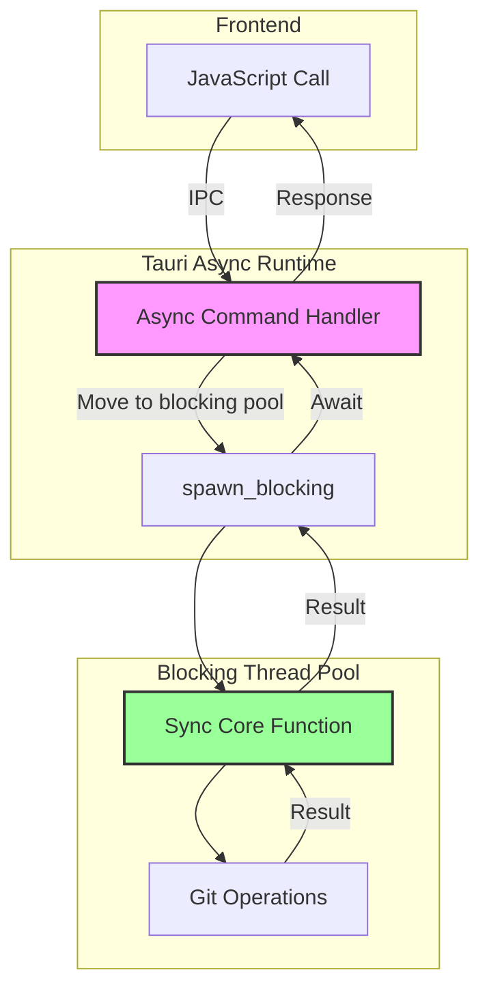
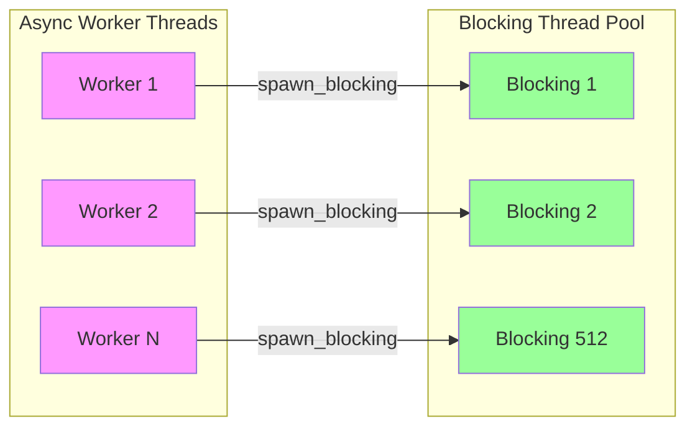

# Async Patterns and spawn_blocking

**Status:** Implemented  
**Updated:** 2026-10-29  
**Tags:** [async, performance, tauri]

## Problem

Tauri commands must be async to avoid blocking the UI thread, but git operations are inherently blocking I/O using synchronous system calls. Running blocking operations directly in async functions blocks the async worker threads, starving the runtime and degrading performance.

The challenge: How to bridge async Tauri commands with synchronous git operations without blocking async threads or adding unnecessary complexity?

## Solution Overview

Use `spawn_blocking` to move all blocking I/O to dedicated thread pools. Tauri commands become thin async wrappers that immediately delegate to synchronous core functions running on blocking threads. This maintains clean separation between async coordination and blocking execution.

## Design

### Architecture

### Thread Pool Architecture

### Key Decisions

1. **Decision**: Synchronous GitCommandExecutor
   **Rationale**: Git operations are blocking; no benefit from async complexity

2. **Decision**: spawn_blocking in every Tauri command that runs git or reads files
   **Rationale**: Consistent pattern, prevents async thread blocking. A command that talks HTTP (Patronus,
   `crates/app-api/src/remote/patronus.rs`) awaits the request on the async runtime with one shared `reqwest::Client`,
   and only its git part (which repository) goes through `run_blocking`, or through the services of its session
   (`ServiceHost`), whose host reads it off the workers.

3. **Decision**: Separate core functions from command handlers
   **Rationale**: Core logic is testable without async runtime

4. **Decision**: Clone state for 'static lifetime
   **Rationale**: spawn_blocking requires 'static, State is not 'static

5. **Decision**: JoinSet.spawn_blocking for parallel operations
   **Rationale**: Direct spawning without double-async wrapper

### Implementation Notes

Pattern structure:
- **Command**: an async body of the registry of app-api (`crates/app-api/src/`, its families), wrapped as a `#[tauri::command]` by `src-tauri/src/api.rs`
- **Core Function**: Synchronous implementation with actual logic
- **State Cloning**: Clone `State<T>` before moving to blocking thread
- **Error Mapping**: Convert JoinError to user-friendly message

Parallel operations:
- Use `JoinSet::spawn_blocking` directly
- Avoid `spawn(async { spawn_blocking(...) })` double-spawning
- Semaphore for concurrency limiting when needed (`max_parallel_git_processes()` in `git_executor::concurrency`)

Sync pipeline (`sync_core::sync::sync_branches`):
- Phase 1, one `spawn_blocking`: issue config, baseline, commit grouping; sends `IssueNavigationConfig`,
  `UnassignedCommits` and `BranchesGrouped` (also when empty) before any per-branch work starts, so the
  frontend always knows the branch set before per-branch events arrive
- Phase 2, concurrently: integration detection in one `spawn_blocking`, and branch processing as
  semaphore-bounded `JoinSet::spawn_blocking` tasks; joined with `tokio::join!` so one failure doesn't orphan the other

### Operation spans

Every command of the app that can fail (`Result<_, ApiError>`) and every `bd` run is an operation with an id of its
own (`sync_utils::operation_id::OperationId`, a ULID: 48 bits of milliseconds, 80 random bits, so the ids of the app
and of every `bd` process never collide and sort by time). `crates/app-api/src/command_scan_test.rs` checks the
commands, as their sources read: the bodies of the entries of the registry of app-api (`commands.rs` names the body of
each, which the app's wrapper of `src-tauri/src/api.rs` and the E2E server's route of `invoke.rs` both call, so the
server's error names its operation too); `src-tauri` has no command of its own
(`the_app_has_no_command_beside_the_registry`):
- Every command but a `session` one (below) has an `#[instrument]` span, its `AppContext` and its `Call` skipped. An
  argument that holds a collection (a `Vec`, a map, through nested structs) is skipped too, with a field or two in its place
  (`skip_all, fields(repository_path = %params.repository_path, branches = params.branches.len())`), because every line
  of the log repeats the fields of the spans it is in: a push of a stack with the remote heads of its branches, or a
  list of robots, would write tens of KB per call.
- The body of an async command runs in `operation(async move { … }).await`, of a synchronous one (on the main thread) in
  `operation_now(|| { … })` (`crates/app-api/src/operation.rs`): the span `operation{operation_id}`, a child of the command's
  span, so a line reads `close_pull_request{…}:operation{operation_id=…}: message`. A command of a session (the
  `session` kind of the registry, `crates/app-api/src/registry.rs`) gets both from its frame: the span of the command
  with its repository and the fields its entry names, as `#[instrument]` would (`session(reason = ?params.reason)
  sync(…)`: why a sync ran, which family a refresh read and for which subject, whether a window gained the focus, which
  target the statistics read; `window` alone, first, is the label of the window that called, `session(window)
  subscribe_view(…)`, since the entry's own tokens can't name the call), then
  its operation, in which the frame resolves the key of the session before the body runs, so a line reads
  `sync{repository_path=… reason=Focus}:operation{operation_id=…}: message` and a refusal of the key names the
  operation too; its body opens neither
  (`the_body_of_a_session_command_opens_no_span_and_no_operation_of_its_own`,
  `the_span_of_a_session_command_records_the_fields_its_entry_names` of the e2e server). A blocking step of the body, git or
  the file system, runs through `run_blocking` on the pool, inside the caller's span; a command whose body is that one
  step needs no `operation`: `run_blocking` alone is the operation then (a task-local tells it whether one is open).
  Opening the object cache is such a step: its first open runs `rev-parse --git-common-dir` and opens LMDB, so an async
  function of `app-api` (a body of the registry, a helper of one, a method) opens it inside `run_blocking` or in a
  `move ||` closure a core runs off the workers (`get_robot_stats` opened it on the worker), and reads the other parts
  of `RepositoryStateCache` there too, `git_common_dir` (a `rev-parse` on the first call for a repository) and
  `github_repository` (up to 3 git processes); the services of a session read them off the workers themselves
  (`an_async_function_makes_the_blocking_reads_off_the_async_workers`).
- An error leaves with the id: `ApiError.operation_id` (an error that names one keeps it), which the page records
  with its Activity entry (`operationId`) and in its log line of the error. An error raised outside a command has none.
- An operation of the remote that a session runs (`operations::engine::run`, the `execute` command) opens a root span
  of its own inside the command's: `operation{op=safe_push operation_id=… tool=app subject=auth}`, the id of its
  record in the operations registry, its outcome and its entry in the journal ([Journal](git-operations.md#journal)),
  around its admission, its body and its end; its error leaves with that id, so the error, the journal and the lines
  of the run name one operation (`operations/src/engine_log_test.rs`). The same `in_current_span` carries the tally of
  what the operation costs (`sync_utils::operation_tally`) to the threads its git runs on.
- A thread starts without a span: `spawn_blocking`, a `JoinSet`, a scoped thread and `tokio::spawn` would log their
  lines outside the operation. A closure handed to another thread goes through `sync_utils::span::in_current_span(…)`,
  a future ends with `.in_current_span()` (`tracing::Instrument`); `crates/git-executor/src/thread_span_scan_test.rs`
  scans every call named `spawn` or `spawn_blocking` with an argument in the production sources, whichever receiver or
  path it has (`tokio::spawn`, `thread::spawn`, `tauri::async_runtime::spawn`, a `JoinSet`, a scope, a `Builder`), the
  argument read across lines as rustfmt lays a long future out, and exempts a file only with its reason and its number
  of hits (the pipe threads of a git process, `SyncTask::spawn`, which wraps the task itself, the mock server). So the
  branch builds of a sync, the integration detection, the file diff workers and the requests of a robot's progress log
  inside the operation of the command or the `bd` run. Two roots of their own outlive what started them and serve every
  window: the actor of a session (`repository_model::runtime::spawn_actor`) logs in `session{worktree prefix}` with no
  parent, and the checks and syncs it starts carry that span; the app's timer that sweeps the idle sessions
  (`Sessions::sweep_every`) logs in `session_sweep` with no parent.
- `tracing_log` (`src-tauri/src/tracing_log.rs`) makes the spans reach the log at all: without a subscriber the `log`
  feature of `tracing` hands an event to `log` without its spans. The subscriber formats each event with its spans,
  plus a line when a span starts (`FmtSpan::NEW`, as `tracing` wrote one per span before), and gives the line to `log`
  with the event's level and target, which `tauri_plugin_log` writes. The plugin rotates the file at a write past
  10 MB and keeps the three before it (the comment of `LOG_FILE_BYTES` in `src-tauri/src/lib.rs` is the one description
  of the retention, pinned to the plugin's version by `log_rotation_test.rs`), so the lines an `operation_id` of
  Activity names are still there days later. The devtools build keeps the subscriber of its plugin.
- `bd` opens the root span `operation{op, operation_id}` in `bd_cli::run` before the dispatch, `op` the words of the
  command (`lease get`); every `-v` line carries it, the lines of the sync's threads too
  (`crates/bd-cli/src/operation_test.rs`, under a global subscriber that sees every thread).

### Single flights, no async mutex

A read that other callers wait for (a token source, the search of a tool, the renewal of a sign-in, a read of
Patronus that two windows ask at once) is a single flight, never the guard of an async mutex held across it: the caller
that comes first leads and runs the read, the callers that ask meanwhile wait for its answer on a `watch`, and nothing
the read does (a process, a request, a file) holds a caller that asks for something else. `sync_utils::single_flight`
is the one form of it: its map of flights is a `std` mutex held only to join or to register; a leader that goes away
(its caller dropped) ends the flight, and the first of its joiners leads again. What should outlive the flight (a kept
token, a list in the object cache) is kept by the read before it answers, so a caller after it reads nothing again;
a long read keeps each part as it comes (the weeks of the Safe Push statistics, two at a time), so a canceled one
loses none of it. A joiner waits for nothing it could show meanwhile: the statistics publish the leader's progress on a
`watch` beside the flight, which a joiner shows while it waits, and what the leader read during the wait counts as
fresh for the joiner, so its Refresh asks for none of it again.
Where joining must be one step with reading a state (the renewal of `youtrack::service`: a lookup reads the token and
joins the renewal of its generation under the one lock of the state), the flight lives in that state. A `std` mutex is
held across no `.await` at all; one that a blocking write needs is taken on the thread of the write
(`spawn_blocking`). The concurrency scan (`crates/git-executor/src/concurrency_scan_test.rs`) fails on the guard of an
async mutex or read-write lock that lives across another `.await` of its scope, with no exemption
([Rust as the Domain Authority](rust-domain-authority.md), «Инварианты», 2), and on the guard of a `std` mutex held
across or handed to a call of git: a memo is locked to look up and to keep, never while git answers what it lacks
(`ContentMemo`), so a caller that wants something kept does not wait for another caller's git.

## Alternatives Considered

- **Async Process Spawning (tokio::process::Command)**:
  - Why not: While tokio::process::Command provides async process spawning, git operations themselves are still blocking I/O. Using async process adds complexity without performance benefit over std::process::Command with spawn_blocking

- **Blocking in Async Functions**:
  - Why not: Blocks async worker threads, ruins performance

- **Separate Thread Pool Management**:
  - Why not: Tokio's blocking pool is well-tuned and sufficient

- **Actor Model with Channels**:
  - Why not: Adds complexity without performance benefit

## Performance Considerations

- **Constraint**: Limited async worker threads (typically CPU cores * 2)
- **Solution**: Never block async threads, use blocking pool (max 512 threads)
- **Measurement**: Git operations move off async threads in <1μs

Thread pool characteristics:
- Async workers: Must never block, handle coordination only
- Blocking pool: Grows on demand up to 512 threads
- spawn_blocking overhead: ~1-5μs per call
- Parallel speedup: Near-linear for independent git operations

## References

- Implementation: `crates/app-api/src/commands.rs` - every command of the app, its body in a family of app-api
- Core functions: Synchronous functions called from commands
- GitCommandExecutor: `crates/git-executor/src/git_command_executor.rs`
- Tests: Much simpler without async - see any `#[test]` vs `#[tokio::test]`
- Related: [Tokio spawn_blocking docs](https://docs.rs/tokio/latest/tokio/task/fn.spawn_blocking.html)