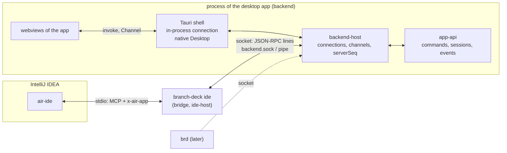
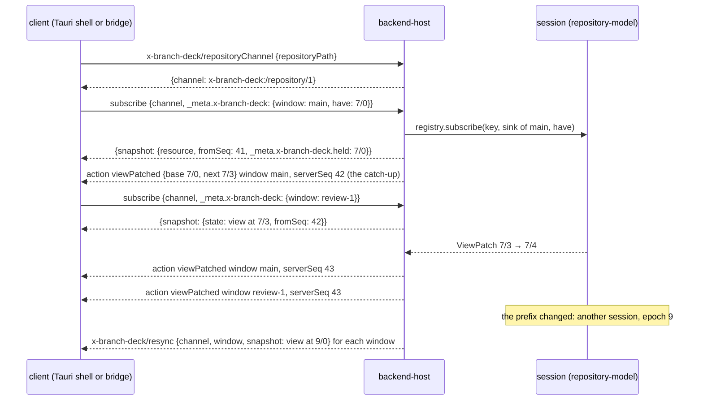

# Backend Protocol

**Status:** Draft  
**Updated:** 2026-11-23  
**Tags:** [backend, protocol, ahp, ide, socket]

## Problem

The desktop app and the IDE run two backends of one user. The IDE starts a backend without a window for each project
(`brd mcp` before the bridge `branch-deck ide`), with its own sessions, its own scheduler and its own polls; the desktop app
builds the same `AppContext` once more. Two windows on one repository then show another time of the last check,
another estimate of a robot and another Landed card, and GitHub, Patronus and YouTrack get one poll from each process.
brd, later, would be a third.

The page already speaks a protocol of the shape of AHP with its backend: `subscribe_view` answers a snapshot with its
`Version`, then each `ViewPatch` follows; `execute` streams its `OperationEvent`s and answers `Outcome.versionAfter`.
The IDE speaks another one, `x-air-app` of Air, whose mirror is a table channel of `air-ide`. Neither is a contract
that a second process can connect to: the windows, the events and the desktop of app-api are of one process
(`WindowId` is a label, `AppEvents` and `Desktop` are of the app).

## Solution Overview

The process of the desktop app is the one backend of a user and an AHP-shaped host, `backend-host`, for every client:
the Tauri shell is a connection in the process, with the native desktop of the app; the bridge of the IDE,
`branch-deck ide`, is a connection over a local socket, which starts the app without a window when no backend runs;
brd connects the same way later. The rules of the wire are those of Air
(`plugins/air/docs/decisions/2026-11-10-the-ide-and-rust-speak-an-ahp-shaped-protocol-over-one-message-connection.md`
of idea-1), the types are Branch Deck's.

One channel per repository holds the `RepositoryView` of its session; its one action is the typed
`x-branch-deck/viewPatched`, the `ViewPatch` of the session, so every client applies the same pure reducer,
`repository_model::patch::apply_patch`. Every command of `for_each_command!` is a root command, `execute` and
`cancel_operation` too; a command's stream is notifications bound to its request id, before its answer. A connection
owns its windows, its events from a page and its desktop. A window is a connection and a label, so the end of a
connection forgets only its own windows.

## Design

### Architecture

The host keeps the connections, one global `serverSeq` and a channel for each repository path. app-api keeps the
sessions, the commands and their rules as now; what changes is that a call, an event and a desktop are of a
connection. The bridge translates `x-air-app` to this protocol and keeps what is the IDE's alone: the views and their
places, the roots of the project as the recent projects, the title bar of a view, the home directory, the frame link.
When no backend of its build can run (no display, a backend of another build with a window open, Windows while the
job of Air denies the breakaway of the app it would start), the bridge runs the same `backend-host` in its own process
over the in-process transport: the behaviour of P1, one backend per project.

### The wire

- **Frames**: one JSON-RPC 2.0 object per line (NDJSON), UTF-8, no batch arrays; a message of 16 MiB at most. Requests
  and notifications go both ways: the host sends requests to a client (the Desktop of a socket client), with ids of its
  own.
- **Channels**: every `params` has `channel`: the root `ahp-root://` for a connection command and a root command, a
  repository channel `x-branch-deck:/repository/<n>` for a channel command and its actions.
- **Names**: the AHP names stay where their meaning is AHP's (`initialize`, `ping`, `subscribe`, `unsubscribe`,
  `dispatchAction`, `action`); every other method and action is `x-branch-deck/<name>`. A command of app-api keeps its
  name of the registry verbatim (`x-branch-deck/get_file_diffs`): that name is the one key of the Tauri `invoke`, the
  routes of the e2e server, `commands.json` and the shim of the IDE. A method of the protocol itself is camelCase
  (`x-branch-deck/setDemand`), and a test of the host checks that no command takes one of its names
  ([Key decision 4](#key-decisions)).
- **`initialize`** is the first request: `protocolVersions` (AHP caret ranges, `1.0.0`), `clientId`,
  `clientInfo: {name, build}` and `_meta["x-branch-deck"]: {version, capabilities}`. The host answers
  `protocolVersion`, `serverSeq`, `snapshots: []`, `serverInfo: {name: "branch-deck", build}` and its own
  `_meta["x-branch-deck"].version`. A request before it is `-32600 notInitialized`, a second one
  `alreadyInitialized`. `ping` answers `{}` at any time.
- **`build`** is the build id of the binary, compared byte for byte: `<version>+<commit>`
  (`backend_host::identity::build_id`). The commit is the builder's word, read by `crates/backend-host/build.rs`, never
  a git process of the app: `BRANCH_DECK_COMMIT` (`scripts/install-app.sh` sets it to `git rev-parse HEAD`, with
  `-dirty` for a tree with changes), else `GITHUB_SHA` of the job of GitHub Actions (CI, the release of
  `build-tauri.yml`), else `dev`. So two releases of one version from different commits are two builds; a dev build is
  `dev`, and its executable path gives it a backend of its own beside a release ([The socket](#the-socket)).
- **Capabilities** say what the Desktop of the connection's windows has ([The Desktop](#the-desktop-of-a-connection)):
  `folderDialog`, `updater`, `restart`, `agentCli`, `nativeMenu` (each a boolean, absent is false) and `hostRequests`,
  the host requests the client answers (`openWindow`, `showWindow`). The Tauri shell declares every one; the bridge
  `hostRequests` only, `openWindow`: the IDE shows its views itself, so a window of the bridge gets
  no `showWindow`, neither at a deadline of a window built hidden nor when its page settled.

### The repository channel

- **One channel per repository path**, as the window names it (no trailing separator). `x-branch-deck/repositoryChannel
  {repositoryPath}` gives its URI; the same path gives the same URI for the life of the backend, so an open never races
  a close. The channel holds no session while no window subscribes.
- **State**: the `RepositoryView` of the session, with its `Version`. `serverSeq` orders the channel (one counter of
  the host, as Air's); `Version` stays in the state for the comparisons of the page (`SyncAnswer.version`,
  `refresh_facts`, the witness, `followUndo`, the seed of the warm start).
- **A subscription is a window's**: `subscribe {channel, _meta["x-branch-deck"]: {window, have?}}` subscribes that
  window of the connection to the session, as `subscribe_view` does now: through `Registry::subscribe` with its `have`,
  kept under the window (`Windows::keep`), the session of the prefix the git config names now
  (`AppContext::session_key_now`). A second subscribe of the same window of the connection is `-32011
  alreadySubscribed`; `unsubscribe {channel, _meta["x-branch-deck"].window}` ends it.
- **The snapshot**: `{snapshot: {resource, state, fromSeq}}`. With `have`, the version the window holds (the seed of the
  warm start, `window.__BD_MODEL__` or `warmFrame`), the session builds the catch-up for that subscriber as now
  (`ViewSubscription.catchUp`): the snapshot has no state but `_meta["x-branch-deck"].held: have`, and the first action
  of the window is the catch-up `viewPatched`, when the session moved since. The session patches only from its seed
  (`View::join` of `repository-model`): a `have` that is the version it holds is `held` with no catch-up, the seed
  `held` with the catch-up from it, and any other (an older version of the epoch, another epoch) gets the whole state.
  A subscription the session refuses is `-32603 apiError` with the `ApiError` in `data.apiError` (`no_branch_prefix`
  is the welcome card).
- **Action**: `x-branch-deck/viewPatched {patch: ViewPatch}`, one per patch of the session, in its order, to each
  subscribed window: one frame per window, which names it (`params.window`), all with the `serverSeq` of the action
  ([Key decision 3](#key-decisions)). A client applies it with `apply_patch` (the page with `src/model/patch.ts`), only
  at `base`. A sync or an operation is several patches (the sync running, its steps, its table; the operation in the
  view), and the session sends patches of its own (a fact read again): a client never counts on one patch per command.
- **`get_snapshot`** stays a root command of the session, answered by the host for the window that asks (a window that
  lost a patch).
- **Epochs**: a new prefix, or a session opened anew (a slot of a lease pool leased again), moves the channel to the
  other session: every window subscribed to it gets `x-branch-deck/resync {channel, window, snapshot}`, whose state
  carries the `Version` of the new epoch, and no patch of the old session after it; the page decides by the epoch as
  now (`installAnother`). The same resync serves a window past the stale cap.
- **The end**: `x-branch-deck/subscriptionEnded {channel, window, reason}`, `sessionClosed` (the session went, the
  repository is gone) or `closed`; a client reads a reason it does not know as `closed` and may subscribe again.
- **No intent**: an intent of the page is a root command (`execute`), so a `dispatchAction` on the channel gets its echo
  with `rejectionReason: "unknownAction"`.
- **Demand**: `x-branch-deck/setDemand {channel, window, demand}` is `Sessions::set_demand` of the subscription of that
  window; the session asks for the facts of the union of its subscriptions, as now. A closed window's subscription and
  demand end with it.
- **The bridge** subscribes once per repository under a window of its own (`mirror:<path>`), serves its views from that
  mirror and sends the union of their demands (`Demand::union`) as the demand of that window.
- **The prefix of now**: `x-branch-deck/followPrefix {channel, window}` of a subscribed window makes the channel take the
  session of the prefix the git config names now, as a subscribe does, without a subscription of its own: under the
  prefix the channel follows it answers `{}` at once; else every window of the channel moves to the new session, each
  with one resync, before the answer. The bridge asks it where a window of the desktop app subscribes again (another view
  of the IDE opens on the repository, the page subscribes again after `prefix_changed`), so the subscription of its
  mirror never ends for it. A `notSubscribed` window gets `-32008`.

### Root commands

- **A call**: `x-branch-deck/<command> {channel: "ahp-root://", window?, args}`; `args` is the object of its arguments
  by their camelCase names, as the page's `invoke` sends them (`dispatch::prepare`). `window` is the label of the
  window of the call in its connection; a command of a window (`window`, `session(window)`, `now`, `main` kinds) is
  `badParams` without it, any other runs for the connection itself.
- **An answer** is `{value}`, the JSON of the output, `{bytes}`, the base64 of a `raw` command (`get_blob_syntax`;
  the in-process transport passes the bytes as they are), or `{error}`, its `ApiError`: every command answers a `Result`
  in the bindings, so a failed command is an answer, never a JSON-RPC error. A command no registry entry names is
  `-32601 unknownMethod`; arguments that do not parse are `-32602 badParams` with the `ApiError` of the parse in
  `data.apiError`.
- **A stream**: each event of the command's channel (`[channel events: …]`) is `x-branch-deck/callEvent {channel:
  "ahp-root://", requestId, event}`, in its order, every one before the answer. No command but `subscribe_view` keeps
  its channel open after the answer, and that one is the repository channel.
- **The version fence**: an answer or a stream event that names a version V of a repository (`SyncAnswer.version` of
  `sync` and `set_window_focus`, the answer of `refresh_facts`, `Outcome.versionAfter` of `execute` and of its `done`
  event) goes into the queue of the connection after every action of that channel up to V to each window of the
  connection that subscribes to it: behind a resync when one is due, at once when no window of the connection
  subscribes to the repository. Each is fenced to its own version: the `done` of a rewrite names the version of the
  rewrite and its answer the version after the sync that follows it. The other events of a stream (the steps of an
  operation) have no order against the actions of the channel.
- **A cancel**: `x-branch-deck/cancel {requestId}`, a root notification, ends the call of that id of the same
  connection where the command can stop (its `Sink` gone, as a page that went away); the explicit cancels of the
  registry (`cancel_operation`, `cancel_symbol_search`, `cancel_conflict_fix`, `cancel_sign_in`,
  `cancel_cli_tool_action`) stay commands. A call gets exactly one answer.
- **Undo** is `execute` of its intent, which needs no subscription.

The class of each command (the kind of `registry.rs`) says where it runs:

| Class | Commands | Over the socket |
|---|---|---|
| Channel | `subscribe_view`, `unsubscribe_view`, `set_demand` | No: the client maps them to `subscribe`, `unsubscribe` and `x-branch-deck/setDemand` of the window; at the root `-32601 {reason: "channelCommand"}` |
| Native (`main`) | `show_window_menu`, `set_auto_sync_menu_checked`, `restart_app` | Yes, by the capability (`nativeMenu`, `restart`): without it the menu commands do nothing and `restart_app` answers its `ApiError` |
| Desktop | `open_sub_window`, `sub_window_loaded`, `sub_window_drawn`, `sub_window_ready` (the windows); `browse_repository`, `add_companion` (`folderDialog`); `check_for_updates`, `get_update_status`, `install_update` (`updater`); `install_agent_cli`, `install_ide_app`, `remove_ide_app`, `agent_cli_command`, `agent_cli_status` (`agentCli`) | Yes: the Desktop of the connection; a capability the client lacks answers as a Desktop without it |
| Raw | `get_blob_syntax` | Yes: `{bytes}` |
| Stream | `disk_usage`, `get_file_diffs`, `get_index_marks`, `get_file_merges`, `get_review_plan`, `get_range_readings`, `execute`, `get_robot_stats`, `sign_in` | Yes: `callEvent`s, then the answer |
| Any other | the reads, the session commands, the writes of the app | Yes |

### The windows of a connection

- **`WindowId`** is the connection and the label (`main`, `review-…` in the app; the instance of a view in the IDE,
  `review:3`). Two connections each have a `main`.
- **The life**: `x-branch-deck/windowShown {window, view?, params?}`, `x-branch-deck/windowHidden {window}`,
  `x-branch-deck/windowClosed {window}` and `x-branch-deck/pageLoaded {window}` (the page loads again:
  `AppContext::forget_page`), root notifications. A close is `AppContext::forget_window` of that window alone; the end
  of a connection closes each of its windows, so it forgets only them, never a window of another connection.
- **A window's reads**: what app-api keeps one of per app for a window's question (`RemoteMemory::branch_names`,
  `ConflictFixSearch`) is one per window, so the IDE and the app never supersede each other.

### Events

- **app-api's** (`events.rs`) go to every connection: `x-branch-deck/event {event, payload, window?}`, a host
  notification; without `window` to every window of the connection, with it to that window. `emit_to` of the main
  window (`settings_save_failed`, `repository_config_changed`, a main-only key of `settings_changed`) goes to the main
  window of each connection. The in-process connection emits them through Tauri's `Emitter`, as now. What the app
  tells beside a command (the sessions and the journals, `start_sessions`; a change of the settings another process
  saved, a failed save) goes through the same `Connections` once the context exists (`ContextEvents` of
  `src-tauri/src/api.rs`), so it reaches a bridge connected to the app too.
- **A page's** (`emit`, `emit_to` of the event plugin) stay inside their connection: the Tauri shell's are Tauri's
  events, the bridge's `x-air-app/event`s of its views. None crosses the socket.
- **A news** of a repository is told once by the backend: the bridge's notification of a failed robot and the page's
  OS notification of one claim it first (`x-branch-deck/claimNews {repositoryPath, news}` → `{first}`; the page's
  command `claim_news`, `src/lib/os-notification.ts`), so two clients on one repository tell it once. The claim names
  what the news tells (`NewsClaim`, `{kind: "robotFailed", robotId}`), never the id of the news, which each session of
  the repository counts from 1: a claim by id would stay taken after the session opened anew. The claimed news are
  of app-api (`Connections::claim_news`), one set for the method and the command. The toast of a window with the focus
  claims nothing: it is that window's.

### The pages of the app

The pages of the app's own windows (the Tauri shell; the page mock of the e2e server, the same way) speak no protocol:
they keep `invoke` of their bindings, and `backend_host::page::Pages` answers each over the one in-process connection
of the app (`InProcess::app`, `ConnectionId::APP`), so every window of the app and every client of the socket share one
host, one session per repository and one set of events.

- **A command** is the root command of its window: `x-branch-deck/<name> {window: <label of the webview>, args: <the
  payload of the invoke>}`, its call events to the channel the page gave (the argument the registry names), its
  `{value}` the answer of the invoke as the text of its JSON (`InvokeResponseBody::Json`), its `{error}` the rejection
  with the `ApiError`, its bytes as they are (`InvokeResponseBody::Raw`). A channel of a page that can read no more
  (the SSE stream of the e2e server gone) cancels the call (`x-branch-deck/cancel`).
- **A subscription**: `subscribe_view` is `subscribe` of the window on the channel of its path with `have`, its
  answer the `ViewSubscription` of an id the pages keep (`{id, view: state or null, catchUp: null}`), the catch-up the
  first patch on its channel, which the page applies as a patch that came before or after the answer; each
  `viewPatched` of the window goes to that channel as the JSON of the `ViewPatch`. `unsubscribe_view` and `set_demand`
  of the id are `unsubscribe` and `x-branch-deck/setDemand` of its window; of an id that ended they do nothing.
- **One subscription per window and channel**: the page subscribes again before it ends the subscription it replaces
  (a resubscribe, the warm start of a reload), so a subscribe of a window that holds one ends that one first, in the
  order of the lines, and the later unsubscribe of the replaced id ends nothing. The session stays: a session without
  subscribers waits `IDLE_LIMIT` before it goes. The host takes a subscribe of a window whose earlier subscribe still
  joins as a reservation of its own: the earlier one, once joined, leaves the session.
- **A resync** reaches the page as a patch from and to the version of its snapshot (`{base: V, next: V, changes:
  {}}`), which no view applies: the page reads the snapshot (`get_snapshot`) as after a gap and takes the view of the
  other epoch (`installAnother`); the page has no resync of its own to learn. `subscriptionEnded` ends the
  subscription of the pages, and the page hears nothing more of it, as a channel of a session that went.
- **The life of a window**: a page that loads again is `x-branch-deck/pageLoaded`, a destroyed webview
  `x-branch-deck/windowClosed`; the host forgets every window of the app's connection that closes, as it does not track
  them (`windowShown` is a client's).
- **The cost**: the pages cut the parts they hand on out of the frame (`serde_json::value::RawValue`) and never build a
  tree of a view, a patch or an answer again; the payload of an invoke is the `Value` Tauri parsed, encoded once into
  the line of the request.

### The Desktop of a connection

app-api picks the `Desktop` by the connection of the call. The in-process connection has the native one of the Tauri
shell (`src-tauri/src/desktop.rs`, `menu.rs`, `auto_update.rs`, `agent_cli.rs`). A socket client's is made of host
requests and of its capabilities:

| `Desktop` part | Host request to a socket client | Without the capability |
|---|---|---|
| `WindowHost::build`, `reopen` | `x-branch-deck/openWindow {opener, params: OpenSubWindowParams, update?, front}` → `{window}`, the label the client gives the window (the `windowId` in the app, the instance of its view in the IDE, `review:3`) | the open answers its `ApiError` |
| `WindowHost::show` | `x-branch-deck/showWindow {window}` → `{}` | nothing |
| `WindowHost::is_open` | none: the host answers from `windowShown` and `windowClosed` | — |
| `DialogHost` | none: `folderDialog` opens the dialog of the app | `has_folder_dialog` false, `pick_folder` none |
| `MenuHost`, `RestartHost`, `Updater`, `AgentCliHost` | none: served natively by the app process for a client that declares them | nothing, or `ApiError` |

The badge, the progress and the close of a window are the page's, as its events: the Tauri shell's plugin calls, the
bridge's `setBadge`, `setProgress` and `closeView` of `x-air-app`. They never reach the host.

### Errors

| Code | `data.reason` | When |
|---|---|---|
| -32700 | `parse` | the line is not JSON |
| -32600 | `invalidRequest`, `notInitialized`, `alreadyInitialized` | no JSON-RPC object, a batch, a request before or a second `initialize` |
| -32601 | `unknownMethod`, `channelCommand` | no method of the name; a channel command at the root |
| -32602 | `badParams` | a param missing or of another type; the arguments of a command (`data.apiError`) |
| -32603 | `panic`, `internal`, `apiError` | the host failed; app-api refused a method that has no answer of its own (`subscribe`, `repositoryChannel`), `data.apiError` |
| -32005 | `ahpVersion`, `vocabularyVersion`, `otherBuild` | no common version; a client of another build (`data.build`, `data.exits`) |
| -32008 | `unknownChannel`, `notSubscribed` | no channel of the URI; an unsubscribe without a subscription |
| -32011 | `alreadySubscribed` | a second subscribe of the connection to the channel |

A failed command is `{error: ApiError}` in its result. A receiver ignores a field of `data` it does not know.

### The socket

- **The key**: 16 hex digits of a hash of the data directory and the path of the executable: a dev build beside a
  release has its own backend. The data directory is the one of the identifier compiled into the binary
  (`app_settings::identity`, `tauri.conf.json` under the overlay of `tauri build --config`), the same for the app and
  the bridge it runs, so a check copy of its own identifier keys its own socket.
- **Unix**: `<base>/branch-deck-<key>/backend.sock`; the base is the user's (`$TMPDIR` on macOS, `$XDG_RUNTIME_DIR`
  else, then the temporary directory), the path within the 104 bytes of `sun_path`. The directory is the owner's with
  mode 0700: the backend creates it so, and both sides refuse one that is not (no fallback to another base), as the
  local socket of Air does. Each side checks the uid of its peer (`getpeereid`, `SO_PEERCRED`).
- **Windows**: the pipe `\\.\pipe\branch-deck-<key>`, every instance with a DACL of its owner and
  `reject_remote_clients`; the client checks the SID of the process of the server.
- **One backend**: `backend.lock` in the directory of the key (on Windows `%LOCALAPPDATA%\branch-deck-<key>\`), held
  for the life of the process and released at `RunEvent::Exit`; a starting app retries it for a few seconds, and the
  holder removes a stale socket under it through `fs_retry`. A second start of the app is a client: it sends
  `x-branch-deck/showMain`, which builds or shows the main window (also of a backend started `--background`), and exits:
  the single instance of every platform.
- **Another build**: `initialize` of a client whose `build` is not the host's is `-32005 otherBuild` with the host's
  build and `exits`. The stale side yields: the side whose executable on disk is no longer its build (the app updated in
  place), told by the identity of the file (device, inode, size, modification time) against the one at its start. A stale backend without a window exits after the answer (`exits: true`), and the bridge starts the app of its
  build; a stale backend with a window stays, and the bridge runs its fallback: the hook of the app
  (`app_api::app::life::BuildReplaced`) tells its main window `build-replaced` once per process, an event toast "A
  newer Branch Deck is installed" whose Restart to Update is `restart_app` (`AppLife::restart`, off the main thread, so
  the new process starts with the windows as they are). A stale
  bridge exits with 1, and the IDE starts it again from the new binary. Windows has no inode in `std`: there the
  identity is the size and the modification and creation times (`backend_host::identity::Executable`).

### Today's API in the protocol

| Today | In the protocol |
|---|---|
| `subscribe_view {repositoryPath, have}` → `ViewSubscription {id, view, catchUp}` | `repositoryChannel` + `subscribe` of the window with `have`: the snapshot, or `held` and the catch-up action |
| the Tauri `Channel<ViewPatch>` of the subscription | `action x-branch-deck/viewPatched` of the repository channel, one frame per window |
| `Version {epoch, seq}` | in the state and in each `ViewPatch`; `serverSeq` orders the frames |
| a patch of another epoch | `x-branch-deck/resync` of each window with the snapshot of the new epoch |
| `get_snapshot` | the same root command, for the window that asks |
| `unsubscribe_view`, `forget_page` | `unsubscribe` of the window; `x-branch-deck/pageLoaded` |
| `set_demand {subscription, demand}` | `x-branch-deck/setDemand {channel, window, demand}` |
| `execute` → `Outcome.versionAfter`, `[channel events: OperationEvent]` | root command, `callEvent`s, the fence of V |
| `sync` → `SyncAnswer.version` | root command, the fence of V |
| a Tauri `Channel` of a command | `x-branch-deck/callEvent {requestId, event}` |
| `AppEvents::emit`, `emit_to` | `x-branch-deck/event` to every connection, to a window of one |
| `Desktop` (`transport.rs`): `WindowHost`, `DialogHost`, `MenuHost`, `RestartHost`, `Updater`, `AgentCliHost` | the native Desktop of the in-process connection; host requests and capabilities of a socket client |
| `WindowId(label)`, `Call {window, page}` | `WindowId` = connection + label; `page` grows with `pageLoaded` |
| `bd_bootstrap` of the bridge | `x-branch-deck/bootstrap {window, view, repositoryPath?}`: the settings snapshot and the warm frame of the repository the main view shows (else of the selected project of the app); the bridge adds the IDE's parts |
| the `--background` start, the single-instance plugin | `backend.lock`, `x-branch-deck/showMain` |

### Key Decisions

1. **Decision**: The repository channel's action is the typed `ViewPatch`, not the table changes of Air.
   **Rationale**: the table form replaces an entry whole, so it loses the detail of `BranchChange` (the parts of a
   branch that changed) and the identity of the rows the page keeps (`src/model/patch.ts:141-145`, a pull request
   it does not name keeps its object); a typed action with one reducer in Rust and its twin in TS keeps both.
2. **Decision**: Intents are root commands, not `dispatchAction`.
   **Rationale**: an intent of `execute` streams its `OperationEvent`s and answers an `Outcome` with its undo token; an
   echo of AHP has one result and no stream, and would tie an Undo to a subscription of the repository.
3. **Decision**: A subscription is a window's, not a connection's; each action goes to each subscribed window in a frame
   of its own.
   **Rationale**: the session already builds the catch-up from `have` for each subscriber
   (`Registry::subscribe(&key, sink, have)`, `crates/app-api/src/session/view.rs`) and keeps each subscription under
   its window (`Windows::keep`); one subscription per connection would make the Tauri shell keep a mirror of its own and
   build the catch-up and the warm start again. A frame per window costs nothing in practice: the host encodes the
   patch once and only the tail (`window`, `serverSeq`) differs, the in-process connection hands each webview the frame
   it receives anyway, and the bridge subscribes one mirror window per repository. A frame that named several windows
   would need the host to group the subscribers of a connection by the patch they get, for no client that has two.
4. **Decision**: The command name of the registry is the method, verbatim.
   **Rationale**: one name across the Tauri `invoke`, the routes of the e2e server, `commands.json` and the shim; a
   camelCase copy would be a second spelling to keep. A method of the protocol of one word (`cancel`, `event`,
   `bootstrap`) could equal a command added later, so a test of the host checks that no name of `COMMANDS`
   is a method of the protocol.
5. **Decision**: A failed command is a result, a JSON-RPC error a failure of the protocol.
   **Rationale**: every command answers a `Result` in the bindings and none rejects; the page decides by
   `ApiError.code`, which a JSON-RPC code would hide.
6. **Decision**: The version fence is the host's, per connection.
   **Rationale**: the page compares the version an answer names with the one of its view (`followUndo`, the witness);
   one ordered queue per connection makes "V before its answer" a property of the queue, not of the client.
7. **Decision**: The stale side yields to another build.
   **Rationale**: neither build is newer by its id (a dev build), but the one whose executable changed on disk is the
   one the user replaced; so a backend never exits for an old bridge, and an old bridge never holds a new backend
   off.

### Implementation Notes

- `crates/backend-host`: `host.rs` (the connections, the global `serverSeq` and its publish lock, the channels, the
  news claimed, the hooks of the app: `showMain`, the rule of another build), `connection.rs` (the lines, `initialize`,
  the life of the windows, the host requests, the end), `channel.rs` (the subscriptions of the windows over
  `app_api::session::view::subscribe_view`, the frames of the actions, the move to another session, the end of a
  session, the demand, the fence), `call.rs` (the root commands over `app_api::dispatch`), `client.rs` (the Desktop and
  the events of a client), `outbox.rs` (the ordered queue of a connection and the cap of a slow window), `in_process.rs`
  and `stream.rs` (the transports), `socket.rs` (the key, the directory, `backend.lock`, the Unix socket and the named
  pipe with their checks, `show_main` of a second start); `crates/bd-cli/src/architecture_test.rs` admits it to app-api
  and keeps Tauri out of it.
- **A subscription before its answer**: the subscribe of a window is reserved in the order of the lines of its
  connection (a second one is `alreadySubscribed` at once), and a patch the session sends it before the host queued
  its snapshot waits for it; a patch the window holds already (the session sends one to every window after the snapshot
  of a new one) is not sent. A move to another session subscribes every window of the channel again and gives each one
  view, the session's once all joined.
- **Call events** go into the queue as the command sends them; one that names a version (the `done` of `execute`) and
  every event after it wait in the forwarder of the call for the fence. A rewrite's `done` names the version of the
  rewrite and its answer the version after the sync that follows it, each fenced to its own.
- `crates/app-api`: a `Call` and a `WindowId` carry the connection (`ConnectionId::APP` for the app's own windows:
  the Tauri shell, a test repository of the e2e server); `Connections` keeps the desktop and the
  events of each client and is the `AppEvents` of the context; `AppContext::desktop(&window)` picks the desktop of a
  window's connection (`app_desktop` is the app's own), `close_connection` forgets the windows of a connection alone.
  The commands that use the desktop are of the `window` kind; `CommandSpec::window` says which commands need a window.
- `crates/ide-host`: the bridge `branch-deck ide`, a client of the host (`backend.rs`) over the socket or, in its
  fallback, the in-process transport of a host of its own (`fallback.rs`); `mirror.rs` turns `viewPatched` into
  `x-air-app/viewChanged`, `notices.rs` claims a news first ([IDE Embedding](ide-embedding.md)). Its `initialize` names
  `clientInfo.name: "branch-deck-ide"`; the host counts its clients that initialized, the app's own connection left out
  (`Host::clients`), which the life of an app without a window reads.
- `src-tauri`: the host and the pages of the app (`Pages::new`, the in-process connection `Host::connect_app`,
  `ConnectionId::APP`), built in the setup before the first window, so the first message of the main page is still its
  subscription (`startup-read`); one invoke handler for every command (`api::invoke`), the declarations of the
  registry only for the bindings (`typed_commands`).
- `crates/test-server`: one host per test repository over its context (`TestRepository::host`, made with its pages at
  the first command), which the page mock's routes (`invoke.rs`) and every connection of the IDE attach to.
- **The contract**: `docs/design/backend-protocol/backend.schema.json` (draft 2020-12) and the golden corpus
  `docs/design/backend-protocol/corpus/*.ndjson`: `connection`, `repository-channel`, `command-stream`,
  `host-requests`, `errors`. A line is `{"comment"}`, `{"client": <frame>}`, `{"clientRaw": <text>}`, `{"host":
  <frame>}` or `{"step": <name>}`, an action of the runner on its fixture (`setPrefix`, `deleteRepository`), with
  `"conn": <n>` for another connection, as Air's corpus. Its arguments are as the page sends them (`openedAt` a number,
  never `null`). A runner sends each client line and expects the host lines
  that follow before the next client line, in order within a connection; a host request of a host line is answered by
  the client line after it. A token is a whole string: `${any}` matches any value; `${repo}`, `${build}`, `${seed}` and
  the arguments a fixture prepares (`${renameIntent}`, `${fingerprint}`) are values of the runner; any other `${name}`
  binds at its first appearance in a host line, and each later appearance is that value (`${view0.version}` a field of
  it). A session sends several patches for one sync or operation and may send one of its own between two lines (a fact
  read again): the runner passes over an action, an event of app-api or a call event no line expects, so a line names
  the first patch of a sync and an answer the version it brought; a call event after the answer of its call fails the
  run. The fixture of a channel is a session synced and quiet (its facts read, the demand of the corpus asked by a
  subscriber of the runner, the clocks of the sessions standing still). The runner is
  `crates/backend-host/src/corpus_test.rs`; every host line and every client line not marked `"invalid": true` passes
  the schema after the replacement, each result also the def of its method (`src/platform/backend/contract.test.ts`).
- **A news** is told by the client that claimed it first: the bridge tells the IDE a news of its mirror itself once
  `claimNews` answers `first: true`, and the page claims its own; the host sends no notification.

## Alternatives Considered

- **The table channel of Air for the repository**: a state of named parts, its changes a part or an entry whole.
  - Why not: it loses the detail of `BranchChange` and the identity of the rows (`src/model/patch.ts:141-145`); the
    bridge converts a `ViewPatch` to the table form for the IDE anyway (`mirror.rs`).
- **Intents as `dispatchAction` with an echo**: AHP's write.
  - Why not: no `OperationEvent` stream, no `Outcome`, and no Undo without a subscription.
- **One generic `x-branch-deck/invoke {command, args}`**, as `bd_invoke`.
  - Why not: the method of a frame names what it does, so a log, a gate by method and the schema read it without
    `params`.
- **One subscription per connection and channel**, as AHP subscribes a connection: the windows of a connection share a
  mirror of its client.
  - Why not: the Tauri shell would keep a mirror in Rust and build again the catch-up from `have` and the warm start
    that the session builds for each subscriber now.
- **One frame per connection naming its windows** (`windows: [main, review-1]`).
  - Why not: the host would group the windows of a connection by the patch each is at (a catch-up, a resync differ),
    to save bytes on a socket whose one client, the bridge, subscribes one window.
- **A backend of its own (a daemon) apart from the app**: the app and the bridge both clients.
  - Why not: one more process to install, update and sign; the app process already owns the windows, the updater and
    the keychain, and the decision of 2026-11-23 makes it the owner.

## Non-goals

- Air connecting to the backend directly: a later change of idea-1 (its `air-host` would be a client).
- brd as a client: it connects later, with the same `initialize`.
- Clients of another user or another machine.

## Performance Considerations

- **Constraint**: a patch of the session reaches every window within the frame it does now; a big diff opens without
  a message over 16 MiB.
- **Solution**: the host encodes each action once, before the publish lock, for every subscribed window, and the
  frame of a window adds only its `window` and `serverSeq` (Air's `ActionFrame`); a diff streams one file per
  `callEvent`; a window past 8 MiB of waiting actions gets one resync;
  the pages of the app cut the JSON text of an answer, a patch and a call event out of its frame and pass it as it is
  to the page (`InvokeResponseBody::Json`, [The pages of the app](#the-pages-of-the-app)).
- **Measurement**: `tests/perf/branch-table.perf.ts` and the startup timings gate the page through the host; the
  numbers of the change are in its commit.

## References

- Specs: [Backend Protocol](../../openspec/specs/repository/backend-protocol/spec.md) (the changes `260-backend-wire`,
  `260-backend-repository-channel`, `260-backend-commands` and `260-page-through-host`, archived),
  [Branch Deck in the IDE](../../openspec/specs/repository/ide-embedding/spec.md)
- The contract: `docs/design/backend-protocol/`
- Air (idea-1, read-only): `plugins/air/native/air-host/src/{host.rs,jsonrpc.rs,table.rs}`, the decision records
  `2026-11-10-the-ide-and-rust-speak-an-ahp-shaped-protocol-over-one-message-connection.md` and
  `2026-11-18-local-clients-speak-ahp-to-the-host-of-air-ide-over-a-unix-socket.md`
- Related docs: [IDE Embedding](ide-embedding.md), [Rust as the Domain Authority](rust-domain-authority.md),
  [Distributed Settings](distributed-settings.md), [Running Operations](operations.md)
