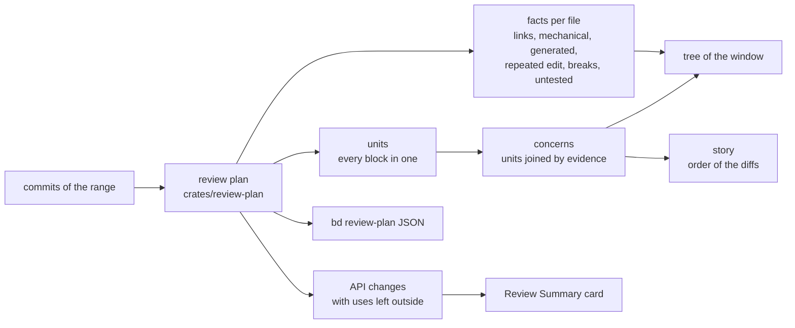

# Change Review

**Status:** Experimental
**Updated:** 2026-10-31
**Tags:** [review, review-plan, units, concerns, agents]

The vision of how Branch Deck reviews a change, what landed, what failed and what is next. The contracts are the
specs ([Review Plan](../../spec/branch/review-plan.spec.md), [Review Units](../../spec/branch/review-units.spec.md));
this document keeps the direction, the progress ledger and the rounds of polish, so that a later round, or another
team building a review, starts from what was learned.

## Problem

The work of one local branch lands in master in pieces ([Landing](landing.md)), and more and more of it is written by
agents: a branch gets a round of commits, the reviewer reads them, the agent lands another round. A review that lists
files in tree order with a diff each throws away what the tool knows. A file with one real change and one change of
imports is read whole. A change of a body of a public function is no line of anything. An edit that 30 files repeat
is read 30 times. One task, such as dropping a server from six configs in five directories, is scattered across the
tree. After each round the whole branch is read again.

The market (2026-10) mostly adds AI reviewer bots that comment on a pull request (CodeRabbit, Greptile, Graphite
Diamond, Copilot review, Cursor Bugbot). The presentation layer is barely touched: CodeRabbit's semantic view groups
moves and token edits, Amp's review panel adds an AI tour of the files, VS Code keeps a list of files with Keep/Undo.
Nobody ships an order by real symbol dependencies, a summary of the changed forms of the API, an interdiff of agent
rounds on a local branch, or folding with a correctness guarantee.

## Vision

A review is the story of a change, not a list of files:

1. **Each change is read once.** The diff is cut into the changes a reviewer reads (units): a changed form of a
   declaration, a changed body, a new or removed declaration, a new or deleted file, one repeated edit over all of its
   files.
2. **What can break comes first.** The API whose uses the change left outside leads, with the places that use it.
3. **Noise is folded with its reason, and a fold is never wrong.** Imports, whitespace, renames, build entries,
   generated files fold into one group with a stated reason. The budget of false folds is about zero: a fold that hides
   real work is the worst defect of the review.
4. **The changes are grouped into concerns.** The tasks a branch does, each with its files, in an order where a
   declaration comes before its uses: the left side of the window and the right side tell the same story.
5. **A second review shows only what is new.** Mark Reviewed remembers the reviewed pair; after a rewrite, a sync or a
   new round of an agent, the review shows the diff since then.
6. **No switches.** One setting turns the review plan on, and whoever turns it on gets the finished review at once.
   No "Order: Tree / Dependencies", no modes to learn: the product decides how the review looks.
7. **Measured, not guessed.** Every rule is printed by `bd review-plan` as JSON and measured on real ranges before
   the window shows it.

## Model

The plan is computed in Rust once for `bd` and the app, from the git processes the review reads already (its
budget is a test, `process_budget_test.rs`). The window only words it: the card (`ReviewPlanCard.tsx`), the badges and
groups of the tree (`file-tree.ts`), the story of the diffs (`presentNarrative`). The concerns are the next part
([Next](#next)).

## Research

What other work offers for the parts that are not done, read on 2026-10-31. These are claims of the papers and the
READMEs; the lab reproduces the ones we build on.

**Untangling a change into concerns, without a language model.**

| Work | How it groups | Result as published | For us |
|---|---|---|---|
| ClusterChanges (Barnett et al., ICSE 2015) | def-use and use-use of names declared inside the change, same method; transitive closure | no spurious merge in 50 hand-checked changesets, weak recall | the hard edges, and the rule that a name declared outside the change links nothing |
| SmartCommit (Shen et al., FSE 2021) | a graph of hunks: hard (AST, data, calls), similar (text ≥ 0.618), proximate, refactoring, test; Kruskal edge shrinking cut at 0.6 | Rand index 71–84% synthetic, 75% in the field | the edge shrinking with a cut and the test edge; it joins every non-Java file by its extension, a false merge we must avoid |
| EpiceaUntangler (Dias et al., 2015) | a random forest over pairs, agglomerative clustering | pairwise precision 0.96 | the order and the adjacency of edits are the strongest features, a tie-breaker for us |
| Herzig & Zeller (MSR 2013) | voters (distance, calls, co-change, data), single linkage | precision 0.80 for 2 tasks | single linkage chains everything through a hub, our guide.md case |
| Flexeme (Pârțachi et al., FSE 2020) | a multi-version dependency graph with names on its edges, graph kernels | accuracy 0.81 on C# | shared names carry the link |
| UTango, HD-GNN | trained graph networks | Java accuracy 34–38% | datasets only |

No published method groups a change across config and doc files: the only token-based baseline (TF-IDF of
AtomicCommitBench) reaches ARI 0.33 on real diffs. An edge of a shared rare identifier in the changed lines (the
`ijproxy` that six configs drop) is unpublished: our opening, and our risk.

**Rust tools.** `sem-core` (MIT/Apache) matches entities across a diff by identity, structural hash, signature and
similarity, finds moved and renamed ones, and addresses JSON and TOML keys by path. `inspect` (Ataraxy Labs, a
restrictive license) joins changed entities by union-find over dependency edges, the nearest baseline. `kodama`
clusters agglomeratively, `probminhash` and `gaoya` give MinHash. mergiraf (GumTree-style matching on tree-sitter) and
HyperAST (subtrees hash-consed over a whole history: a move is the same id under another parent) are GPL: their ideas
only. RefactoringMiner 3.1 (Java, Kotlin) is the oracle for moves and renames.

**Datasets.** tangled-ccs-commits (1750 tangled commits, docs, build and ci concerns among them), UTango's Java set,
AtomicCommitBench (Python, which our summaries do not parse). UTango's set holds tensors only, no source, so the lab tangles
jsoup, gson and commons-lang the same way. And our own: the branches of idea-1, where a commit is a
weak label only (an agent round mixes concerns, a follow-up splits one), and the history of this repository, whose
atomic conventional commits tangle into labelled cases.

**Order of a review.** Baum et al. (2017): the best order is a grouping by relatedness, declarations before uses.
Fregnan et al. (2022): the files at the top get more comments. Google's Rosie splits a large change along directories
and owners and keeps dependent pieces together.

## Progress Ledger

From the handoff of 2026-10-29 (seven experiments) and what the work added. A row changes in the commit that changes
the review.

| Part | Status | Commits | What worked | What did not, or is open |
|---|---|---|---|---|
| Mark Reviewed, Since Your Review of a local branch | Landed | 1db3d3d4f, 4c0986ecb | the reviewed pair in `refs/branch-deck/reviewed/`; after a rebase with an amend the diff from the carried change shows the amend alone | a carry that conflicts falls back to the commits one at a time; a drop alone offers nothing |
| Review Summary: API surface, what can break first | Landed | bfe628d8d, 8365b3951, baa953080 | the uses left outside by accio, a lower bound never read as safe | uses of a changed body are not asked; an override outside the change is missed (JetBrains/accio#71) |
| Many names in one accio query | Landed in accio | JetBrains/accio#74, 1df601e | the names of one call answered in parallel | the plan still asks 20 names at most |
| Folding: imports, whitespace, renames, build entries | Landed | 576095873, e93f1e954, 739a18b56, 116cbd179 | a line wrapped or joined is whitespace; no whitespace where the indent has a meaning | a move of a block, "rename A→B, N sites" not started; no second oracle yet |
| Folding: generated files | Landed | 46faf0108, b57c2e95b | by name, attributes or the header a tool wrote; the renderer's echo is no repeated edit | |
| Deletion as real work | Landed | c60b21a1b | a deleted file is a unit of its own; 3 or more of one directory one unit | |
| Dependency order of the files | Partial | 1db3d3d4f, d61bd2446 | lives in the story of the diffs | the Order toggle was reverted: no switches |
| Units and the story of the diffs | Landed | 7658a56f7, 9734e000b, a75281f1d | every block in one unit; about 40% of the units are a change of a body alone, which no part showed before | a file of no parsed language (Markdown, JSON, TOML, Python) is one unit as a whole |
| Concerns (untangling) | Partial: in the plan and `bd`, the window in work | 97e92369, v4 of 2026-10-31 | on four labelled corpora (the lab, [Review Concerns → Measurements](../../spec/branch/review-concerns.spec.md#measurements)) purer than a group per file on three (idea-1 86.2 vs 84.7, Java 95.4 vs 89.9); a server dropped from six configs is one concern | recall below a group per file (idea-1 67.0 vs 77.8); the rest buys recall back and costs purity, so it is off; a declaration two tasks change joins them |
| LLM tour with a hard coverage gate | Not started | | | |
| Corpus evaluation (ranks of the hunks reviewers needed, false folds) | Not started | | | the main debt |

## Decisions and Reversals

1. **The Order: Tree / Dependencies toggle was removed** (d61bd2446). Whoever wants this review gets it at once, without
   switches to think about; the dependency order went into the story of the diffs.
2. **The plan was on by default, then off again the same day** (c9ddf2ba7, 45884cfe0): it is not ready yet.
3. **The renderer's echo became a generated file** (b57c2e95b): a guide and its two rendered copies were a "Same edit
   ×3"; the copies are generated by their header and fold with their reason.
4. **A deletion is real work** (2026-10-31). A deleted file was folded as "Deleted" in the Mechanical group. In a
   branch that drops a server from six configs, the sixth config held nothing else and was deleted: the same change
   as the other five, hidden as noise. A deletion is a decision of its author, like a new file; only a deleted
   generated file or build model by name folds.
5. **No concern by file or by commit** (2026-10-31). In the same branch one guide is changed by all five commits: a
   union over files or commits joins everything into one concern. Concerns join units, and a file of no parsed
   language must be cut into its blocks first.

## Review Rounds

A round of polish: a real review, what looked wrong, the class of the defect, the change that fixed the class.

| Date | Range | What looked wrong | Class | Fix |
|---|---|---|---|---|
| 2026-10-31 | idea-1 `accio-search-policy`, 5 commits | `dotnet/.codex/config.toml` under Mechanical → Deleted, though it is the change of five other configs | a deletion folded as noise | c60b21a1b |
| 2026-10-31 | the same | the tree lists folders while the diffs tell the story; one task is scattered over five folders | the two sides of the window disagree | concerns ([Next](#next)) |
| 2026-10-31 | idea-1 virtual branches | the first concerns joined a branch into one: single tokens chained singletons, prose blocks shared words | soft evidence chains (single linkage) | cosine of rare tokens without the unchanged words, a token bridges no two concerns ([Review Concerns](../../spec/branch/review-concerns.spec.md#measurements)) |
| 2026-10-31 | the lab: 739 tangled ranges of four corpora | purity below a group per file: `uses` from a body change, words of prose and comments, names of libraries joined tasks; 28 ranges crashed | evidence that is no evidence; a loop in the Rust path resolver | `uses` from a changed form only, tokens from code the change declares, the rest off; 5c20eed6 |

## Measurements

The units of three ranges of idea-1: [Review Units → Measurements](../../spec/branch/review-units.spec.md#measurements).
The plan: [Review Plan → Measurements](../../spec/branch/review-plan.spec.md#measurements).

## Lessons for Other Review Tools

- A commit is a weak unit of review when agents work: one round mixes tasks, and a follow-up splits one.
- A generated file is a consequence of its source, not noise at the end: its header often names the source.
- A deletion is a decision; folding it as mechanical hides the change it belongs to.
- Every fold needs a stated reason and a budget of false folds near zero; a count of uses is a lower bound and must
  never read as safe.
- A switch between views pushes the product's decision onto the reviewer.
- Merge precision alone flatters a grouper: one group over a whole range scores 91–98%. Measure the purity of the
  groups next to the recall, against a group per file.
- A change of a body forces no caller to change; only a changed form is evidence that its uses belong to it.
- A word of prose, a comment or a name of a library is no evidence of a task; a name the change itself declares is.

## Next

1. **Concerns**: units joined by static evidence (names declared in the change and their uses, a test and its subject,
   a generated file and the source its header names, a shared rare identifier, a near-repeated edit), measured on four
   corpora against SmartCommit, inspect and sem; then the tree lists the concerns, each with its files, and the story
   follows them.
2. Moves and renames as one unit ("rename A→B, 37 sites"), with RefactoringMiner as the oracle.
3. The corpus evaluation of the handoff: where the hunks reviewers commented on rank, how many hunks a fold hid.
4. Names of concerns by a language model, behind the same gate as the tour.
5. An LLM tour, rejected unless every hunk is covered exactly once.
