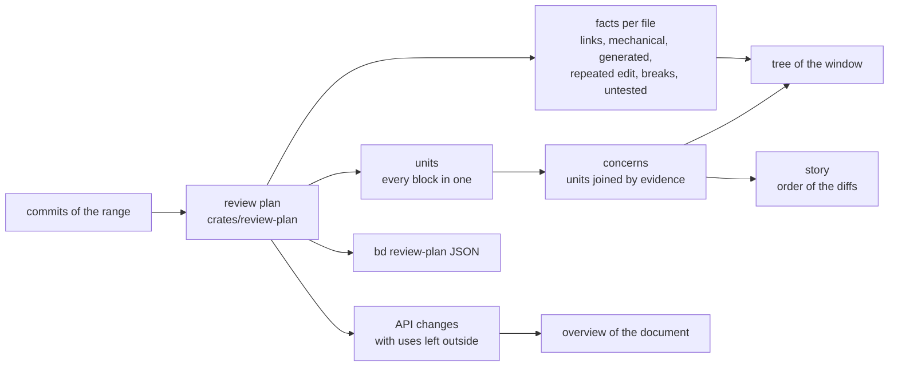

# Change Review

**Status:** Experimental
**Updated:** 2026-10-31
**Tags:** [review, review-plan, units, concerns, agents]

The vision of how Branch Deck reviews a change, what landed, what failed and what is next. The contracts are the
specs ([Review Plan](../../spec/branch/review-plan.spec.md), [Review Units](../../spec/branch/review-units.spec.md));
this document keeps the direction, the progress ledger and the rounds of polish, so that a later round, or another
team building a review, starts from what was learned.

## Problem

The work of one local branch lands in master in pieces ([Landing](landing.md)), and more and more of it is written by
agents: a branch gets a round of commits, the reviewer reads them, the agent lands another round. A review that lists
files in tree order with a diff each throws away what the tool knows. A file with one real change and one change of
imports is read whole. A change of a body of a public function is no line of anything. An edit that 30 files repeat
is read 30 times. One task, such as dropping a server from six configs in five directories, is scattered across the
tree. After each round the whole branch is read again.

The market (2026-10) mostly adds AI reviewer bots that comment on a pull request (CodeRabbit, Greptile, Graphite
Diamond, Copilot review, Cursor Bugbot). The presentation layer is barely touched: CodeRabbit's semantic view groups
moves and token edits, Amp's review panel adds an AI tour of the files, VS Code keeps a list of files with Keep/Undo.
Nobody ships an order by real symbol dependencies, a summary of the changed forms of the API, an interdiff of agent
rounds on a local branch, or folding with a correctness guarantee.

## Vision

A review is the story of a change, not a list of files:

0. **The story comes first, in the words of its author.** A developer who opens a change asks what changes for its
   user, why, how, whether it is proven, what can break and what is noise, in this order. The review is one document: an
   overview (the brief: the issue, the rules of the specs and the docs the change adds; the contents of the steps;
   what can break) and then the steps of the change, each opening above its diffs with the body of its commit, the units that carry it and the tests that reach its code; the files are an index, never the
   spine ([Review Tour](../../spec/branch/review-tour.spec.md)). The body is written for it: a lead that says the new
   state, a paragraph per decision, code names in backticks that resolve to the diffs, labels of one vocabulary
   ([The Commit Body a Review Reads](../guide/commit-bodies.md)).
1. **Each change is read once.** The diff is cut into the changes a reviewer reads (units): a changed form of a
   declaration, a changed body, a new or removed declaration, a new or deleted file, one repeated edit over all of its
   files.
2. **What can break is told, and only what can.** The API whose uses the change left outside, with the places that
   use them; a use a change cannot break (a call that still binds the parameters it bound) is no alarm, and a use
   only the name ties is no use and no proof of none.
3. **Noise is folded with its reason, and a fold is never wrong.** Imports, whitespace, renames, build entries,
   generated files fold into one group with a stated reason. The budget of false folds is about zero: a fold that hides
   real work is the worst defect of the review.
4. **The changes are grouped into concerns.** The tasks a branch does, each with its files, in an order where a
   declaration comes before its uses: the left side of the window and the right side tell the same story.
5. **A second review shows only what is new.** Mark Reviewed remembers the reviewed pair; after a rewrite, a sync or a
   new round of an agent, the review shows the diff since then.
6. **No switches.** One setting turns the review plan on, and whoever turns it on gets the finished review at once.
   No "Order: Tree / Dependencies", no modes to learn: the product decides how the review looks.
7. **Measured, not guessed.** Every rule is printed by `bd review-plan` as JSON and measured on real ranges before
   the window shows it.

## Model

The plan is computed in Rust once for `bd` and the app, from the git processes the review reads already (its
budget is a test, `process_budget_test.rs`). The window only words it: one document, the overview at its top
(`ReviewPrologue.tsx`, `presentPrologue`) and the opening of each step above its first card (`ChapterOpening.tsx`,
`presentOpenings`), the one mark of a row and its card (`FileRowMark.tsx`, `presentRowFacts`) and the groups of the
tree (`file-tree.ts`), the story of the diffs (`presentNarrative`). The concerns are the next part
([Next](#next)).

## Research

What other work offers for the parts that are not done, read on 2026-10-31. These are claims of the papers and the
READMEs; the lab reproduces the ones we build on.

**Untangling a change into concerns, without a language model.**

| Work | How it groups | Result as published | For us |
|---|---|---|---|
| ClusterChanges (Barnett et al., ICSE 2015) | def-use and use-use of names declared inside the change, same method; transitive closure | no spurious merge in 50 hand-checked changesets, weak recall | the hard edges, and the rule that a name declared outside the change links nothing |
| SmartCommit (Shen et al., FSE 2021) | a graph of hunks: hard (AST, data, calls), similar (text ≥ 0.618), proximate, refactoring, test; Kruskal edge shrinking cut at 0.6 | Rand index 71–84% synthetic, 75% in the field | the edge shrinking with a cut and the test edge; it joins every non-Java file by its extension, a false merge we must avoid |
| EpiceaUntangler (Dias et al., 2015) | a random forest over pairs, agglomerative clustering | pairwise precision 0.96 | the order and the adjacency of edits are the strongest features, a tie-breaker for us |
| Herzig & Zeller (MSR 2013) | voters (distance, calls, co-change, data), single linkage | precision 0.80 for 2 tasks | single linkage chains everything through a hub, our guide.md case |
| Flexeme (Pârțachi et al., FSE 2020) | a multi-version dependency graph with names on its edges, graph kernels | accuracy 0.81 on C# | shared names carry the link |
| UTango, HD-GNN | trained graph networks | Java accuracy 34–38% | datasets only |

No published method groups a change across config and doc files: the only token-based baseline (TF-IDF of
AtomicCommitBench) reaches ARI 0.33 on real diffs. An edge of a shared rare identifier in the changed lines (the
`ijproxy` that six configs drop) is unpublished: our opening, and our risk.

**Rust tools.** `sem-core` (MIT/Apache) matches entities across a diff by identity, structural hash, signature and
similarity, finds moved and renamed ones, and addresses JSON and TOML keys by path. `inspect` (Ataraxy Labs, a
restrictive license) joins changed entities by union-find over dependency edges, the nearest baseline. `kodama`
clusters agglomeratively, `probminhash` and `gaoya` give MinHash. mergiraf (GumTree-style matching on tree-sitter) and
HyperAST (subtrees hash-consed over a whole history: a move is the same id under another parent) are GPL: their ideas
only. RefactoringMiner 3.1 (Java, Kotlin) is the oracle for moves and renames.

**Datasets.** tangled-ccs-commits (1750 tangled commits, docs, build and ci concerns among them), UTango's Java set,
AtomicCommitBench (Python, which our summaries do not parse). UTango's set holds tensors only, no source, so the lab tangles
jsoup, gson and commons-lang the same way. And our own: the branches of idea-1, where a commit is a
weak label only (an agent round mixes concerns, a follow-up splits one), and the history of this repository, whose
atomic conventional commits tangle into labelled cases.

**Order of a review.** Baum et al. (2017): the best order is a grouping by relatedness, declarations before uses.
Fregnan et al. (2022): the files at the top get more comments. Google's Rosie splits a large change along directories
and owners and keeps dependent pieces together.

## Progress Ledger

From the handoff of 2026-10-29 (seven experiments) and what the work added. A row changes in the commit that changes
the review.

| Part | Status | Commits | What worked | What did not, or is open |
|---|---|---|---|---|
| Mark Reviewed, Since Your Review of a local branch | Landed | 1db3d3d4f, 4c0986ecb | the reviewed pair in `refs/branch-deck/reviewed/`; after a rebase with an amend the diff from the carried change shows the amend alone | a carry that conflicts falls back to the commits one at a time; a drop alone offers nothing |
| Review Summary: API surface, what can break first | Landed | bfe628d8d, 8365b3951, baa953080 | the uses left outside by accio, a lower bound never read as safe | uses of a changed body are not asked |
| Many names in one accio query | Landed in accio | JetBrains/accio#74, 1df601e | the names of one call answered in parallel | |
| Folding: imports, whitespace, renames, build entries | Landed | 576095873, e93f1e954, 739a18b56, 116cbd179 | a line wrapped or joined is whitespace; no whitespace where the indent has a meaning | a move of a block, "rename A→B, N sites" not started; no second oracle yet |
| Folding: generated files | Landed | 46faf0108, b57c2e95b | by name, attributes or the header a tool wrote; the renderer's echo is no repeated edit | |
| Deletion as real work | Landed | c60b21a1b | a deleted file is a unit of its own; 3 or more of one directory one unit | |
| Dependency order of the files | Partial | 1db3d3d4f, d61bd2446 | lives in the story of the diffs | the Order toggle was reverted: no switches |
| Units and the story of the diffs | Landed | 7658a56f7, 9734e000b, a75281f1d | every block in one unit; about 40% of the units are a change of a body alone, which no part showed before | a file of no parsed language (Markdown, JSON, TOML, Python) is one unit as a whole |
| Concerns (untangling) | Landed: in the plan, `bd` and the window | 97e92369, v4 of 2026-10-31, the window (this change) | on four labelled corpora (the lab, [Review Concerns → Measurements](../../spec/branch/review-concerns.spec.md#measurements)) purer than a group per file on three (idea-1 85.4 vs 84.7, Java 95.3 vs 89.9) and than `inspect`; build files and imports follow their concern; a server dropped from six configs is one concern; the tree lists the concerns, a file of two of them has its row in the one of most of its lines and a row "also in" the other, the story follows them | recall below a group per file (idea-1 67.0 vs 77.8); the rest buys recall back and costs purity, so it is off; a declaration two tasks change joins them; a module whose files are in concerns has no directory row, its dependency badge is on its build file, in the Mechanical group |
| The story: the brief and the steps | Landed in the plan and `bd` (schema 10), and in the window | 3b9fb5275, this change | a step per commit whose body tells it, the units that land by the commit of their lines, rounds and rewritten commits glued, mechanical parts with the commit that wrote them; every block in one stop on 38 real ranges; the brief quotes the rules of the specs with the tests their test links name | a follow-up by its lines joins 2 of 8 tasks of their own to the step that made their file |
| The window, round two: one mark per row | Landed | b94b51243 | up to four badges a row (links, `+1 new`, breaks, same edit) and a dependency badge became one mark, warning only when the file breaks uses left outside; its hover card lists Breaks, Uses, Used by, Same edit, Dependencies, a link selects its file; the description of the row keeps every fact; `I` on the focused row opens the card, the focus on its first file, Escape gives it back to the row (round three) | the card opened by the pointer only until round three: the mark is still no tab stop, the keyboard reaches it from its row |
| The window, round two: owner chips mark | Landed | 580ed48b1 | a chip hides no file: the files of other owners and the steps without the chosen owner's files are muted, a step with them says "Design 2", J/K and N/P move through the owner's sections only; a link of a mark selects a file of another owner without dropping the chip, so the reveal that undid the filter is gone (only the search keeps one); a chip at 0 mutes nothing and says so | the footer counted every file ("File 3 / 12") until round three added the part of the chip ("· Design 2 / 5") |
| The window, round two: the commits in their steps | Landed | b19eaea2f | with the plan, a scope of two commits or more lists its commits in the groups of their steps, above the files: the one that starts a step, those that follow it up, those without a story; the column above keeps the scopes; a commit of several concerns is listed once, one of no step in Other commits; a click shows the step, Enter, Show Commit Alone and ⌥↑/⌥↓ the commit alone with its own plan; in the windows of a branch, a stack and a pull request | until the plan of a scope is read the column lists every commit, then they move into the tree; the plan names its commits short, matched by prefix; the first cut listed every commit of a pull request in its Since Your Review, kept commit rows of steps a search had emptied, took the commits out of the column while no tree showed (a search that keeps nothing), and lost the branch heading and the review boundary of the column: a scope lists its own commits, a search keeps the commits of the groups it keeps, the column has them back while the tree lists none, and a row says its branch and "Your review" |
| The window, round three: the owner path, the groups of a request | Landed | 413e3ca25, 39696f0aa, b7a59c088 | while a review window shows a pull request of someone else into the default branch, the session asks Patronus about it (`request:<n>`) once its review fetch brought the head the listing names, cached as a branch's answer by its reviews; the row `pull:<n>` gets its reviewer groups with `approved` and `yours` (the GitHub login of the app's sign-in, an approval that can count) | a token of `gh` or the environment has no login, so no group is yours without the app's sign-in; the review requests now read the reviewers of each request (2 points a listing, not 1); a pull request that comes back to a window is asked again (the schedule forgets what it read of `request:<n>` once it leaves), the cache still saves the call |
| The window, round three: owner chips in the pull request window, the remembered chip | Landed | 942179549, d6812dd20 | the pull request window has the chips of the branch window: All, the groups of the request (the user's first, "· You", a check once approved), the owners by the `OWNERSHIP` files of the baseline, No Owner, marking as round two; one chip remembered per repository (`reviewOwnerChip`), All forgets it; the pull request window opens on it where it marks files, else on the user's group that still needs an approval, else on All, and moves from All to that group when the groups come later unless the user chose All; the branch window opens on it where it marks files; a group and an owner of one name are one chip, the group's, also for a chip held as the owner before the groups came | one chip per repository, not per pull request or per window; the footer and Approve came in the next row |
| The window, round three: the owner's part in the footer, what Approve counts for | Landed | this change | with a chip that marks files the footer of the branch and pull request windows adds its part: "All Changes · File 3 / 12 · Design 2 / 5" on a file of the owner's, "· Design 5" on another, every file for a branch-wide group (the commit window has no chips); Approve, on hover, and the confirmation of Approve and Safe Push… say "Counts for Design · You opened 1 of its 2 files": the user's groups that still need an approval, whatever chip is chosen, and how many of their files the window showed of each request, kept while the window is open, from zero on a new head; "Counts for no group that still needs an approval"; nothing without groups or while the sign-in names no login (`yours` is null then, not false) | "opened" is the file the review selected (the footer's), not one scrolled past in the story; the count lives in the window and is lost when it closes; Approve informs and never blocks, so an owner can still approve unread files |
| The window, round four: the review is one document | Landed | this change | the panel of the Review Summary (45% of the height, a line of counts, seven sections) became the overview at the top of the document of the diffs: the headline, What Changes one header per file, the contents of the steps (each its full title, the lead of its body, one line of facts, the Look closely of its author), Possible Breakage, Since your review; each step opens above its first card with the body of its commit by Rust's grammar, the fold Rust sets, the verification sections folded always, its follow-ups as disclosures; the bar of the step is one line; J and K walk overview, openings and cards; the commit shown alone heads the document whole | the overview and the openings are not reached by ⌘F; the dependency changes and the repeated edits left the overview for the rows and the dividers |
| The window, round four: anchors from a body to its code and back | Landed | this change | a code name of a body that resolves is a link wherever the document shows its line (`StoryText`), its hover the unit, its line and its step, a click the declaration with its name selected; the header of a section a body names carries a mark of the story, its hover the line that names it, a click that line in its opening, outlined, its fold opened | a follow-up's body, folded under its step, marks no section; the outline plays once, a story that mounts later (the commit alone, the story again) outlines nothing |
| The window, round four: the row of a step is its commit | Landed | this change | the group of a step of the commits is the commit that starts it: no row under it repeats its title, its hash on hover, what it is since the review and its branch on it, its menu, ⌘C and Enter are the commit's; a click and the focus show its opening, a click on a folded step opens it, the chevron, Space, → and ← fold it; the rows of its follow-ups and its commits of no story drop the issue key the brief names; a step of the concerns keeps its commit rows and folds by a click | the step of the commits folds by a click no more, a directory and a concern still do |
| Fan-in by place: what breaks, by the arguments a call passes | Landed | this change | every removed or changed declaration asked by its place (`accio references --at`, JetBrains/accio#114) in one process, no cap, no stop list, no guess at an owner; a use only the name ties (`resolved: name`, JetBrains/accio#115) is counted apart, never as a use and never as none; a call is inside by any of its lines (`end_line`); a call left outside that fits the new form (`fits`) and whose every argument binds a parameter of the same name and type as before (`parameter`, JetBrains/accio#106) still binds: the four `ProjectFrameUiPolicy(…)` calls of `startup-tool-window-place` read "4 calls left outside still bind", not a possible break | a Rust or TypeScript function keeps its parameters in its header, so its calls are never known to still bind; a `string` or `config` hit counts once accio ties a qualified name to the declaration |
| The tests that reach the code of a step | Landed | this change | one `accio tests --at` of the code of every step (JetBrains/accio#107) in place of the words of the changed lines of the range's tests: a test of the change, a test it did not touch ("1 test it did not touch reaches focus"), and "No test reaches paint within 3 calls" only where accio answered; a call only the name ties is not walked | what accio's call graph does not see (reflection, injection, a lambda passed far away) is no edge |
| Since Your Review: how the message changed | Landed | this change (#171) | the messages the interdiff reads already compared by the blocks of the grammar of a body, an LCS of whole blocks, no process: a `rewritten` commit says "message changed" and a commit whose lines are as reviewed is `reworded`, unread, in Since Your Review without a line of its code; its story marks what its body added and shows what it removed where it stood, the part of a change unfolded (Rust places both), in the openings of All Changes and the heading of a commit shown alone (its plan reads the reviewed message, one `rev-list`); the overview's line of the commit opens to the change, the one place Since Your Review as one diff shows it; the overview said "Only its message changed" of a rewritten commit whose lines moved, never having read a message | a paragraph edited is a block removed and a block added, no word diff; a subject reworded with an amend stays added and dropped |
| Steps of the message of one commit | Landed | this change | a commit alone whose paragraphs name the code they tell is told by them: a step per labelled section or paragraph (a list under it one part), in the order of the body, titled by its label, its first sentence or its first code name; a concern one part names goes whole to it, one two parts name is cut by its own evidence (a use the change adds nearer than one it keeps), test code joins the step of `Tests:`, a concern no part names stays a step after them; on 31 commits of idea-1 10 switch, 68 concerns now 48 steps, every block in one stop | a body that lists its changes in one list stays on the concerns (a list is one part); a concern no paragraph names (a DTO field the prose calls "the state DTO") stays a step named by its evidence |
| LLM tour with a hard coverage gate | Not started: the author's tour (`bd tour`) first | | | |
| Corpus evaluation (ranks of the hunks reviewers needed, false folds) | Not started | | | the main debt |

## Decisions and Reversals

1. **The Order: Tree / Dependencies toggle was removed** (d61bd2446). Whoever wants this review gets it at once, without
   switches to think about; the dependency order went into the story of the diffs.
2. **The plan was on by default, then off again the same day** (c9ddf2ba7, 45884cfe0): it is not ready yet.
3. **The renderer's echo became a generated file** (b57c2e95b): a guide and its two rendered copies were a "Same edit
   ×3"; the copies are generated by their header and fold with their reason.
4. **A deletion is real work** (2026-10-31). A deleted file was folded as "Deleted" in the Mechanical group. In a
   branch that drops a server from six configs, the sixth config held nothing else and was deleted: the same change
   as the other five, hidden as noise. A deletion is a decision of its author, like a new file; only a deleted
   generated file or build model by name folds.
5. **No concern by file or by commit** (2026-10-31). In the same branch one guide is changed by all five commits: a
   union over files or commits joins everything into one concern. Concerns join units, and a file of no parsed
   language must be cut into its blocks first.
6. **The file tree is no longer the spine of the window** (2026-10-31). The units and the concerns changed the order
   of the file cards and the folders of the tree, and the review still opened on a card of an API and line 485 of a
   file, the bodies of the commits four truncated subjects in the sidebar. The window opens on the story; the files
   are an index ([Review Tour](../../spec/branch/review-tour.spec.md)).
7. **Steps by commit where the commits tell them, the concerns where they do not** (2026-10-31). Reviews differ: in
   idea-1 every commit of 6 branches has a body that says what and why, and the concerns of `startup-tool-window-place`
   put the code of three of its commits into one and cut its restart story into three; a branch of one commit, or of
   commits without a body, has no such story. The plan decides per commit, no switch; a long branch keeps its commits,
   since its concerns were no shorter a list. This narrows "a commit is a weak unit when agents work": a commit is a
   weak unit to join a concern by, and the strongest unit of the why.
8. **Details on demand, one mark per row** (2026-10-31). A row of the tree carried up to four badges (`uses 1+1 new`,
   `breaks 3`, `same edit ×3`, `+2 deps`), each its own popover or tooltip: a third spine of counts that competed with
   the story for the eye. A row now shows at most one mark, its links, breaks, same edit and dependency changes in
   the card of its hover. Only what can break keeps a tone of its own (warning), so it still stands out at a glance;
   the rest is one hover away, and the description of the row says it all in words.
9. **A filter cuts the story; a mark keeps it** (2026-10-31). An owner chip used to filter the tree and the diffs to
   the owner's files. In a story ordered as "a declaration before its uses" and "every block in one stop", that cut
   the owner's part out of its context: Design approved a stylesheet without the component that uses it, and a link
   of a mark to a hidden file had to drop the filter first (a reveal of its own). A chip now marks: every file stays,
   the others are muted, a step says how many of the owner's files it shows, and the keys skip the rest. Focus comes
   from the keys and the weight of the rows, not from removing anything; the same holds with and without the plan.
10. **The commits live in their steps** (2026-10-31). The sidebar listed the commits in a column above the tree of
   steps: two lists of the same work, the column newest first, the steps in the order of the story, and an agent's
   follow-up stood apart from the step it rewrote. The commits now are rows of the groups of their steps, above the
   files, the round says "follows up"; the column keeps the scopes. A click on a commit scrolls the story to its step,
   as a step of the brief does, so the story stays the spine; the commit alone (its own plan, its heading) is an
   explicit Enter, Show Commit Alone or ⌥↑/⌥↓. Without the plan, and for a commit shown alone, the column stays. What
   the column said by its place moved onto the row: the heading of a branch became the branch of each row, the line of
   the user's last review the "Your review" of its commit. A commit is never out of reach: while the tree lists none
   (no tree, a search that keeps no step) the column lists them again.
11. **Remember the chip, not a review state; Approve informs, never blocks** (2026-10-31). Round three let the code
   owner read their part of someone else's pull request. A "Reviewed" mark per owner, kept in refs, was rejected: the
   GitHub approval already is the reviewer's mark, Since Your Review already starts from it, and a second mark would
   disagree with it after every new head. What is remembered is the chip alone, one per repository, so the next
   window opens on the owner's part; a window without one opens on the user's group that still needs an approval.
   Approve says which of the user's groups it counts for and how many of their files the window showed, but never
   blocks: a GitHub approval covers the whole pull request, and Patronus counts it for every group of the user, so the
   decision of what was read enough stays with the person.
12. **What accio can answer, the review never guesses** (2026-11-01). The fan-in asked accio by a name it built
   (`Owner.name`, `package.name`, the bare name), skipped 32 names every type declares, kept a hit only when its line
   named the owner, dropped a hit of another family of languages, cut the plan at 20 queries and counted a use by the
   line of its name; a step named the tests whose changed lines spelled a name of its code. Each was a guess at what
   accio knows: which declaration a hit resolves to, which tests call the code. accio now answers by the
   place of a declaration and says what ties each hit to it, so every guess was deleted rather than kept beside the
   answer; what the review still needs goes into accio, never into a heuristic here.
13. **The panel went, the story is in the flow** (2026-11-01). The Review Summary was a muted panel of 45% of the
   height above the diffs: a line of counts ("2 possible breaks · 2 new links between modules · 4 new declarations"),
   seven sections of different kinds, the body of each step a cut first paragraph with raw backticks, its title cut by
   the divider in the diffs. A reviewer could not read the author's words beside the code they explain (Gerrit shows
   the commit message as the first file of a change for the same reason). The right column is now one document: the
   overview first, then each step's opening (its full title and the author's body, its lead a step larger, its labels
   as captions, the fold where Rust sets it) right above the card of its first section. What the rows of the tree and
   the dividers say already (the dependency changes, the repeated edits) left the overview; the new API and the new
   links between modules became facts of their steps. Nothing is muted of the author's words, nothing is cut silently.
14. **A commit alone is told by its paragraphs** (2026-11-02). Decision 7 held that a branch of one commit has no
   story, so its concerns were its steps. In idea-1, IJAI-5582 (`terminal-split-url`, one commit of 23 files) has a body
   that tells the fix part by part, each paragraph naming its code: the marker of the emulator, the way of the
   markers, the joiner and its Look closely, the batches of the frontend, the tests. Its 12 concerns put the joiner
   under the token `TerminalOffset`, cut the way of the markers into three and made 7 steps of tests and their
   helpers; a reviewer could not tell how the fix works from them. The parts of such a body are now the steps, each
   with the concerns its code names, a concern two parts name cut by its own evidence; nothing is guessed, a concern
   no part names stays a step of its own. Until the author's tour (`bd tour`, Next 0) exists, the body is the tour of
   a commit alone, and the tour will share this model of chapters.
15. **What the author left out shows** (2026-11-03). `Left out:` was a verification label, folded always, beside
   `Tests:` and `Evidence:`. In `terminal-split-url` it held the one honest answer to "is it proven": "The tests of the
   pending-task merge and the trim depend on timing, so they can pass without a merge", while the opening of a step
   listed 20 declarations "no test reaches", most of them a walk accio cut or a field it does not index. What the
   change does not do or prove is what a reviewer needs before approving: `Left out:` is a label of its own
   (`leftOut`), shown wherever it is and costing no line of the fold, like `Look closely:`. The proof of a step by
   the change's own tests waits for accio to answer it (JetBrains/accio#212, #213, #214).

## Review Rounds

A round of polish: a real review, what looked wrong, the class of the defect, the change that fixed the class.

| Date | Range | What looked wrong | Class | Fix |
|---|---|---|---|---|
| 2026-10-31 | idea-1 `accio-search-policy`, 5 commits | `dotnet/.codex/config.toml` under Mechanical → Deleted, though it is the change of five other configs | a deletion folded as noise | c60b21a1b |
| 2026-10-31 | the same | the tree lists folders while the diffs tell the story; one task is scattered over five folders | the two sides of the window disagree | concerns ([Next](#next)) |
| 2026-10-31 | idea-1 virtual branches | the first concerns joined a branch into one: single tokens chained singletons, prose blocks shared words | soft evidence chains (single linkage) | cosine of rare tokens without the unchanged words, a token bridges no two concerns ([Review Concerns](../../spec/branch/review-concerns.spec.md#measurements)) |
| 2026-10-31 | the lab: 739 tangled ranges of four corpora | purity below a group per file: `uses` from a body change, words of prose and comments, names of libraries joined tasks; 28 ranges crashed | evidence that is no evidence; a loop in the Rust path resolver | `uses` from a changed form only, tokens from code the change declares, the rest off; 5c20eed6 |
| 2026-10-31 | the `review_concerns` template | the guide, cut by two concerns, showed whole in the first one: its unit of a file of no language is a slice the story shows whole | a whole slice ignores the blocks a concern holds of it | a part with its blocks lays them out as a section, the other blocks one row "Shown in grep → accio" ([Review Concerns](../../spec/branch/review-concerns.spec.md#in-the-review-window)) |
| 2026-10-31 | the screenshots of the window of ec08de74 | a guide with its two renderings was the concern "Root"; a block of a Markdown file in a concern got the heading "guide.md" under the header that names it | names that say nothing | a concern of one file is named by it (`file`), a file of no parsed language gets no heading (this change) |
| 2026-10-31 | the dependency badge in the window of ec08de74 | the files of a module sat in a concern, so the badge of its new dependency fell to the build file inside the collapsed Mechanical group | a consequence filed away from its cause | a build file follows the code that needs the new dependency, a file of imports alone the declaration it imports, as a generated file its source; the badge shows on the row of the concern, else on the Mechanical group (e0afac588) |
| 2026-10-31 | idea-1 `startup-tool-window-place`, 4 commits | the restart story cut into the concerns "again" (joined by `does`) and "side" (`kept`, `answers`), the first concern named `activatesprojectviewonstartup` | the words of prose and the fields of a schema taken for names; a token named in lowercase | of a config no key of a field, of a sentence a config or a string quotes only its compound names, an indented line of a text file prose; a token named as written, a whole identifier before a part ([Review Concerns → Measurements](../../spec/branch/review-concerns.spec.md#measurements), this change) |
| 2026-11-02 | idea-1 `terminal-split-url`, 1 commit | the Look closely callout asks about "the guards against a false merge", the guards themselves sit in the overview's "More: The rest" without their question | a list written right under a run-in Look closely taken for the story again | the question keeps the list or code right under it, no blank line between ([Commit Row](../../spec/commit/commit-row.spec.md), this change) |
| 2026-11-02 | the same | 12 steps named by identifiers: the joiner, the core of the fix, under `TerminalOffset`, the way of the markers in three steps, 7 steps of tests and helpers; the facts of a step in the contents 6 lines of names | the author's parts of a commit alone ignored: its concerns were its steps | the steps of the message (decision 14, [Review Tour → Steps of the Message](../../spec/branch/review-tour.spec.md#steps-of-the-message), this change) |
| 2026-11-02 | the same, the window | the message of the commit lay on the grey gap between the file cards under a white band of the bar of the step, "sawn in half"; while the diffs loaded it lay on white; its chips and its Look closely callout had no surface | words of the author on the canvas, not on an island | the overview and each opening are cards of prose, the column of the diffs one canvas with the bar on it, the overview's card from the first frame ([UI Theme](ui-theme.md), this change) |
| 2026-11-02 | 194 steps of 46 one-commit ranges (idea-1, this repository) | after the tests became one count, the new API of a step still listed every name in the contents: 8 steps add 5 to 19 public declarations | a list in the contents cut by no rule | the new API and the new links between modules follow the rule of every list there ("Cache, Reader, Store and 16 more"), the opening names them whole (this change) |
| 2026-11-03 | idea-1 `terminal-split-url`, the opening of step 2 | "No test reaches" named the four data-class fields the step adds, which four test files of the change read; `tests --at` of a primary-constructor `val` answers `unavailable` (JetBrains/accio#189), `references --at` complete with no hit (#215) | an answer accio could not give read as "none" | a place accio finds no declaration at is neither reached nor unreached, its usages unknown (this change); the proof of a step by the change's own tests waits for accio (#212, #213, #214) |

## Measurements

The units of three ranges of idea-1: [Review Units → Measurements](../../spec/branch/review-units.spec.md#measurements).
The plan: [Review Plan → Measurements](../../spec/branch/review-plan.spec.md#measurements).

## Lessons for Other Review Tools

- A commit is a weak unit of review when agents work: one round mixes tasks, and a follow-up splits one.
- A generated file is a consequence of its source, not noise at the end: its header often names the source.
- A deletion is a decision; folding it as mechanical hides the change it belongs to.
- Every fold needs a stated reason and a budget of false folds near zero; a count of uses is a lower bound and must
  never read as safe.
- A switch between views pushes the product's decision onto the reviewer.
- Merge precision alone flatters a grouper: one group over a whole range scores 91–98%. Measure the purity of the
  groups next to the recall, against a group per file.
- A change of a body forces no caller to change; only a changed form is evidence that its uses belong to it.
- A word of prose, a comment or a name of a library is no evidence of a task; a name the change itself declares is.
- The best explanation of a change is often already written: the bodies of its commits, the rule it adds to a spec,
  the names of its tests. A review that shows files and badges first throws it away.
- A consequence belongs to its cause, not to the noise at the end: a generated file to its source, a new dependency to
  the code that needs it, an import to the declaration it brings in.
- Mark a reviewer's part, never filter to it: a filter by owner or path cuts the declarations and the uses around the
  part, and an approval of a part read without its context approves less than it seems. Mute the rest and let the
  keys skip it.
- One spine: a list of commits beside a list of steps makes the reviewer join them in the head. Put each commit in
  the step it tells or follows up, and the commits and the story are one list.

## Next

0. **The author's tour** (`bd tour write`): the agent that wrote the change writes its decisions to approve and the
   places to look closely, by the ids of the units, gated by the plan (every unit in one chapter), kept by the
   fingerprints across a rebase; then "Write Tour" in the window by a model for a range without one.
1. **Concerns**: units joined by static evidence (names declared in the change and their uses, a test and its subject,
   a generated file and the source its header names, a shared rare identifier, a near-repeated edit), now listed by
   the tree and followed by the story; next measured on four corpora against SmartCommit, inspect and sem.
2. Moves and renames as one unit ("rename A→B, 37 sites"), with RefactoringMiner as the oracle.
3. The corpus evaluation of the handoff: where the hunks reviewers commented on rank, how many hunks a fold hid.
4. Names of concerns by a language model, behind the same gate as the tour.
5. An LLM tour, rejected unless every hunk is covered exactly once.
