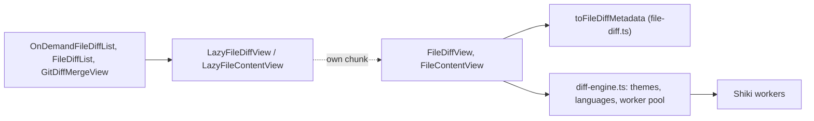

# Diff View: the @pierre/diffs Engine

**Status:** Implemented  
**Updated:** 2026-10-15  
**Tags:** [ui, diff, highlighting, performance]

## Problem

The app shows diffs in four places: the files of a commit in its preview, the uncommitted changes of the amend card,
the conflicting files and the missing commits of a conflict, and the 3-way view. They used `@git-diff-view/react`
with lowlight (highlight.js grammars) and a Vite plugin that cut the grammar set down. That engine had:

- no word diff: a changed line was red and green as a whole, also for a one-character change;
- no expansion of the unchanged lines between hunks;
- highlighting on the main thread, and grammars that read Kotlin and Gradle roughly;
- no virtualization, which a view of a whole commit needs.

## Solution Overview

[`@pierre/diffs`](https://diffs.com) (Apache-2.0) renders every diff. It highlights with Shiki (TextMate grammars, the
VS Code ones) in a pool of web workers, marks the changed words of a changed line, expands the unchanged lines when it
has the file contents, and has a virtualized multi-file view. It renders into the open shadow root of a
`<diffs-container>` element, themed by CSS custom properties.

## Design

### Architecture

- **Lazy chunk.** The views render `LazyFileDiffView` (`src/components/diff/LazyDiffViews.tsx`). It loads
  `FileDiffView.tsx` with `React.lazy`, and with it Pierre, Shiki, the themes and the worker pool. Nothing of the
  engine is in the main chunk; the grammars are further chunks loaded per language.
- **Adapter.** The backend sends a `FileDiff` (`crates/git-ops/src/conflict_analysis.rs`): one `diff --git` patch
  (a commit file, an uncommitted file, a missing commit) or hunks that each repeat the `---`/`+++` header (a conflict
  diff, the 3-way view). `joinFileDiffHunks` makes one patch of either, `toFileDiffMetadata` parses it with Pierre's
  `processFile` (`src/lib/diff/file-diff.ts`).
- **Contents.** A missing commit and the 3-way view also send both file contents, from the same two versions as the
  patch. With `withContents` the parsed diff is complete, and its hunk separators expand the unchanged lines without a
  request. Without the contents the separators only count the lines.
- **Conflict markers.** `getConflictAnnotations` (`src/lib/diff/conflict-annotations.ts`) finds the added lines with
  `<<<<<<<`, `|||||||`, `=======` and `>>>>>>>` and annotates them at their new-file line;
  `ConflictMarkerExtension` renders an annotation in light DOM, slotted under the line.
- **Worker pool.** `getDiffWorkerPool` (`src/lib/diff/diff-engine.ts`) creates the pool of the window on the first diff
  and never terminates it. Pierre's `WorkerPoolContextProvider` terminates the pool when its last instance unmounts,
  which would start and stop the workers with every dialog; we pass our singleton through `WorkerPoolContext` instead.
  The pool has one to three workers. When they cannot start, Pierre highlights on the main thread, and the error is
  logged once.
- **Highlighter.** `shiki-js`, the JavaScript regex engine: no WebAssembly to load, and the grammars we care about
  compile with it (`src/lib/diff/islands-themes.test.ts` tokenizes Kotlin, Rust and TypeScript).

### Key Decisions

- **Our own syntax themes.** None of the bundled Shiki themes is close to the IntelliJ editor: GitHub, Light+ and One
  Light colour keywords red or purple. `islands-themes.ts` maps TextMate scopes to the colours of the IntelliJ New UI
  Light and Dark editor schemes: keywords, strings, numbers, comments, declarations (not calls), fields, annotations,
  tags. Both themes are registered, and `themeType: "system"` lets the OS scheme pick one without a re-render, as the
  rest of the app follows `prefers-color-scheme`.
- **Chrome from our tokens.** The background, the added and deleted colours, the line numbers, the separators and the
  fonts come from `src/index.css` (`diffs-container { --diffs-* }`, see [UI Theme](ui-theme.md) "Diffs").
- **Extensions.** Shiki has no grammar for `.gradle`, `.iml`, `.form` or `Cargo.lock`; `diff-languages.ts` maps them to
  Groovy, XML and TOML. The worker pool receives the map with its render options.
- **Untrimmed patches.** The backend reads every patch with `execute_command_raw`: trimming drops a last context line
  of a blank line (a single space), and Pierre would read a hunk shorter than its header says.

### Implementation Notes

- A `FileDiff` passed to `FileDiffView` must keep its identity while shown: a new object parses and highlights again.
- A diff without hunks (a file that is the same in both versions, a mode change) shows "No changed lines".
- E2E tests read diff text with `toContainText`, which walks shadow roots; HTML snapshots do not
  ([E2E Testing](e2e-testing.md)).

## Alternatives Considered

- **Keep `@git-diff-view`.** No word diff, no context expansion, no virtualization.
- **CodeMirror merge view, Monaco diff editor.** Editors, heavier, and themed apart from the rest of the UI.
- **`@pierre/trees` for the file tree.** Beta, built on Preact in a shadow root, without per-row line counts or a diff
  under a row.

## Performance Considerations

- The engine is a lazy chunk (about 600 KB) and the worker another (about 210 KB). The Shiki grammars add about 11 MB of
  lazy chunks to `dist`, of which a diff loads only the grammars of its files. Shiki's WebAssembly engine is bundled
  twice (main thread and worker, about 620 KB each) but never loaded, as the JavaScript engine is preferred.
- Highlighting runs in the workers; the main thread only parses the patch and lays out the rows.

## References

- [UI Theme](ui-theme.md) ("Diffs")
- [Commit Files](../../spec/commit/commit-files.spec.md)
- [Commit Row](../../spec/commit/commit-row.spec.md) ("Conflict view")
- `@pierre/diffs`: https://diffs.com
