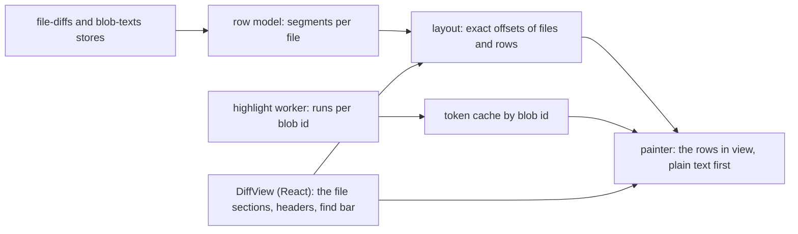

# Diff View: Our Own Renderer on the Blocks of the Engine

**Status:** Implemented  
**Updated:** 2026-11-11  
**Tags:** [ui, diff, highlighting, virtualization, performance]

**What runs and what is planned.** The steps of the Migration run: the row model, the layout, the highlight worker,
`DiffView` in the review windows, in every other 2-way view and in the 3-way view of a conflict, the copy from the
model, the find and the accessibility. A paragraph marked **(planned)** describes code that does not exist yet; the
rest describes the code as it runs.

## Problem

The app shows a diff in five places:
- the review window (`review`: a branch with its stack, a whole stack, a kept branch, a commit of a list, a pull
  request, [Review Window](../../openspec/specs/review/review-window/spec.md#one-window));
- the files of a commit in its preview, with the diff under a tree row;
- the uncommitted changes of the amend card;
- the missing commits and the modify/delete file of a conflict;
- the 3-way view of a conflict.

Since the FileDiff model, the backend sends typed blocks per file and the texts by blob id
(`src/lib/diff/file-diff-model.ts`). The views rendered with a fork of `@pierre/diffs` (`packages/diffs`, 28,000
lines). The fork had a model of patch hunks, so `buildFileDiffFromBlocks` translated the blocks into that model. The
benchmark (`pnpm perf:diff`) showed what this cost:

| scenario | metric | Pierre on a patch | Pierre on the blocks |
|---|---|---|---|
| 200 files, open | first rows | 3446 ms | 2765 ms |
| 10k lines, open | first rows | 2976 ms | 3624 ms |
| 10k lines, open | bytes from the worker | 9.72 M | 27.76 M |
| 200 files, expand | highlighted | 1149 ms | 415 ms |

The causes are in the design of the engine, not in its tuning:
- **No row before the highlight.** Pierre renders no line, not even plain text, before the highlighter is ready. A
  diff waits for the HAST of both whole files.
- **HAST on the wire.** The worker sends a tree of objects per token. Both themes are in each token. For the 10k-line
  file this is 27.76 MB of structured clone.
- **Estimated heights.** The virtualizer estimates the height of a file and measures it after the paint. The
  scroll position jumps, and a scroll to a file or to a change needs a correction.
- **A web component per file.** Each diff has a shadow root, its own managers and its own stylesheets. The app shares
  the stylesheets by hand (`sharedStyleSheets.ts`).
- **A model of hunks.** Folds, ignored blocks, inline pairs and scope labels are patches on a patch model. The 3-way
  view of the merge comparison will not fit it.

## Goals

- One renderer for every diff view, built on the blocks of the engine and the two texts. No patch model.
- The first rows paint as plain text before any highlight. The tokens paint in after.
- Exact heights. A scroll to a file, a change or a find hit lands at once, with no correction.
- 60 fps scroll through a 10k-line file and through a review of 200 files.
- A row model that takes three columns, for the 3-way view of a later stage.
- No Pierre view of a 2-way diff at the end. The package stays only for the 3-way view, until the engine has its own.

## Solution Overview

- **Row model.** Each file is a short list of segments made from its blocks: equal lines, a fold, a block. A row is
  found by a binary search, and is made only when it is painted.
- **Layout.** All rows have one height when soft wraps are off. So the offset of each row is arithmetic, and the
  layout is exact before any text arrives. With soft wraps on, the view breaks the lines itself and knows each height
  before the paint.
- **Painter.** React renders the sections of the files in view, with their sticky headers. A painter of our own fills
  each section with the rows in view, in the light DOM, with the app's CSS. It reuses the row elements.
- **Highlighting.** A worker tokenizes a blob with its TextMate grammar. It sends compact runs of style ids for pages
  of lines, as transferable typed arrays. The main thread keeps them by blob id. A theme is a set of CSS variables, so
  one tokenization serves both themes.

## Design

### Input: the diffs and the texts

The stores stay as they are:
- `src/stores/file-diffs.ts` keeps the `FileDiff[]` of a subject under the whitespace policy. `get_file_diffs`
  streams them through a channel: the files, then the content of each file as it is known (`priorityPaths`, the file
  a review opens at, first), then the scopes of a text the caches did not have, then the `marks` of each file that
  the other files of its subject say something of. A file is in the entry once its content arrived, and pending
  before (`fileDiffOf`); the late scopes and the late marks replace those of its content and keep its fold levels
  and its open notes (`keepOpened`). Contents within 16 ms go into the store in one update. The read ends with its
  last file. What the index of the repository says of the names the subject renamed is another read,
  `get_rename_proofs`, which the store asks of the subjects a view holds (`useFileDiffs`), one at a time, and whose
  answer replaces the marks of the files it names in the complete entry ("The answer is asked by the view" below).
- `src/stores/blob-texts.ts` keeps the texts by blob id, in an LRU of 64 Mi UTF-16 units.

Two changes:
- **Text order.** The view asks for the texts of the files in view and one viewport around them first, then, 50 ms
  later, for the 20 files after them. A review no longer waits for all texts before it mounts.
- **Line tables.** A text gets a table of line starts once per blob id: a `Uint32Array` of offsets into the string.
  IntelliJ's rule splits the lines: `\n`, `\r\n` and a lone `\r`. The painter slices a line from the text only when it
  paints the line, so no array of line strings lives in memory. The table also holds the widest line in columns, for
  the horizontal scroll.

`view-files.ts` gives what a file shows besides its rows: the counts of the engine (`withEngineCounts`), the notices
("Binary file", "Too large to show: …", "Submodule: a → b", "Line endings: LF → CRLF"), the files that start
collapsed, and the grammar of a path.

### Marks

A diff says of its own blocks what a reviewer may pass ([Quiet Changes](../../openspec/specs/commit/quiet-changes/spec.md)):
`TextDiff.marks`, decided in Rust (`crates/file-diffs/src/marks.rs`) for every view. The rule of the whole feature: a
mark is one thing, quiet another. A reviewer passes what is quiet, so only what provably changes no behaviour is; the
rest gets a label and stays a stop.

| kind | a label | quiet |
|---|---|---|
| formatting (`formatting`) | yes | yes: the tokens of the lines are the same on both sides ([Equal by Tokens](../../openspec/specs/commit/equal-by-tokens/spec.md)), only in a file of a grammar |
| comments alone (`comments`) | yes | no |
| a file without a grammar | no | no: its block of whitespace stays the pale stop it is; it has its moves |
| moved lines (`moves`) | yes | never: where lines stand is behaviour. The lines are read where they stand now, and are nothing to read where they left |
| lines moved between two files (`subject.movedOut`, `movedIn`) | yes, at both ends | never, and no line of them is hidden: both ends are read |
| a renamed name (`renamed`, `renames`) | yes | not yet: a label until its measurement. Proven are the lines that changed in the name alone, for a value of its body alone, every name of which the scopes bind: a variable, a parameter that no call may name and no annotation or macro may read, in a text the scopes read whole. Never the declaration of a name that is not local, never a place that makes more of the name than its binding |
| a renamed name that is not local, in the file that declares it and in the files that use it (`subject.declared`, `used`) | yes | not yet, and then only its uses, where the index of the repository lists every use of the declaration in both trees and each is a place of the rename (`subject.confirmed`). The declaration is always read |

- **The marks change no block.** They are a field beside the blocks: `runs` (rows of lines inside one block that
  changed in one way alone), `moves` (the lines that moved within the file), `renames` (the names the change renamed
  within the file) and `starts`. The scans of the dependencies, the patches of `brd` and the review plan read the blocks they read before.
- **One source of the stops.** `starts` names, for each block with something to read, the line its reading starts
  at (`text_diff::model::starts_of`): the first line outside its quiet runs that, of its old lines, no move took. A
  block without an entry has nothing to read. The navigation of changes and the count of what is left to read take
  only this (`stopsOf` of `src/lib/diff/block-parts.ts`); the runs, the moves and the renames are for drawing. What
  a view draws of the runs is "The parts of a block" below.
- **With the content.** The marks change the rows a view draws (the Inline view shows the new lines of a quiet run
  alone), so marks that came after the content would move a file already drawn. They are made in the worker of the
  file before its `content` goes out; the scopes still come after it. What only the other files of the subject
  explain cannot be: it comes when every pair is known, as a `marks` event that adds runs that are labels and words
  and takes no row ("What the files of a subject say of each other" below).
- **A block is read in five steps** (`marks_runs.rs`). The tokens of its code are aligned: lines with the same code
  pair token by token, else by the longest common subsequence of the keys of the tokens. The block is cut at the line
  boundaries both sides share, those no token crosses with the same paired tokens before them. Each segment between
  two cuts is asked whole: the same code, blank, or different. Rows of segments with the same code are cut into the
  longest groups whose tokens are the same, comments too (formatting), and what stands between them (comments). A
  run that reaches an end of its block is one only when the code around the block reads the same there. So forty
  lines indented inside a new `if` are one quiet run, and the reading of the block starts at the `if`.
- **The alignment proves nothing.** It only finds the cuts; what a run is, `compare` of the tokens of its lines
  proves. A subsequence pairs a token with any of its likes (the `)` of `b(1, 2)` with the `)` of the call after it),
  so tokens only one side has are put on whole lines where it leaves the choice; a wrong choice loses a run, never
  makes one.
- **A rename is a binding under two names** (`marks_renames.rs`). Where the alignment of the tokens of a block
  put a name of the new side at the place of a name of the old one, the two are a candidate: two names that stand
  alike in the tree, each one plain word. One parse of each side then answers for all of them
  (`code_symbols::navigate::names_at`, "The bindings of many names" below): each place of the
  old text is asked with the new name, each of the new text with the old one. A rename is one binding of each text
  with the same places: as many names on both sides, name `i` of the old text in the block of name `i` of the new
  one and nowhere the alignment put another name, the declarations at the same places, and for a declaration inside
  a body no clash of the other name on either side. So a use the change left behind, a name it took from another
  declaration, two locals that became one and two that took the name of each other in one body are no rename, and
  nothing of them is marked: such a change is a change of the code. One side alone proves nothing: only the new text
  shows a use that kept the old name bound elsewhere, only the old one a name the new one took. The unit is the
  binding, not the spelling: `i` → `index` in one loop and `i` → `row` in the next are two renames.
- **The runs of a rename are cut by the tokens, again.** The tokens of each place get one text on both sides, a
  text of that place alone (`Tokens::with_texts`), and the blocks that hold a place are read as before: lines that
  are then the same tokens, comments too, and hold a place are a run of the kind `renamed`, however the call with
  the name was wrapped. The proof is the one of formatting, of the old text with its binding renamed: a text that is
  the same program by its scopes. A place on a line with another change, or with a comment that changed, is in no
  run, and that line is read; the rename still has the place. This second reading spends what the first left of
  the work of the file (`MAX_FILE_TOKEN_WORK` is the work of both); a block it does not pay for keeps the runs it
  has.
- **A rename takes no line of formatting.** With the names read as one, a wrapped call beside a line of the name is
  the same tokens as that line is, and one group with it. A run is of one kind, so the group is cut where it may be
  (`marks_runs::Rows::runs_of_group`: at each end of a segment that as many of the same tokens stand before on both
  sides): its parts that hold a place are runs of the kind `renamed`, those that hold none the runs of formatting
  they are without the rename, the blank lines between the two with the formatting. Forty lines indented inside a
  new `if`, one of them a use of the renamed local, are two quiet runs around one line of the rename, whether that
  rename is proven, a label until its measurement or a label for good (a member, a parameter a call may name). The
  second reading adds runs and takes none (`marks_renames::with_the_first`): the two readings align the tokens of a
  block each by itself, and where a line stands twice they may pair it with two lines (the names read as one pair a
  line of three places with itself, where the tokens as they are paired the call that changed places with it).
  There the run the first reading found stays, in place of the runs of the second that share a line with it or
  cross it: what the tokens of the texts prove of a line never depends on a rename beside it.
- **What of a rename is proven.** A run is proven when every place in it is of a value of its body alone, on both
  sides, every name of which the scopes bind (`LocalBinding::is_of_body_alone`). A parameter of a named function of
  Kotlin, C# or Starlark (a call may name it), one an annotation of Java or an attribute macro of Rust may read, a
  declaration that is no value (a function or a class declared in a body), and a local of a text the scopes read
  in part are renames whose runs are labels. Read in part is a text with an error of its parser (what stands where
  the parser gave up is no name to the scopes), a C# file with an `#if` (the branch not taken is no code of the
  tree, and a declaration in the branch taken is none where the other is compiled), a Rust function or closure
  with a `#[cfg]` inside it (two declarations under two conditions are one scope to the reading), and a script
  with a direct `eval` (its text names the variables around the call). A place that makes more of
  the name than its binding never gets the one text, so its line is read: a shorthand property (`{ total }`), a
  pattern that takes a value apart, a call of a value (only the types tell it from a function of that name),
  `nameof(total)`, a name among the tokens of a macro, a name a format string captures, a name inside a `with`, and
  a name whose spelling is a value where the code runs: the declaration of a Kotlin property with a delegate
  (`val integrationTest by registering(…)` registers a task of that name, `val total by map` reads the key
  "total"), a variable that is given a function or a class written without a name, which takes it
  (`const total = () => 1`). The reader stops at that line, where the behaviour changes, and the uses of the name
  stay proven (`Site` of the navigation, anything but `Plain`). A name that no body binds (a member, a declaration of the file) is every name of its
  spelling, tied by nothing but that: with its declaration in the file it is a rename whose uses are labels and
  whose declaration is in no run; the pass over the files of its subject asks the index of the repository (accio)
  whether every use is one of them. Declared in another file, it is no rename of this pair: nothing is marked, and
  the pair hands the name out with its places (`PairMarks::undeclared`) and the runs its blocks have were it a
  rename (`PairMarks::pending`), which that pass reads.
- **Proven is not yet quiet.** A kind of run is passed only after its measurement (the rule at the top of this
  section): a sample of its proven runs of real ranges, read by a person, with no change of behaviour among them.
  The proof of a rename reads scopes without types and without the other files, and its first review found changes
  it had passed (the delegate, the branch of `#if`, the two `#[cfg]`, the `eval`: each is a rule above now). So
  `is_quiet` says no for `renamed`, every run of it is a label with its note, and every block of it a stop.
  `has_proof` names the kinds that can be proven; the marks of a pair name the runs that are proven and labels all
  the same (`PairMarks::proven`), and `PairMarks::as_proven` gives the marks with those runs quiet: what the
  measurement samples, and what the tests of a proof read (they also ask that a view gets the same marks with the
  kind as labels). Switching the kind on is one line of `is_quiet`; the uses of a name that is not local that the
  index confirmed (`SubjectMarks::confirmed`, `marks_subject::as_confirmed`) are proven runs of the same kind and
  become quiet with it, not before.
- **What a pair leaves** (`leftovers.rs`). A pair of blobs is what the caches keep, and it stands in many commits
  beside other files, so nothing of a subject may enter it. What the other files of a subject need of a pair is made
  where its texts are, in its worker, and kept beside its diff (in memory and in the `file_leftovers` store, under
  the key and the version of the diff, never inside the `TextDiff`: a scan decodes the diff of a pair at every hit).
  It is the changed lines of each side that no mark took, as hashed keys with their weight in rows
  ([Text Diff Engine](text-diff.md#moves-between-files)); the names that changed at every place of the file and
  are declared in none; the runs of the blocks that hold a place of such a name, read once more with those names
  as one (the third reading of a block, `Renames::pending`: every run of it with the names it needs, and none that
  shares a line with a move of the file); the places of the declarations of its renames that are not local, in the
  lines and the characters the index counts; and which of its renames the scopes prove. The pass over a subject
  reads no blob, so a subject whose pairs the caches have costs no process.
- **What the files of a subject say of each other** (`marks_subject.rs`, the group Subject of the spec). A pure
  function of what the pairs of the subject are and left, in the order of git, so it is the same from the
  comparison, from memory and from the store of another app.
  - *The lines that moved between two files*: rows of the same lines among what the pairs left, deleted in one file
    and added in another. Exact lines only, from two lines that are not blank and 48 characters, the longest first,
    each line once; lines that match two places move to the first. A label at both ends, never quiet: no line is
    hidden, and no stop is taken (the starts of both files are those of their pairs).
  - *A name another file declares*: a name the pair of a file handed out is a rename of that file once another file
    of the subject declares a name that is not local and renamed it so. The tie is of the two spellings, as within
    a file: a label. The runs its pair kept for it hold then, beside the runs of the pair, which stay
    (`with_the_first`, as the second reading of a pair); a run that leans on a name no file of the subject declares
    does not, and its line is read. A line of such a run is taken from the rows of the moves between files: a line
    is in a run or in a move.
  - *Labels alone.* The files of a subject are put together after the rows of each went out, so the pass adds runs
    of the kind `renamed`, which are labels, and nothing else: the quiet runs and the stops of a file are those of
    its pair. The third reading of a block would give more: with a name read as one, a call wrapped otherwise at
    the end of its block is the same code up to the same token after it, a run of formatting the pair does not
    have. Such a run is quiet, would take rows of a file already drawn, and leans on a name (the token after the
    block) that it does not hold. So the pair keeps of that reading the runs of the kind `renamed` alone, each with
    every name it leans on: those with a place in its lines, and the one whose place is the first token of the code
    after its block when the run reaches the end of the block (`code_symbols::tokens::same_after` compares that
    token).
- **What the index proves** (`Subject::questions`, `IndexAnswer`). Every declaration of a renamed name that is not
  local is asked of accio in one call (`accio renames`, its decision 2026-11-11-rename-read-in-two-trees): whether
  the two places are one declaration, its uses in both trees, what the rename changed beyond the name. accio maps
  no line of one tree to the other; that is this reader's part. A declaration is proven renamed when the answer
  says one declaration of Kotlin or Java, complete, without a conflict, and every use it lists in either tree is
  the declaration, a place of the rename in the subject whose twin of the other tree is listed too, a link of a doc
  comment (it runs nothing), a use that writes no word (accio lists a positional argument that sets a property, and
  a constructor delegation, with no column between its ends: there is no name to change), a use by another word (an
  alias of an import, the accessor of a property in another language) that the other tree lists at the same place
  of a line the change left alone, or stands on a line that is read anyway: a changed line in no run, so a call the
  change added or deleted in another file stands in the way of nothing. Every other case names why not, for a view
  to word: `usesOutside` (a use the change left behind in a file it did not touch, which accio reports, or on a
  line it left alone), `otherMeaning` (a conflict of accio: a capture, an overload, an override, a declaration it
  hides or that hides it, a namesake; a use without its twin; a use of the new name on a line left alone),
  `otherDeclaration` (the kind, the owner or the signature changed with the name), `incomplete` (the answer is not
  complete, a use is tied by its name alone, more uses than listed, another language: accio ties a use by the
  scopes of its file for Kotlin and Java only, so a name a file of another language declares is not asked at all;
  a use by another word that the other tree does not hold at its place; a use in a text with a lone carriage
  return, which the comparison counts as a line end and accio does not, so the line accio names is no line of the
  diff) and `unavailable` (no index, an accio without the answer, a failure, a pair it could not ask, the working
  tree). What the index found wrong comes before what it could not
  say. The places a proven declaration lists are proven, and a run whose every place is proven (by the index, or
  for a local name by the scopes of its file) is named in `confirmed`. The declaration is in no run and stays a
  stop.
- **The answer is asked by the view.** A query of the index takes seconds on a large repository (1.8 s here, 14 s
  warm and 41 s cold on the IntelliJ monorepo, for one declaration), and three things wait for the end of the read
  of a subject's diffs: a review that follows its branch to a new head, the link that opened a review, and the read
  ahead of the neighbours. So the diffs ask no index. With one on the machine, the names a subject renamed say
  `asked`, and the read ends with its last file. The page asks then (`get_rename_proofs`), and only of a subject a
  view shows: the store counts the views that hold an entry (`useFileDiffs`), and a subject read ahead of its view
  has none. One question at a time, of the subject held last; a question whose subject no view shows any more
  gives way to the next one, and the backend kills its query (one request of a kind per window, as a symbol search;
  also once the window closes or loads again). A question that got no answer leaves the names `asked`, and the
  subject is asked again when a view shows it again; an answer is kept in memory by the two trees and the
  declarations asked, so that costs no process. The answer is the marks of the files it says something of, and it
  comes after their rows: a view passes a confirmed run and shows each of its lines, where a quiet run of the pair
  is shown once. That is why `confirmed` is a list of its own beside `quiet`. Only a commit and a range named by
  their ids are asked: the working tree may be another by the time accio reads it, and its answer would be of
  other texts than the ones shown.
- **How a view reads the marks of a subject (planned: no view words them yet).** `marks.subject` is absent or
  `null` for a file the subject says nothing of. `movedOut` and `movedIn` are `{start, len, file, line}`: `len`
  lines from `start` (old lines where they left, new lines where they stand now), `file` the index of the other
  file among the files of the subject (the order of `files`), `line` the first line there; a note at each end
  ("Moved to Report.kt:12", "Moved from Ledger.kt:54") and the colour of a move, every line shown in every view. A
  file out of the view (a section of a review that leaves it out) is just words. `used` is `{rename, file, line,
  proof}`: a `Rename` without a declaration, its note at its first place ("Renamed openStore → connectStore ·
  declared in Store.kt"), its lines the runs of the kind `renamed` that hold its places. `declared` is `{rename,
  proof}` for the renames of `renames` that are not local, by their number. `proof` is what the note adds: `asked`
  until the index answered (the store asks it for a view that shows the subject), `confirmed`, or why not. `confirmed` names the runs, by their
  numbers among `runs`, that are passed once the kind is on (`quiet` then, and the starts without them) and shown
  line by line all the same. A `marks` event, and the answer of the index, replace the marks of their file whole;
  the blocks are those of the content.
- **How a view reads a rename (planned: no view words one yet).** `renames` holds `{old, new, sites, local,
  declared, oldSites, newSites}`: place `i` is `[line, start, end]` of each text (UTF-16), in the order of the
  texts, `declared` the numbers of the places that declare the name: where the one note of the rename stands
  ("Renamed total → sum · 12 sites"). The runs of the kind `renamed` say which lines changed in the name alone, and
  `quiet` which of them are passed: none while the kind is off. A view already draws them as any label, with the
  note of its kind. A place in no run is on a line that is read as it is.
- **Moves need no grammar.** The lines that one block deletes and another block adds are a move
  (`text_diff::moves::find_moves`, [Text Diff Engine](text-diff.md#moves)): the same lines by their text without the
  whitespace at their ends, with at most a quarter of edited lines between exact ones, from 24 characters of exact
  lines, the longest first, each line in one move. Every pair of texts has them, read after its runs, whose lines no
  move takes. The whitespace at the ends of a line follows the policy of the diff: where every character counts, a
  line indented otherwise than its move, or with other whitespace after its text, is an edited line with that
  whitespace as a range. The review plan names a declaration that moved whole the same way, "Moved", and folds it
  only where the place of a declaration has no meaning ([Change Review](change-review.md)).
- **How a view reads a move.** A move is `{oldStart, newStart, len, indent, blanksBefore, blanksAfter, edited,
  oldRanges, newRanges}`, the moves by `newStart`: old line `oldStart + i` is new line `newStart + i`, the old lines
  inside one block (where they left), the new lines inside another (where they stand now). Rust names every fact of
  it; a view reads no line to tell what a move is. What a view draws of it is "The parts of a block" below.
  - *Where the lines left* there is nothing to read: `starts` has no entry for a block whose old lines the moves
    took all, so N and P pass it, and a block that lost only some of its lines starts at a line that stayed. The
    Inline view shows one note in place of the lines, "14 lines moved to line 210", that opens; Unified and Split
    show every line, in the colour of a move.
  - *Where the lines stand now* they are always read: no line of a move is in a run, so the block has a start, at
    its first new line outside its quiet runs, which may stand before the lines of the move. The lines have the
    colour of a move and a note, "Moved from line 120 · re-indented · 1 line edited": `indent` is the columns the
    lines gained, `edited` the lines that were edited on the way, by their place in the move.
  - *An edited line* is drawn as the row of a pair in Inline, with `oldRanges[i]` and `newRanges[i]` (both lists
    empty for a move none of whose lines has a range): its two lines have as many ranges, of the same kinds, in the
    same order, each a text that is another on the other side, and the same text between them, as the pairs of a
    block with `inlinePairs`. Under the policy that counts every character the ranges hold the whitespace at the
    ends of a line too: an indent that is another text and did not move as `indent` says, the whitespace after the
    text. So a line of a move without a range is the same line, shifted by `indent` at most, and the old lines a
    view hides behind the note of a move hide no change.
  - *An edited line without a range* is a line that stayed at its indent while its move shifted, where the
    indentation of the file has a meaning: its nesting changed and no character of it. It counts among the edited
    lines and is drawn as one, pale, with nothing inside it marked.
  - *The blank lines that moved with a move* are counted by it: `blanksBefore` blank lines right before its old
    lines stand right after its new ones, `blanksAfter` the other way round (the blank line the comparison deleted
    before a function and added after it). They are lines of the move on both sides: the note where the lines left
    stands for them too, and they have the colour of the move where they stand now.
- **Before the tokens.** A file is parsed for its marks only when a block of it may hold a run, asked of its
  characters alone (`may_have_run`, `may_hold_rename`): one side holds a word the other has not, or has more often
  (a name that stands where another stood; a block whose sides hold the same words gives no candidate of a rename,
  with the tokens too, so the question changes nothing), some line of one side starts as a line of the other and
  some line ends as one, their blanks aside (a run of formatting is the same text without its blanks), or a comment
  may have a character in the lines: what starts a comment of the grammar (the `@*` of Razor too, a comment to the parser of C#), in the
  lines or before them since the last `\n` (a view ends a line at a lone `\r`, where the lexer of Rust reads a line
  comment on), or a `/*` before the block that the text does not close. Every block with a run answers
  yes: the tests read the runs both ways, for every case and for files of every grammar edited at random, with every
  kind of line end. The tokens of a blob are kept in memory per grammar (32 MiB), so the next commit of a branch and
  another whitespace policy parse only what they have not met.
- **Limits by work.** No time limit: the marks must not depend on the load of the machine. A pair with a side over
  the size the inner ranges are compared for (20,000 lines, 1 MiB) has no runs. A side of a block of more than 32,768
  tokens of code, a block whose sides differ in more than 2,048 of them (the comparison gives up,
  `build_changes_ints_within`), and a block the work left of its file does not pay for (one block at both limits)
  have no run cut out of them; lines of the same code need no comparison and have no limit. The time of the
  comparison changes none of this: the runs read the blocks and the tokens, the moves the blocks and the lines,
  never the inner ranges, so a diff whose inner ranges ran out of their 100 ms (`lineLevelOnly`) has the marks of its
  blocks, the rows and the stops of a quiet machine. The names asked of a file for its renames are bound by work
  too (`MAX_RENAME_WORK`, 1,048,576): what an answer costs is its resolutions of a name, one per spelling asked and
  one more per binding asked with the other name, and only the navigation knows how many bindings the places are,
  so it counts them (`names_at_within`). A resolution costs the tokens of its text where it walks the tree with its
  scopes (Java, C#, Starlark) and an eighth of them where it reads the names of one spelling (Kotlin, Rust,
  TypeScript, JavaScript: `resolution_work`). Every candidate is asked, the first place of each pair of names before
  the second of any; a place past the work has no answer, its name is no rename, and its lines stay stops. A Java
  file of 2,500 lines has some twenty-six resolutions of each side (thirteen renamed locals), a Kotlin file of that
  size some two hundred, a file of 250 lines ten times as many. The moves have their own limits by work: 65,536 lines a side
  that a move may take, 16 new lines of a key that starts a move, and 262,144 pairs of lines read
  ([Text Diff Engine](text-diff.md#moves)), set by what the worst file costs (below).

Measured (`cargo bench -p file-diffs --bench marks_bench`, release, the Mac Studio at a load of 1.4; a Kotlin pair of
3,300 lines and 25,500 tokens a side, 300 functions of which every fifth changed):

| what | time |
|---|---|
| the tokens of one side | 3.2 ms |
| the diff of the pair alone (60 blocks) | 1.7 ms |
| the marks, every block a wrapped call and a comment worded again, both sides parsed | 6.8 ms |
| the same, the tokens in memory | 0.3 ms |
| the marks, every block a changed operator (a changed name, measured here at first, is a candidate of a rename now and is parsed: the renames below): the question alone, nothing parsed | 0.3 ms |
| the marks, every function indented again (300 blocks, 301 runs), both sides parsed | 8.3 ms |
| the same, the tokens in memory | 1.7 ms |
| one block of 29,800 tokens a side, 1,900 of them different | 9.6 ms |
| the same block over the edits allowed, and with every line different: the comparison gives up | 5.1 ms, 5.8 ms |
| 200 files (four of 3,300 lines, the others of 165), no file parsed for its marks: first content, end of the stream | 38 ms, 73 ms |
| the same 200 files, every file parsed for its marks | 34 ms, 75 ms |

So the marks of a subject whose every file is parsed cost 2 ms of 73 (3 %) to the end of its stream, and nothing
that can be measured to its first content (38 ms without the parses, 34 ms with them: the difference is the noise of
the two git processes before it). The same benchmark on the Studio at a load of 53: 38 ms and 73 ms without the
parses, 40 ms and 82 ms with them. The question before the tokens is kept as it is and not made stronger: it costs 0.3 ms for a pair of 3,300 lines against 6.5 ms of parsing, and on the last 400
commits of this repository it left 41 % of the files of a grammar unparsed (1,960 of 3,339 parsed; 4,601 of 9,572
blocks of two sides asked). That was before the question of a rename: a block with a word the other side has not is
read from the tokens too now, so the question leaves out only the blocks that changed in their numbers, their marks
or the order of their words (measured again below, with the renames). There the tokens found 257 runs of formatting (2,489 of 104,084 changed lines) and 3,337
runs of comments: this repository words its comments with its code. The worst block costs 10 ms, once per blob pair:
the diff with its marks is kept in memory and in the `file_diff` store.

The pass over the files of a subject (the groups "the pass over the 200 files of a subject" and `stream` of the same
benchmark, the Studio at a load of 30, so the streams are read by their fastest samples): the pass alone costs 0.05
ms for 200 files whose pairs left nothing, and 0.8 ms for 200 files whose pairs left 14,836 lines, with 1,428 moves
between files among them (12,876 pairs of lines read). So it runs before the first content when the caches have
every pair: a subject of 200 files from memory is at its first content after 33 to 45 ms in every case, which is the
one `diff-tree` of its list, and its marks cost that stream less than a millisecond.

The renames (the groups `marks_of`, "renamed locals at the limit of their work" and `stream` of the same benchmark;
the Mac Studio at a load of 4 to 8 of its 20 cores; the same Kotlin pair of 3,300 lines, and files of 3,400 lines
with 200 renamed locals):

| what | time |
|---|---|
| the tokens of one side, in this run | 3.4 ms |
| the marks, an operator changed in every block: the question alone, nothing parsed | 0.7 ms |
| the marks, a wrapped call and a comment in every block: both sides parsed for their tokens | 7.1 ms |
| the marks, the name of a member changed in every block (a candidate the file does not declare): both sides parsed for their tokens and for their names | 13 ms |
| the same, the tokens in memory: the names of both sides alone, one resolution each | 7.5 ms |
| the marks, a local renamed at its four places in 60 functions (60 renames, 120 runs of them): both sides parsed for their tokens and their names, 61 resolutions a side, the blocks read again | 46 ms |
| the same, the tokens in memory | 39 ms |
| at the limit of the work, Kotlin: 200 renamed locals, 243 resolutions a side, 121 of them renames | 55 ms |
| at the limit, Java: 26 resolutions a side, 13 renames | 51 ms |
| at the limit, C#: 26 resolutions a side, 13 renames | 94 ms |
| the stream of 200 files, an operator changed in every fifth function, no file parsed: first content, end of the stream | 38 ms, 74 ms |
| the same, the name of a member changed: every file parsed for its tokens and its names | 41 ms, 87 ms |
| the same, a wrapped call and a comment: every file parsed for its tokens | 41 ms, 83 ms |
| the same, a local renamed at four places in every fifth function: 828 renames | 35 ms, 122 ms |
| the same, a function moved in every file | 44 ms, 64 ms |

So a file with a name that stands where another stood pays one parse more a side, for its names, about what its
tokens cost (3.4 ms a side of 3,300 lines), and a renamed local 0.7 ms in a Kotlin file of that size: two
resolutions a side, of its spelling and of its binding under the other name. **The first content of a subject does
not move**: 35 to 44 ms in every case, the files in view first and each with its own marks, so the names are read
before the content of their file, as the tokens are, and no parse moves to a later event. What the names cost is the
end of the stream (122 ms with 828 renames against 74 to 87 ms without one) and the content of the one file that
holds them: a file at the limit of its names waits 51 to 94 ms for it, which is what `MAX_RENAME_WORK` bounds. The
run of the fixed bindings (a local read in part, the sites of a delegate and of a function's name) under a load of
7 to 17 measured the same where it could be read: 58 ms for the 60 renames with the tokens in memory, 38 to 48 ms to
the first content.

The question before the tokens, measured again on the 400 commits before this stage (3,269 files of a grammar
changed on both sides, 9,959 blocks of two sides): the question of the runs alone asks 4,812 blocks and parses 2,013
files (62 %); with the question of a rename it asks 9,739 blocks (98 %) and parses 2,716 files (83 %). Nearly every
changed block has a word the other side has not, so the question now saves the parse of one file in six: those
whose blocks changed in their numbers, their marks or the order of their words. A stronger question (a word more on
each side, which a line that only gains or loses a word fails) would ask 7,653 blocks and parse 2,385 files (73 %).
It is not taken: it would cost answers (a rename whose only aligned places stand in blocks that gain a word beside
them), and the parse it saves is not what a reader waits for, as the first content above says.

- **The limit of the names is set by what a resolution costs, and counted where it is known.** The first limit
  counted the places asked, since a place may be a binding of its own: a local of one name in 60 functions, 240
  places, was cut after its tenth function, though it is 61 resolutions. The navigation counts its resolutions now
  (`names_at_within`), and `MAX_RENAME_WORK` (1,048,576 tokens walked) pays for 26 resolutions a side of a Java or
  C# file of 2,500 lines and for some two hundred of a Kotlin file: 51 to 94 ms for a file at the limit.
- **A place asked must not read its text or its tree again.** The same benchmark found three reads that grew with
  the places times the file, which a file with 2,800 candidate places (200 locals, each read on twelve lines) paid
  0.3 to 0.5 s for at the limit: the byte of a place was counted from the start of the text (`byte_offset`; now
  `navigate::Lines`, the line starts read once), the leaf at a byte of a PSI tree collected every leaf of the tree
  (`Tree::leaf_index`; now `navigate::Leaves`, read once per parse), and the name at a byte of a script walked its
  program (now `js::navigate::every_name`, read once from the second place on). Find Usages asks one place and pays
  what it did.

The moves (`bench_moves` and the groups after it of the same benchmark; the Mac Studio at a load of 10 to 21, never
quiet while the lanes of this work ran, so the numbers of one thread are the ones to read; a Kotlin pair of 10,000
lines, 910 functions of eleven lines that are their own):

| what | time |
|---|---|
| the diff of the pair alone, 40 functions moved (41 blocks) | 5.4 ms |
| the moves, no line moved: a word changed in every fifth function, 182 blocks | 0.26 ms |
| the moves, 40 functions at the end of the class: 40 moves of 440 lines, 680 pairs of lines read | 0.33 ms |
| the same, a line of each function edited: 40 pairs compared by word | 0.48 ms |
| the moves, the two halves of the class change places: one move of 5,005 lines, 8,189 pairs read | 1.7 ms |
| the file a search costs most in, at its limit of 262,144 pairs: 65,536 lines a side, every line 16 times, no two in a row on both sides, lines of 40 characters that are nothing alike | 51 to 64 ms |
| the same, lines of 120 characters that are alike but for a number | 71 to 94 ms |
| the same of 10,000 lines a side | 27 to 42 ms |
| a chain of many short moves, 65,000 lines a side, where the indentation has a meaning: a list of YAML of 13,000 items of five lines, indented again by two columns a level in place of four; 13,000 moves when the work ends (273,000 pairs) | 23 to 26 ms |
| the same: every second line under another parent; 32,500 moves when the work ends (292,500 pairs) | 38 to 44 ms |
| the same, any file: a line of its own before a line with another number and two blank lines, 16,250 times; 16,250 moves, 178,749 pairs | 22 to 28 ms |
| the moves of the 200 files of the subject above, one after another: a name changed in every fifth function, no line moved | 1.2 ms (their diffs alone: 21 ms) |
| the same 200 files, every fifth function of each at the end of its class: 828 moves | 6.7 to 7.7 ms (their diffs alone: 26 to 31 ms) |
| the stream of the 200 files with the 828 moves: first content, end of the stream | 46 ms, 64 ms |
| the stream of the 200 files with a changed name, in the same run | 43 ms, 84 ms |

So a file pays for its moves some 5 % of its comparison when no line moved (the lines of the two texts are found,
and the changed lines are numbered by their keys), and a third of it when half of it moved; the tokens of one side
of a third of these lines cost 3.2 ms on a quiet machine. Every read of a pair of lines is work, and a pair is read
as its chain grows and once more where what is left of its row is asked again: the work grows with the changed
lines, not with their square, and the time with the work.

- **The limit of the search is set by its worst file.** `MAX_MOVE_WORK` was 4,194,304 pairs at first, a number no
  measurement stood behind: the file above (every line sixteen times, each pair of two lines of a key a chain of its
  own) cost 1.7 to 3.9 s at three quarters of it in the probe of its review (a Mac at a load of 60), before the
  content of the file, where the comparison itself gives up after 1 s. At 262,144 pairs the same file costs some
  50 to 90 ms on one core, whatever its lines are: the two lines of a pair of other keys are read for their
  likeness, and that read counts as work by their length. A file under the limit is not affected: 10,000 lines of
  five keys with fifty lines that stand sixteen times each are one move at 173,000 pairs read.
- **Every read of a pair is work, and a chain of many short moves is read once.** The longest row of a chain was
  found by reading what was left of the chain again after each move, and that read was no work: a chain whose
  moves are a line or two each (a list of YAML moved and indented again by other columns a level, where each
  line is exact only to the lines of its level; a list with a line of each item edited) cost the square of its
  lines under every limit. The second round of the review measured it: 65,000 such lines 1.5 to 7.3 s at
  200,000 pairs counted, 32,000 lines 1.1 to 4.9 s beside 0.3 to 0.6 s of their comparison. What is left of a row
  is work now, a pair for each pair read again, and a row of many short moves is read once for all of them (each
  exact pair asked how far a move from it reaches, the longest taken from a heap,
  [Text Diff Engine](text-diff.md#moves)): the same files cost 22 to 44 ms, the rows of the table, and a property
  test holds the moves to those of the row read again for each. At 65,000 lines a side such a file ends at its
  work with a part of its moves (two chains of all the lines, one a level of the list, are over 262,144 pairs);
  at 30,000 lines it has them all.
- **A pair is compared by word only where it matters.** The comparison by word of two lines costs 2 µs, and in the
  subject with moved functions the lines of two functions that are alike (the next `handle` of a class) were such
  pairs all along: 11,760 comparisons for 828 moves, 28 ms for the 200 files, more than their diffs (26 ms). No row
  of them was a move. A chain now grows through a pair that may be similar without reading it, and the pair is
  compared when a row may be a move with it edited: no comparison for that subject, 6.7 ms.
- **The stream.** The moves of all 200 files cost 1.2 ms of one thread when no line moved and 7 ms with 828 moves,
  spread over the workers, against 38 ms to the first content and 73 ms to the end of the stream on a quiet machine
  (the table above). The stream itself was measured again in five runs at a load of 10 to 37 and read from the one
  with the narrowest intervals: 43 ms to the first content without a move and 46 ms with the moves, a difference
  inside its noise (± 1.5 ms); the other four runs differ from each other by more than the cases do. A first
  content waits for the moves of its own file alone: 5 µs for a file of 165 lines, 0.1 ms for one of 3,300.

### The row model

A file is a list of segments. A segment holds its start line on each side and the count of its rows:

| segment | rows | from |
|---|---|---|
| `equal` | one per line | the context of a block, an expanded fold, an ignored block of equal length |
| `fold` | one separator | the unchanged lines outside the context, with the scope label |
| `block` | per mode, below | a `changed` or `whitespaceOnly` block: its lines, the notes of its runs and, in a section of a review, the heading of the change it starts, all parts of the block ("The parts of a block" below) |
| `ignored` | per mode, below | an `ignored` block with unequal sides |
| `elsewhere` | one row of words | a section of a review: a block another section shows |

The rows of a block, and of each part of a block the marks cut ("The parts of a block" below), depend on the mode,
in the order of the toggle (Inline · Unified · Split, from the most compact one):
- **Inline:** one row per pair when `inlinePairs` is true. Each row is the new line, with the deleted parts of the old
  line before the inserted parts. Another block shows as in Unified. The engine pairs the lines of a block only when
  one row can show all of both ([Text Diff](text-diff.md), "Inline pairs"): each inner change lies in line i of both
  sides, so their ranges align by index, and between its ranges a pair is the same text but for whitespace. A call
  wrapped again, whose argument goes up a line, is no block of pairs: a row of its second lines would not show the
  argument the old line lost.
- **Unified:** the deleted lines, then the added lines.
- **Split:** `max(old, new)` rows. The shorter side is filled.

**Inline is the default** (`diff-view-settings.ts`), where IntelliJ's diff opens side by side. One column reads top
to bottom at any width of its pane: the preview of a commit and a review beside its tree are narrow, and a side of
Split there is about 50 columns, so many changed lines scroll or wrap. A lightly edited line is one row, its deleted
parts struck through beside what replaced them, so the eye does not travel between two columns to find the change.
Split stays for a rewrite of whole lines read side by side. One setting holds for every diff view, and the settings
keep only what differs from a default: a choice of Split made while Split was the default is not stored, so it cannot
be told from no choice, and such a user gets Inline, without a notice. The default layout is the one the tests of
the keys, the find, the folds and the benchmark run in; a test of what only Split has stores Split
(`SPLIT_DIFFS` of `tests/e2e/helpers/setup-options.ts`).

**A file with one side.** An added file has no old blob, a deleted file no new blob (`oneSideOf` in `row-cells.ts`).
Such a file shows its one side alone in every mode: the rows of Unified, which are its lines as one block, in one
column the width of the view, with the line numbers of its side only (`RowCells.numbers`), every line inserted (green)
or deleted (grey). This is what IntelliJ does: `SimpleDiffTool.createComponent` and `UnifiedDiffTool.createComponent`
take `SimpleOnesideDiffViewer` first when `OnesideDiffViewer.canShowRequest` finds one of the two contents an
`EmptyContent` (`community/platform/diff-impl/src/com/intellij/diff/tools/simple/SimpleDiffTool.java`,
`.../tools/util/side/OnesideDiffViewer.java`), and that viewer highlights all the lines of its editor as
`TextDiffType.INSERTED` or `DELETED`. Before, Split showed an added file as an empty grey half beside the new lines in
half the width. The Inline/Unified/Split toggle stays as it is for every other file. A file that exists on both sides
with an empty text keeps its two sides, as IntelliJ's `DocumentContent` of an empty document is no `EmptyContent`. A
long line keeps its horizontal scroll: the one column has the scroller of its side. The column has no divider, so a
drag at its line numbers moves no split (`.dv-half + .dv-half[data-side="1"]`, `onDividerOf`). The view of a
declaration outside the review (`DeclarationFileView`, a synthetic added file) shows one line number for the same
reason.

The rows of an `ignored` block show as unchanged lines. Unified and Inline show its new lines and leave out its old
lines, so the old line numbers jump, as in IntelliJ. Split shows both sides plain, the shorter side filled.

**The parts of a block.** Rust says which rows of lines of a block changed in one way alone (`TextDiff.marks.runs`,
"Marks" above) and which lines moved within the file (`TextDiff.marks.moves`), and a view shows a block part by
part, in the order of both sides (`src/lib/diff/block-parts.ts`,
[Quiet Changes](../../openspec/specs/commit/quiet-changes/spec.md#views)). The runs cut the block: the lines between
two runs are a part that shows as the block did; a run is a row of words, its note, then its lines. The ends of the
moves cut the lines between two runs once more, each on its own side ("The ends of a move" below). A block the marks
say nothing of is one part, so its rows are what they were. Every function of `rows.ts` that maps the rows of a block to its
lines asks the parts (`itemRowCount`, `itemRow`, `itemLines`, `itemRowOfLine`, through them `forEachRows`, `foldedOf`
and `rowOfLine`): none counts the rows of a block by its line counts. The gaps, the levels of the folds and the
segments are as before.

| part | Inline | Unified | Split |
|---|---|---|---|
| lines in no run | a pair per row where the engine pairs line i of both sides, else as Unified | the old lines, then the new ones | a row per line of the longer side |
| a quiet run (`formatting`) | its note, a button; its new lines once (`once` rows); opened: as Unified | its note; every line, quiet | its note; every line, quiet |
| a run that is a label (`comments`) | its note; its lines as lines in no run | the same | the same |
| where the lines of a move left | its note, a button, which stands for the lines; opened: the old lines, rows of the move | its note; the old lines, rows of the move | its note over the old column; the old lines, the new side filled |
| where the lines of a move stand now | its note; the new lines once, rows of the move, an edited one the row of its two lines | its note; the new lines, rows of the move | its note over the new column; the new lines, the old side filled |

- **The note** is a `NoteRow` of the tone `remark` with its `Remark` (the kind of the run, its lines, whether it is
  quiet, whether its old lines show). Its words are the presenter's (`presentRemark` of `src/presenters/diff-marks.ts`:
  "Formatting only · 3 lines", the new lines of the run): the page words what Rust decided. They start where the code
  does. A note costs a row, never a label at the end of a line: every height stays arithmetic.
- **A line shown once.** Inline is the one layout that hides a line: the old lines of a quiet run. Its new lines are
  rows of the kind `once`, the cell `once` (neither inserted nor unchanged), with the new line number alone. The
  note is then a button with a chevron (`Remark.open` false): a click shows the old lines before the new ones, as
  Unified does, a second click hides them, and ⌥-click opens or closes every such note of the file, as it expands
  every fold. In a review H does it from the keys, for the notes in view ("Keys" below). So a mark can always be
  checked without leaving the layout. The open notes are kept beside the levels of the folds (`getOpenNotes`, by the
  key of the folds; a note by the first old line it hides), and go with them to the object that replaces a diff as
  its scopes come (`keepOpened` of `rows.ts`, called by the stores): the levels, the open notes and the keys of the
  sections of a review, so a note opened while a file was still parsed stays open, in a section too.
- **Played down.** The lines of a quiet run have the tint `quiet` in every layout: one colour of their own
  (`--diff-quiet`, [UI Theme](ui-theme.md#diffs)), whatever their type, and no inner range (`diffCells.ranges`): the
  ranges of such a line are whitespace between the same tokens. Their text is as readable as any: a reader opens them
  to check the mark. A run that is a label plays nothing down.
- **The ends of a move.** `marksByBlock(diff)` gives each block its runs and the ends of the moves it holds
  (`MoveEnd`: `source` where the lines left, `destination` where they stand now, with the lines of that side, the
  blank lines that moved with them among them, and the lines of the other end, `other`: the one place of the page
  that reads the lines of an end from the blank lines of a move, as `LineMove::old_lines` and `new_lines` are in
  Rust); a move with an end in no block, which no engine gives, is left out.
  Between two runs the old side is cut at the sources and the new side at the destinations, and the parts follow
  each other as the lines do: an end that starts where the block stands is next, else the lines of no move up to
  the next end of each side, which show as the block did. In lines the engine pairs (`inlinePairs`) a cut of one
  side cuts the other at the same line, so the lines beside a move keep their pairs and a line whose pair moved
  shows alone. Every line of a block shows once whatever the marks say, by its own row or behind the note that
  stands for it (a property test over random blocks, runs and moves, valid or not).
  - *The note* of an end is a remark of the kind `moved` with its `MoveEnd`: "14 lines moved to line 210" where
    the lines left, "Moved from line 120 · re-indented · 1 line edited" where they stand now (`presentRemark`). A
    line is named by the first line of the other end (`MoveEnd.other`), as a reader counts, the blank lines that
    moved with the move among them: the line under the note the place names, and the line a jump from this end
    lands on (`rowOfPlace` finds the note there by it). The place ("to line 210") is a button of its own, with
    the dotted line of a place a fold names: a click shows the other end ("The other end of a move" under
    Interaction).
  - *Where the lines left*, Inline shows the note alone: it stands for the old lines (`NoteRow.lines`), opens as
    the note of a quiet run does (a click, ⌥-click, H) and then shows them after it, as Unified and Split always
    do: rows of the kind `deleted` (Split: `changed`, the new side filled) with their `LineRow.move`.
  - *Where they stand now* every layout shows the lines after the note: rows of the kind `added` (Split:
    `changed`, the old side filled). Inline shows an edited line as the row of a pair (`inline`, the shape `landed`
    of its part): its old line, which stands where the lines left, and its new one, with the ranges of the move.
    Unified and Split keep the two lines at their ends, each with the ranges of its side.
  - *The cell* of a line of a move is `moved` at both ends, in every layout (`diffCells.cell`), pale where the line
    was edited on the way (`LineRow.tint`), and its inner ranges are those of the move (`diffCells.ranges`): the
    ranges of its block compare it with lines it has nothing to do with. An edited line without a range is pale
    with nothing strong, as a line that changed in its whitespace alone.
  - *With a column per side* the note lies over the column of its lines, the other column filled beside it as it
    is beside the lines (`data-over`).
  - `FileRows.moveNotes` lists the notes at the ends of the moves with their rows: what the key of the moves
    chooses its note from (`moveNoteOfKey` of `layout.ts`). `rowOfPlace(rows, side, line)` is the row a jump to a
    line lands on: the note right above the first line of an end, or the note that stands for the line.
  - *A move is drawn at both ends or at neither.* A block that is played down (a block of the imports alone in a
    review with its plan, `quietImports`) draws no end of a move: its lines stay pale, every one shown, with no
    note, as [the review plan](../../openspec/specs/branch/review-plan/spec.md) requires of it; imports that were
    sorted are moves to the engine and nothing to read. So the view draws a move with an end in such a block
    nowhere (`drawnMarks`, by `MoveEnd.otherBlock`): at its other end, in a block with code beside the import,
    its lines are lines of that block, each with its row in every layout, read as the block is. A note that hides
    the lines where they left would have nothing where they stand now to say that they moved, or to show what an
    edited one was.
- **In a section of a review** the heading of a change is the first part of its block (no segment of its own). A run
  or an end of a move that starts the block says its words in that row, after the heading, and opens from there.
- **An old line without a row** resolves to the row that stands for it (`partsRowOfLine`): the note of its quiet run
  or of the move it left with, as the first new line of an ignored block stands for its old lines. The old line of
  an edited line of a move is found where the lines left, never in the row of its pair where they stand now. So `rowOfLine` of the old side gives the note:
  the anchor of the scroll keeps a note at the top by that line (`DiffLayout.anchorAt` takes the side a row of words
  stands for), a hit of the find in such a line lands on the note, and a reveal of a name there
  (`DiffView.revealPlace`) opens the note first (`noteOfLine`), as it expands a fold, then selects the name.
- **A row of words that stands for no line** (the note of a run whose lines all show: every note of Unified and
  Split, a label, an opened note; the heading of a change) is found by no line, so the anchor of the scroll holds it
  by the first row after it that has a line, with the offset counted from that row, a negative one
  (`standsForNoLine` of `layout.ts`). A new layout of the same rows (another file's diff arrives, a fold expands
  below, the window is resized) leaves it at the top; where the row of words is gone (another layout, a note that
  stands for the line again) the top is the row of the line, never the row above it.
- **Stops.** `FileRows.changeStarts` are the stops of `stopsOf(diff)`: of each block with a start the first row of
  lines of what is read from the line Rust names (`partsStopRow`). Rust cuts a block by its quiet runs alone and
  names the first new line of what is read first; a view cuts it at every run, a label too, and one column shows the
  old lines of a part before its new ones. So the row is found from the part that shows the line back over the parts
  of no quiet run (lines to read, the note of a label) to the one after the last quiet run: lines deleted before a
  comment worded again are read from the first of them, as they were before the comment had a label, though Rust
  names the comment. The lines a move took are nothing to read either: they end what is read before them as a
  quiet run does, so a block that starts with them is read from the line after them, and where the lines stand now
  the stop is the first of them, under their note. Which lines are read is Rust's, which row shows them first is
  the layout's.
  `FileRows.changes` counts the blocks of changed lines (`isChangeBlock`), and a file says
  "10 to read" beside its counts where its stops are fewer (`readingOf`, `formatToRead`): its row in the tree of the
  files (`withEngineCounts`) and the header of its card in a review, which counts the stops of its section.
- **A run in no block and a move with an end in none**, which no engine gives, are left out (`marksByBlock`): every
  line of every block shows whatever the marks say.

**Sections.** The review with its plan shows the story of its units (openspec/specs/branch/review-units/spec.md), in the order
of its concerns (openspec/specs/branch/review-concerns/spec.md): a file may be several sections, a run of its units, its parts
of each concern and its slices of groups, each a `DiffViewFile` with a `section` (`DiffSection`: its key, the headings
of its changes, the blocks other sections show and the key of each, the group and the step the divider above its card
names, "File cards" below). `buildFileRows` with the
`SectionUnits` of a section puts a `note` row of the heading before each block it marks, and makes each block another
section shows one `note` row that stands for its lines: no change, so N and P pass it, and a fold may hold it. The
view keys everything by the section, not the path: the layout, the painter, the React key, the toggled files and the
fold levels, which a section keeps by its own key (`sectionFoldKey`), its gaps being its own. A path finds the section
that shows its line (`sectionOf`), without a line its first open section; a click on a `note` row of a block opens the
section that shows it; a key shows its section (`scrollToSection`), as a row of the tree of a concern does. The
section at the top is reported by its key and its path (`onVisibleSectionChange`), so the tree selects the row of
the file in the concern of the section. In a view that ends at its end, a section near the end, which a scroll to it
cannot bring to the top, keeps the change cursor of N while it is on screen; a review window scrolls past its end, so
the section at the top is the one shown ("Past the end").

The line indices are the engine's. A text that ends with a line end, and an empty text, end with an empty line that
the engine counts (`emptyLastLine`). The row model leaves that line out when no block touches it, so a file shows no
empty last row and a fold counts only real lines.

**Tints.** The tints are IntelliJ's (`SimpleDiffChangeUi`, `TextDiffTypeImpl.getIgnoredColor`). A block with inner
ranges draws its lines pale (the change colour mixed 0.6 with the background) and its ranges in the full colour. A
block without inner ranges (`lineLevelOnly`, or ranges dropped) draws its lines in the full colour. A
`whitespaceOnly` block draws its lines pale with nothing strong. The tint `quiet` is our own: the lines of a quiet run
of the marks ("The parts of a block" above). A line of a move follows the same rule in its own colour: full as it
was, pale with its ranges in the full colour where it was edited on the way. So a re-indent under `Default` shows pale lines with
the indentation in the full colour. A review with its plan (`DiffViewFile::quietImports`) draws a block of the imports
alone (`TextDiff::import_blocks`, from the syntax: each changed line an import or a package statement, or blank) as a
`whitespaceOnly` one.

**Types.** The cells take IntelliJ's diff types (`row-cells.ts`, the colours in [UI Theme](ui-theme.md#diffs)). Split
types a block by its sides, inserted, deleted or modified, and its inner ranges by their own `RangeKind`
(`data-typed`); the empty side of an inserted or a deleted range is a marker part, a bar 2 px wide that takes no
width. Unified and Inline type a deleted line deleted and an inserted line inserted, their words too. Our own types:
`once`, a line of a quiet run that Inline shows once, and `moved`, a line of a move at either end of it, in every
layout.

**Context and folds.** The context is 4 lines, as IntelliJ's default. Two blocks whose context touches share one
span. The unchanged lines outside the context become a fold. The label of a fold is the innermost scope around the
folded lines, the new side first. A scope is a type, a function or a module of the file's summary, and in a Bazel
file a target as well (`scopes_of_summary`), so the folded lines inside `jps_test(name = "monolith", …)` carry
`monolith` rather than nothing. A fold counts only the unchanged lines it hides (`foldWords`): a block another section
of a review shows, which the rows of a fold take as lines, is named after them with where it is shown, "⋯ 62 unchanged
lines · 1 change in part 2", a group by its name and never the count of its heading ("1 change in Imports only", the
group headed "Imports only (1)"), a click there showing that section; an `ignored` block says its lines, "· 1 line
hidden by Whitespace", the most of a side of each.

The folds nest as in IntelliJ (`FoldingModelSupport`: `getRangeShift`, `FoldingBuilderBase.addGroup`). Around each
change they start at 4, 8 and 16 lines of context. So the unchanged lines between two changes have up to three levels:
- level 0 shows 4 lines next to each change;
- a click on the fold goes to level 1, which shows 8 lines;
- the next click goes to level 2, which shows 16 lines;
- the next click shows all lines.

A level that shows no more lines than the one before it is skipped. At the start and at the end of a file, the fold
has a change on one side only, so a click shows more lines on that side. "Expand All", a button of the header of a
file in a review, and ⌥-click (Alt-click) on a fold show all lines of the file.

The level of each fold is a small array per file. A click changes one level and builds the segments of the file again.
The view keeps the levels by the `TextDiff` object, so the lines a diff expanded stay expanded while the store keeps
the diff.

**Sides.** A row holds a line reference per side: a line index, or a gap. Split has two sides, and Unified is a
projection of the same rows into one column, with both line numbers; a file with one side is that projection with its
own line numbers. The 3-way view of the merge comparison adds a third side (the left, the
base, the right). No other type changes for it.

**End of the file.** A side without a newline at its end gets a marker after its last line, with the tooltip "No
newline at end of file". Pierre adds a row for it, which changes the heights per side.

The segments of a file are O(blocks), also for a file of 10,000 lines. A mode switch or an expansion builds them again
in microseconds.

### Layout and virtualization

**Items of the document.** The view is a document of items: the header of a file, the notice of a file (one row; the
review windows show their notices in the header and use no notice row), and the rows of a file; in a review window
also the prologue before the first section, the overview, a card of prose at the inset of the cards (`.dv-prologue`),
and the opening of each step (below). Each item but those has a known height:
- Soft wraps off (the default): every row has the row height. The height of a file is `header + rows × row height`,
  and in a review window the line at the end of a long card and the bottom border of its card (below).
  The row count comes from the blocks and the line counts, so the layout is exact before the texts arrive.
- Soft wraps on: the height of a row is its count of visual lines × the row height. The view computes this count
  itself, see below.

**File cards.** A view with headers (the review windows) shows each file as a card, as IntelliJ's combined diff:
- A gap of 10 px between two cards and above the first and below the last one, in the canvas colour
  (`--diff-card-gap`), so a card stands out from it as an island does, in both themes; an inset of 12 px at the sides;
  a border of 1 px (`--diff-card-border`, an opaque form of the ring of a `Card`: `--foreground` 8% into the canvas,
  so the edge of the header band reads on the canvas); the radius of the scale nearest to IntelliJ's 12 px
  (`--radius-4xl`), all four corners. A collapsed file is its header alone. The width of the gap stays 10 px: what
  made the boundary of two files hard to see was its contrast, a gap almost the colour of the card, not its width.
- The header is 48 px: IntelliJ's insets of 12 px around a control of 24 px, 10 px at the sides. It holds the top
  border of its card. It is a band of its own colour, `--diff-file-header`, one formula for both themes: the card
  mixed with 60% of the canvas, about 0.035 of lightness from the card and 0.025 from the canvas, with a line of the
  ring of the card under it (`--diff-card-border`, as strong as the lines of a fold: `--border` is the canvas itself
  in the light theme, and the folds outweighed the header). At 45% the band was about 6/255 off the rows in the dark
  theme, so only its line told it from the code. A header in the colour of the code, its name in the blue that the
  highlighting of markdown gives a link, read as one more row of code. Its name is `font-semibold` (the bold of a header; a bold of the code is the syntax) at `text-sm`, the size of
  the header of an island: a file is not above the step of a plan it belongs to. The name keeps the colour of its
  status and the strikethrough of a deleted file (One look per role); the path is muted at the same size and gives
  way first, from its start, its last folder in the text colour: of ten files named SKILL.md in a row, that folder is
  what tells them apart.
- The sticky header is the top of its card: it draws the top and the side borders, rounded, and the line under it, so
  it reads as a card while its rows scroll under it. It stops at the end of its card, which pushes it up, as
  IntelliJ's `y = min(blockMaxY - viewTop, h) - h`; that is the rule of `position: sticky` in its section.
- A header stuck with rows under it casts a shadow on them (`--diff-header-shadow`, `0 6px 6px -6px`), so the rows read
  as going on under it: `--foreground` at 12% in the light theme, black at 55% in the dark, where the text colour is
  light and its shadow lit the rows under it up instead. The painter marks its section `data-stuck` in the DOM, written only when it changes, on a
  scroll and on a new layout: the file under the sticky top (`fileAt(scrollTop + stickyTop)`, not `fileAtTop`, which
  names the next file halfway through the push), once its rows reach a row height past the top of its card, so a card
  that just reached the top does not flicker. A header in its place casts none.
- It sticks 10 px below the top of the view (`DiffLayout.stickyTop`, the space above the first card), not at the top
  as IntelliJ's: a card at the top keeps the space it has at the top of the document, so a stuck header never lies
  against the line of what is above the view (the header of the commit in a review). The gap colour of the header
  reaches up over that space and hides the rows of its card there. A scroll to a file (`DiffLayout.fileTop`) and the
  file at the top (`fileAtTop`) count it.
- A section of the story of a review that starts a step (`DiffSection.step`) has its opening between the gap above its
  card and the card (`renderOpening`, `LayoutFile.opening`), as tall as its words: a card of prose a gap above the card
  of its section, each opening of a layer its own card a gap apart (`.dv-openings`, `.dv-step-opening`), the border
  and the padding inside the measured block; one that starts a
  group and no step a divider of 32 px there (`renderDivider`, `LayoutFile.divider`). The opening of a review is its
  chapter (`ChapterOpening`, [Review Tour](../../openspec/specs/branch/review-tour/spec.md#in-the-review-window)): "Step 3"
  muted above the full title in `text-base`, which a click shows as the bar of the step does, the body of its commit,
  the facts of the step, then the group, muted. A step of no card of its own (another step's card shows all it
  changes, or nothing of it lands) has its opening above the opening of the next step with a card, in the same layer
  (`DiffSection.before`, each opening an element `data-opening-step`): the layer is measured whole, and the view finds
  the opening at the top, and the one J shows, by the offsets of those elements (`visibleStop().step`). One told after
  the last card has its opening in the epilogue, a layer below the last card and a gap (`epilogue` of `DiffView`,
  `DiffLayout.epilogue`), an opening of the last section to J, the tree and the bar; a scroll to it brings it to the
  top, past the end of the document, and the line at the end of the last card names it by its step. A change of step is a wider break than a change of file, so its title
  outranks the name of a file (a coloured name in bold outweighed black words of the same size); a group alone is one
  muted line. The prologue of a review is its overview (`ReviewPrologue`). The header names the file alone: its order is
  always the chevron, the letter, the name, the path, then the actions (the mark of a story that names the section
  first, an icon button of the header's height) and the counts, so the name of every file stands at one x. The opening and the divider scroll with their card and never stick: the bar of the step above the diffs
  names the step at the top ("Step 2 / 4 · …"), what the story tells as no step by its name alone ("Other changes", a
  group after the steps "Imports only"), never a place among the steps it has not (`presentStepBar`).
- A card of more than 30 rows and the last card end with a line one row high below their rows (`renderFooter`,
  `LayoutFile.footer`, `endsWithFooter`): what J shows next, "Next: **SKILL.md** .claude/skills/setup-local-rd-flow
  `J`", the file as the header of its card names it (`FilePathLabel`), so the line promises what the next header
  shows; a last folder alone read as a word ("Next: StepBar.kt review"). "Next: SKILL.md, continued" for the next
  section of the same file, "Next: Step 2 · Close moves to b" for the opening of a step in the epilogue below the last
  card, else "End of the review" (or, under an owner chip, the end of its files). It is in the band
  of the header, so a long card ends as it starts, the ring's line above it unless its last row is a fold, which draws
  its own; the words that a click follows are one target, `bg-accent` on hover. The end of a long card is far from its header, so the line says where
  the file ends and what comes next; a short card needs none, and a line on every card would be noise. It is decided
  by the rows alone, never by the viewport, so the layout stays arithmetic. It names what J shows, from the one
  function of `CommitReview` that J uses too (with the plan the next section of the story, else the next file of the
  tree, under an owner chip the next of its files), and a click does what J does; it leaves the focus in the diffs,
  as a fold button does, since the line unmounts with its card once the review scrolls far from it, and a focused
  line would take the keys with it. It never says "End of <file>": a
  section of the story may be a part of its file. It lies after the horizontal scrollbars of the section, which stick
  to the bottom of the rows, so they never lie over it; it is not selectable, so a copy of the code never takes it, and
  it is out of the tab order.
- The layout counts all of it (`LayoutMetrics.cards`): the top of file `i` (`offsets[i]`, the top of its card) is the
  space above the cards, the prologue and a gap after it, the heights of the files before it, a gap after each and the
  openings and dividers (`openingHeight`). A file is `header + notice + rows + scrollbar + footer + bottom border`, the
  strip of the scrollbar where a side is wider than its column ("Horizontal scroll with soft wraps off"). An opening or a
  divider belongs to the file below it: its section starts there (`sectionStart`), `fileAt` in it is that file, and
  `fileTop` counts it, so a scroll to a step shows its opening; a y in the gap is the file above. `cardTop` is the
  scroll that has the card at the top and its opening above the view; `stopTop` is the one a stop at a card goes to
  (J and K at a card, a row, the least top of a change N shows, of a hit of the find and of a declaration shown): the
  card, its opening wholly above the view, as the gap at the end of a layer of openings keeps it off the top, so their
  place on screen never depends on the height of an opening; below the heading of a group (`divider`, its words at its
  bottom right above the card) the top of the heading, so it shows whole and never a cut edge of it under the bar of
  the step. The view scrolls to a stop up to a whole pixel (`DiffPainter.scrollTo`): the engines keep a whole
  `scrollTop` (WebKit drops a fraction, Chromium rounds it), so a stop never stands below its place, which showed a
  pixel of the opening above it in WebKit. A scroll to a section (the tree, J, the map) keeps `fileTop`. `partAt` says whether a y is in the prologue, in an opening or in
  a card; the view tells the section at the top as it changes (`onVisibleSectionChange`, with its part then) and
  its part at the top as it is asked (`visibleStop`): the stop it showed last, else, before a scroll or a choice
  reported one, the one at the top of the view as it stands, the prologue where a review opens, so the first J goes on
  from there.
- **Past the end.** A review window scrolls past the end of its document, as IntelliJ's editor and diff viewer scroll
  past the end of a file: empty canvas after the last card (`DiffLayout.pastEnd`, counted by `height`; `contentHeight`
  is the end of what shows), as much as the view needs for its last stop to reach the top (`lastStopTop`: the card of
  the last file, which a change N shows in it never passes; below an epilogue, its end less a row, as the top of its
  last opening is at most), none where the last card is as high as the view. So J, K, N, P, a row and a place of the
  map bring their section to the top, and the section at the top is the one the bar, the footer, the tree and the map
  name: the rule that kept the section the view showed last while it was on screen holds only for a view that ends at
  its end. The space is sized from the height of the view (a `ResizeObserver` on the scroller): a resize lays the
  document out again, a scroll never. A diff that is a block of another scroller (the preview of a commit, the
  conflict viewer: `scroll: "parent"`) and the view of a file outside the review end at their end: their scroller
  holds other content, and a file shown at a declaration needs no stop past its end.

**Measured: the prologue and the openings.** Every height is arithmetic but two kinds of blocks of words of a
review: the prologue before the first section (`prologue` of `DiffView`) and the opening of each step (of a step of no
card after the last card, the epilogue: `epilogue` of `DiffView`). Their words
are proportional Inter text with spans of code, links and lists that the browser wraps; a count of their lines would
miss by a line here and there, and a miss of one line lays the opening over its card. They are few (one per step, a
hundred on the longest range) and always mounted, outside the virtualization, each at its start among the sections
in the order of the document (`.dv-opening`), so the tab order and a screen reader read an opening before its card.
They are measured in place (`useMeasuredHeights`): one `ResizeObserver` measures a block in the frame it mounts in,
after the layout of that frame and before its paint, and again on every change of its height (the width of the view,
the load of a font, a disclosure, a title or a body that arrives). It sets the heights with `flushSync`, so the first
paint already has them. Before its first measure an opening counts 32 px. The layout takes the heights as numbers (`LayoutFile.opening`, the `prologue` and the `epilogue` of `DiffLayout`), so
everything below stays arithmetic: a new height is a new layout, and the painter keeps the anchor across it
(`setModel`). Only the positions of the blocks depend on the heights, never their sizes, so a measure never asks for
another in the same frame.

**The divider of Split.** The old side takes `splitRatio` of the row (`--dv-split`), the new side the rest less its
1-px border; `codeWidthsOf` counts the same widths, so the soft wraps stay exact. A drag of the divider of a view
with its own scroller changes the share while it moves and stores it at its end; a double click stores 0.5.

**The row height.** It comes from the metrics of the editor font, not from a constant:
- The view measures the ascent and the descent of the font with `measureText` of a canvas, at the font size of the
  diffs (13 px). It multiplies their sum by IntelliJ's default line spacing (1.2).
- It rounds the result to whole device pixels at the current scale (`devicePixelRatio`, which holds the zoom of
  Appearance). So the rows land on the pixel grid at every zoom level, and the heights stay arithmetic.
- The view sets the result as `--diff-row-height` on its root.

A change of the zoom, of the screen or of the font load computes the row height again. Then the view lays out all
files again and keeps the scroll anchor (below).

A `Float64Array` of file offsets gives the offset of each file. A binary search finds the file at a scroll position,
and arithmetic finds the row in it. An expansion or a collapse changes one file, so the offsets after it move by the
difference: O(files).

A row has a fixed height in CSS (`height: var(--diff-row-height); overflow: hidden`). A fallback glyph, such as an
emoji, cannot make a row taller.

**Soft wraps: our own breaks.** The browser does not break the lines. The view breaks them itself and paints each
visual line as its own line box with `white-space: pre`:
- The font is monospace (JetBrains Mono, ligatures off). The view measures the width of a column once per font
  load and per scale. An ASCII line is as wide as its length in columns. A tab goes to the next tab stop: 4 columns
  for now (see Open Questions).
- For a line with other characters, the view measures each code point once with `measureText` of a canvas, in the
  same font stack. It caches the widths per code point. CJK and emoji in a fallback font are not 2 columns wide.
- The break is greedy: after a space or a punctuation mark when the line has one, else at the edge. A wrapped part
  starts at the indent of its line, at most half the width, as IntelliJ's soft wraps do.
- In Split each side breaks at its own width. The row is as tall as its taller side.

So the view knows the height of a row before the paint, and the DOM matches it exactly.

**When the estimate is wrong.** A font or a code point can make the canvas width differ from the DOM width. Then a
visual line is too wide for its box, or our break comes too early. A wrong estimate must not stay:
- After the paint, the painter checks each new row that has a code point outside ASCII, once per row and width. It
  compares the `scrollWidth` of each line box with its `clientWidth`, and the width of the text with the canvas sum.
- When they differ, it measures the line in the DOM (a `Range` over the text), breaks it again, and corrects the
  widths of its code points in the cache. The row gets its new height, and the view keeps the anchor.
- An ASCII line needs no check: its width is its column count.

A `ResizeObserver` is not needed for this check, because the painter knows which rows it just painted.

Measured heights (a `ResizeObserver` per row) were the alternative. The view knows them only after the paint, so each
change makes the content jump, and each measure costs a layout.

**Scroll anchoring.** These events change heights while the user reads:
- a fold expands or a file collapses;
- the row height changes (the zoom, the screen, the font load);
- the width of the view changes (wraps on);
- the texts of a file arrive (wraps on: the visual lines replace an estimate of one per line);
- the font finishes its load (wraps on).

Before the change, the view keeps the anchor: the first row whose bottom is below the top of the viewport. The anchor
is its file, its line on one side, its visual line and its pixel offset. A top in an opening is anchored to the start
of the opening (`ScrollAnchor.opening`), so a disclosure in it grows downwards, below the top, and a measure of a new
height keeps the reader where they are; an offset past the end of an opening that became lower lands at the top of
its card. A top in the prologue, or in the space above it, keeps its offset from the top of the document
(`PROLOGUE_KEY`), clamped to the first section; a top in the gap below the prologue is anchored to the start of the
first section, so a scroll to it stays at it when the prologue grows; a top in the epilogue keeps its offset from the
top of the epilogue (`EPILOGUE_KEY`). A top below the rows of a file (the line at the end of its card, its bottom border, the gap) is anchored to
the start of the next section, not in the last row: a scroll to a file keeps its gap and its opening in view when the
file above changes, and the clamp of an offset to its row (for a row that shows fewer visual lines) never moves it. After the change, the view sets `scrollTop`
to the new offset of the same anchor, in the same task, before the paint. The browser's own anchoring is off
(`overflow-anchor: none`). It chooses an anchor among the rows in the DOM, and those change with every frame. An
expansion keeps the clicked separator at its place, so the new lines go below it. With wraps on, a resize first
computes the files in view and paints them. It computes the other files in idle slices, and keeps the anchor at each
step.

With soft wraps off, only a fold, a collapse or a new row height changes a height. Between them the rows never move.

**Limits (planned).** Browsers limit the height of an element: about 16 million px in some engines, which is about 800,000
rows of 20 px. The rules that start a large file collapsed (over 1,000 changed lines, lock files, generated files)
keep a review far below this. A view over the limit collapses its largest files first. The view does not scale the
scroll coordinates.

### DOM and React

**Light DOM, the app's CSS.** No shadow root. The rows use the tokens of `src/index.css` and a small stylesheet
`src/components/diff/diff-view.css`, with Tailwind where React renders. E2E tests and the accessibility tree see the
rows as any other element. A shadow root would only isolate the styles, and the app owns all styles here.

**React for the sections, a painter for the rows.** React renders `DiffView`:
- the scroll container;
- a section per file three viewports above and below the view (`DiffSection`, a memoized component), each at its
  offset;
- the sticky header of each section (the existing header parts: status, path, owner, counts, copy, menu) and its
  notice;
- in a review window the prologue and the opening of each step, always mounted, each a memoized block at its start
  ("Measured: the prologue and the openings" above);
- the find bar.

Each section has the full height of its file. So its header sticks with `position: sticky`, and no code measures it.

The painter is a plain class, not a component. It fills the rows element of each section with the rows in view and
one viewport around them:
- The rows have `position: absolute` at their offset. A row never moves once it is placed, because the container
  scrolls natively.
- On a scroll, the painter adds the rows that come into range. It removes the rows that leave. It
  works in the scroll event, so the frame shows the new rows.
- A row of plain text is one text node per side. When the tokens of its page arrive, the painter replaces the text
  node with spans.
- One delegated listener per view handles the clicks: a fold, a header chevron.

The scroll path never goes through React. React renders again only when the set of mounted files changes: the files
ahead in a transition, at an idle moment. When the painter needs a section that React has not mounted, it calls
`flushSync`, so a fast scroll shows no blank section; a memoized section renders only when its own props change.

A rendering of the rows in React was the alternative. A fast scroll replaces about 60 rows of about 10 spans per
frame. React renders the update of a scroll event with a continuous priority, so the render can come after the frame,
and that frame is blank. The painter does this work in about 1 ms, with no reconciliation.

**React Compiler.** `DiffView` follows the rules of the repository:
- It creates the painter in a `useState` initializer. The constructor touches no DOM.
- It attaches the painter to its element in a `useLayoutEffect`.
- It passes the props to the painter in layout effects, and reads no ref during the render.
- The painter reports to React through callbacks that set state: the files in view, the file at the top.

A component selects narrow slices of the stores, as `AGENTS.md` asks.

**Row elements.** A row is a `div` with `data-row`, `data-kind` (`context`, `added`, `deleted`, `inline`, `once`,
`fold`, `note`) and `data-tint` (`pale`, `whitespace` or `quiet`) on a half that is not in the full tint; a quiet half
has `data-run`, the kind of its run, a half of a line of a move `data-cell="moved"` and `data-move`, its end (`source`,
`destination`). A note has `data-tone` (`unit`, `elsewhere`, `remark`) and, before the lines of a
quiet run, `data-quiet`; the words of a remark are `diff-remark`, a `button` with `aria-expanded` where the note opens.
The note at an end of a move has `data-move` too, with a column per side `data-over` (`old`, `new`: the column it
lies over), and the place it names is `diff-move-target`, a `button`, with `aria-keyshortcuts` and `data-key` on the
one the key of the moves takes; the row a jump landed on has `data-landed`. A row holds a gutter cell per line number (`aria-hidden`, not
selectable) and a code cell. In Split, the row holds a half per side. A gutter has a fixed width: the digits of the
largest line number of the file.

### Horizontal scroll with soft wraps off

The rows are virtualized vertically, so no element holds all the rows of a side. A native horizontal scroller per
side and per file cannot work: its scrollbar would be at the end of the file, and the rows come and go.

So each file keeps a horizontal offset per side:
- A thin native scroller per side is sticky at the bottom of the viewport, inside the section of its file. Its width
  is the widest line of the side, from the line table; the one column of Inline is as wide as its widest row, since
  the row of a similar pair holds the deleted parts of its old line too and is longer than both lines
  (`widestInlineRow` of `inline-rows.ts`, counted once per diff for every view of it: of a block that a review with
  its plan draws without a move, "The ends of a move", the pairs of both readings count). It shows only when the
  side is wider than its column, in a strip of 10 px of its own below the rows (`LayoutFile.scrollbar`,
  `SCROLLBAR_HEIGHT`): at the end of the file it
  lies under the last row, so a fold there takes a click anywhere on it (laid over the row, it took the lower half of
  the row). The strip is the one height of the layout that the width and the texts decide: a file has it once its
  text was read, and keeps it while the text leaves the window of the view (`widestColumns`), so a scroll lays
  nothing out again; a change of the width or of the split may add or take it.
- The code cells of a side move by `transform: translateX(calc(-1px * var(--scroll-old)))`. One write of the custom
  property on the section moves every row of the side. The gutter does not move, as in IntelliJ.
- A wheel or a trackpad gesture with a horizontal delta over the code of a side moves its scroller. Shift with the
  wheel does the same. A trackpad sends its momentum as wheel events, so the scroll feels native.
- In Split, a scroll of one side sets the other side to the same offset, as IntelliJ's `SyncScrollSupport` does.
  Inline and Unified have one side.

The offset is per file, as in IntelliJ's combined diff. A long line in one file does not move the others.

### The map of files

A review of many files scrolls through hundreds of cards, and a native scrollbar says only how far the view is. So
the view with its own scroller and cards (the review windows) hides that bar (`scrollbar-width: none`,
`::-webkit-scrollbar`) and shows a map of its sections beside it (`DiffFileMap`): a column of 10 px on the canvas at
the right of the scroller, not over it, its track inset by the radius of the cards above and below. It stands for
the diffs alone: the bar of the step above them has no place on it, the overview at the top of the document one band
("Overview"). None of the review tools we
looked at (IntelliJ's combined diff, VS Code's multi-diff, Zed, GitHub, Phabricator, Reviewable, Graphite) has one.
- **Scale.** The document as tall as the `scrollHeight` of the scroller, never shorter than the view, is scaled to the
  height of the track, so a short review keeps its sections where its cards are. The ticks come from the layout
  (`fileMapScale`, `fileMapTicks` of `src/lib/diff/file-map.ts`, `DiffLayout.sectionStart`): the map measures
  nothing but the sizes of the track and the view, from their `ResizeObserver`; the heights of the openings are the
  layout's already.
- **Ticks.** A tick of 1 px at the start of each section, in a token of its own
  (`--diff-map-tick`, `--foreground` 26% into the canvas, one formula for both themes: `--border` is the canvas itself
  in the light theme, and the edge of a card, `--diff-card-border`, is too faint on the dark canvas), 2 px from the
  sides; at the start of a step of the plan a tick of 2 px across the map in `--diff-map-step` (`--foreground` 55% into
  the canvas, quieter than the thumb), at its opening, as `fileAt` counts an opening. Where the pixels are too few
  for every section, the ticks that overlap are one: a step when any of them is. The map is neutral: at 588 files the
  colour of each status would be one blue band, and a colour of its own would compete with the diff colours.
- **The prologue** above the first section is a band of the map without a tick, from the top to the start of the first
  section (`PROLOGUE_SECTION`): its hover says "Overview", a click shows the top of the review, and while the top of the
  view is in it, it is the part filled.
- **Owner chip.** The ticks of the files the chip plays down (`muted` of `DiffView`, as their headers are) are 35%
  opaque; a merged tick only when all of its sections are.
- **The section at the top** (the one the view showed last, as the tree selects it; at the end of the scroll the last
  one, `DiffLayout.fileShownAt`) is filled with `--primary` at 20%, from its opening to the end of its card. **The
  thumb** is the window of the view and the mark the map is for, so it is its strongest: `--foreground` at 30% with an
  inset edge of 1 px at 50%, 38% under the pointer, 45% dragged. It is at least 16 px, a thicker one centred on the
  window and kept inside the track (`fileMapThumb`), so a review of 500 files keeps something to see and to grab and
  its ticks do not hide it. A thumb of 15% inside a fill of 40% was a darker patch of the same blue, 11 px tall on 200
  files, and the steps in `--foreground` outshouted it.
- **Drawing.** The ticks are a canvas, drawn again only for a new layout (a collapse, a fold, the row height, the
  wraps), a size, the screen (`devicePixelRatio`, which the zoom of Appearance moves) and the theme (`data-theme` of
  the root). Its colours are the tokens as the page resolves them, read from a probe element: an `oklab()` that the
  canvas of WebKit and of Chromium fills. The fill and the thumb are two elements moved by `transform` from the
  scroll event of the scroller, after the painter's: a scroll draws nothing on the canvas and renders no React.
- **Interaction.** A drag of the thumb scrolls the diffs by the scale of the map, and the wheel over the map scrolls
  them as over a scrollbar; both are scrolls of the user (`followUserScroll` of the painter), so the tree and the
  footer follow the file at the top, and at the end of the scroll the last file (`DiffLayout.fileShownAt`): there it
  is in view entire, while the header at the top is still the one of a file above it. A click on the track shows the section under the pointer as a click in the tree
  does (`showSection`, then `onVisibleSectionChange`); the diffs take the focus, so the keys go on from there, as a
  click on the line at the end of a card gives it them. On a review of 500 files a pixel of the map stands for several
  sections, so a click shows one of those under it: the map is a place, the tree names a file. The hover names the
  section under the pointer: its file as a list names it (its last folder shows while any of the directory does) and
  its step (`DiffSection.stepHeading`).
- **Not a list of files.** The map is out of the tab order and `aria-hidden`, and it has no menu of a file, an
  exception to one set of actions wherever a file shows ([Commit Files](../../openspec/specs/commit/commit-files/spec.md#the-actions-on-a-file)):
  the tree, the headers and J, K, N and P reach every file it shows.

### Syntax highlighting

**Two engines.** Kotlin, Java, C#, Starlark, Rust, TypeScript and JavaScript are coloured by the backend from a syntax
tree (Kotlin's and Java's PSI, Roslyn's tree for C#, the Bazel plugin's tree for Starlark, rust-analyzer's for Rust,
oxc's for TypeScript and JavaScript), as IntelliJ colours them without resolving names ("Backend
highlighting" below); the other languages by Shiki in a worker. The two sides of a file always share
an engine: a file the backend cannot colour goes to the worker whole.

**A worker per window, two in the main window.** The view pins a blob to one worker: the worker with the least pinned
text when the view first asks for the blob. The worker keeps the text and the grammar states of its blobs, so a later
page of the same blob costs only its own lines.

**Tokenization.** The worker uses the TextMate grammars of Shiki with the JavaScript regex engine, as now. It calls
`tokenizeLine2` of the grammar. That gives a `Uint32Array` of token starts and metadata, not objects.

**One theme of roles.** The metadata holds an index into the colour map of the theme. The worker uses one synthetic
theme in which each colour is a role: keyword, string, escape, number, comment, declaration, field, annotation, tag,
attribute, and the default foreground. Font styles (bold, italic) are bits of the metadata. A style is the role in its
low 6 bits (`ROLE_MASK`) and the font style above them (`FONT_STYLE_SHIFT`). `islands-themes.ts` keeps its map from
scopes to roles, IntelliJ's view of what is coloured: a call (`meta.function-call`, `meta.method-call`,
`meta.function.call`), a package, an import and a class used as a type in Java are plain text, a Rust attribute is an
annotation. The colours of the Islands Light and Dark schemes move to CSS variables in
`src/index.css` (`--syntax-keyword` and the others). So one tokenization serves both themes, and a theme switch
changes only CSS. A font style that differs between the schemes (a comment is italic in the light one only) is in CSS
too, so the italic bit of a style is only for what both schemes put in italic (a static member).

**Compact runs.** The worker answers per page of 256 lines:
- `lineStarts: Uint32Array(257)`: where the runs of each line start;
- `runs: Uint32Array`: pairs of a UTF-16 offset in the line and a style (the role and the bits).

The worker merges adjacent runs of one style. A line in the default foreground has no runs. Both arrays go as
transferables, with no copy. A page of Kotlin has about 6 runs per line, so about 12 KB. The 10k-line file is about
500 KB, not 27.76 MB.

**First screen before the whole file.** A TextMate state depends on all lines before it, so an exact page needs the
states of every earlier line. The worker works in this order:
1. The pages in view. When no exact state is at the start of a page, the worker starts from the initial state at the
   nearest line above with no indent, at most 100 lines up. It sends these runs as provisional. The viewport
   tokenization of VS Code does the same.
2. An exact pass from the last exact checkpoint to the pages in view. It keeps the state at the start of each page as
   a checkpoint. When it reaches a provisional page, it sends the exact runs only if they differ.
3. The pages one viewport around the view, then the other shown lines of the files in view, then the next files.

The worker works in slices of 8 ms and yields between them, so a new request of the view goes first. A request of a
view replaces its last one, and the worker drops the work the view asked for before. A line over 1,000 characters stays plain text. A
line gets at most 20 ms, the time limit of `tokenizeLine2`.

**Token cache on the main thread.** The runs go into a cache by blob id and page. It has a budget of 32 MiB of
arrays, and the least recently painted blob goes out first. The same blob in another commit or range of the same
window costs nothing. A review window has its own cache and worker.

**Protocol.**
- `text { blobId, language, text }`: once per blob and worker.
- `tokens { view, wants: [{ blobId, pages, priority }] }`: the pages a view needs now, replacing its last request.
- The answer `page { blobId, page, exact, lineStarts, runs }`, transferred.
- The answer `missing { blobId }`: the worker dropped the text from its LRU (64 MiB). The main thread sends the text
  again.
- The answer `failed { blobId, reason }`: the grammar did not load or failed. The blob stays plain text, and the view
  logs the error once.

When no worker can start, the main thread tokenizes the pages in view in idle slices of 4 ms, with the same code.

**Languages.** `languageOfPath` of `src/lib/diff/file-languages.ts` maps a file name to a grammar id. Its table comes
from Pierre's `getFiletypeFromFileName` (Apache-2.0, `file-languages.LICENSE.md`), cut to the bundled ids, with the
attribution in its header. `CUSTOM_EXTENSIONS` beside it adds our extensions (`.gradle`, `.iml`, `.form`,
`Cargo.lock`). The `shikiBundle` plugin with `bundled-languages.ts` keeps the build to 84 grammars. A grammar loads in
the worker with the first blob of its language, after the bundled grammars it embeds lazily (`embeddedLangsLazy`: the
front matter and the fenced blocks of Markdown, the blocks of Vue and Svelte), theirs included. An include whose
grammar is not loaded stays empty, so the front matter of Markdown would be a paragraph; and Shiki rebuilds a grammar
when one it embeds lazily loads after it, while the worker keeps the states of the old one. The first line of a grammar that the time limit cuts gets one more try
with 1 s: the first lines compile the regexes of the rules.

**Backend highlighting** (`crates/code-symbols/src/highlight/`). Kotlin, Java, C#, Starlark, Rust, TypeScript, TSX
and JavaScript are coloured as the IntelliJ editor (and Rider) colours them without resolving a name, from a syntax tree of
`code-symbols`: Kotlin and Java from their PSI, the trees of the Kotlin compiler's and IntelliJ's own parsers
(psi-syntax's `kotlin-syntax` and `java-syntax`, read by `kotlin/highlight.rs` and `java/highlight.rs`), C# from
Roslyn's tree (psi-syntax's `csharp-syntax`, read by `csharp/highlight.rs`: a documentation comment's XML, the
keywords of a directive, a branch of `#if` not taken as a comment), Starlark from the Bazel plugin's PSI
(psi-syntax's `starlark-syntax`, read by `starlark/highlight.rs`: one pass over the leaves, the plugin's lexer colours
and the roles a parent gives a name, `Grammar::StarlarkBuild` for a BUILD or MODULE.bazel file, whose top-level calls
declare), Rust from rust-analyzer's tree (psi-syntax's `rust-syntax`, read by `rust/highlight.rs`: one pass over its
tokens, the keywords by their kind, decision 26 of [Symbol Dependencies](symbol-dependencies.md)), TypeScript, TSX
and JavaScript from oxc's tokens and tree (psi-syntax's `js-syntax` in the dialect of the grammar: `.ts`, `.mts`,
`.cts` TypeScript, `.tsx` TSX, `.js`, `.mjs`, `.cjs`, `.jsx` JavaScript with JSX, read by `js/highlight.rs`, decision
27):
- Kotlin, Java, C# and Rust: one pass over the tree in preorder with an explicit stack of the open nodes, each leaf of
  the tree (its tokens tile the text) painted by `paint::paint_leaf`, so a keyword is the parser's token as the parser
  left it, a soft or contextual one only where the parser made it one; TypeScript and JavaScript: a walk of oxc's tree
  marks the names and the brackets of a tag by the start of their token, then one pass over the parse's tokens and the
  comments paints them, so a contextual word (`type`, `as`, `get`, `infer`) is a keyword only where no name is, and a
  region a recovery of the parse blanked has no tokens and stays plain. Either way the spans come out in the order of
  the text, with no sort;
- a scope table (`scopes.rs`) tells what IntelliJ resolves and the tree shows by its scopes: an unqualified name that
  is a member of an enclosing class with no local of that name in between is a field (`count++`), the companion members
  of a Kotlin class too, a Rust `mut` binding is underlined wherever it is used, a type parameter is one in its scope;
- a static member is italic: a `static`, `const` or top-level property, an enum entry, a name in upper case, a member
  reached through a type (`Box.LIMIT`, `Math.max()`);
- what a leaf holds and the parser does not split is lexed: the escapes of a string (none in a Kotlin raw string), the
  tags of a doc comment (`@param` and its name, a KDoc `[link]`);
- a leaf inside a parse error keeps what its kind tells (a keyword; of Kotlin and Java a string, a number, a comment
  too), the rest of the error stays plain;
- Kotlin: `as?`, `!in` and `!is` are keywords whole, the `constructor` of a primary constructor one, the `@Outer` of
  `this@Outer` and `return@label` a label, the arguments of a file annotation are code, the name after a receiver and
  `::` is no field of the scopes and an operand of an infix call is read by them as any other, the parameter of a
  function type (`(size: Int) -> Unit`) binds nothing and a parameter's own name is plain. A `.kts` is parsed as a
  script, whose top-level properties are static members;
- Java: a keyword the parser reads in its context is one (`var`, `record`, `yield`, `sealed`, `non-sealed`, `permits`,
  `when`) and a name elsewhere; a string, a text block and a character literal have their escapes as Java reads them
  (an octal `\77`, a unicode `\uuu0041`, the line continuation of a text block); a JavaDoc is lexed whole, a Markdown
  one (`///`) line by line from its slashes. The scopes are those of the PSI: the fields of an anonymous class and of
  an enum constant's body are fields (in its body, not in its arguments), a pattern, loop, resource and vararg variable
  hides the field of its name (a pattern variable only where Java sees it: in its statement, after an
  `if (!(o instanceof String s)) return;` the rest of the block), a field is static by its modifier or in an interface,
  `Outer.this.size` is the instance's and `Base.super.run()` no static call, an annotation's element is a method
  declaration and the name of an argument (`@Range(value = 1)`) no field, an annotated type parameter (`<@A T>`) one;
- the roles are IntelliJ's colours that the syntax shows (`--syntax-*` of `src/index.css`): a property and a field, a
  static one and a constant italic, a static Java method in the colour of a declaration and italic, a Rust call in the
  colour of its function (RustRover colours calls, IntelliJ does not), a type parameter, a Kotlin label (a Rust one is
  a lifetime, as RustRover's lexer has it; a Java one has no colour), a named argument, a doc comment, its tag and the
  name a tag documents, a macro, a lifetime, Rust's `self`, an enum variant, Rust's `?`; a Kotlin `var` and a Rust `mut`
  binding are underlined (`UNDERLINE`), Kotlin's `it`, backing `field` and lambda braces bold (`BOLD`). JavaScript has
  the colours of its semantic visitor as far as the scopes of the file show a declaration (`js/highlight.rs`): a local
  variable, a parameter (of a function type and a signature too), a local function, a global variable or function
  (exported, `export declare` too, imported, or not declared by the file: `console`, `setTimeout`; an import is a
  function when the file calls it, also with type arguments), a method (also `.f(` and `.f<T>(`), a type parameter
  (the key of a mapped type and what `infer` declares too), a regular expression, a string with the escapes of
  JavaScript (`\x1f`, `\u{1F600}`), a template literal type as a string, the type `this` as a keyword, a JSX
  component apart from an HTML tag (each part of `Menu.Item`), the brackets of a tag and of a fragment, a decorator
  from its `@` to its arguments, which are code; the name of an index signature and the label of a tuple member are
  plain. What needs a resolve stays out: an
  extension or a top-level call, a smart cast, a field read without a syntax that tells it;
- the colours are resolved as IntelliJ resolves a key, from the scheme of Islands Light ("Light",
  `themes/expUI/expUI_lightScheme.xml`, not "IntelliJ Light" of `themes/Light.xml`) with its parent `Default`, and
  from Islands Dark with its parent Darcula, each with what the Kotlin, JavaScript and RustRover plugins add to the
  parent: the key's own entry anywhere in the chain first, then its fallbacks. A font style that differs between the
  schemes is a CSS token, a colour a plugin gives one language only is a token of `.dv-section[data-language]`
  (`diff-view.css`: Rust's and TypeScript's type parameters, the underline of a mutable Kotlin or Rust name);
- the answer is the format of the worker: the lines as `buildLineTable` splits them, runs of (UTF-16 offset, style) per
  line, a style the role in its low 6 bits and the font style above; the roles are `SYNTAX_ROLES` in their order
  (`roles_match_the_view` checks it);
- bounded: over `MAX_BYTES` (8 MiB, the limit of the texts) there is no highlighting; psi-syntax parses any text, a
  construct nested past its limit (1000 levels of Kotlin, 1200 of Java) as an error element, and a Rust or a script
  file nested deeper than `rust_syntax` or `js_syntax` reads has none (its parse, walk and drop run on a stack sized
  for the file).

The view asks for it with `get_blob_syntax` (`crates/file-diffs/src/syntax.rs`), one call per blob and range of lines:
- the text comes from the blobs `get_file_diffs` and `get_blob_texts` read (the memory cache, so no git process), the
  working tree, or one `cat-file --batch`; the view sends the text of a blob it made (the result of a merge) and of one
  answered `Missing`;
- the highlighting is made once per blob and kept in memory by grammar and id (64 MiB); a second call for a blob in
  work waits for it, and at most half the cores parse at once, beside the workers of the diffs. It is not stored: a
  reopened review parses again (2–15 ms for a typical file), cheaper than a write to the object cache, whose overflow
  clears its whole environment;
- the view (`src/lib/diff/highlight/backend-syntax.ts`) asks for a run of the pages a view needs and the page after it,
  at most 6 calls at once, the pages in view first, and puts the answer into the token cache as exact pages; it sends
  the text of a blob whose id is not git's (the result of a merge) with the first call, and only until an answer with
  runs (`textSent`): the backend keeps the highlighting by id, and a later `Missing` (evicted) sends the text once
  more. A `Fallback` sends every side of
  the file to the worker (`HighlightClient.fallBack`);
- the answer is raw bytes (`tauri::ipc::Response`, an `ArrayBuffer` in the view, `application/octet-stream` from the
  e2e server): `u32`s of a header (format, status, line count, the lines answered, the run count), the line starts of
  the lines asked for from 0, then their runs. The status says `Runs`, `Fallback` (no grammar, a binary or too large
  file, a file nested deeper than its parse reads: the worker colours it) or `Missing`. The typed bindings cannot say raw bytes, so the
  command has its own handler beside theirs (`lib.rs` of `src-tauri`).

Kotlin and Java from their PSI take 18–19 ms per MB, the parse included (the first 5 000 files of each language of
intellij-community on one thread, 18.6 MB each: 343 and 365 ms, where tree-sitter took 1 527 and 1 257 ms); Rust from
rust-analyzer's tree takes 5.0 s for the 21 092 Rust files of the IntelliJ monorepo against tree-sitter's 7.0 s, and
TypeScript and JavaScript from oxc's 0.93 s for 5 000 files against 9.41 s ([Symbol Dependencies](symbol-dependencies.md),
decisions 26 and 27). The rules have golden files (`crates/code-symbols/testdata/highlight/*.highlight`).

**Go to Declaration** ([Symbol Navigation](../../openspec/specs/commit/symbol-navigation/spec.md)). The painter finds the word
under a point or at the selection (`wordAt`, `wordAtSelection`: the caret of the point, the offset of its code cell
without the deleted parts of an Inline row; a point in a deleted part is a point of the old line, by the offset the
part starts at, `data-inline-deleted`, so a struck-through name is the old name on the old side and its underline is
that part alone). The caret of a point beside the text (the number of a line, the space before its first character,
the blank end of its row) is the nearest place of the text, so `wordAt` gives the word there only when the point is on
one of its rectangles: beside the text the pointer is on no name. The painter selects a name once its row is painted with its text, by every paint
after the reveal, not by a count of frames, and again when a new layout paints the row anew, until the user presses or
types in the view or selects elsewhere (`selectWord`). A name without its columns is the first whole word of that
name in the line of the model, never in the text of the cell, which in an Inline row holds the deleted parts of the old
line too. A name of the old line whose line is a row of a similar pair in Inline has no cell of its own: it is
selected where that row shows it (`inlineOffset`), in the text the row shares with the new line, or struck through in
a deleted part, which is selectable (`data-revealed-old` on the row) for as long as the selection is that name
(`revealedOld`, checked at every `selectionchange` by the text of the row before each end of the selection). While it
is, a copy takes the name, and ⌘B, ⌥F7 and Back read it as the name of the old line: the selection of the page alone
cannot say it, since it may start in the text the row shows from the new line. A modifier alone and the copy keep the
name selected; another key only stops a later paint from selecting it again. A name of the old side on an unchanged
line of one column has no cell of its own either: the row shows the line once, by its new line, and the name is
selected there at the columns it has in that line (`sameTextOffset`), which under a policy that ignores whitespace
are other columns than in the old line (a block the policy ignores is an unchanged row of another indent), found by
the characters that are no whitespace. The menu of the code acts on the name
it opened on. The pointer opens it on the name under it (the point of its `contextmenu`), whatever is selected
elsewhere, and on none where it is on no name: a press that opens the menu selects no word in a part that is not
selectable, and on Windows in no text, so the selection cannot say where the menu opened. The context menu key and
Shift+F10 open it on the name at the selection, under the start of that name (`openCodeMenuByKey`,
`codeMenuKeyPoint`, as the list of ⌘B): the engine's own `contextmenu` of a key goes to the element with the focus,
which is the view and not the trigger of the menu inside it, at the middle of the view, so the view takes the key and
dispatches a `contextmenu` at the trigger (`openMenuByKey` of `src/lib/menu-key.ts`, which the rows of pull requests
use too). A prevented press holds back the engine's menu of Shift+F10 everywhere and of the context menu key in
WebKit and in Chromium off Windows; on Windows the engine opens the menu of that key as the key goes up, at whatever
has the focus by then (an item of the menu just opened), whether the press was prevented or not, and only a prevented
release holds it back (checked in Edge, the engine of WebView2: `openMenuByKey` prevents the next release of the key,
wherever it lands). WebKit clears the selection of the page as the focus goes to an element that does not hold it (the
menu, a list of declarations or usages; `FocusController::clearSelectionIfNeeded`), Chromium keeps it: the painter
keeps the ends of the selection of the view (`keptSelection`, no selection at all being no gesture of the user) and
puts them back as the focus returns (`restoreSelection`), so the name a popup opened on is selected again once the
popup closes and the keys of the code read it. The caret of a field is no selection elsewhere while the name
still waits for its paint: the search a reveal of a hidden file clears moves its caret, under load after the reveal;
once the name is selected, a click into a field lets it go. A place the review shows before its diffs mount (no diff
of the subject read yet: the overview alone on the canvas, the changes of a pull request still on their way) waits in
the review, the last one asked, and is shown as they mount (`withCode` of `CommitReview`): a link of the overview
followed early selects its name once the diffs come. The view draws
the underline of a link in a layer of its own (`.dv-links`), never in the rows the painter replaces. `find_declaration`
(`crates/file-diffs/src/declarations.rs`) reads the name and its scopes from the tree (`code_symbols::navigate`; Kotlin's and Java's from their PSI in one
walk that keeps the declarations of the name, `kotlin/navigate.rs` and `java/navigate.rs`; TypeScript's and
JavaScript's from oxc's tree in the dialect of the file, in two walks, the name at the place and every name of its
text with the declaration its scopes bind it to, `js/navigate.rs`),
then the declarations of the review's files from the summaries of the `blob_summary` store and the texts the diffs
read, so a jump starts no git process. A name the review does not declare is asked of the index of accio
(`crates/file-diffs/src/accio.rs`, behind the `SymbolIndex` trait: the e2e server answers from a fixture of the test
repository) at the commit of its side, with no deadline: the view shows `SymbolSearchStatus` at the name while the
answer has not come (faded in after 300 ms), whose Escape or Cancel drops the answer (`NavigationGate.cancel`) and kills
the search of the window (`cancel_symbol_search`). A declaration in another file opens `DeclarationFileView` over the review: a
`DiffView` of one synthetic added file (all its lines one block of the new side) in `plain` mode, which paints no
changed background, so the file has the colours, the find and the navigation of a diff without a mode of its own.
`CommitReviewCode` keeps a stack of these views with the name each jump started from; Back of the first view returns
to that name, a declaration of the review reached from a view closes them all, and the tree and the keys of the review
close them too, through the handle it forwards to the review's view. **Find Usages** (⌥F7, the same menu) goes through the same
callback shape to `find_usages` (`crates/file-diffs/src/usages.rs`): the names of the trees of the review
(`code_symbols::navigate::usages_at`, `usages_of`: a local by the binding of its scopes, any other name by its text and
no local binding it), then `accio references` for the files outside the review. `SymbolChooser` shows both the choice
of declarations and the list of usages; a choice moves the focus to the view at the place it shows, Escape gives it
back to where it was.

**The bindings of many names** ([Name Bindings](../../openspec/specs/commit/name-bindings/spec.md)). A reader of a
change asks of many names at once, the renames of the marks first: is this name a local, where is every name bound to
it, and would another name for it be taken. `code_symbols::navigate::names_at` parses the text once and resolves each
spelling asked once (`navigate::Names::resolve`: every name of a spelling with its access, its site and the
declaration its scopes bind it to; one implementation per parser, the one `usages_at` and `usages_of` read, so Find
Usages is the same answer without its sites). An entry says what a body declares the local as (a variable, a
parameter, a lambda parameter, a loop variable, a catch parameter, else `other`; whether code outside its body may
name it: a call by a named argument, an attribute macro of Rust, a framework that reads the annotations of a Java
method and binds by the names of its parameters; whether the scopes read only a part of the code that may name it:
a text with a parser error, a C# file with an `#if`, a Rust body with a `#[cfg]` inside, a script with a direct
`eval`), its uses with what each site makes of the name
beside the binding (`{ total }`, `nameof(total)`, the tokens of a macro, the declaration of a Kotlin property with a
delegate, a variable given a function without a name), and for a new name asked with the place its
clashes. The clashes are one more resolution, of the names of the new spelling and the uses of the local as one name:
a use that then binds to another declaration is shadowed, a name of the new spelling that binds to the local is
captured. The answer is data; what is quiet is the reader's.

Two kinds of names are kept apart from the uses. A name its place reads as another kind of thing than a variable is
bound to no local, by the kind of the name or the namespace of its place: a type, a Java call, the name of a named
argument, the field of a Rust struct before its colon, the member a C# initializer names, a path segment before `::`.
So `S { total: total }` → `S { total: sum }` reads as the rename of one local, and `total::run(total)` →
`sum::run(sum)` does not. And where only the types tell whether a name is the local its scopes give it, the use says
so (`Site::Namesake`): a called Kotlin value, a name that is all of a Java `case` label, a name in a Java class that
may inherit a member of that spelling, a name that is all of the right side of a C# `is` (a constant only while no
type has the name), a name inside the body of a JavaScript `with` (a property of the object comes first). A
parameter of a TypeScript constructor with a modifier (`public total`) is the property it declares: no local, and
one name with `this.total`.

Such a reader proves a rename by the scopes, so they read code as each language does, and a difference is a defect
whichever way it goes: a scope too wide binds a name to a local the language reads as another, a scope too narrow
loses a use, and a change that leaves that use in place then passes in silence (the use is no place of the rename, so
neither side sees it). Hence the value of a Kotlin or a Rust variable reads the name before it
(`let total = total + 1`); a name a Starlark `def` binds is one variable in all of it, as a parameter and the `var`s of
its name are in a JavaScript function; the default of a parameter is read outside the body; a Kotlin local comes
before a member of a class inside its body, and a parameter of its primary constructor is seen by its initializers
alone; the statements of the sections of a C# `switch` share its block, a query reads its clauses in their order and
each of its lambdas ends what it declares; the variable of a Java pattern is seen where its test is known to have
matched (`java/pattern_scope.rs`, JLS 6.3), a resource of a `try` by its block; a Rust item sees no binding around it.

The scopes are checked against the compilers. A fixture per language (`crates/code-symbols/testdata/navigate/`)
gives every read of a name `s` to a function of what it reads, `f` of the declaration of the file and `p` of the one
its line declares, and the two take types of their own: the file compiles only as it is tagged, so the expectations
of the test that reads it (`test_support::readings_unlike_the_compiler`) are javac's, csc's, kotlinc's, rustc's and
tsc's; the Starlark fixture checks itself when run as Python. A new rule of scope starts as a line of such a file.
The differences that are left need types, another file or the flow of the code;
[Name Bindings](../../openspec/specs/commit/name-bindings/spec.md) lists them. The renames of a diff read these
answers ([Marks](#marks)), and the quiet of a rename waits for its measurement on real ranges: `is_quiet` of the
marks says no for the kind until then. A stored diff holds the renames those answers allowed, so the rules of the
names have a version (`navigate::RULES_VERSION`, bumped with any rule that changes an answer) in the version the
store keeps the diffs under (`file_diffs::service::model_version`): a scope that was fixed takes its renames with it.

| 200 places of a file of 250 functions, each a local asked with a new name (`benches/names_bench.rs`, the Studio at load 4 to 8 of 20 cores) | together | one by one |
|---|---|---|
| Kotlin, 2 504 lines | 26 ms | 316 ms |
| Java, 2 505 lines | 169 ms | 576 ms |
| C#, 2 505 lines | 358 ms | 921 ms |
| Starlark, 2 002 lines | 125 ms | 549 ms |
| Rust, 2 502 lines | 23 ms | 991 ms |
| TypeScript, 2 502 lines | 19 ms | 196 ms |

One by one is a parse per place; together is one parse, a resolution of the spelling and one more per entry for its
clashes. A resolution of Kotlin, Rust and TypeScript reads the names of the spelling (0.1 ms here); one of Java, C#
and Starlark walks the tree with its scopes (0.5 to 1 ms here), so their cost grows with the entries asked with a new
name: a reader bounds its candidates by count. Rust collects its name tokens once per parse, where a walk of
rust-analyzer's tree per resolution cost several times the resolution.

### Painting the layers of a line

A code cell can show up to four layers:
- the syntax runs;
- the changed ranges of the engine (`oldRanges`, `newRanges`), on the emphasis colour;
- in Inline, the deleted parts of the old line, in a `data-inline-deleted` span that is not selectable; the value of
  the attribute is where the part starts in the old line;
- the hits of the find, on the find colour; in an Inline row the hits of both its lines, a hit of the old line in its
  deleted parts and on in the text the row shows from the new line (`sharedHitsOf` of `line-parts.ts`).

The painter merges the boundaries of the layers into one list of spans per line. A span has one class per role
(`t<id>`, `t1` a keyword; `ti`, `tb`, `tu` for italic, bold and the underline of a mutable binding) and one per layer (`range`, `hit`). The deleted parts of an Inline row take the syntax runs of the old
line. The ranges of the two lines of a pair align by index (`inlinePair` of `line-parts.ts`): the engine pairs no
other lines. A part says what it is for a test (`data-change` with the kind of its range, `data-hit`, `current` for
the current hit), and the rows, their sides, code cells and line numbers have test ids
([Writing E2E Tests](../contributing/e2e-tests.md), "The rows of a diff"): a test never finds them by a `dv-` class.

### Interaction

**Selection and copy.** The browser selects the text of the rows in the DOM:
- The gutters are not selectable.
- In Split, a press on a side makes the other side not selectable (`data-select-side` on the view), so a selection
  stays on one side. The one column of a row is always selectable (`:only-child`): the side of a press outlives a
  switch to Inline or Unified, where a name a reveal selects is of the one column.
- The painter keeps the row of the anchor of a selection in the DOM while the selection lives. So the browser does
  not lose the selection when that row leaves the view.

A `copy` event builds the text from the model, not from the DOM. It maps the two ends of the selection to a file, a
row, a side and an offset (from `data-row` and the text nodes of the code cell). Then it joins the lines between them
from the texts. So a selection over rows that are no longer in the DOM copies all its lines. The copy does not take
the breaks of soft wraps or the deleted parts of an Inline row. Unified copies its rows as shown, deleted and added
lines. A quiet run of Inline is copied as it shows: its new lines, its old lines too once its note is opened; the
lines of a move likewise, once where they stand now, and where they left once their note is opened. ⌘A in the diffs selects the side of the file at the top. The one selection that holds a deleted part is the
name of the old line that a reveal selected in its Inline row: its copy is that name. A selection that holds no text
of a line (a fold, a note) is left to the browser: the view never puts an empty text on the clipboard.

**Keys.** J and K go to the next and the previous file. N and P go to the next and the previous change. Both use the
layout, so the scroll lands exactly at once:
- A file goes to the top, its card below the gap above the first card.
- A change goes to its first row, with its 4 rows of context visible below the sticky header.

The targets of N and P are the starts of the blocks, as the marks of the diff say them (`TextDiff.marks.starts`,
"The parts of a block"): an `ignored` block has none, nor has a block whose every line is in a quiet run, so N and P
pass them, and a collapsed file. A `whitespaceOnly` block the tokens do not prove formatting (a file of no grammar,
a blank line added) is a target: it is pale, and it counts, as in IntelliJ. A block of the imports alone that a
review plays down (`quietImports`) is not: it is pale, and N and P pass it.
They are `FileRows.changeStarts`. The rule of the review stays: after a scroll that the view made, the file
at the top changes the selection only after a wheel, touch, pointer or key event.

H (the hidden lines) shows the old lines of the notes in view that open (Inline shows a quiet run once), and hides
them again once they all show (`DiffViewHandle.toggleNotes`, `FileRows.noteRows`). In view: the row whole below the
header stuck at the top. The key takes what the view shows, not a change N stepped to: a block that is quiet as a
whole is no stop. The view stays at its top row (the anchor). It is a key of the review as N and P are
(`CommitReview`), so it works from the tree of the files too; a note names it after its words (`notesKey`, the hint
of `Kbd` as generated content, `aria-keyshortcuts`) only in a view whose surface has the key, so the preview of a
commit shows none. With no such note in view the key does nothing.

G (go) shows the other end of a move from the note of one of its ends in view ("The other end of a move" below).
One note answers the key at a time (`moveNoteOfKey` of `layout.ts`, asked by `DiffPainter.keyedMove`): the note at
the end the view stands at while that note is in view, else the first note of a move in view. The view stands at an
end where a reveal of a line landed (a jump, Back, Forward: `revealPlace` tells the painter, `setMoveHand`), so two
presses go there and back also where both ends are in view, and at the note N or P stopped under, a stop where the
lines of a move stand now; a reveal of a name, and a stop under no such note, end it. In view as for H. Only the
button of the place of that one note shows the key after its words (`moveKey`, `DiffPainter.markMoveKey` after every
paint, so the hint follows the scroll), and only where the surface has the key: with several notes in view no hint
names a key that would act on another move. With no such note in view the key does nothing.

The keys of the review are one table, `REVIEW_KEYS` of `src/lib/review-keys.ts` (J, K, N, P, F, H, G), read by the
handler, the hints of the footer and the hints of a note. The review takes its key before the window around it reads
the event, and only while the diffs or the tree have the focus, so a letter of the table is the key of no action of
a window that holds a review: O is the pull request's, S the Safe Push's, A, R, M and D a pull request's, I the
details of a row. A letter that were both would run the action or the review by where the focus is and by what is in
view: with O as the key of the notes, O would open the pull request only while no note is in view.
`review-keys.test.ts` compares the table with the keys the actions name.

**The other end of a move.** The note at an end of a move names its other end, and three surfaces go there: a
click on the place the note names ("to line 210", "from line 120"), G in a review window for the note in view, and
"Go to Other End of Move" of the menu of the code, which has the item on a line of a move and on its note alone
(`codeMenuItems`, one builder; `DiffPainter.moveAt`; opened by a menu key, on the line of a move the selection starts
in, `moveAtSelection`, so after a jump, which selects nothing, the menu of a key has no such item and G goes on).
The item shows the key only where the end it opened on is the one the key takes. All call `jumpMove` of `DiffView`:
the place is the first line of the other end (`MoveEnd.other`), a `DeclarationPlace` with `wholeLine`, the variant of a reveal that is of the line and no name in
it. Such a reveal opens the file and the fold around the line as any does, but opens no note the line is behind
(the note is the row of the line), selects nothing, and lands on the row that says what the line is (`rowOfPlace`):
the note of that end, a third of the viewport below the header. The painter marks the row (`DiffPainter.land`,
`data-landed`): a ring that fades, since no selection shows where the view went; where the OS asks for reduced
motion the ring stays until the user scrolls, presses or types. `revealPlace` pushes no history itself: in a review
window (`scroll === "own"`, where Back and Forward exist) `jumpMove` keeps the end it started from for Back, as a
jump to a declaration keeps its name, and Back and Forward keep the line the view landed on while no name is
selected (`landedPlace`); the diffs take the focus, so the keys go on. In the preview of a commit, a block of the
scroller of its parent, the jump scrolls that scroller, keeps no history and moves no focus.

**Find in the review.** ⌘F (Ctrl+F off macOS) in a review window opens a find bar above the document
(`DiffFindBar.tsx`, labelled "Find in the review"). It combines two searches into one hit list:
- The mounted DOM text of the prologue, each opening and the epilogue (`find-text.ts`), in document order around the
  diff rows. It matches case-insensitively within one block, can span inline nodes, and skips `.sr-only`,
  `[aria-hidden=true]` and `[data-find-skip]`.
- The diff model's lines (`find.ts`): what the rows of the layout show. Split searches both sides of a change and the
  new side of an unchanged line. One column searches a deleted row by its old line and every other row by its new
  line; the row of a similar pair in Inline shows both its lines, so it is searched in both: the new line, and of the
  old line the hits that hold a deleted part, struck through in the row, or a place where the new line inserts text
  (`isOwnOldHit`). A hit of the old line that lies in the text the two lines share is the hit of the new line there,
  and counts once. The hits of a row go in the order of its text (`inlineOffset`), a deleted part before the inserted
  one. Under a policy that ignores whitespace the shared text of a pair may differ in whitespace (another indent):
  the row shows it as the new line has it, and an offset of the old line maps into it by the characters that are no
  whitespace (`sharedOffset`), so a hit that reaches out of a deleted part marks its own text, not the indent. So a
  text found in Unified or in Split is found in Inline too, but for the whitespace of an old line that the policy
  ignores and the row does not show. The old lines of a quiet run that Inline shows once are searched too, at the note
  that stands for them, before its new lines: their hits are of the old side, a step lands on the note
  (`rowOfLine`), which names the hits it holds ("1 match in the old line", `formatHiddenMatches`) and marks the
  current one; the note opened, the same hits are in the old lines. The lines a move took are searched the same
  way at the note that stands for them, after the same lines where they stand now, which are rows above or below.
  An edited line of a move is the row of a pair where it stands, and that row is searched by its new line alone:
  its old line is a line of where the lines left (`rowOfLine`), found there once, behind the note or in its own
  row, so a word the edited line lost is one hit, the note counts it once, and a step lands where the count says.
  The row of the pair still marks what it shows of that line, the struck-through parts (`ownOldHits`); the text
  both lines share is marked by the hits of the new line. A line may hold more hits than a call takes
  arguments (a minified file, one letter typed): the hits and the parts of a line are added in loops, never spread
  into a call. "In folded
  lines" searches folded diff lines only; it does not gate story text.

Closed story-body parts and `Disclosure`s retain their text hidden in the page. A text hit opens each fold around it
through `beforematch`, then scrolls the hit a third of the viewport below the sticky header. The text hit is held by its
text-node range, so opening the fold or receiving more story text keeps the same current hit. The result count combines
text and diff hits; Enter and ⌘G go to the next one, Shift with them to the previous one, wrapping around.

The painter marks diff hits as a layer, the current one stronger. The CSS Custom Highlight API marks text hits with the
same tokens without mutating React's DOM; without the API, the count and scroll still work. Escape closes the bar and
clears the marks. ⌘F works anywhere in a review window, including the sidebar; ⌘G steps while the bar is open. The
find is of the diffs, so a ⌘F pressed before they mounted (the tree shows the files, or the files are still read and
the frame of the review holds the focus) is kept for its subject and opens the bar as they mount (`findWaiting` of
`CommitReview`, beside the place `withCode` keeps; the frame, `ReviewRoot`, reads the keys of the review, of which
only ⌘F and ⌘G are its own: J, K, N, P and F belong to the sidebar and the diffs).

Searching story text is synchronous and cheap because the openings are few. The diff search keeps its current cost:
one pass over the texts it has. A review of many large files can make it a slice job of the worker later.

**Accessibility.**
- The scroller has `role="region"`, the label "Diffs", and the focus. The arrows, PageUp, PageDown and Space scroll it
  natively.
- Each file section is a `region` with its path as the label.
- A fold is a `button` with the label "Expand 120 unchanged lines in fun main()". It is not in the Tab order, because
  a review has hundreds of folds.
- An added or a deleted row says so with CSS generated content with alternative text (`content: "" / "added"`). A
  screen reader reads it, and a copy does not take it. A line of a quiet run says what it changed in after its type
  ("inserted, formatting only"; a line shown once "formatting only"), by the kind of its run (`data-run`).
- A note that opens is a `button` named by its words and by what a press does ("Formatting only, 3 lines: Show the
  old line"), with `aria-expanded`; as a fold, it is not in the Tab order (a commit that formats a file has hundreds),
  and in a review H opens the notes in view (`aria-keyshortcuts`). A note that opens nothing is its words.
- A line of a move says which end it is at, and that it was edited on the way ("moved away", "moved here, edited on
  the way"), by `data-move` and its tint. The place its note names is a `button` named by where it goes ("Go to
  line 210, where the lines stand now"); the one the key of the review takes names that key (`aria-keyshortcuts`).
- The colours have the contrast of the app's tokens. No scroll is animated when the OS asks for reduced motion.

### One component for every view

`DiffView` takes the files (`FileDiff`, the texts from the store, the header parts of each file), the mode, the soft
wraps, the whitespace policy, and where it scrolls:
- **Its own scroller:** the review windows. The files of a commit or a range in the order of the tree, sticky
  headers, the file at the top reported, the handle `scrollToFile`, `moveChange`, `find` and `focus`.
- **The scroller of its parent:** the diff under a tree row of the preview, the uncommitted changes of the amend
  card, the missing commits and the modify/delete file of a conflict. The view finds the rows in view from its
  position in the nearest ancestor that scrolls, and listens to the scroll of that ancestor. It has no header: the row
  or the item above it names the file, and a notice row under it says why the file shows no lines.

Each open item of `SubjectFileDiffList` (the uncommitted changes, the missing commits) and of
`ConflictingFilesSection` shows its file in a `DiffView` of its own. The lists keep their accordion, and the items keep
their headers and their actions. The diff under a tree row is no longer limited to 2,000 changed lines, because its rows are virtualized
too. HTML snapshots keep the rows element of a view without its rows and the styles of its layout, which depend on
what is in view, on the font and on when the tokens arrive (`tests/e2e/setup/tauri-mocks.ts`).

**The review window.** The window shows once the rows of the first files are painted. It does not wait more than
80 ms for the tokens. `prepareFirstDiffs` and the `initialize()` of Pierre's pool go.

### The 3-way view

A conflicting file shows as IntelliJ's merge viewer shows it, read-only: three columns, left the branch the commit is
copied onto (ours, stage 2), right the commit (theirs, stage 3), the middle the result or the base.

- **Data.** `get_file_merges` streams the merges of a cherry-pick as `get_file_diffs` streams the diffs: the files,
  the content of each, the open file first, then the late scopes. `src/stores/file-merges.ts` keeps the last 8 by the
  repository, the source (parent, target, commit) and the whitespace policy. Both stores are `createFileStream` of
  `src/stores/file-stream.ts`. The texts come by the blob ids of the stages, as the texts of a diff.
- **Rows.** `buildMergeRows` builds the rows of a `TextMerge` with the row model of a diff: a run of equal lines on
  the three sides, a block with `max(left, middle, right)` rows and the shorter sides filled, the nested folds, the
  empty last line left out. Every block is a change that N and P stop at: an ignored block is pale, never unchanged
  lines, as in IntelliJ's merge viewer. IntelliJ's merge has no IgnoreBlankLines, which merges as Ignore. A row of a
  block
  carries `blockRow`, so every side finds the inner ranges of its line.
- **The middle column.** "Result (proposed)" is the default: each block as `resultSourceOf` says, the side that
  changed it, the text of its resolve by words, or the base for a conflict that does not resolve. "Base" shows the
  base. The result is a text that no blob holds: `composeResult` composes it once the three texts are read, and the
  view keeps it in the blob texts store under its own id (`resultTextId`), so the line tables, the highlight worker
  and the widths take it as a blob. A copy that the sync committed with the conflict resolved by words
  (`MergeSource::CherryPick::resolved`) shows "Result (committed)": the blob of the file in the copy
  (`resolvedId`), read by its id as the sides are, not a text the view composes.
- **Cells.** `mergeCells` of `src/lib/diff/row-cells.ts`, as `diffCells` for a diff, tells the painter the columns,
  the kind of each cell and its ranges. A block has the colour of its kind (inserted green, deleted grey, modified
  blue, conflict red) in the middle and on each side that changed it; a side that did not change it stays plain. The
  tints follow IntelliJ's `DiffViewerHighlighters`: a block with inner ranges, also empty ones, and an ignored block
  are pale, the changed words in the full colour; an insertion or a deletion without them is in the full colour. A
  conflict that the result resolves has a dashed bar in the middle.
- **Notices.** A notice row under the columns: "Git stops here; the conflict resolves by words" when `conflicts > 0`
  and `unresolved == 0`; "3 conflicts, 2 of them resolve by words" when some resolve. A one-sided merge (modify/delete,
  rename/delete) shows the 2-way diff of the base to the side that kept the file. A binary, too large, submodule or
  missing merge shows a line that says so.

The painter, the layout, the copy and the folds take any number of sides: a row has a line per side, a fold a range
per side, and the cells give the columns.

### What came from the fork

The fork of `@pierre/diffs` (`packages/diffs`) and `@pierre/theming` are gone, with the project reference of
`tsconfig.app.json`, the lint excludes and the React Compiler exclude.

| module | decision |
|---|---|
| the rule of `composeInlineLine.ts` | in the painter, written again on runs (`inlineParts` of `line-parts.ts`) |
| `buildFileDiffFromBlocks` | its rules are the row model |
| `UnresolvedFile` and the zdiff3 text of the conflicts | the 3-way view on `DiffView`, on the merges of the engine |
| the extension table (`getFiletypeFromFileName`) | `file-languages.ts`, cut to the bundled grammars, attributed |
| the worker pool, the Shiki themes, the other modules | gone |

### Pierre's choices, questioned

| Pierre | the new renderer | why |
|---|---|---|
| a model of patch hunks, our builder translates into it | segments from the blocks | no translation, O(blocks) memory |
| no row before the highlighter is ready | plain text first, then the tokens | the first rows wait for no worker |
| HAST of both whole files | sparse pages of runs, by blob id | 50 times fewer bytes, no wait for a whole file |
| each token in both themes | role styles, colours in CSS variables | one tokenization, a theme switch in CSS |
| estimated heights, measured after the paint | arithmetic heights, our own soft wraps | no jumps, exact scroll targets |
| a web component and a shadow root per file | light DOM, the app's CSS | one stylesheet; tests and accessibility see the rows |
| managers per file (interaction, resize, scroll sync) | one painter and one listener per view | less work per file |
| a native horizontal scroller per column | an offset per file and side, a sticky scrollbar | it works with virtualized rows; the gutter stays |
| expansion in chunks of lines, up or down | nested folds at 4, 8 and 16 lines, then all; Expand All | IntelliJ's folding |
| a "No newline at end of file" row | a marker after the last line | one row per line, exact heights |
| filler rows in Split | kept | one row index for two or three sides |

## Performance Targets

The app runs in WKWebView on macOS, so the targets apply to WebKit. They stand against the fork on the corrected clock
(about 300 ms to the first rows in Chromium); first rows ≤ 350 ms in WebKit counts without the start of the window,
and the table gives both. [Measuring](#measuring) says how the benchmark
gets the numbers. The fork is Pierre on the blocks (commit 93cebd46) on the same clock; "DiffView" is the end of the
migration, on the streamed diffs. The medians of 3 runs, the machine at a load of about 30.

| scenario | metric | fork, Chromium | DiffView, Chromium | DiffView, WebKit | target |
|---|---|---|---|---|---|
| 200 files, open | ready | — | 131 ms | 322 ms | — |
| 200 files, open | first rows | 299 ms | 168 ms | 412 ms | ≤ 350 ms |
| 200 files, open | first rows after ready | — | 37 ms | 90 ms | ≤ 350 ms in WebKit, the window start apart |
| 200 files, open | highlighted | 303 ms | 183 ms | 452 ms | ≤ 450 ms |
| 10k lines, open | ready | — | 77 ms | 216 ms | — |
| 10k lines, open | first rows | 237 ms | 102 ms | 267 ms | ≤ 300 ms |
| 10k lines, open | highlighted (provisional pages count) | 802 ms | 119 ms | 323 ms | ≤ 400 ms |
| 10k lines, open | bytes from the worker | 27.76 M | 0.03 M | 0.03 M | ≤ 1 M |
| 200 files, expand a fold | highlighted | 415 ms | 53 ms | 83 ms | in the same frame |
| scroll, 20 viewports/s | a scroll event with its layout, p95 | — | 2 ms | 5 ms | ≤ 4 ms |
| scroll | frames with an empty row | — | 0 | 0 | 0 |
| any | DOM nodes of the view | — | 964 | 930 | ≤ 4,000 |
| any | long tasks after the first rows | — | none | none | none over 50 ms |

The frames over 16.7 ms are not in the table: the still control drops as many frames as the scroll in a headless
browser under load (Chromium 25–35 %, WebKit 100 % at a slow scroll). The heap is not either: `performance.memory` is
not there in a headless browser. If "ready" alone takes more than 250 ms, the start of the window becomes its own
task, apart from this renderer: in WebKit it is 322 ms of the 412 ms of the 200 files.

The fork did not finish the open of the 200 files in WebKit: the benchmark stopped it after its 20 minutes.

**Inline, the default (2026-11-11).** The benchmark runs each commit in Inline, with nothing stored, and in Split.
WebKit, the medians of 7 runs on the developer Mac while it was quiet (a load of 3 as the runs began, 14 as they
ended, the benchmark's own among it), where the table above had about 30:

| scenario | metric | Inline | Split | target |
|---|---|---|---|---|
| 200 files, open | ready | 145 ms | 142 ms | — |
| 200 files, open | first rows after ready | 239 ms | 245 ms | ≤ 350 ms |
| 200 files, open | highlighted | 444 ms | 466 ms | ≤ 450 ms |
| 200 files, open | highlighted, the fastest run | 433 ms | 449 ms | ≤ 450 ms |
| 10k lines, open | first rows | 217 ms | 226 ms | ≤ 300 ms |
| 10k lines, open | highlighted | 248 ms | 339 ms | ≤ 400 ms |
| 200 files, expand a fold | highlighted | 71 ms | 91 ms | in the same frame |
| scroll, 20 viewports/s | a scroll event with its layout, p95 (200 files, 10k lines) | 3, 3 ms | 4, 4 ms | ≤ 4 ms |
| scroll | frames with an empty row | 0 | 0 | 0 |
| any | DOM nodes of the view (200 files, 10k lines) | 697, 646 | 1075, 1045 | ≤ 4,000 |
| any | long tasks after the first rows | none | none | none over 50 ms |

Inline is within every target, and no slower than Split in any metric. A row of Inline has one code cell where Split
has two, so the view holds a third fewer nodes, and the open of the 10,000 lines is highlighted 90 ms sooner. The
highlighted time of the 200 files is the one metric near its target, and it is the one that rises with the load of
the machine: 472 ms at a load of 25 and 490 ms at 45 to 55 (Split 582 and 591 ms in those runs), 759 ms on the Mac
Studio at a load of 35 beside the runs of other sessions (Split 830 ms). So that number is read on a quiet machine,
or against the Split of the same run: a time over the target under load says nothing of the renderer.

**With the marks (2026-11-11).** The commits of the benchmark hold a quiet run for every fourth changed line of a
file (`PERF_QUIET_EVERY`), so a quarter of their changes are a note and a line shown once. No quiet machine was to
be had, so the views of the marks were measured against master, the two checkouts in turns on the developer Mac at
a load of 18 to 37 (WebKit, Inline, two rounds of 5 runs each; the fastest run of each, the nearest to a quiet
machine):

| metric | master | the marks, commits without a run | the marks, every fourth change a quiet run | target |
|---|---|---|---|---|
| 200 files, first rows after ready | 250 ms | 247 ms | 250 ms | ≤ 350 ms |
| 200 files, highlighted | 455 ms | 447 ms | 456 ms | ≤ 450 ms |
| 10k lines, first rows | 224 ms | 221 ms | 221 ms | ≤ 300 ms |
| 10k lines, highlighted | 257 ms | 242 ms | 248 ms | ≤ 400 ms |
| scroll, 20 viewports/s, a scroll event p95 (200 files, 10k lines) | 3, 3 ms | 3, 3 ms | 3, 3 ms | ≤ 4 ms |
| DOM nodes of the view (200 files, 10k lines) | 697, 646 | 697, 646 | 699, 640 | ≤ 4,000 |

The parts of a block and the notes cost nothing this load lets through: the three columns differ by less than two
rounds of one of them do (the medians of the 200 files highlighted were 483 and 849 ms on master, 503 and 476 ms with
the runs). The highlighted time of the 200 files stays the one metric at its target, 5 ms over it under this load on
master and with the marks alike, as the paragraph above says of a loaded machine. No frame had an empty row, and no
long task followed the first rows.

**With the moves (2026-11-11).** The commits of the benchmark hold moves: two changes of every eight of a file are
the ends of a move (`PERF_MOVE_EVERY`), a line that leaves one change and stands before the next, every second one
edited on the way. So an eighth of the blocks of a file is a note that stands for a line, another eighth a note and
the line where it stands, in Inline the row of its two lines where it was edited; the file of 10,000 lines has 63
moves. No quiet machine was to be had (the Mac Studio did not answer), so the commits with the moves and without
(`PERF_MOVE_EVERY=0`) were measured in turns on the developer Mac at a load of 15 to 59 (WebKit, four rounds of 5
runs each; the fastest run of the four rounds, the nearest to a quiet machine):

| metric | commits without a move | every eighth block an end of a move | target |
|---|---|---|---|
| 200 files, first rows after ready (Inline, Split) | 244, 255 ms | 245, 256 ms | ≤ 350 ms |
| 200 files, highlighted (Inline, Split) | 441, 465 ms | 444, 476 ms | ≤ 450 ms |
| 10k lines, first rows (Inline, Split) | 218, 224 ms | 224, 231 ms | ≤ 300 ms |
| 10k lines, highlighted (Inline, Split) | 238, 259 ms | 252, 280 ms | ≤ 400 ms |
| 200 files, expand a fold, highlighted (Inline, Split) | 85, 95 ms | 79, 90 ms | in the same frame |
| scroll, 20 viewports/s, a scroll event p95 (200 files, 10k lines; Inline, Split) | 3, 3; 4, 4 ms | 3, 3; 4, 4 ms | ≤ 4 ms |
| DOM nodes of the view (200 files, 10k lines; Split) | 699, 640; 1077, 1032 | 681, 627; 971, 996 | ≤ 4,000 |

Inline is within every target by its fastest run, with the moves as without, and the two columns differ by less than
the rounds of one of them do: over the four rounds the 200 files were highlighted in 444 to 538 ms with the moves
and in 441 to 494 ms without, the 10,000 lines in 252 to 503 ms and in 238 to 290 ms, each round at another load.
What the rows of a move cost is below what this load lets through, so it was measured apart: the rows of the file
of 10,000 lines are built in 0.42 ms with its 63 moves and in 0.31 ms without one (10,251 and 10,125 rows, all of
them made in 0.24 and 0.18 ms), and the note the key of the moves takes, looked up in every scroll event of a review
for the hint of the key, is found in 1 µs. No frame had an empty row, and no long task followed the first rows. The
targets were read by the fastest run under load, not on a quiet machine: the highlighted time of the 200 files,
the one metric at its target, is to be read again when one is at hand.

Before the commits of the benchmark held a move, the views of a move were measured against the parent commit on
commits without one, the two in turns on the Mac Studio (WebKit, 5 runs each, the fastest run; a load of 7 for the
views of the moves and of 4 for the parent, the quietest pair of two rounds): what they may cost such a commit is
the lookup of the ends of the moves of each block and the cut of its lines at them.

| metric | the parent | the views of a move | target |
|---|---|---|---|
| 200 files, first rows after ready (Inline, Split) | 373, 419 ms | 368, 389 ms | ≤ 350 ms |
| 200 files, highlighted (Inline, Split) | 666, 746 ms | 657, 709 ms | ≤ 450 ms |
| 10k lines, first rows (Inline, Split) | 323, 373 ms | 339, 350 ms | ≤ 300 ms |
| 10k lines, highlighted (Inline, Split) | 344, 448 ms | 380, 374 ms | ≤ 400 ms |
| scroll, 20 viewports/s, a scroll event p95 (200 files, 10k lines) | 4, 4 ms | 4, 4 ms | ≤ 4 ms |
| DOM nodes of the view (200 files, 10k lines; Split) | 699, 640; 1077, 1032 | 699, 640; 1077, 1032 | ≤ 4,000 |

The two columns differ by less than two rounds of one of them (the second round, at a load of 16 and of 41, read
779 and 722 ms for the 200 files and 430 and 392 ms for the 10,000 lines), each way in one layout or the other: the
views of a move cost a commit without one nothing this benchmark can tell. The Studio opens a review slower than
the developer Mac at any load (759 and 831 ms for the 200 files in the rounds of the changes before this one), so
its numbers are read against the parent of the same round, not against the targets.

Two rules keep a scroll event short in WebKit. React mounts the sections three viewports around the view, the ones
ahead in a transition, so a scroll event mounts a section only when its frame needs it; and a section is a memoized
component, so a mount renders that section alone. The benchmark times the whole scroll event with the layout of the
rows it added (`DiffPainter.onVerticalScroll` reads the scroll position after the paint): a time of the paint alone
leaves the layout to the next read and hides it.

### Measuring

`pnpm perf:diff` (`tests/perf/diff-review.perf.ts`, `playwright.perf.config.ts`) opens the review window on the
production build of the e2e setup, over two synthetic commits (`tests/perf/diff-fixtures.ts`): 200 files (four of
3,000-5,000 lines), and one file of 10,000 lines, each changed line a similar pair but every fourth of a file, which
changes in its formatting alone: a quiet run of the marks, with its note; and two of every eight, which are the ends
of a move: a line that leaves one change and stands before the next, every second one edited on the way
(`PERF_QUIET_EVERY=0` and `PERF_MOVE_EVERY=0` give the commits without the one or the other). It runs each commit in Inline,
with nothing stored, so it follows the default and the targets gate the layout a user gets, and in Split, stored
(the rows "…, Split" of its table); a run asserts the layout its numbers are of. Routed answers of `get_commit_files`, `get_file_diffs` and
`get_blob_texts` give the diffs of the engine and the texts. `--project=chromium` and `--project=webkit` run one
engine; `PERF_RUNS` sets the runs (3). The medians go to stdout and to `tests/results/perf/diff-review-<project>.json`,
and beside them the open of the fastest run (`openFastest`): the load of the machine only adds time, so under load the
fastest run is the nearest to a quiet machine.

- **The clock.** An open is timed from the request of the opener (`__SUB_WINDOW_OPEN__.openedAt`). A review window
  can be reused or made before its open, so the clock of the page does not start with the open. The first numbers of
  the fork (3446 ms to the first rows of 200 files) were on that clock and held the age of the window.
- **Open:** the time when the review root mounts (ready), when the first rows with text show, and when every visible
  row is highlighted; the long tasks until the window is quiet for 1.5 s; the DOM nodes of the view.
- **Expand:** the time from a click on the first fold of a large file to its highlighted rows.
- **Bytes:** the length of the strings and the typed arrays of each worker message, in a run of its own, because
  counting costs main-thread time.
- **Scroll:** a scroll per frame through the diffs for 2 s, at 3 and at 20 viewports per second. It records the frame
  times, the time of each scroll event of `DiffPainter` with the layout of its rows (the page collects it in
  `__diffPaintTimes` while the benchmark runs),
  and the frames with a point of the viewport that no row covers. The same loop without a scroll ("still") gives
  the frame times the machine allows: a headless browser under load drops frames with no work at all.
- **Memory:** `performance.memory`, where the browser has it; a headless browser does not.

Playwright's WebKit is the closest engine the repository can drive. It is not WKWebView, so a release also gets a
manual check in the app.

## Migration

The steps are done; the 3-way view is the next stage.

Small commits. Each one is green: lint, types, unit tests, and the e2e tests of the views it switches.

1. `docs`: this design.
2. `feat(diff)`: the row model of a file from its blocks: segments, the three modes, folds with scope labels, the
   expansion, the sides. No view uses it yet.
3. `feat(diff)`: the layout: the file offsets, the fixed heights, our own soft wraps, the anchor. Unit tests.
4. `feat(diff)`: the highlight worker (the theme of roles, the runs, the checkpoints, the provisional pages, the
   priorities) and the token cache by blob id. The colours of the roles go into `src/index.css`. Tests on the worker
   module, without a `Worker`.
5. `feat(diff)`: `DiffView` with the painter in its own scroller: plain text first, the tokens, the folds, the sticky
   headers, the horizontal scroll. The review windows switch to it (`CommitReviewCode`). The benchmark gets its new
   metrics, and the commit message has the numbers.
6. `feat(diff)`: the selection and the copy from the model, J, K, N and P on the layout, the focus, the accessibility.
7. `feat(diff)`: the scroller of the parent. The preview, the uncommitted changes, the missing commits and the
   modify/delete file switch; their accordions stay, an open item holds a `DiffView`. The limit of 2,000 changed
   lines goes.
8. `feat(diff)`: the find in the diffs, with the spec change and its e2e test.
9. `chore(diff)`: the 2-way Pierre views of the app and `buildFileDiffFromBlocks` go, with their tests. The other
   modules of the fork stay for `UnresolvedFile`, which extends `FileDiff`.
10. `feat(diff)`: the 3-way view on `DiffView`, on the merges of the engine (`get_file_merges`).
11. `chore(diff)`: the fork goes, with `@pierre/theming`.

## Alternatives Considered

- **Replace parts of the fork.** The model, the layout, the worker protocol and the DOM all change. Nothing of value
  stays in the other 27,000 lines, and each upstream change would conflict.
- **Split as IntelliJ: two columns without fillers, joined by shapes in the divider.** Each side would have its own
  height, and the scroll would map the two through the blocks. That does not fit one stream of files with sticky
  headers, and a third side makes it harder. The shapes can come later, in the gutter between the fillers.
- **CodeMirror 6 merge view, the Monaco diff editor.** An editor per file, no stream of many files, heavy, and themed
  apart from the app.
- **The CSS Custom Highlight API for the tokens.** It paints the colours with no spans. But it has no font style (the
  comments of IntelliJ are italic), and its live ranges must follow the reused rows. Spans are simpler. We look at it
  again if the spans show in a profile.
- **Canvas.** No native selection, no accessibility, worse text.
- **Tokens on the main thread in idle slices.** A large file would take frames from the scroll.

## Open Questions / Risks

- The start of a review window in WebKit: Playwright's WebKit mounts the review root 322 ms after the open request
  (Chromium 131 ms), of the 412 ms to the first rows of the 200 files. The app creates its review windows ahead in
  WKWebView, so this is measured in the real app first, as a task of its own.
- The scroll of many absolute rows in WebKit must hold 60 fps. Step 5 measures it in Playwright's WebKit before the
  other views switch. Playwright's WebKit is not WKWebView, so the app gets a manual check too.
- Our soft wraps break a little differently from IntelliJ's, for example at punctuation.
- Right-to-left text in a code line: the column math assumes left-to-right. Such a line gets `unicode-bidi: plaintext`
  and its width from `measureText`.
- A provisional page can show wrong colours in a long block comment or string, until the exact pass replaces it.
- The tab stop is 4. The backend can read `tab_width` (or `indent_size`) of `.editorconfig` for a file when that is
  cheap, and send it with the `FileDiff`. Otherwise a setting gives it. This does not block the migration.
- The keys that expand a fold without a pointer are not designed yet.

## References

- [UI Theme](ui-theme.md) ("Diffs")
- [Rendering Performance](rendering-performance.md)
- [Commit Files](../../openspec/specs/commit/commit-files/spec.md)
- [Commit Review](../../openspec/specs/commit/commit-review/spec.md)
- [Commit Row](../../openspec/specs/commit/commit-row/spec.md) ("Conflict view")
- `src/lib/diff/file-diff-model.ts`: the model of the backend
- VS Code: the viewport tokenization of `TextMateTokenizationSupport`
- IntelliJ: `SyncScrollSupport`, `FoldingModelSupport`, the soft wraps of the editor, `SimpleOnesideDiffViewer` and
  `OnesideDiffViewer.canShowRequest` (a file with one side)
