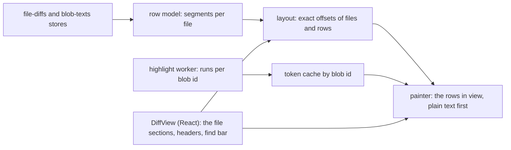

# Diff View: Our Own Renderer on the Blocks of the Engine

**Status:** Implemented  
**Updated:** 2026-10-18  
**Tags:** [ui, diff, highlighting, virtualization, performance]

**What runs and what is planned.** The steps of the Migration run: the row model, the layout, the highlight worker,
`DiffView` in the review windows, in every other 2-way view and in the 3-way view of a conflict, the copy from the
model, the find and the accessibility. A paragraph marked **(planned)** describes code that does not exist yet; the
rest describes the code as it runs.

## Problem

The app shows a diff in five places:
- the review windows: a commit, a range, a pull request;
- the files of a commit in its preview, with the diff under a tree row;
- the uncommitted changes of the amend card;
- the missing commits and the modify/delete file of a conflict;
- the 3-way view of a conflict.

Since the FileDiff model, the backend sends typed blocks per file and the texts by blob id
(`src/lib/diff/file-diff-model.ts`). The views rendered with a fork of `@pierre/diffs` (`packages/diffs`, 28,000
lines). The fork had a model of patch hunks, so `buildFileDiffFromBlocks` translated the blocks into that model. The
benchmark (`pnpm perf:diff`) showed what this cost:

| scenario | metric | Pierre on a patch | Pierre on the blocks |
|---|---|---|---|
| 200 files, open | first rows | 3446 ms | 2765 ms |
| 10k lines, open | first rows | 2976 ms | 3624 ms |
| 10k lines, open | bytes from the worker | 9.72 M | 27.76 M |
| 200 files, expand | highlighted | 1149 ms | 415 ms |

The causes are in the design of the engine, not in its tuning:
- **No row before the highlight.** Pierre renders no line, not even plain text, before the highlighter is ready. A
  diff waits for the HAST of both whole files.
- **HAST on the wire.** The worker sends a tree of objects per token. Both themes are in each token. For the 10k-line
  file this is 27.76 MB of structured clone.
- **Estimated heights.** The virtualizer estimates the height of a file and measures it after the paint. The
  scroll position jumps, and a scroll to a file or to a change needs a correction.
- **A web component per file.** Each diff has a shadow root, its own managers and its own stylesheets. The app shares
  the stylesheets by hand (`sharedStyleSheets.ts`).
- **A model of hunks.** Folds, ignored blocks, inline pairs and scope labels are patches on a patch model. The 3-way
  view of the merge comparison will not fit it.

## Goals

- One renderer for every diff view, built on the blocks of the engine and the two texts. No patch model.
- The first rows paint as plain text before any highlight. The tokens paint in after.
- Exact heights. A scroll to a file, a change or a find hit lands at once, with no correction.
- 60 fps scroll through a 10k-line file and through a review of 200 files.
- A row model that takes three columns, for the 3-way view of a later stage.
- No Pierre view of a 2-way diff at the end. The package stays only for the 3-way view, until the engine has its own.

## Solution Overview

- **Row model.** Each file is a short list of segments made from its blocks: equal lines, a fold, a block. A row is
  found by a binary search, and is made only when it is painted.
- **Layout.** All rows have one height when soft wraps are off. So the offset of each row is arithmetic, and the
  layout is exact before any text arrives. With soft wraps on, the view breaks the lines itself and knows each height
  before the paint.
- **Painter.** React renders the sections of the files in view, with their sticky headers. A painter of our own fills
  each section with the rows in view, in the light DOM, with the app's CSS. It reuses the row elements.
- **Highlighting.** A worker tokenizes a blob with its TextMate grammar. It sends compact runs of style ids for pages
  of lines, as transferable typed arrays. The main thread keeps them by blob id. A theme is a set of CSS variables, so
  one tokenization serves both themes.

## Design

### Input: the diffs and the texts

The stores stay as they are:
- `src/stores/file-diffs.ts` keeps the `FileDiff[]` of a subject under the whitespace policy. `get_file_diffs`
  streams them through a channel: the files, then the content of each file as it is known (`priorityPaths`, the file
  a review opens at, first), then the scopes of a text the caches did not have. A file is in the entry once its
  content arrived, and pending before (`fileDiffOf`); the late scopes replace its content and keep its fold levels.
  Contents within 16 ms go into the store in one update.
- `src/stores/blob-texts.ts` keeps the texts by blob id, in an LRU of 64 Mi UTF-16 units.

Two changes:
- **Text order.** The view asks for the texts of the files in view and one viewport around them first, then, 50 ms
  later, for the 20 files after them. A review no longer waits for all texts before it mounts.
- **Line tables.** A text gets a table of line starts once per blob id: a `Uint32Array` of offsets into the string.
  IntelliJ's rule splits the lines: `\n`, `\r\n` and a lone `\r`. The painter slices a line from the text only when it
  paints the line, so no array of line strings lives in memory. The table also holds the widest line in columns, for
  the horizontal scroll.

`view-files.ts` gives what a file shows besides its rows: the counts of the engine (`withEngineCounts`), the notices
("Binary file", "Too large to show: …", "Submodule: a → b", "Line endings: LF → CRLF"), the files that start
collapsed, and the grammar of a path.

### The row model

A file is a list of segments. A segment holds its start line on each side and the count of its rows:

| segment | rows | from |
|---|---|---|
| `equal` | one per line | the context of a block, an expanded fold, an ignored block of equal length |
| `fold` | one separator | the unchanged lines outside the context, with the scope label |
| `block` | per mode, below | a `changed` or `whitespaceOnly` block |
| `ignored` | per mode, below | an `ignored` block with unequal sides |

The rows of a block depend on the mode:
- **Unified:** the deleted lines, then the added lines.
- **Inline:** one row per pair when `inlinePairs` is true. Each row is the new line, with the deleted parts of the old
  line before the inserted parts. Another block shows as in Unified.
- **Split:** `max(old, new)` rows. The shorter side is filled.

The rows of an `ignored` block show as unchanged lines. Unified and Inline show its new lines and leave out its old
lines, so the old line numbers jump, as in IntelliJ. Split shows both sides plain, the shorter side filled.

The line indices are the engine's. A text that ends with a line end, and an empty text, end with an empty line that
the engine counts (`emptyLastLine`). The row model leaves that line out when no block touches it, so a file shows no
empty last row and a fold counts only real lines.

**Tints.** The tints are IntelliJ's (`SimpleDiffChangeUi`, `TextDiffTypeImpl.getIgnoredColor`). A block with inner
ranges draws its lines pale (the change colour mixed 0.6 with the background) and its ranges in the full colour. A
block without inner ranges (`lineLevelOnly`, or ranges dropped) draws its lines in the full colour. A
`whitespaceOnly` block draws its lines pale with nothing strong. So a re-indent under `Default` shows pale lines with
the indentation in the full colour.

**Types.** The cells take IntelliJ's diff types (`row-cells.ts`, the colours in [UI Theme](ui-theme.md#diffs)). Split
types a block by its sides, inserted, deleted or modified, and its inner ranges by their own `RangeKind`
(`data-typed`); the empty side of an inserted or a deleted range is a marker part, a bar 2 px wide that takes no
width. Unified and Inline type a deleted line deleted and an inserted line inserted, their words too.

**Context and folds.** The context is 4 lines, as IntelliJ's default. Two blocks whose context touches share one
span. The unchanged lines outside the context become a fold. The label of a fold is the innermost scope around the
folded lines, the new side first.

The folds nest as in IntelliJ (`FoldingModelSupport`: `getRangeShift`, `FoldingBuilderBase.addGroup`). Around each
change they start at 4, 8 and 16 lines of context. So the unchanged lines between two changes have up to three levels:
- level 0 shows 4 lines next to each change;
- a click on the fold goes to level 1, which shows 8 lines;
- the next click goes to level 2, which shows 16 lines;
- the next click shows all lines.

A level that shows no more lines than the one before it is skipped. At the start and at the end of a file, the fold
has a change on one side only, so a click shows more lines on that side. "Expand All", a button of the header of a
file in a review, and ⌥-click (Alt-click) on a fold show all lines of the file.

The level of each fold is a small array per file. A click changes one level and builds the segments of the file again.
The view keeps the levels by the `TextDiff` object, so the lines a diff expanded stay expanded while the store keeps
the diff.

**Sides.** A row holds a line reference per side: a line index, or a gap. Split has two sides, and Unified is a
projection of the same rows into one column. The 3-way view of the merge comparison adds a third side (the left, the
base, the right). No other type changes for it.

**End of the file.** A side without a newline at its end gets a marker after its last line, with the tooltip "No
newline at end of file". Pierre adds a row for it, which changes the heights per side.

The segments of a file are O(blocks), also for a file of 10,000 lines. A mode switch or an expansion builds them again
in microseconds.

### Layout and virtualization

**Items of the document.** The view is a document of items: the header of a file (36 px, `h-9`), the notice of a
file (one row; the review windows show their notices in the header and use no notice row), and the rows of a file. Each item has a known height:
- Soft wraps off (the default): every row has the row height. The height of a file is `header + rows × row height`.
  The row count comes from the blocks and the line counts, so the layout is exact before the texts arrive.
- Soft wraps on: the height of a row is its count of visual lines × the row height. The view computes this count
  itself, see below.

**The row height.** It comes from the metrics of the editor font, not from a constant:
- The view measures the ascent and the descent of the font with `measureText` of a canvas, at the font size of the
  diffs (13 px). It multiplies their sum by IntelliJ's default line spacing (1.2).
- It rounds the result to whole device pixels at the current scale (`devicePixelRatio`, which holds the zoom of
  Appearance). So the rows land on the pixel grid at every zoom level, and the heights stay arithmetic.
- The view sets the result as `--diff-row-height` on its root.

A change of the zoom, of the screen or of the font load computes the row height again. Then the view lays out all
files again and keeps the scroll anchor (below).

A `Float64Array` of file offsets gives the offset of each file. A binary search finds the file at a scroll position,
and arithmetic finds the row in it. An expansion or a collapse changes one file, so the offsets after it move by the
difference: O(files).

A row has a fixed height in CSS (`height: var(--diff-row-height); overflow: hidden`). A fallback glyph, such as an
emoji, cannot make a row taller.

**Soft wraps: our own breaks.** The browser does not break the lines. The view breaks them itself and paints each
visual line as its own line box with `white-space: pre`:
- The font is monospace (JetBrains Mono, ligatures off). The view measures the width of a column once per font
  load and per scale. An ASCII line is as wide as its length in columns. A tab goes to the next tab stop: 4 columns
  for now (see Open Questions).
- For a line with other characters, the view measures each code point once with `measureText` of a canvas, in the
  same font stack. It caches the widths per code point. CJK and emoji in a fallback font are not 2 columns wide.
- The break is greedy: after a space or a punctuation mark when the line has one, else at the edge. A wrapped part
  starts at the indent of its line, at most half the width, as IntelliJ's soft wraps do.
- In Split each side breaks at its own width. The row is as tall as its taller side.

So the view knows the height of a row before the paint, and the DOM matches it exactly.

**When the estimate is wrong.** A font or a code point can make the canvas width differ from the DOM width. Then a
visual line is too wide for its box, or our break comes too early. A wrong estimate must not stay:
- After the paint, the painter checks each new row that has a code point outside ASCII, once per row and width. It
  compares the `scrollWidth` of each line box with its `clientWidth`, and the width of the text with the canvas sum.
- When they differ, it measures the line in the DOM (a `Range` over the text), breaks it again, and corrects the
  widths of its code points in the cache. The row gets its new height, and the view keeps the anchor.
- An ASCII line needs no check: its width is its column count.

A `ResizeObserver` is not needed for this check, because the painter knows which rows it just painted.

Measured heights (a `ResizeObserver` per row) were the alternative. The view knows them only after the paint, so each
change makes the content jump, and each measure costs a layout.

**Scroll anchoring.** These events change heights while the user reads:
- a fold expands or a file collapses;
- the row height changes (the zoom, the screen, the font load);
- the width of the view changes (wraps on);
- the texts of a file arrive (wraps on: the visual lines replace an estimate of one per line);
- the font finishes its load (wraps on).

Before the change, the view keeps the anchor: the first row whose bottom is below the top of the viewport. The anchor
is its file, its line on one side, its visual line and its pixel offset. After the change, the view sets `scrollTop`
to the new offset of the same anchor, in the same task, before the paint. The browser's own anchoring is off
(`overflow-anchor: none`). It chooses an anchor among the rows in the DOM, and those change with every frame. An
expansion keeps the clicked separator at its place, so the new lines go below it. With wraps on, a resize first
computes the files in view and paints them. It computes the other files in idle slices, and keeps the anchor at each
step.

With soft wraps off, only a fold, a collapse or a new row height changes a height. Between them the rows never move.

**Limits (planned).** Browsers limit the height of an element: about 16 million px in some engines, which is about 800,000
rows of 20 px. The rules that start a large file collapsed (over 1,000 changed lines, lock files, generated files)
keep a review far below this. A view over the limit collapses its largest files first. The view does not scale the
scroll coordinates.

### DOM and React

**Light DOM, the app's CSS.** No shadow root. The rows use the tokens of `src/index.css` and a small stylesheet
`src/components/diff/diff-view.css`, with Tailwind where React renders. E2E tests and the accessibility tree see the
rows as any other element. A shadow root would only isolate the styles, and the app owns all styles here.

**React for the sections, a painter for the rows.** React renders `DiffView`:
- the scroll container;
- a section per file three viewports above and below the view (`DiffSection`, a memoized component), each at its
  offset;
- the sticky header of each section (the existing header parts: status, path, owner, counts, copy, menu) and its
  notice;
- the find bar.

Each section has the full height of its file. So its header sticks with `position: sticky`, and no code measures it.

The painter is a plain class, not a component. It fills the rows element of each section with the rows in view and
one viewport around them:
- The rows have `position: absolute` at their offset. A row never moves once it is placed, because the container
  scrolls natively.
- On a scroll, the painter adds the rows that come into range. It removes the rows that leave. It
  works in the scroll event, so the frame shows the new rows.
- A row of plain text is one text node per side. When the tokens of its page arrive, the painter replaces the text
  node with spans.
- One delegated listener per view handles the clicks: a fold, a header chevron.

The scroll path never goes through React. React renders again only when the set of mounted files changes: the files
ahead in a transition, at an idle moment. When the painter needs a section that React has not mounted, it calls
`flushSync`, so a fast scroll shows no blank section; a memoized section renders only when its own props change.

A rendering of the rows in React was the alternative. A fast scroll replaces about 60 rows of about 10 spans per
frame. React renders the update of a scroll event with a continuous priority, so the render can come after the frame,
and that frame is blank. The painter does this work in about 1 ms, with no reconciliation.

**React Compiler.** `DiffView` follows the rules of the repository:
- It creates the painter in a `useState` initializer. The constructor touches no DOM.
- It attaches the painter to its element in a `useLayoutEffect`.
- It passes the props to the painter in layout effects, and reads no ref during the render.
- The painter reports to React through callbacks that set state: the files in view, the file at the top.

A component selects narrow slices of the stores, as `AGENTS.md` asks.

**Row elements.** A row is a `div` with `data-row`, `data-kind` (`context`, `added`, `deleted`, `inline`, `fold`,
`filler`) and `data-tint` (`pale` or `whitespace`) on a half that is not in the full tint. It holds a gutter cell per line number (`aria-hidden`, not
selectable) and a code cell. In Split, the row holds a half per side. A gutter has a fixed width: the digits of the
largest line number of the file.

### Horizontal scroll with soft wraps off

The rows are virtualized vertically, so no element holds all the rows of a side. A native horizontal scroller per
side and per file cannot work: its scrollbar would be at the end of the file, and the rows come and go.

So each file keeps a horizontal offset per side:
- A thin native scroller per side is sticky at the bottom of the viewport, inside the section of its file. Its width
  is the widest line of the side, from the line table. It shows only when the side is wider than its column.
- The code cells of a side move by `transform: translateX(calc(-1px * var(--scroll-old)))`. One write of the custom
  property on the section moves every row of the side. The gutter does not move, as in IntelliJ.
- A wheel or a trackpad gesture with a horizontal delta over the code of a side moves its scroller. Shift with the
  wheel does the same. A trackpad sends its momentum as wheel events, so the scroll feels native.
- In Split, a scroll of one side sets the other side to the same offset, as IntelliJ's `SyncScrollSupport` does.
  Unified has one side.

The offset is per file, as in IntelliJ's combined diff. A long line in one file does not move the others.

### Syntax highlighting

**A worker per window, two in the main window.** The view pins a blob to one worker: the worker with the fewest queued
lines when the view first asks for the blob. The worker keeps the text and the grammar states of its blobs, so a later
page of the same blob costs only its own lines.

**Tokenization.** The worker uses the TextMate grammars of Shiki with the JavaScript regex engine, as now. It calls
`tokenizeLine2` of the grammar. That gives a `Uint32Array` of token starts and metadata, not objects.

**One theme of roles.** The metadata holds an index into the colour map of the theme. The worker uses one synthetic
theme in which each colour is a role: keyword, string, escape, number, comment, declaration, field, annotation, tag,
attribute, and the default foreground. Font styles (bold, italic) are bits of the metadata. `islands-themes.ts` keeps
its map from scopes to roles. The colours of the IntelliJ Light and Dark schemes move to CSS variables in
`src/index.css` (`--syntax-keyword` and the others). So one tokenization serves both themes, and a theme switch
changes only CSS. Pierre highlights each token for both themes.

**Compact runs.** The worker answers per page of 256 lines:
- `lineStarts: Uint32Array(257)`: where the runs of each line start;
- `runs: Uint32Array`: pairs of a UTF-16 offset in the line and a style (the role and the bits).

The worker merges adjacent runs of one style. A line in the default foreground has no runs. Both arrays go as
transferables, with no copy. A page of Kotlin has about 6 runs per line, so about 12 KB. The 10k-line file is about
500 KB, not 27.76 MB.

**First screen before the whole file.** A TextMate state depends on all lines before it, so an exact page needs the
states of every earlier line. The worker works in this order:
1. The pages in view. When no exact state is at the start of a page, the worker starts from the initial state at the
   nearest line above with no indent, at most 100 lines up. It sends these runs as provisional. The viewport
   tokenization of VS Code does the same.
2. An exact pass from the last exact checkpoint to the pages in view. It keeps the state at the start of each page as
   a checkpoint. When it reaches a provisional page, it sends the exact runs only if they differ.
3. The pages one viewport around the view, then the other shown lines of the files in view, then the next files.

The worker works in slices of 8 ms and yields between them, so a new request of the view goes first. Each request has
a generation, and the worker drops the work of an older viewport. A line over 1,000 characters stays plain text. A
line gets at most 20 ms, the time limit of `tokenizeLine2`.

**Token cache on the main thread.** The runs go into a cache by blob id and page. It has a budget of 32 MiB of
arrays, and the least recently painted blob goes out first. The same blob in another commit or range of the same
window costs nothing. A review window has its own cache and worker.

**Protocol.**
- `text { blobId, language, text }`: once per blob and worker.
- `tokens { blobId, pages, generation }`: the pages the view needs.
- The answer `page { blobId, page, exact, lineStarts, runs }`, transferred.
- The answer `missing { blobId }`: the worker dropped the text from its LRU (64 MiB). The main thread sends the text
  again.
- The answer `failed { blobId, reason }`: the grammar did not load or failed. The blob stays plain text, and the view
  logs the error once.

When no worker can start, the main thread tokenizes the pages in view in idle slices of 4 ms, with the same code.

**Languages.** `languageOfPath` of `src/lib/diff/file-languages.ts` maps a file name to a grammar id. Its table comes
from Pierre's `getFiletypeFromFileName` (Apache-2.0, `file-languages.LICENSE.md`), cut to the bundled ids, with the
attribution in its header. `CUSTOM_EXTENSIONS` beside it adds our extensions (`.gradle`, `.iml`, `.form`,
`Cargo.lock`). The `shikiBundle` plugin with `bundled-languages.ts` keeps the build to 84 grammars. A grammar loads in
the worker with the first blob of its language. The first line of a grammar that the time limit cuts gets one more try
with 1 s: the first lines compile the regexes of the rules.

### Painting the layers of a line

A code cell can show up to four layers:
- the syntax runs;
- the changed ranges of the engine (`oldRanges`, `newRanges`), on the emphasis colour;
- in Inline, the deleted parts of the old line, in a `data-inline-deleted` span that is not selectable;
- the hits of the find, on the find colour.

The painter merges the boundaries of the layers into one list of spans per line. A span has one class per role
(`t-keyword`) and one per layer (`range`, `hit`). The deleted parts of an Inline row take the syntax runs of the old
line. The rule of `composeInlineLine.ts` aligns the ranges of the two lines by index. That rule moves into the
painter.

### Interaction

**Selection and copy.** The browser selects the text of the rows in the DOM:
- The gutters are not selectable.
- In Split, a press on a side makes the other side not selectable (`data-select-side` on the view), so a selection
  stays on one side.
- The painter keeps the row of the anchor of a selection in the DOM while the selection lives. So the browser does
  not lose the selection when that row leaves the view.

A `copy` event builds the text from the model, not from the DOM. It maps the two ends of the selection to a file, a
row, a side and an offset (from `data-row` and the text nodes of the code cell). Then it joins the lines between them
from the texts. So a selection over rows that are no longer in the DOM copies all its lines. The copy does not take
the breaks of soft wraps or the deleted parts of an Inline row. Unified copies its rows as shown, deleted and added
lines. ⌘A in the diffs selects the side of the file at the top.

**Keys.** J and K go to the next and the previous file. N and P go to the next and the previous change. Both use the
layout, so the scroll lands exactly at once:
- A file goes to the top.
- A change goes to its first row, with its 4 rows of context visible below the sticky header.

The targets of N and P are the `block` segments, so N and P skip an `ignored` block and a collapsed file. A
`whitespaceOnly` block is a target: it is pale, and it counts, as in IntelliJ.
They are `FileRows.changeStarts`. The rule of the review stays: after a scroll that the view made, the file
at the top changes the selection only after a wheel, touch, pointer or key event.

**Find in the diffs.** ⌘F (Ctrl+F off macOS) in a view with its own scroller opens a find bar above the diffs
(`DiffFindBar.tsx`). The find searches the model, not the rows in the DOM (`find.ts`):
- It searches the lines that the rows show, file by file in the order of the view: both sides of a change in Split,
  the new side of an unchanged line. With "In folded lines" on, it searches the folded lines of the new side too. A
  hit in a fold expands the fold when the find goes to it.
- It asks for the texts of every file it searches; the count grows as they arrive ("12 results", then "3 of 12").
- Enter and ⌘G go to the next hit, and Shift with them to the previous one. The scroll is exact: the hit a third of
  the viewport below the header.
- The painter draws the hits as a layer, the current one stronger.

The search runs in one pass over the texts it has. A review of many large files can make it a slice job of the
worker later.

**Accessibility.**
- The scroller has `role="region"`, the label "Diffs", and the focus. The arrows, PageUp, PageDown and Space scroll it
  natively.
- Each file section is a `region` with its path as the label.
- A fold is a `button` with the label "Expand 120 unchanged lines in fun main()". It is not in the Tab order, because
  a review has hundreds of folds.
- An added or a deleted row says so with CSS generated content with alternative text (`content: "" / "added"`). A
  screen reader reads it, and a copy does not take it.
- The colours have the contrast of the app's tokens. No scroll is animated when the OS asks for reduced motion.

### One component for every view

`DiffView` takes the files (`FileDiff`, the texts from the store, the header parts of each file), the mode, the soft
wraps, the whitespace policy, and where it scrolls:
- **Its own scroller:** the review windows. The files of a commit or a range in the order of the tree, sticky
  headers, the file at the top reported, the handle `scrollToFile`, `moveChange`, `find` and `focus`.
- **The scroller of its parent:** the diff under a tree row of the preview, the uncommitted changes of the amend
  card, the missing commits and the modify/delete file of a conflict. The view finds the rows in view from its
  position in the nearest ancestor that scrolls, and listens to the scroll of that ancestor. It has no header: the row
  or the item above it names the file, and a notice row under it says why the file shows no lines.

Each open item of `SubjectFileDiffList` (the uncommitted changes, the missing commits) and of
`ConflictingFilesSection` shows its file in a `DiffView` of its own. The lists keep their accordion, and the items keep
their headers and their actions. The diff under a tree row is no longer limited to 2,000 changed lines, because its rows are virtualized
too. HTML snapshots keep the rows element of a view without its rows and the styles of its layout, which depend on
what is in view, on the font and on when the tokens arrive (`tests/e2e/setup/tauri-mocks.ts`).

**The review window.** The window shows once the rows of the first files are painted. It does not wait more than
80 ms for the tokens. `prepareFirstDiffs` and the `initialize()` of Pierre's pool go.

### The 3-way view

A conflicting file shows as IntelliJ's merge viewer shows it, read-only: three columns, left the branch the commit is
copied onto (ours, stage 2), right the commit (theirs, stage 3), the middle the result or the base.

- **Data.** `get_file_merges` streams the merges of a cherry-pick as `get_file_diffs` streams the diffs: the files,
  the content of each, the open file first, then the late scopes. `src/stores/file-merges.ts` keeps the last 8 by the
  repository, the source (parent, target, commit) and the whitespace policy. Both stores are `createFileStream` of
  `src/stores/file-stream.ts`. The texts come by the blob ids of the stages, as the texts of a diff.
- **Rows.** `buildMergeRows` builds the rows of a `TextMerge` with the row model of a diff: a run of equal lines on
  the three sides, a block with `max(left, middle, right)` rows and the shorter sides filled, the nested folds, the
  empty last line left out. Every block is a change that N and P stop at: an ignored block is pale, never unchanged
  lines, as in IntelliJ's merge viewer. IntelliJ's merge has no IgnoreBlankLines, which merges as Ignore. A row of a
  block
  carries `blockRow`, so every side finds the inner ranges of its line.
- **The middle column.** "Result (proposed)" is the default: each block as `resultSourceOf` says, the side that
  changed it, the text of its resolve by words, or the base for a conflict that does not resolve. "Base" shows the
  base. The result is a text that no blob holds: `composeResult` composes it once the three texts are read, and the
  view keeps it in the blob texts store under its own id (`resultTextId`), so the line tables, the highlight worker
  and the widths take it as a blob. A copy that the sync committed with the conflict resolved by words
  (`MergeSource::CherryPick::resolved`) shows "Result (committed)": the blob of the file in the copy
  (`resolvedId`), read by its id as the sides are, not a text the view composes.
- **Cells.** `mergeCells` of `src/lib/diff/row-cells.ts`, as `diffCells` for a diff, tells the painter the columns,
  the kind of each cell and its ranges. A block has the colour of its kind (inserted green, deleted grey, modified
  blue, conflict red) in the middle and on each side that changed it; a side that did not change it stays plain. The
  tints follow IntelliJ's `DiffViewerHighlighters`: a block with inner ranges, also empty ones, and an ignored block
  are pale, the changed words in the full colour; an insertion or a deletion without them is in the full colour. A
  conflict that the result resolves has a dashed bar in the middle.
- **Notices.** A notice row under the columns: "Git stops here; the conflict resolves by words" when `conflicts > 0`
  and `unresolved == 0`; "3 conflicts, 2 of them resolve by words" when some resolve. A one-sided merge (modify/delete,
  rename/delete) shows the 2-way diff of the base to the side that kept the file. A binary, too large, submodule or
  missing merge shows a line that says so.

The painter, the layout, the copy and the folds take any number of sides: a row has a line per side, a fold a range
per side, and the cells give the columns.

### What came from the fork

The fork of `@pierre/diffs` (`packages/diffs`) and `@pierre/theming` are gone, with the project reference of
`tsconfig.app.json`, the lint excludes and the React Compiler exclude.

| module | decision |
|---|---|
| the rule of `composeInlineLine.ts` | in the painter, written again on runs (`inlineParts` of `line-parts.ts`) |
| `buildFileDiffFromBlocks` | its rules are the row model |
| `UnresolvedFile` and the zdiff3 text of the conflicts | the 3-way view on `DiffView`, on the merges of the engine |
| the extension table (`getFiletypeFromFileName`) | `file-languages.ts`, cut to the bundled grammars, attributed |
| the worker pool, the Shiki themes, the other modules | gone |

### Pierre's choices, questioned

| Pierre | the new renderer | why |
|---|---|---|
| a model of patch hunks, our builder translates into it | segments from the blocks | no translation, O(blocks) memory |
| no row before the highlighter is ready | plain text first, then the tokens | the first rows wait for no worker |
| HAST of both whole files | sparse pages of runs, by blob id | 50 times fewer bytes, no wait for a whole file |
| each token in both themes | role styles, colours in CSS variables | one tokenization, a theme switch in CSS |
| estimated heights, measured after the paint | arithmetic heights, our own soft wraps | no jumps, exact scroll targets |
| a web component and a shadow root per file | light DOM, the app's CSS | one stylesheet; tests and accessibility see the rows |
| managers per file (interaction, resize, scroll sync) | one painter and one listener per view | less work per file |
| a native horizontal scroller per column | an offset per file and side, a sticky scrollbar | it works with virtualized rows; the gutter stays |
| expansion in chunks of lines, up or down | nested folds at 4, 8 and 16 lines, then all; Expand All | IntelliJ's folding |
| a "No newline at end of file" row | a marker after the last line | one row per line, exact heights |
| filler rows in Split | kept | one row index for two or three sides |

## Performance Targets

The app runs in WKWebView on macOS, so the targets apply to WebKit. They stand against the fork on the corrected clock
(about 300 ms to the first rows in Chromium); first rows ≤ 350 ms in WebKit counts without the start of the window,
and the table gives both. [Measuring](#measuring) says how the benchmark
gets the numbers. The fork is Pierre on the blocks (commit 93cebd46) on the same clock; "DiffView" is the end of the
migration, on the streamed diffs. The medians of 3 runs, the machine at a load of about 30.

| scenario | metric | fork, Chromium | DiffView, Chromium | DiffView, WebKit | target |
|---|---|---|---|---|---|
| 200 files, open | ready | — | 131 ms | 322 ms | — |
| 200 files, open | first rows | 299 ms | 168 ms | 412 ms | ≤ 350 ms |
| 200 files, open | first rows after ready | — | 37 ms | 90 ms | ≤ 350 ms in WebKit, the window start apart |
| 200 files, open | highlighted | 303 ms | 183 ms | 452 ms | ≤ 450 ms |
| 10k lines, open | ready | — | 77 ms | 216 ms | — |
| 10k lines, open | first rows | 237 ms | 102 ms | 267 ms | ≤ 300 ms |
| 10k lines, open | highlighted (provisional pages count) | 802 ms | 119 ms | 323 ms | ≤ 400 ms |
| 10k lines, open | bytes from the worker | 27.76 M | 0.03 M | 0.03 M | ≤ 1 M |
| 200 files, expand a fold | highlighted | 415 ms | 53 ms | 83 ms | in the same frame |
| scroll, 20 viewports/s | a scroll event with its layout, p95 | — | 2 ms | 5 ms | ≤ 4 ms |
| scroll | frames with an empty row | — | 0 | 0 | 0 |
| any | DOM nodes of the view | — | 964 | 930 | ≤ 4,000 |
| any | long tasks after the first rows | — | none | none | none over 50 ms |

The frames over 16.7 ms are not in the table: the still control drops as many frames as the scroll in a headless
browser under load (Chromium 25–35 %, WebKit 100 % at a slow scroll). The heap is not either: `performance.memory` is
not there in a headless browser. If "ready" alone takes more than 250 ms, the start of the window becomes its own
task, apart from this renderer: in WebKit it is 322 ms of the 412 ms of the 200 files.

The fork did not finish the open of the 200 files in WebKit: the benchmark stopped it after its 20 minutes.

Two rules keep a scroll event short in WebKit. React mounts the sections three viewports around the view, the ones
ahead in a transition, so a scroll event mounts a section only when its frame needs it; and a section is a memoized
component, so a mount renders that section alone. The benchmark times the whole scroll event with the layout of the
rows it added (`DiffPainter.onVerticalScroll` reads the scroll position after the paint): a time of the paint alone
leaves the layout to the next read and hides it.

### Measuring

`pnpm perf:diff` (`tests/perf/diff-review.perf.ts`, `playwright.perf.config.ts`) opens the review window on the
production build of the e2e setup, over two synthetic commits (`tests/perf/diff-fixtures.ts`): 200 files (four of
3,000-5,000 lines), and one file of 10,000 lines. Routed answers of `get_commit_files`, `get_file_diffs` and
`get_blob_texts` give the diffs of the engine and the texts. `--project=chromium` and `--project=webkit` run one
engine; `PERF_RUNS` sets the runs (3). The medians go to stdout and to `tests/results/perf/diff-review-<project>.json`.

- **The clock.** An open is timed from the request of the opener (`__SUB_WINDOW_OPEN__.openedAt`). A review window
  can be reused or made before its open, so the clock of the page does not start with the open. The first numbers of
  the fork (3446 ms to the first rows of 200 files) were on that clock and held the age of the window.
- **Open:** the time when the review root mounts (ready), when the first rows with text show, and when every visible
  row is highlighted; the long tasks until the window is quiet for 1.5 s; the DOM nodes of the view.
- **Expand:** the time from a click on the first fold of a large file to its highlighted rows.
- **Bytes:** the length of the strings and the typed arrays of each worker message, in a run of its own, because
  counting costs main-thread time.
- **Scroll:** a scroll per frame through the diffs for 2 s, at 3 and at 20 viewports per second. It records the frame
  times, the time of each scroll event of `DiffPainter` with the layout of its rows (the page collects it in
  `__diffPaintTimes` while the benchmark runs),
  and the frames with a point of the viewport that no row covers. The same loop without a scroll ("still") gives
  the frame times the machine allows: a headless browser under load drops frames with no work at all.
- **Memory:** `performance.memory`, where the browser has it; a headless browser does not.

Playwright's WebKit is the closest engine the repository can drive. It is not WKWebView, so a release also gets a
manual check in the app.

## Migration

The steps are done; the 3-way view is the next stage.

Small commits. Each one is green: lint, types, unit tests, and the e2e tests of the views it switches.

1. `docs`: this design.
2. `feat(diff)`: the row model of a file from its blocks: segments, the three modes, folds with scope labels, the
   expansion, the sides. No view uses it yet.
3. `feat(diff)`: the layout: the file offsets, the fixed heights, our own soft wraps, the anchor. Unit tests.
4. `feat(diff)`: the highlight worker (the theme of roles, the runs, the checkpoints, the provisional pages, the
   priorities) and the token cache by blob id. The colours of the roles go into `src/index.css`. Tests on the worker
   module, without a `Worker`.
5. `feat(diff)`: `DiffView` with the painter in its own scroller: plain text first, the tokens, the folds, the sticky
   headers, the horizontal scroll. The review windows switch to it (`CommitReviewCode`). The benchmark gets its new
   metrics, and the commit message has the numbers.
6. `feat(diff)`: the selection and the copy from the model, J, K, N and P on the layout, the focus, the accessibility.
7. `feat(diff)`: the scroller of the parent. The preview, the uncommitted changes, the missing commits and the
   modify/delete file switch; their accordions stay, an open item holds a `DiffView`. The limit of 2,000 changed
   lines goes.
8. `feat(diff)`: the find in the diffs, with the spec change and its e2e test.
9. `chore(diff)`: the 2-way Pierre views of the app and `buildFileDiffFromBlocks` go, with their tests. The other
   modules of the fork stay for `UnresolvedFile`, which extends `FileDiff`.
10. `feat(diff)`: the 3-way view on `DiffView`, on the merges of the engine (`get_file_merges`).
11. `chore(diff)`: the fork goes, with `@pierre/theming`.

## Alternatives Considered

- **Replace parts of the fork.** The model, the layout, the worker protocol and the DOM all change. Nothing of value
  stays in the other 27,000 lines, and each upstream change would conflict.
- **Split as IntelliJ: two columns without fillers, joined by shapes in the divider.** Each side would have its own
  height, and the scroll would map the two through the blocks. That does not fit one stream of files with sticky
  headers, and a third side makes it harder. The shapes can come later, in the gutter between the fillers.
- **CodeMirror 6 merge view, the Monaco diff editor.** An editor per file, no stream of many files, heavy, and themed
  apart from the app.
- **The CSS Custom Highlight API for the tokens.** It paints the colours with no spans. But it has no font style (the
  comments of IntelliJ are italic), and its live ranges must follow the reused rows. Spans are simpler. We look at it
  again if the spans show in a profile.
- **Canvas.** No native selection, no accessibility, worse text.
- **Tokens on the main thread in idle slices.** A large file would take frames from the scroll.

## Open Questions / Risks

- The start of a review window in WebKit: Playwright's WebKit mounts the review root 322 ms after the open request
  (Chromium 131 ms), of the 412 ms to the first rows of the 200 files. The app creates its review windows ahead in
  WKWebView, so this is measured in the real app first, as a task of its own.
- The scroll of many absolute rows in WebKit must hold 60 fps. Step 5 measures it in Playwright's WebKit before the
  other views switch. Playwright's WebKit is not WKWebView, so the app gets a manual check too.
- Our soft wraps break a little differently from IntelliJ's, for example at punctuation.
- Right-to-left text in a code line: the column math assumes left-to-right. Such a line gets `unicode-bidi: plaintext`
  and its width from `measureText`.
- A provisional page can show wrong colours in a long block comment or string, until the exact pass replaces it.
- The tab stop is 4. The backend can read `tab_width` (or `indent_size`) of `.editorconfig` for a file when that is
  cheap, and send it with the `FileDiff`. Otherwise a setting gives it. This does not block the migration.
- The keys that expand a fold without a pointer are not designed yet.

## References

- [UI Theme](ui-theme.md) ("Diffs")
- [Rendering Performance](rendering-performance.md)
- [Commit Files](../../spec/commit/commit-files.spec.md)
- [Commit Review](../../spec/commit/commit-review.spec.md)
- [Commit Row](../../spec/commit/commit-row.spec.md) ("Conflict view")
- `src/lib/diff/file-diff-model.ts`: the model of the backend
- VS Code: the viewport tokenization of `TextMateTokenizationSupport`
- IntelliJ: `SyncScrollSupport`, `FoldingModelSupport`, the soft wraps of the editor
