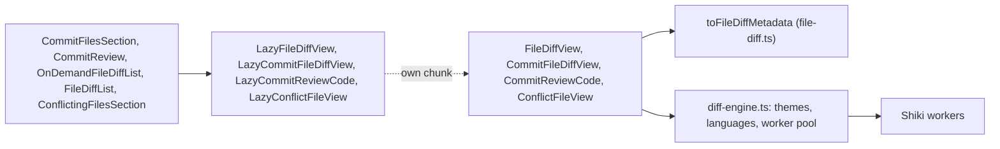

# Diff View: the @pierre/diffs Engine

**Status:** Implemented  
**Updated:** 2026-10-15  
**Tags:** [ui, diff, highlighting, performance]

## Problem

The app shows diffs in four places: the files of a commit in its preview, the uncommitted changes of the amend card,
the conflicting files and the missing commits of a conflict, and the 3-way view. They used `@git-diff-view/react`
with lowlight (highlight.js grammars) and a Vite plugin that cut the grammar set down. That engine had:

- no word diff: a changed line was red and green as a whole, also for a one-character change;
- no expansion of the unchanged lines between hunks;
- highlighting on the main thread, and grammars that read Kotlin and Gradle roughly;
- no virtualization, which a view of a whole commit needs.

## Solution Overview

[`@pierre/diffs`](https://diffs.com) (Apache-2.0) renders every diff. It highlights with Shiki (TextMate grammars, the
VS Code ones) in a pool of web workers, marks the changed words of a changed line, expands the unchanged lines when it
has the file contents, and has a virtualized multi-file view. It renders into the open shadow root of a
`<diffs-container>` element, themed by CSS custom properties.

## Design

### Architecture

- **Lazy chunk.** The views render `LazyFileDiffView` (`src/components/diff/LazyDiffViews.tsx`). It loads
  `FileDiffView.tsx` with `React.lazy`, and with it Pierre, Shiki, the themes and the worker pool. Nothing of the
  engine is in the main chunk; the grammars are further chunks loaded per language.
- **Adapter.** The backend sends a `FileDiff` (`crates/git-ops/src/conflict_analysis.rs`): one `diff --git` patch
  (a commit file, an uncommitted file, a missing commit) or hunks that each repeat the `---`/`+++` header (the change
  of a commit in a modify/delete conflict). `joinFileDiffHunks` makes one patch of either, `toFileDiffMetadata` parses it with Pierre's
  `processFile` (`src/lib/diff/file-diff.ts`).
- **Contents.** A missing commit and a modify/delete conflict also send both file contents, from the same two versions as the
  patch. With `withContents` the parsed diff is complete, and its hunk separators expand the unchanged lines without a
  request. Without the contents the separators only count the lines.
- **Commit files.** The files of a commit in its preview come from the patch of the whole commit
  (`get_commit_patch`, one `diff-tree -p --full-index`, kept for the last 8 commits by `src/stores/commit-patch.ts`).
  `getCommitFileDiff` (`src/lib/diff/commit-patch.ts`) parses its sections once per patch and finds a file's section by
  its path; `CommitFileDiffView` shows it with `loadCommitFileContents` as the loader, which reads both blobs by the ids
  of the `index` line (`get_blob_contents`) when the unchanged lines expand. A failed load is a `notifyError` toast:
  Pierre only logs it. The parsed diff keeps its identity, so the lines it expanded stay expanded.
- **Review.** `CommitReviewCode` (`src/components/diff/CommitReviewCode.tsx`, its own lazy chunk) shows every file of
  a commit in Pierre's virtualized `CodeView`: one item per file in the order of the tree, sticky custom headers
  (`renderCustomHeader`, `h-9`, the `diffHeaderHeight` metric the virtualizer lays out with), lock, generated and huge
  files collapsed. `CommitReview` puts a sidebar beside it (its slots: the commits of a range on top, `sidebarTop`; the
header of the files, `filesHeader`; then the tree) and a slot above it (`codeTop`, the commit a range shows), and talks
to it through a handle: `scrollToFile` (a choice in
  the tree, J, K) and `moveChange` (N, P, over `getChangeTargets` of `src/lib/diff/change-targets.ts`). The view
  reports the file at the top from `onScroll` with a binary search over `getTopForItem`; after a scroll it made itself
  it waits for a wheel, touch, pointer or key event, or the file above the last ones (which cannot reach the top)
  would take the selection back ([Commit Review](../../spec/commit/commit-review.spec.md)). Every state of the review
  (loading, no files, an error) is inside one focusable root (`data-review-root`), and the split is there in every
  state: only the tree and the diffs are keyed by the subject and the filter (`LoadedReview.key`; the tree state resets
  with the key during render), so the slots of the sidebar never unmount. The diffs of the last subject took the focus
  with them, the root holds it until the next ones mount, so the keys of the surface keep working; the diffs take it
  only from inside the root, from what contains it, or from the body, never from what the user works in beside them
  (`data-review-keeps-focus`: the commits, the header of the files with the owner chips).
- **Range review.** `RangeReview` (`src/components/review/RangeReview.tsx`) is the review of a range, a part of a
  stack or a pull request: the commits (`RangeReviewItem`s of `src/lib/range-review.ts`: the scopes, "All Changes" and
  "Since Your Review", then the commits newest first) in the `sidebarTop` of `CommitReview` of the chosen item, above
  the files, with the subject, meta line and message of a chosen commit in its `codeTop`, as the commit picker of a code review on GitHub or
  in IntelliJ. One component for every surface, the commits of both are `ReviewCommit`s; a commit is never a nested
  preview. The review of a commit, a branch and a pull request opens only in a window of its kind
  (`commit-review`, `branch-review`, `pull-request-review`; one link per kind, `src/lib/sub-window-link.ts`), with the
  same keys: D the review, J/K, N/P, ⌥↑/⌥↓; Space keeps the quick preview of a commit and a branch.
- **Conflicts.** A conflicting file is the merged file with its markers (`ConflictDetail.fileDiff.newFile`, written by
  `merge-tree` with `zdiff3`), shown by Pierre's `UnresolvedFile` (`ConflictFileView`): each conflict as the current
  change, the version before the commit and the incoming change, 3 lines of context (`maxContextLines`), the rest
  folded, no resolve actions (`mergeConflictActionsType: "none"`). `labelConflictMarkers` first names the sides in the
  marker lines instead of the commit ids git wrote. It replaced the Diff View of the merged file with marker
  annotations and the 3-way view of three whole files side by side, whose base panel started collapsed.
- **Worker pool.** `getDiffWorkerPool` (`src/lib/diff/diff-engine.ts`) creates the pool of the window on the first diff
  and never terminates it. Pierre's `WorkerPoolContextProvider` terminates the pool when its last instance unmounts,
  which would start and stop the workers with every dialog; we pass our singleton through `WorkerPoolContext` instead.
  The pool has one to three workers. When they cannot start, Pierre highlights on the main thread, and the error is
  logged once.
- **Highlighter.** `shiki-js`, the JavaScript regex engine: no WebAssembly to load, and the grammars we care about
  compile with it (`src/lib/diff/islands-themes.test.ts` tokenizes Kotlin, Rust and TypeScript).

### Key Decisions

- **Our own syntax themes.** None of the bundled Shiki themes is close to the IntelliJ editor: GitHub, Light+ and One
  Light colour keywords red or purple. `islands-themes.ts` maps TextMate scopes to the colours of the IntelliJ New UI
  Light and Dark editor schemes: keywords, strings, numbers, comments, declarations (not calls), fields, annotations,
  tags. Both themes are registered, and `themeType: "system"` lets the OS scheme pick one without a re-render, as the
  rest of the app follows `prefers-color-scheme`.
- **Chrome from our tokens.** The background, the added and deleted colours, the line numbers, the separators and the
  fonts come from `src/index.css` (`diffs-container { --diffs-* }`, see [UI Theme](ui-theme.md) "Diffs").
- **Extensions.** Shiki has no grammar for `.gradle`, `.iml`, `.form` or `Cargo.lock`; `diff-languages.ts` maps them to
  Groovy, XML and TOML. The worker pool receives the map with its render options.
- **Languages.** The build bundles 84 of Shiki's ~230 grammars, `BUNDLED_LANGUAGE_IDS` in
  `src/lib/diff/bundled-languages.ts`: the JVM, the web, the languages of the other JetBrains IDEs (their test data
  lands in commits too), scripts, the build, the infrastructure and the files of a repository. The `shikiBundle` plugin
  of `vite.config.ts` filters Shiki's language list (`langs-bundle-full-*.mjs`) to them, so the dynamic imports of the
  others and their chunks leave the build, and fails the build when an id is not in the list. The grammars a kept one
  embeds come with it (Vue brings its template languages). Pierre fails a highlight of a language it cannot resolve,
  so `registerDiffLanguages` maps every extension of Pierre's table whose grammar is missing (`.el`, `.cob`, `.ftl`,
  which Shiki has no grammar for at all) to plain text. The same plugin empties Shiki's theme list and the Shiki
  collection of `@pierre/theming` (the diffs register their own themes) and replaces `shiki/wasm` with a stub: the
  JavaScript regex engine is preferred, the WebAssembly one never loads. It runs for the build, the worker build and
  the dev server's pre-bundle of `@pierre/diffs`.
- **Untrimmed patches.** The backend reads every patch with `execute_command_raw`: trimming drops a last context line
  of a blank line (a single space), and Pierre would read a hunk shorter than its header says.

### Implementation Notes

- A `FileDiff` passed to `FileDiffView` must keep its identity while shown: a new object parses and highlights again.
- A diff without hunks (a file that is the same in both versions, a mode change) shows "No changed lines".
- E2E tests read diff text with `toContainText`, which walks shadow roots; HTML snapshots do not
  ([E2E Testing](e2e-testing.md)).

## Alternatives Considered

- **Keep `@git-diff-view`.** No word diff, no context expansion, no virtualization.
- **CodeMirror merge view, Monaco diff editor.** Editors, heavier, and themed apart from the rest of the UI.
- **`@pierre/trees` for the file tree.** Beta, built on Preact in a shadow root, without per-row line counts or a diff
  under a row.

## Performance Considerations

- The engine is a lazy chunk (about 550 KB) and the worker another (about 210 KB). The bundled grammars add about 3.5 MB
  of lazy chunks to `dist` (C++ alone 770 KB), of which a diff loads only the grammars of its files; `dist/assets` is
  6.6 MB. Without the `shikiBundle` plugin all grammars, 58 themes and two copies of the WebAssembly engine made it
  13.2 MB.
- The main chunk is about 600 KB (React, React Router, Base UI and the app). `build.chunkSizeWarningLimit` in
  `vite.config.ts` is 1000 KB: the app reads its chunks from disk, so the web default of 500 KB only flags chunks that
  cannot be split (a grammar, the startup UI, the engine), while 1000 KB still warns when a diff view lands in the main
  chunk.
- Highlighting runs in the workers; the main thread only parses the patch and lays out the rows.

## References

- [UI Theme](ui-theme.md) ("Diffs")
- [Commit Files](../../spec/commit/commit-files.spec.md)
- [Commit Review](../../spec/commit/commit-review.spec.md)
- [Commit Row](../../spec/commit/commit-row.spec.md) ("Conflict view")
- `@pierre/diffs`: https://diffs.com
