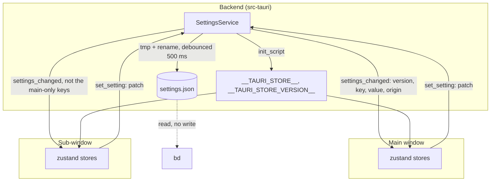
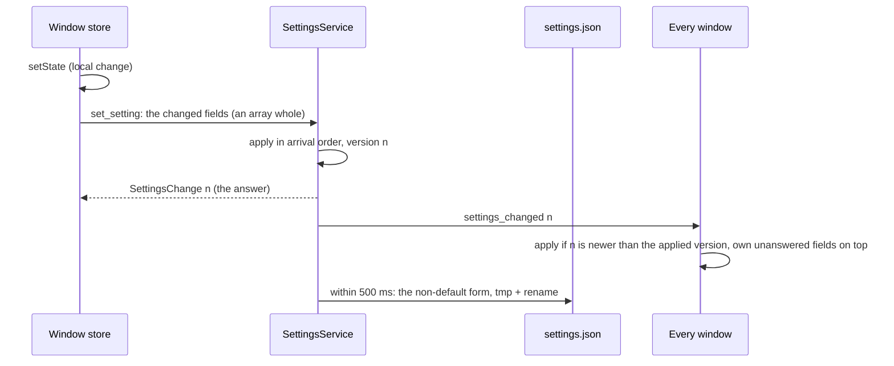

# Distributed Settings Architecture

**Status:** Implemented  
**Updated:** 2026-10-24  
**Tags:** [settings, zustand, tauri]

## Problem

Branch Deck opens sub-windows (the reviews, the conflict windows, Settings, Activity) next to the main window. Every
window renders settings (theme, diff view options, AI settings, recent projects) and some can change them. Each window
must have the settings synchronously on its first render, and a change made in any window must reach all others
without loops or lost updates. Rust reads some of them too: the zoom and the title bar when it builds a window, the
check of Auto-sync on Focus in the native menu, and `bd` the branch prefix of the app.

`settings.json` needs one writer. Several writers race and overwrite each other; a write in place (truncate, then
write) gives a reader a cut file; and a naive "write, then apply the change notification" loop echoes values back and
rolls the state back to a stale value while several writes are in flight.

## Solution Overview

The backend owns the file: one `SettingsService` (`crates/app-settings/src/service.rs`, no Tauri, so the E2E server
runs the same writer) holds the settings in memory, applies every change as a patch in the order it arrives, gives each
change a version and saves the file at most 500 ms after the first unsaved change, to a temporary file renamed over it.
`src-tauri` opens it on `settings.json` of the app data directory in `setup` (`src-tauri/src/settings.rs`).

Each setting group of the page is a zustand vanilla store created by `createPersistentStore`
(`src/stores/settings/persistent-store.ts`). It starts synchronously from `window.__TAURI_STORE__`, the writer's copy
that the backend sets in the init script of every window, with the version it was taken at
(`window.__TAURI_STORE_VERSION__`). A local change goes to the writer as a patch (`set_setting`); the writer sends every
change to every window (`settings_changed`), and each window applies a change newer than the one it applied. Every value
read from the snapshot or received from the writer passes through the store's Zod schema.

## Design

### Architecture

### Data Flow

### Key Decisions

1. **Decision**: One writer in the backend; every window, the main one too, changes the settings through it.
   **Rationale**: No window owns the file, so a sub-window writes nothing that no one saves, and a write never waits for
   the main window. Rust writes through the same writer (`restart_app` saves the title bar setting and flushes before
   the restart), and `bd` only reads the file, which the rename never shows cut. The command is synchronous: Tauri runs
   it on the main thread, in the order the calls arrive.

2. **Decision**: Synchronous initialization from the writer's copy, set by the backend in every window's init script.
   **Rationale**: Settings are there on the first render, without loading states. The opener passes no settings: a
   sub-window starts from the writer as it is when the backend builds it (`open_sub_window`), the zoom of its builder
   too. The values are serialized JSON, so the script parses even for a settings file that was cut (its snapshot is the
   defaults). A page that starts to listen asks for the changes made after its snapshot (`get_settings_changes`): one
   made while it loaded reached no listener (a zoom changed while a review window loaded; a reload of the main window).

3. **Decision**: A window sends patches, not whole values: the fields of an object that differ from the value it last
   knew (`SettingsPatch::Fields`, a field back at its default as `null`), an array whole (`SettingsPatch::Value`).
   **Rationale**: Two windows that change two fields of one key at once keep both (the Activity panel opened in the
   main window, then F in a review window hid its sidebar). The writer merges the fields into its own value.

4. **Decision**: Versions instead of echo tracking. Every applied patch gets the next version; the answer of
   `set_setting` and `settings_changed` carry the change (`SettingsChange`: version, key, the whole key after the patch,
   origin), and a window takes a change only when it is newer than the last one it took for the key.
   **Rationale**: The answer and the broadcast of one change arrive in either order, and a late one is older than what
   the window took since, so it never rolls a key back; a change equal to a value the window had before still arrives
   (Actual Size after a review window wrote its sidebar at 110%). This replaces the echo tracker and the relay of the
   main window.

5. **Decision**: A window has at most one patch per key in flight; the changes made meanwhile merge into the next one,
   and the state it shows is the writer's value with its unanswered patches on top.
   **Rationale**: The writer gets a window's changes in the order they were made (↓ ↓ ↑ in Settings ends at the last
   value), a burst of changes costs one round trip per answer, and a change of another window applied while the window
   waits keeps the window's own newer field. A refused patch (a field Rust reads with an invalid value) drops it: the
   window shows the writer's value and says "Cannot change the settings".

6. **Decision**: Only non-default fields are persisted; an empty array, and an object whose last field went, remove
   the key. The fields Rust reads (`AppSettings`) go to the windows in their full form, every field with its default
   (`AppSettings::to_full`).
   **Rationale**: Keeps the file small and lets new defaults apply to users who never changed a setting; the page and
   Rust agree on the defaults of the fields both read. Keys the backend does not know are kept raw.

7. **Decision**: Array stores (recent projects) wrap the array as `{ items }`.
   **Rationale**: zustand state must be an object. The writer and the file see the plain array.

8. **Decision**: Keys only the main window keeps (`MAIN_ONLY_KEYS` in `crates/app-settings/src/windows.rs`: the
   Activity log, the robot history) reach no sub-window: not in its snapshot, not in its changes.
   **Rationale**: They are large and only the main window writes them; the Activity window gets the log of the selected
   repository over its window link (`src/lib/activity-window-link.ts`).

9. **Decision**: The disk lags, the windows don't: a change is sent to every window at once, and the file is saved on
   one writer thread at most 500 ms after the first unsaved change. The app flushes on `RunEvent::ExitRequested`.
   **Rationale**: A burst of changes (a zoom by keys, a dragged split) is one write. A failed save keeps the settings in
   memory, is tried again by the next change or flush, and is told to the main window once per streak of failures
   (`settings_save_failed` → "Cannot save the settings").

### Implementation Notes

- Writer: `SettingsService` (`crates/app-settings/src/service.rs`): `set(patch, origin)` answers the change at once,
  `snapshot()` and `changes_since(version)` for the windows, `flush()`, `on_save_error`. The file:
  `SettingsFile` (`file.rs`): a tolerant load (a missing or broken file is the defaults, a field of the wrong type its
  default), the stored form, the atomic save. Which window gets which key: `windows.rs`.
- Backend: `src-tauri/src/settings.rs` opens the writer, builds the settings part of every init script
  (`init_script`) and sends the changes (`emit_change`); `src-tauri/src/commands/settings.rs` has `set_setting` (origin:
  the calling window's label) and `get_settings_changes`. The window builders (the zoom), the title bar and the menu
  read their settings from the writer's `AppSettings` (`zoom.rs`, `title_bar.rs`, `menu.rs`), with its defaults.
- `bd`: reads the file once as it starts, by the same loader (`app_settings_of` in `crates/bd-core/src/context.rs`,
  `SettingsFile::load`), so it runs with the same values and defaults without the app; it resolves the branch prefix
  with `resolve_branch_prefix` and names its source in `bd status` (`prefix_source`).
- Page: `createPersistentStore(key, { schema, isArray, isMainOnly })` in `src/stores/settings/persistent-store.ts`; one
  `settings_changed` listener per page, started with the first store. Stores: `appSettings.ts`, `aiSettings.ts`,
  `diff-view-settings.ts`, `repositorySettings.ts` in `src/stores/settings/`, the Activity log `src/stores/activity.ts`
  and the robot history `src/stores/robot-history.ts`. They are module-level singletons; components read them with
  `useStore` selectors, non-React code with `getState()`.
- E2E: the test server gives each test repository a `SettingsService` of its own on a file of its app data
  (`TestRepository::store`); the page mock routes `set_setting` and `get_settings_changes` to it and sends the change to
  its page and the linked pages ([E2E Testing](e2e-testing.md)).

## Alternatives Considered

- **The main window owns the file** (the design before, with the Tauri store plugin): the sub-windows relayed their
  writes through it and it broadcast its own writes after its debounce, which needed an echo tracker and the fields of
  unanswered writes in every sub-window; the plugin wrote the file in place, so `bd` read a cut file.
- **Each window manages its own file**: file conflicts, race conditions, complex merging.
- **zustand `persist` middleware**: no cross-window ownership; every window would write the file, and it loads
  asynchronously.
- **Every read through IPC**: the UI needs synchronous access on the first render; the snapshot gives it, the changes
  keep it current.
- **CRDT for conflict-free updates**: unnecessary for settings that change rarely and one at a time; a per-field patch
  and a version per change suffice.

## Performance Considerations

- **Constraint**: Settings must be available on window open.
- **Solution**: Synchronous initialization from the injected snapshot, before the React root renders.

Optimizations:
- The writer saves at most once per 500 ms of changes, on its own thread; `set_setting` answers before the save.
- A window sends only the fields that changed, and one patch per key at a time.
- Equal incoming values are not applied, so selectors do not re-run.

## References

- Writer: `crates/app-settings/src/service.rs`, `crates/app-settings/src/file.rs`, `crates/app-settings/src/windows.rs`
- Backend: `src-tauri/src/settings.rs`, `src-tauri/src/commands/settings.rs`, `src-tauri/src/commands/window_management.rs`
- Page: `src/stores/settings/persistent-store.ts`
- Spec: [Settings](../../spec/repository/settings.spec.md) ("Writes through the backend")
- Plan: [Rust как источник предметных правил](rust-domain-authority.md), stage `s5-settings`
