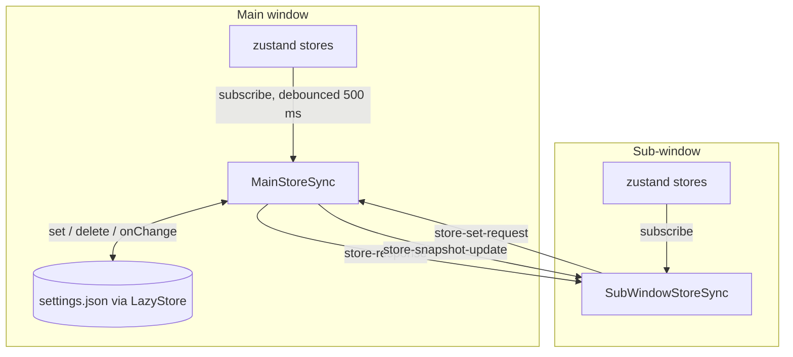
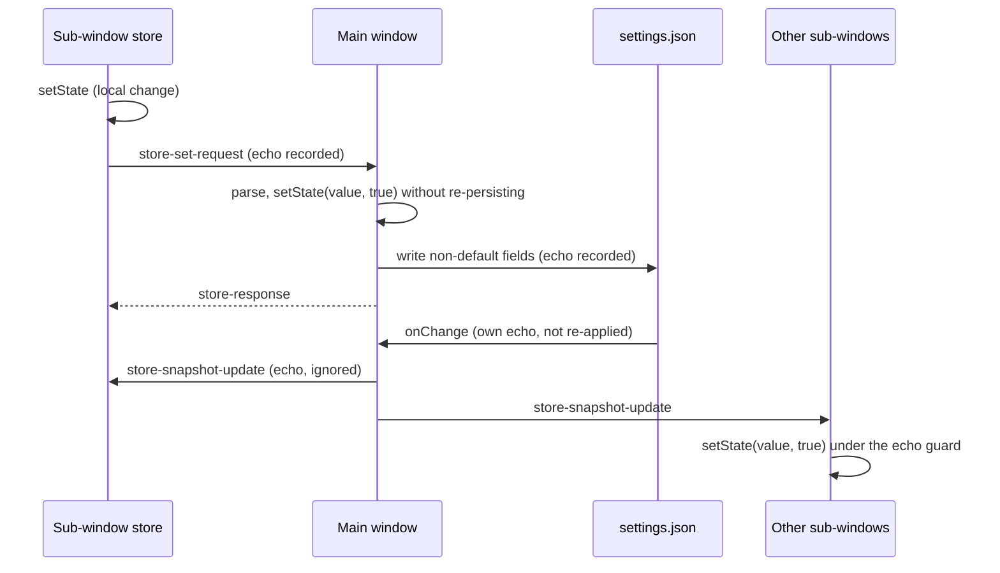

# Distributed Settings Architecture

**Status:** Implemented  
**Updated:** 2026-10-18  
**Tags:** [settings, zustand, tauri]

## Problem

Branch Deck opens sub-windows (the reviews, the conflict windows, Settings) next to the main window. Every window renders settings
(theme, diff view options, AI settings, recent projects) and some can change them. Each window must have the settings
synchronously on its first render, and a change made in any window must reach all others without loops or lost updates.

Only one process can safely own `settings.json`. Several windows writing it independently would race and overwrite
each other, and a naive "write, then apply the change notification" loop echoes values back and can roll the state
back to a stale value while several writes are in flight.

## Solution Overview

Each setting group is a zustand vanilla store created by `createPersistentStore`. It is initialized synchronously from
`window.__TAURI_STORE__`, a snapshot injected by the backend before the page loads (`stored_settings`: `{}` without the
file and for one that does not parse as an object, so a file cut within a write never makes the init script a syntax
error). Every value read from disk or received from another window passes through the store's Zod schema.

The main window owns `settings.json` through the Tauri store plugin (`LazyStore`). It persists local changes (debounced),
applies writes requested by sub-windows and broadcasts every change. Sub-windows never touch the file: they send their
changes to the main window and receive the result back like every other window. The plugin writes the file in place
(truncate, then write), so `bd`, which reads the app's branch prefix from it, reads a file that does not parse again
for up to 200 ms (`read_app_settings` in `crates/bd-core/src/context.rs`) instead of taking the git prefix silently.
One writer with a temporary file and a rename is the stage `s5-settings` of
[Rust как источник предметных правил](rust-domain-authority.md).

## Design

### Architecture

### Data Flow

A change made in the main window takes the same path from the `subscribe` listener: debounced persist, `onChange`,
broadcast to all sub-windows.

### Key Decisions

1. **Decision**: The main window is the single owner of `settings.json`.
   **Rationale**: Avoids file races and merging. Sub-windows are short-lived and depend on the main window anyway:
   they close with it (`close_sub_windows` in `src-tauri/src/lib.rs`), so no window writes settings that no one saves.
   Settings, the window of most writes, is opened by the main window only, so it starts from the current state.

2. **Decision**: Synchronous initialization from an injected snapshot.
   **Rationale**: Settings are available on the first render, without loading states. The main window gets the file
   content through an initialization script (`src-tauri/src/lib.rs`). The opener passes `getStoreSnapshot()` as
   `storeCache` when it opens a sub-window, so the sub-window starts from the opener's current state.

3. **Decision**: External values replace the whole state with `setState(value, true)` while an `applyingExternal` flag is set.
   **Rationale**: The local `subscribe` listener filters out these updates, so a received value is never persisted or
   sent back. Values equal to the current state (compared with `stableStringify`) are not applied at all, so subscribed
   components do not re-render.

4. **Decision**: An `EchoTracker` per window remembers the values it wrote.
   **Rationale**: The `onChange` in the main window and the `store-snapshot-update` in a sub-window that come back for a
   value this window wrote are recognized and dropped. Applying the echo of an older write would roll the state back
   while a newer write is in flight.

5. **Decision**: Only non-default fields are persisted; an empty array or an all-default object deletes the key.
   **Rationale**: Keeps the file small and lets new defaults apply to users who never changed a setting. A sub-window
   compares the echo after parsing, because the broadcast value lacks the default fields.

6. **Decision**: Array stores (recent projects) wrap the array as `{ items }`.
   **Rationale**: zustand state must be an object. The sync layer and the file see the plain array.

### Implementation Notes

- Store factory: `createPersistentStore(key, { schema, isArray, isMainOnly })` in `src/stores/settings/persistent-store.ts`.
  It registers a `StoreRegistration` (`src/stores/settings/sync-utils.ts`), so the sync layer never touches the zustand store directly.
- Main window: `MainStoreSync` in `src/stores/settings/app-store.ts`. Writes from sub-windows are applied to the local store
  immediately, then saved in the same non-default form. Its writes reach `settings.json` one at a time, in the order they
  were asked for (`write`): Tauri runs two `set` commands in flight concurrently, so ↓ ↓ ↑ in Settings could leave the
  middle value on disk; a failed write fails its request and the next one still runs. Changes of unregistered keys only update the raw snapshot.
  Stores with `isMainOnly` are not broadcast and are left out of the sub-window snapshot (`getStoreSnapshot`): the
  Activity log (`src/stores/activity.ts`), which only the main window writes; the Activity window gets the log of the
  selected repository over its window link (`src/lib/activity-window-link.ts`), not from the store.
- Sub-windows: `SubWindowStoreSync` in `src/stores/settings/sub-window-app-store.ts`. Request ids include the window label
  because every sub-window receives every `store-response`. A request without a response fails after 10 s.
- Initialization: `initializeStoreHandlers()` is called at module level in `src/main.tsx`. It starts serving
  `store-set-request` in the main window and is a no-op in sub-windows.
- Stores: `appSettings.ts`, `aiSettings.ts`, `diff-view-settings.ts`, `repositorySettings.ts` in `src/stores/settings/`, and the
  Activity log `src/stores/activity.ts`. They are module-level singletons. Components read them with `useStore` selectors, non-React code with `getState()`.

## Alternatives Considered

- **Each window manages its own file**:
  - Why not: File conflicts, race conditions, complex merging.

- **zustand `persist` middleware**:
  - Why not: It has no cross-window ownership. Every window would write the file, and it loads asynchronously.

- **Keeping settings in the Rust backend**:
  - Why not: Every read would be an async IPC call. The UI needs synchronous access on the first render.

- **CRDT for conflict-free updates**:
  - Why not: Unnecessary complexity for settings that change rarely and one at a time.

## Performance Considerations

- **Constraint**: Settings must be available on window open.
- **Solution**: Synchronous initialization from the injected snapshot, before the React root renders.

Optimizations:
- Debounced persistence (500 ms) in the main window coalesces rapid changes into one disk write.
- Equal incoming values are not applied, so selectors do not re-run.
- Only plain values are transmitted between windows.

## References

- Implementation: `src/stores/settings/app-store.ts` (main window), `src/stores/settings/sub-window-app-store.ts` (sub-windows)
- Store creation: `src/stores/settings/persistent-store.ts`
- Sub-window opening: `src/lib/window-management.ts`, `src-tauri/src/commands/window_management.rs`
- Related: [virtual-branches.md](virtual-branches.md)
