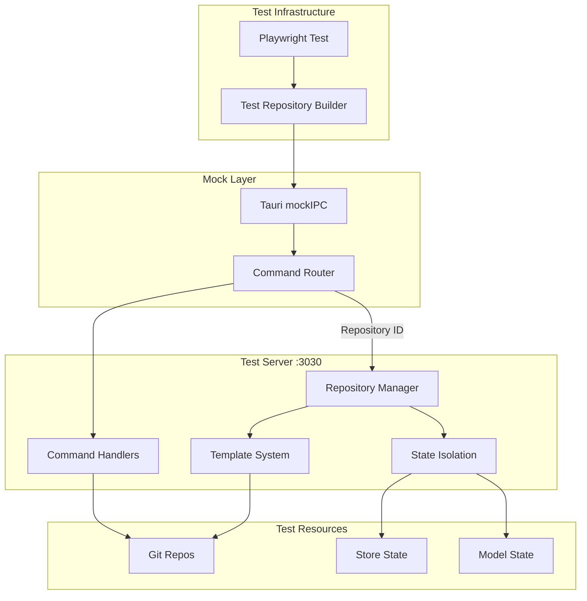
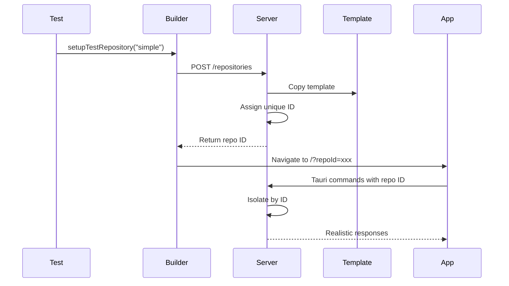

# E2E Testing Architecture

**Status:** Implemented  
**Updated:** 2026-10-11  
**Tags:** [testing, playwright, mocking, snapshots]

## Problem

Testing a desktop Git application requires isolated environments for each test to avoid interference. Tests need predictable repository states, realistic Tauri command behavior, and the ability to simulate various error conditions.

The challenge: How to provide complete test isolation while accurately simulating production behavior, including Git operations, Tauri IPC, and error handling?

## Solution Overview

A custom test server (port 3030) provides isolated Git repositories from templates for each test. Tauri commands are mocked to route through this server, which maintains separate state per test via repository IDs. Templates are pre-created for fast test startup, and the mock layer accurately simulates Tauri's Result type system.

## Design

### Architecture

### Test Isolation Flow

### Key Decisions

1. **Decision**: Test server instead of real Tauri backend
   **Rationale**: Complete control over responses, faster than full app startup

2. **Decision**: Template system for repositories
   **Rationale**: Fast test startup, consistent initial state, no git init overhead

3. **Decision**: Repository ID routing via URL parameter
   **Rationale**: Simple isolation mechanism, survives navigation

4. **Decision**: Mock Tauri Result type accurately
   **Rationale**: Tests must handle errors exactly as in production

5. **Decision**: Pre-create templates at server startup
   **Rationale**: Eliminates per-test repository creation overhead

### Implementation Notes

Template system:
- **Templates**: `simple`, `unassigned`, `conflict_*`, `NO_REPO`, `empty-non-git`
- **Location**: Created in `tests/test-repos/` at server startup
- **Usage**: Copied to unique directory per test

Mock implementation:
- **IPC Interception**: `mockIPC` redirects all Tauri commands
- **Error Simulation**: Throws JavaScript Error to match Tauri behavior
- **Result Wrapping**: Bindings layer wraps in `{status: "error", error: "..."}`

State isolation:
- **Repository mapping**: `path_to_id` map for command routing
- **Store state**: Separate per repository ID
- **Configuration**: `__BRANCH_DECK_TEST_CONFIG__` for test-specific behavior

HTML snapshots (`captureHtmlSnapshot`, `tests/e2e/helpers/aria-snapshot-helpers.ts`):
- **Formatter**: `formatElementWithNormalization` in the mock script prints one attribute set per element with sorted attributes,
  so snapshots diff cleanly.
- **Generated ids**: React `useId` values (`_r_1f_`, `«r1»`, `:r1:`), Base UI ids (`base-ui-_r_2_`, `base-ui-2`) and
  `@git-diff-view` roots are replaced with `[ID]`/`[DYNAMIC]` in every attribute except `class` and `style`.
- **Per-run values**: repository ids (KSUIDs) and temporary paths become `[REPO_ID]`/`[TEMP_PATH]` in text and attributes.
- **Icons**: lucide-react renders `<svg class="lucide lucide-NAME ...">`. The formatter prints each icon as one line with the
  canonical name and its own classes, without paths and SVG presentation attributes. No icon name index is needed.
- **Transition settling**: before capturing, the helper waits until no element has `data-starting-style`/`data-ending-style`,
  no closed Base UI popup is still mounted in a portal, and no finite animation is running. Base UI keeps closing popups and
  outgoing tab panels mounted until their exit transition ends; `waitForTabSwitchSettled` covers tab switches. It also
  waits until no commit list (`table`, the `ol` of the branch preview) is `aria-busy`: a list is busy while the file
  counts of its meta lines are read ([Commit Files](../../spec/commit/commit-files.spec.md)).
- **Update**: `pnpm e2e-up` rewrites snapshots. Review the diff, a changed snapshot can hide a regression.

## Alternatives Considered

- **Real Tauri Backend**:
  - Why not: Slow startup, harder to control state, complex cleanup

- **In-Memory Git**:
  - Why not: libgit2 differences, not representative of real git CLI

- **Shared Test Repositories**:
  - Why not: Test interference, race conditions, unpredictable state

- **Docker Containers**:
  - Why not: Overhead, complexity, platform differences

## Performance Considerations

- **Constraint**: Tests must run in parallel without interference
- **Solution**: Complete isolation via repository IDs
- **Measurement**: Test startup < 100ms, full suite < 30s

Optimizations:
- Template pre-creation eliminates git init per test
- Parallel test execution with independent state
- Element-based waiting instead of fixed timeouts
- Direct file operations for template copying

## References

- Implementation: `crates/test-server/`, `tests/e2e/`
- Test helpers: `tests/e2e/helpers/`
- Mock layer and snapshot formatter: `tests/e2e/setup/tauri-mocks.ts` (injected with `page.addInitScript`)
- Snapshot capture and transition settling: `tests/e2e/helpers/aria-snapshot-helpers.ts`
- Frontend: the test server serves the `pnpm build` output from `dist/`, with an SPA fallback to `index.html` for client routes such as `/conflicting-files`
- Templates: generated by `pnpm e2e:regenerate` (`crates/test-server`)
- Related: [virtual-branches.md](virtual-branches.md)