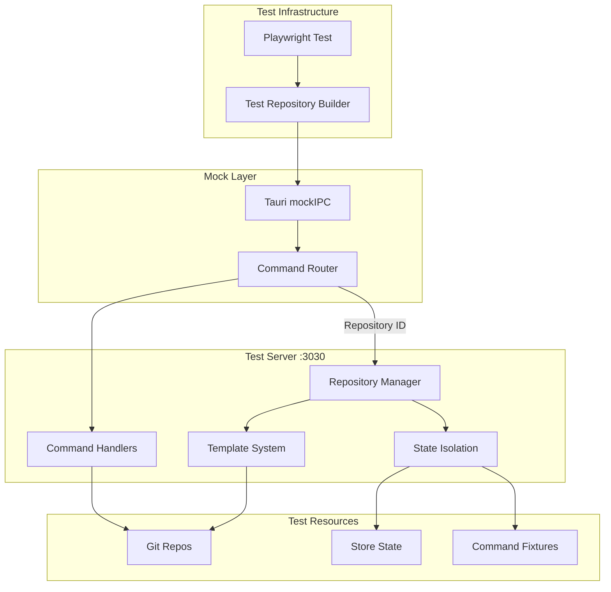
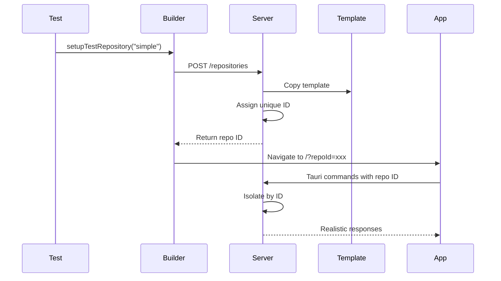

# E2E Testing Architecture

**Status:** Implemented  
**Updated:** 2026-10-11  
**Tags:** [testing, playwright, mocking, snapshots]

## Problem

Testing a desktop Git application requires isolated environments for each test to avoid interference. Tests need predictable repository states, realistic Tauri command behavior, and the ability to simulate various error conditions.

The challenge: How to provide complete test isolation while accurately simulating production behavior, including Git operations, Tauri IPC, and error handling?

## Solution Overview

A custom test server (port 3030, or `E2E_PORT`) provides isolated Git repositories from templates for each test. Tauri commands are mocked to route through this server, which maintains separate state per test via repository IDs. Templates are pre-created for fast test startup, and the mock layer accurately simulates Tauri's Result type system.

## Design

### Architecture

### Test Isolation Flow

### Key Decisions

1. **Decision**: Test server instead of real Tauri backend
   **Rationale**: Complete control over responses, faster than full app startup

2. **Decision**: Template system for repositories
   **Rationale**: Fast test startup, consistent initial state, no git init overhead

3. **Decision**: Repository ID routing via URL parameter
   **Rationale**: Simple isolation mechanism, survives navigation

4. **Decision**: Mock Tauri Result type accurately
   **Rationale**: Tests must handle errors exactly as in production

5. **Decision**: Pre-create templates at server startup
   **Rationale**: Eliminates per-test repository creation overhead

### Implementation Notes

Template system:
- **Templates**: `simple`, `unassigned`, `conflict_*`, `NO_REPO`, `empty-non-git`
- **Location**: Built in parallel into the temporary directory of the server at startup
- **Usage**: Copied to unique directory per test
- **Git**: fixture code runs git through `git_command` (`crates/test-utils/src/git_test_utils.rs`), which removes the
  repository-local variables (`git rev-parse --local-env-vars`). Under `git rebase --exec` or a hook, an inherited
  `GIT_DIR` would otherwise send every template command into the developer's clone; `git_command_test` scans the test
  code for a raw `Command::new("git")`.

Mock implementation:
- **IPC Interception**: `mockIPC` redirects all Tauri commands
- **Command errors**: a command that fails answers with 200 and `{ status: "error", error: { message } }`
  (`CommandFailure` in `tauri_command_bridge.rs`, logged at debug: it is the expected answer of an error-path test),
  and the mock rejects with `{ name: "CommandError", message }`, as Tauri rejects with the `CommandError`; the
  bindings return it as `{ status: "error", error }` (an `Error` instance they would throw). A test fails a command
  with `routeCommandError`. Any other answer is a bug of the mock, thrown and logged: 405 a command the server does
  not implement, 500 a command that panicked, 410 a page that outlived its repository
- **Commands**: the server runs each command's git work on the blocking pool (`run_command`), with the app's core
  functions; an answer that Patronus, gh or claude would give comes from a fixture of the repository, or from a route
  of the test
- **Review requests**: `get_review_requests` answers `NotGitHub` until a test posts a fixture to
  `/repositories/{id}/review-requests` (a `ReviewRequestsResult` plus an optional `fetchError`; `GET` returns the
  counts of asks and fetches, and the `keep` of every prune). `fetch_review_head` never fetches: an empty `headRefOid`
  is the tip of the local branch `headRefName` (else of `HEAD`),
  an empty `baseRefOid` the baseline (`HEAD~2` when that is `HEAD`), so the real function finds both commits local and
  answers a range of source `local`; `fetchError` fails it instead. `get_range_files`, `get_range_patch` and
  `prune_review_refs` run the real functions, `cancel_review_fetch` does nothing (`review_requests_test.rs`)
- **Window**: `plugin:window` answers from `__e2eWindowState` (fullscreen, maximized) and records the actions in
  `__e2eWindowCalls`; a test fires `tauri://resize` with `emitTauriEvent`. E2E has no `__BD_TITLE_BAR__`, so the toolbar
  renders as under a native title bar; `tests/e2e/repository/title-bar.spec.ts` sets it with `addInitScript`
- **Sub-windows**: `open_sub_window` is answered in the page and recorded in `__e2eSubWindows` (the label, the URL, the
  title and the parsed data); `getOpenedSubWindows` reads them. A test shows the route of a sub-window in the same
  page with the recorded data as `__INIT_DATA__` (`openSubWindowPage` in `sub-window-helpers.ts`): the mock keeps the
  label `main`, since another label would make the settings store wait for a main window. What only a sub-window does
  (Escape closes it) is not covered. `tests/e2e/branch-review/branch-review.spec.ts` reviews a branch this way, on the
  `stacked_ownership` template (`OWNERSHIP` files in the baseline)

State isolation:
- **Repository mapping**: `path_to_id` map for command routing
- **Store state**: Separate per repository ID
- **Teardown**: the mock names its repository on every request (`X-Repository-Id`), and the server holds the
  repository while the command runs, in a task of its own: closing a page aborts its requests and drops their
  handlers, but their git work runs on. The `setupRepo` fixture closes the pages of the test first, and
  `delete_repository` forgets the repository, waits for its running commands (10 s at most), then deletes the
  directory. Before, a test's cleanup deleted the files under a running sync, file read or note write
  (`repository_lifecycle_test.rs`)
- **Port**: `E2E_PORT` (default 3030, `tests/e2e/helpers/test-server-url.ts`) sets the port of the server, the
  Playwright `baseURL` and the helpers; the mock script calls its page's origin. `/health` answers the checkout the
  server serves, and global setup refuses a server of another checkout: Playwright reuses whatever listens on the port
  (`reuseExistingServer`), and another treehouse worktree's server serves that worktree's `dist/` and code
- **Time**: `base-test.ts` installs the Playwright clock at a fixed time; it runs at real speed. A test that waits for
  a timer of the app (the 2 s "Copied" state of `useCopyToClipboard`) runs the clock past it with
  `page.clock.fastForward` instead of a real wait, which a loaded machine overruns

HTML snapshots (`captureHtmlSnapshot`, `tests/e2e/helpers/aria-snapshot-helpers.ts`):
- **Formatter**: `formatElementWithNormalization` in the mock script prints one attribute set per element with sorted attributes,
  so snapshots diff cleanly.
- **Generated ids**: React `useId` values (`_r_1f_`, `«r1»`, `:r1:`) and Base UI ids (`base-ui-_r_2_`, `base-ui-2`) are
  replaced with `[ID]` in every attribute except `class` and `style`.
- **Diffs**: a diff (`@pierre/diffs`) renders into the shadow root of `<diffs-container>`, which the formatter does not
  walk: a loaded diff without slotted light-DOM children (annotations, custom headers) prints as an empty element.
  Assert on diff text with `toContainText`, which reads shadow roots too, and keep it to lines near the top: a long diff
  is virtualized.
- **Per-run values**: repository ids (`repo-<22 digits>`) and temporary paths become `[REPO_ID]`/`[TEMP_PATH]` in text and attributes.
- **Icons**: lucide-react renders `<svg class="lucide lucide-NAME ...">`. The formatter prints each icon as one line with the
  canonical name and its own classes, without paths and SVG presentation attributes. No icon name index is needed.
- **Transition settling**: before capturing, the helper waits until no element has `data-starting-style`/`data-ending-style`,
  no closed Base UI popup is still mounted in a portal, and no finite animation is running. Base UI keeps closing popups and
  outgoing tab panels mounted until their exit transition ends; `waitForTabSwitchSettled` covers tab switches. It also
  waits until no commit list (`table`, the `ol` of the branch preview) is `aria-busy`: a list is busy while the file
  counts of its meta lines are read ([Commit Files](../../spec/commit/commit-files.spec.md)).
- **Update**: `pnpm e2e-up` rewrites snapshots. Review the diff, a changed snapshot can hide a regression.

## Alternatives Considered

- **Real Tauri Backend**:
  - Why not: Slow startup, harder to control state, complex cleanup

- **In-Memory Git**:
  - Why not: libgit2 differences, not representative of real git CLI

- **Shared Test Repositories**:
  - Why not: Test interference, race conditions, unpredictable state

- **Docker Containers**:
  - Why not: Overhead, complexity, platform differences

## Performance Considerations

- **Constraint**: Tests must run in parallel without interference
- **Solution**: Complete isolation via repository IDs
- **Measurement** (2026-10-15, 230 tests, 14 workers on 18 cores): one worker creates a repository and loads the page in
  ~170 ms and syncs it in ~270 ms; the full suite takes ~38 s, ~470 s of test time, a median test 2 s
- **Logging**: a green run prints no warning or error. The server logs warnings and errors only
  (`TEST_SERVER_LOG=warn`): an error of the server is a bug, not the error of a command. The console errors and
  uncaught exceptions of the pages are attached to a failed test only (`page errors` in `base-test.ts`): an
  error-path test makes the app log its expected errors. `DEBUG_E2E=1` prints the server's debug log and every
  console line live. The debug log was 60k lines (23 MB) per run through the pipe that the Playwright main process
  drains: under load the full pipe blocked the server's threads on stdout, and tests timed out waiting for the page
  or a sync

Optimizations:
- Template pre-creation eliminates git init per test
- Parallel test execution with independent state
- Element-based waiting instead of fixed timeouts
- Direct file operations for template copying

## References

- Implementation: `crates/test-server/`, `tests/e2e/`
- Test helpers: `tests/e2e/helpers/`
- Mock layer and snapshot formatter: `tests/e2e/setup/tauri-mocks.ts` (injected with `page.addInitScript`)
- Snapshot capture and transition settling: `tests/e2e/helpers/aria-snapshot-helpers.ts`
- Frontend: the test server serves the `pnpm build` output from `dist/`, with an SPA fallback to `index.html` for client routes such as `/conflicting-files`
- Templates: generated by `pnpm e2e:regenerate` (`crates/test-server`)
- Related: [virtual-branches.md](virtual-branches.md)