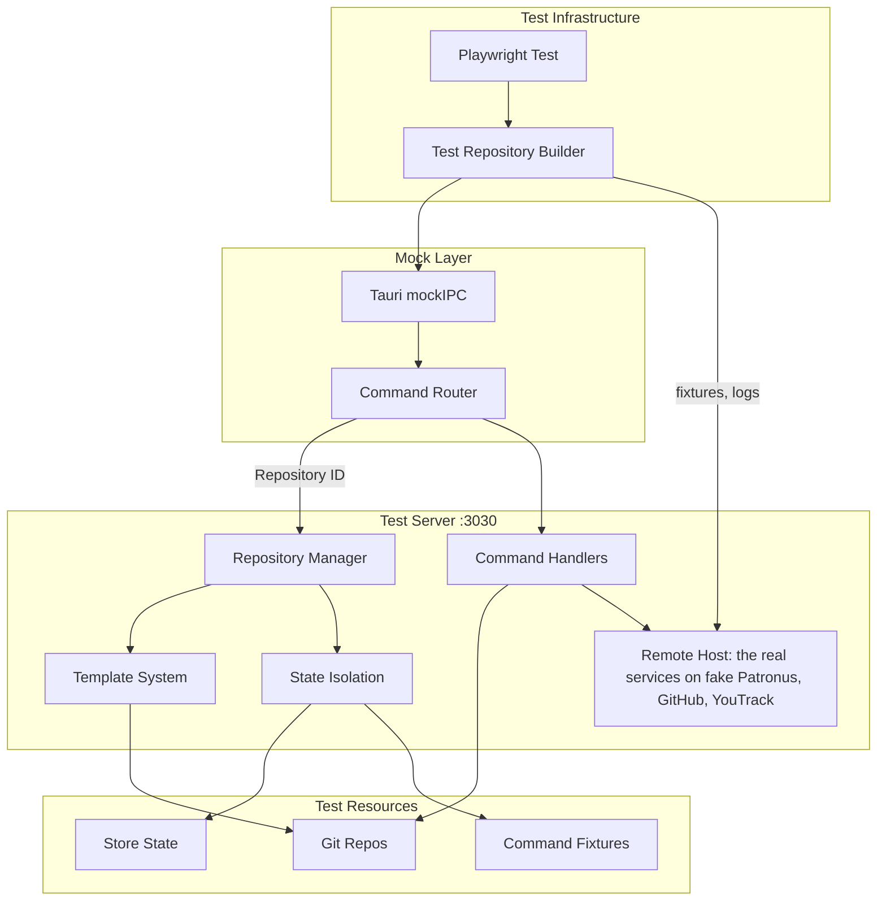
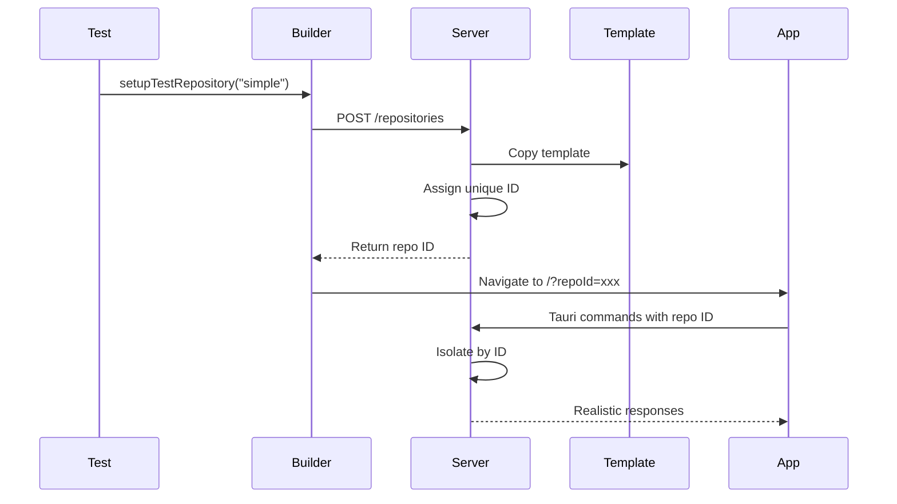

# E2E Testing Architecture

**Status:** Implemented  
**Updated:** 2026-10-24  
**Tags:** [testing, playwright, mocking, snapshots]

## Problem

Testing a desktop Git application requires isolated environments for each test to avoid interference. Tests need predictable repository states, realistic Tauri command behavior, and the ability to simulate various error conditions.

The challenge: How to provide complete test isolation while accurately simulating production behavior, including Git operations, Tauri IPC, and error handling?

## Solution Overview

A custom test server (port 3030, or `E2E_PORT`) provides isolated Git repositories from templates for each test. Tauri commands are mocked to route through this server, which maintains separate state per test via repository IDs. Templates are pre-created for fast test startup, and the mock layer accurately simulates Tauri's Result type system. The remote services (Patronus, GitHub, YouTrack) are fakes of each test repository behind the app's real services, so a remote command runs the app's Rust path and a test asserts what the fake got ([Remote services](#remote-services)).

## Design

### Architecture

### Test Isolation Flow

### Key Decisions

1. **Decision**: Test server instead of real Tauri backend
   **Rationale**: Complete control over responses, faster than full app startup

2. **Decision**: Template system for repositories
   **Rationale**: Fast test startup, consistent initial state, no git init overhead

3. **Decision**: Repository ID routing via URL parameter
   **Rationale**: Simple isolation mechanism, survives navigation

4. **Decision**: Mock Tauri Result type accurately
   **Rationale**: Tests must handle errors exactly as in production

5. **Decision**: The E2E server keeps its templates in a cache beside its executable (`target/debug/e2e-templates/`,
   one directory per build of the server and version of git, `templates.rs`), builds the missing ones in the
   background while it already serves, and a repository waits only for its own template; a route test of
   `crates/test-server` (`create_route_test_app_with_state`) builds a template into its temporary directory when it
   first makes a repository of it. A repository is one APFS clone of its template on macOS (`clone_dir` of
   `lease-pool`), a copy elsewhere
   **Rationale**: A template is built by the code of the server, so a new build of the server is the one change that
   needs new templates; a run of the same build starts at once. Building all 45 took 9–11 s of every run on a quiet
   Mac Studio (1784 git processes) and over a minute under load, and the server served nothing until they were done. A
   route test runs in a process of its own (nextest) and asks for one or two templates: building all 45 took each of
   them two minutes on a CI runner, and the Windows run hit its time limit. A copy of a template took 50 ms on a
   loaded Mac and 167 ms on average during a full run of the Studio, the clone a few ms

6. **Decision**: A reload starts from what the app wrote to its settings store, as a new window of the app starts from
   `settings.json` as it is now. The setup injects the initial values as `window.__TAURI_STORE__` from an init script,
   which runs again on a reload; the store mock (`tauri-mocks.ts`) also records each write and delete of the page in
   `sessionStorage` (`bd-e2e-store-writes`), and the init script lays them over the initial values.
   **Rationale**: Without it a reload re-injected the values of the setup and a persisted setting (the tab of the
   conflict viewer, a collapsed stack) could not be tested; `sessionStorage` lives as long as the tab, so tests stay
   isolated.

7. **Decision**: A repository synced before is the option `syncedAgoMs` of `setupRepo`: the setup sets the
   `repositoryState` of the repository (its `lastSyncTime`) through the test server's writer (`/store/{repo}/{key}`)
   and injects it, so the window syncs it on open as the app does.
   **Rationale**: The writer is the app's (`SettingsService`), so the key lands in its own file
   (`repository-state.json`) and the page's later patches of the key apply to the value the writer has; an init script
   that edits `__TAURI_STORE__` changes only what the page starts from.

8. **Decision**: The commands of the test server run without the object cache (`ObjectCache::disabled()`); not for
   determinism, the app's cache answers by content
   **Rationale**: Measured 2026-10-24 on the 197 tests of patronus-actions, next-step, commit-files, stacked-branches,
   update-project and move-commits, with a fresh cache per test repository where the app keeps it
   (`$GIT_COMMON_DIR/branch-deck/cache`, opened on its first command, closed before its files go) for every command
   the app reads through it (the sync, the view and its landing needs, the landing gate and the start, the readiness,
   the stack independence, the conflict fix, the commit files, the file diffs and merges, Go to Declaration): all
   passed, but the test server and its git used 84 s user and 165 s system time instead of 84 s and 123 s, and the
   run took 66 s instead of 47-49 s (two interleaved runs each, load 17-25). The git processes went down 1.3% only
   (23,237 against 23,540): a test computes each thing once on a repository of its own, so the cache misses, while
   each test opens four LMDB environments (their maps, their SysV semaphores, `open.lock`), syncs every write to disk
   and closes them under the lock of the open environments. A cache shared by the repositories of a run would hit
   across the tests of one template and make a test's path depend on the tests before it

### Implementation Notes

Template system:
- **Templates**: `TEMPLATES` of `crates/test-server/src/templates.rs`, built by `test_utils::repo_template` with fixed
  commit dates, so a cached template differs from a new one only in the ids of its store commits (issue groups, stack
  parents); `NO_REPO` is a path without a directory
- **Location**: the E2E server: `e2e-templates/<size and mtime of the executable>-git-<version>/` beside its
  executable, the caches of the two builds before kept (a server of the build before may still run), a half-built
  template of a stopped server removed after 10 minutes. A template is built into `.<name>.<pid>.building` and renamed
  into place once whole, so two servers of one build never copy half a template. A route test: its temporary directory
- **Usage**: cloned (macOS) or copied into a directory of its own per test, in a blocking task
- **Guard**: `every_template_builds` (`templates_test.rs`) builds all of them in one test process: the route tests
  build only the templates they ask for, and a change of the fixture code once broke two templates (a branch
  description with lines in `append_config`) that only the E2E tests copy
- **Git**: fixture code runs git through `git_command` (`crates/test-utils/src/git_test_utils.rs`), which removes the
  repository-local variables (`git rev-parse --local-env-vars`). Under `git rebase --exec` or a hook, an inherited
  `GIT_DIR` would otherwise send every template command into the developer's clone; `git_command_test` scans the test
  code for a raw `Command::new("git")`.

Mock implementation:
- **IPC Interception**: `mockIPC` redirects all Tauri commands
- **Command registry**: three lists name the commands: `collect_commands!` of `src-tauri/src/lib.rs`, the
  `/invoke/<name>` routes of `crates/test-server/src/lib.rs` and `COMMAND_HANDLERS` of `tauri-mocks.ts`. The mock
  proxies every command it does not handle to the server, and one without a route answers 405, which fails the test.
  `command_registry_test.rs` (test-server) reads the three as text: every command has a route or a `PAGE_MOCKED`
  entry with its reason (a page handler for the windows and the window menu), never both; a stale entry, or a route
  or a handler without its command, fails; the nine
  handlers over a route (`get_file_diffs`, `get_file_merges` and `sync_branches` adapt a channel;
  `set_repository_config`, `wait_github_sign_in`, `sign_out_of_github`, `wait_youtrack_sign_in`, `save_youtrack_token`
  and `sign_out_of_youtrack` emit the event the backend emits after them, `emitAfter`) are pinned, and `get_blob_syntax` is the one route outside `collect_commands!` (its answer is raw
  bytes). The number of commands (129) and `PAGE_MOCKED` (3) are pinned; `PAGE_MOCKED` only goes down: a new command
  gets a route of the server, not a page mock. The updater is routed too: `check_for_updates` and `get_update_status`
  answer the update of `POST /repositories/{id}/update` (`{ availableVersion }`, `setAvailableUpdate`; none: up to
  date, version `0.0.0-test`), `install_update` and `restart_app` fail with the message that the test server has no
  updater (`updater.rs`).
- **The ratchet of page answers**: the fourth source of the registry test is the E2E tests themselves
  (`tests/e2e/**/*.ts`). It counts every answer a test gives in the page: each `routeCommand(page, "<name>", …)` and
  each `.route("**/invoke/<name>", …)` whose handler fulfills with an answer of its own (a hold, a record and a
  rewrite of the server's answer, `rewriteNextSyncEvents`, and a hold of the server's answer, `holdNextAnswer` (an
  older answer that comes after a newer one), let the command run on the server: a rewrite binds
  `const response = await route.fetch()` and passes that binding as the `response` of its `fulfill`; a `fulfill` of
  any other value, also one named `response`, is an answer, and a fetch bound any other way fails the scan). A write
  (`MUTATING`: the Patronus, GitHub and YouTrack writes, the sign-ins, the git writes, the app's settings) has no page
  answer: the test server runs it behind the fake of its service and the test asserts the fake's log
  ([Remote services](#remote-services)); its failure stays `routeCommandError`, the one page answer that is no route
  count. The page answers of the read commands are pinned per command (`ROUTED_IN_PAGE`, ten commands: a robot a
  `/patronus` comment started, the build progress of a running robot's details, a refused landing gate, …), and the pushes
  (`PUSHES_IN_PAGE`, `routePush`/`routePushBranches`/`routeHeldPush`: the templates name the repository itself as
  `origin`, so a rejected or moved remote has nowhere to come from) are the one exception among the writes. An answer
  counts where it is given: a helper that answers (a declared `function` at the outermost level, exported from
  `helpers/` or a spec's own, through the helpers it calls) counts its answers once per call, not once per definition,
  so the pinned pushes are the calls of the push helpers. Inside a test the count is of the places that answer, not
  of the runs: a `beforeEach` answers for every test of its describe, a loop or a local arrow function runs its answer
  more often, and the ratchet counts each once, because it pins which commands the page answers and where, not how
  often a run answers them. The places whose count is wrong by construction and whose fix is a declared helper are
  refused: an answer, or a call of an answering helper, at the top level outside a test (`test(…)`, `test.describe`,
  `test.beforeEach`, `test.step`, a fixture's `testWith…`; the members of the test API, never `test.extend`), which is
  how a function kept in a `const` looks in any of its forms (an arrow with a block or an expression body, with or
  without types, a function expression, a method of an object); an answer in the definition of a fixture
  (`test.extend({…})`, with or without a type argument), which runs once per test that uses it; a function declared
  inside a helper that answers; and a second declaration of an answering helper's name, in another file or the same.
  An overload signature of a helper is read as the formatter writes it (no `;`, the declaration on the next line). A
  route handler that fulfills with an answer of its own on any branch is an
  answer, even when another branch forwards the server's `response`. A new page answer fails, a removed one lowers its
  number; `routeCommand` and a fulfilling route name their command by a string literal. Beside this ratchet,
  `pnpm lint:arch` (`scripts/lint-arch.mjs`, its own tests in `scripts/lint-arch.test.mjs`) scans the same tests and
  the page (`src/**/*.ts(x)`): no branch on the words of an error (`.message` compared or searched), no `kind` of an
  error, and every `routeCommandError` names the code its error answers (below); an exception is an entry of its
  `ALLOWLIST` with a reason, and an entry that matches nothing fails.
- **Command errors**: a command that fails answers with 200 and `{ status: "error", error: <ApiError> }`: the
  `ApiError` of `domain-types` (`{ code, message, details, retry, operation_id }`) that the app's command rejects
  with, made by the same `app_api::api_error::api_error` from the core's error (`Rejection` in
  `tauri_command_bridge.rs`, a type of the server only because axum's `IntoResponse` can't be implemented for
  `ApiError` there; logged at debug: it is the expected answer of an error-path test). The mock rejects with the whole
  error, marked `name: "ApiError"`; the bindings return it as `{ status: "error", error }` (an `Error` instance they
  would throw), and the page branches on `code`, never on `message` (`pnpm lint:arch`). A test fails a command with
  `routeCommandError(page, command, { code, message, details?, retry? }, { times? })`, the code the real command would
  answer (`lint:arch` refuses a call without one); `times: 1` fails only the first call, so a retry reaches the server.
  A cancel answers `canceled` from the real session (a sign-in, an action of a CLI tool), which the page tells nothing
  of.
  Any other answer is a bug of the mock, thrown and logged: 405 a command the server does not implement, 500 a command
  that panicked, 410 a page that outlived its repository. The adapters' contract: both answer the JSON of
  `crates/app-api/fixtures/api_errors.json` for each case of `app_api::api_error::contract_cases`, the app with the id
  of the operation besides.
  [@test] ../../src-tauri/src/api_error_contract_test.rs (`a_command_of_the_app_rejects_with_the_api_error_json_of_the_contract`)
  [@test] ../../crates/test-server/src/api_error_contract_test.rs (`a_command_of_the_server_answers_the_api_error_json_of_the_contract`)
  [@test] ../../crates/test-server/src/api_error_contract_test.rs (`a_panicked_command_of_the_server_fails_the_request`)
  [@test] ../../crates/test-server/src/api_error_contract_test.rs (`a_command_with_a_channel_answers_the_api_error_json_of_the_contract_on_its_stream`)
  [@test] ../../crates/test-server/src/repository_lifecycle_test.rs (`a_failed_command_answers_with_its_api_error`)
- **IPC counters**: the mock counts the backend commands of the page in `window.__ipcStats`: `invokes` by command,
  `requestBytes` and `responseBytes` (UTF-8 bytes of the parameters and the answers), `channelMessages` by command and
  `channelBytes` (the SSE events of `sync_branches`, `get_file_diffs`, `get_file_merges`, and the patches of
  `subscribe_view` for as long as its channel stays open), and `pending`, the commands whose answer has not been read
  (`subscribe_view` until its answer, not its last patch); `reset()` zeroes the counts, not `pending`. It counts at the fetch of `/invoke/<cmd>`,
  so an answer of a `routeCommand` counts too; the commands the page answers itself (the store, event, window and log
  plugins, the sub-window handlers) do not. `pnpm perf:table` reads it
  ([Rendering Performance](rendering-performance.md#the-ipc-of-the-branch-view))
- **Sessions**: the server hosts the sessions of its repositories as the app does (`session_routes.rs`, the same
  `Sessions` and `GitSessionHost` of `repository-model`, on a `TestClock` that stands still, so no session of a test
  goes away by itself): `open_session`, `get_snapshot`, `sync`, `set_window_focus` and `unsubscribe_view` answer JSON;
  `subscribe_view` is a long-lived event stream of its channel (`X-Progress-Channel`, the `patches` of the command):
  `{ result }` with the subscription and its view first, then each `ViewPatch` as `{ progress }`, until
  `unsubscribe_view` or the deletion of the repository, which closes its sessions first, so the stream ends and the
  deletion does not wait for it. The mock answers the command at its `{ result }` and reads the stream on for the
  channel (`OPEN_CHANNELS` of `tauri-mocks.ts`). A refusal (`no_branch_prefix`) is `{ result: { status: "error",
  error } }` on the stream, the JSON of the app. A patch may reach the channel before the answer, in the app too: the
  page keeps it until it has the view, and applies a patch only on its `base`.
  [@test] ../../crates/test-server/src/session_routes_test.rs (`a_subscription_answers_its_view_then_the_patches_up_to_the_version_a_sync_answers`)
  [@test] ../../crates/test-server/src/session_routes_test.rs (`a_repository_without_a_prefix_is_refused_with_the_api_error_of_the_app`)
  [@test] ../../crates/test-server/src/repository_lifecycle_test.rs (`deleting_a_repository_closes_its_sessions`)
- **Commands**: the server runs each command's git work on the blocking pool (`run_command`), with the app's core
  functions; Patronus and GitHub are asked through the app's own services behind fakes
  ([Remote services](#remote-services)); an answer that claude would give, and the review requests, come from a
  fixture of the repository, or from a route of the test
- **Review requests**: `get_review_requests` answers `NotGitHub` until a test posts a fixture to
  `/repositories/{id}/review-requests` (a `ReviewRequestsResult` plus an optional `fetchError`; `GET` returns the
  counts of asks and fetches, and the `keep` of every prune). `fetch_review_head` never fetches: an empty `headRefOid`
  is the tip of the local branch `headRefName` (else of `HEAD`),
  an empty `baseRefOid` the baseline (`HEAD~2` when that is `HEAD`), so the real function finds both commits local and
  answers a range of source `local`; `fetchError` fails it instead. `get_range_files` and
  `prune_review_refs` run the real functions, `cancel_review_fetch` does nothing (`review_requests_test.rs`)
- **Code-owner review**: `get_branch_review_readiness` runs the app's core (`remote_facts::review_readiness`, without the
  object cache, so every call asks the fake Patronus; Space and the target branch as the app needs them), see
  [Remote services](#remote-services). `POST /repositories/{id}/review-answers` (`setReviewAnswers`, the `reviewAnswers`
  setup option) sets what the pre-check answers by branch (`{answers: {<branch> | stack:<root>: PatronusReviewRequirement}}`;
  `AWAITING_CODE_OWNER`, `APPROVED_BY_CODE_OWNER`, `NOT_EVALUATED` in `patronus-helpers.ts`), written once in the wire
  form the real parser reads back (`fixture_review_answer`; an answer Patronus could not give, a skipped review or
  paths of the `OWNERSHIP` files, is refused with 422). The fake answers a pre-check whose newest commit is the tip of
  `{prefix}/virtual/<branch>` (or `{prefix}/stack/<root>`) with its answer, any other by the code owners of the paths of
  its commits by the `OWNERSHIP` files of the target (`origin/<target>`), one group per owner, none approved, as a
  Patronus that doesn't evaluate pull requests; the core attributes the paths (`review_readiness_test.rs`). A template
  without `OWNERSHIP` files needs no review. `GET` returns the page's `calls` (the branches, the recheck: only the page
  knows it) and the `checks` the fake got (the tip, the pull request). A test of one surface that only Space answers
  (a merge request) still answers in the page (`routeReviewRequirement`)
- **Window**: `plugin:window` answers from `__e2eWindowState` (fullscreen, maximized) and records the actions in
  `__e2eWindowCalls` (with `show_window_menu`); a test fires `tauri://resize`, `tauri://focus` and `tauri://blur` with
  `emitTauriEvent`. E2E has no `__BD_TITLE_BAR__`, so the toolbar renders as under a native title bar
  (`{ kind: "native" }`); a test sets one of the platforms' title bars with `useTitleBar` (`TITLE_BARS` in
  `tests/e2e/helpers/title-bar-helpers.ts`: macOS, Windows, GNOME layouts, KDE). The browser says it is Windows, so the
  lone Alt tap of the main menu is on. `emit` and `emit_to` are recorded in `__e2eEmittedEvents`, not delivered
- **Sub-windows**: `open_sub_window` is answered in the page and recorded in `__e2eSubWindows` (the label, the URL, the
  title, the parsed data and the settings it starts from, `store`); `getOpenedSubWindows` reads them; `sub_window_ready` (the page settled its content) is answered in
  the page too, recorded in `__e2eSubWindowReady` (the open) and `__e2eWindowReadyRows` (the branch rows the page had
  then: the main window, whose open the mock sets as its init script does, says it on its first rows);
  `sub_window_drawn` (the page committed its shell) goes on to the server, which shows no window, and records in
  `__e2eWindowShell` the title rows, the loading tables and the branch rows the page had then (`getWindowShell`). Two
  ways show a sub-window:
  - in the same page, with the recorded data as `__INIT_DATA__` (`openSubWindowPage` in `sub-window-helpers.ts`), under
    the label `main`: for a window that only reads (the commit review, the branch review, the conflict windows); the
    main window's page is gone then;
  - as a page of its own beside the main window's (`openLinkedSubWindow`), under its own label (`__e2eWindowLabel`,
    which the mock reports as the current window) and with the settings the open recorded (else those the main window
    started from): `emit` of one page is
    delivered to the other (`__e2eRelay`, a binding of the context), so the link of the window works end to end: the
    window asks, the main window runs it against the test server and answers, and the toast shows where the app shows
    it. A route of what the window asks itself (its fetch) is set on its page before it loads (`beforeLoad`). Escape
    that closes the window is the `close` of `__e2eWindowCalls` of its page. `tests/e2e/review-requests/review-requests.spec.ts`
    reviews and writes in the `pull-request-review` window this way. A write of the settings in the window reaches the
    main window, which saves it in the store of the test server (`testStore`); `reopenLinkedSubWindow` hands the shown
    window a later open, as the backend does. The Activity window is always linked too (`openActivityWindow` of
    `activity-helpers.ts`, by Open in Window of the side panel unless the test opens it otherwise: the main window sends
    it the log, and runs its reveal, Undo, Dismiss and Clear Log). The
    Settings window is always linked: `openSettingsWindow` of
    `settings-helpers.ts` fires `open_settings` in the main window's page once it listens (`waitForTauriListener`; an
    event fired before a lazy page registered its listener is lost) and shows the open, `expectSettingsOpened` checks
    that it is the only new one. A write of Settings → Repository (`set_repository_config`) is answered by the test
    server, and the mock sends the main window `repository_config_changed`, as the command does. A change of the
    settings (`set_setting`) goes to the test server's writer of the repository (`TestRepository::store`, the app's
    `SettingsService` on a file of its app data), and the mock sends the change to its page and the linked pages
    (`settings_changed`), as the backend does, recorded in `__e2eEmittedEvents` of the page that changed it, with its
    version; each page keeps its copy of the settings (`__TAURI_STORE__` and `__TAURI_STORE_VERSION__`), from which a
    reload and a sub-window it opens start. A linked window's webview starts at the zoom of its snapshot
    (`__e2eWebviewZoom`, as the builder zooms it), and its load (`sub_window_loaded`) takes the changes the test
    server's writer made after the version of that snapshot.
  `emit` is also recorded in `__e2eEmittedEvents` (`getEmittedEvents`); a test fires an event in a page with
  `emitTauriEvent`. An event fired for a window (`emitTauriEvent(page, "tauri://destroyed", null,
  "pull-request-review")`) reaches only the listeners of any target and of that window (`target: { label }`), so the
  links of the other kinds stay open; one fired without a window reaches every listener of its name

State isolation:
- **Repository mapping**: `path_to_id` map for command routing
- **Store state**: Separate per repository ID
- **Teardown**: the mock names its repository on every request (`X-Repository-Id`), and the server holds the
  repository while the command runs, in a task of its own: closing a page aborts its requests and drops their
  handlers, but their git work runs on. The `setupRepo` fixture closes the pages of the test first, and
  `delete_repository` forgets the repository and answers at once; in the background it waits for the running commands
  (120 s at most: a sync of a loaded machine still runs tens of seconds after its test failed) and for the computation
  of the landing needs that a view started, which no command holds (`RepositoryViews::forget`), releases the
  repository lock its test held (`holdRepositoryLock`, also when the test failed before it released it), then deletes
  the files. Before, a test's cleanup deleted them under a running sync, file read or note write, and under the
  landing needs ("not a git repository", "bad object", "Unable to read current working directory"); and a wait of 10 s
  in the cleanup was too short under load (`repository_lifecycle_test.rs`). The deletion waits only for the commands
  of a named repository, so a route test names it too: every command of one goes through `test_support::command`
  (`post`, `post_error` and `sync` call it), which names the repository at the `repositoryPath` of the params
  (`Named::ByPath`) or the one a test gives (`Named::Id`), and a command of no repository says so (`Named::Nothing`);
  `every_command_of_a_route_test_names_its_repository` refuses a request a test builds itself. Unnamed, a command ran
  across the deletion, and the fake GitHub's git of a released answer ran in the files the deletion removed. The
  removals go through `sync_utils::fs_retry`, which tries a sharing error again for about a second: on Windows a
  process whose current directory is in the directory, or a scanner with a file open, blocks its removal until it
  lets go, and the directory stays
- **Port**: `E2E_PORT` (default 3030, `tests/e2e/helpers/test-server-url.ts`) sets the port of the server, the
  Playwright `baseURL` and the helpers; the mock script calls its page's origin. `/health` answers the checkout the
  server serves, and global setup refuses a server of another checkout: Playwright reuses whatever listens on the port
  (`reuseExistingServer`), and another lease worktree's server serves that worktree's `dist/` and code
- **Time**: `base-test.ts` installs the Playwright clock at a fixed time; it runs at real speed. A test that waits for
  a timer of the app (the 2 s "Copied" state of `useCopyToClipboard`) runs the clock past it with
  `page.clock.fastForward` instead of a real wait, which a loaded machine overruns
- **Focus**: Base UI moves the focus into a dialog a frame after it opened (`requestAnimationFrame`, which the clock
  drives), often after the dialog's text came. A test that types into the dialog waits for `toBeFocused()` first and
  types with `page.keyboard`: `press` or `type` on an input without the focus focuses it with the caret at 0, and End
  moves no caret on macOS (Playwright maps it to `scrollToEndOfDocument:`, as macOS does)

HTML snapshots (`captureHtmlSnapshot`, `tests/e2e/helpers/aria-snapshot-helpers.ts`):
- **Formatter**: `formatElementWithNormalization` in the mock script prints one attribute set per element with sorted attributes,
  so snapshots diff cleanly.
- **Generated ids**: React `useId` values (`_r_1f_`, `«r1»`, `:r1:`) and Base UI ids (`base-ui-_r_2_`, `base-ui-2`) are
  replaced with `[ID]` in every attribute except `class` and `style`.
- **Diffs**: a diff (`DiffView`) prints its rows element and its scrollbars without their children, and without the
  styles of its layout, which depend on what is in view, on the font and on when the tokens arrive. Assert on diff text
  with `toContainText`, and keep it to lines near the top: a long diff is virtualized.
- **Per-run values**: repository ids (`repo-<22 digits>`) and temporary paths become `[REPO_ID]`/`[TEMP_PATH]` in text and attributes.
- **Icons**: lucide-react renders `<svg class="lucide lucide-NAME ...">`. The formatter prints each icon as one line with the
  canonical name and its own classes, without paths and SVG presentation attributes. No icon name index is needed.
- **Transition settling**: before capturing, the helper waits until no element has `data-starting-style`/`data-ending-style`,
  no closed Base UI popup is still mounted in a portal, and no finite animation is running. Base UI keeps closing popups and
  outgoing tab panels mounted until their exit transition ends; `waitForTabSwitchSettled` covers tab switches. It also
  waits until no commit list (`table`, the `ol` of the branch preview) is `aria-busy`: a list is busy while the file
  counts of its meta lines are read ([Commit Files](../../spec/commit/commit-files.spec.md)).
- **Update**: `pnpm e2e-up` rewrites snapshots. Review the diff, a changed snapshot can hide a regression.

### Remote services

A remote command of the page runs the app's real client and service, which ask a fake on a loopback port instead of
the remote service; a test sets what the fake answers (the fixture endpoints `/repositories/{id}/…` below, in the
shapes the page knows) and reads what reached it (their `GET`: the counters of the page's commands and the request
log of the fake). No test answers a remote write in the page: the registry test fails it
([the ratchet of page answers](#implementation-notes)).

- **Host** (`crates/test-server/src/remote_host.rs`): each test repository gets its `RemoteHost` on the first need
  (`TestRepository::remote`), stopped when the repository is deleted (`test_utils::fake_server::FakeServer`, the
  loopback server of every fake, feature `http` of `test-utils`, aborts its listener on drop). It
  holds a fake GitHub (below) and `FakePatronus` (`crates/patronus/src/fake_patronus.rs`, `state_only`: nothing built in) and the
  `PatronusService` of the app on it, with a fixed token, no `teamcity` CLI, and the robot pages on `PATRONUS_URL`
  (`PatronusClient::with_web_url`), so a robot links where the app links it. The service is replaced on each Patronus
  fixture: no cached list, backoff or rejected token of the answers before holds. The templates' origin is a local path,
  so the host holds whether the repository is on Space (`space_repository`, project `e2e`, repository `repository`).
- **Bridge**: `get_patronus_robots`, `poll_patronus_robots`, `get_patronus_robot_details`, `get_robot_failure`,
  `get_patronus_robot_problems`, `get_patronus_failing_robots`, `get_patronus_start_options`,
  `get_patronus_target_branch`, `start_patronus_robot`, `restart_patronus_robot`, `cancel_patronus_robot` and
  `get_patronus_robot_status` call the service as `src-tauri/src/commands/patronus.rs` does: the list answers
  `notPatronus` while the repository is not on Space and names the GitHub repository by the real
  `resolve_github_repository`; the start options and the start need Space and the target branch of the baseline
  (`required_target_branch`), and the start runs the app's `prepare_robot_start` first (the landing gate, without the
  object cache, then the source ref of the virtual or the stack branch).
- **Actions**: in `state_only` the fake acts as Patronus does: a start (`POST /robots`) lists a new running robot
  `started-<n>` built from its body (source and target branch, mode), on the commit its source branch is at then
  (`robots_hook`, pinned: a later change of the branch doesn't move it), dated by `clock`, which the host sets to the
  page's clock (`PAGE_CLOCK_START`, 2024-01-02 10:00Z, `base-test.ts`) plus a second per robot started; a restart
  lists `restarted-<n>` with the branches, mode and options of the robot it restarts, on the newest commit of the
  branch; a cancel makes the robot `CANCELING`; the status of a robot is its listed status; an unknown robot answers 404.
  The robot pages are `https://patronus.labs.jb.gg/robot/<id>` (`robotUrl` in `patronus-helpers.ts`). A failure of
  Patronus is the fixture's `availability` (`set_status`), never a route of the page; a refused start is
  `/patronus-start-refusal` (`refusePatronusStarts(description)`, `start_refusal`): every start answers 400 with that
  description, which the app shows, is logged as any start and lists no robot, while the reads go on as before (a test
  that starts from several surfaces refuses them, so no robot holds the next start).
- **Fixtures** (`crates/test-server/src/remote_fixtures.rs`) keep the shapes the page knows and are written once into
  the wire form of the fake; `remote_fixtures_test.rs` reads each form back through the real parser (`to_robot`,
  `progress_of`) as the fixture. `POST /repositories/{id}/patronus` (a `PatronusRobotsResult`, `setPatronus`) sets the
  robots of the list, of a poll (the listed robots whose status differs from the last known one) and of the details;
  `notPatronus` takes the repository off Space, `notLoggedIn` answers 401, `error` 500, and a `githubRepository` is
  written as `branchdeck.githubRepository`. A robot's source branch is the full ref of its virtual branch or of the
  stack branch of its whole stack under the repository's `branchdeck.branchPrefix`, its profile in the options; an
  empty `sourceRevision` is resolved when Patronus answers (`robots_hook`) to the tip of that ref, `~N` to its Nth first
  parent. `/patronus-progress` sets what `robots/progress` folds per robot (the new API of Settings → Patronus, which the
  routes read from the settings of the test, `initialStoreValues` or a `set_setting` of the page, as the app's
  commands read it from the writer), and
  `/patronus-history` adds the robots the Safe Push statistics count, the user's (owner `1`) and other people's
  (`setPatronusHistory`), and the list filters as Patronus does (`owner=me`, `targetBranch`, `[start, end)` with an
  end); `get_robot_stats` runs the real core at the page's clock in UTC without the object cache.
  `/patronus-details` the TeamCity checks and problems per robot and the failed builds per check attempt in the wire
  form (`setPatronusDetails`, `failedFastTests` and `buildsNeverStarted` in `patronus-helpers.ts`); a robot without
  them has none. `/patronus-profiles` (`setPatronusProfiles`, the `patronusProfiles` setup option) sets the merge
  profiles of `robot-start-supported` in the shape of `PatronusStartOptions` (`profiles`, `emergencyProfiles`); until
  then a start offers only the default checks. The default profile is the real service's: the profile of the branch's
  last robot, which a fixture robot names in `profile`; so are the profiles that skip the review (`skipsReview` of a
  regular profile comes only from that robot's options, an emergency profile always skips it)
- **Log**: `GET /repositories/{id}/patronus` (`getPatronusLog`) answers `listCalls`, `pollCalls`, `detailCalls`, the
  commands of the page (the caches of the service answer some of them: a test of the page's ask policy counts these),
  `requests`, what reached the fake: `list`, `updates`, `details` and `startOptions` counts, and the robot ids of
  `problems` and `progress` in order; and the actions in order: `starts`, the bodies of the start requests as Patronus
  got them (`startRequest` in `patronus-helpers.ts` builds the expected one, `wholeStackStartRequest` the one from
  `refs/heads/user-name/stack/<root>`, `expectPatronusStarts` waits for them), `restarts`, `cancels` and `statusReads`,
  robot ids. A Safe Push test asserts the start Patronus got, not the parameters the page sent, and no test answers a
  start, a restart, a cancel, the start options, a robot status or the target branch in the page; the order of a push
  answered in the page and the robot actions around it is the log the push's route reads when it comes
  (`routePushNotingPatronus` in `patronus-actions.spec.ts`)
- **GitHub**: the host holds `FakeGitHub` with a `FakeGitHubRepository` (`crates/github/src/fake_repository.rs`) and
  the `GitHubService` of the app on it, whose token chain asks only the token file of the host's own app data directory
  (`<test root>/<id>.app-data`, beside the repository, deleted with it)
  and a fake `gh` a sign-in fixture writes there (no `GH_TOKEN`, no `gh` of the developer, no git credentials, no
  keychain): signed in as `user-name`, the author of the fixtures' pull requests, until a fixture says `signedOut`. The fake answers as GitHub does what `remote_facts` asks: `GET /user`, the
  GraphQL search of the user's pull requests (`author:@me`, newest first) and of the assignable users, `POST pulls`
  (422 for an open pull request of the head, for a head or a base it doesn't have), `GET`/`PATCH pulls/<n>`, `POST
  pulls/<n>/requested_reviewers` (422 for the author and for a user who is no collaborator), `POST pulls/<n>/reviews`
  (the user a reviewer in its state, no longer asked; 422 for a review of the author), `POST issues/<n>/comments` and
  `assignees`, `GET issues/comments/<id>` (its reactions), `GET issues/<n>/comments?since`, `GET branches/<b>` and
  `GET rules/branches/<b>`; a write changes what the next read answers. Its Patronus bot answers a `/patronus` comment
  at once: 👍, or 👎 and a `⚠️` comment of the reason, as `patronus_replies` says (accepted by default). A branch
  is on GitHub when the test repository has it (its `origin` is itself). The service is replaced on each fixture.
- **GitHub bridge**: `get_pull_requests`, `get_branch_rules`, `create_pull_request`, `retarget_pull_request`,
  `close_pull_request`, `get_pull_request_head`, `get_new_pull_request` and `get_new_stack_pull_request` (the text of
  the real core, the viewer GitHub answers), `wait_for_github_branch`, `search_github_users`,
  `request_pull_request_reviewers` and `submit_pull_request_review` call the cores as
  `src-tauri/src/commands/pull_requests.rs` does, with the GitHub repository the real `resolve_github_repository` reads
  (or the one the page names); `post_patronus_command` and `read_patronus_command_reply` as `commands/patronus.rs` does.
- **GitHub sign-in**: `get_github_auth_status`, `start_github_sign_in`, `wait_github_sign_in`, `cancel_github_sign_in`
  and `sign_out_of_github` (the page's repository by `X-Repository-Id`) call the host's `GitHubSignInSession`
  (`crates/github/src/sign_in_session.rs`), the core of the app's commands, with the host's service. The fake answers
  the device flow as GitHub does: `POST /login/device/code` a code (`WDJB-MJHT`, `https://github.com/login/device`, 900
  s, polled every second), `POST /login/oauth/access_token` `authorization_pending` until the codes are authorized,
  then the host's token, whose user `GET /user` names (`user-name`). `POST /repositories/{id}/github-sign-in`
  (`setGitHubSignIn`) changes what it names: `clientId`, the OAuth app of the build (none by default, as a build
  without `BRANCH_DECK_GITHUB_CLIENT_ID`); `authorize`, the user entered the codes issued so far; `signedIn`, the token
  file holds the host's sign-in or none (signed in or out elsewhere); `ghToken`, a fake `gh` that answers it. `GET`
  (`getGitHubSignIn`) answers `pending` (a sign-in waits for its code, as the session holds it), `codes` and `polls`,
  the requests of the device flow that reached the fake. The page mock emits `github-auth-changed` to every page after
  a wait or a sign-out succeeded, as the backend does; a deleted repository cancels the sign-in its page left waiting,
  so its deletion does not wait for the code to expire.
- **GitHub fixture**: `POST /repositories/{id}/pull-requests` (`setPullRequests`, the `pullRequests` setup option) takes
  a `PullRequestsResult` (`availablePullRequests`, `unavailablePullRequests` in `pull-request-helpers.ts`) and what only
  the writes see (`GitHubFixture`: `repository` of an availability that names none, `users`, the collaborators a review
  can be asked from, `dismissStaleReviewsOnPush`, `nextNumber`, `missingBranches` a mirror has not copied yet). Its
  availability is what GitHub answers: `available` names the repository, written as `branchdeck.githubRepository`
  (`acme/monorepo` in the helpers; a Patronus fixture's `githubRepository` names the same fact), `notGitHub` unsets it,
  `signedOut` removes the token file, `notAuthenticated` answers 401, `noAccess` 404 with its message, `rateLimited`
  and `ssoRequired` 403 with their headers, `error` 400 with its message; a failure of a token names the Branch Deck
  sign-in, the one source. The pull requests are checked first: the real parser must read the search of them back into
  the fixture (`fixture_pulls`, `github_host_test.rs`), so a fixture GitHub could not answer (another author, a
  requested reviewer before one who reviewed) fails the setup; an empty `headRefOid` is the tip of the head branch when
  GitHub answers. The review requests (`/review-requests`, an available repository) put their pull requests there too,
  of their authors, the user asked; a pull request whose request left the list stays, and a GitHub fixture keeps them.
  `/patronus-replies` (`setPatronusReplies`) sets the bot's reply by pull request number (a `PatronusCommandReply`);
  `/github-answer` (`answerGitHub(method, path, status, body)`) scripts the answer of one request before the state, for
  a failure no state gives (GitHub refusing a review, another head than the one reviewed).
- **GitHub log**: `GET /repositories/{id}/pull-requests` (`getGitHubLog`) answers `calls`, the page's
  `get_pull_requests`, and `requests`, every request that reached the fake in order (`method`, `path`, JSON `body`);
  `gitHubWrites` keeps the writes and `repoPath` names a path of the repository. A test asserts what GitHub got (the
  `POST pulls`, the `PATCH` of a retarget, the reviewers asked, the review, the `/patronus` comment and the reads of its
  reply, the comment and the close; `gitHubRequests(repo, method, …segments)` filters them, `skipCommandReplyWait` runs
  the page clock until the app read the bot's reply), not the parameters the page sent; it records the page's
  parameters on their way to the server where they matter (`recordCommand`), and no test answers a pull request
  command, a review, a `/patronus` comment or the text of a new pull request in the page.
- **Held answers**: `POST /repositories/{id}/remote-gates` (`holdRemoteAnswers({ hold, fail, release })`) holds
  answers of the fakes from now on, fails them, or releases them: `pullRequests` (GitHub's search of the user's pull
  requests, `POST /graphql` whose body has `author:@me`), `robots` (the list of Patronus, `GET /app/rest/v1/robots`),
  `readiness` (the pre-check, `POST /app/rest/v1/pre-merge-approval-required-check`), `robotProblems` (why a robot
  failed, `GET /app/rest/v1/robots/*/problems`: a `*` segment of a route of `FakePatronus::hold` matches any one) and
  the answers the bridge gives itself, which wait in their command: `reviewRequests` (`get_review_requests`, from their
  fixture), `landingNeeds` (`wait_landing_needs`), `repositoryView` (`get_repository_view`), `branchRules`
  (`get_branch_rules`), `gitHubAuth`, `youTrackAuth` and `cliTools` (the statuses of Settings). A held request reaches its fake and waits at a `FakeGate`
  (`test_utils::fake_server`, the gate `FakeGitHub::hold` and `FakePatronus::hold` take), so the page shows what it
  shows before the answer, and a release lets it through with what the fixture holds then. `fail` makes a route of
  the fake Patronus answer 500 (`FakePatronus::set_failing`) or the bridge reject the command ("the fixture fails this
  read") from now on, until a release; the failing set changes before the gates of the same request open, so
  `{ fail: [a], release: [a] }` fails the request held at `a`. `GET` (`getArrivedAnswers`)
  names the held answers a request reached: a test waits for that (`expect.poll`) before it asserts the page before
  the answer, so the assertion is never vacuous, then releases and asserts the page after it. Set before the sync whose
  answers it holds (a reload keeps it: the next start of the page); the deletion of the repository releases what is
  still held, so no command outlives its test ([Facts without an answer](../../spec/branch/next-step.spec.md#facts-without-an-answer)).
- **YouTrack**: the host holds `FakeYouTrack` (`crates/youtrack/src/fake_youtrack.rs`), a YouTrack with its Hub
  built in at `/hub`, on its own port (`youTrackUrlOf(repo)`, `http://127.0.0.1:<port>`: a test links the issue keys
  there, `linkIssuesToYouTrack(page, url)`), and the app's `YouTrackService` on the token file of the host's app data
  directory (no `YOUTRACK_TOKEN`, no keychain). `get_youtrack_auth_status`, `start_youtrack_sign_in`,
  `wait_youtrack_sign_in`, `cancel_youtrack_sign_in`, `save_youtrack_token`, `sign_out_of_youtrack` (the session of
  `crates/youtrack/src/sign_in_session.rs`, the core of the app's commands), `get_youtrack_issue` and
  `set_youtrack_issue_state` (the service) run for the page's repository (`X-Repository-Id`). The fake answers as
  YouTrack does: `api/config` names the Hub; the Hub page of `localhost-auth` (`api/rest/oauth2/auth`) redirects back to
  the app's listener with a code at once, a user who approved before, and a client or a redirect it does not accept to
  `/hub/auth/oauth/error`; `api/rest/oauth2/token` trades a code once for the verifier of its challenge and renews with
  a refresh token it issued, else `invalid_grant`; the API takes the tokens its Hub issued and the ones a fixture
  created (401 for another): `api/users/me` (Jane Doe, `jane`), `api/issues/<key>` with the state field `State`
  (Open, In Progress, Fixed, Duplicate, Verified, the last three resolved) and the single-value fields of the fixture,
  the values of the state field, and `api/commands` (`State <value>` sets it and its resolved time, the page's clock;
  another command is a 400 with YouTrack's message). The browser of a sign-in is `completeYouTrackSignIn(page)`: Node
  fetches the Hub page the app opened and follows its redirect to the listener, as the browser does. The page mock
  emits `youtrack-auth-changed` to every page after a wait, a saved token or a sign-out succeeded, as the backend does.
- **YouTrack fixture and log**: `POST /repositories/{id}/youtrack` (`setYouTrack`, the `youtrack` setup option, set
  before the page opens so the window starts with its sign-in) takes `issues` (`openIssue`, `resolvedIssue` in
  `youtrack-helpers.ts`), `me`, `tokens` (created in Account Security) and `signedIn`: the token file holds a browser
  sign-in (`signIn`, tokens the Hub issued), a pasted token (`pastedToken`), a browser sign-in whose access token
  expired and whose refresh token the Hub no longer knows (`expired`, which the next lookup finds out), or none
  (`signedOut`); the service reads the file again. `GET` (`getYouTrack`) answers `url`, `pending` (a sign-in started
  and not ended, as the session holds it), and what reached the fake in order: `commands` (`query`, `issues`), the keys
  of the issue `lookups`, and `meTokens`, the token of each `GET api/users/me`. A test asserts these, and no test
  answers a YouTrack command in the page.

## Alternatives Considered

- **Real Tauri Backend**:
  - Why not: Slow startup, harder to control state, complex cleanup

- **In-Memory Git**:
  - Why not: libgit2 differences, not representative of real git CLI

- **Shared Test Repositories**:
  - Why not: Test interference, race conditions, unpredictable state

- **Docker Containers**:
  - Why not: Overhead, complexity, platform differences

## Performance Considerations

- **Constraint**: Tests must run in parallel without interference
- **Solution**: Complete isolation via repository IDs
- **Measurement** (2026-10-24, 672 tests, 16 workers on the 20 cores of the Mac Studio, load 7-30 from other work):
  ~150 s, ~2075 s of test time, a mean test 3.1 s (p50 2.8 s, p99 12 s). A test spends 17% in `setupRepo` (the
  repository 177 ms, the page ~300 ms until Sync is enabled), 31% in its syncs (~1 s each, of which `sync_branches`
  takes 519 ms on the server), 5% in the browser fixtures, the rest in its body; `wait_landing_needs` (384 ms) and
  `get_branch_review_readiness` follow most syncs. The run is CPU-bound: the test server and its git processes used
  374 s user and 817 s system time (about 136 git processes per test: `rev-parse` 25, `config` 23, `cat-file` 16,
  `unpack-objects` after each small `fast-import` 8), the browsers and the workers 1084 s, so the wall time follows
  the CPU work, not the waits. Measured and left as they are: Playwright's retry backoff of an expect (500 ms steps,
  capped to 100 ms in a patched `playwright-core`) costs 5% of the test time and nothing of the wall time; reduced
  motion would save 4%. On the loaded Mac (load 60-150) the same suite takes 145-180 s
- **Timing summary** (`tests/e2e/setup/timing-reporter.ts`, a reporter of `playwright.config.ts`): every run prints
  its start (global setup, the server, the workers), the slowest tests, and the stalled actions, a click or hover
  that took ≥ 2 s and 20× the median action of the run (the ratio holds on a loaded machine, where every action is
  slower): an overlay over its target, a toast to close (below). `tests/results/timing.json` keeps 20 of each
- **Under load** (load average 80, several checkouts running e2e and cargo): a command takes seconds, so a test waits
  for the event a state comes with, never for one assertion to span two of them. A rewrite (move, rename, reword,
  squash, stack, undo) shows its result with the sync it starts: `runAndWaitForSync` (`data-sync-count`). What loads
  after a sync shows with its own element: the autosquash plan with the fixup count of a row. Sync is enabled while
  the branch prefix still loads: the "Ready to Sync" card says it is loaded. The unassigned commits card above the
  table renders with the rows (a lazy chunk of it once came seconds later under load and moved the rows away from
  the pointer of a hover). A menu zooms in as it opens, late
  under load: an item hovered meanwhile moves away under the pointer and its leave cancels the hover open, so
  `openSubmenu` hovers once the animations of the open menus ended (`animationsEnded`). A chain of commands gets a
  wait per step: at a load of 150-220 on 18 cores each of them takes 2-5 s, and a 5 s assertion after the press that
  starts the chain failed. Update Project is a fetch, then the update, then its sync: `runAndWaitForUpdate` waits for
  the answer of `update_project` (`nextAnswer`, the page's next answer of a command, with the test's timeout), then the
  toast and the button are an assertion's; a start of a robot, the answer of `start_patronus_robot`
  (`runAndWaitForAnswer`, `nextAnswer(page, command, count)` for two starts side by side). The step of a row waits for
  facts that answer one after another (the robots, the pull requests, why a robot failed, what it needs to land, the
  approvals): "Checking…" names the fact it waits for (`data-waits-for` of the slot), and `waitForStepFacts`
  (`safe-push-helpers.ts`) gives each fact an assertion's time of its own before the step is asserted. The steps
  measured in the traces of the failed waits (2026-10-24):
  `fetch_baseline` 2-4 s, `check_landing_gate` 2-3.5 s (a start runs the gate again in `start_patronus_robot`, 2-2.7 s:
  the test server has no object cache), `wait_landing_needs` 2-5 s, `get_branch_review_readiness` 1-5 s
- **Toasts**: the toast viewport lies above the menus and the dialogs (`z-[60]`), so a toast at the bottom right
  covers a menu item, a row's button or a dialog's footer there; Playwright waits until nothing intercepts the click,
  which is until the toast times out (5 s, 10 s with an action). A test closes a toast it has read with its close
  button before it acts there (`closeToast`, `toast-helpers.ts`), also over a dialog the toast's action opened. Five
  tests waited 7-9 s each for a toast (2026-10-24: the unapply and reapply from both menus, the close of an orphaned
  stack pull request, GitHub's form from the push toast, the disabled push of the preview)
- **Logging**: a green run prints no warning or error. The server logs warnings and errors only
  (`TEST_SERVER_LOG=warn`): an error of the server is a bug, not the error of a command. The warnings of the Patronus
  client and of the YouTrack and GitHub clients and services are left out (`patronus::client=error`, `youtrack=error`,
  `github=error`, `remote_facts::pull_requests=error`): each failed request of a fake is an answer a fixture scripted
  (a refused start, an unknown robot, a token YouTrack does not know, an expired sign-in, a token GitHub rejects or
  that can't see the repository, a reviewer who is no collaborator), and the page shows it. The console errors and
  uncaught exceptions of the pages are attached to a failed test only (`page errors` in `base-test.ts`): an
  error-path test makes the app log its expected errors. `DEBUG_E2E=1` prints the server's debug log and every
  console line live. The debug log was 60k lines (23 MB) per run through the pipe that the Playwright main process
  drains: under load the full pipe blocked the server's threads on stdout, and tests timed out waiting for the page
  or a sync

Optimizations:
- Templates cached per build of the server and cloned per test: no git init per test, none per run
- Global setup builds the frontend only when its inputs changed: the hash of `git ls-files --stage` and `git status`
  of `src/` (without the unit tests), `public/`, `index.html` and the build config, with the content of the changed
  files, is kept in `dist/.e2e-build-inputs` (a build empties `dist/`, and the hash with it). Hashing every file of
  `src/` took 1.2–1.8 s on a loaded Mac, the git listing 40–80 ms; a build takes 2 s on a quiet Mac and tens of
  seconds under load. Chromium is installed only when its executable is missing (`playwright install --dry-run`
  answered "installed" for any state and cost 0.5 s twice per run)
- Parallel test execution with independent state
- Element-based waiting instead of fixed timeouts (Oxlint refuses `waitForTimeout` in `tests/` and a `setTimeout` in
  a spec, a fixture or a helper, `vite.config.ts`)

## References

- Implementation: `crates/test-server/`, `tests/e2e/`
- Test helpers: `tests/e2e/helpers/`
- Mock layer and snapshot formatter: `tests/e2e/setup/tauri-mocks.ts` (injected with `page.addInitScript`)
- Snapshot capture and transition settling: `tests/e2e/helpers/aria-snapshot-helpers.ts`
- Frontend: the test server serves the `pnpm build` output from `dist/`, with an SPA fallback to `index.html` for client routes such as `/conflicting-files`
- Templates: `crates/test-server/src/templates.rs` (the cache), `crates/test-utils/src/repo_template.rs` (the repositories)
- Related: [virtual-branches.md](virtual-branches.md)