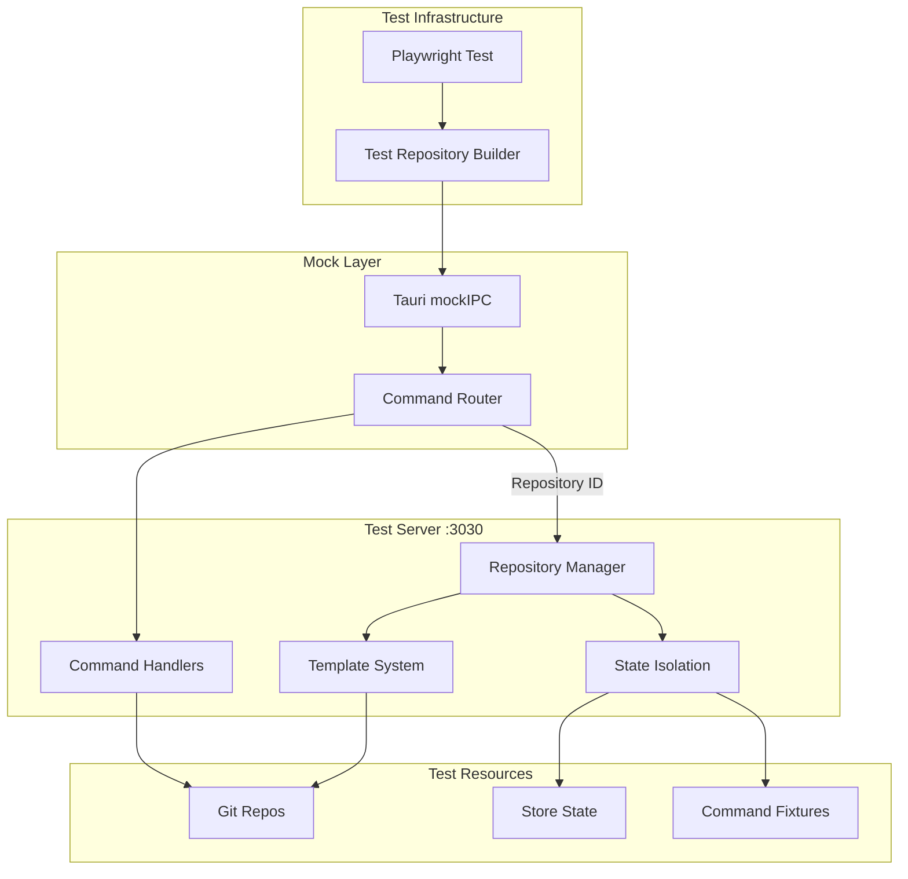
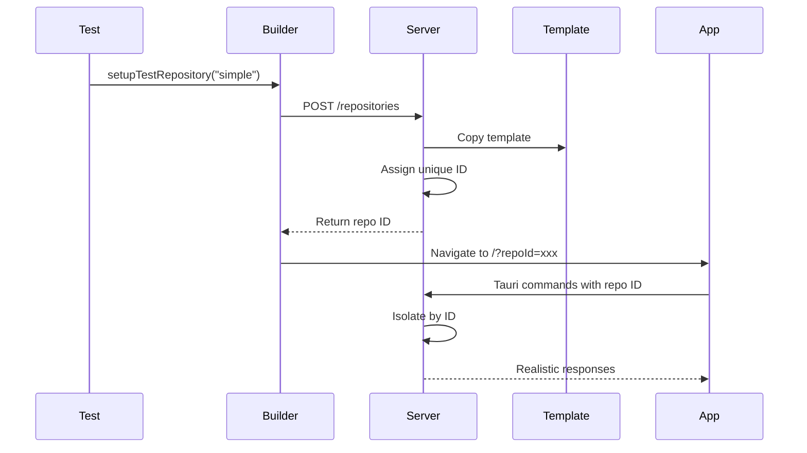

# E2E Testing Architecture

**Status:** Implemented  
**Updated:** 2026-10-11  
**Tags:** [testing, playwright, mocking, snapshots]

## Problem

Testing a desktop Git application requires isolated environments for each test to avoid interference. Tests need predictable repository states, realistic Tauri command behavior, and the ability to simulate various error conditions.

The challenge: How to provide complete test isolation while accurately simulating production behavior, including Git operations, Tauri IPC, and error handling?

## Solution Overview

A custom test server (port 3030, or `E2E_PORT`) provides isolated Git repositories from templates for each test. Tauri commands are mocked to route through this server, which maintains separate state per test via repository IDs. Templates are pre-created for fast test startup, and the mock layer accurately simulates Tauri's Result type system.

## Design

### Architecture

### Test Isolation Flow

### Key Decisions

1. **Decision**: Test server instead of real Tauri backend
   **Rationale**: Complete control over responses, faster than full app startup

2. **Decision**: Template system for repositories
   **Rationale**: Fast test startup, consistent initial state, no git init overhead

3. **Decision**: Repository ID routing via URL parameter
   **Rationale**: Simple isolation mechanism, survives navigation

4. **Decision**: Mock Tauri Result type accurately
   **Rationale**: Tests must handle errors exactly as in production

5. **Decision**: Pre-create templates at server startup
   **Rationale**: Eliminates per-test repository creation overhead

6. **Decision**: A reload starts from what the app wrote to its settings store, as a new window of the app starts from
   `settings.json` as it is now. The setup injects the initial values as `window.__TAURI_STORE__` from an init script,
   which runs again on a reload; the store mock (`tauri-mocks.ts`) also records each write and delete of the page in
   `sessionStorage` (`bd-e2e-store-writes`), and the init script lays them over the initial values.
   **Rationale**: Without it a reload re-injected the values of the setup and a persisted setting (the tab of the
   conflict viewer, a collapsed stack) could not be tested; `sessionStorage` lives as long as the tab, so tests stay
   isolated.

### Implementation Notes

Template system:
- **Templates**: `simple`, `unassigned`, `conflict_*`, `NO_REPO`, `empty-non-git`
- **Location**: Built in parallel into the temporary directory of the server at startup
- **Usage**: Copied to unique directory per test
- **Git**: fixture code runs git through `git_command` (`crates/test-utils/src/git_test_utils.rs`), which removes the
  repository-local variables (`git rev-parse --local-env-vars`). Under `git rebase --exec` or a hook, an inherited
  `GIT_DIR` would otherwise send every template command into the developer's clone; `git_command_test` scans the test
  code for a raw `Command::new("git")`.

Mock implementation:
- **IPC Interception**: `mockIPC` redirects all Tauri commands
- **Command registry**: three lists name the commands: `collect_commands!` of `src-tauri/src/lib.rs`, the
  `/invoke/<name>` routes of `crates/test-server/src/lib.rs` and `COMMAND_HANDLERS` of `tauri-mocks.ts`. The mock
  proxies every command it does not handle to the server, and one without a route answers 405, which fails the test.
  `command_registry_test.rs` (test-server) reads the three as text: every command has a route or a `PAGE_MOCKED`
  entry with its reason (a page handler for the windows, the window menu and the updater; a `routeCommand` of the test
  for Patronus, GitHub and YouTrack), never both; a stale entry, or a route or a handler without its command, fails;
  the four handlers over a route (`get_file_diffs`, `get_file_merges`, `sync_branches`, `set_repository_config`) are
  pinned, and `get_blob_syntax` is the one route outside `collect_commands!` (its answer is raw bytes). The number of
  commands (111) and `PAGE_MOCKED` (30) are pinned; `PAGE_MOCKED` only goes down: a new command gets a route
- **Command errors**: a command that fails answers with 200 and `{ status: "error", error: { message } }`
  (`CommandFailure` in `tauri_command_bridge.rs`, logged at debug: it is the expected answer of an error-path test),
  and the mock rejects with `{ name: "CommandError", message }`, as Tauri rejects with the `CommandError`; the
  bindings return it as `{ status: "error", error }` (an `Error` instance they would throw). A test fails a command
  with `routeCommandError`. Any other answer is a bug of the mock, thrown and logged: 405 a command the server does
  not implement, 500 a command that panicked, 410 a page that outlived its repository
- **IPC counters**: the mock counts the backend commands of the page in `window.__ipcStats`: `invokes` by command,
  `requestBytes` and `responseBytes` (UTF-8 bytes of the parameters and the answers), `channelMessages` by command and
  `channelBytes` (the SSE events of `sync_branches`, `get_file_diffs`, `get_file_merges`), and `pending`, the commands
  whose answer has not been read; `reset()` zeroes the counts, not `pending`. It counts at the fetch of `/invoke/<cmd>`,
  so an answer of a `routeCommand` counts too; the commands the page answers itself (the store, event, window and log
  plugins, the sub-window and updater handlers) do not. `pnpm perf:table` reads it
  ([Rendering Performance](rendering-performance.md#the-ipc-of-the-branch-view))
- **Commands**: the server runs each command's git work on the blocking pool (`run_command`), with the app's core
  functions; Patronus is asked through the app's own service behind a fake ([Remote services](#remote-services)); an
  answer that GitHub or claude would give comes from a fixture of the repository, or from a route of the test
- **Review requests**: `get_review_requests` answers `NotGitHub` until a test posts a fixture to
  `/repositories/{id}/review-requests` (a `ReviewRequestsResult` plus an optional `fetchError`; `GET` returns the
  counts of asks and fetches, and the `keep` of every prune). `fetch_review_head` never fetches: an empty `headRefOid`
  is the tip of the local branch `headRefName` (else of `HEAD`),
  an empty `baseRefOid` the baseline (`HEAD~2` when that is `HEAD`), so the real function finds both commits local and
  answers a range of source `local`; `fetchError` fails it instead. `get_range_files` and
  `prune_review_refs` run the real functions, `cancel_review_fetch` does nothing (`review_requests_test.rs`)
- **Code-owner review**: `get_branch_review_readiness` computes the readiness with the real
  `patronus::review_readiness` from the answer `POST /repositories/{id}/review-answers` sets per branch
  (`{answers: {<branch>: PatronusReviewRequirement}, unavailable?: message}`, `setReviewAnswers`; `AWAITING_CODE_OWNER`,
  `APPROVED_BY_CODE_OWNER`, `NOT_EVALUATED` in `patronus-helpers.ts`) and the reviewers and start the page sends; `GET`
  returns its calls (the branches, the recheck). A branch without an answer needs no review, unless the baseline of
  the repository has `OWNERSHIP` files (`stacked_ownership`, `stack_push_alone`): then the owners of the files of the
  branch's commits at the tip the page sent, ahead of the baseline, review, one group per owner, none approved, as a
  Patronus that doesn't evaluate pull requests (`review_readiness_test.rs`). A test of one surface answers in the page
  instead (`routeReviewRequirement`). So an unstack shows in the review
- **Window**: `plugin:window` answers from `__e2eWindowState` (fullscreen, maximized) and records the actions in
  `__e2eWindowCalls` (with `show_window_menu`); a test fires `tauri://resize`, `tauri://focus` and `tauri://blur` with
  `emitTauriEvent`. E2E has no `__BD_TITLE_BAR__`, so the toolbar renders as under a native title bar
  (`{ kind: "native" }`); a test sets one of the platforms' title bars with `useTitleBar` (`TITLE_BARS` in
  `tests/e2e/helpers/title-bar-helpers.ts`: macOS, Windows, GNOME layouts, KDE). The browser says it is Windows, so the
  lone Alt tap of the main menu is on. `emit` and `emit_to` are recorded in `__e2eEmittedEvents`, not delivered
- **Sub-windows**: `open_sub_window` is answered in the page and recorded in `__e2eSubWindows` (the label, the URL, the
  title, the parsed data and the settings it starts from, `store`); `getOpenedSubWindows` reads them; `sub_window_ready` (the page painted) is answered in
  the page too. Two ways show a sub-window:
  - in the same page, with the recorded data as `__INIT_DATA__` (`openSubWindowPage` in `sub-window-helpers.ts`), under
    the label `main`: for a window that only reads (the commit review, the branch review, the conflict windows); the
    main window's page is gone then;
  - as a page of its own beside the main window's (`openLinkedSubWindow`), under its own label (`__e2eWindowLabel`,
    which the mock reports as the current window) and with the settings the open recorded (else those the main window
    started from): `emit` of one page is
    delivered to the other (`__e2eRelay`, a binding of the context), so the link of the window works end to end: the
    window asks, the main window runs it against the test server and answers, and the toast shows where the app shows
    it. A route of what the window asks itself (its fetch) is set on its page before it loads (`beforeLoad`). Escape
    that closes the window is the `close` of `__e2eWindowCalls` of its page. `tests/e2e/review-requests/review-requests.spec.ts`
    reviews and writes in the `pull-request-review` window this way. A write of the settings in the window reaches the
    main window, which saves it in the store of the test server (`testStore`); `reopenLinkedSubWindow` hands the shown
    window a later open, as the backend does. The Activity window is always linked too (`openActivityWindow` of
    `activity-helpers.ts`: the main window sends it the log, and runs its reveal, Undo, Dismiss and Clear Log). The
    Settings window is always linked: `openSettingsWindow` of
    `settings-helpers.ts` fires `open_settings` in the main window's page once it listens (`waitForTauriListener`; an
    event fired before a lazy page registered its listener is lost) and shows the open, `expectSettingsOpened` checks
    that it is the only new one. A write of Settings → Repository (`set_repository_config`) is answered by the test
    server, and the mock sends the main window `repository_config_changed`, as the command does. The mock's store
    reports no change of a key, so the main window broadcasts none to the linked pages (`store-snapshot-update`): a
    test that changes the recent projects in the main window hands them to the window itself.
  `emit` is also recorded in `__e2eEmittedEvents` (`getEmittedEvents`); a test fires an event in a page with
  `emitTauriEvent`. An event fired for a window (`emitTauriEvent(page, "tauri://destroyed", null,
  "pull-request-review")`) reaches only the listeners of any target and of that window (`target: { label }`), so the
  links of the other kinds stay open; one fired without a window reaches every listener of its name

State isolation:
- **Repository mapping**: `path_to_id` map for command routing
- **Store state**: Separate per repository ID
- **Teardown**: the mock names its repository on every request (`X-Repository-Id`), and the server holds the
  repository while the command runs, in a task of its own: closing a page aborts its requests and drops their
  handlers, but their git work runs on. The `setupRepo` fixture closes the pages of the test first, and
  `delete_repository` forgets the repository, waits for its running commands (10 s at most), then deletes the
  directory. Before, a test's cleanup deleted the files under a running sync, file read or note write
  (`repository_lifecycle_test.rs`)
- **Port**: `E2E_PORT` (default 3030, `tests/e2e/helpers/test-server-url.ts`) sets the port of the server, the
  Playwright `baseURL` and the helpers; the mock script calls its page's origin. `/health` answers the checkout the
  server serves, and global setup refuses a server of another checkout: Playwright reuses whatever listens on the port
  (`reuseExistingServer`), and another lease worktree's server serves that worktree's `dist/` and code
- **Time**: `base-test.ts` installs the Playwright clock at a fixed time; it runs at real speed. A test that waits for
  a timer of the app (the 2 s "Copied" state of `useCopyToClipboard`) runs the clock past it with
  `page.clock.fastForward` instead of a real wait, which a loaded machine overruns
- **Focus**: Base UI moves the focus into a dialog a frame after it opened (`requestAnimationFrame`, which the clock
  drives), often after the dialog's text came. A test that types into the dialog waits for `toBeFocused()` first and
  types with `page.keyboard`: `press` or `type` on an input without the focus focuses it with the caret at 0, and End
  moves no caret on macOS (Playwright maps it to `scrollToEndOfDocument:`, as macOS does)

HTML snapshots (`captureHtmlSnapshot`, `tests/e2e/helpers/aria-snapshot-helpers.ts`):
- **Formatter**: `formatElementWithNormalization` in the mock script prints one attribute set per element with sorted attributes,
  so snapshots diff cleanly.
- **Generated ids**: React `useId` values (`_r_1f_`, `«r1»`, `:r1:`) and Base UI ids (`base-ui-_r_2_`, `base-ui-2`) are
  replaced with `[ID]` in every attribute except `class` and `style`.
- **Diffs**: a diff (`DiffView`) prints its rows element and its scrollbars without their children, and without the
  styles of its layout, which depend on what is in view, on the font and on when the tokens arrive. Assert on diff text
  with `toContainText`, and keep it to lines near the top: a long diff is virtualized.
- **Per-run values**: repository ids (`repo-<22 digits>`) and temporary paths become `[REPO_ID]`/`[TEMP_PATH]` in text and attributes.
- **Icons**: lucide-react renders `<svg class="lucide lucide-NAME ...">`. The formatter prints each icon as one line with the
  canonical name and its own classes, without paths and SVG presentation attributes. No icon name index is needed.
- **Transition settling**: before capturing, the helper waits until no element has `data-starting-style`/`data-ending-style`,
  no closed Base UI popup is still mounted in a portal, and no finite animation is running. Base UI keeps closing popups and
  outgoing tab panels mounted until their exit transition ends; `waitForTabSwitchSettled` covers tab switches. It also
  waits until no commit list (`table`, the `ol` of the branch preview) is `aria-busy`: a list is busy while the file
  counts of its meta lines are read ([Commit Files](../../spec/commit/commit-files.spec.md)).
- **Update**: `pnpm e2e-up` rewrites snapshots. Review the diff, a changed snapshot can hide a regression.

### Remote services

A remote command of the page runs the app's real client and service, which ask a fake on a loopback port instead of
the remote service; a test sets what the fake answers and reads what reached it.

- **Host** (`crates/test-server/src/remote_host.rs`): each test repository gets its `RemoteHost` on the first need
  (`TestRepository::remote`), stopped when the repository is deleted (`FakeServer` aborts its listener on drop). It
  holds `FakePatronus` (`crates/patronus/src/fake_patronus.rs`, `state_only`: nothing built in) and the
  `PatronusService` of the app on it, with a fixed token, no `teamcity` CLI, and the robot pages on `PATRONUS_URL`
  (`PatronusClient::with_web_url`), so a robot links where the app links it. The service is replaced on each Patronus
  fixture: no cached list, backoff or rejected token of the answers before holds. The templates' origin is a local path,
  so the host holds whether the repository is on Space (`space_repository`, project `e2e`, repository `repository`).
- **Bridge**: `get_patronus_robots`, `poll_patronus_robots`, `get_patronus_robot_details`, `get_robot_failure`,
  `get_patronus_robot_problems`, `get_patronus_failing_robots`, `get_patronus_start_options`,
  `get_patronus_target_branch`, `start_patronus_robot`, `restart_patronus_robot`, `cancel_patronus_robot` and
  `get_patronus_robot_status` call the service as `src-tauri/src/commands/patronus.rs` does: the list answers
  `notPatronus` while the repository is not on Space and names the GitHub repository by the real
  `resolve_github_repository`; the start options and the start need Space and the target branch of the baseline
  (`required_target_branch`), and the start runs the app's `prepare_robot_start` first (the landing gate, without the
  object cache, then the source ref of the virtual or the stack branch).
- **Actions**: in `state_only` the fake acts as Patronus does: a start (`POST /robots`) lists a new running robot
  `started-<n>` built from its body (source and target branch, mode), on the commit its source branch is at then
  (`robots_hook`, pinned: a later change of the branch doesn't move it), dated by `clock`, which the host sets to the
  page's clock (`PAGE_CLOCK_START`, 2024-01-02 10:00Z, `base-test.ts`) plus a second per robot started; a restart
  lists `restarted-<n>` with the branches, mode and options of the robot it restarts, on the newest commit of the
  branch; a cancel makes the robot `CANCELING`; the status of a robot is its listed status; an unknown robot answers 404.
  The robot pages are `https://patronus.labs.jb.gg/robot/<id>` (`robotUrl` in `patronus-helpers.ts`). A failure of
  Patronus is the fixture's `availability` (`set_status`), never a route of the page; a refused start is
  `/patronus-start-refusal` (`refusePatronusStarts(description)`, `start_refusal`): every start answers 400 with that
  description, which the app shows, is logged as any start and lists no robot, while the reads go on as before (a test
  that starts from several surfaces refuses them, so no robot holds the next start).
- **Fixtures** (`crates/test-server/src/remote_fixtures.rs`) keep the shapes the page knows and are written once into
  the wire form of the fake; `remote_fixtures_test.rs` reads each form back through the real parser (`to_robot`,
  `progress_of`) as the fixture. `POST /repositories/{id}/patronus` (a `PatronusRobotsResult`, `setPatronus`) sets the
  robots of the list, of a poll (the listed robots whose status differs from the last known one) and of the details;
  `notPatronus` takes the repository off Space, `notLoggedIn` answers 401, `error` 500, and a `githubRepository` is
  written as `branchdeck.githubRepository`. A robot's source branch is the full ref of its virtual branch or of the
  stack branch of its whole stack under the repository's `branchdeck.branchPrefix`, its profile in the options; an
  empty `sourceRevision` is resolved when Patronus answers (`robots_hook`) to the tip of that ref, `~N` to its Nth first
  parent. `/patronus-progress` sets what `robots/progress` folds per robot (the new API of Settings → Patronus), and
  `/patronus-details` the TeamCity checks and problems per robot and the failed builds per check attempt in the wire
  form (`setPatronusDetails`, `failedFastTests` and `buildsNeverStarted` in `patronus-helpers.ts`); a robot without
  them has none. `/patronus-profiles` (`setPatronusProfiles`, the `patronusProfiles` setup option) sets the merge
  profiles of `robot-start-supported` in the shape of `PatronusStartOptions` (`profiles`, `emergencyProfiles`); until
  then a start offers only the default checks. The default profile is the real service's: the profile of the branch's
  last robot, which a fixture robot names in `profile`; so are the profiles that skip the review (`skipsReview` of a
  regular profile comes only from that robot's options, an emergency profile always skips it)
- **Log**: `GET /repositories/{id}/patronus` (`getPatronusLog`) answers `listCalls`, `pollCalls`, `detailCalls`, the
  commands of the page (the caches of the service answer some of them: a test of the page's ask policy counts these),
  `requests`, what reached the fake: `list`, `updates`, `details` and `startOptions` counts, and the robot ids of
  `problems` and `progress` in order; and the actions in order: `starts`, the bodies of the start requests as Patronus
  got them (`startRequest` in `patronus-helpers.ts` builds the expected one, `wholeStackStartRequest` the one from
  `refs/heads/user-name/stack/<root>`, `expectPatronusStarts` waits for them), `restarts`, `cancels` and `statusReads`,
  robot ids. A Safe Push test asserts the start Patronus got, not the parameters the page sent, and no test answers a
  start, a restart, a cancel, the start options, a robot status or the target branch in the page; the order of a push
  answered in the page and the robot actions around it is the log the push's route reads when it comes
  (`routePushNotingPatronus` in `patronus-actions.spec.ts`)

## Alternatives Considered

- **Real Tauri Backend**:
  - Why not: Slow startup, harder to control state, complex cleanup

- **In-Memory Git**:
  - Why not: libgit2 differences, not representative of real git CLI

- **Shared Test Repositories**:
  - Why not: Test interference, race conditions, unpredictable state

- **Docker Containers**:
  - Why not: Overhead, complexity, platform differences

## Performance Considerations

- **Constraint**: Tests must run in parallel without interference
- **Solution**: Complete isolation via repository IDs
- **Measurement** (2026-10-15, 230 tests, 14 workers on 18 cores): one worker creates a repository and loads the page in
  ~170 ms and syncs it in ~270 ms; the full suite takes ~38 s, ~470 s of test time, a median test 2 s
- **Under load** (load average 80, several checkouts running e2e and cargo): a command takes seconds, so a test waits
  for the event a state comes with, never for one assertion to span two of them. A rewrite (move, rename, reword,
  squash, stack, undo) shows its result with the sync it starts: `runAndWaitForSync` (`data-sync-count`). What loads
  after a sync shows with its own element: the autosquash plan with the fixup count of a row. Sync is enabled while
  the branch prefix still loads: the "Ready to Sync" card says it is loaded. The unassigned commits card is a lazy
  chunk above the table: it can render seconds after the rows and move them away from the pointer of a hover, so
  `syncBranches` waits until its fallback (`unassigned-commits-loading`) is gone
- **Logging**: a green run prints no warning or error. The server logs warnings and errors only
  (`TEST_SERVER_LOG=warn`): an error of the server is a bug, not the error of a command. The warnings of the Patronus
  client are left out (`patronus::client=error`): each failed request of the fake is an answer a fixture scripted (a
  refused start, an unknown robot), and the page shows it. The console errors and
  uncaught exceptions of the pages are attached to a failed test only (`page errors` in `base-test.ts`): an
  error-path test makes the app log its expected errors. `DEBUG_E2E=1` prints the server's debug log and every
  console line live. The debug log was 60k lines (23 MB) per run through the pipe that the Playwright main process
  drains: under load the full pipe blocked the server's threads on stdout, and tests timed out waiting for the page
  or a sync

Optimizations:
- Template pre-creation eliminates git init per test
- Parallel test execution with independent state
- Element-based waiting instead of fixed timeouts
- Direct file operations for template copying

## References

- Implementation: `crates/test-server/`, `tests/e2e/`
- Test helpers: `tests/e2e/helpers/`
- Mock layer and snapshot formatter: `tests/e2e/setup/tauri-mocks.ts` (injected with `page.addInitScript`)
- Snapshot capture and transition settling: `tests/e2e/helpers/aria-snapshot-helpers.ts`
- Frontend: the test server serves the `pnpm build` output from `dist/`, with an SPA fallback to `index.html` for client routes such as `/conflicting-files`
- Templates: generated by `pnpm e2e:regenerate` (`crates/test-server`)
- Related: [virtual-branches.md](virtual-branches.md)