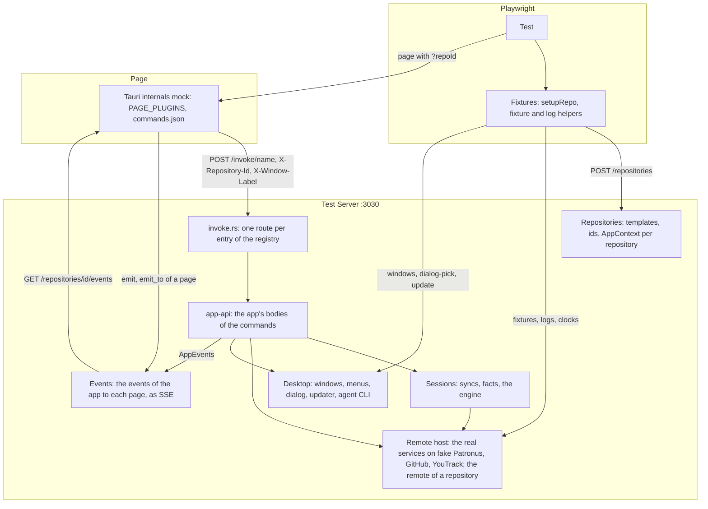
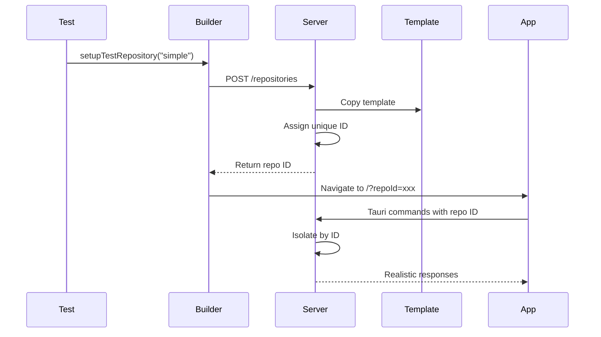

# E2E Testing Architecture

**Status:** Implemented  
**Updated:** 2026-10-28  
**Tags:** [testing, playwright, mocking, snapshots]

## Problem

Testing a desktop Git application requires isolated environments for each test to avoid interference. Tests need predictable repository states, realistic Tauri command behavior, and the ability to simulate various error conditions.

The challenge: How to provide complete test isolation while accurately simulating production behavior, including Git operations, Tauri IPC, and error handling?

## Solution Overview

A custom test server (port 3030, or `E2E_PORT`) provides isolated Git repositories from templates for each test, and
hosts the app's own commands: every command is declared once, in the registry of `crates/app-api`
(`for_each_command!`), which gives the app its Tauri commands and the server its routes, `/invoke/<name>`, each
running the app's body in the context of the test repository the request names. The page mock forwards every command
to its route and answers only the plugins of Tauri itself; the events of the app come from Rust over an event stream
of the server, as the app sends them to its windows. Templates are pre-created for fast test startup. The remote
services (Patronus, GitHub, YouTrack) are fakes of each test repository behind the app's real services, so a remote
command runs the app's Rust path and a test asserts what the fake got ([Remote services](#remote-services)).

## Design

### Architecture

### Test Isolation Flow

### Key Decisions

1. **Decision**: A test server that hosts the app's commands instead of the Tauri app
   **Rationale**: The bodies are the app's (`crates/app-api`), so a test runs the app's Rust path behind fakes it
   controls; faster than an app start, and one server serves the pages of many parallel tests

2. **Decision**: Template system for repositories
   **Rationale**: Fast test startup, consistent initial state, no git init overhead

3. **Decision**: Repository ID routing via URL parameter
   **Rationale**: Simple isolation mechanism, survives navigation

4. **Decision**: Mock Tauri Result type accurately
   **Rationale**: Tests must handle errors exactly as in production

5. **Decision**: The E2E server keeps its templates in a cache beside its executable (`target/debug/e2e-templates/`,
   one directory per build of the server and version of git, `templates.rs`), builds the missing ones in the
   background while it already serves, and a repository waits only for its own template; a route test of
   `crates/test-server` (`create_route_test_app_with_state`) builds a template into its temporary directory when it
   first makes a repository of it. A repository is one APFS clone of its template on macOS (`clone_dir` of
   `lease-pool`), a copy elsewhere
   **Rationale**: A template is built by the code of the server, so a new build of the server is the one change that
   needs new templates; a run of the same build starts at once. Building all 45 took 9–11 s of every run on a quiet
   Mac Studio (1784 git processes) and over a minute under load, and the server served nothing until they were done. A
   route test runs in a process of its own (nextest) and asks for one or two templates: building all 45 took each of
   them two minutes on a CI runner, and the Windows run hit its time limit. A copy of a template took 50 ms on a
   loaded Mac and 167 ms on average during a full run of the Studio, the clone a few ms

6. **Decision**: A reload starts from what the app wrote to its settings store, as a new window of the app starts from
   `settings.json` as it is now. The setup injects the initial values as `window.__TAURI_STORE__` from an init script,
   which runs again on a reload; the store mock (`tauri-mocks.ts`) also records each write and delete of the page in
   `sessionStorage` (`bd-e2e-store-writes`), and the init script lays them over the initial values.
   **Rationale**: Without it a reload re-injected the values of the setup and a persisted setting (the tab of the
   conflict viewer, a collapsed stack) could not be tested; `sessionStorage` lives as long as the tab, so tests stay
   isolated.

7. **Decision**: A repository synced before is the option `syncedAgoMs` of `setupRepo`: the setup sets the
   `repositoryState` of the repository (its `lastSyncTime`) through the test server's writer (`/store/{repo}/{key}`)
   and injects it, so its session syncs as it opens, as the app's does (`synced_before` of the server's session
   environment reads the writer of the test repository).
   **Rationale**: The writer is the app's (`SettingsService`), so the key lands in its own file
   (`repository-state.json`) and the page's later patches of the key apply to the value the writer has; an init script
   that edits `__TAURI_STORE__` changes only what the page starts from.

8. **Decision**: A warm start is the option `warmStart` of `setupRepo`. Before the page opens, a sync without a page
   (`POST /repositories/{id}/warm-start/build`, as `bd sync` syncs: the session reads no fact without a window) leaves
   the frame of the repository's session, which the server keeps in the memory of the test repository
   (`TestRepository::frame`, saved again by its sessions from then on); the session closes, as the app quits. A quit
   (`POST …/sessions/close`, `closeSessions`, also that of `reloadWarm`) answers once each session saved its last frame
   (`Sessions::close_worktree_saved`), so the next start reads the frame of the last facts, not of the last commit. The
   setup then starts the app as Rust does (`GET /repositories/{id}/warm-start`: the session of the prefix the config
   names now, seeded from the frame when the frame is of that prefix, whose first sync starts at once for a repository synced before, `syncedAgoMs` an hour ago unless set) and injects the
   seed it answers as `window.__BD_MODEL__` from an init script of its own, before the page loads; `reloadWarm` quits
   and starts again the same way, its init script replacing the one before for the next load. A test that looks at the
   rows before the first sync holds it in the session (`remoteAnswers: { hold: ["sync"] }`, `HeldAnswer::Sync`, with
   `waitForSync: false`, so the setup waits for the header only). What the page asked before its first row is counted
   in the page (`recordIpcAtFirstRows`, `firstRowsAsks` of `ipc-helpers.ts`, the counters of `__ipcStats` at the
   first `branch-row`), without what every page tells as it loads and which reads nothing of the repository
   (`PAGE_PROTOCOL`: `sub_window_loaded`, `get_settings_changes`, `set_demand`): B7 is the subscription and its channel.
   `pnpm perf:table` starts warm the same way (`reloadWarm`; `warmFirstRowsMs`, `warmFirstSync*` and
   `warmStartInvokes` of its report).
   **Rationale**: The frame is the one a sync of the app's core makes, seeded through the same `Sessions::open_seeded`
   as the start of the app, so the test checks the path of the app and not a frame of its own making; the frame of a
   test is in its repository's memory because the server runs without the object cache (the next decision), and only a
   test that built one seeds from it, so a reload of every other test starts as before.

9. **Decision**: The commands of the test server run without the object cache (`ObjectCache::disabled()`; the
   commands of app-api by the context of a test repository, `RepositoryStateCache::without_object_caches` of
   `AppState::context_of`); not for determinism, the app's cache answers by content
   **Rationale**: Measured 2026-10-24 on the 197 tests of patronus-actions, next-step, commit-files, stacked-branches,
   update-project and move-commits, with a fresh cache per test repository where the app keeps it
   (`$GIT_COMMON_DIR/branch-deck/cache`, opened on its first command, closed before its files go) for every command
   the app reads through it (the sync, the view and its landing needs, the landing gate and the start, the readiness,
   the stack independence, the conflict fix, the commit files, the file diffs and merges, Go to Declaration): all
   passed, but the test server and its git used 84 s user and 165 s system time instead of 84 s and 123 s, and the
   run took 66 s instead of 47-49 s (two interleaved runs each, load 17-25). The git processes went down 1.3% only
   (23,237 against 23,540): a test computes each thing once on a repository of its own, so the cache misses, while
   each test opens four LMDB environments (their maps, their SysV semaphores, `open.lock`), syncs every write to disk
   and closes them under the lock of the open environments. A cache shared by the repositories of a run would hit
   across the tests of one template and make a test's path depend on the tests before it

10. **Decision**: One registry of the commands for both hosts. The grammar is `api_commands!` of
   `crates/app-api/src/registry.rs`, the entries are `for_each_command!` of `commands.rs` (the docs of the bindings,
   the class, the kind, the arguments, the channel, the output, the body), and every host is a callback of it: the
   app's `#[tauri::command]` wrappers, `collect_commands!` of the typed ones and `generate_handler!` of the raw ones
   (`src-tauri/src/api.rs`), the server's routes (`invoke.rs`), the table of the page mock (`commands.json`)
   **Rationale**: Before, three lists named the commands (`collect_commands!` of the app, about 60 handwritten routes
   of the server's `lib.rs`, the handlers of the mock), and the server answered many commands with code of its own
   (a bridge of 1059 lines): a command missing from one list answered 405, and a body of the server
   answered what the app did not. Now a command is declared in one place, and the bindings and the router are held to
   it (**Command registry** below)

### Implementation Notes

Template system:
- **Templates**: `TEMPLATES` of `crates/test-server/src/templates.rs`, built by `test_utils::repo_template` with fixed
  commit dates, so a cached template differs from a new one only in the ids of its store commits (issue groups, stack
  parents); `NO_REPO` is a path without a directory
- **Location**: the E2E server: `e2e-templates/<size and mtime of the executable>-git-<version>/` beside its
  executable, the caches of the two builds before kept (a server of the build before may still run), a half-built
  template of a stopped server removed after 10 minutes. A template is built into `.<name>.<pid>.building` and renamed
  into place once whole, so two servers of one build never copy half a template. A route test: its temporary directory
- **Usage**: cloned (macOS) or copied into a directory of its own per test, in a blocking task
- **Guard**: `every_template_builds` (`templates_test.rs`) builds all of them in one test process: the route tests
  build only the templates they ask for, and a change of the fixture code once broke two templates (a branch
  description with lines in `append_config`) that only the E2E tests copy
- **Git**: fixture code runs git through `git_command` (`crates/test-utils/src/git_test_utils.rs`), which removes the
  repository-local variables (`git rev-parse --local-env-vars`). Under `git rebase --exec` or a hook, an inherited
  `GIT_DIR` would otherwise send every template command into the developer's clone; `git_command_test` scans the test
  code for a raw `Command::new("git")`.

Mock implementation:
- **IPC Interception**: the mock script's `__TAURI_INTERNALS__.invoke` redirects every Tauri command
- **The commands of app-api**: a command of the registry of app-api (`for_each_command!` in
  `crates/app-api/src/commands.rs`) has one generic route, `/invoke/<name>` of `crates/test-server/src/invoke.rs`, which
  runs the app's body in the `AppContext` of the test repository the request names (`X-Repository-Id`), built when
  the repository is (`AppState::context_of`): the settings of its page, its own memory of the diffs and of the reviews
  of branches, no object cache (decision 9), the fakes of the repository as its services (`TestServices`) and its host
  (`TestHost` of `host.rs`: the accounts of the fakes, no `teamcity` CLI, the branch names of the fixture, since E2E
  never runs claude, the page's clock in UTC and the fakes of the CLIs of Settings → Tools), its desktop (`TestDesktop`,
  `TestUpdater`, `TestAgentCli`: below, **Command registry**), and the git of a test machine, `GIT_CONFIG_GLOBAL` the repository's
  own file and `GIT_CONFIG_NOSYSTEM`, whose identity is Test User <test-user@example.com> (`TEST_IDENTITY`: what `git
  var` finds outside a repository, the first run's suggestion `test-user`; a template's own identity wins inside it).
  So the server answers what the app answers, an unknown path included, with no code of its own: the read ahead of a
  branch review (`prefetch_branch_review`) fills the memories of the context as the app's fills its own. It answers the value Tauri resolves the `invoke` with, the
  bytes of a raw command (`get_blob_syntax`), or its error (below) with the operation it names, as the app's.
  [@test] ../../crates/test-server/src/invoke_test.rs (`a_read_of_app_api_answers_what_the_app_answers`, `a_raw_command_answers_its_bytes`, `the_arguments_of_a_command_are_its_params_or_its_named_arguments`)
  [@test] ../../crates/test-server/src/commit_files_test.rs (`commit_files_routes_read_the_fixture_repository`)
- **The table of the page mock**: the mock knows the commands of app-api from the table of their registry,
  `crates/app-api/commands.json` (`[{ name, class, transport }]`; `transport` is `"json"`, `"raw"`, or
  `{ channel, open }`: the argument of the page that gets the events of the command, and whether it stays open after
  the answer), which `commands_json_test.rs` writes from `app_api::commands::COMMANDS` with
  `UPDATE_COMMANDS=1 cargo nextest run -p app-api -E 'test(/commands_json/)'` and which fails when it is stale. The
  fixtures pass it to the init script (`page.addInitScript(tauriMockScript, PAGE_COMMANDS)`): for a command with a
  channel the mock keeps the `Channel` of the argument its entry names (`window.__progressChannels`), sends its key
  (`X-Progress-Channel`), hands each `{ progress }` of the answer to it, and reads on after the answer for an `open`
  one. No channel is guessed from the payload: the diffs and the merges of the views (`get_file_diffs`,
  `get_file_merges`, `events`) stream through it as the app streams them, the patches of `subscribe_view`
  (`patches`, open), the events of `execute`, of a sign-in (`sign_in`, `events`) and the progress of the Safe Push
  statistics (`get_robot_stats`, `events`) and the lines of an action of Settings → Tools (`run_cli_tool_action`,
  `progress`).
  [@test] ../../crates/app-api/src/commands_json_test.rs (`the_commands_json_of_the_page_mock_is_the_registry`, `a_channel_of_the_table_names_the_argument_of_the_page_and_whether_it_stays_open`)
- **Command registry**: one list names the commands, the registry of app-api (`app_api::commands::COMMANDS`, 76: 75
  typed and the raw `get_blob_syntax`, pinned in `crates/app-api/src/registry_test.rs`), and every host is made of it:
  the app registers its generated wrappers (`typed_commands`, which the bindings `src/lib/bindings.ts` are exported
  from in the order of the registry, and `raw_handler`), the server routes `/invoke/<name>` of each entry
  (`invoke::command_routes`; no other source of the server routes a command), and the page answers only what is no
  command, `PAGE_PLUGINS` of `tauri-mocks.ts`: the plugins of Tauri (`plugin:event`, `plugin:window`, the clipboard,
  the opener…). The mock proxies every command to the server, and one without a route answers 405, which fails the
  test. `command_registry_test.rs` (test-server) holds the three to one set: the functions of `export const commands`
  of the bindings are the typed entries, in their order; the router answers `POST /invoke/<name>` of every entry with
  its error (a request that names no test repository runs nothing), never 404 or 405; no source of the server but
  `invoke.rs` names a route of a command; `PAGE_PLUGINS` holds only plugins. The class of an entry says what the
  command writes, the ratchet below reads it: `read`, `engine` (`execute`, `cancel_operation`, pinned in
  `registry_test.rs`) or `app(<reason>)`, a write no session admits with its reason (`AppReason`: a ticket of the
  session, the cancel of a read, the page's journal, a settings writer, the app itself, the tools, an account, the
  reviewed refs of Mark Reviewed). The app
  itself is every command that acts on its windows or its desktop: an open of a window and the stages of a page that
  show it, the folder dialog, the window menu, a check for an update (which downloads it), the restart; a body that uses
  the desktop or the windows of `AppContext` beyond the reads of the updater and the agent CLI is no `read`
  (`command_scan_test.rs` of app-api). No page handler emits an event: the events come from Rust (**Events of the
  app**).
  [@test] ../../crates/test-server/src/command_registry_test.rs (`the_registry_and_the_bindings_are_one_set`, `the_server_routes_every_command_of_the_registry`, `no_source_of_the_server_routes_a_command_beside_the_registry`, `the_page_mock_answers_only_the_plugins_of_tauri`)
  [@test] ../../crates/app-api/src/registry_test.rs (`every_command_is_registered_once`, `the_writes_of_the_engine_are_its_intents_and_their_cancel`)
  [@test] ../../crates/app-api/src/command_scan_test.rs (`a_command_that_acts_on_the_windows_or_the_desktop_is_no_read`)
- **Desktop**: what the app does on the desktop runs on the server as the app runs it, its host the desktop of the
  test repository (`Desktop` of app-api; `TestDesktop`, `TestUpdater` and `TestAgentCli` of `host.rs` and `updater.rs`): the windows
  (**Sub-windows**) and the window menu, recorded (`GET /repositories/{id}/windows`: `opens`, `menus`;
  `getOpenedSubWindows`, `getWindowMenus`); Auto-sync on Focus of the native menu, a request a test reads; the folder
  dialog (`browse_repository`), which picks the folder of `POST /repositories/{id}/dialog-pick` (`{ path }`, null
  cancels; `setDialogPick`), else the test repository; the updater, whose `check_for_updates` and `get_update_status`
  answer the update of `POST /repositories/{id}/update` (`{ availableVersion }`, `setAvailableUpdate`; none: up to
  date, version `0.0.0-test`) and whose install fails, as `restart_app` does after its write of the settings, with the
  message that the test server has no updater; the agent CLI, `bd` at a fixed path that installs nothing (its skills
  once `install_agent_cli` ran, the rules of `bd workspace` of the repository's global config); the CLIs of Settings →
  Tools, the real cores on the fakes of the repository (`cli_tools_fixtures.rs`: `POST /repositories/{id}/cli-tools`
  sets what is installed, `GET` reads what the fakes were asked; `AppHost::tool_environment` of `TestHost`).
- **Events of the app**: the commands of app-api tell the windows through `AppEvents` of the host
  (`app_api::events`: `settings_changed`, `activity-changed`, `auth-changed`, `repository_config_changed`), which in
  the test server is `TestEvents` of `crates/test-server/src/host.rs`, one per test repository: each page subscribes
  as its mock starts, `GET /repositories/{id}/events?window=<label>` (SSE, `{"subscribed": true}` first, then
  `{ event, payload, window, source }`), outside `hold_repository`, so the stream that lasts as long as the page never
  holds the deletion of the repository, which ends every stream (`TestEvents::close`). An event goes to every page, or
  to the pages of one window (`emit_to`: `repository_config_changed` and the main-only keys of the settings to `main`),
  as Tauri sends it; the mock hands it to the listeners of its name (`__e2eEmitTauriEvent`, for its window) and
  records an event of the app (no `source`) in `__e2eEmittedEvents`. The mock sends its first command once the stream
  answered, so the events of what a page does reach it. The watch of the operations registry of a repository a window
  shows tells its pages `activity-changed` when the journal changes (`RegistryFiles::on_journal`, with the keys of the
  sessions that watch it), and a sign-in or a sign-out that changed an account `auth-changed` (`TestSignIns` of
  `remote_host.rs`). What a page emits (`emit`, `emit_to` of `@tauri-apps/api/event`) is recorded in its
  `__e2eEmittedEvents` and goes through the server the same way (`POST /repositories/{id}/events`, the page's window
  as its `source`), to the pages it names, the page itself included, as the event plugin of Tauri sends it; so the
  link of a sub-window and the main window works end to end without a binding of the test. As in the app, the answer
  of a write and its event come in any order: the page applies the settings by version, and a test waits for the
  event or the state (`getEmittedEvents`, `waitForStorePersistence`), never for time.
  [@test] ../../crates/test-server/src/app_events_test.rs (`the_events_of_the_app_reach_the_pages_of_their_windows_and_end_with_the_repository`, `an_operation_journaled_in_the_repository_a_window_shows_tells_its_pages`)
  [@test] ../../crates/app-api/src/events_test.rs (`a_change_of_the_settings_goes_to_the_windows_that_get_its_key`, `a_config_write_goes_to_the_main_window_and_a_journal_change_to_every_window`)
- **The ratchet of page answers**: the fourth source of the registry test is the E2E tests themselves
  (`tests/e2e/**/*.ts`). It counts every answer a test gives in the page: each `routeCommand(page, "<name>", …)` and
  each `.route("**/invoke/<name>", …)` whose handler fulfills with an answer of its own (a hold, a record, a
  rewrite of the server's answer and a hold of it, `holdNextAnswer` (an older answer that comes after a newer one), let
  the command run on the server: a rewrite binds
  `const response = await route.fetch()` and passes that binding as the `response` of its `fulfill`; a `fulfill` of
  any other value, also one named `response`, is an answer, and a fetch bound any other way fails the scan). A write
  (an entry of the registry whose class is not `read`: `execute` and `cancel_operation` of the engine, and the
  commands of the app with their reasons: the sign-ins, the settings writers, the journal of the page, the tools, the
  app) has no page answer: the test server runs it behind the fake of its service and the test asserts the fake's log
  ([Remote services](#remote-services)); a push goes to the remote of the repository, and the test asserts what that
  remote has and took ([The remote of a repository](#the-remote-of-a-repository)); its failure stays
  `routeCommandError`, the one page answer that is no route count. The page answers of the read commands are pinned per
  command (`ROUTED_IN_PAGE`, three commands: the repository config, the status of the agent CLI and the read ahead of a
  branch review, states that neither the fixtures of the fakes nor the
  templates make yet; no fact of a session is among them). An answer
  counts where it is given: a helper that answers (a declared `function` at the outermost level, exported from
  `helpers/` or a spec's own, through the helpers it calls) counts its answers once per call, not once per definition,
  so the pinned answers are the calls of the helpers. Inside a test the count is of the places that answer, not
  of the runs: a `beforeEach` answers for every test of its describe, a loop or a local arrow function runs its answer
  more often, and the ratchet counts each once, because it pins which commands the page answers and where, not how
  often a run answers them. The places whose count is wrong by construction and whose fix is a declared helper are
  refused: an answer, or a call of an answering helper, at the top level outside a test (`test(…)`, `test.describe`,
  `test.beforeEach`, `test.step`, a fixture's `testWith…`; the members of the test API, never `test.extend`), which is
  how a function kept in a `const` looks in any of its forms (an arrow with a block or an expression body, with or
  without types, a function expression, a method of an object); an answer in the definition of a fixture
  (`test.extend({…})`, with or without a type argument), which runs once per test that uses it; a function declared
  inside a helper that answers; and a second declaration of an answering helper's name, in another file or the same.
  An overload signature of a helper is read as the formatter writes it (no `;`, the declaration on the next line). A
  route handler that fulfills with an answer of its own on any branch is an
  answer, even when another branch forwards the server's `response`. A new page answer fails, a removed one lowers its
  number; `routeCommand` and a fulfilling route name their command by a string literal. Beside this ratchet,
  `pnpm lint:arch` (`scripts/lint-arch.mjs`, its own tests in `scripts/lint-arch.test.mjs`) scans the same tests and
  the page (`src/**/*.ts(x)`): no branch on the words of an error (`.message` compared or searched), no `kind` of an
  error, and every `routeCommandError` names the code its error answers (below); an exception is an entry of its
  `ALLOWLIST` with a reason, only of a timer of the UI (`poll-timer`), and an entry that matches nothing fails.
- **Command errors**: a command that fails answers with 200 and `{ status: "error", error: <ApiError> }`: the
  `ApiError` of `domain-types` (`{ code, message, details, retry, operation_id }`) that the app's command rejects
  with, made by the same `app_api::api_error::api_error` from the core's error (`Rejection` in `invoke.rs`, a type of
  the server only because axum's `IntoResponse` can't be implemented for `ApiError` there; logged at debug: it is the
  expected answer of an error-path test). A command runs as a task of its own (`invoke::caught`), so one that panicked
  is no answer: 500, or `{ "result": { "panicked": true } }` on the stream of its channel. The mock rejects with the whole
  error, marked `name: "ApiError"`; the bindings return it as `{ status: "error", error }` (an `Error` instance they
  would throw), and the page branches on `code`, never on `message` (`pnpm lint:arch`). A test fails a command with
  `routeCommandError(page, command, { code, message, details?, retry? }, { times? })`, the code the real command would
  answer (`lint:arch` refuses a call without one); `times: 1` fails only the first call, so a retry reaches the server.
  A cancel answers `canceled` from the real session (a sign-in, an action of a CLI tool), which the page tells nothing
  of.
  Any other answer is a bug of the mock, thrown and logged: 405 a command the server does not implement, 500 a command
  that panicked, 410 a page that outlived its repository. The adapters' contract: both answer the JSON of
  `crates/app-api/fixtures/api_errors.json` for each case of `app_api::api_error::contract_cases`, the app with the id
  of the operation besides (and the server for a command of app-api, which runs the app's body).
  [@test] ../../src-tauri/src/api_error_contract_test.rs (`a_command_of_the_app_rejects_with_the_api_error_json_of_the_contract`)
  [@test] ../../crates/test-server/src/api_error_contract_test.rs (`a_command_of_the_server_answers_the_api_error_json_of_the_contract`)
  [@test] ../../crates/test-server/src/api_error_contract_test.rs (`a_panicked_command_of_the_server_fails_the_request`)
  [@test] ../../crates/test-server/src/api_error_contract_test.rs (`a_command_with_a_channel_answers_the_api_error_json_of_the_contract_on_its_stream`)
  [@test] ../../crates/test-server/src/repository_lifecycle_test.rs (`a_failed_command_answers_with_its_api_error`)
- **IPC counters**: the mock counts the backend commands of the page in `window.__ipcStats`: `invokes` by command,
  `requestBytes` and `responseBytes` (UTF-8 bytes of the parameters and the answers), `channelMessages` by command and
  `channelBytes` (the SSE events of `get_file_diffs` and `get_file_merges`, and the patches of `subscribe_view` for
  as long as its channel stays open), and `pending`, the commands whose answer has not been read
  (`subscribe_view` until its answer, not its last patch); `reset()` zeroes the counts, not `pending`. It counts at the fetch of `/invoke/<cmd>`,
  so an answer of a `routeCommand` counts too; what the page answers itself (the plugins of Tauri: the store, the
  events, the window, the log) does not. `pnpm perf:table` reads it
  ([Rendering Performance](rendering-performance.md#the-ipc-of-the-branch-view)), and so do the tests that pin the IPC
  of a step (`resetIpc`, `settledInvokes` of ipc-helpers.ts, and `withoutAppTimers`, which leaves out the commands of
  the app's own timers, `set_setting` and `check_for_updates`, as they fire wherever a step is): the hover of a row
  reads no fact, its menu invokes nothing, the popover of its robot one `set_demand`
  [@test] ../../tests/e2e/patronus/patronus.spec.ts (`should ask the session nothing for the hover and the menu of a row, and tell it only the details of the robot whose popover opens`)
- **Sessions**: the server hosts the sessions of its repositories as the app does (`session_routes.rs`, the same
  `Sessions` and `GitSessionHost` of `repository-model`, on a `TestClock` per repository that stands still, so no
  session of a test goes away by itself until the test moves it, `repo.advanceBackendClock`), and runs the app's
  commands of the sessions (`app_api::session`) through the routes of app-api (`invoke.rs`), in the `AppContext` of the
  test repository: its sessions and registry are the server's, its services the fakes of the repository
  (`TestServices`), its windows its own, named by the `X-Window-Label` header the mock sends with every command (the
  label of its page, `__e2eWindowLabel`), as the app names the calling window by its webview. `get_snapshot`, `sync`,
  `set_window_focus`, `set_demand` (what the window of a subscription shows, `src/model/demand.ts`), `refresh_facts`
  and `unsubscribe_view` answer JSON; the scheduler of the facts runs on the same clocks and reads the fakes of each
  repository (`TestFactSources`, which counts every read of a family: the lists, polls and details of the robots in
  `listCalls`, `pollCalls` and `detailCalls` of `getPatronusLog`, the listings of the pull requests in `calls` of
  `getGitHubLog`, the review requests in `getReviewRequestCalls`, the readiness asked in `getReviewReadinessCalls`; a
  test of the cadence asserts these after it moved the clock, as the policy tests of `domain_policy::refresh` do);
  `subscribe_view` is a long-lived event stream of its channel (`X-Progress-Channel`, the `patches` of the command):
  `{ result }` with the subscription and its view first, then each `ViewPatch` as `{ progress }`, until
  `unsubscribe_view` or the deletion of the repository, which closes its windows and its sessions first
  (`AppContext::forget_windows`, as the app forgets a closed window), so the stream ends and the deletion does not
  wait for it. A command of app-api with a channel (`[channel patches: ViewPatch, open]` of its entry) streams so
  whenever the mock names its channel; the mock answers the command at its `{ result }` and reads the stream on for
  the channel (`open` of its entry in `commands.json`). A refusal (`no_branch_prefix`, by the frame of a session command,
  which resolves the key of the session before its body runs) is `{ result: { status: "error", error } }` on the
  stream, the JSON of the app, with the id of its operation. A patch may reach the channel before the answer, in the app too: the
  page keeps it until it has the view, and applies a patch only on its `base`. The sync button carries the version of
  the view the page holds (`data-view-version`, `epoch:seq`) beside the count of the runs that ended
  (`data-sync-count`), for a test that waits for a patch; the review window of a branch, which subscribes on its own,
  carries the version of its view on `branch-review`.
  [@test] ../../crates/test-server/src/session_routes_test.rs (`a_subscription_answers_its_view_then_the_patches_up_to_the_version_a_sync_answers`)
  [@test] ../../crates/test-server/src/session_routes_test.rs (`a_repository_without_a_prefix_is_refused_with_the_api_error_of_the_app`)
  [@test] ../../crates/test-server/src/repository_lifecycle_test.rs (`deleting_a_repository_closes_its_sessions`)
- **What a sync reports differently**: a branch on the remote comes from the remote of the repository (a push in a
  terminal, [The remote of a repository](#the-remote-of-a-repository)); a test that needs a remote status that remote
  does not make (a stack branch as a test writes it), or the issue links of a YouTrack user, sets it for the next run
  of the repository's session: `POST /repositories/{id}/sync-overrides` (`setSyncOverrides`, or the
  `syncOverrides` option of `setupRepo` for the first sync) with `remote` (branch -> the fields of its
  `RemoteStatusUpdate` that replace the computed ones, `keepUnpushed: n` for the newest `n` of the commits the sync
  found the remote lacking; null: no status of the branch), `stacks` (root -> the fields of its `StackBranchUpdate`)
  and `issueLinks`. The run that starts next takes them (`sync_overrides.rs`, through `SessionEnvironment::reporter`),
  so the session's table, its patches to the page and the table of the views are what a sync of such a repository
  makes, never a rewrite of the page's stream; the runs after it are the server's again, unless `every: true` keeps
  them for each run until a test sets others (a test of several starts, whatever syncs run between them). `GET
  /repositories/{id}/revision?name=<rev>` answers the commit a ref is at (`repo.revision`), the copy a sync built.
  `POST /repositories/{id}/rebase-in-progress` (`setRebaseInProgress`, the `rebaseInProgress` option of `setupRepo`)
  leaves the repository as an interrupted rebase does, so its syncs are deferred by the real check. `POST
  /repositories/{id}/branch-prefix` (`setBranchPrefixInTerminal`) sets `branchdeck.branchPrefix` of `.git/config` as
  `git config` in a terminal does: the run of a session reads the local prefix again (`branch_prefix_now`), so one
  under the prefix the config left answers `prefix_changed`, as in the app. `POST /repositories/{id}/user-name`
  (`setUserNameInTerminal`) sets `user.name` there the same way: an empty name is an identity git cannot form whatever
  the global config says, so the next sync fails with `no_identity` at its notes. `repo.sessionView()` asks the test
  server for the view of the session (`get_snapshot`, the test's own request, no answer of the page): a test whose page
  waits for an answer (a held `subscribe_view`) waits on it for what the backend did meanwhile.
  [@test] ../../crates/test-server/src/session_routes_test.rs (`the_next_sync_takes_the_overrides_of_its_repository_and_the_syncs_after_it_do_not_unless_set_for_every_sync`)
  [@test] ../../crates/test-server/src/session_routes_test.rs (`a_revision_of_the_repository_answers_its_commit`)
  [@test] ../../crates/test-server/src/session_routes_test.rs (`a_rebase_in_progress_defers_the_sync_until_it_is_gone`)
  [@test] ../../crates/test-server/src/session_routes_test.rs (`a_prefix_set_in_a_terminal_refuses_the_run_of_the_session_under_the_old_one`)
- **Commands**: the server runs no command of its own: each is the app's body (app-api), its git work on the blocking
  pool (`run_blocking`, as in the app); Patronus and GitHub are asked through the app's own services behind fakes
  ([Remote services](#remote-services)); an answer that claude would give (`TestHost::suggest_branch_names`, after
  the delay of the fixture), and the review requests, come from a fixture of the repository, or from a route of the
  test
- **Review requests**: the session of a repository reads `NotGitHub` (`TestFactSources::review_requests`,
  `review_requests_of`) until a test posts a fixture to `/repositories/{id}/review-requests` (a `ReviewRequestsFixture`
  plus an optional `fetchError`, and for [Reviews](../../spec/repository/reviews.spec.md) `others` (the searches the
  Reviews view reads), `answered` and `linkable`, the pull requests a link can name, `closed` for a merged one; `GET`
  returns the counts of the session's lists, of those that read the rest of Reviews (`reviewsCalls`) and of the
  fetches, and the `keep` of every prune); it lists them after a sync, on a focus and five minutes after its last answer
  on the clock of the repository (`repo.advanceBackendClock`). An empty `headRefOid` of the fixture is answered as the
  tip of the branch it names, read from the refs without a git process. The links the user adds live in the settings of
  the test repository, and the fake GitHub answers `pullRequest(number:)` from the nodes of the fixture. The review
  fetch (the intent `fetchReview` of `execute`) runs the real operation and never fetches: the server's
  `RewriteHost::review_fetch` makes an empty `headRefOid` the tip of the local branch `headRefName` (else of `HEAD`),
  an empty `baseRefOid` the baseline (`HEAD~2` when that is `HEAD`), so the real core finds both commits local and
  answers a range of source `local`; `fetchError` fails it instead. `get_range_files` runs the real function, and the
  prunes of the session at each change of its review windows are recorded before they run (`review_requests_test.rs`)
- **Code-owner review**: the readiness reads of the sessions (`TestFactSources::readiness`) run
  the app's reads (`ServiceFactSources`) and core (`remote_facts::review_readiness`, without the object cache, so every call asks the fake Patronus
  and no kept answer is read first; Space and the target branch as the app needs them); a test holds or fails the
  pre-check of the fake (`holdRemoteAnswers({ hold: ["readiness"] })`), never the page's call, see
  [Remote services](#remote-services). `POST /repositories/{id}/review-answers` (`setReviewAnswers`, the `reviewAnswers`
  setup option) sets what the pre-check answers by branch (`{answers: {<branch> | stack:<root>: PatronusReviewRequirement}}`;
  `AWAITING_CODE_OWNER`, `APPROVED_BY_CODE_OWNER`, `NOT_EVALUATED` in `patronus-helpers.ts`), written once in the wire
  form the real parser reads back (`fixture_review_answer`; an answer Patronus could not give, a skipped review or
  paths of the `OWNERSHIP` files, is refused with 422). The fake answers a pre-check whose newest commit is the tip of
  `{prefix}/virtual/<branch>` (or `{prefix}/stack/<root>`) with its answer, any other by the code owners of the paths of
  its commits by the `OWNERSHIP` files of the target (`origin/<target>`), one group per owner, none approved, as a
  Patronus that doesn't evaluate pull requests; the core attributes the paths (`review_readiness_test.rs`). A template
  without `OWNERSHIP` files needs no review. `mergeRequest: { request, answers }` is the Space merge request the fake
  finds open for every branch (a repository only on Space counts its approvals) with what the pre-check answers asked
  with its review. `GET` returns the sessions' `calls` (the subjects of each,
  the recheck) and the `checks` the fake got (the tip, the pull request)
- **Window**: `plugin:window` answers from `__e2eWindowState` (fullscreen, maximized) and records the actions in
  `__e2eWindowCalls` (the window menu is a command of the app, recorded by the server: `getWindowMenus`); a test fires `tauri://resize`, `tauri://focus` and `tauri://blur` with
  `emitTauriEvent`. E2E has no `__BD_TITLE_BAR__`, so the toolbar renders as under a native title bar
  (`{ kind: "native" }`); a test sets one of the platforms' title bars with `useTitleBar` (`TITLE_BARS` in
  `tests/e2e/helpers/title-bar-helpers.ts`: macOS, Windows, GNOME layouts, KDE). The browser says it is Windows, so the
  lone Alt tap of the main menu is on. `emit` and `emit_to` are recorded in `__e2eEmittedEvents` and go through the
  test server to the pages of the repository (**Events of the app**)
- **Sub-windows**: `open_sub_window` runs on the server as the app runs it (`app_api::app::windows`): the desktop of the
  test repository builds no window and records each open (the window that asked, the label, the URL, the title, the
  parsed data and the settings it starts from, `store` and `storeVersion`: the writer's copy, as the app builds the
  window), which `getOpenedSubWindows` reads (`GET /repositories/{id}/windows`), the opens of the page's own window.
  The window of a page a test opens is built on the server before the page loads, as the app builds it
  (`registerWindowBuild`, `POST /repositories/{id}/windows/built`: the main window in `common-setup.ts`, a linked
  sub-window in `openLinkedSubWindow` with the version of its snapshot), so `sub_window_loaded` answers the changes of
  the settings after it and the stages of the page set the deadlines of the window there (`sub_window_drawn`,
  `sub_window_ready`), as in the app; the server shows nothing. What the page had in its DOM when it said a stage is a
  measure of the test (`observeCommand` on `page.route`, the call going on to the server; `observeWindowStages`, which
  `openLinkedSubWindow` sets for every window: `getWindowShell`, the title rows, the loading tables and the branch rows
  at `sub_window_drawn`; `getSubWindowReadyOpen` and `getWindowReadyRows`, the open and the branch rows at
  `sub_window_ready`, which the main window, whose open the mock sets as its init script does, says on its first rows).
  Two ways show a sub-window:
  - in the same page, with the recorded data as `__INIT_DATA__` (`openSubWindowPage` in `sub-window-helpers.ts`), under
    the label `main`: for a window that only reads (the commit review, the branch review, the conflict windows); the
    main window's page is gone then;
  - as a page of its own beside the main window's (`openLinkedSubWindow`), under its own label (`__e2eWindowLabel`,
    which the mock reports as the current window) and with the settings the open recorded (else those the main window
    started from): `emit` of one page reaches the other through the test server, as the events of the app reach both
    (**Events of the app**), so the link of the window works end to end: the window asks, the main window runs it
    against the test server and answers, and the toast shows where the app shows it. A route of what the window asks itself (its fetch) is set on its page before it loads (`beforeLoad`). Escape
    that closes the window is the `close` of `__e2eWindowCalls` of its page. `tests/e2e/review-requests/review-requests.spec.ts`
    reviews and writes in the `pull-request-review` window this way. A write of the settings in the window reaches the
    main window, which saves it in the store of the test server (`testStore`); `reopenLinkedSubWindow` hands the shown
    window a later open, as the backend does. The Activity window is always linked too (`openActivityWindow` of
    `activity-helpers.ts`, by Open in Window of the side panel unless the test opens it otherwise: the window reads the
    log itself, the main window sends it what only it knows and runs its reveal, Undo, Dismiss and Clear Log; the test
    server tells both pages `activity-changed` after `record_activity` and `clear_activity`, and when the journal of
    the repository changed after an operation, as the backend does). The
    Settings window is always linked: `openSettingsWindow` of
    `settings-helpers.ts` fires `open_settings` in the main window's page once it listens (`waitForTauriListener`; an
    event fired before a lazy page registered its listener is lost) and shows the open, `expectSettingsOpened` checks
    that it is the only new one. A write of Settings → Repository (`set_repository_config`) is answered by the test
    server, which sends the main window `repository_config_changed`, as the command does. A change of the settings
    (`set_setting`) goes to the test server's writer of the repository (`TestRepository::store`, the app's
    `SettingsService` on a file of its app data), which sends the change to every page whose window gets its key
    (`settings_changed`), as the backend does, recorded in `__e2eEmittedEvents` of each page that heard it, with its
    version; each page keeps its copy of the settings (`__TAURI_STORE__` and `__TAURI_STORE_VERSION__`), from which a
    reload and a sub-window it opens start. A linked window's webview starts at the zoom of its snapshot
    (`__e2eWebviewZoom`, as the builder zooms it), and its load (`sub_window_loaded`) takes the changes the test
    server's writer made after the version of that snapshot.
  `getEmittedEvents` reads what a page emitted and the events of the app it heard; a test fires an event in a page with
  `emitTauriEvent`, in that page alone. An event fired for a window (`emitTauriEvent(page, "tauri://destroyed", null,
  "pull-request-review")`) reaches only the listeners of any target and of that window (`target: { label }`), so the
  links of the other kinds stay open; one fired without a window reaches every listener of its name

State isolation:
- **Repository mapping**: `path_to_id` map for command routing
- **Store state**: Separate per repository ID
- **Teardown**: the mock names its repository on every request (`X-Repository-Id`), and the server holds the
  repository while the command runs, in a task of its own: closing a page aborts its requests and drops their
  handlers, but their git work runs on. The `setupRepo` fixture closes the pages of the test first, and
  `delete_repository` forgets the repository and answers at once; in the background it waits for the running commands
  (120 s at most: a sync of a loaded machine still runs tens of seconds after its test failed) and for the computation
  of the landing needs its session runs, which holds the repository as a command does
  (`TestSessionEnvironment::landing_needs`), releases the
  repository lock its test held (`holdRepositoryLock`, also when the test failed before it released it), then deletes
  the files. Before, a test's cleanup deleted them under a running sync, file read or note write, and under the
  landing needs ("not a git repository", "bad object", "Unable to read current working directory"); and a wait of 10 s
  in the cleanup was too short under load (`repository_lifecycle_test.rs`). The deletion waits only for the commands
  of a named repository, so a route test names it too: every command of one goes through `test_support::command`
  (`post`, `post_error` and `sync` call it), which names the repository at the `repositoryPath` of the params
  (`Named::ByPath`) or the one a test gives (`Named::Id`: a command whose params name none, the cancel of an
  operation; a command of app-api runs in the context of the repository a request names, so every one names one;
  only the route probe of the registry test names none, `command_of_no_repository`, and runs nothing);
  `every_command_of_a_route_test_names_its_repository` refuses a request a test builds itself. Unnamed, a command ran
  across the deletion, and the fake GitHub's git of a released answer ran in the files the deletion removed. The
  removals go through `sync_utils::fs_retry`, which tries a sharing error again for about a second: on Windows a
  process whose current directory is in the directory, or a scanner with a file open, blocks its removal until it
  lets go, and the directory stays
- **Port**: `E2E_PORT` (default 3030, `tests/e2e/helpers/test-server-url.ts`) sets the port of the server, the
  Playwright `baseURL` and the helpers; the mock script calls its page's origin. `/health` answers the checkout the
  server serves, and global setup refuses a server of another checkout: Playwright reuses whatever listens on the port
  (`reuseExistingServer`), and another lease worktree's server serves that worktree's `dist/` and code
- **Time**: two clocks, each moved by a test, never waited out. The page's: `base-test.ts` installs the Playwright
  clock at a fixed time; it runs at real speed, and a test that waits for a timer of the page (the 2 s "Copied" state
  of `useCopyToClipboard`) runs it past with `page.clock.fastForward` instead of a real wait, which a loaded machine
  overruns. The backend's: the sessions of each test repository age on a `TestClock` of their own
  (`AppState::session_clocks`, `WorktreeClocks`: `Sessions` and the scheduler take the clock of a session by its
  worktree), which stands still; the timers that decide what a session asks and when (its polls, retries and backoffs,
  the sweep of a session no window shows) wake only when its test moves it with `repo.advanceBackendClock(ms)`
  (test-repository.ts, `POST /repositories/{id}/clock/advance { ms }`, which also sweeps the idle sessions), so a test
  that moves its time moves no session of a test beside it: the poll of the robots a minute after the last one
  while the window is focused, so a test that waits for a merge a poll tells moves it in a loop until the toast shows;
  a focus (`tauri://focus`) polls at once, unless a poll ran less than 50 s ago on that clock; a focus lists the pull
  requests only two minutes after their last answer on it, and the look again five seconds after a push that GitHub
  shows on an old head waits for it too. A test of a new start of the app closes the sessions of its repository before
  the reload (`closeSessions`, `POST /repositories/{id}/sessions/close`): the reload opens a new session, whose facts
  are asked anew. Neither clock moves the 16 ms merge of the patches or a
  bounded lock wait, which run on wall time: a test waits for the patch an advance causes (its DOM state,
  `data-view-version`), never for time
- **Motion**: `base-test.ts` switches the enter animations off in every window of a test (a constructable sheet,
  `[class*="animate-in"]:not([data-closed])`), so a popup, an inline form or a card is in place from its first frame.
  On the Mac Studio Playwright found the first two frames of a menu's zoom equal, put the pointer where an item was in
  them, and the grown item left it 3 px above: the hover open of "Whole Stack ›" closed in 22 of 40 runs of four
  tests, a tooltip of an item never opened. The exits still run as the user sees them, so a popup reopened while it
  closes stays tested; the reduced motion of the app is a test's own (`page.emulateMedia({ reducedMotion })`)
- **Focus**: Base UI moves the focus into a dialog a frame after it opened (`requestAnimationFrame`, which the clock
  drives), often after the dialog's text came. A test that types into the dialog waits for `toBeFocused()` first and
  types with `page.keyboard`: `press` or `type` on an input without the focus focuses it with the caret at 0, and End
  moves no caret on macOS (Playwright maps it to `scrollToEndOfDocument:`, as macOS does)

HTML snapshots (`captureHtmlSnapshot`, `tests/e2e/helpers/aria-snapshot-helpers.ts`):
- **Formatter**: `formatElementWithNormalization` in the mock script prints one attribute set per element with sorted attributes,
  so snapshots diff cleanly.
- **Generated ids**: React `useId` values (`_r_1f_`, `«r1»`, `:r1:`) and Base UI ids (`base-ui-_r_2_`, `base-ui-2`) are
  replaced with `[ID]` in every attribute except `class` and `style`.
- **Diffs**: a diff (`DiffView`) prints its rows element and its scrollbars without their children, and without the
  styles of its layout, which depend on what is in view, on the font and on when the tokens arrive. Assert on diff text
  with `toContainText`, and keep it to lines near the top: a long diff is virtualized.
- **Per-run values**: repository ids (`repo-<22 digits>`) and temporary paths become `[REPO_ID]`/`[TEMP_PATH]` in text and attributes.
- **Icons**: lucide-react renders `<svg class="lucide lucide-NAME ...">`. The formatter prints each icon as one line with the
  canonical name and its own classes, without paths and SVG presentation attributes. No icon name index is needed.
- **Transition settling**: before capturing, the helper waits until no element has `data-starting-style`/`data-ending-style`,
  no closed Base UI popup is still mounted in a portal, and no finite animation is running. Base UI keeps closing popups and
  outgoing tab panels mounted until their exit transition ends, so it waits for those of a tab switch too. It also
  waits until no commit list (`table`, the `ol` of the branch preview) is `aria-busy`: a list is busy while the file
  counts of its meta lines are read ([Commit Files](../../spec/commit/commit-files.spec.md)).
- **Update**: `pnpm e2e-up` rewrites snapshots. Review the diff, a changed snapshot can hide a regression.

### The routes of the server

What a test and its page reach on the server (`create_app` of `crates/test-server/src/lib.rs`). The commands are the
registry's; everything else is a fixture a test sets, a log it reads, or the event stream of a page. The helpers are
the methods of `TestRepository` (`tests/e2e/helpers/test-repository.ts`) unless named otherwise; `…` is
`/repositories/{id}`.

| Route | What it does | Helper |
|---|---|---|
| `POST /invoke/<name>` | a command of the registry in the context of the repository of `X-Repository-Id`, for the window of `X-Window-Label`; SSE with `X-Progress-Channel` (`invoke.rs`) | the page mock |
| `POST /repositories`, `GET`/`DELETE …` | a repository of a template, its path, its deletion after its commands | `setupRepo`, `init`, `cleanup` |
| `GET`/`POST …/events` | the event stream of a page (`?window=`), an event a page emits (`host.rs`) | the page mock |
| `GET …/windows`, `POST …/windows/built`, `POST …/dialog-pick` | what the desktop opened and its menus, the build of a page a test opens, the folder of the dialog | `getOpenedSubWindows`, `getWindowMenus`, `registerWindowBuild` (sub-window-helpers.ts), `setDialogPick` |
| `GET /store/{repo}`, `GET`/`POST`/`DELETE /store/{repo}/{key}` | the settings of the repository's app, through their writer | `setupRepo` (`initialStoreValues`, `syncedAgoMs`; common-setup.ts) |
| `POST …/reword`, `…/commit`, `…/update-outside`, `GET …/revision` | git of the test behind the app's back | `reword`, `commit`, `updateOutsideTheApp`, `revision` |
| `POST …/sync-overrides`, `…/rebase-in-progress`, `…/branch-prefix`, `…/user-name` | what the next run of its session takes (`sync_overrides.rs`) | `setSyncOverrides`, `setRebaseInProgress`, `setBranchPrefixInTerminal`, `setUserNameInTerminal` |
| `POST …/locks/{lock}` | the repository lock or the fetch lock, held as another process holds it | `holdRepositoryLock`, `holdFetchLock` |
| `POST …/foreign-operation`, `…/agent-operation`, `…/journal-gone`, `…/stamp` | the operations registry, the journal and the stamp of another process | `setForeignOperation`, `journalAgentOperation`, `loseJournalDisk`, `touchStamp` |
| `POST`/`GET …/patronus`, `POST …/patronus-details`, `…/patronus-history`, `…/patronus-progress`, `…/patronus-profiles`, `…/patronus-start-refusal`, `…/patronus-replies` | the fake Patronus and its log | `setPatronus`, `setPatronusDetails`, `setPatronusHistory`, `setPatronusProgress`, `setPatronusProfiles`, `refusePatronusStarts`, `setPatronusReplies`, `getPatronusLog` |
| `POST`/`GET …/review-answers` | the code-owner pre-check and its calls | `setReviewAnswers`, `getReviewReadinessCalls`, `getReviewChecks` |
| `POST`/`GET …/pull-requests`, `…/github-sign-in`, `POST …/github-answer` | the fake GitHub, its sign-in, a scripted answer; its log | `setPullRequests`, `setGitHubSignIn`, `answerGitHub`, `getGitHubLog`, `getGitHubSignIn` |
| `POST`/`GET …/review-requests` | the review requests and the rest of Reviews, and their reads | `setReviewRequests`, `getReviewRequestCalls`, `getReviewsCalls` |
| `POST`/`GET …/youtrack` | the fake YouTrack and its log | `setYouTrack`, `getYouTrack` |
| `POST`/`GET …/branch-name-suggestions` | the answer claude would give, and its calls | `setBranchNameSuggestions`, `getBranchNameSuggestionCalls` |
| `GET …/remote`, `POST …/remote/push`, `…/remote/commit`, `…/remote/fetch`, `…/remote/refusal`, `POST`/`GET …/landing` | the remote of the repository and its route into master ([The remote of a repository](#the-remote-of-a-repository)) | `getRemoteBranches`, `getRemotePushes`, `pushInTerminal`, `commitOnRemote`, `fetchInTerminal`, `refuseRemotePushes`, `setLanding`, `getLanding` |
| `POST`/`GET …/remote-gates` | answers of the fakes held or failed, and those that arrived | `holdRemoteAnswers`, `getArrivedAnswers` |
| `POST …/update`, `POST`/`GET …/cli-tools` | the update of the updater; the CLIs of Settings → Tools and what they were asked | `setAvailableUpdate`, `setCliTools`, `getCliToolsLog` |
| `POST …/sessions/close`, `…/clock/advance` | the app quits; the clock of the sessions moves | `closeSessions`, `advanceBackendClock` |
| `POST …/warm-start/build`, `GET …/warm-start` | the frame an earlier run of the app left, the start of the app on it (`session_routes.rs`) | `buildWarmStart`, `warmStartModel` (the option `warmStart` of `setupRepo`, `reloadWarm`) |
| `GET /health` | the checkout the server serves | global setup |

### Remote services

A remote command of the page runs the app's real client and service, which ask a fake on a loopback port instead of
the remote service; a test sets what the fake answers (the fixture endpoints `/repositories/{id}/…` below, in the
shapes the page knows) and reads what reached it (their `GET`: the counters of the page's commands and the request
log of the fake). No test answers a remote write in the page: the registry test fails it
([the ratchet of page answers](#implementation-notes)).

- **Host** (`crates/test-server/src/remote_host.rs`): each test repository gets its `RemoteHost` on the first need
  (`TestRepository::remote`), stopped when the repository is deleted (`test_utils::fake_server::FakeServer`, the
  loopback server of every fake, feature `http` of `test-utils`, aborts its listener on drop). It
  holds a fake GitHub (below) and `FakePatronus` (`crates/patronus/src/fake_patronus.rs`, `state_only`: nothing built in) and the
  `PatronusService` of the app on it, with a fixed token, no `teamcity` CLI, and the robot pages on `PATRONUS_URL`
  (`PatronusClient::with_web_url`), so a robot links where the app links it. The service is replaced on each Patronus
  fixture: no cached list, backoff or rejected token of the answers before holds. The templates' origin is a local path,
  so the host holds whether the repository is on Space (`space_repository`, project `e2e`, repository `repository`).
- **Remote branches**: the fetch of a branch whose pull request moved ([Remote Status](remote-status.md#moved-remote-branches))
  runs only in a repository whose remote a test moved behind the app's back (`POST …/remote/commit`,
  `repo.commitOnRemote`, [The remote of a repository](#the-remote-of-a-repository)): the other tests set the remote
  statuses of their branches (`sync-overrides`) and their pull requests show heads that no fetch may bring in, so
  `TestFactSources::fetch_moved_remotes` ends their asks unfetched (`skip_in_session`). The id `commitOnRemote` answers
  is the head the test's pull request then shows.
- **Reads**: the reads of the session's robots (`TestFactSources`: the app's reads, `ServiceFactSources`, over the
  services of each test repository, `TestServices`, the lists, polls and details counted; the merge profiles and the
  review readiness held as the tests hold them), and the commands of the remote family of app-api
  (`app_api::remote`: `get_robot_failure`, `get_robot_stats`, `get_robot_commit_map`) run the app's bodies over the
  same `TestServices` and the host of the test repository (`TestHost` of `crates/test-server/src/host.rs`, the
  `AppHost` of its context): the list answers `notPatronus` while the repository is not on Space and names the GitHub
  repository by the real `resolve_github_repository`; the start options need Space and the target branch of the
  baseline (`required_target_branch`); the full failure of a robot has no `teamcity` CLI. A start, a restart and a cancel of a robot and a retarget
  are `execute` of the engine over the services of the test repository (`operations::engine::execute`, the start's
  landing gate without the object cache), their events on the stream of its channel; the held answers `start`,
  `restart` and `cancel` hold their `POST /robots`, `POST /robots/*/restart` and `PUT /robots/*/cancel` at the fake,
  so a test sees "Starting…" or a restart that runs.
- **Actions**: in `state_only` the fake acts as Patronus does: a start (`POST /robots`) lists a new running robot
  `started-<n>` built from its body (source and target branch, mode), on the commit its source branch is at then
  (`robots_hook`, pinned: a later change of the branch doesn't move it), dated by `clock`, which the host sets to the
  page's clock (`PAGE_CLOCK_START`, 2024-01-02 10:00Z, `base-test.ts`) plus a second per robot started; a restart
  lists `restarted-<n>` with the branches, mode and options of the robot it restarts, on the newest commit of the
  branch; a cancel makes the robot `CANCELING`; the status of a robot is its listed status; an unknown robot answers 404.
  The robot pages are `https://patronus.labs.jb.gg/robot/<id>` (`robotUrl` in `patronus-helpers.ts`). A failure of
  Patronus is the fixture's `availability` (`set_status`), never a route of the page; a refused start is
  `/patronus-start-refusal` (`refusePatronusStarts(description)`, `start_refusal`): every start answers 400 with that
  description, which the app shows, is logged as any start and lists no robot, while the reads go on as before (a test
  that starts from several surfaces refuses them, so no robot holds the next start).
- **Fixtures** (`crates/test-server/src/remote_fixtures.rs`) keep the shapes the page knows and are written once into
  the wire form of the fake; `remote_fixtures_test.rs` reads each form back through the real parser (`to_robot`,
  `progress_of`) as the fixture. `POST /repositories/{id}/patronus` (a `PatronusRobotsResult`, `setPatronus`) sets the
  robots of the list, of a poll (the listed robots whose status differs from the last known one) and of the details;
  `notPatronus` takes the repository off Space, `notLoggedIn` answers 401, `error` 500, and a `githubRepository` is
  written as `branchdeck.githubRepository`. A robot's source branch is the full ref of its virtual branch or of the
  stack branch of its whole stack under the repository's `branchdeck.branchPrefix`, its profile in the options; an
  empty `sourceRevision` is resolved when Patronus answers (`robots_hook`) to the tip of that ref, `~N` to its Nth first
  parent. `/patronus-progress` sets what `robots/progress` folds per robot (the new API of Settings → Landing, which the
  routes read from the settings of the test, `initialStoreValues` or a `set_setting` of the page, as the app's
  commands read it from the writer), and
  `/patronus-history` adds the robots the Safe Push statistics count, the user's (owner `1`) and other people's
  (`setPatronusHistory`), and the list filters as Patronus does (`owner=me`, `targetBranch`, `[start, end)` with an
  end); `get_robot_stats` runs the app's body at the page's clock in UTC (`TestHost::now`, `calendar`) without the
  object cache, its progress on the stream of its channel.
  `/patronus-details` the TeamCity checks and problems per robot and the failed builds per check attempt in the wire
  form (`setPatronusDetails`, `failedFastTests` and `buildsNeverStarted` in `patronus-helpers.ts`); a robot without
  them has none. `/patronus-profiles` (`setPatronusProfiles`, the `patronusProfiles` setup option) sets the merge
  profiles of `robot-start-supported` in the shape of `PatronusStartOptions` (`profiles`, `emergencyProfiles`); until
  then a start offers only the default checks. The default profile is the real service's: the profile of the branch's
  last robot, which a fixture robot names in `profile`; so are the profiles that skip the review (`skipsReview` of a
  regular profile comes only from that robot's options, an emergency profile always skips it)
- **Log**: `GET /repositories/{id}/patronus` (`getPatronusLog`) answers `listCalls`, `pollCalls` and `detailCalls`,
  the lists, the polls and the reads of the details of the session (`TestFactSources`; the caches of the service answer
  some of them: a test of the ask policy counts these, and a poll a test waits for comes when it moves the clock of its
  repository, `repo.advanceBackendClock`), `robots`, the robots the lists and polls answered by id (a fixture robot's empty
  revision as the fake resolved it: `mergeRunningRobots` pins it in the next fixture),
  `requests`, what reached the fake: `list`, `updates`, `details` and `startOptions` counts, and the robot ids of
  `problems` and `progress` in order; and the actions in order: `starts`, the bodies of the start requests as Patronus
  got them (`startRequest` in `patronus-helpers.ts` builds the expected one, `wholeStackStartRequest` the one from
  `refs/heads/user-name/stack/<root>`, `expectPatronusStarts` waits for them), `restarts`, `cancels` and `statusReads`,
  robot ids. A Safe Push test asserts the start Patronus got, not the parameters the page sent, and no test answers a
  start, a restart, a cancel, the start options, a robot status or the target branch in the page; the order of a push
  and the robot actions around it is the log a test reads while the push waits at the remote (`patronusAtPush` in
  `patronus-actions.spec.ts`, [The remote of a repository](#the-remote-of-a-repository))
- **GitHub**: the host holds `FakeGitHub` with a `FakeGitHubRepository` (`crates/github/src/fake_repository.rs`) and
  the `GitHubService` of the app on it, whose token chain asks only the token file of the host's own app data directory
  (`<test root>/<id>.app-data`, beside the repository, deleted with it)
  and a fake `gh` a sign-in fixture writes there (no `GH_TOKEN`, no `gh` of the developer, no git credentials, no
  keychain): signed in as `user-name`, the author of the fixtures' pull requests, until a fixture says `signedOut`. The fake answers as GitHub does what `remote_facts` asks: `GET /user`, the
  GraphQL search of the user's pull requests (`author:@me`, newest first) and of the assignable users, `POST pulls`
  (422 for an open pull request of the head, for a head or a base it doesn't have), `GET`/`PATCH pulls/<n>`, `POST
  pulls/<n>/requested_reviewers` (422 for the author and for a user who is no collaborator), `POST pulls/<n>/reviews`
  (the user a reviewer in its state, no longer asked; 422 for a review of the author), `POST issues/<n>/comments` and
  `assignees`, `GET issues/comments/<id>` (its reactions), `GET issues/<n>/comments?since`, `GET branches/<b>` and
  `GET rules/branches/<b>`; a write changes what the next read answers. Its Patronus bot answers a `/patronus` comment
  at once: 👍, or 👎 and a `⚠️` comment of the reason, as `patronus_replies` says (accepted by default). A branch
  is on GitHub when the test repository has it, not only when a push gave it to the remote of the repository: a pull
  request of a branch whose push a spec still answers in the page finds its head. The service is replaced on each fixture.
- **GitHub bridge**: the reads of the session's pull requests, of the rules of their bases and of the review requests
  of others (`TestFactSources`: the pull requests, counted, and the rules of a base, each holding the
  repository as a command does, and `review_requests_of`, counted, which answers the fixture of the review requests),
  `get_new_pull_request` and `get_new_stack_pull_request` (the text of the real core, the viewer GitHub answers) and
  `search_github_users` are the app's bodies (`app_api::remote::pull_requests`) over the services of the test
  repository, with the GitHub repository the real `resolve_github_repository` reads; the writes (closes, reviews,
  `/patronus` comments) are intents of `execute`, on the same services.
- **Sign-ins**: `sign_in` (its events as SSE messages of its channel, as `execute`), `cancel_sign_in`, `sign_out` and
  `get_auth_status` (the page's repository by `X-Repository-Id`; the app's body over `TestHost::sign_ins`, held and
  failed by `HeldAnswer::AuthStatus` in `TestHost::before_auth_status`) call the host's `SignIns` (`remote_facts::sign_in`,
  the core of the app's commands) on the services of the repository (`TestSignIns` of `remote_host.rs`), and a sign-in
  or a sign-out has the sessions of the repository's worktree read their fact `auth` (after GitHub the pull requests
  and the review requests too), as the app has all of its sessions, by the app's one rule
  (`app_api::app::sign_in::account_changed`); the session reads the fact through
  `TestFactSources::auth`. The GitHub one runs `GitHubSignInSession` (`crates/github/src/sign_in_session.rs`). The fake answers
  the device flow as GitHub does: `POST /login/device/code` a code (`WDJB-MJHT`, `https://github.com/login/device`, 900
  s, polled every second), `POST /login/oauth/access_token` `authorization_pending` until the codes are authorized,
  then the host's token, whose user `GET /user` names (`user-name`). `POST /repositories/{id}/github-sign-in`
  (`setGitHubSignIn`; the setup option `gitHubSignIn` before the page opens, since the session reads the sign-ins when
  the window opens it) changes what it names: `clientId`, the OAuth app of the build (none by default, as a build
  without `BRANCH_DECK_GITHUB_CLIENT_ID`); `authorize`, the user entered the codes issued so far; `signedIn`, the token
  file holds the host's sign-in or none (signed in or out elsewhere); `ghToken`, a fake `gh` that answers it. `GET`
  (`getGitHubSignIn`) answers `pending` (a sign-in waits for its code, as the session holds it), `codes` and `polls`,
  the requests of the device flow that reached the fake. The test server tells every page of the repository
  `auth-changed` after a sign-in or a sign-out that changed an account, as the backend does; a deleted repository cancels the sign-in its page left waiting,
  so its deletion does not wait for the code to expire.
- **GitHub fixture**: `POST /repositories/{id}/pull-requests` (`setPullRequests`, the `pullRequests` setup option) takes
  a `PullRequestsResult` (`availablePullRequests`, `unavailablePullRequests` in `pull-request-helpers.ts`) and what only
  the writes see (`GitHubFixture`: `repository` of an availability that names none, `users`, the collaborators a review
  can be asked from, `dismissStaleReviewsOnPush`, `nextNumber`, `missingBranches` a mirror has not copied yet). Its
  availability is what GitHub answers: `available` names the repository, written as `branchdeck.githubRepository`
  (`acme/monorepo` in the helpers; a Patronus fixture's `githubRepository` names the same fact), `notGitHub` unsets it,
  `signedOut` removes the token file, `notAuthenticated` answers 401, `noAccess` 404 with its message, `rateLimited`
  and `ssoRequired` 403 with their headers, `error` 400 with its message; a failure of a token names the Branch Deck
  sign-in, the one source. The pull requests are checked first: the real parser must read the search of them back into
  the fixture (`fixture_pulls`, `github_host_test.rs`), so a fixture GitHub could not answer (another author, a
  requested reviewer before one who reviewed) fails the setup; an empty `headRefOid` is the tip of the head branch when
  GitHub answers. The review requests (`/review-requests`, an available repository) put their pull requests there too,
  of their authors, the user asked; a pull request whose request left the list stays, and a GitHub fixture keeps them.
  `/patronus-replies` (`setPatronusReplies`) sets the bot's reply by pull request number (a `PatronusCommandReply`);
  `/github-answer` (`answerGitHub(method, path, status, body)`) scripts the answer of one request before the state, for
  a failure no state gives (GitHub refusing a review, another head than the one reviewed).
- **GitHub log**: `GET /repositories/{id}/pull-requests` (`getGitHubLog`) answers `calls`, the session's lists of the
  pull requests, and `requests`, every request that reached the fake in order (`method`, `path`, JSON `body`);
  `gitHubWrites` keeps the writes and `repoPath` names a path of the repository. A test asserts what GitHub got (the
  `POST pulls`, the `PATCH` of a retarget, the reviewers asked, the review, the `/patronus` comment and the reads of its
  reply, the comment and the close; `gitHubRequests(repo, method, …segments)` filters them; the engine reads the bot's
  reply on the clock of the session, which `repo.advanceBackendClock` moves), not the parameters the page sent; it records the page's
  parameters on their way to the server where they matter (`recordCommand`), and no test answers a pull request
  command, a review, a `/patronus` comment or the text of a new pull request in the page.
- **Held answers**: `POST /repositories/{id}/remote-gates` (`holdRemoteAnswers({ hold, fail, release })`) holds
  answers of the fakes from now on, fails them, or releases them: `pullRequests` (GitHub's search of the user's pull
  requests, `POST /graphql` whose body has `author:@me`), `createPullRequest` (`POST /repos/*/*/pulls`) and
  `requestReviewers` (`POST /repos/*/*/pulls/*/requested_reviewers`), the writes the engine's creation and review
  request end with (`FakeGitHub::hold`), `robots` (the list of Patronus, `GET /app/rest/v1/robots`),
  `readiness` (the pre-check, `POST /app/rest/v1/pre-merge-approval-required-check`), `robotProblems` (why a robot
  failed, `GET /app/rest/v1/robots/*/problems`: a `*` segment of a route of `FakePatronus::hold`, `FakeGitHub::hold`
  and `FakeYouTrack::hold` matches any one, `test_utils::fake_server::route_matches`), `youTrackConfig` (the
  configuration of the fake YouTrack that names its Hub, `GET /api/config`, which a sign-in in the browser asks first) and
  the answers the server gives itself, which wait in their read: `reviewRequests` (the session's list, from their
  fixture, `review_requests_of`), `landingNeeds` (the computation of the landing needs of a session, `TestSessionEnvironment::landing_needs`),
  `repositoryView` (fails the view of the robots a session derives, `before_patronus_view`), `branchRules` (the
  session's read of the rules of a base, `TestFactSources::branch_rules`), `profiles` (its read of the merge profiles,
  `TestFactSources::profiles`), `authStatus` (the status of the sign-ins: the session's read, `TestFactSources::auth`,
  and the read of a window without a session, `get_auth_status`, held in `TestHost::before_auth_status`), `cliTools` (the tools of Settings), `sync` (a sync
  run of the session, held in `TestSessionEnvironment::run_setup` before it reads anything: the session's sync runs
  until the release, so a push that waits for it, `WaitingForSync`, is seen waiting; a page hold of the `sync` command
  never reaches the session; a path "during a sync" presses Sync held with `pressSyncHeld` and ends it with
  `releaseHeldSync` of `sync-helpers.ts`, which asserts it was the one sync since the press). A held request reaches its fake and waits at a `FakeGate`
  (`test_utils::fake_server`, the gate `FakeGitHub::hold` and `FakePatronus::hold` take), so the page shows what it
  shows before the answer, and a release lets it through with what the fixture holds then. `fail` makes a route of
  the fake Patronus answer 500 (`FakePatronus::set_failing`) or the server reject the read at its gate
  (`host::held_or_failed`: "the fixture fails this read") from now on, until a release; the failing set changes before the gates of the same request open, so
  `{ fail: [a], release: [a] }` fails the request held at `a`. `GET` (`getArrivedAnswers`)
  names the held answers a request reached: a test waits for that (`expect.poll`) before it asserts the page before
  the answer, so the assertion is never vacuous, then releases and asserts the page after it. Set before the sync whose
  answers it holds (a reload keeps it: the next start of the page), or before the page opens by the setup option
  `remoteAnswers` (the reads of the session's open meet it, its sign-ins among them); the deletion of the repository releases what is
  still held, so no command outlives its test ([Facts without an answer](../../spec/branch/next-step.spec.md#facts-without-an-answer)).
- **YouTrack**: the host holds `FakeYouTrack` (`crates/youtrack/src/fake_youtrack.rs`), a YouTrack with its Hub
  built in at `/hub`, on its own port (`youTrackUrlOf(repo)`, `http://127.0.0.1:<port>`: a test links the issue keys
  there, `linkIssuesToYouTrack(page, url)`), and the app's `YouTrackService` on the token file of the host's app data
  directory (no `YOUTRACK_TOKEN`, no keychain). The sign-ins of YouTrack and of the `youtrack` CLI are `sign_in`,
  `cancel_sign_in` and `sign_out` of the host's `SignIns` (over `crates/youtrack/src/sign_in_session.rs`, as in the
  app), `get_auth_status` reads its status and `get_youtrack_issue` the service (`TestHost::youtrack`), all for the
  page's repository (`X-Repository-Id`), and Mark Fixed, the `SetIssueState` of `execute`, with the service of
  the session's repository (`ServiceHost::youtrack`). The fake answers as
  YouTrack does: `api/config` names the Hub; the Hub page of `localhost-auth` (`api/rest/oauth2/auth`) redirects back to
  the app's listener with a code at once, a user who approved before, and a client or a redirect it does not accept to
  `/hub/auth/oauth/error`; `api/rest/oauth2/token` trades a code once for the verifier of its challenge and renews with
  a refresh token it issued, else `invalid_grant`; the API takes the tokens its Hub issued and the ones a fixture
  created (401 for another): `api/users/me` (Jane Doe, `jane`), `api/issues/<key>` with the state field `State`
  (Open, In Progress, Fixed, Duplicate, Verified, the last three resolved) and the single-value fields of the fixture,
  the values of the state field, and `api/commands` (`State <value>` sets it and its resolved time, the page's clock;
  another command is a 400 with YouTrack's message). The browser of a sign-in is `completeYouTrackSignIn(page)`: Node
  fetches the Hub page the app opened (on the `browser` event of the sign-in's channel) and follows its redirect to the
  listener, as the browser does. A sign-in or a sign-out has the sessions of the repository read their fact `auth`,
  and the test server tells every page of the repository `auth-changed`, as the backend does.
- **YouTrack fixture and log**: `POST /repositories/{id}/youtrack` (`setYouTrack`, the `youtrack` setup option, set
  before the page opens so the window starts with its sign-in) takes `issues` (`openIssue`, `resolvedIssue` in
  `youtrack-helpers.ts`), `me`, `tokens` (created in Account Security) and `signedIn`: the token file holds a browser
  sign-in (`signIn`, tokens the Hub issued), a pasted token (`pastedToken`), a browser sign-in whose access token
  expired and whose refresh token the Hub no longer knows (`expired`, which the next lookup finds out), or none
  (`signedOut`); the service reads the file again. `GET` (`getYouTrack`) answers `url`, `pending` (a sign-in started
  and not ended, as the session holds it), and what reached the fake in order: `commands` (`query`, `issues`), the keys
  of the issue `lookups`, and `meTokens`, the token of each `GET api/users/me`. A test asserts these, and no test
  answers a YouTrack command in the page.

#### The remote of a repository

Every template has the remote a clone leaves: a bare repository at `.git/upstream.git` (`test_utils::remote_git`,
inside `.git`, so a copy of the template has its own and no status shows it), `origin` with the usual fetch refspec,
its `master` (`main` of `archived_branches`) at `origin/master`. The app's push reaches it through the real core
(`execute` of the intent `Push` through the engine: the robots of the fake, the repository lock, `push_refs` with its
lease and progress),
and the fetches of the target conflict check and of Update Project read it; nothing of the page answers a push of a
spec on it. A test asserts what the remote has and took, not what the page sent: `GET /repositories/{id}/remote`
answers its branches (`repo.getRemoteBranches()`) and the pushes of the app it took, in order (`repo.getRemotePushes()`:
each the branches it moved, to their commits; its `post-receive` hook, which the template writes, logs each push into
`pushes.log` of the remote, one write per push; a push in a terminal is not one, and a refused push moved nothing).
`expectPushedToRemote(repo, names)` of `push-helpers.ts` waits until the remote has each branch at the commit of the
local one (a virtual branch by its name, the stack branch of a whole stack as `stack:<root>`, `stackBranchOf`, an
unapplied branch as `unapplied:<name>`, `branchOf`), `pushedBranches(repo)` lists what is there, the anchor of a
"nothing was pushed" after a step that would have pushed, and `remotePushes(repo)` the pushes, each its branches
sorted: one entry for the one atomic push of a stack, none for a push that found the remote moved, so "pushed once,
over the tip the sync brought" and "refused whole" are what the remote took. A push of Push Up to Here is the remote
branch at the commit it was pushed up to.

- **Behind the app's back** (`remote_git_fixtures.rs`): `POST …/remote/push` (`repo.pushInTerminal(branch, {
  revision, earlierBuild })`, `pushedBefore(page, repo, names, { lacking, earlierBuild })` with the sync after it)
  pushes a commit of the repository as `git push --force` in a terminal does, the remote-tracking ref moved too: a
  branch pushed before, without its newest `lacking` commits, or an earlier build of the same commits (a copy of the
  commits after `origin/master`, each committed a day earlier: the same commits by content under other ids, what a
  robot or a pull request took before the sync rebuilt the branch). `POST …/remote/commit`
  (`repo.commitOnRemote(branch, { subject, author, timestamp, files })`) writes someone else's commit onto a branch of
  the remote, the remote-tracking ref left where it was: the next push finds the branch moved, with that commit to
  drop. `POST …/remote/fetch` (`repo.fetchInTerminal()`) fetches the remote as `git fetch origin` in a terminal does,
  so the next sync shows that commit on the row, a force push that asks first. A robot that ran on what the remote has names its commit (`sourceRevision`, `~1` of its source branch for one
  the sync rebuilt with a commit more); a fixture known only after a push in a terminal starts the app again
  (`closeSessions`, a reload), so the new session lists the robots and the pull requests anew.
- **Held and refused**: the held answer `push` (`holdRemotePushes(repo)`: `holdRemoteAnswers({ hold: ["push"] })`,
  `arrived`, `release`) holds every push at the remote: its pre-receive hook (written on the first hold or refusal)
  posts the refs of the push with `curl` to the fake remote of the host (`FakeRemote`, a loopback server of its own),
  which waits at the gate.
  The remote has the pack by then and no ref moved, so the page shows the push running with the progress git reported
  (a percent and its line, never a fixed one), and a test reads what the fakes had done when the push came
  (`patronusAtPush`); the deletion of the repository releases it, as every held answer. `POST …/remote/refusal`
  (`repo.refuseRemotePushes(message)`) makes the remote refuse every push with that message, which git shows as
  `remote: <message>` (`fail: ["push"]` of the gates is refused for it); no ref moves. The barrier is the hook and the
  gate, never a sleep or a timer.
  [@test] ../../crates/test-server/src/remote_git_fixtures_test.rs (`a_push_of_the_app_reaches_the_remote_of_the_template`)
  [@test] ../../crates/test-server/src/remote_git_fixtures_test.rs (`a_refused_push_moves_nothing_and_a_held_one_waits_at_the_remote`)
  [@test] ../../crates/test-server/src/remote_git_fixtures_test.rs (`a_commit_on_the_remote_is_what_the_next_push_finds`)
  [@test] ../../crates/test-utils/src/remote_git_test.rs (`a_template_has_its_own_remote_which_a_terminal_and_someone_else_push_to`)
  [@test] ../../crates/test-utils/src/remote_git_test.rs (`an_earlier_build_is_the_same_commits_under_other_ids`)
  [@test] ../../crates/test-utils/src/remote_git_test.rs (`the_remote_logs_the_pushes_of_the_app_and_a_fetch_brings_its_commits`)

## Alternatives Considered

- **Real Tauri Backend**:
  - Why not: Slow startup, harder to control state, complex cleanup

- **In-Memory Git**:
  - Why not: libgit2 differences, not representative of real git CLI

- **Shared Test Repositories**:
  - Why not: Test interference, race conditions, unpredictable state

- **Docker Containers**:
  - Why not: Overhead, complexity, platform differences

## Performance Considerations

- **Constraint**: Tests must run in parallel without interference
- **Solution**: Complete isolation via repository IDs
- **Measurement** (2026-10-24, 672 tests, 16 workers on the 20 cores of the Mac Studio, load 7-30 from other work):
  ~150 s, ~2075 s of test time, a mean test 3.1 s (p50 2.8 s, p99 12 s). A test spends 17% in `setupRepo` (the
  repository 177 ms, the page ~300 ms until Sync is enabled), 31% in its syncs (~1 s each, of which `sync_branches`
  takes 519 ms on the server), 5% in the browser fixtures, the rest in its body; the landing needs (384 ms; the page
  waited for them with `wait_landing_needs`, which s7-4 deleted: the session computes them) and the readiness of the shown rows (the session's reads since s7-6) follow most syncs. The run is CPU-bound: the test server and its git processes used
  374 s user and 817 s system time (about 136 git processes per test: `rev-parse` 25, `config` 23, `cat-file` 16,
  `unpack-objects` after each small `fast-import` 8), the browsers and the workers 1084 s, so the wall time follows
  the CPU work, not the waits. Measured and left as they are: Playwright's retry backoff of an expect (500 ms steps,
  capped to 100 ms in a patched `playwright-core`) costs 5% of the test time and nothing of the wall time; reduced
  motion would save 4%. On the loaded Mac (load 60-150) the same suite takes 145-180 s
- **Timing summary** (`tests/e2e/setup/timing-reporter.ts`, a reporter of `playwright.config.ts`): every run prints
  its start (global setup, the server, the workers), the slowest tests, and the stalled actions, a click or hover
  that took ≥ 2 s and 20× the median action of the run (the ratio holds on a loaded machine, where every action is
  slower): an overlay over its target, a toast to close (below). `tests/results/timing.json` keeps 20 of each
- **Under load** (load average 80, several checkouts running e2e and cargo): a command takes seconds, so a test waits
  for the event a state comes with, never for one assertion to span two of them. A rewrite (move, rename, reword,
  squash, stack, undo) shows its result with the sync it starts: `runAndWaitForSync` (`data-sync-count`). What loads
  after a sync shows with its own element: the autosquash plan with the fixup count of a row. Sync is enabled while
  the branch prefix still loads: the "Ready to Sync" card says it is loaded. The unassigned commits card above the
  table renders with the rows (a lazy chunk of it once came seconds later under load and moved the rows away from
  the pointer of a hover). A menu zoomed in late under load, and an item hovered meanwhile moved away under the
  pointer, its leave canceling the hover open: the zoom is off in a test now (**Motion** above), and `openSubmenu`
  hovers once the exits of the menus ended (`animationsEnded`) and waits for the submenu. A chain of commands gets a
  wait per step: at a load of 150-220 on 18 cores each of them takes 2-5 s, and a 5 s assertion after the press that
  starts the chain failed. Update Project is a fetch, then the update, then its sync: `runAndWaitForUpdate` waits for
  the answer of its `execute` (`nextAnswer`, the page's next answer of a command, with the test's timeout), then the
  toast and the button are an assertion's; the steps of a held update are the test's (`holdIntent` holds the `execute`
  of an intent in the page and sends events of its operation on its channel), a fetch held in the backend is the fetch
  lock an agent's `bd update` holds (`holdFetchLock`); a start of a robot, the end of `execute` (`runAndWaitForAnswer`,
  `nextAnswer(page, command, count)` for two starts side by side: the request finished, the last event of its stream,
  so an `execute` that waits for the lock before the call counts too); a restart of a robot that
  runs on an older commit, the answers of its cancel, its push and its restart in turn (`runAndWaitForRestart` of
  `patronus-actions.spec.ts`). The press is the action of the wait: a wait that began after it missed the answer of a
  restart that came 90 ms before it (traced on the Studio) and held the test 30 s. The step of a row waits for
  facts that answer one after another (the robots, the pull requests, why a robot failed, what it needs to land, the
  approvals): "Checking…" names the fact it waits for (`data-waits-for` of the slot), and `waitForStepFacts`
  (`safe-push-helpers.ts`) gives each fact an assertion's time of its own before the step is asserted. The steps
  measured in the traces of the failed waits (2026-10-24):
  the fetch of an update 2-4 s, the landing gate 2-3.5 s (the gate of a whole stack in `execute`: the test server has no
  object cache), the landing needs 2-5 s (then the page's `wait_landing_needs`, the session's since s7-4), the readiness 1-5 s
- **Toasts**: the toast viewport lies above the menus and the dialogs (`z-[60]`), so a toast at the bottom right
  covers a menu item, a row's button or a dialog's footer there; Playwright waits until nothing intercepts the click,
  which is until the toast times out (5 s, 10 s with an action). A test closes a toast it has read with its close
  button before it acts there (`closeToast`, `toast-helpers.ts`), also over a dialog the toast's action opened. Five
  tests waited 7-9 s each for a toast (2026-10-24: the unapply and reapply from both menus, the close of an orphaned
  stack pull request, GitHub's form from the push toast, the disabled push of the preview)
- **Logging**: a green run prints no warning or error. The server logs warnings and errors only
  (`TEST_SERVER_LOG=warn`): an error of the server is a bug, not the error of a command. The warnings of the Patronus
  client and of the YouTrack and GitHub clients and services are left out (`patronus::client=error`, `youtrack=error`,
  `github=error`, `remote_facts::pull_requests=error`): each failed request of a fake is an answer a fixture scripted
  (a refused start, an unknown robot, a token YouTrack does not know, an expired sign-in, a token GitHub rejects or
  that can't see the repository, a reviewer who is no collaborator), and the page shows it. The console errors and
  uncaught exceptions of the pages are attached to a failed test only (`page errors` in `base-test.ts`): an
  error-path test makes the app log its expected errors. `DEBUG_E2E=1` prints the server's debug log and every
  console line live. The debug log was 60k lines (23 MB) per run through the pipe that the Playwright main process
  drains: under load the full pipe blocked the server's threads on stdout, and tests timed out waiting for the page
  or a sync

Optimizations:
- Templates cached per build of the server and cloned per test: no git init per test, none per run
- Global setup builds the frontend only when its inputs changed: the hash of `git ls-files --stage` and `git status`
  of `src/` (without the unit tests), `public/`, `index.html` and the build config, with the content of the changed
  files, is kept in `dist/.e2e-build-inputs` (a build empties `dist/`, and the hash with it). Hashing every file of
  `src/` took 1.2–1.8 s on a loaded Mac, the git listing 40–80 ms; a build takes 2 s on a quiet Mac and tens of
  seconds under load. Chromium is installed only when its executable is missing (`playwright install --dry-run`
  answered "installed" for any state and cost 0.5 s twice per run)
- Parallel test execution with independent state
- Element-based waiting instead of fixed timeouts (Oxlint refuses `waitForTimeout` in `tests/` and a `setTimeout` in
  a spec, a fixture or a helper, `vite.config.ts`)

## References

- Implementation: `crates/test-server/`, `tests/e2e/`
- The commands: their registry `crates/app-api/src/commands.rs` (the grammar `registry.rs`), the routes of the server
  `crates/test-server/src/invoke.rs`, the wrappers of the app `src-tauri/src/api.rs`, the table of the page mock
  `crates/app-api/commands.json`; the routes of the server for the tests: [The routes of the server](#the-routes-of-the-server)
- Test helpers: `tests/e2e/helpers/`
- Mock layer and snapshot formatter: `tests/e2e/setup/tauri-mocks.ts` (injected with `page.addInitScript`, with the
  table of the commands of app-api, `crates/app-api/commands.json`)
- Snapshot capture and transition settling: `tests/e2e/helpers/aria-snapshot-helpers.ts`
- Frontend: the test server serves the `pnpm build` output from `dist/`, with an SPA fallback to `index.html` for client routes such as `/conflicting-files`
- Templates: `crates/test-server/src/templates.rs` (the cache), `crates/test-utils/src/repo_template.rs` (the repositories)
- Related: [virtual-branches.md](virtual-branches.md)