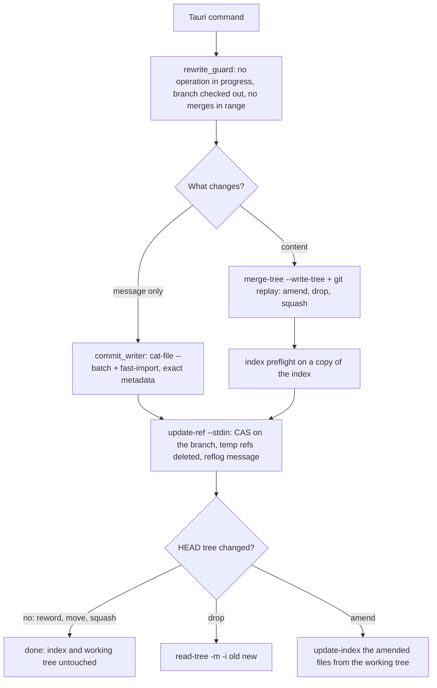

# Git Operations: Working-Tree Safety, Exact Rewrites and Batching

**Status:** Implemented  
**Updated:** 2026-10-14  
**Tags:** [git, safety, performance, rewrite, replay, fast-import]

## Problem

Branch Deck rewrites the checked-out branch: reword, move to another branch, add an issue reference, amend
uncommitted changes into an older commit, squash commits, unapply (drop) a branch, and update it onto its upstream. The
user is usually in the middle of their own work. The working tree and the index may hold uncommitted and staged changes that Branch Deck has no right to touch.
`git rebase`, `git commit -a` and `git reset --mixed` all write to the working tree or the index. They stage what the
user did not select, discard what the user staged, and depend on the user's `rebase.*` configuration.

A rewrite must also be invisible apart from what it is meant to change. Renaming a commit must not change who
committed it or when. Every commit after it must be recreated with the same author, committer, dates and timezones.

Branch Deck exists for large repositories, so speed is a goal. A process spawn costs milliseconds. An operation that
spawns git once per commit, note or file does not scale to hundreds of commits.

## Solution Overview

Every rewrite is done on objects and refs only:

- Message-only rewrites read the commits as raw objects (`cat-file --batch`) and write the new ones in one
  `git fast-import` stream, copying the `author` and `committer` lines byte for byte.
- Content rewrites use `git replay`, which applies commits in memory and never touches the working tree. Trees are
  combined with `git merge-tree --write-tree`, and working-tree files are read into a temporary index.

The checked-out branch then moves in one `update-ref --stdin` transaction with an old-value check (CAS). The user's
index changes only where HEAD's tree changed, and staged changes on other paths survive.

## Design

### Architecture



Every path ends at one ref transaction. Only a content rewrite reaches the index step, and the working tree is never
written, except by Update Project (its own section below).

### Invariants

1. **Never write to the working tree.** No `checkout`, `checkout-index`, `switch`, `reset`, `rebase`, `stash`,
   `commit`, `cherry-pick`, `merge`, `restore`, `clean`, `apply` without `--cached`, no `read-tree -u` or `--reset`, and
   no `git history`. Reading working-tree files into a temporary index (`GIT_INDEX_FILE`) is allowed.
   `crates/git-executor/src/worktree_safety_test.rs` scans the production sources and fails on such an argument list.

   **The one exception is Update Project** (see "Update project" below), which must bring the upstream's files into
   the working tree. It does that with a single two-way `read-tree -m -u <old HEAD tree> <new HEAD tree>`, which writes
   only the paths whose content differs between the two trees. Three guards come first: a dry run of the same command
   on a copy of the index, a check for ignored files where the update adds a file, and the CAS ref move. Uncommitted
   and staged changes on the other paths survive byte for byte; any overlap refuses the whole update before anything
   moves. The exemption lives in `crates/git-ops/src/worktree_update.rs` only; the safety scan allows `-u` there and
   asserts the number of such argument lists (two: the dry run and the update), so the exemption can't grow unnoticed.
2. **The user's index changes only where HEAD's tree changes** (see the index policy below). Staged changes on other
   paths survive. A conflict with staged work is detected before any ref moves. If the update fails afterwards, the
   error is returned, never ignored.
3. **Every ref move is one `update-ref --stdin` transaction** (`crates/git-ops/src/ref_transaction.rs`) with an
   old-value CAS and a `branch-deck: <operation>` reflog message. Related ref changes go into the same transaction:
   the unapply rename together with the branch move, and the deletion of temporary refs.
4. **Guards before any rewrite of the checked-out branch** (`crates/git-ops/src/rewrite_guard.rs`):
   - no rebase, merge, cherry-pick or revert is in progress;
   - HEAD is not detached;
   - the range from the oldest rewritten commit to HEAD contains no merge
     (`rev-list --min-parents=2 -n1 HEAD ^<oldest>^@`); if it does, the rewrite is refused.
5. **Metadata**:
   - A message-only rewrite keeps the author and the committer (name, email, date and timezone) byte for byte, and
     the message bytes of every commit it does not reword.
   - A content rewrite (amend, drop, squash) keeps the author, and the committer becomes the current user and the
     current time, as with `git rebase`.
   - Signatures are stripped because they would no longer be valid.
6. **Batch**: one process per operation phase, not one per item. Never parse translated text; rely on exit codes and
   on `--porcelain` and `-z` output.
7. **Git 2.54 or newer**, checked when the executor discovers git, on every platform, so that every command fails
   early with an upgrade hint.

### Minimum Git version

| Feature | Since | Used for |
|---|---|---|
| `merge-tree --write-tree` | 2.38 | conflict detection and tree merges without a working tree |
| `merge-tree --merge-base` | 2.40 | cherry-pick semantics in sync, the amended tree |
| `git replay` | 2.44 | replaying commits in memory |
| `fast-import --signed-commits` | 2.52 | stripping signatures that a rewrite invalidates |
| `replay --ref-action=print` | 2.53 | reading the new tip without letting replay move refs |
| `replay --ref`, dropping commits that become empty | 2.54 | segment tips that are commit ids, not branches |

The minimum is therefore **2.54** (`MIN_VERSION` in `crates/git-executor/src/git_info.rs`). On macOS a Homebrew git
is preferred. On other platforms the upgrade hint names the git-core PPA (Ubuntu) and Git for Windows. CI checks the
runner's git in `.github/workflows/test.yml`.

### Executor

All git runs through `GitCommandExecutor`:

- Every call gets `-c core.quotePath=false -c color.ui=never -c log.showSignature=false` and the environment
  variables `GIT_TERMINAL_PROMPT=0` and `GIT_OPTIONAL_LOCKS=0`.
- Inherited `GIT_DIR`, `GIT_WORK_TREE`, `GIT_INDEX_FILE` and `GIT_NOTES_REF` are removed. A temporary index is always
  passed explicitly.
- stdout is a pipe, so git never starts a pager and callers do not need `--no-pager`.
- Special exit codes still apply: `merge-tree` and `replay` exit with 1 on conflicts.

### Operations

#### Reword, move, add issue reference

Only messages change, so every tree stays the same and the index and the working tree are already correct.

1. Read the first-parent history (`rev-list --first-parent HEAD`). Every reworded commit must be on it; the oldest
   one starts the range.
2. Read the commits of the range as raw objects with one `cat-file --batch`.
3. Write the new commits in one `fast-import --date-format=raw --signed-commits=strip` stream:
   - each commit copies its `author` and `committer` lines and its `encoding`;
   - an unchanged message keeps its bytes; a new one ends with a newline, like `commit-tree -m`;
   - the tree is set with `M 040000 <tree> ""`;
   - commits are chained by marks on a temporary ref `refs/branch-deck/tmp/<pid>-<time>-<n>`;
   - `get-mark` prints the new ids.
4. Run one transaction that moves the branch with CAS and deletes the temporary ref.

`fast-import` objects become readable only when its stream ends, so it suits batches whose commits are all known up
front. Code: `crates/git-ops/src/reword_commits.rs`, `crates/git-ops/src/commit_writer.rs`.

#### Regroup, rename, restack

A move, a regroup plan of the agent CLI (`{branches: {path: [ids]}, unassign: [ids]}`), a branch rename and a restack
all set the `(prefix)` of commits, so they are one reword. `regroup_commits_core` decides the messages before it
writes anything:

1. Take the repository lock (below), refuse while an operation is in progress or HEAD is detached, and read HEAD, the
   stack setting and the commits ahead of the baseline (one `log`). An `expect_head` that isn't HEAD is `head_moved`.
2. Resolve the ids of the plan (abbreviations allowed); unknown ids, ids that aren't ahead of the baseline,
   duplicates and ids both in a branch and in `unassign` are refused.
3. Move every fixup of a moved target along (`plan_autosquash`); a plan that separates a fixup from its target is
   refused.
4. Group every subject ahead of the baseline with the new prefixes in memory (`CommitGrouper::new_with_stacks`) and
   compare the stack forest with the current one: a problem the plan introduces (a cycle, conflicting parents, a
   self parent, a leaf collision) refuses the plan; a problem that already existed is reported.
5. Reword the changed commits in one `fast-import` (`reword_commits_batch_at`): the history must still start at the
   HEAD of step 1, and the ref transaction's CAS uses it too.

A rename replaces the old level in every prefix path (children included) and gives an issue branch's commits a
prefix; a restack sets `(parent/leaf)` or `(leaf)` on all commits of the branch. The undo token is
`{previous_head, new_head}`: `restore_branch_head` moves the branch back with CAS, which is valid because a message
rewrite keeps HEAD's tree.

**Repository lock.** History rewrites take an exclusive `flock` on `$GIT_COMMON_DIR/branch-deck.lock` (all worktrees
share it), waiting up to 10 s for another holder and then failing with `locked`. The in-process mutexes don't cover
the app and parallel `bd` processes. A dry run reads only and takes no lock. Sync doesn't take it yet.

Code: `crates/sync-core/src/regroup.rs`, `crates/sync-core/src/move_commits.rs`,
`crates/sync-core/src/repository_lock.rs`.

#### Amend

The user selects files in the uncommitted changes. They go into commit X, which may be HEAD, an older commit or the
root commit.

1. Build `T_wt` in a temporary index: HEAD's tree plus only the selected files from the working tree.
2. Compute the new tree of X:
   - if X is HEAD, it is `T_wt`;
   - otherwise it is `merge-tree --write-tree --merge-base=HEAD^{tree} X^{tree} T_wt`, which applies only the delta
     between HEAD and the working tree. A later commit that also changed the file does not leak into X. A conflict
     refuses the amend.
3. Write X' with `fast-import`: X's author and message, the current user as committer.
4. Unless X is HEAD, run `git replay --ref-action=print --onto=X' --ref=refs/branch-deck/replay X..HEAD`. `--ref`
   only names the tip in the printed update; with `print`, replay writes no ref.
5. Check that the new tip's tree equals `T_wt` before any ref moves, so the amended files match the working tree
   afterwards and nothing else changed.
6. Move the branch, then stage the amended files from the working tree (see the index policy).

There is no `commit -a` and no `rebase --autosquash` fallback. A range with merges is refused (invariant 4).

Code: `crates/git-ops/src/amend_operations.rs`, with the shared replay and merge helpers in
`crates/git-ops/src/rewrite_plan.rs`.

#### Drop and unapply

The dropped commits are ordered oldest to newest on the first-parent line. Each run of kept commits between two
dropped ones, and after the last one, is replayed onto the result of the previous run:

```
git replay --ref-action=print --onto=<base> --ref=refs/branch-deck/replay <d_i>..<parent of d_i+1>
```

The last run is `<d_k>..HEAD`. That is at most k processes for k dropped commits, whatever the length of the range.
A conflict makes `replay` exit with 1, without output, and nothing has changed. A drop is a rewrite plan
(`prepare_plan`) whose steps are all `Drop`.

Unapply moves the virtual branch to the unapplied namespace. Under `REF_RENAME_MUTEX`, one `for-each-ref` picks a free
name, and one transaction contains:

- the create in the unapplied namespace;
- the delete of the virtual branch, checked against its tip;
- the CAS move of the checked-out branch.

A failed drop therefore never leaves a renamed branch behind. The dropped content stays in the working tree, so it
shows as unstaged changes, and files that the dropped commits added become untracked.

Code: `crates/git-ops/src/rewrite_plan.rs`, `crates/sync-core/src/unapply_branch.rs`,
`crates/branch-integration/src/archive.rs`.

#### Squash

The user selects commits; they are squashed into the oldest one, which keeps its place and its author. The newer ones
leave the history, as fixups do with `rebase --autosquash`, and the commits in between stay. A squash is a rewrite
plan with one `Replace` step per group (`SquashGroup`: a target, the folded commits and a `SquashMessage`, either a new
text or the target's own message and encoding):

1. Read the first-parent history and the positions of the commits; each must be on it, the folded ones newer than the
   target. Read the target, the folded commits and their parents with one `cat-file --batch`.
2. Replay the kept commits before the target, if an earlier step changed the history.
3. Compute the squashed tree with `merge-tree --write-tree`, starting from the target's tree, then applying each
   folded commit oldest first as a cherry-pick (`--merge-base=<its parent>`). A conflict refuses the squash, as does a
   result without changes.
4. Write the commit with `fast-import`: the target's author and the current user as committer.
5. Replay the rest up to HEAD (`git replay`, as for a drop).
6. Check, before any ref moves:
   - the new HEAD tree equals the old one, so the index and the working tree are already right and a dirty tree is
     fine;
   - the commit count matches, because `replay` silently drops a commit that becomes empty.
7. Move the branch in one transaction (`branch-deck: squash N commits`) that also deletes the temporary refs.

**Undo** moves the branch back to the old HEAD with a CAS on the new one (`branch-deck: undo squash`). It is refused if
the branch moved since, or if the two trees differ; equal trees mean the index and the working tree need no change.

Code: `crates/git-ops/src/squash_commits.rs`, `crates/git-ops/src/rewrite_plan.rs`, `crates/sync-core/src/squash.rs`.

#### Squash fixups

`fixup!`, `squash!` and `amend!` commits are squashed into their targets as `git rebase --autosquash` would, but as
one squash rewrite with a group per target. The plan (`plan_autosquash`) is pure, over the commits ahead of the
baseline, oldest first, and follows git's `todo_list_rearrange_squash`:

1. A subject is a fixup if it starts with `fixup! `, `squash! ` or `amend! `; the space is required. All leading
   markers are stripped (`fixup! squash! X` targets `X`); the first one gives the kind. The grouper strips them the same
   way, so `fixup! (auth) X` stays in `auth`.
2. The target is the oldest older commit that matches, in this order: the exact subject; a hash prefix of 4 or more hex
   digits that matches one commit of the range; the subject without the `(prefix)`, the prefixes agreeing if the fixup
   has one (Branch Deck's addition: `fixup! X` finds `(auth) X`); a subject, or a subject without the `(prefix)`,
   starting with the text. Fixups are never matched by subject.
3. A fixup of a fixup (by hash) goes to the final target. Anything unmatched, a newer target included, is an orphan:
   reported, not squashed.

Messages: a group of fixups only keeps the target's message and encoding (`SquashMessage::Target`). A `squash!` appends
its body, an `amend!` replaces the message with its body, as UTF-8 text; if an involved commit has another encoding
(one `cat-file --batch` for those), the squash is refused.

`squash_fixup_commits_core` plans again, refuses if HEAD is not the confirmed one, and takes the groups of the scope:
the target's branch (grouper rules), the unassigned targets, or one fixup. The branch moves with
`branch-deck: squash fixups`; Undo is the squash undo.

Code: `crates/sync-core/src/autosquash.rs`, `crates/sync-core/src/commit_grouper.rs` (`parse_subject`,
`branch_name_of`).

#### Update project

Update Project (`⌘T`) brings the checked out branch onto its upstream, as `git pull --rebase` does, but it works with
a dirty working tree when that is safe and never leaves a half-done rebase. The local commits are replayed in memory,
and the branch and the files move only after every check passed. The same check, without the network and without the
final steps, runs inside every sync, so the header can say whether the update would apply cleanly.

| Step | Command | On failure |
|---|---|---|
| 0. Guards | `rev-parse --git-path` for the operation markers, `symbolic-ref HEAD` | error: an operation in progress, a detached HEAD |
| 1. Upstream | `remote`, `for-each-ref --format=%(upstream)%00%(upstream:remotename)%00%(upstream:remoteref) refs/heads/<b>` | a local baseline: nothing to update from |
| 2. Fetch | `fetch --porcelain --no-tags --no-write-fetch-head --no-recurse-submodules --no-auto-maintenance <remote> +<remoteref>:<tracking>` | error, nothing changed |
| 3. Classify | `rev-parse HEAD U`, `merge-base HEAD U` | `B == U`: up to date; `B == H`: fast-forward, `N = U` |
| 4. Previous tips | the `+ <old> <new> <tracking>` line of the forced fetch, `merge-base --fork-point <tracking> HEAD` | none: the merge base suffices |
| 5. Linear | `rev-list --min-parents=2 -n1 HEAD ^U ^<previous tips>` | error: merges are not replayed |
| 6. Replay | `replay --ref-action=print --onto=U --ref=refs/branch-deck/replay HEAD ^U ^<previous tips>` | exit 1: `Conflict`, see below |
| 7. Dry run | on a copy of the index: `update-index -q --refresh`, `read-tree -m -u -n --no-recurse-submodules H^{tree} N^{tree}` | `Blocked{paths}` |
| 8. Ignored files | `diff-tree -r -z --no-renames --name-status H N`; an added path that exists on disk | `Blocked{paths}` |
| 9. Move | `update-ref --stdin`: `update refs/heads/<b> N H`, `branch-deck: update project` | error: the branch moved meanwhile, nothing changed |
| 10. Files | on the real index: `update-index -q --refresh`, `read-tree -m -u --no-recurse-submodules H^{tree} N^{tree}`, `update-index -q --refresh` | roll back: `update refs/heads/<b> H N`, `branch-deck: update project rolled back` |

Details:

- **Fetch scope.** Only the baseline's remote branch is fetched, into its tracking ref. The other tracking refs stay
  where the last push saw them, so the `--force-with-lease` of the virtual branches keeps protecting work pushed from
  elsewhere. `--porcelain` prints `<flag> <old> <new> <ref>` per updated ref (` ` fast-forward, `+` forced, `*` new)
  and nothing for a ref that did not move. The fetch runs through `execute_remote_command_with_progress` (Key
  Decision 8).
- **Transfer progress.** Git has no machine-readable progress: trace2 reports a stage only when it ends. So the fetch
  and the app's push run with `--progress`, as IDEA's do: `execute_remote_command_with_progress` adds it after the
  subcommand, and `execute_command_with_progress` passes each stderr line as it arrives (split on `\r`, with which git
  overwrites a progress line, and `\n`). `TransferProgressAnalyzer` (`crates/sync-core/src/transfer_progress.rs`)
  ports IDEA's `GitStandardProgressAnalyzer`: a share per stage, earlier stages done. A fetch receives (or unpacks)
  where a push writes, both are the transfer stage; the `remote: ` prefix doesn't matter, since a fetch counts on the
  server and a push resolves the deltas there. `TransferProgressReporter` throttles to one progress per 100 ms but
  always sends the end of a stage, a stage at 100 %, which also covers the server's `Resolving deltas: 100% (2/2),
  completed with 2 local objects.` that has no `, done.`. It is the one place that reads human output, and only for a
  label: an unknown line changes nothing. The error of a failed command keeps the `\n` lines only, without the `\r`
  updates.
- **Force-pushed upstream.** After an upstream force-push, `HEAD ^U` also contains the commits the upstream dropped,
  and replaying them conflicts or brings them back. As `pull --rebase` does, they are excluded with the old tip from
  the forced fetch line and with the fork point from the tracking ref's reflog; the fork point also covers a forced
  fetch made in a terminal before the check inside a sync.
- **Conflict.** `replay` reports a conflict only by its exit code. The files come from `merge-tree --write-tree
  --name-only -z --no-messages U H` (`<tree>\0<file>\0…`, exit 1). If only the replay of single commits conflicts, they
  are the paths both `diff-tree B U` and `diff-tree B H` change. The commits are `log --reverse HEAD ^U ^<previous
  tips>`. Two more `log --reverse --no-merges --no-renames --name-only -z -- <files>` runs, with
  `GIT_LITERAL_PATHSPECS=1`, tell which commits change the files: one over the local range, one over `B..U` with
  `--max-count=50` (a monorepo upstream has thousands). At most 50 files go on the command line, which Windows limits
  to 32K characters. The result names the files, the commits and the upstream commits with their authors, with H, U and
  B, for the dialog and the agent prompt; nothing has changed.
- **Dirty working tree.** Two-way `read-tree -m -u` updates a path only where `H` and `N` differ, and only if the index
  and the working tree still match `H` there. Uncommitted or staged changes on any other path stay byte for byte. A
  dirty or staged path that the update changes, an untracked file where it adds one, or an untracked file inside a
  directory it replaces makes git refuse; the dry run on the index copy finds that before anything moves, and
  `Blocked` lists those paths (`status --porcelain=v1 -z --no-renames --untracked-files=all` ∩ the changed paths). The
  copy is refreshed first, so a file that was only touched (same content, new stat data) does not block.
- **Ignored files.** `read-tree -u` overwrites an ignored file where the update adds one, silently, as `checkout`
  does. Step 8 refuses that instead: an added path that exists on disk (or has a file in place of one of its
  directories) blocks the update.
- **Order and rollback.** The branch moves before the files, with a CAS on H: if a commit landed meanwhile, the move
  fails and nothing was written. `read-tree` checks every path again before it writes any file, so a file changed
  between the dry run and step 10 fails it with nothing written; the branch then moves back with a second CAS
  transaction and the update reports "Files changed during the update; nothing was changed".
- **Already upstream.** `replay` drops a local commit that becomes empty, e.g. one merged upstream from a pull request.
  The result reports it: `rev-list --count N ^U` replayed against `rev-list --count HEAD ^U ^<previous tips>` local.
- **Metadata.** The replayed commits keep their author; the committer is the current user, as with any content rewrite.
- **The check inside sync** (`CheckPurpose::Preview`) runs steps 0, 1 and 3 to 6 against the last fetched tracking
  ref, and a cheaper form of steps 7 and 8. It starts as soon as the sync knows the baseline, beside the commit
  grouping and the branch rebuilds, and sends `SyncEvent::BaselineStatus` whenever it is done; its duration is logged.
  A failed check (a rebase in progress, a detached HEAD) is reported in the event, never as a sync error. `fetched_at`
  is the time git last wrote `FETCH_HEAD` (a fetch elsewhere); the app keeps the time of its own fetch.

  The preview differs from the check before an update so that a sync on every window focus stays cheap in a monorepo
  with a huge index; its cost grows with the paths the update changes, not with the index:
  - **No index copy, no full refresh, no dry run.** The paths come from the raw `diff-tree -r -z --no-renames H N`
    (mode and blob in H). An added path is blocked by anything on disk there (step 8). A changed or deleted path is
    blocked if its index entry differs from H (staged: one `cat-file --batch-check=%(objectname) -Z` of `:<path>`, a
    binary search per path) or if its file differs from H's blob (`hash-object --stdin-paths`, with the clean
    filters). Comparing content, a file that was only touched does not block, and the index is never written.
    `status`, `diff-files` and `diff-index` take no `--pathspec-from-file`, and as arguments thousands of pathspecs
    are matched against every index entry: `status` with 2,105 pathspecs took 5–12 s on a 50k-file index.
  - **Cache.** Per repository, in memory: the replay outcome (conflict, or the new tip and the changed paths) keyed by
    H, U and the excluded previous tips, and a probe of the local state. The probe keeps the index blobs for one
    index file (git writes a new file, a new inode, on every change) and, per hashed file, its stat data, when it was
    hashed and its blob, trusted like git's racy check only when the file was modified at least 2 s before it was
    hashed. An unchanged state therefore costs no replay, no `cat-file` and no `hash-object`, only an `lstat` per
    changed path; after a fetch only the newly changed paths are read.
  - Its replay sets `GIT_COMMITTER_DATE=@0 +0000`, so a replay after a cache miss writes the same objects again; such
    a plan can't be applied.
  - It leans to blocked where the two can differ: a sparse checkout (a missing file then doesn't block), an
    executable bit with `core.fileMode=false`, a symlink, a path with a newline. A directory that the update replaces
    by a file, or the reverse, is checked by the update's dry run only. The update always runs the exact check
    (`CheckPurpose::Apply`) after its fetch.

**Residual risk.** `read-tree -u` validates every path before it writes the first file, but writing can still fail
midway, e.g. when a smudge filter (Git LFS) fails or the disk fills up. The branch then moves back to H, and the files
already written show up as uncommitted changes that bring in the upstream's version; `git status` and the reflog
(`branch-deck: update project`) show what happened. Submodules are not updated (`--no-recurse-submodules`); a changed
gitlink shows as a modified submodule until the user updates it.

Code: `crates/git-ops/src/update_branch.rs` (check and apply), `crates/git-ops/src/worktree_update.rs` (the exempt
`read-tree -u`), `crates/sync-core/src/update_project.rs` (upstream, fetch, the check inside sync).

#### Virtual branch sync

Virtual branches never touch HEAD, the index or the working tree.

1. Each group's commits are copied onto the baseline one after another. A commit whose parent tree did not change
   reuses its tree. Otherwise `merge-tree --write-tree --merge-base` merges it, and a conflict produces the conflict
   view.
2. Each created commit is written with `commit-tree`, with the grouping prefix stripped from the subject and
   `branch-deck` as committer. The next commit merges onto it, and a conflict view reads it, so it must be readable at
   once. That is why the `fast-import` writer is not used here.
3. Known trees are seeded into the tree cache (`%T` of the listed commits, the tree of each new commit), and the
   cherry-pick takes the parent from the commit list instead of asking git.
4. A branch is moved with an `update-ref --stdin` transaction, and its `original → new` mapping notes are written as
   one notes commit by one `fast-import` (`N inline <oid>` on the default notes ref, `from <ref>^0`).

Code: `crates/git-ops/src/copy_commit.rs`, `crates/git-ops/src/cherry_pick.rs`, `crates/git-ops/src/notes.rs`,
`crates/sync-core/src/branch_processor.rs`. The integration-detection cache writes its notes in one `fast-import` as
well (`crates/branch-integration/src/cache.rs`).

#### Virtual commit reuse

A sync reuses a virtual commit when the original's mapping note points to it; otherwise it copies the original again.
- **Reuse checks the parent.** The mapped commit must be in the existing branch with the new parent as its first
  parent (`rev-list --parents <branch> ^<base>`, one call per branch). A commit added below, or a new base, copies the
  rest again. A branch whose commits are all reused still moves if its old tip had more commits.
- **Deterministic copies.** The committer date is the newest committer date of the original, the originals below it
  and the base (the base's date is read with its tree). The same originals on the same base give the same ids, even
  after the notes are lost. Both dates keep the original's timezone (`%aI`, `%cI` of the commit list), so the copies
  don't depend on the machine's timezone either.
- **Rewords carry the notes.** A reword or move recreates every commit after the oldest reworded one, and its
  `fast-import` stream also writes the old commits' mapping notes onto the new ones (`N inline :<mark>`). A reworded
  commit keeps its note only if its virtual commit stays the same: the subject without the grouping prefix and the
  body are unchanged, as in a move. Without this, each move would rebuild every virtual branch after it.
- **Bounded walk.** A reword reads only the first-parent history ahead of the baseline, notes included, with one
  `log --first-parent --format=%H%x1f%N HEAD ^<baseline>` (the whole history on the local baseline branch, as the
  commit list does), and refuses a commit outside it.
- **One listing, one notes write.** A sync lists the branches under the prefix once
  (`for-each-ref refs/heads/<prefix>/`): the virtual tips decide reuse, and the unapplied and archived names give the
  state of a stack parent without commits. The branches return their mapping notes, and the sync writes them in one
  notes commit at the end; a note lost to a failed sync only costs a copy.
- **Stacks.** A stacked branch is built on its parent's new head (see [Stacked Branches](../../spec/branch/stacked-branches.spec.md)).
  Each branch is a build task, which publishes its head after its last `commit-tree`, and a finish task for the ref,
  the status and the remote status. A child is spawned only once its parent's head is known, so no task holds a slot
  of the process limit while it waits; ready branches start longest chain first. A rebuilt child's tip gets a note on
  `refs/notes/branch-deck/stack` naming its base, in the same `fast-import` run as the mapping notes (one notes commit
  per ref), for the integration detection of its archived branch.

Code: `crates/git-ops/src/copy_commit.rs`, `crates/sync-core/src/branch_processor.rs`,
`crates/git-ops/src/reword_commits.rs`, `crates/sync-core/src/reword_commit.rs`.

#### Object cache

`bd commits` and `bd status --stats` read the changes of each commit (files, statuses, line counts and the `-U0` hunk
ranges) from a disk cache before they run git, and run one `log --no-walk=unsorted --stdin -z --raw -p -U0` only for
the commits it misses.
- **Safe without invalidation.** Keys are object ids, and an object never changes: the changes of a commit against
  its first parent with fixed diff options (`-M`, `--no-ext-diff`, `--no-textconv`) are the same forever. Entries are
  only evicted, never stale. The value format is versioned in the database name (`commit_diff.v1`); opening drops
  older versions.
- **Shared by processes.** The cache is one LMDB environment (heed) in `$GIT_COMMON_DIR/branch-deck/cache/`, shared
  by every worktree and by the app and parallel `bd` calls: writers are serialized by LMDB's lock file, readers never
  wait. Within a process there is one environment per directory, as LMDB requires.
- **Never in the way.** The map size (1 GiB) caps it; a full map is cleared and the write retried. Any error is a miss,
  never a failed command, and `--no-cache` bypasses it. The cache holds only derived data: no ref, index or working
  tree is read or written through it.
- `merge_result` ((base, commit, target) trees → result tree or conflict files) and `commit_tree` (commit → tree) are
  read and written by `bd check` through the `MergeMemo` of the tree cache (`crates/git-ops/src/merge_memo.rs`); a
  sync doesn't pass a memo yet.

#### Trial sync (check)

`bd check` answers "would these branches build?" for a plan without touching anything a sync updates:

1. The plan is applied in memory and validated as a regroup dry run, and the branches are placed as a stacked sync
   places them (`place_branches`).
2. Each branch is built with the sync's `build_branch`, parents first, a child on its parent's new head. It writes
   commit objects (`merge-tree`, `commit-tree`) and nothing else: no ref transaction, no notes, no remote status, no
   repository lock.
3. The tree cache carries a memo backed by the object cache: a merge of known trees returns the remembered tree or
   conflict, and a conflict is reported light (its files), without the conflict analysis.

Code: `crates/sync-core/src/check.rs`, `crates/git-ops/src/cherry_pick.rs`, `crates/git-ops/src/cache.rs`.

Code: `crates/object-cache/src/cache.rs`, `crates/bd-cli/src/diff_scan.rs`.

#### Agent push (`bd push`)

`bd push` syncs and pushes under the repository lock, so the refs it pushes are the ones it just built:

1. It refuses (`push_refused`) before talking to the remote: a branch that didn't sync (error, conflict, blocked), a
   branch whose remote branch has commits it lacks unless `--force`, and a stacked branch whose parent is neither on
   the remote nor pushed with it. Branches go parents first.
2. One `git push --porcelain --atomic <remote> --force-with-lease=refs/heads/<b>:<lease>… <tip>:refs/heads/<b>…`
   through `execute_remote_command_accepting` (exit 1, a rejected ref, still prints the porcelain report). Atomic: a
   stack is pushed whole or not at all, and a rejection is `lease_rejected`.
3. The lease comes from `push_lease`, which the app's push button uses as well (below): the remote head the sync of
   the same run compared with (`remote.head`), a view as fresh as the app's row, or with `--expect-remote <commit>`
   that commit. Step 1 decides whether the push may drop commits; the lease only makes sure it drops nothing the sync
   didn't see. With `--remote` other than `origin`, which the sync compares with, `bd push` computes the remote status
   of the branches it pushes against that remote's remote-tracking refs (`compute_remote_status_for_branch` with the
   remote, 2 to 5 processes per branch), so steps 1, 3 and 4 work the same for every remote. A `--remote` that is not
   a configured remote is `no_remote`: a URL has no remote-tracking refs.
4. A rejection fetches the rejected branches (`fetch_remote_branches`) and lists them in `lease_rejected` with their
   new remote status (`head`, `behind`, `dropped_commits`); a branch refused as behind is listed the same way. The
   agent shows what a push drops and, once the user approves, pushes with `--force --expect-remote <head>`.

Code: `crates/bd-cli/src/push_command.rs`, `crates/sync-core/src/push_lease.rs`,
`crates/sync-core/src/remote_command.rs`.

#### Push lease

The app's push (`push_branch`) and `bd push` share one lease (`crates/sync-core/src/push_lease.rs`), so a push from
either one leaves the next push of the other valid. A push replaces exactly the remote state the user saw:

- The remote status of a branch names the commit it was computed against (`remote_tip`) and lists the commits a push
  drops ([Remote Status](remote-status.md)). The push button sends that commit back (`expected_remote`, null when
  the row showed no remote branch), and `prepare_push_expecting` leases on it. A Force Push drops what the row
  listed and nothing else, also when Branch Deck's last push is older than someone else's fetched commit; a plain
  push after the user brought that commit into the branch goes through as well.
- The sync `bd push` runs first gives it the same view, so `bd push` leases on the sync's `remote_tip` too.
- A background fetch that moves the remote-tracking ref can't defeat the lease the way a bare
  `--force-with-lease=<ref>` can: the status computed after it lists the fetched commits as dropped (`behind`), and
  a push replaces them only once the user saw them (a Force Push, `bd push --force`).
- The push names the tip it read (`<tip>:refs/heads/<branch>`), so it pushes exactly that commit even if the branch
  moves meanwhile.
- The app's push runs through `execute_remote_command_with_progress`, which accepts exit 1 too and reports how far
  the push is to the push button ("Transfer progress" under Update project); `bd push` has no one to show it to.
- A rejected ref is `!` in `push --porcelain` (exit 1); the summary is only logged. `fetch_remote_branches` then
  fetches just the rejected branches, `+refs/heads/<b>:refs/remotes/<remote>/<b>` with the flags of the baseline fetch
  (`--porcelain --no-tags --no-write-fetch-head --no-recurse-submodules --no-auto-maintenance`), so the caller shows
  what the remote has now. A branch deleted on the remote fails the fetch: `ls-remote --exit-code` (2: no such ref)
  tells it from a failed connection, and its remote-tracking ref is deleted.
- `push_branch` returns `PushOutcome::RemoteMoved` with the new remote status when the fetched head differs from the
  expected one: the row turns into the push the remote now needs, and a toast offers it. When the fetched head is the
  expected one, the lease held and the remote refused for another reason (a hook, a protected branch): an error.

#### Patronus review pre-check

Read-only. Before a Safe Push, the code-owner review check of Patronus needs the commits of the virtual branch with
the paths they change ([Patronus](../../spec/branch/patronus.spec.md)):

- One `git log -z --no-renames --no-relative --name-only --max-count=501 --format=… ^<baseline> refs/heads/<p>/virtual/<n>`
  (`read_review_commits` in `crates/sync-core/src/patronus.rs`): hash, parents, author, committer, the message, then the
  NUL-terminated paths.
- `--no-renames`: no rename detection on large commits; a rename is a delete and an add, whose owners both review it.
  A deleted path stays in the list. `--no-relative` ignores a `diff.relative` setting.
- 501 commits mean "too many": the check is skipped, as the IDE skips it at 500.
- Starting a robot pushes nothing itself: the branch is pushed by `push_branch` first, then Patronus is asked over HTTP.

### Index policy

When a rewrite changes HEAD's tree, the index has to follow. Otherwise `git status` shows the rewrite reversed as
staged changes. `IndexUpdate` in `crates/git-ops/src/rewrite_guard.rs` has two forms.

- **Drop: two-way merge.** `read-tree -m -i <old> <new>`, without `-u`:
  - entries that matched the old HEAD take the new HEAD's entry;
  - staged changes on untouched paths and intent-to-add entries are kept;
  - the working tree is never read or written.

  Before any ref moves, the same command runs on a copy of the index (`GIT_INDEX_FILE`). If a staged path is also
  changed by the drop, git fails with "Entry 'x' would be overwritten by merge", and the drop is refused with the
  paths named.
- **Amend: stage the amended files.** HEAD now holds the working-tree versions of the selected files, so exactly
  those are staged (`update-index --add --remove -z --stdin`), like `git commit -- <paths>` does. Other staged
  changes stay staged.

Both end with `update-index -q --refresh`, which restores the stat data so that `git status` does not rehash the
files. A failure after the ref moved needs a concurrent `git add` and is rare. It is returned as an error with a
recovery hint (`git reset -q`).

### Key Decisions

1. **Decision**: `git replay` for content rewrites (amend, drop).
   **Rationale**: it applies commits in memory, never touches the working tree, and needs one process per run of
   commits. The cost: the committer of replayed commits is the current user, as with `git rebase`.

2. **Decision**: our own `fast-import` writer for reword and move.
   **Rationale**:
   - `replay` cannot change messages;
   - `commit-tree` costs one process per commit and gets the date only as unix seconds, losing the timezone;
   - `fast-import` writes exact `author`/`committer` lines and `data <len>` messages.

3. **Decision**: refuse a range that contains merges.
   **Rationale**: `replay` dies with "replaying merge commits is not supported yet!", and the writer recreates a
   single parent. The previous `rebase --autosquash` fallback touched the working tree and flattened the merges.

4. **Decision**: Update Project writes the working tree with a guarded two-way `read-tree -m -u`, the only exception to
   invariant 1.
   **Rationale**:
   - `pull --rebase`, `rebase --autostash` and `stash` + `checkout` write every file of the rebase, stop halfway on a
     conflict and leave the user in a rebase, or a stash pop conflict, that the app can't finish;
   - replaying in memory first turns a conflict into a result with nothing changed, and the dry run on an index copy
     proves the files can follow before the branch moves;
   - two-way `read-tree` touches only the paths that differ between the old and the new HEAD, so unrelated local
     changes survive without being stashed.

5. **Decision**: do not use `git history` (2.54+, experimental).
   **Rationale**:
   - `drop` updates the index and the working tree;
   - `reword` opens an editor and changes one commit per run;
   - it does not support merges.

6. **Decision**: our own transaction, rather than `replay --ref-action=update` or `fast-import` updating the branch.
   **Rationale**:
   - only our transaction checks the old value of the checked-out branch;
   - it writes a reflog message;
   - it combines related refs atomically;
   - it deletes the temporary ref in the same step.

7. **Decision**: push with `--force-with-lease=refs/heads/<branch>:<expected>`, where `<expected>` is the remote head
   of the status the user saw (the app's row, the sync `bd push` runs first, the status `bd push --remote` computes,
   `--expect-remote`) ("Push lease"). A rejected push fetches the branch and reports what the remote has now.
   **Rationale**: a virtual branch is rebuilt on every sync, so the push must force. The lease refuses to overwrite a
   remote branch that changed since the user looked, and a background fetch shows up in the status as commits a push
   drops, which a bare lease on the remote-tracking ref would replace silently. Leasing on the commit Branch Deck last
   pushed instead (an earlier design, `refs/branch-deck/pushed/`) made a branch stuck: once someone else's commit was
   fetched, every push was rejected, even a Force Push the user confirmed and even after the commit was brought into
   the branch.

8. **Decision**: commands that talk to a remote (push, and fetch for Update Project) go through
   `execute_remote_command` in `crates/sync-core/src/remote_command.rs`. It adds
   `-c credential.interactive=false -c http.lowSpeedLimit=1000 -c http.lowSpeedTime=30`, `GCM_INTERACTIVE=never` and
   `LC_ALL=C LANGUAGE=` on top of the executor's `GIT_TERMINAL_PROMPT=0`.
   **Rationale**:
   - the user's credential helpers (osxkeychain, Git Credential Manager, `gh auth git-credential`) keep working, so
     stored HTTPS credentials are used. The earlier `-c credential.helper=` disabled them, and an HTTPS remote that
     needed credentials failed;
   - nothing may ask for new credentials: the app has no terminal, and a hidden prompt would block forever;
   - a transfer that stalls below 1000 bytes/s for 30 s is aborted instead of hanging on a dead connection;
   - the C locale keeps the `--progress` lines untranslated, so the fetch and push progress can be read (IDEA runs
     every git command in an English locale for the same reason). An unknown locale falls back to C as well.

   SSH is left as configured. The app started from Finder has no controlling terminal, so ssh fails instead of
   prompting. Forcing `GIT_SSH_COMMAND="ssh -o BatchMode=yes"` would override `core.sshCommand` and break
   `SSH_ASKPASS` prompts.

## Performance

| Operation | Before | After |
|---|---|---|
| Reword or move of n commits | n `commit-tree` + n `merge-base --is-ancestor` | 1 `rev-list` + 1 `cat-file` + 1 `fast-import` + 1 `update-ref`, plus the guard |
| Drop k commits from a range of n | up to n `merge-tree` + n `commit-tree` + `reset` | at most k `replay` + 1 `update-ref` + 1 `read-tree` |
| Amend into a non-HEAD commit | n `merge-tree` + n `commit-tree`, or a rebase | 1 `merge-tree` + 1 `fast-import` + 1 `replay` + 1 `update-ref` |
| Squash the fixups of a range | a terminal `rebase -i --autosquash` | 1 `log` + 1 `rev-parse` for the plan, then the squash, with one `cat-file` more if messages are combined |
| Squash k commits into one, n commits after it | a terminal `rebase -i` | 1 `cat-file` + k `merge-tree` + 1 `fast-import` + 1 `replay` + 1 `rev-list` + 1 `update-ref` |
| Sync notes for n created commits | n `notes add` | 1 `fast-import` per sync |
| Existing virtual branches of a sync | 1 `show-ref` per branch | 1 `for-each-ref` per sync |
| Update check inside a sync, p paths changed by the update | an index copy, a full `update-index --refresh` and a dry run: grows with the index | unchanged state: 9 processes (guards, upstream, `rev-parse`, 2 `merge-base`) and an `lstat` per path; new state: + `rev-list`, `replay`, `diff-tree`, `cat-file`, `hash-object` of the paths not seen yet |
| Conflict view | `ls-tree` + `cat-file` per revision | 1 `cat-file --batch` for all revisions |

## Follow-ups

- **Sync commits**: write the commits of a branch with one `fast-import` once the chain no longer needs to read them
  back, e.g. merge onto trees instead of commits and flush only for a conflict view. A `merge-tree --stdin`
  coprocess would also save the spawn per diverged commit.
- **Replay conflicts**: `replay` reports a conflict only by its exit code, so the error does not name the commit or
  the files yet.
- **Mapping notes** live on the default notes ref (`refs/notes/commits`), so they show up in the user's `git log`.
  Moving them to a private ref needs a migration that reads both refs.
- **SSH stalls**: the low-speed limits apply to HTTP only. A dead SSH connection is bounded only by the user's
  `ServerAliveInterval`.

## References

- Implementation: `crates/git-executor/src/git_info.rs`, `crates/git-executor/src/git_command_executor.rs`,
  `crates/sync-core/src/remote_command.rs`, `crates/sync-core/src/push.rs`, `crates/sync-core/src/push_lease.rs`,
  `crates/git-ops/src/rewrite_guard.rs`, `crates/git-ops/src/ref_transaction.rs`,
  `crates/git-ops/src/commit_writer.rs`, `crates/git-ops/src/reword_commits.rs`,
  `crates/git-ops/src/rewrite_plan.rs`, `crates/git-ops/src/amend_operations.rs`, `crates/git-ops/src/squash_commits.rs`,
  `crates/sync-core/src/autosquash.rs`, `crates/git-ops/src/update_branch.rs`, `crates/git-ops/src/worktree_update.rs`,
  `crates/sync-core/src/update_project.rs`, `crates/sync-core/src/regroup.rs`, `crates/sync-core/src/repository_lock.rs`,
  `crates/object-cache/src/cache.rs`
- Specs: [Commit Row](../../spec/commit/commit-row.spec.md), [Move Commits](../../spec/branch/move-commits.spec.md),
  [Amend](../../spec/commit/amend.spec.md), [Squash](../../spec/commit/squash.spec.md),
  [Squash Fixups](../../spec/commit/fixups.spec.md),
  [Unapply](../../spec/branch/unapply.spec.md), [Update Project](../../spec/repository/update-project.spec.md),
  [Agent CLI](../../spec/cli/agent-cli.spec.md)
- Related docs: [Virtual Branches](virtual-branches.md), [Integration Detection](integration-detection.md),
  [Async Patterns](async-patterns.md)
- Git manuals: `git help replay`, `git help fast-import`, `git help merge-tree`, `git help read-tree` (two-way merge,
  `-u`, `-n`), `git help fetch` (`--porcelain`), `git help merge-base` (`--fork-point`)
