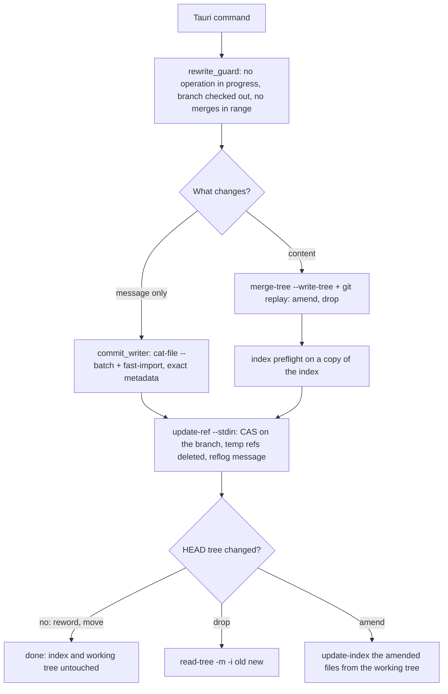

# Git Operations: Working-Tree Safety, Exact Rewrites and Batching

**Status:** Implemented  
**Updated:** 2026-10-14  
**Tags:** [git, safety, performance, rewrite, replay, fast-import]

## Problem

Branch Deck rewrites the checked-out branch: reword, move to another branch, add an issue reference, amend
uncommitted changes into an older commit, and unapply (drop) a branch. The user is usually in the middle of their own
work. The working tree and the index may hold uncommitted and staged changes that Branch Deck has no right to touch.
`git rebase`, `git commit -a` and `git reset --mixed` all write to the working tree or the index. They stage what the
user did not select, discard what the user staged, and depend on the user's `rebase.*` configuration.

A rewrite must also be invisible apart from what it is meant to change. Renaming a commit must not change who
committed it or when. Every commit after it must be recreated with the same author, committer, dates and timezones.

Branch Deck exists for large repositories, so speed is a goal. A process spawn costs milliseconds. An operation that
spawns git once per commit, note or file does not scale to hundreds of commits.

## Solution Overview

Every rewrite is done on objects and refs only:

- Message-only rewrites read the commits as raw objects (`cat-file --batch`) and write the new ones in one
  `git fast-import` stream, copying the `author` and `committer` lines byte for byte.
- Content rewrites use `git replay`, which applies commits in memory and never touches the working tree. Trees are
  combined with `git merge-tree --write-tree`, and working-tree files are read into a temporary index.

The checked-out branch then moves in one `update-ref --stdin` transaction with an old-value check (CAS). The user's
index changes only where HEAD's tree changed, and staged changes on other paths survive.

## Design

### Architecture



Every path ends at one ref transaction. Only a content rewrite reaches the index step, and the working tree is never
written.

### Invariants

1. **Never write to the working tree.** No `checkout`, `switch`, `reset`, `rebase`, `stash`, `commit`, `cherry-pick`,
   `merge`, `restore`, `clean`, `apply` without `--cached`, and no `git history`. Reading working-tree files into a
   temporary index (`GIT_INDEX_FILE`) is allowed. `crates/git-executor/src/worktree_safety_test.rs` scans the
   production sources and fails on such a subcommand.
2. **The user's index changes only where HEAD's tree changes** (see the index policy below). Staged changes on other
   paths survive. A conflict with staged work is detected before any ref moves. If the update fails afterwards, the
   error is returned, never ignored.
3. **Every ref move is one `update-ref --stdin` transaction** (`crates/git-ops/src/ref_transaction.rs`) with an
   old-value CAS and a `branch-deck: <operation>` reflog message. Related ref changes go into the same transaction:
   the unapply rename together with the branch move, and the deletion of temporary refs.
4. **Guards before any rewrite of the checked-out branch** (`crates/git-ops/src/rewrite_guard.rs`):
   - no rebase, merge, cherry-pick or revert is in progress;
   - HEAD is not detached;
   - the range from the oldest rewritten commit to HEAD contains no merge
     (`rev-list --min-parents=2 -n1 HEAD ^<oldest>^@`); if it does, the rewrite is refused.
5. **Metadata**:
   - A message-only rewrite keeps the author and the committer (name, email, date and timezone) byte for byte, and
     the message bytes of every commit it does not reword.
   - A content rewrite (amend, drop) keeps the author, and the committer becomes the current user and the current
     time, as with `git rebase`.
   - Signatures are stripped because they would no longer be valid.
6. **Batch**: one process per operation phase, not one per item. Never parse translated text; rely on exit codes and
   on `--porcelain` and `-z` output.
7. **Git 2.54 or newer**, checked when the executor discovers git, on every platform, so that every command fails
   early with an upgrade hint.

### Minimum Git version

| Feature | Since | Used for |
|---|---|---|
| `merge-tree --write-tree` | 2.38 | conflict detection and tree merges without a working tree |
| `merge-tree --merge-base` | 2.40 | cherry-pick semantics in sync, the amended tree |
| `git replay` | 2.44 | replaying commits in memory |
| `fast-import --signed-commits` | 2.52 | stripping signatures that a rewrite invalidates |
| `replay --ref-action=print` | 2.53 | reading the new tip without letting replay move refs |
| `replay --ref`, dropping commits that become empty | 2.54 | segment tips that are commit ids, not branches |

The minimum is therefore **2.54** (`MIN_VERSION` in `crates/git-executor/src/git_info.rs`). On macOS a Homebrew git
is preferred. On other platforms the upgrade hint names the git-core PPA (Ubuntu) and Git for Windows. CI checks the
runner's git in `.github/workflows/test.yml`.

### Executor

All git runs through `GitCommandExecutor`:

- Every call gets `-c core.quotePath=false -c color.ui=never -c log.showSignature=false` and the environment
  variables `GIT_TERMINAL_PROMPT=0` and `GIT_OPTIONAL_LOCKS=0`.
- Inherited `GIT_DIR`, `GIT_WORK_TREE`, `GIT_INDEX_FILE` and `GIT_NOTES_REF` are removed. A temporary index is always
  passed explicitly.
- stdout is a pipe, so git never starts a pager and callers do not need `--no-pager`.
- Special exit codes still apply: `merge-tree` and `replay` exit with 1 on conflicts.

### Operations

#### Reword, move, add issue reference

Only messages change, so every tree stays the same and the index and the working tree are already correct.

1. Read the first-parent history (`rev-list --first-parent HEAD`). Every reworded commit must be on it; the oldest
   one starts the range.
2. Read the commits of the range as raw objects with one `cat-file --batch`.
3. Write the new commits in one `fast-import --date-format=raw --signed-commits=strip` stream:
   - each commit copies its `author` and `committer` lines and its `encoding`;
   - an unchanged message keeps its bytes; a new one ends with a newline, like `commit-tree -m`;
   - the tree is set with `M 040000 <tree> ""`;
   - commits are chained by marks on a temporary ref `refs/branch-deck/tmp/<pid>-<time>-<n>`;
   - `get-mark` prints the new ids.
4. Run one transaction that moves the branch with CAS and deletes the temporary ref.

`fast-import` objects become readable only when its stream ends, so it suits batches whose commits are all known up
front. Code: `crates/git-ops/src/reword_commits.rs`, `crates/git-ops/src/commit_writer.rs`.

#### Amend

The user selects files in the uncommitted changes. They go into commit X, which may be HEAD, an older commit or the
root commit.

1. Build `T_wt` in a temporary index: HEAD's tree plus only the selected files from the working tree.
2. Compute the new tree of X:
   - if X is HEAD, it is `T_wt`;
   - otherwise it is `merge-tree --write-tree --merge-base=HEAD^{tree} X^{tree} T_wt`, which applies only the delta
     between HEAD and the working tree. A later commit that also changed the file does not leak into X. A conflict
     refuses the amend.
3. Write X' with `fast-import`: X's author and message, the current user as committer.
4. Unless X is HEAD, run `git replay --ref-action=print --onto=X' --ref=refs/branch-deck/replay X..HEAD`. `--ref`
   only names the tip in the printed update; with `print`, replay writes no ref.
5. Check that the new tip's tree equals `T_wt` before any ref moves, so the amended files match the working tree
   afterwards and nothing else changed.
6. Move the branch, then stage the amended files from the working tree (see the index policy).

There is no `commit -a` and no `rebase --autosquash` fallback. A range with merges is refused (invariant 4).

Code: `crates/git-ops/src/amend_operations.rs`, with the shared replay and merge helpers in
`crates/git-ops/src/rewrite_plan.rs`.

#### Drop and unapply

The dropped commits are ordered oldest to newest on the first-parent line. Each run of kept commits between two
dropped ones, and after the last one, is replayed onto the result of the previous run:

```
git replay --ref-action=print --onto=<base> --ref=refs/branch-deck/replay <d_i>..<parent of d_i+1>
```

The last run is `<d_k>..HEAD`. That is at most k processes for k dropped commits, whatever the length of the range.
A conflict makes `replay` exit with 1, without output, and nothing has changed. A drop is a rewrite plan
(`prepare_plan`) whose steps are all `Drop`.

Unapply moves the virtual branch to the unapplied namespace. Under `REF_RENAME_MUTEX`, one `for-each-ref` picks a free
name, and one transaction contains:

- the create in the unapplied namespace;
- the delete of the virtual branch, checked against its tip;
- the CAS move of the checked-out branch.

A failed drop therefore never leaves a renamed branch behind. The dropped content stays in the working tree, so it
shows as unstaged changes, and files that the dropped commits added become untracked.

Code: `crates/git-ops/src/rewrite_plan.rs`, `crates/sync-core/src/unapply_branch.rs`,
`crates/branch-integration/src/archive.rs`.

#### Virtual branch sync

Virtual branches never touch HEAD, the index or the working tree.

1. Each group's commits are copied onto the baseline one after another. A commit whose parent tree did not change
   reuses its tree. Otherwise `merge-tree --write-tree --merge-base` merges it, and a conflict produces the conflict
   view.
2. Each created commit is written with `commit-tree`, with the grouping prefix stripped from the subject and
   `branch-deck` as committer. The next commit merges onto it, and a conflict view reads it, so it must be readable at
   once. That is why the `fast-import` writer is not used here.
3. Known trees are seeded into the tree cache (`%T` of the listed commits, the tree of each new commit), and the
   cherry-pick takes the parent from the commit list instead of asking git.
4. A branch is moved with an `update-ref --stdin` transaction, and its `original → new` mapping notes are written as
   one notes commit by one `fast-import` (`N inline <oid>` on the default notes ref, `from <ref>^0`).

Code: `crates/git-ops/src/copy_commit.rs`, `crates/git-ops/src/cherry_pick.rs`, `crates/git-ops/src/notes.rs`,
`crates/sync-core/src/branch_processor.rs`. The integration-detection cache writes its notes in one `fast-import` as
well (`crates/branch-integration/src/cache.rs`).

### Index policy

When a rewrite changes HEAD's tree, the index has to follow. Otherwise `git status` shows the rewrite reversed as
staged changes. `IndexUpdate` in `crates/git-ops/src/rewrite_guard.rs` has two forms.

- **Drop: two-way merge.** `read-tree -m -i <old> <new>`, without `-u`:
  - entries that matched the old HEAD take the new HEAD's entry;
  - staged changes on untouched paths and intent-to-add entries are kept;
  - the working tree is never read or written.

  Before any ref moves, the same command runs on a copy of the index (`GIT_INDEX_FILE`). If a staged path is also
  changed by the drop, git fails with "Entry 'x' would be overwritten by merge", and the drop is refused with the
  paths named.
- **Amend: stage the amended files.** HEAD now holds the working-tree versions of the selected files, so exactly
  those are staged (`update-index --add --remove -z --stdin`), like `git commit -- <paths>` does. Other staged
  changes stay staged.

Both end with `update-index -q --refresh`, which restores the stat data so that `git status` does not rehash the
files. A failure after the ref moved needs a concurrent `git add` and is rare. It is returned as an error with a
recovery hint (`git reset -q`).

### Key Decisions

1. **Decision**: `git replay` for content rewrites (amend, drop).
   **Rationale**: it applies commits in memory, never touches the working tree, and needs one process per run of
   commits. The cost: the committer of replayed commits is the current user, as with `git rebase`.

2. **Decision**: our own `fast-import` writer for reword and move.
   **Rationale**:
   - `replay` cannot change messages;
   - `commit-tree` costs one process per commit and gets the date only as unix seconds, losing the timezone;
   - `fast-import` writes exact `author`/`committer` lines and `data <len>` messages.

3. **Decision**: refuse a range that contains merges.
   **Rationale**: `replay` dies with "replaying merge commits is not supported yet!", and the writer recreates a
   single parent. The previous `rebase --autosquash` fallback touched the working tree and flattened the merges.

4. **Decision**: do not use `git history` (2.54+, experimental).
   **Rationale**:
   - `drop` updates the index and the working tree;
   - `reword` opens an editor and changes one commit per run;
   - it does not support merges.

5. **Decision**: our own transaction, rather than `replay --ref-action=update` or `fast-import` updating the branch.
   **Rationale**:
   - only our transaction checks the old value of the checked-out branch;
   - it writes a reflog message;
   - it combines related refs atomically;
   - it deletes the temporary ref in the same step.

6. **Decision**: push with `--force-with-lease=refs/heads/<branch>`.
   **Rationale**: a virtual branch is rebuilt on every sync, so the push must force. The lease still refuses to
   overwrite a remote branch that someone else updated since the last fetch or push.

7. **Decision**: commands that talk to a remote (push, and fetch for Update Project) go through
   `execute_remote_command` in `crates/sync-core/src/remote_command.rs`. It adds
   `-c credential.interactive=false -c http.lowSpeedLimit=1000 -c http.lowSpeedTime=30` and `GCM_INTERACTIVE=never`
   on top of the executor's `GIT_TERMINAL_PROMPT=0`.
   **Rationale**:
   - the user's credential helpers (osxkeychain, Git Credential Manager, `gh auth git-credential`) keep working, so
     stored HTTPS credentials are used. The earlier `-c credential.helper=` disabled them, and an HTTPS remote that
     needed credentials failed;
   - nothing may ask for new credentials: the app has no terminal, and a hidden prompt would block forever;
   - a transfer that stalls below 1000 bytes/s for 30 s is aborted instead of hanging on a dead connection.

   SSH is left as configured. The app started from Finder has no controlling terminal, so ssh fails instead of
   prompting. Forcing `GIT_SSH_COMMAND="ssh -o BatchMode=yes"` would override `core.sshCommand` and break
   `SSH_ASKPASS` prompts.

## Performance

| Operation | Before | After |
|---|---|---|
| Reword or move of n commits | n `commit-tree` + n `merge-base --is-ancestor` | 1 `rev-list` + 1 `cat-file` + 1 `fast-import` + 1 `update-ref`, plus the guard |
| Drop k commits from a range of n | up to n `merge-tree` + n `commit-tree` + `reset` | at most k `replay` + 1 `update-ref` + 1 `read-tree` |
| Amend into a non-HEAD commit | n `merge-tree` + n `commit-tree`, or a rebase | 1 `merge-tree` + 1 `fast-import` + 1 `replay` + 1 `update-ref` |
| Sync notes for n created commits | n `notes add` | 1 `fast-import` per branch |
| Conflict view | `ls-tree` + `cat-file` per revision | 1 `cat-file --batch` for all revisions |

## Follow-ups

- **Sync commits**: write the commits of a branch with one `fast-import` once the chain no longer needs to read them
  back, e.g. merge onto trees instead of commits and flush only for a conflict view. A `merge-tree --stdin`
  coprocess would also save the spawn per diverged commit.
- **Replay conflicts**: `replay` reports a conflict only by its exit code, so the error does not name the commit or
  the files yet.
- **Mapping notes** live on the default notes ref (`refs/notes/commits`), so they show up in the user's `git log`.
  Moving them to a private ref needs a migration that reads both refs.
- **SSH stalls**: the low-speed limits apply to HTTP only. A dead SSH connection is bounded only by the user's
  `ServerAliveInterval`.

## References

- Implementation: `crates/git-executor/src/git_info.rs`, `crates/git-executor/src/git_command_executor.rs`,
  `crates/sync-core/src/remote_command.rs`, `crates/sync-core/src/push.rs`,
  `crates/git-ops/src/rewrite_guard.rs`, `crates/git-ops/src/ref_transaction.rs`,
  `crates/git-ops/src/commit_writer.rs`, `crates/git-ops/src/reword_commits.rs`,
  `crates/git-ops/src/rewrite_plan.rs`, `crates/git-ops/src/amend_operations.rs`
- Specs: [Commit Row](../../spec/commit/commit-row.spec.md), [Move Commits](../../spec/branch/move-commits.spec.md),
  [Amend](../../spec/commit/amend.spec.md), [Unapply](../../spec/branch/unapply.spec.md)
- Related docs: [Virtual Branches](virtual-branches.md), [Integration Detection](integration-detection.md),
  [Async Patterns](async-patterns.md)
- Git manuals: `git help replay`, `git help fast-import`, `git help merge-tree`, `git help read-tree` (two-way merge)
