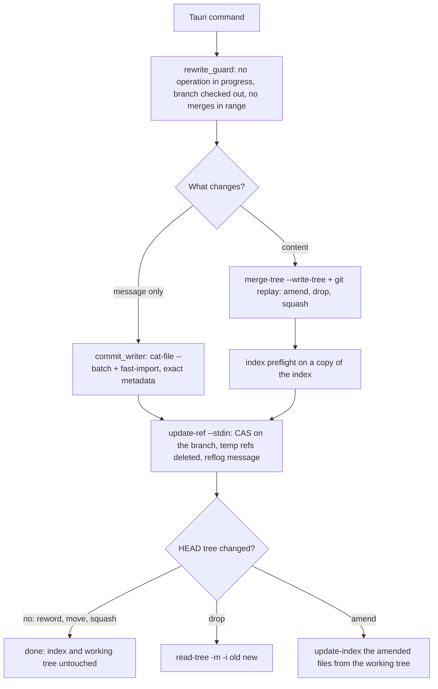

# Git Operations: Working-Tree Safety, Exact Rewrites and Batching

**Status:** Implemented  
**Updated:** 2026-10-16  
**Tags:** [git, safety, performance, rewrite, replay, fast-import]

## Problem

Branch Deck rewrites the checked-out branch: reword, move to another branch, add an issue reference, amend
uncommitted changes into an older commit, squash commits, unapply (drop) a branch, and update it onto its upstream. The
user is usually in the middle of their own work. The working tree and the index may hold uncommitted and staged changes that Branch Deck has no right to touch.
`git rebase`, `git commit -a` and `git reset --mixed` all write to the working tree or the index. They stage what the
user did not select, discard what the user staged, and depend on the user's `rebase.*` configuration.

A rewrite must also be invisible apart from what it is meant to change. Renaming a commit must not change who
committed it or when. Every commit after it must be recreated with the same author, committer, dates and timezones.

Branch Deck exists for large repositories, so speed is a goal. A process spawn costs milliseconds. An operation that
spawns git once per commit, note or file does not scale to hundreds of commits.

## Solution Overview

Every rewrite is done on objects and refs only:

- Message-only rewrites read the commits as raw objects (`cat-file --batch`) and write the new ones in one
  `git fast-import` stream, copying the `author` and `committer` lines byte for byte.
- Content rewrites use `git replay`, which applies commits in memory and never touches the working tree. Trees are
  combined with `git merge-tree --write-tree`, and working-tree files are read into a temporary index.

The checked-out branch then moves in one `update-ref --stdin` transaction with an old-value check (CAS). The user's
index changes only where HEAD's tree changed, and staged changes on other paths survive.

## Design

### Architecture



Every path ends at one ref transaction. Only a content rewrite reaches the index step, and the working tree is never
written, except by Update Project and the finish of its resolve session (their own sections below).

### Invariants

1. **Never write to the working tree.** No `checkout`, `checkout-index`, `switch`, `reset`, `rebase`, `stash`,
   `commit`, `cherry-pick`, `merge`, `restore`, `clean`, `apply` without `--cached`, no `read-tree -u` or `--reset`, and
   no `git history`. Reading working-tree files into a temporary index (`GIT_INDEX_FILE`) is allowed.
   `crates/git-executor/src/worktree_safety_test.rs` scans the production sources and fails on such an argument list.

   **The one exception is Update Project** (see "Update project" below), which must bring the upstream's files into
   the working tree, **its undo**, which takes them out again, **and the finish of a resolve session** (see "Resolve
   session"), which is the same move to the tip that the session replayed. Both use a single two-way
   `read-tree -m -u <old HEAD tree> <new HEAD tree>`, which writes only the paths whose content differs between the two
   trees; the undo swaps the trees. Three guards come first: a dry run of the same command on a copy of the index, a
   check for ignored files where the move adds a file, and the CAS ref move. Uncommitted and staged changes on the
   other paths survive byte for byte; any overlap refuses the whole move before anything moves. The exemption lives in
   `crates/git-ops/src/worktree_update.rs` only. Its functions are `pub(crate)`, and only `update_branch.rs` calls them:
   for the app's Update Project, `bd update` and `bd undo update:`, and, through its `pub(crate)`
   `move_branch_and_files_with` and `files_follow`, for the finish of a resolve session in `update_resolve.rs`, which
   moves HEAD only to the tip it reads from the session ref. The safety scan allows `-u` there and asserts the
   number of such argument lists (two: the dry run and the update), so the exemption can't grow unnoticed.
2. **The user's index changes only where HEAD's tree changes** (see the index policy below). Staged changes on other
   paths survive. A conflict with staged work is detected before any ref moves. If the update fails afterwards, the
   error is returned, never ignored.
3. **Every ref move is one `update-ref --stdin` transaction** (`crates/git-ops/src/ref_transaction.rs`) with an
   old-value CAS and a `branch-deck: <operation>` reflog message. Related ref changes go into the same transaction:
   the unapply rename together with the branch move, and the deletion of temporary refs. **One named exception:** the
   review fetch writes `refs/branch-deck/review/<n>/{head,base}` through `git fetch` itself (its refspecs, forced, no
   CAS, no reflog message): those refs only keep the fetched commits of a pull request reachable, nothing reads their
   old value, and no other operation writes them. Their pruning is a CAS transaction (see "Review fetch").

   **Ref moves that the files follow** (an update and its undo, `move_branch_and_files`) update `HEAD` (deref), not
   `refs/heads/<b>`, so git moves the branch HEAD points at, the one whose files the guarded update writes. That must
   be the branch the check used. git 2.56 refuses `symref-verify HEAD refs/heads/<b>` next to
   `update refs/heads/<b>` ("multiple updates for 'HEAD' (including one via its referent) are not allowed") and next
   to `update HEAD` ("cannot operate with deref mode"). So the transaction runs interactively
   (`RefTransaction::commit_while`): `start`, `update HEAD N H`, `prepare`, which takes the locks of HEAD and of the
   branch and checks the old value, then `symbolic-ref --quiet --short HEAD` under those locks, then `commit` when it
   is still `<b>`, else `abort` and `BranchSwitched`. While the locks are held, a `git switch` fails on `HEAD.lock`,
   so a switch at any point since the check refuses the move with nothing changed. A read of `symbolic-ref` before
   the transaction only refuses earlier, and the rollback runs the same way. The transactions also pass
   `--create-reflog`, so the undo finds the update in the reflog with `core.logAllRefUpdates=false` too.

   `commit_while` needs `GitCommandExecutor::spawn_interactive` (`crates/git-executor/src/interactive_command.rs`):
   git with piped stdin, stdout and stderr, the environment and config of every other call, a reply line awaited
   with a timeout (60 s; ref locks are taken without waiting). A dropped handle closes stdin and waits up to 5 s:
   `update-ref` then aborts and removes its lock files. Then it sends SIGTERM, whose handler in git removes them too,
   and SIGKILL only as the last resort, which would leave `HEAD.lock` and the branch lock behind. It is used only
   here.
4. **Guards before any rewrite of the checked-out branch** (`crates/git-ops/src/rewrite_guard.rs`):
   - no rebase, merge, cherry-pick or revert is in progress;
   - HEAD is not detached;
   - the range from the oldest rewritten commit to HEAD contains no merge
     (`rev-list --min-parents=2 -n1 HEAD ^<oldest>^@`); if it does, the rewrite is refused.
5. **Metadata**:
   - A message-only rewrite keeps the author and the committer (name, email, date and timezone) byte for byte, and
     the message bytes of every commit it does not reword.
   - A content rewrite (amend, drop, squash) keeps the author, and the committer becomes the current user and the
     current time, as with `git rebase`.
   - **One named exception:** a move of a hunk (`bd move-hunk`, see "Move a hunk") changes the trees of a range, but
     keeps author and committer byte for byte for every commit whose diff stays the same (`patch-id --stable`): the
     commits between the two whose change only shifted, and every commit above. Their virtual commits keep their ids,
     so the sync leaves their branches as they are. Only the two commits and those between whose diff of the file
     changed get the current user as committer.
   - Signatures are stripped because they would no longer be valid.
6. **Batch**: one process per operation phase, not one per item. Never parse translated text; rely on exit codes and
   on `--porcelain` and `-z` output. **One named exception:** a branch description (`branch.<name>.description`,
   `bd describe` and the `descriptions` of a `bd group` plan) costs one `git config` process per branch, because git
   has no batch writer for config. The current descriptions are still read with one `git config --get-regexp`, and
   only the ones that differ are written.
7. **Git 2.54 or newer**, checked when the executor discovers git, on every platform, so that every command fails
   early with an install or upgrade hint.

### Minimum Git version

| Feature | Since | Used for |
|---|---|---|
| `merge-tree --write-tree` | 2.38 | conflict detection and tree merges without a working tree |
| `merge-tree --merge-base` | 2.40 | cherry-pick semantics in sync, the amended tree |
| `git replay` | 2.44 | replaying commits in memory |
| `fast-import --signed-commits` | 2.52 | stripping signatures that a rewrite invalidates |
| `replay --ref-action=print` | 2.53 | reading the new tip without letting replay move refs |
| `replay --ref`, dropping commits that become empty | 2.54 | segment tips that are commit ids, not branches |

The minimum is therefore **2.54** (`MIN_VERSION` in `crates/git-executor/src/git_info.rs`). On macOS a Homebrew git
is preferred. On other platforms the upgrade hint names the git-core PPA (Ubuntu) and Git for Windows. Every failed
discovery is one summary line, then the hint (`UPGRADE_HINT`), and the app shows the line as the title: "Cannot find
Git: <reason>" for a git that is missing or fails to run (the macOS `/usr/bin/git` stub without the Command Line Tools
exits with an `xcrun: error`, its first line is the reason), "Git 2.39 is too old: Branch Deck requires Git 2.54 or
newer" for an old one. CI checks the runner's git in `.github/workflows/test.yml`.

### Executor

All git runs through `GitCommandExecutor`:

- Every call gets `-c core.quotePath=false -c color.ui=never -c log.showSignature=false` and the environment
  variables `GIT_TERMINAL_PROMPT=0` and `GIT_OPTIONAL_LOCKS=0`.
- Inherited `GIT_DIR`, `GIT_WORK_TREE`, `GIT_INDEX_FILE` and `GIT_NOTES_REF` are removed. A temporary index is always
  passed explicitly.
- `GIT_NOTES_DISPLAY_REF` is set to an empty value. It replaces an inherited one and turns off `notes.displayRef`. So
  `%N` shows only the notes of `core.notesRef`, the mapping notes, or those of an explicit `--notes=<ref>`. With
  `notes.displayRef=refs/notes/*`, `%N` would otherwise print the notes of every ref, and the mapping readers would take
  a wrong id. The mapping readers also parse only the first line of a note.
- stdout is a pipe, so git never starts a pager and callers do not need `--no-pager`.
- Special exit codes still apply: `merge-tree` and `replay` exit with 1 on conflicts. `merge-tree --stdin` exits with
  0 even then: each merge of its output starts with its status, 1 clean and 0 conflicted
  (`merge_tree_output::parse_merge_tree_batch`).

### Operations

#### Reword, move, add issue reference

Only messages change, so every tree stays the same and the index and the working tree are already correct.

1. Read the first-parent history (`rev-list --first-parent HEAD`). Every reworded commit must be on it; the oldest
   one starts the range.
2. Read the commits of the range as raw objects with one `cat-file --batch`.
3. Write the new commits in one `fast-import --date-format=raw --signed-commits=strip` stream:
   - each commit copies its `author` and `committer` lines and its `encoding`;
   - an unchanged message keeps its bytes; a new one ends with a newline, like `commit-tree -m`;
   - the tree is set with `M 040000 <tree> ""`;
   - commits are chained by marks on a temporary ref `refs/branch-deck/tmp/<pid>-<time>-<n>`;
   - `get-mark` prints the new ids.
4. Run one transaction that moves the branch with CAS and deletes the temporary ref.

`fast-import` objects become readable only when its stream ends, so it suits batches whose commits are all known up
front. Code: `crates/git-ops/src/reword_commits.rs`, `crates/git-ops/src/commit_writer.rs`.

#### Regroup, rename, restack

A move, a regroup plan of the agent CLI (`{branches: {path: [ids]}, unassign: [ids]}`), a branch rename and a restack
all set the `(prefix)` of commits, so they are one reword. `regroup_commits_core` decides the messages before it
writes anything:

1. Take the repository lock (below), refuse while an operation is in progress or HEAD is detached, and read HEAD, the
   stack setting, the issue groups and the stack parents (one `cat-file --batch`) and the commits ahead of the
   baseline (one `log`). An
   `expect_head` that isn't HEAD is `head_moved`.
2. Resolve the ids of the plan (abbreviations allowed); unknown ids, ids that aren't ahead of the baseline,
   duplicates and ids both in a branch and in `unassign` are refused.
3. Move every fixup of a moved target along (`plan_autosquash`); a plan that separates a fixup from its target is
   refused.
   A commit without a prefix that goes to the branch of its own issue key keeps its message: it is grouped there
   already. A commit with a prefix keeps its message only when the plan path is exactly that prefix. With stacked
   branches on, a path `auth/login` writes the stack parent `login<TAB>auth` and gives a commit that needs a prefix the
   bare `(login)`; a commit outside the plan whose prefix declares another parent for a child the plan stacks or
   unstacks loses the levels above the child (the levels above it become stack parents).
4. Group every subject ahead of the baseline with the new prefixes, the issue groups and the stack parents after the
   plan in memory
   (`CommitGrouper::new_with`) and compare the stack forest with the current one: a problem the plan introduces (a
   cycle, conflicting parents, a self parent, a leaf collision) refuses the plan; a problem that already existed is
   reported.
5. Reword the changed commits in one `fast-import` (`reword_commits_batch_at`): the history must still start at the
   HEAD of step 1, and the ref transaction's CAS uses it too. A change of the issue groups or of the stack parents
   joins that transaction (below).

A move of the app (`move_commits_to_branch`) computes its plan from the snapshot of step 1, under the same lock
(`regroup_planned` and `plan_move` in `move_plan.rs`): a whole issue (every commit of its key without a prefix) goes into
`issue_groups`, also into a stacked target, a part of one and a commit without a key into `branches` (a path `P/X`
also writes the stack parent of `X`, with an empty list when the issue groups move every commit), and a prefixed commit
that its key puts into the target anyway into `unassign`. So combining issues rewrites nothing, and a mixed move is one
reword and one ref transaction. A dry run of it is the preview of the "Move to…" form.

A rename replaces the old level in every prefix path (children included), renames the issue groups of the old name,
names an issue branch in the issue groups, and renames the old name in the stack parents (as a child, and as the parent
of a child with commits on this HEAD), without a rewrite; a restack writes the stack parent and rewrites only the
commits whose prefix declares another parent, an unstack removes it and the parent levels. The undo token is
`H1..H2` for a rewrite:
`restore_branch_head` moves the branch back with CAS, which is valid because a message rewrite keeps HEAD's tree. The
app undoes a move, a rename and a restack with that token too (`undo_regroup`), never by rewording the messages back.

**Issue groups.** The map of issue key to branch name lives in `refs/branch-deck/issue-groups`
([Issue Groups](../../spec/branch/issue-groups.spec.md)), outside `refs/heads`, so the default refspecs neither push nor fetch it.
- A write makes a commit with the one file `issue-groups` on the previous map commit (`StoreCommit::file` and
  `StoreUpdate` in `commit_writer.rs`). With a rewrite, it is one more commit of the reword's `fast-import` stream
  (`reword_commits_batch_at`), so a mixed plan costs one `git var` and one `fast-import`. Without a rewrite,
  `write_store_updates` writes it alone. `fast-import` objects are readable only after the stream ends, which suits
  this write.
- Its `update-ref` line is `update <ref> <new> <old>`, or `create` for the first write. It goes into the transaction
  that moves HEAD and deletes the temporary ref, so both refs move or neither does. A plan that changes only the map,
  and a reword whose messages are equal once cleaned up, add `verify refs/heads/<branch> <head>` instead of a HEAD
  move.
- On a failed transaction the temporary ref is deleted, and a read of HEAD and of the map ref names the one that moved:
  `head_moved` or `groups_moved`.
- The undo token is `groups:G1..G2` for a change of the map only and `H1..H2+groups:G1..G2` for both. The ids are
  full; a `G1` of zeros is a map that did not exist, which the undo deletes. One `for-each-ref` reads the map ref and
  the parent of its commit: `G2` must be the map now (else `groups_moved`), and its parent must be `G1` (else the
  token names no write of the map). `undo_regroup_core` moves both refs back in one transaction
  (`restore_branch_head_with`), with CAS on each; a ref that moves meanwhile is `head_moved` or `groups_moved` too.
- Only a regroup writes the map; the sync, `bd status`, `bd check` and `bd suggest` read it. The ref is shared by
  every branch and worktree (`refs/branch-deck/*` is not per worktree), so a write changes only the keys the plan
  names: a key that groups no commit on this HEAD may group the commits of another branch, and only `ungroup_issues`
  removes it. The lines that the parser can't use are written back as they are, unless the write sets or ungroups
  their key. git keeps no reflog outside `refs/heads`, so the parent chain of the map commits is its history.

**Stack parents.** The map of branch to parent lives in `refs/branch-deck/stack-parents`
([Stack Parents](../../spec/branch/stack-parents.spec.md)), a ref of its own: a store commit replaces its whole tree
(`deleteall`), so a file next to `issue-groups` would be lost by every write of a version that does not know it.
- It is written, read and undone as the issue groups: one file `stack-parents` of sorted `child<TAB>parent` lines
  (`store_lines.rs`), read in the same `cat-file --batch`, one more store commit of the same `fast-import` run, each
  store on a temporary ref of its own (`{temp}-store-<n>`, so no store commit replaces another tip before the
  transaction), one more line of the same ref transaction with CAS (`write_store_updates` without a rewrite).
- A failed transaction names the ref that moved in the order HEAD, issue groups, stack parents: `head_moved`,
  `groups_moved`, `stacks_moved`. The undo token joins `H1..H2`, `groups:G1..G2` and `stacks:S1..S2`, the parts of the
  refs that moved, with `+`, in this order; `S2` must be a write on `S1`.
- The one write outside a regroup: after the detection of the archived branches, a sync drops the lines of the
  children whose newest archived branch is integrated (`drop_integrated_stack_parents`), with CAS on the commit it
  read and only when a line goes, with a message of its own. It holds no repository lock (the app's sync never does, see "Repository lock"); a
  write that loses the race is skipped and tried at the next sync. A newer archive that is not integrated, such as a
  branch of another worktree that this sync archived, keeps the line. So that such a drop does not break the undo of
  a regroup whose toast is still open, an undo whose `S2` is followed only by drops (one `log`) writes the map of `S1`
  without the dropped children on top of them (`undo_over_drops`), in the undo's transaction.

**Repository lock.** History rewrites take an exclusive `flock` on `$GIT_COMMON_DIR/branch-deck.lock` (all worktrees
share it), waiting up to 10 s for another holder and then failing with `locked`. The in-process mutexes don't cover
the app and parallel `bd` processes. A dry run reads only and takes no lock. `bd sync`, `bd push`, `bd safe-push`
(until its push), `bd fold`, `bd move-hunk` and
`bd undo` take it, and so does Update Project (the app's and `bd update`, which also starts a resolve session under
it) after its fetch, and `bd update --continue` and `--abort`; `bd update --status` takes none. The app's sync
never takes it: a sync of a large repository would make every `bd` writer fail with `locked`. Within a window one sync
runs at a time (`syncBranches`): a request while one runs asks for one follow-up after it, the events of a superseded
run are dropped, and a focus during a sync checks the inputs once after it. A `bd` write during an app sync changes
the inputs (the fingerprint is taken when the sync starts), so the next focus syncs again and corrects what the sync
wrote from the HEAD it read. A fetch never runs under the lock: on a monorepo it can take minutes, and every other writer would fail with
`locked`.

**One call: rewrite, descriptions, sync.** `bd group` (and `rename`, `restack`, `unstack`) takes the lock itself and
passes it to the regroup (`RegroupOptions.held_lock`), so the regroup takes no lock of its own and the lock has no gap:

1. Read the current descriptions (one `git config --get-regexp`), when the plan has `descriptions`.
2. The regroup above. Before it writes, `regroup_commits_accepted` lets bd refuse the result: a description without a
   title of one line, or of a branch that has no commits after the plan, is `invalid_plan`.
3. After the ref transaction: one `git config` per changed description (the exception of the batch rule).
4. With `--sync`: the sync of `bd sync` (`sync_locked`).

A failure in step 3 or 4 leaves the rewrite in place: the output keeps the undo token and has the error as `error`.
A failed description write stops the later ones and skips step 4. The undo moves HEAD and the issue groups back, not
the descriptions or the virtual branches; the output lists the texts the descriptions replaced.

Code: `crates/sync-core/src/regroup.rs`, `crates/sync-core/src/move_commits.rs`,
`crates/sync-core/src/issue_groups.rs`, `crates/sync-core/src/repository_lock.rs`.

#### Amend

The user selects files in the uncommitted changes. They go into commit X, which may be HEAD, an older commit or the
root commit.

1. Build `T_wt` in a temporary index: HEAD's tree plus only the selected files from the working tree.
2. Compute the new tree of X:
   - if X is HEAD, it is `T_wt`;
   - otherwise it is `merge-tree --write-tree --merge-base=HEAD^{tree} X^{tree} T_wt`, which applies only the delta
     between HEAD and the working tree. A later commit that also changed the file does not leak into X. A conflict
     refuses the amend.
3. Write X' with `fast-import`: X's author and message, the current user as committer.
4. Unless X is HEAD, run `git replay --ref-action=print --onto=X' --ref=refs/branch-deck/replay X..HEAD`. `--ref`
   only names the tip in the printed update; with `print`, replay writes no ref.
5. Check that the new tip's tree equals `T_wt` before any ref moves, so the amended files match the working tree
   afterwards and nothing else changed.
6. Move the branch, then stage the amended files from the working tree (see the index policy).

There is no `commit -a` and no `rebase --autosquash` fallback. A range with merges is refused (invariant 4).

Code: `crates/git-ops/src/amend_operations.rs`, with the shared replay and merge helpers in
`crates/git-ops/src/rewrite_plan.rs`.

#### Drop and unapply

The dropped commits are ordered oldest to newest on the first-parent line. Each run of kept commits between two
dropped ones, and after the last one, is replayed onto the result of the previous run:

```
git replay --ref-action=print --onto=<base> --ref=refs/branch-deck/replay <d_i>..<parent of d_i+1>
```

The last run is `<d_k>..HEAD`. That is at most k processes for k dropped commits, whatever the length of the range.
A conflict makes `replay` exit with 1, without output, and nothing has changed. A drop is a rewrite plan
(`prepare_plan`) whose steps are all `Drop`.

Unapply moves the virtual branch to the unapplied namespace. Under `REF_RENAME_MUTEX`, one `for-each-ref` picks a free
name, and one transaction contains:

- the create in the unapplied namespace;
- the delete of the virtual branch, checked against its tip;
- the CAS move of the checked-out branch.

A failed drop therefore never leaves a renamed branch behind. The dropped content stays in the working tree, so it
shows as unstaged changes, and files that the dropped commits added become untracked.

Code: `crates/git-ops/src/rewrite_plan.rs`, `crates/sync-core/src/unapply_branch.rs`,
`crates/branch-integration/src/archive.rs`.

#### Squash

The user selects commits; they are squashed into the oldest one, which keeps its place and its author. The newer ones
leave the history, as fixups do with `rebase --autosquash`, and the commits in between stay. A squash is a rewrite
plan with one `Replace` step per group (`SquashGroup`: a target, the folded commits and a `SquashMessage`, either a new
text or the target's own message and encoding):

1. Read the first-parent history and the positions of the commits; each must be on it, the folded ones newer than the
   target. Read the target, the folded commits and their parents with one `cat-file --batch`.
2. Replay the kept commits before the target, if an earlier step changed the history.
3. Compute the squashed tree with `merge-tree --write-tree`, starting from the target's tree, then applying each
   folded commit oldest first as a cherry-pick (`--merge-base=<its parent>`). A conflict refuses the squash, as does a
   result without changes.
4. Write the commit with `fast-import`: the target's author and the current user as committer.
5. Replay the rest up to HEAD (`git replay`, as for a drop).
6. Check, before any ref moves:
   - the new HEAD tree equals the old one, so the index and the working tree are already right and a dirty tree is
     fine;
   - the commit count matches, because `replay` silently drops a commit that becomes empty.
7. Move the branch in one transaction (`branch-deck: squash N commits`) that also deletes the temporary refs.

**Undo** moves the branch back to the old HEAD with a CAS on the new one (`branch-deck: undo squash`). It is refused if
the branch moved since, or if the two trees differ; equal trees mean the index and the working tree need no change.

Code: `crates/git-ops/src/squash_commits.rs`, `crates/git-ops/src/rewrite_plan.rs`, `crates/sync-core/src/squash.rs`.

#### Squash fixups

`fixup!`, `squash!` and `amend!` commits are squashed into their targets as `git rebase --autosquash` would, but as
one squash rewrite with a group per target. The plan (`plan_autosquash`) is pure, over the commits ahead of the
baseline, oldest first, and follows git's `todo_list_rearrange_squash`:

1. A subject is a fixup if it starts with `fixup! `, `squash! ` or `amend! `; the space is required. All leading
   markers are stripped (`fixup! squash! X` targets `X`); the first one gives the kind. The grouper strips them the same
   way, so `fixup! (auth) X` stays in `auth`.
2. The target is the oldest older commit that matches, in this order: the exact subject; a hash prefix of 4 or more hex
   digits that matches one commit of the range; the subject without the `(prefix)`, the prefixes agreeing if the fixup
   has one (Branch Deck's addition: `fixup! X` finds `(auth) X`); a subject, or a subject without the `(prefix)`,
   starting with the text. Fixups are never matched by subject.
3. A fixup of a fixup (by hash) goes to the final target. Anything unmatched, a newer target included, is an orphan:
   reported, not squashed.

Messages: a group of fixups only keeps the target's message and encoding (`SquashMessage::Target`). A `squash!` appends
its body, an `amend!` replaces the message with its body, as UTF-8 text; if an involved commit has another encoding
(one `cat-file --batch` for those), the squash is refused.

`squash_fixup_commits_core` plans again and takes the groups of the scope: the target's branch (grouper rules), the
unassigned targets, or one fixup. It refuses with `HeadMoved` unless HEAD, the newest commit of the planned range and
the history the squash replays all are the confirmed head; these are three reads, and a commit between them would
otherwise give a plan for one head and a rewrite of another. The branch moves with `branch-deck: squash fixups` and a
CAS on that head; Undo is the squash undo. `bd fold` runs it under the repository lock, with the head it planned for.

Code: `crates/sync-core/src/autosquash.rs`, `crates/sync-core/src/commit_grouper.rs` (`parse_subject`,
`GroupingInputs::branch_of`).

#### Move a hunk

`bd move-hunk <from> <to> <path> [--hunk N]…` moves the change of one file, or some of its hunks, from commit `from`
into commit `to`, both ahead of the baseline on the checked out branch: the fix for a hunk that landed in the wrong
commit. HEAD's tree never changes, by construction, so the index and the working tree need nothing:

- forward (`to` older than `from`): the trees of `[to, from)` get the change Δ added; `from` keeps its tree, which now
  holds only the rest of its change;
- backward (`to` newer than `from`): the trees of `[from, to)` lose Δ; `to` keeps its tree;
- the commits above the newer of the two get new parents only.

The steps, a fixed number of processes whatever the range (`crates/git-ops/src/move_hunk.rs`):

1. Under the repository lock (none for `--dry-run`): the guards, the commits ahead of the baseline, `--expect-head`
   (prefix match), and the patch of `from` through `read_commit_patches` (`sync_core::diff_scan`), whose options pin
   the hunks (`-U3 --diff-algorithm=myers --inter-hunk-context=0 --indent-heuristic`, no external diff or textconv), so
   hunk N is hunk N of `bd commits --patch`. A rename or copy of the path is refused, as are `--hunk` of a binary file
   and an unknown hunk (`hunk_not_found`); all hunks named is the whole file.
2. One `log --first-parent --boundary` of the history with trees and mapping notes, the rewrite guard
   (`check_rewrite` from the older of the two), one `cat-file --batch` of the commits, one
   `diff-tree --raw --no-renames` of the path in `from`: a mode change, a type change, a symlink or a submodule is
   refused.
3. "Theirs", the merge base with Δ: forward `from^`'s tree with the path as the selected hunks applied to
   `from^:<path>`, backward `from`'s tree with them taken out of `from:<path>`. The hunks apply by their line ranges
   to the blobs (one `cat-file --batch -Z`), byte for byte, in Rust; the whole file moves its blob, its mode or its
   deletion as they are, also for a binary file. `write_edited_commit` writes the tree with one `fast-import` (a
   commit on a temporary ref).
4. One `merge-tree --write-tree --stdin -z --no-messages -X no-renames`, a line `<base> -- <commit tree> <theirs>` per
   commit of the range: the base is `from^`'s tree forward and `from`'s tree backward. Theirs differs from the base
   only in the path, so every other path keeps the commit's version, and the path gets Δ applied to the commit's own
   version of it: a commit that only shifts the lines takes it, one that changes the same lines, or lacks the file,
   conflicts (`hunk_conflict`, naming the commit and the path, nothing written but objects). Without renames, a file
   that doesn't exist in a commit is a conflict, not a guess.
5. Checks in memory: no commit of the range or the one above it becomes empty (moving all of `from`'s only change
   is "squash it instead"), and the last tree is HEAD's.
6. One `diff-tree --stdin -p -U0 -- <path>` of the old and the new tree pair of each commit between the two, one
   `patch-id --stable`: line numbers and whitespace don't count, so a change that only shifted keeps its id.
7. One `fast-import` writes the commits and their notes (`write_commits_with_notes`). Metadata, the named exception of
   invariant 5: `from`, `to` and the commits between whose diff changed keep the author and get the current user as
   committer; every other commit keeps author and committer byte for byte. Notes: a commit between with the same diff
   gets its note with the same virtual commit and the new trees as its source (a note without a source is copied as
   it is, for the sync to check); the commits above get their mapping lines copied; the changed ones get none, so the
   sync copies them again, and the virtual commits of the other branches stay.
8. One `RefTransaction` (`branch-deck: move hunk`) moves the branch with CAS on the HEAD it read and deletes the
   temporary refs. The undo token `<previous>..<new>` works with `bd undo`: the trees are equal.

`--dry-run` stops after step 6 and deletes the temporary ref at once: no ref moves and no note is written, only the
objects of theirs and the merges. `--sync` syncs under the same lock.

Code: `crates/git-ops/src/move_hunk.rs`, `crates/sync-core/src/move_hunk.rs`, `crates/bd-cli/src/move_hunk_command.rs`.

#### Update project

Update Project (`⌘T`) brings the checked out branch onto its upstream, as `git pull --rebase` does, but it works with
a dirty working tree when that is safe and never leaves a half-done rebase. The local commits are replayed in memory,
and the branch and the files move only after every check passed. The same check, without the network and without the
final steps, runs inside every sync, so the header can say whether the update would apply cleanly.

| Step | Command | On failure |
|---|---|---|
| 0. Guards | `rev-parse --git-path` for the operation markers, `symbolic-ref HEAD` | error: an operation in progress, a detached HEAD |
| 1. Upstream | `remote`, `for-each-ref --format=%(upstream)%00%(upstream:remotename)%00%(upstream:remoteref) refs/heads/<b>` | a local baseline: nothing to update from |
| 2. Fetch | `fetch --porcelain --no-tags --no-write-fetch-head --no-recurse-submodules --no-auto-maintenance <remote> +<remoteref>:<tracking>`; none for `bd update --no-fetch` | error (`FetchFailed`), nothing changed |
| 2b. Lock | `$GIT_COMMON_DIR/branch-deck.lock`, held to the end | `locked` after 10 s, nothing changed |
| 2c. Pending files | `rev-parse --verify refs/branch-deck/update-pending/<worktree id>`; with one, the files of the interrupted move follow first (below) | `finish_pending`: the branch moved since, nothing changed |
| 3. Classify | `rev-parse HEAD U`, `merge-base HEAD U` | `B == U`: up to date; `B == H`: fast-forward, `N = U` |
| 4. Previous tips | the `+ <old> <new> <tracking>` line of the forced fetch, `merge-base --fork-point <tracking> HEAD` | none: the merge base suffices |
| 5. Linear | `rev-list --min-parents=2 -n1 HEAD ^U ^<previous tips>` | error: merges are not replayed |
| 6. Replay | `replay --ref-action=print --onto=U --ref=refs/branch-deck/replay HEAD ^U ^<previous tips>` | exit 1: `Conflict`, see below |
| 7. Dry run | on a copy of the index: `update-index -q --refresh`, `read-tree -m -u -n --no-recurse-submodules H^{tree} N^{tree}` | `Blocked{paths}` |
| 8. Ignored files | `diff-tree -r -z --no-renames --name-status H N`; an added path that exists on disk | `Blocked{paths}` |
| 9. Move | `symbolic-ref --quiet --short HEAD` (still `<b>`), then `update-ref --create-reflog --stdin`: `start`, `update HEAD N H`, `create refs/branch-deck/update-pending/<worktree id> H`, `prepare`, `symbolic-ref` under the locks, `commit`; `branch-deck: update project` | `BranchSwitched` or `HeadMoved`: HEAD switched or the branch moved meanwhile; `locked` with the path when `HEAD.lock` or the branch's lock file exists; nothing changed |
| 10. Files | on the real index: `update-index -q --refresh`, `read-tree -m -u --no-recurse-submodules H^{tree} N^{tree}`, `update-index -q --refresh`, then `delete refs/branch-deck/update-pending/<worktree id> H` | roll back: `update HEAD H N` and the mark deleted, `branch-deck: update project rolled back` |

Details:

- **Lock.** The fetch runs before the repository lock, so a slow network never blocks another writer; the check and
  the move run under it, so the app's Update Project, `bd update` and every rewrite of the app or of bd never
  interleave. The check runs again under the lock, so an update never applies a check made before another writer
  moved the branch. `bd update --dry-run` is the check inside sync (below): no fetch, no lock, no move.
- **Fetch scope.** Only the baseline's remote branch is fetched, into its tracking ref. The other tracking refs stay
  where the last push saw them, so the `--force-with-lease` of the virtual branches keeps protecting work pushed from
  elsewhere. `--porcelain` prints `<flag> <old> <new> <ref>` per updated ref (` ` fast-forward, `+` forced, `*` new)
  and nothing for a ref that did not move. The fetch runs through `execute_remote_command_with_progress` (Key
  Decision 8).
- **Fetch without update.** The Fetch of a merged robot's toast (`crates/sync-core/src/baseline_fetch.rs`) is step 2
  alone, then a sync: the check inside it compares HEAD with the fetched tracking ref. A forced update needs no
  record: the next check excludes the old tip by the fork point of the tracking ref's reflog.
- **Transfer progress.** Git has no machine-readable progress: trace2 reports a stage only when it ends. So the fetch
  and the app's push run with `--progress`, as IDEA's do: `execute_remote_command_with_progress` adds it after the
  subcommand, and `execute_command_with_progress` passes each stderr line as it arrives (split on `\r`, with which git
  overwrites a progress line, and `\n`). `TransferProgressAnalyzer` (`crates/sync-core/src/transfer_progress.rs`)
  ports IDEA's `GitStandardProgressAnalyzer`: a share per stage, earlier stages done. A fetch receives (or unpacks)
  where a push writes, both are the transfer stage; the `remote: ` prefix doesn't matter, since a fetch counts on the
  server and a push resolves the deltas there. `TransferProgressReporter` throttles to one progress per 100 ms but
  always sends the end of a stage, a stage at 100 %, which also covers the server's `Resolving deltas: 100% (2/2),
  completed with 2 local objects.` that has no `, done.`. It is the one place that reads human output, and only for a
  label: an unknown line changes nothing. The error of a failed command keeps the `\n` lines only, without the `\r`
  updates.
- **Force-pushed upstream.** After an upstream force-push, `HEAD ^U` also contains the commits the upstream dropped,
  and replaying them conflicts or brings them back. As `pull --rebase` does, they are excluded with the old tip from
  the forced fetch line and with the fork point from the tracking ref's reflog; the fork point also covers a forced
  fetch made in a terminal before the check inside a sync.
- **Conflict.** `replay` reports a conflict only by its exit code. The files come from `merge-tree --write-tree
  --name-only -z --no-messages U H` (`<tree>\0<file>\0…`, exit 1). If only the replay of single commits conflicts, they
  are the paths both `diff-tree B U` and `diff-tree B H` change. The commits are `log --reverse HEAD ^U ^<previous
  tips>`. Two more `log --reverse --no-merges --no-renames --name-only -z -- <files>` runs, with
  `GIT_LITERAL_PATHSPECS=1`, tell which commits change the files: one over the local range, one over `B..U` with
  `--max-count=50` (a monorepo upstream has thousands). At most 50 files go on the command line, which Windows limits
  to 32K characters. The result names the files, the commits and the upstream commits with their authors and
  committers and both times (`%an %at %cn %ct`: the committer time of an upstream commit is about when it landed), with
  H, U and B, for the dialog and the agent prompt; nothing has changed. In `bd update` (not `--dry-run`), a conflict
  starts a resolve session under the same lock instead ("Resolve session" below).
- **Dirty working tree.** Two-way `read-tree -m -u` updates a path only where `H` and `N` differ, and only if the index
  and the working tree still match `H` there. Uncommitted or staged changes on any other path stay byte for byte. A
  dirty or staged path that the update changes, an untracked file where it adds one, or an untracked file inside a
  directory it replaces makes git refuse; the dry run on the index copy finds that before anything moves, and
  `Blocked` lists those paths (`status --porcelain=v1 -z --no-renames --untracked-files=all` ∩ the changed paths). The
  copy is refreshed first, so a file that was only touched (same content, new stat data) does not block.
- **Ignored files.** `read-tree -u` overwrites an ignored file where the update adds one, silently, as `checkout`
  does. Step 8 refuses that instead: an added path that exists on disk (or has a file in place of one of its
  directories) blocks the update.
- **Order and rollback.** The branch moves before the files, with a CAS on H: if a commit landed meanwhile, the move
  fails and nothing was written. `read-tree` checks every path again before it writes any file, so a file changed
  between the dry run and step 10 fails it with nothing written; the branch then moves back with a second CAS
  transaction and the update reports "Files changed during the update; nothing was changed".
- **Already upstream.** `replay` drops a local commit that becomes empty, e.g. one merged upstream from a pull request.
  The result reports it: `rev-list --count N ^U` replayed against `rev-list --count HEAD ^U ^<previous tips>` local.
  **Landed commits left out.** When the replay conflicts, the check asks sync-core for sets of landed local commits
  (`LandedCandidates`): those with a counterpart upstream with their fixups, then those alone. Each set is left out as a
  drop does, one `replay` per run of kept commits, the first run `<d_1>^ ^U ^<previous tips>` onto U. The result counts
  only if `merge-tree --merge-base=<base> <result> H` gives the result's tree: merging every local change into it
  changes nothing, so nothing local is lost (an amend after the push, a fixup made after it). A robot that autosquashes
  pushes the target with its fixups folded in; the target alone then adds other content than the upstream has, and a
  plain replay conflicts. Tried only after a conflict, so a clean update costs nothing more.

  Which commits landed, and where, takes three read-only `log` processes after the check (the preview's are cached
  with its replay): the local commits (`HEAD ^U ^<previous tips>`), the ones that stay (`N ^U`) and the upstream
  commits since the merge base by the authors of the local commits (`--fixed-strings --author=<email>`, so a monorepo
  upstream stays small). See "Landed commits" in [Integration Detection](integration-detection.md); the report is
  `branch-deck/landed.json` in the worktree's git directory, written through a temporary file and a rename, never git
  state.
- **Metadata.** The replayed commits keep their author; the committer is the current user, as with any content rewrite.
- **The check inside sync** (`CheckPurpose::Preview`) runs steps 0, 1 and 3 to 6 against the last fetched tracking
  ref, and a cheaper form of steps 7 and 8. It starts as soon as the sync knows the baseline, beside the commit
  grouping and the branch rebuilds, and sends `SyncEvent::BaselineStatus` whenever it is done; its duration is logged.
  A failed check (a rebase in progress, a detached HEAD) is reported in the event, never as a sync error. `fetched_at`
  is the time git last wrote `FETCH_HEAD` (a fetch elsewhere); the app keeps the time of its own fetch.

  The preview differs from the check before an update so that a sync on every window focus stays cheap in a monorepo
  with a huge index; its cost grows with the paths the update changes, not with the index:
  - **No index copy, no full refresh, no dry run.** The paths come from the raw `diff-tree -r -z --no-renames H N`
    (mode and blob in H). An added path is blocked by anything on disk there (step 8). A changed or deleted path is
    blocked if its index entry differs from H (staged: one `cat-file --batch-check=%(objectname) -Z` of `:<path>`, a
    binary search per path) or if its file differs from H's blob (`hash-object --stdin-paths`, with the clean
    filters). Comparing content, a file that was only touched does not block, and the index is never written.
    `status`, `diff-files` and `diff-index` take no `--pathspec-from-file`, and as arguments thousands of pathspecs
    are matched against every index entry: `status` with 2,105 pathspecs took 5–12 s on a 50k-file index.
  - **Cache.** Per repository, in memory: the replay outcome (conflict, or the new tip and the changed paths) keyed by
    H, U and the excluded previous tips, and a probe of the local state. The probe keeps the index blobs for one
    index file (git writes a new file, a new inode, on every change) and, per hashed file, its stat data, when it was
    hashed and its blob, trusted like git's racy check only when the file was modified at least 2 s before it was
    hashed. An unchanged state therefore costs no replay, no `cat-file` and no `hash-object`, only an `lstat` per
    changed path; after a fetch only the newly changed paths are read.
  - Its replay sets `GIT_COMMITTER_DATE=@0 +0000`, so a replay after a cache miss writes the same objects again; such
    a plan can't be applied.
  - **A conflict is shared with the update.** Whether the replay conflicts, and its files and commits, don't depend on
    the committer date. So the exact check takes a cached conflict of the same H, U and previous tips instead of
    replaying, and writes its own conflict to the cache: the click on Update after the sync that found the conflict,
    and the sync after a conflicting click, cost no replay (in a monorepo, hundreds of local commits replay for
    seconds). A clean outcome is never shared: its commits must carry the real committer date.
  - **Bounded.** A conflict reports the first 50 likely conflicting files, the ones its commits are attributed to
    (each a pathspec, and Windows limits a command line to 32K characters), and counts all (`file_count`); a block
    reports the first 100 paths and counts all (`path_count`). The event of every sync carries the state, so a conflict
    in thousands of files costs the app and `bd` a list of 50, not thousands of paths and file lists per commit.
  - It leans to blocked where the two can differ: a sparse checkout (a missing file then doesn't block), an
    executable bit with `core.fileMode=false`, a symlink, a path with a newline. A directory that the update replaces
    by a file, or the reverse, is checked by the update's dry run only. The update always runs the exact check
    (`CheckPurpose::Apply`) after its fetch.

**Undo of an update** (`bd undo update:<H>..<N>`, `undo_update_core`). The move back from N to H, with the files
following, under the repository lock:

1. The guards of step 0, and HEAD must be N (`HeadMoved` otherwise, `undo_stale` in bd: a commit on top, another
   update or a switch can't be undone this way, and a retry can't change that).
2. The last entry of the branch's reflog must be `branch-deck: update project` to N
   (`log -g -n2 --format=%H%x00%gs refs/heads/<b>`), with the value before it at H (`rev-parse refs/heads/<b>@{1}`,
   which also reads the old value of a reflog the update started). So a token can't move the branch to any other
   commit, and only the last update can be undone. When HEAD is at H and the last two entries are
   `branch-deck: undo update` to H and the update to N, the undo is done already: `already_undone`, no error, so a
   repeated undo (a timed-out call that did succeed) is harmless.
3. Steps 7 and 8 with the trees swapped (`check_update_undo`, the same `blocking_paths`): the dry run of
   `read-tree -m -u N^{tree} H^{tree}` on a copy of the index refuses every path changed since the update, and an
   ignored file where the undo brings a file back (one that the update deleted) blocks it too. A block is
   `UndoBlocked{paths}`, `uncommitted_overlap` in bd.
4. Steps 9 and 10 with `update HEAD H N`, `branch-deck: undo update`, and the same rollback. Only
   `check_update_undo` builds the `UpdateUndo` that `apply_update_undo` applies: its fields are private and the
   reflog message is fixed, so no other crate can move HEAD to another commit through the exemption.
5. The landed report goes back to the one from before the update: `record_update` keeps it as `previous` in
   `branch-deck/landed.json`, and a sync drops it when it finds the branch elsewhere.

**Residual risk.** `read-tree -u` validates every path before it writes the first file, but writing can still fail
midway, e.g. when a smudge filter (Git LFS) fails or the disk fills up. The branch then moves back to H, and the files
already written show up as uncommitted changes that bring in the upstream's version; `git status` and the reflog
(`branch-deck: update project`) show what happened. Submodules are not updated (`--no-recurse-submodules`); a
changed gitlink shows as a modified submodule until the user updates it.

**Interrupted files.** A process killed between the move (step 9) and the files (step 10), e.g. by an agent harness at
its timeout on a monorepo index, leaves HEAD at N and the index and the files at H; no rollback runs. The move creates
the mark `refs/branch-deck/update-pending/<worktree id>` at H in its transaction (the undo: at N), and step 10 deletes
it, so the state is never silent. Every later update, undo and the app's Update Project starts with the mark, under the
lock (step 2c). When the last reflog entry of the branch is that move from the mark's commit to HEAD, the files follow
through the same guarded update, or only the mark goes when the index already has the new side. A local change in the
way refuses it, and the branch moves back with the mark deleted. When the branch moved since, the result is
`finish_pending`, which names `git update-ref -d <mark> <commit>` and changes nothing. `bd update --status` prints the
mark as `pending_update`.

Code: `crates/git-ops/src/update_branch.rs` (check, apply, the undo check, and the moves of a resolve finish),
`crates/git-ops/src/worktree_update.rs` (the exempt `read-tree -u`), `crates/sync-core/src/update_project.rs` (upstream, fetch, lock, undo, the check inside
sync), `crates/bd-cli/src/update_command.rs` (`bd update`, `bd undo update:`).

#### Resolve session

An update that conflicts starts a resolve session in `bd update` (spec: [bd update](../../spec/cli/update.spec.md)).
The app's Update Project starts none. The session replays the local commits outside the working tree, one round per
conflicting commit. The agent resolves a round in copies of the files, and `bd update --continue` commits the round.
Only the finish moves the branch, and the files follow through the guarded update of "Update project". Code:
`crates/git-ops/src/update_resolve.rs` (the state and the engine), `crates/git-ops/src/resolve_check.rs` (the checks),
`crates/git-ops/src/merge_tree_output.rs` (the `-z` parser, shared with the sync's cherry-pick),
`crates/sync-core/src/resolve_session.rs` (the lock and the output), `crates/sync-core/src/resolve_copies.rs` (the
copies), `crates/bd-cli/src/update_command.rs`.

**State in git.** All state of a session is in git; only the copies are files.

- The session ref is `refs/branch-deck/resolve/<worktree id>`: `main` for the main worktree, else the name of the
  linked worktree. It is a shared ref, not a `refs/worktree/` ref: a probe showed that a `gc --prune=now` in another
  worktree prunes the objects of a `refs/worktree/` ref, because the gc of one worktree does not see the per-worktree
  refs of another.
- The ref points at a state commit. Its tree holds `state.json` (version 1, the only file that readers parse),
  `round/merge` (a `040000` entry of the round's merge tree, which keeps the `edit` copies rebuildable) and
  `round/{before,onto,commit}/<path>` (the stage blobs, by id). Its parents are the previous state, the replayed tip
  and HEAD as the session knows it. The tip keeps the replayed commits reachable, and HEAD keeps the original local
  commits reachable, which `--status --materialize` needs. Reachability goes through commit parents only, never a
  gitlink, so every git command, a gc included, follows it.
- `state.json` records the worktree's git dir, the branch, the upstream, the merge base, the upstream tip, the
  excluded upstream tips, the local commits, how many are replayed, the tip, the round, the status, the open round
  (the commit, the tip it replays onto, the merge tree, the conflicting files with their stages), the resolutions so
  far, and the fixed committer. State commits have that committer too, so `var GIT_COMMITTER_IDENT` runs only at the
  start.
- Every step moves the ref with compare-and-swap. `--continue --round <n>` refuses another round (`round_moved`, exit
  2, not retryable: `bd update` prints the open round).
- The states are `resolving` (a round is open), `ready` (every commit is replayed, the finish is next), `applying`
  (the finish started, the branch has not moved) and `applied` (the branch moved, the files may not have followed).

**Binding.** A session belongs to one worktree and one branch, and keeps the upstream tip it started with; it never
fetches. There is one session per worktree, so no id is needed, and `bd update` with a session open prints the open
round again (no fetch, nothing changed) and writes its missing copies. Before every step:

- the git dir of the worktree must be the one in `state.json`; otherwise the session is `session_stale`, with
  `bd update --abort --worktree <id>` as the way out. In another worktree, `--continue` finds no session of its own
  (`no_session`);
- the guards of step 0 run, and HEAD must be on the session's branch;
- HEAD must contain the session's HEAD. Peers' commits on top of it (`merge-base --is-ancestor`, no merges) join the
  local commits and are replayed as more rounds, usually clean. A rewritten HEAD is `session_stale` (exit 4, not
  retryable); the session stays for `--abort`.

`--status` lists every session of the repository with one `for-each-ref` and one `cat-file --batch`; a session whose
git dir is gone is `orphaned`, and `--abort --worktree <id>` removes it. The session of a worktree that still exists
needs `--force` too; an id is letters, digits, `.`, `_` and `-` only.

**The engine.**

| Step | Command |
|---|---|
| Start | the check of "Update project" conflicted under the lock, and the session reuses its landed candidates; `for-each-ref` sweeps stale temporary refs (also at `--abort` and in a recovery), `var GIT_COMMITTER_IDENT` (the fixed committer), `rev-list --reverse HEAD ^U ^<previous tips>` (the local commits), `rev-list --cherry-mark`, `diff-tree --stdin -p` and `patch-id --stable` (the landed ones, left out) |
| Find the conflict | a binary search over the prefixes `<last> ^<first>^` with `replay --onto=<tip>`: `replay` stops at the first conflict, so ⌈log₂ n⌉ replays find it |
| Open a round | `-c merge.conflictStyle=zdiff3 merge-tree --write-tree -z --merge-base <c>^ <tip> <c>`, parsed as bytes: the stages and the messages; one `cat-file --batch -Z` of the commit, the merge result per path (`<merge tree>:<path>`) and the stage blobs, which also writes the copies |
| The copies | one `log -1 --patch-with-stat` for `commit.patch`, one `log` of the upstream commits of the files, and the check of every sync for `blocked_paths` (two `diff-tree`, `rev-parse --git-path index`, `cat-file --batch-check -Z`, `hash-object --stdin-paths`) |
| The state | one `fast-import` of the state commit on a temporary ref, one `update-ref --stdin` (create or CAS, the temporary ref deleted) |
| `--continue` | one `cat-file --batch` of HEAD and the session, the guards (2); one `cat-file --batch -Z` of the round's objects for the checks; one `fast-import` writes the resolved commit (`M 040000 <merge tree> ""`, then `M`/`D` per path, author and message of `c`, the fixed committer) and `ls`s its tree and its parent's; one `replay` of the rest, a binary search only when it exits with 1; then the next round as above, or the finish |

Measured on a middle round of a fixture with three local commits, `--continue` runs 20 git processes after the 3 of
bd's own start: 2 replays, 5 for `blocked_paths`, 1 `merge-tree`, 2 `cat-file -Z`, 2 `fast-import`, 1 `update-ref`, 2
`log`, 2 guards, the lock and the session read. The plan's estimate of about 9 plus the replays is not reached; the
check for `blocked_paths` is the largest share.

- **Fixed committer.** Every commit the session writes, by `replay` (`GIT_COMMITTER_NAME`, `_EMAIL`, `_DATE`) and by
  `fast-import`, has the committer and the date of the session start. So the same input gives the same ids: a rerun
  after a failed step writes the same objects, and `--continue --dry-run` reports the id that `--continue` writes.
  This is a stated deviation from invariant 5, where a content rewrite gets the current time.
- **An empty result.** When the resolved tree equals its parent's (the `ls` of the same `fast-import`), the round is
  `empty_resolution` (exit 2), and nothing moves. `--allow-empty` keeps the empty commit; `--drop-empty <commit>`, with
  the round's commit, drops it: no `resolved` id and no note. The finish counts a dropped commit as
  `dropped_by_resolution` and keeps it out of `dropped_already_upstream` and of the landed report, because the
  upstream does not have it.
- **Supported types.** A round supports `CONFLICT (contents)` of text (also `CONFLICT (add/add)`, a content conflict
  without `before`), `CONFLICT (modify/delete)` and `CONFLICT (rename/delete)` (the stages are at the new path; the
  message gives the old one, so `--take` and `--delete` take either), on regular files (`100644`, `100755`). The mode is merged as git
  does: the side that changed it wins, and only two different modes on both sides are `distinct modes`. Any other
  conflict type of the `-z` messages (binary, file/directory, rename/*, distinct modes), a symlink (`120000`) or a
  gitlink (`160000`) stage, an invalid path, and a content file whose merge result has no block of bd's labels refuse
  the whole round with `unsupported_conflict`, with the paths. A file/directory conflict names its moved side file
  (`df~<id>`) too. At the start no session is created. Every refusal names the round and its commit (id and
  subject), and a refused `--continue` says that the round stays open and the copies keep the agent's edits.
- **Landed commits.** At the start, one `rev-list --cherry-mark --no-merges U...H` marks the commits of both sides
  that have a counterpart with the same patch, and one `diff-tree --stdin -p` with one `patch-id --stable` pairs them.
  A local commit whose patch id equals that of an upstream commit since the merge base is left out of the replay, as
  `git rebase` leaves it out (`landed_dropped`): the patch id proves that the upstream has its change, also when the
  upstream changed the lines further and a replay would conflict. The other local commits form runs of consecutive
  commits (`run_starts`): each replay covers one run, and the binary search runs inside the first run that conflicts.
  A commit that the landed detection finds only by its author, author time and subject gets the hint "likely landed:
  take onto" and is never left out: that key is no proof.
- **Blocked paths early.** Each round prints `blocked_paths`: the local changes on the paths that the upstream changed
  since the merge base and that differ between HEAD and the upstream, found with the cheaper check of every sync. The
  agent asks the user about them before it resolves; the finish runs the exact check.

**The checks of a round.** Every conflicting path needs an explicit resolution: an edited `edit` copy, `--take
onto:<path>`, `--take commit:<path>` or `--delete <path>`. A take of a side that has no file deletes it. A missing
copy is `missing_resolution`, never a delete, and so is an unchanged modify/delete copy (the version left in the tree
decides nothing).

- Blocks: bd knows the labels it passed to `merge-tree`, so a block starts with a run of 7 or more `<` and the new
  parent's id, has the base section (`|` and `<commit>^`), the separator of `=` of the same length, and ends with `>`
  and the commit's id. With a rename (on either side, or of a directory), merge-ort adds `:<path>` to each label, the
  path as it is, and the block still counts. So the longer markers of `conflict-marker-size` count, and any other
  marker-like line, e.g. the `=======` under a Markdown setext heading, is text.
- Hard: outside the conflict blocks, an edited content file must be byte for byte the `edit` copy that bd wrote (read
  again from the merge tree, not from disk). The plain runs between the blocks are matched in order, leftmost, and the
  regions between them replace the blocks. A changed plain line is `resolution_outside_conflict`; when only the line
  ends differ (CRLF and LF, or the newline at the end), the message says so. A marker line of bd's labels in a
  replaced region is `unresolved_markers`. Both are exit 2, nothing written. Outside the blocks the merge already holds
  every change of both sides; a change that the commit needs there, or in another file, goes into a `fixup! <subject>`
  commit after the update, and the refusal says so.
- The message of a refusal names the absolute `edit` copy of each path. For leftover markers and a missing resolution,
  one `diff --name-only -z HEAD -- <paths>` also names the paths that changed in the working tree, where bd never
  reads: the commonest mistake of an agent.
- Report only: per file the lines of a side's change (`before` to `onto` for `dropped_upstream_lines`, `before` to
  `commit` for `dropped_commit_lines`) that the result lost, at most 20 per side; also for `--take` and `--delete`. A
  line counts as kept when the result has it as it is, or when one line that replaced a conflict block (of an edit;
  the whole result of a take) has every word that the side added to its nearest `before` line (the largest share of
  words in common). So a lost change of one value (`APP_MODE=test`, a version, a flag) is reported, also when its word
  is in another line of the file, and a rewrite that combines both sides in one line is not. A rule by the share of
  words in common hid such losses, and so did a look at the whole file. The agent shows them to the
  user. An earlier gate that merged the result with the upstream again fired on nearly every correct resolution, and
  is cut.

**The copies (the store rule).** The copies are the only files of a session outside git objects, and all of them can
be rebuilt from the session ref.

- They live in `branch-deck/resolve/` of the worktree's git dir (`state.git_dir`), or in the directory of `--dir`.
  Per round `r<n>/edit/`, `before/`, `onto/` and `commit/`, each file under the flat name `<key>-<basename>`, and
  `r<n>/commit.patch`; `.branch-deck-resolve` marks the directory and names the git dir of its owner. A flat name
  can't reach outside the round directory, can't collide with another file (two paths that differ only in case get
  distinct keys), and needs no directories of the tree. A basename longer than 100 bytes is cut on a character
  boundary and keeps its extension, so the name stays below `NAME_MAX` with the key and the temporary file.
- Tree paths are validated per component by `gix_validate::path::component`: no empty, `.` or `..` component, no `.git`
  in any case or a name NTFS or HFS+ takes for it (`GIT~1`, `.git.`, `.g\u{200c}it`), no NUL, and on Windows no `\`,
  no drive prefix, no `:` stream and no device name (`CON`). Characters a file system may refuse are replaced in the flat name only.
- Bytes are written and read in Rust, as git stores them, without filters. A write goes to a new temporary file that a
  rename puts in place, which replaces a symlink at the target instead of writing through it. A read takes only a
  regular file, and the file it opens must be the one `lstat` saw. Every directory from the git dir (or `--dir`) down
  to the copy must be a real directory: bd neither reads nor deletes through a symlinked directory.
- A new round gets a new directory, so a stale edit never applies to the next round, and the copies of the closed
  round are removed. bd deletes only the file names it wrote, then the directories left empty, only in a directory
  whose marker names its own git dir, and removes the session directory only when it created it.
- `--dir <path>` (for a sandbox that keeps `.git` read only) must be absolute, not a symlink, not inside a worktree
  (the git dir aside), empty or marked for this git dir, and used by no other session (`list_sessions`); a refused
  directory that bd created is removed.

**The finish**, when every commit is replayed (`finish` in `update_resolve.rs`), in four compare-and-swap steps:

1. The exact check of steps 7 and 8 of "Update project" from HEAD to the tip (`blocking_paths`). Local changes there
   are `uncommitted_overlap` with the paths; the state is committed as `ready` then, so no resolution is lost, and a
   later `--continue` only finishes. Without a block, no `ready` state is written: one `fast-import` writes the
   `applying` and the `applied` state commits and the notes commit, each on a temporary ref, and one transaction
   moves the session ref to `applying` and deletes the temporary ref of the last resolved commit.
2. `move_branch_and_files_with` moves the branch as step 9 does: `update HEAD <tip> <head>` (deref), committed only
   while git holds `HEAD.lock` and `symbolic-ref HEAD` is still the branch (`RefTransaction::commit_while`). The same
   transaction moves the session ref to `applied`, moves the notes ref with CAS (or creates it) and deletes the
   temporary refs. The reflog message is `branch-deck: update project`, so `bd undo update:<head>..<tip>` takes the
   finish back.
3. The files follow (step 10). On a failure the branch, the session ref (back to `applying`) and the notes ref move
   back together in one transaction, under the same check.
4. The session ref is deleted with CAS on `applied`, the landed report is written as after an update, and the copies
   are removed.

**Crash recovery.** A process killed at a step leaves `applying` or `applied`. The next `--continue` completes it,
except in the last case below:

- `applying` (killed before step 2, or the move refused, e.g. by a `git switch`): nothing moved. The next
  `--continue` runs the finish again, with the peers' commits replayed first.
- `applied`: the index is "left behind" when a path that the update changes still has the old side in the index
  (`cat-file --batch-check -Z` of `:<path>`; no entry for an added path).
  - Not left behind, and the branch still contains the tip (also with peers' commits on top): the files did follow,
    and `--continue` or `--abort` only deletes the session ref.
  - Left behind, and HEAD at the tip: `--continue` runs `files_follow` in `update_branch.rs`, the exact check and the
    guarded update. The local changes it reports are those against the old HEAD (`diff-index`), so bd's own files of
    the old HEAD are not named. On a block or a failure the branch, the session ref and the notes ref move back to
    `applying` together. `--abort` is `finish_pending` here: the branch moved already.
  - Left behind, and HEAD left the tip (a peer committed the old files on top): bd can't finish. `--continue` and
    `--abort` are `finish_pending` (exit 4); the message names `git update-ref -d <session ref> <commit>` and tells
    the agent to look at `git status` with the user.
- Temporary refs that a killed process left (`refs/branch-deck/tmp/<pid>-<nanos>-<n>`) are deleted when they are older
  than an hour, by the time in their name: at the start of a session and in a `--continue` of an `applying` or
  `applied` session.

**The notes.** Each resolved commit gets a note in `refs/notes/branch-deck/resolve`: the session (the worktree and the
start time), the round, the original commit and an outcome per path (`edited`, `onto`, `commit`, `deleted`). The
content is deterministic. The resolution records stay in `state.json` until the finish; only the finish transaction
writes the notes (on a temporary ref, moved with the branch), so `--abort` leaves none. User decision, 2026-10-15
(option a): no bd rewrite carries these notes, so a note is an audit record of one session, valid until the next
rewrite of that commit. A record that survives rewrites needs a store keyed by the landed key (author email, author
time, subject without the prefix), as the issue groups are; that is a follow-up, only if the app shows "resolved by an
agent".

**Residual risk.**

- A later round with an unsupported conflict stops the session: nothing is saved for it, every rerun gives the same
  refusal, and `--abort` drops the earlier rounds too.
- `--continue --dry-run` writes git objects and a temporary ref, which it deletes.
- A peer that commits after the finish moved the branch but before the files followed commits on the index of the old
  HEAD; bd then refuses with `finish_pending`, and the user decides with `git status`.
- `blocked_paths` is the cheaper check of every sync; it can miss a block that the exact check of the finish finds.

#### Virtual branch sync

Virtual branches never touch HEAD, the index or the working tree.

A sync starts with the guards of a rewrite without the merge check (`check_sync_guards`, one `rev-parse --git-path`
for the operation markers and one `symbolic-ref HEAD`): while git is in the middle of a rebase, merge, cherry-pick or
revert, or HEAD is detached, the history of HEAD is not the branch the user works on, and a sync would archive the
virtual branches of the groups the half-done history lacks. It is refused before any event as `SyncDeferred`: the app
names it by `CommandErrorKind` (`operationInProgress`, `detachedHead`) and shows an `info` toast for a sync the user
asked for, nothing for one it started itself; `bd sync` answers `operation_in_progress` or `detached_head` (exit 4).

1. Each group's commits are copied onto the baseline one after another. A commit whose parent tree did not change
   reuses its tree. Otherwise `merge-tree --write-tree --merge-base` merges it, and a conflict produces the conflict
   view.
2. Each created commit is written with `commit-tree`, with the grouping prefix stripped from the subject and
   `branch-deck` as committer. The next commit merges onto it, and a conflict view reads it, so it must be readable at
   once. That is why the `fast-import` writer is not used here.
3. Known trees are seeded into the tree cache (`%T` of the listed commits, the tree of each new commit), and the
   cherry-pick takes the parent from the commit list instead of asking git.
4. A branch is moved with an `update-ref --stdin` transaction, and its `original → new` mapping notes are written as
   one notes commit by one `fast-import` (`N inline <oid>` on the default notes ref, `from <ref>^0`).

Before the copies, a sync with branches reads their descriptions (`bd describe`) with one
`git config -z --get-regexp '^branch\..*\.description$'`, the read `bd` uses too
(`crates/git-ops/src/branch_description.rs`), and sends the title of each with the grouped branches.

Code: `crates/git-ops/src/copy_commit.rs`, `crates/git-ops/src/cherry_pick.rs`, `crates/git-ops/src/notes.rs`,
`crates/sync-core/src/branch_processor.rs`. The integration-detection cache writes its notes in one `fast-import` as
well (`crates/branch-integration/src/cache.rs`).

#### Sync inputs check

Auto-sync on Focus syncs only when what a sync reads changed since the last sync (`sync_inputs_fingerprint`,
`crates/sync-core/src/sync_inputs.rs`), so it is on by default: a focus of an unchanged repository costs two git
processes and three file stats, no object read.

1. `rev-parse --path-format=absolute --git-dir --git-common-dir`: where `config` and `config.worktree` are.
2. One `for-each-ref --format='%(HEAD)%(objectname) %(refname)'` over the local branches without the virtual branches
   of the prefix (`--exclude=refs/heads/<prefix>/`, which the sync writes itself), the `master` and `main` of every
   remote (the baseline a fetch moves), the remote virtual branches of the prefix (`refs/remotes/*/<prefix>/virtual/**`,
   a push from elsewhere; `**`, as a glob matches the whole name and `*` no slash) and the issue groups and the stack
   parents (not the rest of `refs/branch-deck/`: a review fetch writes there). `%(HEAD)` marks the branch HEAD is on.
3. The size and the modification time of `config`, `config.worktree` (descriptions, `branchdeck.stacks`) and
   `.idea/vcs.xml` (issue links).

The hash of these and the prefix is the fingerprint. The page reads it before each sync, so a commit made while the
sync runs is a change, and keeps it with the result; a focus compares it. Not in it: the notes the sync writes, the
working tree (the paths that block an update are read by the next sync), a baseline that is no `master` or `main`.

#### Virtual commit reuse

A sync reuses a virtual commit when the original's mapping note points to it; otherwise it copies the original again.
- **Reuse checks the parent.** The mapped commit must be in the existing branch with the new parent as its first
  parent (`log --format=%H %P %T %an %ae %at %B <branch> ^<base>`, one call per branch). A commit added below, or a new
  base, copies the rest again. A branch whose commits are all reused still moves if its old tip had more commits.
- **Reuse checks the source.** A note is `v-commit-v1:<copy>` and `v-commit-source-v1:<parent tree> <tree>`, the trees
  of the original it was copied from; the lines are read by their prefixes (`notes.rewriteMode=cat_sort_uniq` sorts
  them), and older binaries read the first. `git notes copy`, `git rebase` and `git commit --amend` with
  `notes.rewriteRef` carry a note to a commit whose trees or message changed: a source that is not the commit's trees,
  or a copy whose message (the subject without the prefix and the body) or author (name, email, date) is not the
  commit's, makes the note stale, and the commit is copied again (`warn!` "mapping note is stale"). The trees come from
  the commit list (`%T` of every commit ahead of the baseline seeds the tree cache) and the listing of the branch, so
  the check runs no git.
- **Older notes are checked by the tree.** A note without the source line, written before it, or any note with
  `SyncOptions::verify_mapping_notes` (`bd --no-cache`), is checked against the copy itself: the copy's tree must be
  the tree a copy would get (the original's tree on the same parent tree, else the merge the copy runs). A match keeps
  the copy and writes the note with its source, so an older copy (another committer date, from before the
  deterministic dates) is not replaced and its branch doesn't move; the cost is one merge per commit, once. A re-copy
  that writes the commit the note names is `unchanged` too.
- **Deterministic copies.** The committer date is the newest committer date of the original, the originals below it
  and the base (the base's date is read with its tree). The same originals on the same base give the same ids, even
  after the notes are lost. Both dates keep the original's timezone (`%aI`, `%cI` of the commit list), so the copies
  don't depend on the machine's timezone either. Copies written before these dates (89960d7, 2026-10-14) have other
  committer dates; the check by the tree above keeps them.
- **Rewords carry the notes.** A reword or move recreates every commit after the oldest reworded one, and its
  `fast-import` stream also writes the old commits' mapping notes onto the new ones (`N inline :<mark>`), both lines:
  the trees stay, so the source still holds. A reworded
  commit keeps its note only if its virtual commit stays the same: the subject without the grouping prefix and the
  body are unchanged, as in a move. Without this, each move would rebuild every virtual branch after it.
- **Bounded walk.** A reword reads only the first-parent history ahead of the baseline, notes included, with one
  `log --first-parent --format=%H%x1f%N HEAD ^<baseline>` (the whole history on the local baseline branch, as the
  commit list does), and refuses a commit outside it.
- **One listing, one notes write.** A sync lists the branches under the prefix once
  (`for-each-ref refs/heads/<prefix>/`): the virtual tips decide reuse, and the unapplied and archived names give the
  state of a stack parent without commits. The branches return their mapping notes, and the sync writes them in one
  notes commit at the end; a note lost to a failed sync only costs a copy.
- **Archive before the rebuild.** Before any virtual branch is rebuilt, one transaction deletes the old integrated
  archives (`branch-deck: clean up archived branches`) and one moves the virtual branches no group has into
  `<prefix>/archived/<today>/` (`branch-deck: archive`: the create and the delete checked against the tip read), so a
  rebuilt `foo/bar` never meets the `foo` of a renamed group. Both are best effort: a failure leaves the refs as they
  are for the next sync. A branch checked out in a worktree (`%(worktreepath)` of the same `for-each-ref`) is left
  alone, because `update-ref` deletes a checked-out branch without asking. See
  [Integration Detection](integration-detection.md), decision 9.
- **Stacks.** A stacked branch is built on its parent's new head (see [Stacked Branches](../../spec/branch/stacked-branches.spec.md)).
  Each branch is a build task, which publishes its head after its last `commit-tree`, and a finish task for the ref,
  the status and the remote status. A child is spawned only once its parent's head is known, so no task holds a slot
  of the process limit while it waits; ready branches start longest chain first. A rebuilt child's tip gets a note on
  `refs/notes/branch-deck/stack` naming its base, in the same `fast-import` run as the mapping notes (one notes commit
  per ref), for the integration detection of its archived branch.

Code: `crates/git-ops/src/copy_commit.rs`, `crates/sync-core/src/branch_processor.rs`,
`crates/git-ops/src/reword_commits.rs`, `crates/sync-core/src/reword_commit.rs`.

#### Object cache

`bd commits` and `bd status --stats` read the changes of each commit (files, statuses, line counts and the `-U0` hunk
ranges) from a disk cache before they run git, and run one `log --no-walk=unsorted --stdin -z --raw -p -U0` only for
the commits it misses.
- **Safe without invalidation.** Keys are object ids, and an object never changes: the changes of a commit against
  its first parent with fixed diff options (`-M`, `--no-ext-diff`, `--no-textconv`) are the same forever. Entries are
  only evicted, never stale. The value format is versioned in the database name (`commit_diff.v1`); opening drops
  older versions.
- **Shared by processes.** The cache is one LMDB environment (heed) in `$GIT_COMMON_DIR/branch-deck/cache/`, shared
  by every worktree and by the app and parallel `bd` calls: writers are serialized by LMDB's lock file, readers never
  wait. Within a process there is one environment per directory, as LMDB requires.
- **Never in the way.** The map size (1 GiB) caps it; a full map is cleared and the write retried. Any error is a miss,
  never a failed command, and `--no-cache` bypasses it. `--no-cache` also makes a sync and a check verify every mapping
  note against the tree of its copy (see "Virtual commit reuse"). The cache holds only derived data: no ref, index or working
  tree is read or written through it.
- `merge_result` ((base, commit, target) trees → result tree or conflict files) and `commit_tree` (commit → tree) are
  read and written by `bd check` through the `MergeMemo` of the tree cache (`crates/git-ops/src/merge_memo.rs`); a
  sync doesn't pass a memo yet.
- `commit_files` (commit → files with statuses and line counts, no hunks) is read and written by the app for the
  commit rows (see "Commit files" below). It is a store of its own: an entry without hunks in `commit_diff` would
  read as "no hunks" to `bd`.

#### Commit files

The commit rows show "3 files · +42 −7", and the commit preview lists the files with their diffs
([Commit Files](../../spec/commit/commit-files.spec.md)). Both are read-only:
- **One process per list.** `get_commits_files` reads the commits of an expanded branch (or the unassigned commits)
  with one `diff-tree --stdin --raw --numstat -z -r -M --root --diff-merges=first-parent`, the ids on stdin. The output
  is NUL-separated: each commit id, its `--raw` entries (status letter, paths verbatim), then its `--numstat` entries in
  the same order (`-` counts for a binary file). `get_commit_files` is the same for one commit, when a preview shows a
  commit no list loaded. The ids must be full object ids, so none reads as an option or a revision.
- **Cached by commit id** in the `commit_files` store of the object cache: the commits the output lists are written
  back, so a commit seen once costs no process again, also in a later session. A commit the output doesn't list (no
  changes, or not fetched yet) is not cached. The app resolves `--git-common-dir` once per repository
  (`RepositoryStateCache`) to open the cache; outside a repository the cache is disabled and the read still runs.
- **The patch of a commit, once.** `get_commit_patch` runs one `diff-tree -p --no-commit-id --full-index -U3
  --src-prefix=a/ --dst-prefix=b/` with the options above, without a pathspec, when the preview first shows a diff of
  the commit: every other file of the commit then costs nothing. The output streams into a splitter that cuts it at
  the `diff --git` lines (inside a hunk every line starts with ` `, `+`, `-` or `\`, so a cut never falls into a
  file's content). A file over 1 MiB or 10 000 lines, and every file after the first 16 MiB, keeps only its header
  and the count of the lines left out, so memory is bounded by the limits, not by the commit. The paths are not
  parsed in Rust: the diff view reads them from the `---`/`+++` lines, C-quoted where git quotes them. The patch is
  read untrimmed: trimming would drop a last context line of a blank line. The frontend keeps the patches of the last
  8 commits in memory (at most 32 MiB of text, `src/stores/commit-patch.ts`); they are not cached on disk, because one
  `diff-tree` is cheap and a patch is large.
- **The unchanged lines, by blob id.** `--full-index` puts both blob ids on the `index` line. When a diff expands the
  lines between its hunks, `get_blob_contents` reads both sides with one `cat-file --batch --buffer -Z`, by id, at most
  16 ids: no path to quote, and a root commit needs no `<commit>^`. A blob with a NUL in its first 8000 bytes (git's
  test) is binary, one over 8 MiB is too large, an id that is not a blob is missing; only text is sent, decoded as
  UTF-8 with invalid sequences replaced. `cat-file` writes a large blob whole before it is refused, which a desktop app
  accepts. The `-Z` output is parsed by `parse_batch_output` (`crates/git-ops/src/cat_file_batch.rs`), shared with the
  conflict analysis.
- **Uncommitted file.** `get_file_content_for_diff` (the amend card) runs `diff HEAD -U3 --no-ext-diff --no-textconv
  --src-prefix=a/ --dst-prefix=b/ -- :(literal)<path>`, untrimmed: the user's diff config must not change the patch the
  diff view parses.
- The frontend keeps the files by commit id in memory (`src/stores/commit-files.ts`) and asks only for the ids it
  doesn't have; a second request for an id waits for the one in flight.
- **A range** (`DiffSubject::Range`, the review of a pull request, see "Review fetch"): `get_range_files` runs one
  `diff-tree --raw --numstat -z --no-commit-id` with the options above, `-l1000` and `--end-of-options <base> <head>`,
  never `--stdin`, and `get_range_patch` one `diff-tree -p` of the two commits as for a commit. Both pass
  `-c core.bigFileThreshold=8m` (= `MAX_BLOB_BYTES`): a range may change thousands of files, and a file the diff view
  can't show is diffed as binary instead of read. A commit keeps exactly its arguments. Both ids must be full object
  ids, as for a commit. The returned `commitId` is `"<base>..<head>"` (`DiffSubject::id`), which the frontend keys
  by. No disk cache: a cache entry is keyed by one commit, and a range on the head's key would answer the commit's
  files with the range's.

Code: `crates/git-ops/src/commit_files.rs`, `crates/git-ops/src/cat_file_batch.rs`,
`crates/object-cache/src/commit_files.rs`, `src-tauri/src/commands/commit_files.rs`, `src-tauri/src/repository_state.rs`.

#### Review fetch

The review of a pull request someone asked the user for ([Review Requests](../../spec/repository/review-requests.spec.md))
needs its commits. `fetch_review_head` gets them without the working tree, the index or the repository lock: it
writes only `refs/branch-deck/review/<n>/head` and `…/base`, which no other operation reads or writes, so it runs
beside a sync or an update.

| Step | Command | Note |
|------|---------|------|
| 0. Validate | none | both ids full object ids, both branch names safe for a refspec (no `:`, `*`, `..`, leading `-`): they come from the frontend |
| 1. Local check | `cat-file --batch-check=%(objecttype)` of the head id, the base id, `refs/remotes/origin/<base>` and `HEAD` | both commits local: no network, no ref (a reopened review, a pruned ref whose objects gc kept) |
| 2. Source | `resolve_github_repository_source` (1–3 processes), `config --get-regexp ^remote\..*\.url$` | the configured URLs, so `insteadOf` doesn't hide which repository a remote is |
| 3. Fetch | `fetch --progress --porcelain --verbose …` (below) `<source> +<src>:refs/branch-deck/review/<n>/head` and, while the base id is missing, `+refs/heads/<base>:refs/branch-deck/review/<n>/base` | the new tips from the porcelain lines, no `rev-parse` |
| 4. Head state | `cat-file --batch-check` and `merge-base --is-ancestor <head id> <tip>`, only when the tip is not the head id | `Same`, `SourceAhead`, `Diverged`, or `Missing` (the head id still not local: the review shows the tip) |
| 5. Range | `merge-base <head> <base id>`, then `log -z --format=%H%x00%s%x00%an%x00%at%x00%B --reverse --max-count=1000 <merge base>..<head>` (the full messages for the commit preview, NUL-framed) | exit 1 of `merge-base`: `NoCommonHistory`, "The pull request has no common history with <base>" |

- **Sources.** The source follows from where `resolve_github_repository_source` found the GitHub repository and from
  origin's configured fetch URL:
  - origin is that GitHub repository: origin `refs/pull/<n>/head`;
  - otherwise (`branchdeck.githubRepository` or the Space mirror: origin is Space) a pull request of the same
    repository: origin `refs/heads/<head branch>`, which Space has first. If the head id is still missing (the mirror
    is behind, or the branch was force-pushed), a second fetch asks GitHub; when that fails, the review shows origin's
    tip (`Missing`);
  - a fork, or a push URL on GitHub with another fetch URL: GitHub `refs/pull/<n>/head`, through a configured remote
    whose URL is that repository (its credentials and `insteadOf` apply), else `https://github.com/<o>/<n>.git`.
- **The flags**, on top of the remote policy (Key Decision 8):
  - `--porcelain --verbose`: machine-readable ref lines, also `=` for a ref that is up to date (the tip of an earlier
    review fetch);
  - `--no-tags --no-write-fetch-head --no-recurse-submodules --no-auto-maintenance`, as for Update Project;
  - `--refmap=`: no opportunistic update of `refs/remotes/origin/<branch>` for a fetched `refs/heads/<branch>`; the
    push lease and the outgoing status read those refs, and a review must not move them;
  - `--no-prune`: the user's `fetch.prune` would otherwise prune `refs/remotes/origin/*`;
  - `--no-show-forced-updates`: no ancestry walk per updated ref;
  - `--no-write-commit-graph`: a large repository may set `fetch.writeCommitGraph`, and writing the graph of tens of
    millions of objects after every review fetch costs more than the fetch;
  - `--negotiation-tip=refs/remotes/origin/<base>` (else `HEAD`): the haves are the base branch's history, not every
    ref of a repository with thousands, which keeps the negotiation short and the pack the size of the pull request.
- **The base.** When the base id GitHub reports is not local, the same fetch brings `refs/heads/<base>`: diffing
  against a stale `origin/master` would bring master's newer changes into the range. The range's base is the merge
  base of the head and the base id (milliseconds with the commit-graph), as GitHub's "Files changed".
- **Timeout and cancel.** The fetch runs through `execute_remote_command_with_progress_until`
  (`GitCommandExecutor::execute_command_with_progress_until`): git is killed when stderr is silent for 120 s (SSH has
  no `http.lowSpeedLimit`), or when the app's latest-request counter moved on (`cancel_review_fetch`, or a newer
  `fetch_review_head`, `src-tauri/src/commands/review_requests.rs`), within 20 ms. The error is then a
  `StoppedCommand`. A grandchild (ssh, a remote helper) that keeps stderr open does not keep the result waiting.
- **Credentials.** A refused authentication when fetching from GitHub (git's C-locale words: `could not read
  Username`, `terminal prompts disabled`, `Permission denied (publickey)`) is `GitHubCredentials`, "GitHub asked for
  credentials: store HTTPS credentials of github.com in git (gh auth setup-git does)". The card can show the request
  with a token git does not have (`GH_TOKEN`, `gh` without its git helper), so the fetch may still need git's
  credential helper for github.com.
- **Pruning.** `prune_review_refs(keep)` is one `for-each-ref --format=%(refname) %(objectname)
  refs/branch-deck/review/` and one `update-ref --stdin` deleting every review ref of a number not in `keep` with
  its old value (the `sweep_stale_temp_refs` pattern). A ref that moved meanwhile (a review fetch of another window)
  fails the transaction, which is only logged: the next prune deletes it. It is best effort across app instances;
  the diffs are read by object id, and gc keeps unreachable objects for about two weeks.
- **Never** the repository lock: the fetch moves no branch, and a fetch never runs under the lock (Update Project
  fetches before it takes it).

Code: `crates/sync-core/src/review_fetch.rs`, `crates/sync-core/src/remote_command.rs`,
`crates/git-executor/src/git_command_executor.rs`, `src-tauri/src/commands/review_requests.rs`.

#### Trial sync (check)

`bd check` answers "would these branches build?" for a plan without touching anything a sync updates:

1. The plan is applied in memory and validated as a regroup dry run, and the branches are placed as a stacked sync
   places them (`place_branches`).
2. Each branch is built with the sync's `build_branch`, parents first, a child on its parent's new head. It writes
   commit objects (`merge-tree`, `commit-tree`) and nothing else: no ref transaction, no notes, no remote status, no
   repository lock.
3. The tree cache carries a memo backed by the object cache: a merge of known trees returns the remembered tree or
   conflict, and a conflict is reported light (its files), without the conflict analysis.

A `CheckSession` reads the snapshot (the guards, HEAD, the stack setting, the baseline and one `log`) and the branch
tips once; `check_plan` is one session with one check. `bd suggest` checks up to 6 plans with one session, one per
repair round, so the rounds repeat no `log`; each check still runs the git processes of building each branch.

`stack_independence` asks whether a stacked branch builds without its parent: the plan `unstack: [branch]`, and only
that branch is built, as a root on the baseline. Its first conflict names the commit and the files. Only then the
changes of every commit ahead of the baseline are read (the object cache, one `log -p -U0` for the misses) for the line
dependencies (`dependencies.rs`), lock files included: they name the commits of the ancestors the branch needs.
The app (`get_stack_independence`) and `bd safe-push` ask it; the sync never does. It takes no lock.

Code: `crates/sync-core/src/check.rs`, `crates/git-ops/src/cherry_pick.rs`, `crates/git-ops/src/cache.rs`.

#### Dangling references (check)

A branch that removes a declaration its own tree still uses merges cleanly and fails only when it is compiled: the
commit that changed the use is in another branch (the Safe Push of 2026-10-16 that motivated it). After the builds of
a check, `find_dangling_references` looks for such uses without a compiler:
1. The changed lines of every commit ahead of the baseline, in the files of the known languages, come from the object
   cache (`commit_lines`) and one `log --no-walk --stdin -p -U0 --no-renames --diff-algorithm=myers` for the misses,
   read once per `CheckSession`.
2. A removed line of a branch's commit is a declaration when it declares a name other files can use (a top-level type
   or function, a static member), by per-language patterns. A member is searched as `<file stem>.<name>`, a top-level
   name as a whole word, a private one only in its file; a top-level JVM declaration moved to another package as
   `<old package>.<name>`. A name still declared in its file in the branch's tree (an overload, a change in place) is
   not searched, nor a member moved with its class (a file of the same stem), nor a private declaration the branch
   declares elsewhere (its file imports it from there). Only a private declaration or a member is searched unqualified
   in its own file. On the 200 commits and 35 branches of the IntelliJ checkout these rules took the check from nine
   false references to none, in 8 s, the trial builds included.
3. A use the branch's tree has and HEAD's tree lacks can only be in a path where the two differ: one `diff-tree
   --stdin -r -z --raw` with a line `<virtual head> <HEAD>` per built branch (and `<baseline tip> <base>` for the uses
   the baseline got after the base) lists them, one `cat-file --batch -Z` reads their blobs and the branches' versions
   of the removing files, and the search runs in Rust. Paths where the trees differ are the other branches' changes,
   a few hundred even in a monorepo.
4. A path dangles when the branch's tree has more lines that use the name than HEAD's, so a reformatted use is no
   reference. `fixed_by` is the oldest commit outside the branch and its ancestors whose patch of the path removes more
   such lines than it adds; `mutual` when its added lines name a declaration the branch adds. Without `fixed_by`, and
   for the baseline, the reference is only possible: a warning.

`bd check` reports a proven one as `dangling_reference`, `bd suggest` turns it into a repair edge (the removing commit
needs `fixed_by`) unless it is mutual, and `bd safe-push` refuses it (`--allow-dangling`). The sync doesn't run it.

Code: `crates/sync-core/src/dangling_references.rs`, `crates/git-ops/src/object_texts.rs`,
`crates/object-cache/src/commit_lines.rs`.

Code: `crates/object-cache/src/cache.rs`, `crates/sync-core/src/diff_scan.rs`.

#### Agent push (`bd push`)

`bd push` syncs and pushes under the repository lock, so the refs it pushes are the ones it just built:

1. It refuses (`push_refused`) before talking to the remote: a branch that didn't sync (error, conflict, blocked), a
   branch whose remote branch has commits it lacks unless `--force`, and a stacked branch whose parent is neither on
   the remote nor pushed with it. Branches go parents first. A stacked branch takes the branches it is built on (the
   effective base chain) along when the sync counted commits of theirs the remote lacks; `--alone` and
   `--expect-remote` don't. `--with-children` adds the branches stacked on the named ones, directly or further down
   (by the effective base, or the declared parent of a blocked one), so a blocked child refuses the push as any
   branch that didn't sync. On Space it then reads the user's robots once (best effort: off Space, without a token or
   an answer, nothing is held) and refuses (`robot_running`) a named branch whose Safe Push runs on it or on a branch
   built on it, which lands it; an ancestor such a robot lands stays out of the push. `--restart-running` cancels the
   robot of a named branch over HTTP before the push and restarts it after it, as the app's Push and Restart does.
2. One `git push --porcelain --atomic <remote> --force-with-lease=refs/heads/<b>:<lease>… <tip>:refs/heads/<b>…`
   through `execute_remote_command_accepting` (exit 1, a rejected ref, still prints the porcelain report). Atomic: a
   stack is pushed whole or not at all, and a rejection is `lease_rejected`.
3. The lease comes from `push_lease`, which the app's push button uses as well (below): the remote head the sync of
   the same run compared with (`remote.head`), a view as fresh as the app's row, or with `--expect-remote <commit>`
   that commit. Step 1 decides whether the push may drop commits; the lease only makes sure it drops nothing the sync
   didn't see. With `--remote` other than `origin`, which the sync compares with, `bd push` computes the remote status
   of the branches it pushes against that remote's remote-tracking refs (`compute_remote_status_for_branch` with the
   remote, 2 to 7 processes per branch), so steps 1, 3 and 4 work the same for every remote. A `--remote` that is not
   a configured remote is `no_remote`: a URL has no remote-tracking refs.
4. A rejection fetches the rejected branches (`fetch_remote_branches`) and lists them in `lease_rejected` with their
   new remote status (`head`, `behind`, `dropped_commits`); a branch refused as behind is listed the same way. The
   agent shows what a push drops and, once the user approves, pushes with `--force --expect-remote <head>`.

Code: `crates/bd-cli/src/push_command.rs`, `crates/sync-core/src/push_lease.rs`,
`crates/sync-core/src/remote_command.rs`.

#### Agent Safe Push (`bd safe-push`)

`bd safe-push` pushes the branch exactly as `bd push <branch>` does (`push_locked`, the same sync, refusals and
lease), so its git side adds only reads before the push, all under the repository lock with the sync:

1. `remote get-url --push origin` (the Space repository) and the upstream of the baseline (the target branch), as the
   app reads them (`sync_core::patronus`).
2. For the code-owner pre-check of a Safe Push, one `git log -z --name-only ^<baseline> <virtual branch>` for the
   commits and their paths, and, for the groups Patronus names without paths, one `cat-file --batch` of the `OWNERSHIP`
   files of the baseline (`sync_core::patronus_review`, shared with the app's Safe Push form).
3. Then the push; the lock is released before the robot starts, as a start from a pull request comment waits up to a
   minute for the answer of Patronus.
4. `--create-pull-request` without a `bd describe` text fills the pull request as `gh pr create --fill`: one
   `git log --reverse --format=%s%x1f%b%x1e refs/remotes/<remote>/<base>..refs/heads/<branch>` after the push.

Code: `crates/bd-cli/src/safe_push_command.rs`, `crates/sync-core/src/patronus_review.rs`,
`crates/sync-core/src/patronus_start.rs`.

#### Agent robot status (`bd robot`)

Read-only, without the repository lock and without a sync: `bd robot` reads the branches as the last sync left them.

1. The grouping of the commits ahead of the baseline (`read_grouping`, as `bd status`): the baseline and the parent of
   a stacked branch (`placements[..].effective_base`).
2. One `for-each-ref refs/heads/<prefix>/virtual/<name> refs/remotes/origin/<prefix>/virtual/<name>`: the local and
   the pushed tip, which a robot of a temporary ref (the IDE, the Safe Push CLI) is matched by (`find_branch_robot`).
3. For a failed or failing robot, the [robot commit map](#robot-commit-map) and one `symbolic-ref --short HEAD`
   (`robot_failure_report`, the same as the app's `get_robot_failure`).

Code: `crates/bd-cli/src/robot_command.rs`.

#### GitHub credentials

The GitHub API is asked with the first token of a chain (`crates/github/src/token.rs`): `GH_TOKEN`/`GITHUB_TOKEN`,
`gh auth token`, then the password git stores for github.com. The last one is the only git process of the chain:

- `git -c credential.interactive=false credential fill` with `protocol=https`, `host=github.com` and
  `path=<owner>/<name>.git` on stdin, in the repository (its local `credential.helper` and `useHttpPath` apply);
- environment: `GIT_ASKPASS=` (empty: git runs an askpass program, `core.askPass` or `SSH_ASKPASS`, before it
  looks at `GIT_TERMINAL_PROMPT`, and an empty value stops the lookup), `GCM_INTERACTIVE=never`,
  `GCM_GUI_PROMPT=false`, plus the executor's `GIT_TERMINAL_PROMPT=0`;
- `GitCommandExecutor::execute_command_with_input_until`: killed after 10 s (a helper may wait for a keychain unlock),
  a non-zero exit is no credential and is not logged as an error (128 without a stored credential); stdout is read
  for `password=` only, other keys (`password_expiry_utc`, `oauth_refresh_token`) are skipped;
- never `credential approve` or `reject`: these are the user's credentials, and a token GitHub rejects is only
  skipped by the app (`TokenChain::reject`), not erased from the helper.

It reads nothing of the working tree and writes nothing; the worktree safety scan allows it.

#### Push lease

The app's push (`push_branch`) and `bd push` share one lease (`crates/sync-core/src/push_lease.rs`), so a push from
either one leaves the next push of the other valid. A push replaces exactly the remote state the user saw:

- The remote status of a branch names the commit it was computed against (`remote_tip`) and lists the commits a push
  drops ([Remote Status](remote-status.md)); older versions of commits amended or restacked here are counted apart
  (`commits_amended`, `commits_restacked`), a push replaces them without asking. The push button sends that commit back
  (`expected_remote`, null when the row showed no remote branch), and `prepare_push_expecting` leases on it. A Force
  Push drops what the row listed and nothing else, also when Branch Deck's last push is older than someone else's
  fetched commit; a plain push after the user brought that commit into the branch goes through as well.
- The sync `bd push` runs first gives it the same view, so `bd push` leases on the sync's `remote_tip` too.
- A background fetch that moves the remote-tracking ref can't defeat the lease the way a bare
  `--force-with-lease=<ref>` can: the status computed after it lists the fetched commits as dropped (`behind`), and
  a push replaces them only once the user saw them (a Force Push, `bd push --force`).
- The push names the tip it read (`<tip>:refs/heads/<branch>`), so it pushes exactly that commit even if the branch
  moves meanwhile.
- Push Up to Here (`PushBranchParams::tip`, [Stacked Branches](../../spec/branch/stacked-branches.spec.md#push-up-to-here))
  pushes a prefix of the branch: the refspec names the chosen commit instead of the tip, with the same lease, and the
  commits after it stay unpushed. `check_push_tip` checks it with one `rev-list --first-parent <branch> ^<base>` (the
  parent's branch, or the baseline): a virtual branch is a line of cherry-picked commits, so the order of that list
  says that the commit is one of the branch's own and that the remote head is an older one of them, a fast-forward. A
  commit outside the branch, one the remote already has, or a remote head that is no commit of the line (the branch was
  rewritten since its push) refuses the push before anything goes out. The ancestors go first, whole, by the app
  (`pushUpTo`, the order of a Push Stack); `bd push` has no cut.
- The app's push runs through `execute_remote_command_with_progress`, which accepts exit 1 too and reports how far
  the push is to the push button ("Transfer progress" under Update project); `bd push` has no one to show it to.
- A rejected ref is `!` in `push --porcelain` (exit 1); the summary is only logged. `fetch_remote_branches` then
  fetches just the rejected branches, `+refs/heads/<b>:refs/remotes/<remote>/<b>` with the flags of the baseline fetch
  (`--porcelain --no-tags --no-write-fetch-head --no-recurse-submodules --no-auto-maintenance`), so the caller shows
  what the remote has now. A branch deleted on the remote fails the fetch: `ls-remote --exit-code` (2: no such ref)
  tells it from a failed connection, and its remote-tracking ref is deleted.
- `push_branch` returns `PushOutcome::RemoteMoved` with the new remote status when the fetched head differs from the
  expected one: the row turns into the push the remote now needs, and a toast offers it (a push that drops the fetched
  commits confirms in the row's push button first, as any such push does). When the fetched head is the
  expected one, the lease held and the remote refused for another reason (a hook, a protected branch): an error.

#### Patronus review pre-check

Read-only. Before a Safe Push, the code-owner review check of Patronus needs the commits of the virtual branch with
the paths they change ([Patronus](../../spec/branch/patronus.spec.md)):

- One `git log -z --no-renames --no-relative --name-only --max-count=501 --format=… ^<baseline> refs/heads/<p>/virtual/<n>`
  (`read_review_commits` in `crates/sync-core/src/patronus.rs`): hash, parents, author, committer, the message, then the
  NUL-terminated paths.
- `--no-renames`: no rename detection on large commits; a rename is a delete and an add, whose owners both review it.
  A deleted path stays in the list. `--no-relative` ignores a `diff.relative` setting.
- 501 commits mean "too many": the check is skipped, as the IDE skips it at 500.
- Starting a robot pushes nothing itself: the branch is pushed by `push_branch` first, then Patronus is asked over HTTP.
- When Patronus names a reviewer group without its paths, the union of the paths of that log is given to the code
  owners (below), and a group gets the paths whose owner has its name.

#### Code owners (OWNERSHIP)

Read-only, generic: a repository without `OWNERSHIP` files has no owners. `read_ownership` in
`crates/git-ops/src/ownership.rs` reads, for a set of paths, the `OWNERSHIP` file of the root and of every ancestor
directory in the tree of the baseline in one `cat-file --batch --buffer -Z` of `<baseline>:<dir>/OWNERSHIP` names (a
missing one answers `missing`): only those files can match the paths, their rules are anchored at their directory.

- A file is sections of `/pattern` lines closed by `owner 'Name'` (none is `/**`), `#` comments, blank lines; a file
  that doesn't parse is skipped with a warning, its parents still decide.
- The rules are ordered by the depth of their file, then its path, then their order; the last match wins, as
  Patronus resolves owners (`OwnershipMappingBuilder`, `OwnershipMapping.getMatch`). The matcher is jgit's
  `FastIgnoreRule.isMatch(path, false)`: a rule matches the path or a parent directory of it, `**` is any number of
  segments (a trailing one at least one), a trailing `/` a directory.
- Callers: the Patronus pre-check (above) and `get_file_owners` of the branch review window, once per path.

#### Branch review

Read-only. The review window of a branch ([Branch Review](../../spec/branch/branch-review.spec.md)) diffs parts of its
stack: `get_branch_review` (`crates/sync-core/src/branch_review.rs`) runs one `for-each-ref` of the virtual branches
of the chain (root first) for their tips, then one `git log --first-parent --max-count=2001 ^<baseline> <last tip>`
and cuts it at the tips: a child is built on the head of its parent (`release_children` of the sync), so the log
passes through every parent's tip. The base of the root is the first parent of the oldest commit, the range the
pre-check reads. A tip missing from the log is a child built on an older head of its parent: an error that asks for a
sync. The diffs of a part are `DiffSubject::Range` (`get_range_files`, `get_range_patch`), never cached.

#### Robot commit map

Read-only. The prompt for a failed robot ([Safe Push Failure Prompt](../../spec/branch/safe-push-failure-prompt.spec.md))
says which commits the robot checked, by the hashes of the checked-out branch: the robot ran on `source_revision`, the
tip of the virtual branch when it started, and since then the branch may have been amended, extended, rebuilt on a
newer baseline, or a commit of it may have landed. `robot_commit_map` (`crates/sync-core/src/robot_commits.rs`), the
same for the app and `bd robot`, runs one process per phase:

1. One `cat-file --batch-check` of the source revision and `refs/heads/<prefix>/virtual/<name>`. A source revision the
   repository lacks (the robot started on another machine, a gc pruned it) lists the commits of the checked-out branch
   as `unknown`; no walk runs.
2. The commits of the branch and of its stack ancestors on HEAD with their mapping notes: the stack setting and one
   `cat-file --batch` of the issue groups and stack parents, one `log` of `<baseline>..HEAD` as the sync reads it,
   grouped by `branch_of`. The robot of a stacked branch builds the whole stack, so the map covers the ancestors'
   commits too, each with its branch: a failure may come from a parent's commit.
3. One `rev-list ^<baseline> <virtual branch>` and one
   `rev-list --left-right --cherry-mark ^<baseline> <source>...<virtual branch>`. A commit both reach (the symmetric
   difference leaves it out, so the first walk is needed) or a patch-equivalent copy (`=`) is `tested`.
4. A new commit (`>`) and a robot commit (`<`) with one identity (`CommitKey`) are compared by `same_changes` of the
   remote status: one `diff-tree --stdin -p -U0` and one `patch-id --stable`, none without such pairs. The same
   changes are `rebased`, others `changed`. The patch ids of `--cherry-mark` include three lines of context, which a
   rebuild on a newer baseline moves when the baseline changed lines near the change; without context only the
   changed lines count (a patch id ignores the line numbers).
5. The other robot commits are `landed` when a baseline commit since the source revision has its identity, else
   `removed`: one `rev-list --fixed-strings --author=<email>… <baseline> ^<source>`, run only
   when such commits remain. Identity, not patch id, as for [landed commits](integration-detection.md): Patronus
   rebases the commit onto a newer target, which can move its context. The other new commits are `added`.

A virtual commit is shown by the HEAD commit whose mapping note names it (a note copied onto a commit with another
tree, `notes.rewriteRef` on an amend, doesn't count), else by the HEAD commit with its identity. A HEAD commit no note
maps into the virtual branch was made or changed after the last sync: `virtual_behind_head`, and a commit shown by it
is `changed`, not `tested`. A missing virtual branch (archived) leaves every robot commit `landed` or `removed`.

### Index policy

When a rewrite changes HEAD's tree, the index has to follow. Otherwise `git status` shows the rewrite reversed as
staged changes. `IndexUpdate` in `crates/git-ops/src/rewrite_guard.rs` has two forms.

- **Drop: two-way merge.** `read-tree -m -i <old> <new>`, without `-u`:
  - entries that matched the old HEAD take the new HEAD's entry;
  - staged changes on untouched paths and intent-to-add entries are kept;
  - the working tree is never read or written.

  Before any ref moves, the same command runs on a copy of the index (`GIT_INDEX_FILE`). If a staged path is also
  changed by the drop, git fails with "Entry 'x' would be overwritten by merge", and the drop is refused with the
  paths named.
- **Amend: stage the amended files.** HEAD now holds the working-tree versions of the selected files, so exactly
  those are staged (`update-index --add --remove -z --stdin`), like `git commit -- <paths>` does. Other staged
  changes stay staged.

Both end with `update-index -q --refresh`, which restores the stat data so that `git status` does not rehash the
files. A failure after the ref moved needs a concurrent `git add` and is rare. It is returned as an error with a
recovery hint (`git reset -q`).

### Key Decisions

1. **Decision**: `git replay` for content rewrites (amend, drop).
   **Rationale**: it applies commits in memory, never touches the working tree, and needs one process per run of
   commits. The cost: the committer of replayed commits is the current user, as with `git rebase`.

2. **Decision**: our own `fast-import` writer for reword and move.
   **Rationale**:
   - `replay` cannot change messages;
   - `commit-tree` costs one process per commit and gets the date only as unix seconds, losing the timezone;
   - `fast-import` writes exact `author`/`committer` lines and `data <len>` messages.

3. **Decision**: refuse a range that contains merges.
   **Rationale**: `replay` dies with "replaying merge commits is not supported yet!", and the writer recreates a
   single parent. The previous `rebase --autosquash` fallback touched the working tree and flattened the merges.

4. **Decision**: Update Project writes the working tree with a guarded two-way `read-tree -m -u`, the only exception to
   invariant 1. Its undo runs the same command and guards in the other direction (N to H), not a second mechanism.
   **Rationale**:
   - `pull --rebase`, `rebase --autostash` and `stash` + `checkout` write every file of the rebase, stop halfway on a
     conflict and leave the user in a rebase, or a stash pop conflict, that the app can't finish;
   - replaying in memory first turns a conflict into a result with nothing changed, and the dry run on an index copy
     proves the files can follow before the branch moves;
   - two-way `read-tree` touches only the paths that differ between the old and the new HEAD, so unrelated local
     changes survive without being stashed;
   - two-way `read-tree` is symmetric: from N back to H, the dry run refuses every path the user edited after the
     update, so the undo is as safe as the update. Only the ignored-files check must run on the swapped trees, because
     files that the update deleted come back.

5. **Decision**: do not use `git history` (2.54+, experimental).
   **Rationale**:
   - `drop` updates the index and the working tree;
   - `reword` opens an editor and changes one commit per run;
   - it does not support merges.

6. **Decision**: our own transaction, rather than `replay --ref-action=update` or `fast-import` updating the branch.
   **Rationale**:
   - only our transaction checks the old value of the checked-out branch;
   - it writes a reflog message;
   - it combines related refs atomically;
   - it deletes the temporary ref in the same step.

7. **Decision**: push with `--force-with-lease=refs/heads/<branch>:<expected>`, where `<expected>` is the remote head
   of the status the user saw (the app's row, the sync `bd push` runs first, the status `bd push --remote` computes,
   `--expect-remote`) ("Push lease"). A rejected push fetches the branch and reports what the remote has now.
   **Rationale**: a virtual branch is rebuilt on every sync, so the push must force. The lease refuses to overwrite a
   remote branch that changed since the user looked, and a background fetch shows up in the status as commits a push
   drops, which a bare lease on the remote-tracking ref would replace silently. Leasing on the commit Branch Deck last
   pushed instead (an earlier design, `refs/branch-deck/pushed/`) made a branch stuck: once someone else's commit was
   fetched, every push was rejected, even a Force Push the user confirmed and even after the commit was brought into
   the branch.

8. **Decision**: commands that talk to a remote (push, the fetch for Update Project, and the review fetch) go through
   `execute_remote_command` in `crates/sync-core/src/remote_command.rs`. It adds
   `-c credential.interactive=false -c http.lowSpeedLimit=1000 -c http.lowSpeedTime=30`, `GCM_INTERACTIVE=never` and
   `LC_ALL=C LANGUAGE=` on top of the executor's `GIT_TERMINAL_PROMPT=0`.
   **Rationale**:
   - the user's credential helpers (osxkeychain, Git Credential Manager, `gh auth git-credential`) keep working, so
     stored HTTPS credentials are used. The earlier `-c credential.helper=` disabled them, and an HTTPS remote that
     needed credentials failed;
   - nothing may ask for new credentials: the app has no terminal, and a hidden prompt would block forever;
   - a transfer that stalls below 1000 bytes/s for 30 s is aborted instead of hanging on a dead connection;
   - the C locale keeps the `--progress` lines untranslated, so the fetch and push progress can be read (IDEA runs
     every git command in an English locale for the same reason). An unknown locale falls back to C as well.

   SSH is left as configured. The app started from Finder has no controlling terminal, so ssh fails instead of
   prompting. Forcing `GIT_SSH_COMMAND="ssh -o BatchMode=yes"` would override `core.sshCommand` and break
   `SSH_ASKPASS` prompts.

   SSH has no low-speed abort, so a fetch the user waits for and may abandon (the review fetch) runs through
   `execute_remote_command_with_progress_until`: killed after 120 s without a stderr line, or on cancel. The review
   fetch also passes `--refmap=` and `--no-prune`, so fetching a pull request never moves or prunes a
   remote-tracking ref of origin.

9. **Decision**: a conflicting update is resolved in a session of objects and refs, one round per commit, not in a
   rebase of the working tree.
   **Rationale**:
   - in a shared working tree, `git rebase` and `git stash` move files under the other sessions and take their
     changes; a session writes the working tree only at the finish, through the guarded update;
   - all state in git (a ref, a state commit, notes) survives a context compaction of the agent and a crash, and every
     step is one compare-and-swap; the copies are rebuildable;
   - the fixed committer makes every step repeatable, at the cost of invariant 5's current time.

## Performance

| Operation | Before | After |
|---|---|---|
| Reword or move of n commits | n `commit-tree` + n `merge-base --is-ancestor` | 1 `rev-list` + 1 `cat-file` + 1 `fast-import` + 1 `update-ref`, plus the guard |
| Drop k commits from a range of n | up to n `merge-tree` + n `commit-tree` + `reset` | at most k `replay` + 1 `update-ref` + 1 `read-tree` |
| Amend into a non-HEAD commit | n `merge-tree` + n `commit-tree`, or a rebase | 1 `merge-tree` + 1 `fast-import` + 1 `replay` + 1 `update-ref` |
| Squash the fixups of a range | a terminal `rebase -i --autosquash` | 1 `log` + 1 `rev-parse` for the plan, then the squash, with one `cat-file` more if messages are combined |
| Move a hunk across n commits | `commit-tree` plumbing by hand, per commit | 1 `log` + the guard + 1 `cat-file` + 1 `diff-tree` (+ 1 `cat-file` of two blobs) + 1 `fast-import` + 1 `merge-tree --stdin` + 1 `diff-tree --stdin` + 1 `patch-id` + 1 `fast-import` + 1 `update-ref` |
| Squash k commits into one, n commits after it | a terminal `rebase -i` | 1 `cat-file` + k `merge-tree` + 1 `fast-import` + 1 `replay` + 1 `rev-list` + 1 `update-ref` |
| Sync notes for n created commits | n `notes add` | 1 `fast-import` per sync |
| Existing virtual branches of a sync | 1 `show-ref` per branch | 1 `for-each-ref` per sync |
| Update check inside a sync, p paths changed by the update | an index copy, a full `update-index --refresh` and a dry run: grows with the index | unchanged state: 9 processes (guards, upstream, `rev-parse`, 2 `merge-base`) and an `lstat` per path; new state: + `rev-list`, `replay`, `diff-tree`, `cat-file`, `hash-object` of the paths not seen yet |
| Conflict view | `ls-tree` + `cat-file` per revision | 1 `cat-file --batch` for all revisions |
| A round of `bd update --continue`, n commits left | a terminal `rebase --continue` per commit | about 18 processes (guards, reads, 2 `fast-import`, 1 `update-ref`, 5 for `blocked_paths`; the planned 9 not reached) + 1 `replay`, ⌈log₂ n⌉ more only for a new conflict |
| File counts of an expanded branch of n commits | not shown | 1 `diff-tree --stdin` for the commits the object cache misses, none for a branch seen before |
| Review of a pull request | the browser | both commits local: 3 processes (`cat-file --batch-check`, `merge-base`, `log`); else 2–4 more to find the source, 1 `fetch` (2 for a mirror behind GitHub), at most 2 for the head state; then 1 `diff-tree` for the files and 1 for the patch |

## Follow-ups

- **Sync commits**: write the commits of a branch with one `fast-import` once the chain no longer needs to read them
  back, e.g. merge onto trees instead of commits and flush only for a conflict view. A `merge-tree --stdin`
  coprocess would also save the spawn per diverged commit.
- **Replay conflicts**: `replay` reports a conflict only by its exit code, so the error does not name the commit or
  the files yet.
- **Mapping notes** live on the default notes ref (`refs/notes/commits`), so they show up in the user's `git log`.
  Moving them to a private ref needs a migration that reads both refs.
- **Resolve notes across rewrites**: a store keyed by the landed key, if the app shows "resolved by an agent".
- **SSH stalls**: the low-speed limits apply to HTTP only. A dead SSH connection is bounded only by the user's
  `ServerAliveInterval`.

## References

- Implementation: `crates/git-executor/src/git_info.rs`, `crates/git-executor/src/git_command_executor.rs`,
  `crates/sync-core/src/remote_command.rs`, `crates/sync-core/src/push.rs`, `crates/sync-core/src/push_lease.rs`,
  `crates/git-ops/src/rewrite_guard.rs`, `crates/git-ops/src/ref_transaction.rs`,
  `crates/git-ops/src/commit_writer.rs`, `crates/git-ops/src/reword_commits.rs`,
  `crates/git-ops/src/rewrite_plan.rs`, `crates/git-ops/src/amend_operations.rs`, `crates/git-ops/src/squash_commits.rs`,
  `crates/sync-core/src/autosquash.rs`, `crates/git-ops/src/update_branch.rs`, `crates/git-ops/src/worktree_update.rs`,
  `crates/sync-core/src/update_project.rs`, `crates/git-ops/src/update_resolve.rs`, `crates/git-ops/src/resolve_check.rs`,
  `crates/git-ops/src/merge_tree_output.rs`, `crates/sync-core/src/resolve_session.rs`,
  `crates/sync-core/src/resolve_copies.rs`, `crates/sync-core/src/regroup.rs`, `crates/sync-core/src/repository_lock.rs`,
  `crates/object-cache/src/cache.rs`, `crates/git-ops/src/commit_files.rs`
- Specs: [Commit Row](../../spec/commit/commit-row.spec.md), [Commit Files](../../spec/commit/commit-files.spec.md),
  [Move Commits](../../spec/branch/move-commits.spec.md),
  [Amend](../../spec/commit/amend.spec.md), [Squash](../../spec/commit/squash.spec.md),
  [Squash Fixups](../../spec/commit/fixups.spec.md),
  [Unapply](../../spec/branch/unapply.spec.md), [Update Project](../../spec/repository/update-project.spec.md),
  [Agent CLI](../../spec/cli/agent-cli.spec.md), [bd update](../../spec/cli/update.spec.md)
- Related docs: [Virtual Branches](virtual-branches.md), [Integration Detection](integration-detection.md),
  [Async Patterns](async-patterns.md)
- Git manuals: `git help replay`, `git help fast-import`, `git help merge-tree`, `git help read-tree` (two-way merge,
  `-u`, `-n`), `git help fetch` (`--porcelain`), `git help merge-base` (`--fork-point`)
