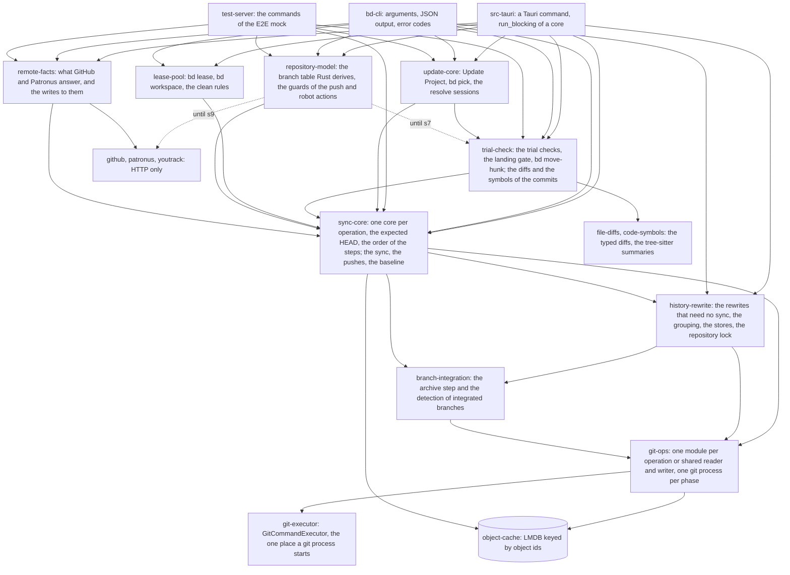
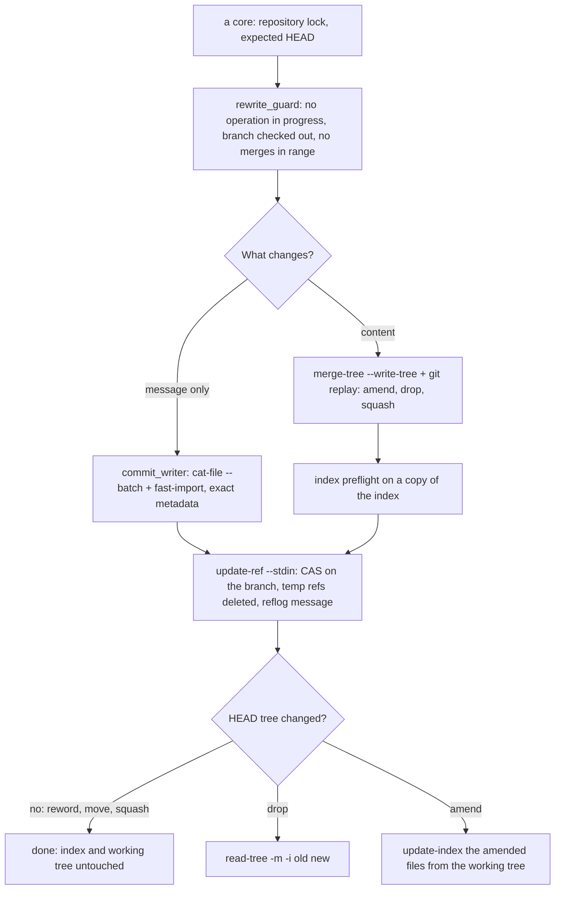

# Git Operations: Working-Tree Safety, Exact Rewrites and Batching

**Status:** Implemented  
**Updated:** 2026-10-24  
**Tags:** [git, safety, performance, rewrite, replay, fast-import, lease]

## Problem

Branch Deck rewrites the checked-out branch: reword, move to another branch, add an issue reference, amend
uncommitted changes into an older commit, squash commits, unapply (drop) a branch, and update it onto its upstream. The
user is usually in the middle of their own work. The working tree and the index may hold uncommitted and staged changes that Branch Deck has no right to touch.
`git rebase`, `git commit -a` and `git reset --mixed` all write to the working tree or the index. They stage what the
user did not select, discard what the user staged, and depend on the user's `rebase.*` configuration.

A rewrite must also be invisible apart from what it is meant to change. Renaming a commit must not change who
committed it or when. Every commit after it must be recreated with the same author, committer, dates and timezones.

Branch Deck exists for large repositories, so speed is a goal. A process spawn costs milliseconds. An operation that
spawns git once per commit, note or file does not scale to hundreds of commits.

## Solution Overview

Every rewrite is done on objects and refs only:

- Message-only rewrites read the commits as raw objects (`cat-file --batch`) and write the new ones in one
  `git fast-import` stream, copying the `author` and `committer` lines byte for byte.
- Content rewrites use `git replay`, which applies commits in memory and never touches the working tree. Trees are
  combined with `git merge-tree --write-tree`, and working-tree files are read into a temporary index.

The checked-out branch then moves in one `update-ref --stdin` transaction with an old-value check (CAS). The user's
index changes only where HEAD's tree changed, and staged changes on other paths survive.

## Design

### Architecture



Each layer calls only the layers below it. The adapters (the app, `bd`, the E2E server) parse a request, call a core
(`<operation>_core(params, options)`) and present its result; the app and `bd` run no git of their own and call git-ops
directly only for reads that need no lock or guard, such as the patches of the diff view. A core is where an operation
is made safe against the app and the parallel `bd` processes, once for every caller (the cores of the rewrites that
need no sync, GitHub or Patronus are the crate history-rewrite; Update Project, `bd pick` and the resolve sessions
update-core; the trial checks, `bd move-hunk` and every reader of the diffs and the symbols trial-check; the lease pool
lease-pool; the readers and the writers of GitHub and Patronus remote-facts, over HTTP; the rest sync-core, which
reads no diff and no symbol and talks to no remote service but through git, so a change above it rebuilds no sync;
what the branch table shows and the guards of the app's actions on the remote are repository-model, on what the others
read): it takes the repository lock,
checks the HEAD the request was made for and orders the git steps. git-ops knows git and no policy: which arguments,
which process, how to read its output, each module one operation or one primitive that operations share; a rewrite there
runs the guards on the history it read and moves the branch with CAS. The `//!` headers of `crates/git-ops/src/lib.rs`,
`crates/history-rewrite/src/lib.rs`, `crates/sync-core/src/lib.rs`, `crates/update-core/src/lib.rs`,
`crates/trial-check/src/lib.rs`, `crates/lease-pool/src/lib.rs`, `crates/remote-facts/src/lib.rs` and
`crates/repository-model/src/lib.rs` map their modules by area; `crates/bd-cli/src/architecture_test.rs` fences the
edges on `cargo metadata` (sync-core, update-core and trial-check reach no HTTP crate, sync-core and lease-pool no
`file-diffs` or `code-symbols`, lease-pool and remote-facts no trial check and no update, repository-model none of
the crates beside it; the two dashed edges stand in its `ALLOWED`, each with the stage that removes it); "Adding a git operation" in `AGENTS.md` is the checklist
of a new one, and [Adding a Git Operation](../guidelines/adding-git-operation.md) says where it goes and which helpers
it reuses.

A rewrite of the checked out branch:



Every path ends at one ref transaction. Only a content rewrite reaches the index step, and the working tree is never
written, except by Update Project and the finish of its resolve session (their own sections below).

### Invariants

1. **Never write to the working tree.** No `checkout`, `checkout-index`, `switch`, `reset`, `rebase`, `stash`,
   `commit`, `cherry-pick`, `merge`, `restore`, `clean`, `apply` without `--cached`, no `read-tree -u` or `--reset`, and
   no `git history`. Reading working-tree files into a temporary index (`GIT_INDEX_FILE`) is allowed.
   `crates/git-executor/src/worktree_safety_test.rs` scans the production sources and fails on such an argument list.

   **The one exception is Update Project** (see "Update project" below), which must bring the upstream's files into
   the working tree, **its undo**, which takes them out again, **the finish of a resolve session** (see "Resolve
   session"), which is the same move to the tip that the session replayed, **`bd pick`** (see "Pick"), which
   moves the branch to the commits of another worktree replayed onto it and, with `--follow`, that worktree onto the
   same tip, and its undo, **and the unapply and the reapply of a virtual branch** (see "Drop and unapply",
   "Reapply"), which take its commits and their files out of HEAD and back, and their undo. All use a single two-way
   `read-tree -m -u <old HEAD tree> <new HEAD tree>`, which writes only the paths whose content differs between the two
   trees; the undo swaps the trees. Three guards come first: a dry run of the same command on a copy of the index, a
   check for ignored files where the move adds a file, and the CAS ref move. Uncommitted and staged changes on the
   other paths survive byte for byte; any overlap refuses the whole move before anything moves. The exemption lives in
   `crates/git-ops/src/worktree_update.rs` only. Its functions are `pub(crate)`, and only `update_branch.rs` calls them:
   for the app's Update Project, `bd update` and `bd undo update:`, and, through its `pub(crate)`
   `move_branch_and_files_with` and `files_follow`, for the finish of a resolve session in `update_resolve.rs`, which
   moves HEAD only to the tip it reads from the session ref, and, through its `pub(crate)` `move_branch_and_files`, for
   `bd pick` in `pick.rs`, which moves HEAD only to the tip its own check replayed (`PickPlan`, private fields), a
   detached HEAD with `option no-deref`, and, through its `pub(crate)` `move_branch_and_files_carrying` and
   `apply_move_undo_with`, for the unapply in `unapply.rs`, which moves HEAD only to the drop its own check replayed
   (`UnapplyPlan`, private fields) and moves the virtual branch in the same transaction, and for the reapply in
   `reapply.rs`, which moves HEAD only to the pick its own check replayed (through `pick.rs`'s `apply_pick_carrying`)
   and deletes the unapplied branch in the same transaction. The safety scan allows `-u`
   there and asserts the number of such argument lists (two: the dry run and the update), so the exemption can't grow
   unnoticed, and it names the files that call those moves, each with its count (`MOVE_CALLERS`).

   **A slot of the lease pool is not the user's working tree** (see "Lease"). The pool owns it while it is free, and a
   get replaces its content: `reset --merge` of a slot that one `status` found clean, which writes the diff of the two
   commits, `checkout --force` of a new slot or of one whose diff git refused, `clean -fd` of a clone, and on a return
   that the agent confirmed or a give-back, `reset --hard HEAD` and `clean -fd`. These argument lists live in
   `crates/git-ops/src/lease_slot.rs` only, and the safety scan asserts each count (`checkout` 2, `reset` 2, `clean` 2).
2. **The user's index changes only where HEAD's tree changes** (see the index policy below). Staged changes on other
   paths survive. A conflict with staged work is detected before any ref moves. If the update fails afterwards, the
   error is returned, never ignored.
3. **Every ref move is one `update-ref --stdin` transaction** (`crates/git-ops/src/ref_transaction.rs`) with an
   old-value CAS and a `branch-deck: <operation>` reflog message. Related ref changes go into the same transaction:
   the unapply's move of the virtual branch together with the move of HEAD, and the deletion of temporary refs. **One named exception:** the
   review fetch writes `refs/branch-deck/review/<n>/{head,base}` through `git fetch` itself (its refspecs, forced, no
   CAS, no reflog message): those refs only keep the fetched commits of a pull request reachable, nothing reads their
   old value, and no other operation writes them. Their pruning is a CAS transaction (see "Review fetch").

   **A second named exception: the refs `fast-import` moves.** Notes are written in the `fast-import` stream of their
   batch, one notes commit per notes ref, `from <notes ref>^0` when the ref exists (`write_notes_to_refs` and
   `write_commits_with_notes` in `crates/git-ops/src/commit_writer.rs`): the mapping and stack notes of a sync, the
   mapping notes of a reword and of a move of a hunk, the detection notes
   (`crates/branch-integration/src/detection_notes.rs`). fast-import moves the notes ref itself when the stream ends,
   with the reflog message `fast-import`: it reads the ref again, refuses a new tip that does not contain that value
   ("not updating … new tip … does not contain …", exit code 1, so the operation fails), and moves the ref with that
   value as the old one. A writer that moved the notes ref meanwhile is therefore never overwritten. The check is a
   fast-forward, not the exact old value of a transaction: a notes ref moved back to an ancestor of the `from` commit
   meanwhile would be moved forward again. The notes of a sync and of the detection are only a cache, so their lost
   write fails nothing (`write_cache_notes`): it runs once more, from the tip the other writer left (its notes kept),
   and a second loss is a warning; a later sync writes them
   (`a_sync_that_loses_the_notes_ref_to_another_writer_writes_again_and_finishes`,
   `a_detection_write_that_loses_its_ref_runs_again_and_never_fails`).

   **The stack branches** (`{prefix}/stack/<root>`, see "Stack branch") follow the rule without an exception: a sync
   moves one with CAS on the tip it listed, only when every branch of its stack was built, and deletes the ones of
   stacks that no longer fork in one CAS transaction, never one with a remote branch or checked out in a worktree. A
   stack branch the sync did not rebuild keeps its tip, and nothing pushes it.
   The notes of a resolve session are not written this way: their commit is written on a temporary ref
   (`StoreNotes`), and the session's transaction moves `refs/notes/branch-deck/resolve` with CAS. fast-import also
   creates the temporary ref its commits are written on (`refs/branch-deck/tmp/<pid>-<time>-<n>`, a name of its own
   per run), which the operation's transaction deletes with CAS on the commit written last on it (`delete_temp_refs`
   of `WrittenCommits` and `WrittenStore`, `delete_temp_ref` of `WrittenEdit`).

   **A third named exception: the ref of a sync chain's commit writer** (`commit_chain.rs`). Each writer gets a
   temporary ref of its own (`unique_temp_ref`), because the branches of a sync build in parallel and the app's sync,
   `bd sync` and the trial builds of `bd check` run at the same time without a common lock. The ref reaches the disk
   only through the `checkpoint` of a resolve by words; then the end of the writer deletes it in its own stream
   (`reset <ref>` `from` the null id), else `reset` without `from` drops it from the memory of `fast-import`. Nothing
   reads its value, so there is no CAS. Up to 0.21 every chain wrote `refs/branch-deck/tmp/chain` and a checkpoint left
   it behind: the next checkpoint of another branch failed with "not updating … does not contain …".

   **The sweep of temporary refs.** A temporary ref left by a killed process keeps its objects alive. A sync lists
   `refs/branch-deck/tmp/` in the `for-each-ref` of its facts (`read_baseline_listing`) and deletes in one CAS
   transaction the ones older than an hour by the time in their name, and any name without a time (the old shared
   `chain`), so the delete costs a process only when there are some (`is_stale_temp_ref`, `delete_stale_temp_refs`).
   A resolve session sweeps the same way at its start (`sweep_stale_temp_refs`).

   **Ref moves that the files follow** (an update and its undo, `move_branch_and_files`) update `HEAD` (deref), not
   `refs/heads/<b>`, so git moves the branch HEAD points at, the one whose files the guarded update writes. That must
   be the branch the check used. git 2.56 refuses `symref-verify HEAD refs/heads/<b>` next to
   `update refs/heads/<b>` ("multiple updates for 'HEAD' (including one via its referent) are not allowed") and next
   to `update HEAD` ("cannot operate with deref mode"). So the transaction runs interactively
   (`RefTransaction::commit_while`): `start`, `update HEAD N H`, `prepare`, which takes the locks of HEAD and of the
   branch and checks the old value, then `symbolic-ref --quiet HEAD` under those locks, then `commit` when it
   is still `<b>`, else `abort` and `BranchSwitched`. While the locks are held, a `git switch` fails on `HEAD.lock`,
   so a switch at any point since the check refuses the move with nothing changed. A read of `symbolic-ref` before
   the transaction only refuses earlier, and the rollback runs the same way. The transactions also pass
   `--create-reflog`, so the undo finds the update in the reflog with `core.logAllRefUpdates=false` too.

   `commit_while` runs `update-ref --stdin` as an interactive git (`GitCommand::interactive`,
   `crates/git-executor/src/interactive_command.rs`): git with piped stdin, stdout and stderr, the config, the
   environment and the per-call `env` of every other call, a reply line awaited with a timeout (60 s; ref locks are
   taken without waiting). A dropped handle closes stdin and waits up to 5 s: `update-ref` then aborts and removes its
   lock files. Then it sends SIGTERM, whose handler in git removes them too, and SIGKILL only as the last resort, which
   would leave `HEAD.lock` and the branch lock behind (on Windows the kill of its job, as for every git). The same interactive git drives the chains of a sync
   (`commit_chain.rs`: one `merge-tree --write-tree --stdin -z` and one `fast-import` per branch, each step waiting for
   the reply of the one before) and the tree check of a trial sync (`crates/trial-check/src/check.rs`:
   `cat-file --batch-check` of the trees the object cache remembers).
4. **Guards before any rewrite of the checked-out branch** (`crates/git-ops/src/rewrite_guard.rs`):
   - no rebase, merge, cherry-pick or revert is in progress;
   - HEAD is not detached;
   - the range from the oldest rewritten commit to HEAD contains no merge; if it does, the rewrite is refused. A
     rewrite of commits it read (see "Rewrite history") takes this from the parents of its history, without a
     process (`History::check_rewrite`); a range it did not read, such as the undo of a squash, asks
     `rev-list --min-parents=2 -n1 HEAD ^<oldest>^@` (`check_rewrite_range`).
5. **Metadata**:
   - A message-only rewrite keeps the author and the committer (name, email, date and timezone) byte for byte, and
     the message bytes of every commit it does not reword.
   - A content rewrite (amend, drop, squash) keeps the author, and the committer becomes the current user and the
     current time, as with `git rebase`.
   - **One named exception:** a move of a hunk (`bd move-hunk`, see "Move a hunk") changes the trees of a range, but
     keeps author and committer byte for byte for every commit whose diff stays the same (`patch-id --stable`): the
     commits between the two whose change only shifted, and every commit above. Their virtual commits keep their ids,
     so the sync leaves their branches as they are. Only the two commits and those between whose diff of the file
     changed get the current user as committer.
   - Signatures are stripped because they would no longer be valid.
6. **Batch**: one process per operation phase, not one per item. **An operation reads a repository fact once** and
   passes it down: the baseline and its upstream come from `read_baseline` (`symbolic-ref`, `remote` and one
   `for-each-ref`, as `read_baseline_listing` reads them for a sync), never from `detect_baseline_branch` and then
   `resolve_baseline_upstream` (six processes; `the_baseline_and_its_upstream_are_read_once`); a check session and
   `bd move-hunk` take the baseline with its commit, HEAD's tip and the branch tips from one `read_listed_baseline`
   (`remote` and one `for-each-ref`) and walk the commits between the two ids; the directories come from
   the executor ([Executor](#executor); `the_directories_of_an_operation_are_read_once`); a step of a sync takes
   `RepoFacts`, `ConfigSnapshot` or the `SyncReport`. Only HEAD and the guards are read again, under the lock, where
   they may have moved since the check (the witness). Never parse translated text; rely on exit codes and
   on `--porcelain` and `-z` output. **One named exception:** a branch description (`branch.<name>.description`,
   `bd describe` and the `descriptions` of a `bd group` plan) costs one `git config` process per branch, because git
   has no batch writer for config. The current descriptions are still read with one `git config --get-regexp`, and
   only the ones that differ are written.
7. **Git 2.54 or newer**, checked when the executor discovers git, on every platform, so that every command fails
   early with an install or upgrade hint.
8. **Every push of virtual branches decides under the repository lock, in Rust, what may go, and pushes after it**:
   `bd push` and `bd safe-push` after their sync, the app's pushes (of a branch alone, of a stack, up to a commit) through
   the plan of the intent `Push` and its witness and freeze (`operations::push::execute_push`). Under the lock the commits and the leases are fixed; the network push sends exactly
   them (`<commit>:refs/heads/<name>`, `--force-with-lease=refs/heads/<name>:<lease>`) after it, so no writer waits
   for the network and a branch moved meanwhile changes nothing of what goes. A
   parked branch, one built on parked, one a merged Safe Push landed whole and one a running Safe Push holds are
   refused by the same view of the robots (`patronus_view`) on both sides, whatever the page checked before ("App
   stack push").

### Minimum Git version

| Feature | Since | Used for |
|---|---|---|
| `merge-tree --write-tree` | 2.38 | conflict detection and tree merges without a working tree |
| `merge-tree --merge-base` | 2.40 | cherry-pick semantics in sync, the amended tree |
| `git replay` | 2.44 | replaying commits in memory |
| `fast-import --signed-commits` | 2.52 | stripping signatures that a rewrite invalidates |
| `replay --ref-action=print` | 2.53 | reading the new tip without letting replay move refs |
| `replay --ref`, dropping commits that become empty | 2.54 | segment tips that are commit ids, not branches |

The minimum is therefore **2.54** (`MIN_VERSION` in `crates/git-executor/src/git_info.rs`). On macOS a Homebrew git
is preferred, and its one `git version` gives both the check and the version. A successful discovery is kept for the
process (`DISCOVERED` in `git_command_executor.rs`): every executor without a git of its own (`with_info`) shares it,
instead of running `git version` again on its first command. On other platforms the upgrade hint names the git-core PPA (Ubuntu) and Git for Windows. Every failed
discovery is one summary line, then the hint (`UPGRADE_HINT`), and the app shows the line as the title: "Cannot find
Git: <reason>" for a git that is missing or fails to run (the macOS `/usr/bin/git` stub without the Command Line Tools
exits with an `xcrun: error`, its first line is the reason), "Git 2.39 is too old: Branch Deck requires Git 2.54 or
newer" for an old one. CI checks the runner's git in `.github/workflows/test.yml`.

### Executor

All git runs through `GitCommandExecutor` (`crates/git-executor/src/git_command_executor.rs`):

- Every call gets `-c core.quotePath=false -c color.ui=never -c log.showSignature=false
  -c i18n.logOutputEncoding=UTF-8` and the environment variables `GIT_TERMINAL_PROMPT=0` and `GIT_OPTIONAL_LOCKS=0`
  (one exception: the `status` of a slot of the lease pool may write the slot's index, [Lease](#lease)).
  The encoding keeps `log` and `show` messages in UTF-8 for a user who reads logs in another one: the commit list drops
  a record that is not UTF-8.
- Inherited `GIT_DIR`, `GIT_WORK_TREE`, `GIT_INDEX_FILE` and `GIT_NOTES_REF` are removed. A temporary index is always
  passed explicitly, in the per-call environment, which is applied after the removal.
- The executor knows no git beyond running it: a rev or ref fact (`resolve_tree_id`, `ref_exists`) is a function of
  `git_ops::revs`. It carries what its operation read once, for the steps it passes the executor to (`with_fact`, one
  value per type, which it never reads itself): the directories of the repository (`with_repository_dirs`,
  `with_dirs_of`), so the guards, the lock, the worktree, the index of a dry run, `index.lock`, `FETCH_HEAD` and the
  landed state are paths of those directories (`RepositoryDirs::git_path`) and start no `rev-parse`; a step on
  another path (the source worktree of `bd pick`) reads its own. `bd`'s context attaches the directories it reads;
  Update Project, its undo, the resolve session, `bd pick` and the rewrites of the checked out branch read them once at
  their entry.
- stdin is null unless the call pipes it: git never inherits the stdin of the app or of `bd`. On Windows git queries
  its stdin handle at startup, which waits while a read of the same pipe is pending in our process (`bd check --plan -`
  reads a plan from stdin).
- `GIT_NOTES_DISPLAY_REF` is set to an empty value. It replaces an inherited one and turns off `notes.displayRef`. So
  `%N` shows only the notes of `core.notesRef`, the mapping notes, or those of an explicit `--notes=<ref>`. With
  `notes.displayRef=refs/notes/*`, `%N` would otherwise print the notes of every ref, and the mapping readers would take
  a wrong id. The mapping readers also parse only the first line of a note.
- stdout is a pipe, so git never starts a pager and callers do not need `--no-pager`.
- On Windows git opens no console window (`CREATE_NO_WINDOW`, `sync_utils::child_process::windowless_command`) while our process has none. The release
  app is a GUI program, so Windows gave every git a console of its own, which Windows Terminal showed as a window in
  front of the app, five to thirteen a second. `bd` and a debug build of the app have a console, and their gits share
  it, so a Ctrl+C ends them too. Every other program starts the same way (`console_window_scan_test.rs`).
- Paths after `--` are names: an argument list that puts any there starts with `--literal-pathspecs` (git's global
  option, the same as `GIT_LITERAL_PATHSPECS=1`), so `a*.txt` matches no `ab.txt` and `:name` is no pathspec magic.
  No call needs a glob or magic; `git_usage_scan_test.rs` checks the lists.
- Special exit codes still apply: `merge-tree` and `replay` exit with 1 on conflicts. `merge-tree --stdin` exits with
  0 even then: each merge of its output starts with its status, 1 clean and 0 conflicted
  (`merge_tree_output::parse_batch_merge`, the one reader of a merge of a `--stdin` run, from its whole output or
  from the running process of the sync's `CommitChain`).
- An operation can count its processes: `with_process_stats` gives an executor whose clones count every process they
  start, interactive ones included, by subcommand, with its wall time. The summary is logged at info level when the
  last clone is dropped (`git processes`, e.g. `merge-tree 2×40ms, log 5×31ms`). The sync and every `bd` command count
  theirs; `bd -v` prints the summary. Tests assert on `process_stats().by_command()`; the budget of every operation is
  pinned, process by process, in `crates/sync-core/src/process_budget_test.rs`,
  `crates/update-core/src/process_budget_test.rs`, `crates/trial-check/src/process_budget_test.rs`,
  `crates/remote-facts/src/process_budget_test.rs` and `crates/branch-integration/src/process_budget_test.rs` (the
  cores) and
  `crates/bd-cli/src/process_budget_test.rs` (what a `bd` command adds), so a change that saves a process lowers a
  number there.

**One builder, one spawn core.** A git invocation is `git.cmd(&args, repository_path)` (`GitCommand`), configured with
`.env(&[(k, v)])`, `.stdin(&bytes)`, `.accept(&[1])` (non-zero exit codes that are still success) and
`.timeout(duration)`, and run by one finisher:

| Finisher | Returns | A non-zero exit code |
|---|---|---|
| `.text()` | stdout as text, trimmed | an error with git's stderr, unless accepted |
| `.bytes()` | stdout untouched (`-z`, `cat-file --batch`) | as `.text()` |
| `.lines()` | the non-empty lines of stdout, trimmed | as `.text()` |
| `.output()` | `GitOutput { stdout, stderr, code }`, when the code is the answer | as `.text()` |
| `.status()` | `GitOutput`, whatever the code | not an error, logged at debug level only |
| `.stream(handler)` | stdout to `handler` in chunks, on the calling thread | as `.text()`; `ControlFlow::Break` kills git and ends with `Ok`, without a look at the code |
| `.progress(on_line, stop)` | stdout as text; each stderr line to `on_line` (`fetch --progress`) | an error with the stderr messages, not the `\r` updates |
| `.interactive(delimiter)` | an `InteractiveCommand` for a reply protocol | `read_record` or `finish` fails with git's stderr once git exits |

`GitCommand::spawn` is the only place a process starts, and every finisher but `interactive` runs on
`GitCommand::run`: stdin is written from its own thread, so a large input cannot deadlock against a full stdout pipe;
stdout and stderr are read by threads that send their events to the calling thread (a bounded queue, so a slow
`stream` handler holds git back instead of filling the memory); a timeout or a `ProgressStop` (an idle timeout, a
cancel) makes the run poll and kill git, the error a `StoppedCommand`, and after git exits the rest of its pipes is
awaited for 500 ms only, because a helper of git (ssh, a credential helper) may hold them open. On Windows a kill ends
the job object that git was put into when it started (`crates/git-executor/src/process_tree.rs`): `git` on `PATH` is
mostly the launcher of Git for Windows (`Git\cmd\git.exe`), which starts the real git as its child, and a kill of the
launcher alone would leave that git running with its ssh or helper, its lock files and our inherited pipe handles. A
git that exits by itself ends nothing of its job. Each run is one tracing span (`git`, with the command, the exit code
and the time), and a guard kills a git that still runs and counts the process however the run ends: a handler error, a
stop or a `Break`. Text is decoded with `String::from_utf8`, lossily only when it is not UTF-8; stderr is read as bytes
and decoded lossily, the interactive one too. Three shorthands stay for the common one-liners: `execute_command` is
`.text()`, `execute_command_lines` is `.lines()` and `execute_command_with_status` is `.status()` as text (trimmed
stdout on success, trimmed stderr otherwise, and the code); every other call is the builder. Besides its construction (`new`, `with_info`, `get_info`) and the process
counts (`with_process_stats`, `process_stats`), that is all the executor offers: it knows no git command, and what a
command means (a commit or a tree by name, whether a ref exists) is a function of `git_ops::revs`.

### Index lock

A write of the user's index takes `<git dir>/index.lock`, and git does not wait for it: `core.filesRefLockTimeout` is
only for refs. Two kinds of lock refused bd's moves on the IntelliJ monorepo (2026-10-24, ten sessions picking into
one `master`), and each rollback made the agent loop again:

- **Live**: an IDE's `git status` holds the lock for the whole of its scan (an opportunistic refresh; 11–20 s with
  `--untracked-files=all --ignored=matching` on 1.4M files) and starts again at every ref change, so at the move of a
  pick too.
- **Ownerless**: a 0-byte lock that no process has open, left by a git killed with SIGKILL (git removes its lock on
  exit, SIGTERM and SIGINT). Every later status skips it, and every write fails on it until someone removes it.

`git_ops::index_lock` handles both, for the moves the files follow (the pick and its follow, Update Project, the
unapply, the reapply, their undo, the finish of a resolve session) and for `IndexUpdate::apply` of the rewrites:

1. **Before the CAS move**, a move whose git dir is known (`move_branch_and_files_carrying`: `current_worktree` reads
   it anyway; a pick's check reads both worktrees' dirs) waits while a lock is there, and the refresh of the stat data
   runs (`prepare_worktree_update`). A pick does this before the repository lock too (`PickPlan::wait_for_index_locks`),
   so no other writer waits for the repository lock while this one waits for git's.
2. **A step that a lock blocked runs again** once the lock is gone (`IndexLock::retry`): the step failed, and the lock
   exists now and appeared before the step started (100 ms of slack: Linux stamps a file with a coarse clock). A step
   that refused for its own reasons held the lock itself and released it, so a lock that exists now is younger and the
   step's error stands. A blocked step wrote nothing: git takes the lock before it writes (`update-index --refresh` without stat data to write needs no lock and passes,
   which is why step 1 looks at the file itself).
3. **An ownerless lock is removed.** Every 2 s of a wait, bd asks who owns it: a process that has it open (`lsof` on
   macOS, `/proc/*/fd` on Linux), or a git in the worktree that started before the lock appeared (a `git commit`
   closes its lock while a hook runs). Two answers "nobody", 2 s apart, for the same file (device, inode, mtime) remove
   it; its identity is read again right before the unlink, so the race left is microseconds after a lock that stood
   ownerless for 2 s. A lock bd can't judge (no `lsof`, Windows) stays.
4. **After 30 s** (`INDEX_LOCK_WAIT`, per write) the answer is `IndexLocked` with the file, its age and the processes
   that may own it: `locked` (retryable) with `processes` in bd. A move that gives up after the branch moved moves it
   back first, so nothing was changed; a follow that gives up is `followed: blocked`, the target picked. A rewrite has
   rewritten the branch already: its error stays the non-retryable one with the `git reset -q` advice, naming the lock.
5. The refresh after `read-tree -m -u` is best effort: the files followed, and the next `git status` refreshes the
   stat data. Before, its failure moved the branch back after the files had moved.

The happy path costs no process: the lock file is looked at only when a step failed or the git dir is known.

### Operations

#### Rewrite history

Every rewrite of the checked out branch reads the first-parent history of HEAD it rewrites once, newest first, with one
`git log --first-parent --format=%m%H%x1f%T%x1f%P[%x1f%N]%x1e` (`crates/git-ops/src/history.rs`): each commit's id,
tree and parents, and its mapping note where the rewrite carries them. It gives the positions of the commits the plan
names, the first parent of each (`parent(pos)`) and its tree, and the merges of the guard (invariant 4). It is never
the whole history, which has 10⁵–10⁶ commits in a monorepo. There are two bounds:

- **Down to the oldest target** (`History::read_to`): amend, drop, unapply, squash and squash fixups, whose requests
  name no baseline. The log is streamed and stopped (the process killed) at the first commit after the last target
  it saw, the parent of the oldest one, which the plan needs too. A commit that is not on the first-parent line of HEAD
  makes the walk read everything; the rewrite is then refused with "Commit … is not on the current branch, sync and
  try again".
- **Ahead of the baseline** (`History::read_ahead_of`): reword, add issue reference and the move of a hunk, which must
  not rewrite a commit of the baseline. `log --first-parent --boundary HEAD ^<baseline>` (no exclusion on the local
  baseline branch itself, as the commit list does) also prints the boundary, the first parent of the oldest commit,
  and the second parent of every merge among them; the one that is the oldest commit's first parent is kept.

#### Reword, move, add issue reference

Only messages change, so every tree stays the same and the index and the working tree are already correct. The app's
edit of a message and `bd reword` are a regroup (below); this is how it writes, as add issue reference does.

1. Read the commits ahead of the baseline and their mapping notes (see "Rewrite history"). Every reworded commit must
   be among them; the oldest one starts the range.
2. Read the commits of the range as raw objects with one `cat-file --batch`.
3. Write the new commits in one `fast-import --date-format=raw --signed-commits=strip` stream:
   - each commit copies its `author` and `committer` lines and its `encoding`;
   - an unchanged message keeps its bytes; a new one ends with a newline, like `commit-tree -m`;
   - the tree is set with `M 040000 <tree> ""`;
   - commits are chained by marks on a temporary ref `refs/branch-deck/tmp/<pid>-<time>-<n>`;
   - `get-mark` prints the new ids.
4. Run one transaction that moves the branch with CAS and deletes the temporary ref.

`fast-import` objects become readable only when its stream ends, so it suits batches whose commits are all known up
front. Code: `crates/git-ops/src/reword_commits.rs`, `crates/git-ops/src/commit_writer.rs`.

#### Regroup, rename, restack

A move, a regroup plan of the agent CLI (`{branches: {path: [ids]}, unassign: [ids]}`), a branch rename, a restack,
`bd reword` and the app's edit of a message all change the messages of commits, so they are one reword. `regroup_commits_core` decides the messages before it
writes anything:

1. Take the repository lock (below), refuse while an operation is in progress or HEAD is detached, and read HEAD, the
   stack setting, the issue groups and the stack parents (one `cat-file --batch`) and the commits ahead of the
   baseline (one `log`): the `Snapshot` (`crates/history-rewrite/src/snapshot.rs`, which the check reads too; the reads
   that need less take its parts, `CommitsAhead` and `read_grouping_inputs`). An
   `expect_head` that isn't HEAD is `head_moved`.
2. Resolve the ids of the plan (abbreviations allowed); unknown ids, ids that aren't ahead of the baseline,
   duplicates and ids both in a branch and in `unassign` are refused.
3. Move every fixup of a moved target along (`plan_autosquash`); a plan that separates a fixup from its target is
   refused. So is a rewrite after which a fixup folds into another target or none, a `fixup!`, `squash!` or `amend!`
   marker is added or removed, a target that a fixup names by its id (`fixup! <hash>`) gets a new id, or a target
   whose `amend!` waits gets a new text (`fixup_targets.rs`): each would fold the fixup elsewhere, or replace the new
   message at the next fold. The autosquash plan of the new messages decides, on the old ids, so the ids are checked
   apart. The refusal is `RegroupError::FixupsStranded` with its `FixupRefusal`, a reason that names no action: `bd`
   adds "fold them first with bd fold", the app "squash the fixups into their target first".
   A commit without a prefix that goes to the branch of its own issue key keeps its message: it is grouped there
   already. A commit with a prefix keeps its message only when the plan path is exactly that prefix. With stacked
   branches on, a path `auth/login` writes the stack parent `login<TAB>auth` and gives a commit that needs a prefix the
   bare `(login)`; a commit outside the plan whose prefix declares another parent for a child the plan stacks or
   unstacks loses the levels above the child (the levels above it become stack parents).
4. Group every subject ahead of the baseline with the new prefixes, the issue groups and the stack parents after the
   plan in memory
   (`CommitGrouper::new_with`) and compare the stack forest with the current one: a problem the plan introduces (a
   cycle, conflicting parents, a self parent, a leaf collision) refuses the plan, named by its reason without a fix
   (the plan changed nothing yet); a problem that already existed is reported, and its fixes run.
5. Reword the changed commits in one `fast-import` (`reword_commits_batch_at`): the history must still start at the
   HEAD of step 1, and the ref transaction's CAS uses it too. A change of the issue groups or of the stack parents
   joins that transaction (below).

A move of the app (`move_commits_to_branch`) computes its plan from the snapshot of step 1, under the same lock
(`regroup_planned` and `plan_move` in `move_plan.rs`): a whole issue (every commit of its key without a prefix) goes into
`issue_groups`, also into a stacked target, a part of one and a commit without a key into `branches` (a path `P/X`
also writes the stack parent of `X`, with an empty list when the issue groups move every commit), and a prefixed commit
that its key puts into the target anyway into `unassign`. So combining issues rewrites nothing, and a mixed move is one
reword and one ref transaction. A dry run of it is the preview of the "Move to…" form.

`bd reword` (`crates/history-rewrite/src/reword.rs`) gives the regroup whole new messages by id (`Change::messages`,
a `--subject` keeps the body it reads from the snapshot, under the lock), cleaned up as `git commit` does, before the
plan's prefixes apply; a message equal to the old one after the cleanup changes nothing. A new `(prefix)` regroups the
commit as a plan would, with step 4's check, and the fixups of a target whose prefix changes follow it. The mapping
note of a commit whose text (not only its prefix) changed is not carried: its copy must be rebuilt with the message.

The app's edit of a message (the Tauri command `reword`, `reword_request_core` in `reword.rs`, which the E2E server
routes too) is the same reword: whole messages by full id, `RegroupOptions::default()` (the lock and its 10 s wait,
no expected HEAD), and the answer carries the new ids, `previousHead`, `newHead` and the undo token. Its refusals are
told for the app: an id that is no longer ahead of the baseline is "Commit <id> is no longer on the current branch,
sync and try again" (the list was read before a terminal reworded or dropped it).

A rename replaces the old level in every prefix path (children included), renames the issue groups of the old name,
names an issue branch in the issue groups, and renames the old name in the stack parents (as a child, and as the parent
of a child with commits on this HEAD), without a rewrite; a restack writes the stack parent and rewrites only the
commits whose prefix declares another parent, an unstack removes it and the parent levels. The undo token is
`H1..H2` for a rewrite:
`restore_branch_head` moves the branch back with CAS, which is valid because a message rewrite keeps HEAD's tree. The
app undoes a move, a rename, a restack and a reword with that token too (`undo_regroup`), never by rewording the
messages back.

**Issue groups.** The map of issue key to branch name lives in `refs/branch-deck/issue-groups`
([Issue Groups](../../spec/branch/issue-groups.spec.md)), outside `refs/heads`, so the default refspecs neither push nor fetch it.
- A write makes a commit with the one file `issue-groups` on the previous map commit (`StoreCommit::file` and
  `StoreUpdate` in `commit_writer.rs`). With a rewrite, it is one more commit of the reword's `fast-import` stream
  (`reword_commits_batch_at`), so a mixed plan costs one `git var` and one `fast-import`. Without a rewrite,
  `write_store_updates` writes it alone. `fast-import` objects are readable only after the stream ends, which suits
  this write.
- Its `update-ref` line is `update <ref> <new> <old>`, or `create` for the first write. It goes into the transaction
  that moves HEAD and deletes the temporary ref, so both refs move or neither does. A plan that changes only the map,
  and a reword whose messages are equal once cleaned up, add `verify refs/heads/<branch> <head>` instead of a HEAD
  move.
- On a failed transaction the temporary ref is deleted, and a read of HEAD and of the map ref names the one that moved:
  `head_moved` or `groups_moved`.
- The undo token is `groups:G1..G2` for a change of the map only and `H1..H2+groups:G1..G2` for both. The ids are
  full; a `G1` of zeros is a map that did not exist, which the undo deletes. One `for-each-ref` reads the map ref and
  the parent of its commit: `G2` must be the map now (else `groups_moved`), and its parent must be `G1` (else the
  token names no write of the map). `undo_regroup_core` moves both refs back in one transaction
  (`restore_branch_head_with`), with CAS on each; a ref that moves meanwhile is `head_moved` or `groups_moved` too.
- Only a regroup writes the map; the sync, `bd status`, `bd check` and `bd suggest` read it. The ref is shared by
  every branch and worktree (`refs/branch-deck/*` is not per worktree), so a write changes only the keys the plan
  names: a key that groups no commit on this HEAD may group the commits of another branch, and only `ungroup_issues`
  removes it. The lines that the parser can't use are written back as they are, unless the write sets or ungroups
  their key. git keeps no reflog outside `refs/heads`, so the parent chain of the map commits is its history.

**Stack parents.** The map of branch to parent lives in `refs/branch-deck/stack-parents`
([Stack Parents](../../spec/branch/stack-parents.spec.md)), a ref of its own: a store commit replaces its whole tree
(`deleteall`), so a file next to `issue-groups` would be lost by every write of a version that does not know it.
- It is written, read and undone as the issue groups, by the same code: each map is a `LineStore` (`store_lines.rs`:
  its ref, its file, its commit message, the shape and the validation of a line; `ISSUE_GROUPS`, `STACK_PARENTS`).
  One file `stack-parents` of sorted `child<TAB>parent` lines, read in the same `cat-file --batch`, one more store commit of the same `fast-import` run, each
  store on a temporary ref of its own (`{temp}-store-<n>`, so no store commit replaces another tip before the
  transaction), one more line of the same ref transaction with CAS (`write_store_updates` without a rewrite).
- A failed transaction names the ref that moved in the order HEAD, issue groups, stack parents: `head_moved`,
  `groups_moved`, `stacks_moved`. The undo token joins `H1..H2`, `groups:G1..G2` and `stacks:S1..S2`, the parts of the
  refs that moved, with `+`, in this order; `S2` must be a write on `S1`.
- The one write outside a regroup: after the detection of the archived branches, a sync drops the lines of the
  children whose newest archived branch is integrated (`drop_integrated_stack_parents`), with CAS on the commit it
  read and only when a line goes, with a message of its own. It takes the repository lock only while it is free, never
  waiting (`drop_store_lines`): a regroup holds the lock from its read of the stores to its transaction, so a drop in
  that time would fail it with `stacks_moved` or `parked_moved`; a held lock, also one of the same process (the sync of
  `bd push` under its lock), leaves the drop to the next sync
  (`a_sync_leaves_the_stack_parents_to_a_regroup_that_holds_the_lock`). A write that loses the race to another writer
  is skipped and tried at the next sync. A newer archive that is not integrated, such as a
  branch of another worktree that this sync archived, keeps the line. So that such a drop does not break the undo of
  a regroup whose toast is still open, an undo whose `S2` is followed only by drops (one `log`) writes the map of `S1`
  without the dropped children on top of them (`undo_over_drops`, for any `LineStore` with its drop message), in the
  undo's transaction.

**Parked branches.** The branches the user keeps local live in `refs/branch-deck/parked`
([Parked Branches](../../spec/branch/parked-branches.spec.md)), the third `LineStore` (`PARKED`, `parked.rs`): one file
`parked` of sorted `branch<TAB>note` lines, the note one line, possibly empty. It decides no group: a sync builds a
parked branch as any other, and only `bd push`, `bd safe-push` and the app's push surfaces leave it out, and a branch
built on it, which carries its commits.
- It is read in the same `cat-file --batch` as the other two maps (`GroupingInputs.parked`), so the stack setting and
  the three maps still cost two processes, and a sync's budget is unchanged. The sync sends the whole map in
  `BranchesGrouped` (`parked`), the lines of branches without commits here too.
- Park and unpark change no commit: `park_core` takes the repository lock, reads the grouping of the commits ahead
  (each branch must group one), then writes the store with one `fast-import` and one `update-ref --stdin` with CAS on
  the commit it read (`write_store_updates`); a ref that moved is `parked_moved`. `unpark_core` reads only the store
  (one `cat-file --batch`) and drops a line also of a branch without commits here. Both take several branches (the
  app's drag of a selection, the undo of one) and write all their lines in one store commit, or none when one of them
  is refused; the processes are the same for one branch or many. Neither has an undo token: the other one is the undo.
- A rename carries the line: the parked `old` becomes the parked `new` with its note, in the transaction of the rename
  (a third store of `regroup_with`; a parked `new`, a merge, keeps its own note). The undo token gets the part
  `parked:P1..P2` after `stacks:`; a failed transaction names the ref that moved in the order HEAD, issue groups,
  stack parents, parked branches (`parked_moved`). A merge into another branch by a move keeps the line of the
  branch moved from: it may park the branch of another worktree.
- A sync drops the line of a parked branch without commits here whose newest archived branch is integrated, as the
  stack parents (`drop_integrated_parked`, its own drop message, best effort, only while the lock is free), and an undo of a rename passes
  over those drops. Every other idle line stays (`idle_parked` of `bd status`): an issue key that groups again is
  parked again.

**Repository lock.** History rewrites take an exclusive `flock` on `$GIT_COMMON_DIR/branch-deck.lock` (all worktrees
share it). The in-process mutexes don't cover the app and parallel `bd` processes. A dry run reads only and takes no
lock. Every rewrite of the checked out branch takes it in its core, before it reads anything: the regroup (also the
app's reword) and the move of a hunk (their options), and the app's squash and its undo, squash fixups (also `bd
fold`), amend, unapply and add issue reference, each a `*_core(…, &RewriteOptions)`
(`crates/history-rewrite/src/repository_lock.rs`): `lock_wait`, `held_lock` for a caller that holds the lock already,
so the core takes none, and `expect_head`, the HEAD the request was made for, abbreviated ids allowed, else
`HeadMoved` (`ensure_expected_head`, one check for every core). The app's cores without options (a move, a rename, a
restack, an undo of a regroup, park and unpark, the squash undo, the unapply and reapply undo, the conflict fix,
Update Project) take a `LockWait` themselves. How a rewrite waits is the `LockWait` of its caller:

- **`bd`**: `LockWait::Bounded(lock_timeout)`, 10 s by default (`BRANCH_DECK_LOCK_TIMEOUT`), then `locked`, exit 3.
- **The app**: `LockWait::WhileHeld(&WaitTicket)`, `lock_repository_while_held`: it waits, without a bound, while the
  holder record names a live process, an agent's `bd pick --follow` or this app's own push or rewrite (two operations
  of one process conflict on the `flock` as two processes do, and the page's queue orders its rewrites anyway); only
  a lock no record names a live holder of (a holder that writes none) refuses after `DEFAULT_LOCK_TIMEOUT` ("Another
  Branch Deck operation holds …; retry when it is done"). Each rewrite command of the app takes a `wait:
  Channel<LockWaitEvent>`, the push its progress channel and Update Project its progress channel; the command
  registers its wait by the id of that channel in the host's `LockWaits` (`crates/history-rewrite/src/lock_wait.rs`,
  `src-tauri/src/lock_wait.rs`), tells the page whom it waits for when the holder changes and about once a second
  ("Waiting for `bd pick` (pid 4242, for 12 s)": `LockWaitEvent.waitingFor`, `TransferProgress.waiting` with its
  `line`, `UpdateProgress.waitingFor`) and that the wait ended (`waitingFor: null`). `cancel_lock_wait` of the
  channel's id (Stop Waiting) ends a wait before the rewrite read or wrote anything: the wait sees the flag on its
  next poll and returns `LockWaitCanceled`, and the command answers the code `canceled` (`canceled_code`) only when
  its own wait ended so (`WaitTicket::ended_by_cancel`), never for a Stop Waiting that came after the lock was taken.
  The page says "Canceled squashing 2 commits before it started" (an info toast, no error) and changes nothing. The
  E2E server keeps the same registry and streams the messages of the channel as SSE events before the answer
  (`crates/test-server/src/channel_commands.rs`).

`bd push` and `bd safe-push` (until the commits of their
push are fixed, the network push after it; with `--check` only its sync),
`bd move-hunk`, `bd pick` (after its check, the witness and the moves of both worktrees under one hold, its landing report after it) and `bd undo` take it, so does the app's push
(`execute` of the intent `Push`: `operations::push`, on the `$GIT_COMMON_DIR` the app keeps, so the witness sees the
branches no other writer moves meanwhile and fix the commits that go; it holds the lock only for that, and pushes
those commits after it, so the app's pushes run side by side; "Push and land"), and so does Update Project (the app's and `bd update`, which also starts a
resolve session under it) after its fetch and its check, for the witness, the local changes and the move, and `bd update --continue` and `--abort`; `bd update --status` and
`--continue --dry-run` take none. A holder writes who it is next to the lock (`branch-deck.lock.holder`: the command line, the pid, the start of
the process and the time, through a temporary file and a rename) once it has the lock, and deletes it before it
releases it, so the error of a wait names the holder; the lock file itself can't carry it, Windows refuses to read a
locked file. A record whose process is gone (`process_scan::is_running`: its pid and start time, on Windows through
`OpenProcess` and `GetProcessTimes`) names nobody. A record of this process always
names it, and one whose process the system won't describe (a sandbox that denies the process info on macOS) names its
holder while `kill(pid, 0)` still finds the process: otherwise the app would wait for a live holder it can't see, say
whom for nowhere, and refuse after 10 s. A core finds the file with one
`rev-parse --git-common-dir`; `bd`'s own lock (`lock_repository_in`) takes the
directory its context resolved, and a wait for it makes `bd` read the config again (`RepoContext::forget_config`). A sync
never waits for it, the app's, `bd sync` and the `--sync` of a `bd` rewrite (after the release) alike: a sync of a large
repository would make every writer fail with `locked`; only its drop of store lines takes it, while it is free (see
"Regroup"). Within a session one sync
runs at a time (`SyncScheduler`, [Session facts](#session-facts)): a request while one runs asks for one follow-up
after it, the events of a run that is not in flight are dropped, and a focus during a sync checks the inputs once after
it. A `bd` write during an app sync changes
the inputs (the fingerprint is taken when the sync starts), so the next focus syncs again and corrects what the sync
wrote from the HEAD it read. A fetch never runs under the lock: on a monorepo it can take minutes, and every other writer would fail with
`locked`.

**One call: rewrite, descriptions, sync.** `bd group` (and `rename`, `restack`, `unstack`) takes the lock itself and
passes it to the regroup (`RegroupOptions.held_lock`), so the regroup takes no lock of its own and the lock has no gap
between the rewrite and its descriptions:

1. The current descriptions, when the plan has `descriptions`: those of the command's config (`RepoContext::config`,
   one `git config --get-regexp` read once per command and again after a wait for the lock).
2. The regroup above. Before it writes, `regroup_commits_accepted` lets bd refuse the result: a description without a
   title of one line, or of a branch that has no commits after the plan, is `invalid_plan`.
3. After the ref transaction: one `git config` per changed description (the exception of the batch rule).
4. With `--sync`, after the release of the lock: the sync of `bd sync`, which takes none, so its merges never make the
   app or another `bd` wait.

A failure in step 3 or 4 leaves the rewrite in place: the output keeps the undo token and has the error as `error`.
A failed description write stops the later ones and skips step 4. The undo moves HEAD and the issue groups back, not
the descriptions or the virtual branches; the output lists the texts the descriptions replaced.

Code: `crates/history-rewrite/src/regroup.rs`, `crates/history-rewrite/src/snapshot.rs`, `crates/history-rewrite/src/move_commits.rs`,
`crates/history-rewrite/src/issue_groups.rs`, `crates/history-rewrite/src/parked.rs`, `crates/history-rewrite/src/repository_lock.rs`.

#### Amend

The user selects files in the uncommitted changes. They go into commit X, which may be HEAD, an older commit or the
root commit.

1. Read the first-parent history down to X and its parent (see "Rewrite history"). Build `T_wt` in a temporary
   index: HEAD's tree plus only the selected files from the working tree.
2. Compute the new tree of X:
   - if X is HEAD, it is `T_wt`;
   - otherwise it is `merge-tree --write-tree --merge-base=HEAD^{tree} X^{tree} T_wt`, which applies only the delta
     between HEAD and the working tree. A later commit that also changed the file does not leak into X. A conflict
     refuses the amend.
3. Write X' with `fast-import`: X's author and message, the current user as committer.
4. Unless X is HEAD, run `git replay --ref-action=print --onto=X' --ref=refs/branch-deck/replay X..HEAD`. `--ref`
   only names the tip in the printed update; with `print`, replay writes no ref.
5. Check that the new tip's tree equals `T_wt` before any ref moves, so the amended files match the working tree
   afterwards and nothing else changed.
6. Move the branch, then stage the amended files from the working tree (see the index policy).

There is no `commit -a` and no `rebase --autosquash` fallback. A range with merges is refused (invariant 4).

Code: `crates/git-ops/src/amend_operations.rs`, with the shared replay and merge helpers in
`crates/git-ops/src/replay.rs`.

#### Drop and unapply

The dropped commits are ordered oldest to newest on the first-parent line, read down to the oldest of them (see
"Rewrite history"); a commit that is not on it refuses the drop. Each run of kept commits between two dropped ones,
and after the last one, is replayed onto the result of the previous run:

```
git replay --ref-action=print --onto=<base> --ref=refs/branch-deck/replay <d_i>..<parent of d_i+1>
```

The last run is `<d_k>..HEAD`. That is at most k processes for k dropped commits, whatever the length of the range.
A conflict makes `replay` exit with 1, without output, and nothing has changed. A drop is a rewrite plan
(`prepare_plan`) whose steps are all `Drop`.

Unapply ([Unapply](../../spec/branch/unapply.spec.md)) takes the commits of a virtual branch out of HEAD with their
files and keeps the branch in the unapplied namespace, which no sync archives or deletes. Under the repository lock,
after the mark of an interrupted move is finished (`finish_pending_update`):

1. The commits of the branch as they group now: the grouping inputs (one `cat-file --batch`) and the commits ahead
   (one `log`). The ids the app's request names must be them, else `BranchChanged`.
2. The build: one `for-each-ref` of the virtual branch (its tip, the worktree that has it checked out, which refuses),
   the start of its own commits (`own_commits_start`: its stack note, else the merge base with the baseline) and one
   `rev-list` of them, which must be the copies the mapping notes of the commits name, in order. A branch that a
   conflict or a missing sync left without a copy of a commit is refused (`NotBuilt`): the commit would leave HEAD
   without one.
3. The drop above, then the dry run of the files: `read-tree -m -u -n` of the old and the new HEAD tree on a copy of
   the index, and the check for an ignored file where a file comes back (`blocking_paths`). A local change on a path
   the drop changes, staged or not, refuses the unapply (`MoveBlocked`); work on other paths stays as it is.
4. Under `REF_RENAME_MUTEX`, one `for-each-ref` picks a free name, and the guarded move of "Update project" moves HEAD
   with the files (`move_branch_and_files_carrying`, `branch-deck: unapply`). Its transaction also creates the branch
   in the unapplied namespace, deletes the virtual branch (checked against its tip) and the temporary refs of the drop;
   the rollback of files that changed since the dry run moves both back.

A failed unapply therefore never leaves a renamed branch behind, and a crash between the move and the files leaves the
mark that the next move of the files finishes.

The app lists them in the Unapplied card; a push of one (the intent `Push` with the scope `unapplied`, `bd push --unapplied <name>`)
goes to `origin` under its own name, leased as any push: the remote keeps a copy, and the remote branch of its virtual
branch, a pull request's head, stays as it was last pushed. `bd push` and `bd safe-push` refuse its name as
`unapplied`: it lands nothing. Its delete is the one of an archived branch (`delete_unapplied_branch_core`: one
`for-each-ref`, one CAS transaction, refused while a worktree has it). `bd status` lists them from the listing it read
(`unapplied`, no process).

The undo (`unapply:<previous head>..<new head>:<tip>:<virtual branch>:<unapplied branch>`, the toast's Undo and
`bd undo`) is the check of an undo of "Update project" with the trees swapped (`check_unapply_undo`: the last entry of
the branch's reflog must be `branch-deck: unapply` from the previous head, else `NotAnUpdate`; HEAD elsewhere is
`HeadMoved`), then the same guarded move back (`branch-deck: undo unapply`), whose transaction deletes the unapplied
branch (checked against the tip) and creates the virtual branch at the tip again. The originals come back with their
ids and their mapping notes, so the next sync reuses the copies.

Code: `crates/git-ops/src/rewrite_plan.rs`, `crates/git-ops/src/unapply.rs`, `crates/sync-core/src/unapply_branch.rs`,
`crates/branch-integration/src/archive.rs`, `crates/bd-update/src/unapply_command.rs`.

#### Squash

The user selects commits; they are squashed into the oldest one, which keeps its place and its author. The newer ones
leave the history, as fixups do with `rebase --autosquash`, and the commits in between stay. A squash is a rewrite
plan with one `Replace` step per group (`SquashGroup`: a target, the folded commits and a `SquashMessage`, either a new
text or the target's own message and encoding):

1. Read the first-parent history down to the oldest target (see "Rewrite history") and the positions of the commits;
   each must be on it, the folded ones newer than the target. The history has the trees of the commits and of their
   parents; one `cat-file --batch` reads the targets, for their authors and messages (a kept message is taken from
   there, not read twice).
2. Replay the kept commits before the target, if an earlier step changed the history.
3. Compute the squashed tree, starting from the target's tree, then applying each folded commit oldest first as a
   cherry-pick (merge base: its parent's tree). All merges of the plan, of every group, go to one interactive
   `merge-tree --write-tree --stdin -z` (`CommitChain::merge`), each line answered before the next, as the next
   merge starts from its tree. A conflict refuses the squash, as does a result without changes.
4. Write the commit with `fast-import`: the target's author and the current user as committer.
5. Replay the rest up to HEAD (`git replay`, as for a drop).
6. Check, before any ref moves:
   - the new HEAD tree equals the old one, so the index and the working tree are already right and a dirty tree is
     fine (one `rev-parse` of the replayed tip; the old tree is the history's);
   - the commit count matches, because `replay` silently drops a commit that becomes empty.
7. Move the branch in one transaction (`branch-deck: squash N commits`) that also deletes the temporary refs.

**Undo** moves the branch back to the old HEAD with a CAS on the new one (`branch-deck: undo squash`). It is refused if
the branch moved since (`HeadMoved`, also when it moves between the check and the transaction: a failed transaction
reads the branch again, and only a branch elsewhere is `HeadMoved`; the app answers it as `undo_stale`, `undo_error`,
in the words of `HeadMoved::undo_message`), or if the two trees differ; equal trees mean the index and the working tree
need no change.

Code: `crates/git-ops/src/squash_commits.rs`, `crates/git-ops/src/rewrite_plan.rs`, `crates/history-rewrite/src/squash.rs`.

#### Squash fixups

`fixup!`, `squash!` and `amend!` commits are squashed into their targets as `git rebase --autosquash` would, but as
one squash rewrite with a group per target. The plan (`plan_autosquash`) is pure, over the commits ahead of the
baseline, oldest first, and follows git's `todo_list_rearrange_squash`:

1. A subject is a fixup if it starts with `fixup! `, `squash! ` or `amend! `; the space is required. All leading
   markers are stripped (`fixup! squash! X` targets `X`); the first one gives the kind. The grouper strips them the same
   way, so `fixup! (auth) X` stays in `auth`.
2. The target is the oldest older commit that matches, in this order: the exact subject; a hash prefix of 4 or more hex
   digits that matches one commit of the range; the subject without the `(prefix)`, the prefixes agreeing if the fixup
   has one (Branch Deck's addition: `fixup! X` finds `(auth) X`); a subject, or a subject without the `(prefix)`,
   starting with the text. Fixups are never matched by subject.
3. A fixup of a fixup (by hash) goes to the final target. Anything unmatched, a newer target included, is an orphan:
   reported, not squashed.

Messages: a group of fixups only keeps the target's message and encoding (`SquashMessage::Target`). A `squash!` appends
its body, an `amend!` replaces the message with its body, as UTF-8 text; if an involved commit has another encoding
(one `cat-file --batch` for those), the squash is refused.

`squash_fixup_commits_core` plans again and takes the groups of the scope: the target's branch (grouper rules), the
unassigned targets, or one fixup. It refuses with `HeadMoved` unless HEAD, the newest commit of the planned range and
the history the squash replays all are the confirmed head; these are three reads, and a commit between them would
otherwise give a plan for one head and a rewrite of another. The history is read last, down to the oldest target of
the scope (see "Rewrite history"), once the plan names the targets. The branch moves with `branch-deck: squash fixups` and a
CAS on that head; Undo is the squash undo. The core takes the repository lock first; `bd fold` passes its
`--expect-head` and lock timeout to it, with the head it planned for.

Code: `crates/history-rewrite/src/autosquash.rs`, `crates/git-ops/src/autosquash_targets.rs` (the target of each
fixup), `crates/sync-utils/src/commit_subject.rs` (`parse_subject`), `crates/history-rewrite/src/commit_grouper.rs`
(`GroupingInputs::branch_of`).

#### Move a hunk

`bd move-hunk <from> <to> <path> [--block <id>]…` moves the change of one file, or some of its blocks, from commit
`from` into commit `to`, both ahead of the baseline on the checked out branch: the fix for a change that landed in the
wrong commit. HEAD's tree never changes, by construction, so the index and the working tree need nothing:

- forward (`to` older than `from`): the trees of `[to, from)` get the change Δ added; `from` keeps its tree, which now
  holds only the rest of its change;
- backward (`to` newer than `from`): the trees of `[from, to)` lose Δ; `to` keeps its tree;
- the commits above the newer of the two get new parents only.

The steps, a fixed number of processes whatever the range (`crates/git-ops/src/move_hunk.rs`):

1. Under the repository lock (none for `--dry-run`): the guards, the commits ahead of the baseline, `--expect-head`
   (prefix match), the files of `from` from one `log --raw` (`read_commit_changes`), and the blocks of the path from
   `FileDiffs::patches_of` (one `cat-file --batch` of its two blobs; the blocks of the diff views, so an id is the one
   of `bd commits --patch`). A rename of the path is refused, as are `--block` of a file without blocks, an id that
   does not parse, and an id whose lines or hash match no block now (`block_not_found`, with the ids of now); all
   blocks named is the whole file.
2. One `log --first-parent --boundary` of the history with trees and mapping notes, the rewrite guard
   (`check_rewrite` from the older of the two), one `cat-file --batch` of the commits, one
   `diff-tree --raw --no-renames` of the path in `from`: a mode change, a type change, a symlink or a submodule is
   refused.
3. "Theirs", the merge base with Δ: forward `from^`'s tree with the path as the selected blocks applied to
   `from^:<path>`, backward `from`'s tree with them taken out of `from:<path>`. The blocks apply by their line ranges
   to the blobs (one `cat-file --batch -Z`, `text_diff::apply::apply_blocks`), byte for byte: a line ends with `\n`,
   `\r\n` or a lone `\r`, as the diff views split it, and keeps its own line end; the whole file moves its blob, its mode or its
   deletion as they are, also for a binary file. `write_edited_commit` writes the tree with one `fast-import` (a
   commit on a temporary ref).
4. One `merge-tree --write-tree --stdin -z --no-messages -X no-renames`, a line `<base> -- <commit tree> <theirs>` per
   commit of the range: the base is `from^`'s tree forward and `from`'s tree backward. Theirs differs from the base
   only in the path, so every other path keeps the commit's version, and the path gets Δ applied to the commit's own
   version of it: a commit that only shifts the lines takes it, one that changes the same lines, or lacks the file,
   conflicts (`hunk_conflict`, naming the commit and the path, nothing written but objects). Without renames, a file
   that doesn't exist in a commit is a conflict, not a guess. A conflict here is never resolved by words (see "Resolve
   by words"): HEAD's tree is the same by construction, so a conflict says that the move splits a change of the
   user's own commits wrongly, which a resolve would hide.
5. Checks in memory: no commit of the range or the one above it becomes empty (moving all of `from`'s only change
   is "squash it instead"), and the last tree is HEAD's.
6. One `diff-tree --stdin -p -U0 -- <path>` of the old and the new tree pair of each commit between the two, one
   `patch-id --stable`: line numbers and whitespace don't count, so a change that only shifted keeps its id.
7. One `fast-import` writes the commits and their notes (`write_commits_with_notes`, with the committer of step 3, so
   one `git var` serves both). Metadata, the named exception of
   invariant 5: `from`, `to` and the commits between whose diff changed keep the author and get the current user as
   committer; every other commit keeps author and committer byte for byte. Notes: a commit between with the same diff
   gets its note with the same virtual commit and the new trees as its source (a note without a source is copied as
   it is, for the sync to check); the commits above get their mapping lines copied; the changed ones get none, so the
   sync copies them again, and the virtual commits of the other branches stay.
8. One `RefTransaction` (`branch-deck: move hunk`) moves the branch with CAS on the HEAD it read and deletes the
   temporary refs. The undo token `<previous>..<new>` works with `bd undo`: the trees are equal.

`--dry-run` stops after step 6 and deletes the temporary ref at once: no ref moves and no note is written, only the
objects of theirs and the merges. `--sync` syncs after the lock is released, as `bd sync` does.

A trial (`MoveHunkMode::Trial`, no lock) also runs step 7 without the notes and then deletes the temporary refs instead
of step 8: the rewritten commits exist as objects only, for a trial build of the history after the move.
`CheckSession::with_rewrite` puts them in place of the old ones in its snapshot (their parents follow, without
mapping notes, so their branches are built anew) and `rewritten_plan` renames the plan's ids; `bd check` proves a
`move_hunk` fix that way before it prints the command (see "Dangling references (check)").

Code: `crates/git-ops/src/move_hunk.rs`, `crates/trial-check/src/move_hunk.rs`, `crates/bd-rewrite/src/move_hunk_command.rs`.

#### Update project

Update Project (`⌘T`) brings the checked out branch onto its upstream, as `git pull --rebase` does, but it works with
a dirty working tree when that is safe and never leaves a half-done rebase. The local commits are replayed in memory,
and the branch and the files move only after every check passed. The same check, without the network and without the
final steps, runs inside every sync, so the header can say whether the update would apply cleanly.

| Step | Command | On failure |
|---|---|---|
| 0. Guards | `rev-parse --git-path` for the operation markers, `symbolic-ref HEAD` | error: an operation in progress, a detached HEAD |
| 1. Upstream | `remote`, `for-each-ref --format=%(upstream)%00%(upstream:remotename)%00%(upstream:remoteref) refs/heads/<b>` | a local baseline: nothing to update from |
| 2. Fetch | `fetch --porcelain --no-tags --no-write-fetch-head --no-recurse-submodules --no-auto-maintenance <remote> +<remoteref>:<tracking>`; none for `bd update --no-fetch` and for the app (`UpdateProjectParams.fetch: false`: it fetched with `fetch_baseline` first, the same fetch); once more when git refuses it with `cannot lock ref` (another fetch of the tracking ref, e.g. `bd update` in a lease, held its lock) | error (`FetchFailed`), nothing changed |
| 2b. Lock | after step 6: `$GIT_COMMON_DIR/branch-deck.lock`, held to the end of step 10; the wait is the step `waiting` | `locked` after 10 s, nothing changed |
| 2c. Pending files | under the lock: `rev-parse --verify refs/branch-deck/update-pending/<worktree id>`; with one, the files of the interrupted move follow first (below), and steps 3 to 8 run again | `finish_pending`: the branch moved since, nothing changed |
| 2d. Witness | under the lock (`recheck_update`): step 0 and `rev-parse HEAD^{commit} U^{commit}` again; another branch, H or U: steps 3 to 8 once more, under the lock | as steps 0 and 3 |
| 3. Classify | `rev-parse HEAD U`, `merge-base HEAD U` | `B == U`: up to date; `B == H`: fast-forward, `N = U`; exit 1: no common history, any other exit (a history git can't read) an error with git's message |
| 4. Previous tips | the `+ <old> <new> <tracking>` line of the forced fetch, `merge-base --fork-point <tracking> HEAD` | none (exit 1): the merge base suffices; any other exit (the ref is gone) an error |
| 5. Linear | `rev-list --min-parents=2 -n1 HEAD ^U ^<previous tips>` | error: merges are not replayed |
| 6. Replay | `replay --ref-action=print --onto=U --ref=refs/branch-deck/replay HEAD ^U ^<previous tips>` | exit 1: `Conflict`, see below |
| 7. Dry run | under the lock; on a copy of the index: `update-index -q --refresh`, `read-tree -m -u -n --no-recurse-submodules H^{tree} N^{tree}` | `Blocked{paths}` |
| 8. Ignored files | `diff-tree -r -z --no-renames --name-status H N`; an added path that exists on disk | `Blocked{paths}` |
| 9. Move | `symbolic-ref --quiet HEAD` (still `refs/heads/<b>`), then `update-ref --create-reflog --stdin`: `start`, `update HEAD N H`, `create refs/branch-deck/update-pending/<worktree id> H`, `prepare`, `symbolic-ref` under the locks, `commit`; `branch-deck: update project` | `BranchSwitched` or `HeadMoved`: HEAD switched or the branch moved meanwhile; `locked` with the path when `HEAD.lock` or the branch's lock file exists; nothing changed |
| 10. Files | on the real index: `update-index -q --refresh`, `read-tree -m -u --no-recurse-submodules H^{tree} N^{tree}`, `update-index -q --refresh`, then `delete refs/branch-deck/update-pending/<worktree id> H` | roll back: `update HEAD H N` and the mark deleted, `branch-deck: update project rolled back` |

Details:

- **Lock.** The fetch and the check (steps 3 to 6: the replay, the resolution by words, the landed candidates) run
  before the repository lock, on the HEAD and the upstream one `rev-parse` read (`check_update_before_lock`), so
  neither a slow network nor a long replay blocks another writer: a regroup, a push or an agent's `bd` goes on
  meanwhile. The app runs the fetch as a command of its own (`fetch_baseline`), outside the slot of its rewrites, then
  `update_project` without a fetch, so a regroup of the page runs during the fetch (a forced update is excluded by the
  fork point of the reflog, step 4, as for `--no-fetch`). Under the lock run only the witness (2d), the local changes on the paths the update writes (7, 8) and the
  move (9, 10), so the app's Update Project, `bd update` and every rewrite of the app or of bd never interleave with
  the move. A writer that moved the branch or the upstream during the check makes the update check once more, under
  the lock, so an update never applies a check made before another writer moved the branch; the progress says the
  check again (`Checking`), no longer the wait. A check that moves
  nothing (up to date, blocked, or a conflict that starts no session: the app's) is the answer without the lock,
  unless the mark of an interrupted update (`pending_update`) asks for its files to follow under it. What the update
  did and landed is read after the release on the ids the move froze (`MovedUpdate::report`: the notes of the commits
  resolved by words, the counts; `record_landed_update`, a report), also when a resolve session finishes: its
  `--continue`, or a start that resolves every round by words, releases the lock once the session refs moved and its
  copies are gone. The record of `branch-deck/landed.json` is a read-modify-write under a lock of its own
  (`landed.lock` beside it, also for the undo's restore and a dismiss): a record whose update another one already moved
  past (HEAD is no longer at its new head) only adds what it landed, so the state keeps naming the later update. A
  conflict of `bd update` starts its resolve session under the lock, its search for the first conflict too. `bd update --dry-run` is the check inside sync
  (below): no fetch, no lock, no move.
- **Fetch scope.** Only the baseline's remote branch is fetched, into its tracking ref. The other tracking refs stay
  where the last push saw them, so the `--force-with-lease` of the virtual branches keeps protecting work pushed from
  elsewhere. `--porcelain` prints `<flag> <old> <new> <ref>` per updated ref (` ` fast-forward, `+` forced, `*` new)
  and nothing for a ref that did not move. The fetch runs through `execute_remote_command_with_progress` (Key
  Decision 8).
- **Fetch without update.** The Fetch of a merged robot's toast (`crates/sync-core/src/baseline_fetch.rs`) is step 2
  alone, then a sync: the check inside it compares HEAD with the fetched tracking ref. A forced update needs no
  record: the next check excludes the old tip by the fork point of the tracking ref's reflog.
- **Transfer progress.** Git has no machine-readable progress: trace2 reports a stage only when it ends. So the fetch
  and the app's push run with `--progress`, as IDEA's do: `execute_remote_command_with_progress` adds it after the
  subcommand, and `GitCommand::progress` passes each stderr line as it arrives (split on `\r`, with which git
  overwrites a progress line, and `\n`). `TransferProgressAnalyzer` (`crates/sync-core/src/transfer_progress.rs`)
  ports IDEA's `GitStandardProgressAnalyzer`: a share per stage, earlier stages done. A fetch receives (or unpacks)
  where a push writes, both are the transfer stage; the `remote: ` prefix doesn't matter, since a fetch counts on the
  server and a push resolves the deltas there. `TransferProgressReporter` throttles to one progress per 100 ms but
  always sends the end of a stage, a stage at 100 %, which also covers the server's `Resolving deltas: 100% (2/2),
  completed with 2 local objects.` that has no `, done.`. It is the one place that reads human output, and only for a
  progress: an unknown line changes nothing. The error of a failed command keeps the `\n` lines only, without the `\r`
  updates.
- **Steps of an update.** The update reports its step on the progress channel (`UpdatePhase`): `fetching` with the
  transfer progress, `waiting` once when the lock is held by another operation (`LockWait::lock_with` calls its
  `on_wait` on the first `WouldBlock` of `bd`, on the first named holder of the app; the poll loop and its `rev-parse`
  stay one), in the app again with `waitingFor` while a live holder keeps it (Stop Waiting beside the Update button
  ends it, the fetch stays), `checking` once the lock is taken,
  `updating` before the move. The page turns the steps into one progress, the share of each its usual time in the
  repository (`src/lib/update-progress.ts`). The file write itself reports nothing: `read-tree -v` prints "Updating
  files" only after git's 1 s progress delay, translated, and reading it would put a progress reader with its idle
  kill around the one guarded working-tree write.
- **Force-pushed upstream.** After an upstream force-push, `HEAD ^U` also contains the commits the upstream dropped,
  and replaying them conflicts or brings them back. As `pull --rebase` does, they are excluded with the old tip from
  the forced fetch line and with the fork point from the tracking ref's reflog; the fork point also covers a forced
  fetch made in a terminal before the check inside a sync.
- **Conflict.** `replay` reports a conflict only by its exit code. The check names the first conflict
  (`UpdateState::Conflict.first_conflict`): the first kept local commit whose replay conflicts, and the tip of the
  commits before it. With the resolve by words on, it is the commit where that replay stopped
  (`WordsOutcome::Stopped`); else one `replay` per run of the `ReplayPlan`, and in the first run that conflicts a
  binary search over its prefixes, each probe from the longest clean prefix found so far
  (`replay::first_conflict_in_runs`): about n replayed commits for a run of n, where a probe from the start of the run
  replayed ⌈log₂ n⌉ × n/2. Its files come from one `merge-tree --write-tree --name-only -z --no-messages
  --merge-base=<c>^ <tip> <c>` (`<tree>\0<file>\0…`, exit 1), the commit from one `log --no-walk`, and one more
  `--literal-pathspecs log --reverse --no-merges --no-renames --name-only -z -- <files>` over `B..U` with
  `--max-count=50` (a monorepo upstream has thousands) tells which upstream commits change them. A merge of the whole
  branch named files that no commit conflicts on, and missed the files of the commits that do. At most 50 files go on
  the command line, which Windows limits to 32K characters. The result names the commit, its files and the upstream
  commits with their authors and committers and both times (`%an %at %cn %ct`: the committer time of an upstream
  commit is about when it landed), with H, U and B, for the dialog and the agent prompt; nothing has changed. The plan
  keeps its index (`ReplayPlan::first_conflict`), so a resolve session opens its first round there. In `bd update` (not `--dry-run`), a conflict
  starts a resolve session under the same lock instead ("Resolve session" below). Before the conflict, the check
  resolves the conflicts of git by words when `branchdeck.resolveByWords` is on ("Resolve by words" below).
- **Dirty working tree.** Two-way `read-tree -m -u` updates a path only where `H` and `N` differ, and only if the index
  and the working tree still match `H` there. Uncommitted or staged changes on any other path stay byte for byte. A
  dirty or staged path that the update changes, an untracked file where it adds one, or an untracked file inside a
  directory it replaces makes git refuse; the dry run on the index copy finds that before anything moves, and
  `Blocked` lists those paths (`status --porcelain=v1 -z --no-renames --untracked-files=all` ∩ the changed paths). The
  copy is refreshed first, so a file that was only touched (same content, new stat data) does not block.
- **Ignored files.** `read-tree -u` overwrites an ignored file where the update adds one, silently, as `checkout`
  does. Step 8 refuses that instead: an added path that exists on disk (or has a file in place of one of its
  directories) blocks the update.
- **Paths as bytes.** The paths of `diff-tree -z`, `diff-index -z`, `status -z` and `merge-tree -z` stay bytes as git
  stores them, untrimmed: they name the index entries (`:<path>` of `cat-file -Z`), the files on disk and the input of
  `hash-object --stdin-paths`, so a path that is not UTF-8 (Latin-1 on Linux) still names its entry. Only the
  reported paths are text, with U+FFFD for the bytes that are not UTF-8; such a likely conflicting file is listed
  without commits, because a pathspec argument must be UTF-8.
- **Order and rollback.** The branch moves before the files, with a CAS on H: if a commit landed meanwhile, the move
  fails and nothing was written. `read-tree` checks every path again before it writes any file, so a file changed
  between the dry run and step 10 fails it with nothing written; the branch then moves back with a second CAS
  transaction and the update reports "Files changed during the update; nothing was changed". The index lock of
  another process is waited for, before the move and at `read-tree`, and an ownerless one removed
  ([Index lock](#index-lock)); one that stays 30 s moves the branch back as `locked`.
- **Already upstream.** `replay` drops a local commit that becomes empty, e.g. one merged upstream from a pull request.
  The result reports it: `rev-list --count N ^U` replayed against `rev-list --count HEAD ^U ^<previous tips>` local.
  `bd update` names each in `dropped` with `proof: empty`: the commits of the landed report that the pairing did not
  leave out, read with no process more.
  **Landed commits left out.** When the replay conflicts, the check pairs the local commits with the upstream ones
  once (`LandedLookup::ByKey`, `landed_pairing::pair_landed`) and keeps the result as the `ReplayPlan` of the plan,
  which a resolve session replays. The pairing is a ladder of proofs, one to one: each upstream commit proves at most
  one local commit, the oldest first, and merge commits never pair.
  1. `patch_id`: one `rev-list --cherry-mark --no-merges U...H`, then one `diff-tree --stdin -p` and one
     `patch-id --stable` of the marked commits, as `git rebase` compares.
  2. `replayed`: a local commit L and the upstream commit T with its key (author email, author time, subject without
     the `(prefix)`). One `merge-tree --write-tree --stdin` of the lines `L^ -- T^ L` for all pairs and one `rev-parse`
     of their `T^{tree}`: T is L cherry-picked onto its own parent when the merge writes T's tree. Each pair is
     compared against its own parent, so twins that landed in another order prove each other's context.
  3. `changed_lines`: the pairs whose cherry-pick conflicts on its context. One `diff-tree --stdin -p -U0` with one
     `patch-id --verbatim`, and one `diff-tree --stdin -r -z --raw --numstat`: the same changed lines, and the same
     paths, statuses and modes, with the same new object of each binary file (`-` counts) and gitlink.

  A pair that no rung proves is a candidate: the key alone is no proof (an amend after the push, a robot that folded
  its fixups in, an independent fix of the same lines). The proven commits are left out as a drop does, one `replay`
  per run of kept commits, the first run `<d_1>^ ^U ^<previous tips>` onto U. If that still conflicts, the candidates
  with their fixups, then the candidates alone, are left out too. Such a set counts only if each candidate keeps its
  change: one `merge-tree --stdin` of the lines `C^ -- <result> <last>`, where `last` is the last local fixup of C (or
  C), and each merge gives the result's tree. So the proven drops and the other local commits never take part in the
  check, and a fixup made after the push keeps the candidate's set out. A robot that autosquashes pushes the target
  with its fixups folded in; the target alone then adds other content than the upstream has, and a plain replay
  conflicts. Tried only after a conflict, so a clean update costs nothing more.

  Which commits landed, and where, takes three read-only `log` processes after the check (the preview's are cached
  with its replay): the local commits (`HEAD ^U ^<previous tips>`), the ones that stay (`N ^U`) and the upstream
  commits since the merge base by the authors of the local commits (`--fixed-strings --author=<email>`, so a monorepo
  upstream stays small). None when the upstream has nothing since the merge base (up to date): no upstream commit can
  carry a local one. A commit the replay left out landed as the upstream commit of its proof, also when the upstream
  reworded it (one `log --no-walk` for such commits by other authors). See "Landed commits" in
  [Integration Detection](integration-detection.md); the report is
  `branch-deck/landed.json` in the worktree's git directory, written through a temporary file and a rename, never git
  state.
- **Metadata.** The replayed commits keep their author; the committer is the current user, as with any content rewrite.
- **The check inside sync** (`CheckPurpose::Preview`) runs steps 0, 1 and 3 to 6 against the last fetched tracking
  ref, and a cheaper form of steps 7 and 8. It starts as soon as the sync knows the baseline, beside the commit
  grouping and the branch rebuilds, and sends `SyncEvent::BaselineStatus` whenever it is done; its duration is logged.
  A failed check (a rebase in progress, a detached HEAD) is reported in the event, never as a sync error. `fetched_at`
  is the time git last wrote `FETCH_HEAD` (a fetch elsewhere); the app keeps the time of its own fetch.

  The preview differs from the check before an update so that a sync on every window focus stays cheap in a monorepo
  with a huge index; its cost grows with the paths the update changes, not with the index:
  - **No index copy, no full refresh, no dry run.** The paths come from the raw `diff-tree -r -z --no-renames H N`
    (mode and blob in H). An added path is blocked by anything on disk there (step 8). A changed or deleted path is
    blocked if its index entry differs from H (staged: one `cat-file --batch-check=%(objectname) -Z` of `:<path>`, a
    binary search per path) or if its file differs from H's blob (`hash-object --stdin-paths`, with the clean
    filters; a symlink by the id of its target, `blob <length>\0<target>` hashed in-process with the algorithm of the
    repository, `commit_utils::blob_id`). Comparing content, a file that was only touched does not block, and the
    index is never written.
    `status`, `diff-files` and `diff-index` take no `--pathspec-from-file`, and as arguments thousands of pathspecs
    are matched against every index entry: `status` with 2,105 pathspecs took 5–12 s on a 50k-file index.
  - **Cache.** Per repository, in memory: the replay outcome (conflict, or the new tip and the changed paths) keyed by
    H, U and the excluded previous tips, and a probe of the local state. The probe keeps the index blobs for one
    index file (git writes a new file, a new inode, on every change) and, per hashed file, its stat data, when it was
    hashed and its blob, trusted like git's racy check only when the file was modified at least 2 s before it was
    hashed. An unchanged state therefore costs no replay, no `cat-file` and no `hash-object`, only an `lstat` per
    changed path; after a fetch only the newly changed paths are read.
  - Its replay sets `GIT_COMMITTER_DATE=@0 +0000`, so a replay after a cache miss writes the same objects again; such
    a plan can't be applied.
  - **A conflict is shared with the update.** Whether the replay conflicts, and its files and commits, don't depend on
    the committer date. So the exact check takes a cached conflict of the same H, U and previous tips instead of
    replaying, and writes its own conflict to the cache: the click on Update after the sync that found the conflict,
    and the sync after a conflicting click, cost no replay (in a monorepo, hundreds of local commits replay for
    seconds). A clean outcome is never shared: its commits must carry the real committer date.
  - **Bounded.** A conflict reports the first 50 files of its first conflict (51 rather than one left out, as every
    cut list: `list_cut::kept`), the ones its commits are attributed to
    (each a pathspec, and Windows limits a command line to 32K characters), and counts all (`file_count`); a block
    reports the first 100 paths and counts all (`path_count`). The event of every sync carries the state, so a conflict
    in thousands of files costs the app and `bd` a list of 50, not thousands of paths and file lists per commit.
  - It leans to blocked where the two can differ: a sparse checkout (a missing file then doesn't block), an
    executable bit with `core.fileMode=false`, a symlink, a path with a newline. A directory that the update replaces
    by a file, or the reverse, is checked by the update's dry run only. The update always runs the exact check
    (`CheckPurpose::Apply`) after its fetch.

**Undo of an update** (`bd undo update:<H>..<N>`, `undo_update_core`). The move back from N to H, with the files
following, under the repository lock:

1. The guards of step 0, and HEAD must be N (`HeadMoved` otherwise, `undo_stale` in bd: a commit on top, another
   update or a switch can't be undone this way, and a retry can't change that).
2. The last entry of the branch's reflog must be `branch-deck: update project` to N
   (`log -g -n2 --format=%H%x00%gs refs/heads/<b>`), with the value before it at H (`rev-parse refs/heads/<b>@{1}`,
   which also reads the old value of a reflog the update started). So a token can't move the branch to any other
   commit, and only the last update can be undone. When HEAD is at H and the last two entries are
   `branch-deck: undo update` to H and the update to N, the undo is done already: `already_undone`, no error, so a
   repeated undo (a timed-out call that did succeed) is harmless.
3. Steps 7 and 8 with the trees swapped (`check_update_undo`, the same `blocking_paths`): the dry run of
   `read-tree -m -u N^{tree} H^{tree}` on a copy of the index refuses every path changed since the update, and an
   ignored file where the undo brings a file back (one that the update deleted) blocks it too. A block is
   `UndoBlocked{paths}`, `uncommitted_overlap` in bd.
4. Steps 9 and 10 with `update HEAD H N`, `branch-deck: undo update`, and the same rollback. Only
   `check_update_undo` builds the `UpdateUndo` that `apply_update_undo` applies: its fields are private and the
   reflog message is fixed, so no other crate can move HEAD to another commit through the exemption.
5. The landed report goes back to the one from before the update: `record_update` keeps it as `previous` in
   `branch-deck/landed.json`, and a sync drops it when it finds the branch elsewhere.

**Residual risk.** `read-tree -u` validates every path before it writes the first file, but writing can still fail
midway, e.g. when a smudge filter (Git LFS) fails or the disk fills up. The branch then moves back to H, and the files
already written show up as uncommitted changes that bring in the upstream's version; `git status` and the reflog
(`branch-deck: update project`) show what happened. Submodules are not updated (`--no-recurse-submodules`); a
changed gitlink shows as a modified submodule until the user updates it.

**Interrupted files.** A process killed between the move (step 9) and the files (step 10), e.g. by an agent harness at
its timeout on a monorepo index, leaves HEAD at N and the index and the files at H; no rollback runs. The move creates
the mark `refs/branch-deck/update-pending/<worktree id>` at H in its transaction (the undo: at N), and step 10 deletes
it, so the state is never silent. Every later update, undo and the app's Update Project starts with the mark, under the
lock (step 2c). When the last reflog entry of the branch is that move from the mark's commit to HEAD, the files follow
through the same guarded update, or only the mark goes when the index already has the new side. A local change in the
way refuses it, and the branch moves back with the mark deleted. When the branch moved since, the result is
`finish_pending`, which names `git update-ref -d <mark> <commit>` and changes nothing. `bd update --status` prints the
mark as `pending_update`.

Code: `crates/git-ops/src/update_branch.rs` (check, apply, the undo check, and the moves of a resolve finish),
`crates/git-ops/src/paths.rs` (the changed paths of two trees, the commits that change the likely conflicting files),
`crates/git-ops/src/worktree_update.rs` (the exempt `read-tree -u`), `crates/sync-core/src/baseline.rs` (upstream, fetch, the check inside
sync), `crates/update-core/src/update_project.rs` (lock, update, undo), `crates/bd-update/src/update_command.rs` (`bd update`, `bd undo update:`).

**Onto a local branch** (`UpdateOptions::onto`, only `bd lease pick` after its pick conflicted): the lease is
updated onto the branch it was cut from, `refs/heads/<home>` in place of the tracking ref (`UpstreamRef::local`).
Step 1 and step 2 are skipped (a `show-ref --verify` that the branch exists instead), step 0 accepts a detached
HEAD, which the check names `HEAD` (`HeadRef::of`, git refuses a branch of that name) and step 9 moves with
`option no-deref`, as the follow of a pick does. Step 4 reads the fork point with `branch_fork_point`, the fork point
of `bd pick`, which sees through a pick that rolled back or was undone in the branch's reflog. No landed report is
written, at the apply or at the finish of a session (`SessionState::local_upstream`): what the local branch has did
not reach the baseline by this update. `bd undo update:` of a detached HEAD checks the reflog of `HEAD`. In a lease a
plain `bd update` is refused (`lease_follows_home`): onto a baseline newer than the home branch it would make the
next pick refuse the lease (`source_on_newer_baseline`). A `bd lease return` refuses while the slot's session ref
exists (one `show-ref`), because the next lease of the slot, the same worktree id, would find it.

#### Resolve session

An update that conflicts starts a resolve session in `bd update` (spec: [bd update](../../spec/cli/update.spec.md)).
The app's Update Project starts none. The session replays the local commits outside the working tree, one round per
conflicting commit. The agent resolves a round in copies of the files, and `bd update --continue` commits the round.
Only the finish moves the branch, and the files follow through the guarded update of "Update project". Code:
`crates/git-ops/src/update_resolve.rs` (the state and the engine), `crates/git-ops/src/resolve_check.rs` (the checks),
`crates/git-ops/src/merge_tree_output.rs` (the `-z` parser, shared with the sync's cherry-pick),
`crates/update-core/src/resolve_session.rs` (the lock and the output), `crates/update-core/src/resolve_copies.rs` (the
copies), `crates/bd-update/src/update_command.rs`.

**State in git.** All state of a session is in git; only the copies are files.

- The session ref is `refs/branch-deck/resolve/<worktree id>`: `main` for the main worktree, else the name of the
  linked worktree. It is a shared ref, not a `refs/worktree/` ref: a probe showed that a `gc --prune=now` in another
  worktree prunes the objects of a `refs/worktree/` ref, because the gc of one worktree does not see the per-worktree
  refs of another.
- The ref points at a state commit. Its tree holds `state.json` (version 2 since a round can resolve itself by words;
  the only file that readers parse, its `version` first, so a bd of another version refuses it by that number),
  `round/merge` (a `040000` entry of the round's merge tree, which keeps the `edit` copies rebuildable) and
  `round/{before,onto,commit}/<path>` (the stage blobs, by id). Its parents are the previous state, the replayed tip
  and HEAD as the session knows it. The tip keeps the replayed commits reachable, and HEAD keeps the original local
  commits reachable, which `--status --materialize` needs. Reachability goes through commit parents only, never a
  gitlink, so every git command, a gc included, follows it.
- `state.json` records the worktree's git dir, the branch, the upstream, the merge base, the upstream tip, the
  excluded upstream tips, the local commits, how many are replayed, the tip, the round, the status, the open round
  (the commit, the tip it replays onto, the merge tree, the conflicting files with their stages), the resolutions so
  far, and the fixed committer. State commits have that committer too, so `var GIT_COMMITTER_IDENT` runs only at the
  start.
- Every step moves the ref with compare-and-swap. `--continue --round <n>` refuses another round (`round_moved`, exit
  2, not retryable: `bd update` prints the open round).
- The states are `resolving` (a round is open), `ready` (every commit is replayed, the finish is next), `applying`
  (the finish started, the branch has not moved) and `applied` (the branch moved, the files may not have followed).

**Binding.** A session belongs to one worktree and one branch, and keeps the upstream tip it started with; it never
fetches. There is one session per worktree, so no id is needed, and `bd update` with a session open prints the open
round again (no fetch, nothing changed) and writes its missing copies. Before every step:

- the git dir of the worktree must be the one in `state.json`; otherwise the session is `session_stale`, with
  `bd update --abort --worktree <id>` as the way out. In another worktree, `--continue` finds no session of its own
  (`no_session`);
- the guards of step 0 run, and HEAD must be on the session's branch;
- HEAD must contain the session's HEAD. Peers' commits on top of it (`merge-base --is-ancestor`, no merges) join the
  local commits and are replayed as more rounds, usually clean. A rewritten HEAD (exit 1 of `--is-ancestor`) is
  `session_stale` (exit 4, not retryable); the session stays for `--abort`. Any other exit (an object git can't read)
  is an error with git's message, never taken for a rewrite; so is the check of the crash recovery that the branch
  still contains the tip.

`--status` lists every session of the repository with one `for-each-ref` and one `cat-file --batch`; a session whose
git dir is gone is `orphaned`, and `--abort --worktree <id>` removes it. The session of a worktree that still exists
needs `--force` too; an id is letters, digits, `.`, `_` and `-` only.

**The engine.**

| Step | Command |
|---|---|
| Start | the check of "Update project" conflicted under the lock, and the session replays its `ReplayPlan`: the local commits without the proven ones, in runs, and the candidates; `for-each-ref` sweeps stale temporary refs (also at `--abort` and in a recovery), `var GIT_COMMITTER_IDENT` (the fixed committer) |
| Find the conflict | at the start, the first conflict of the check: one `replay` per run of the commits before it, and its round opens without a search (a commit before it that the words resolve conflicts on the way and is searched). After a resolution, one `replay` per run of the rest, and in the first that conflicts a binary search over the prefixes `<last> ^<first>^` with `replay --onto=<tip>`, each probe from the longest clean prefix: `replay` stops at the first conflict, so ⌈log₂ n⌉ replays find it |
| Resolve by words | with `branchdeck.resolveByWords` on, the merge of the round (below) resolved by words: one `check-attr`, one `cat-file --batch` and one `fast-import`; a resolved commit is a round that resolves itself, and the search goes on after it ("Resolve by words") |
| Open a round | `-c merge.conflictStyle=zdiff3 merge-tree --write-tree -z --merge-base <c>^ <tip> <c>`, parsed as bytes: the stages and the messages; one `cat-file --batch -Z` of the commit, the merge result per path (`<merge tree>:<path>`) and the stage blobs, which also writes the copies |
| The copies | one `log -1 --patch-with-stat` for `commit.patch`, one `log` of the upstream commits of the files, and the check of every sync for `blocked_paths` (two `diff-tree`, `rev-parse --git-path index`, `cat-file --batch-check -Z`, `hash-object --stdin-paths`) |
| The state | one `fast-import` of the state commit on a temporary ref, one `update-ref --stdin` (create or CAS, the temporary ref deleted) |
| `--continue` | one `cat-file --batch` of HEAD and the session, the guards (2); one `cat-file --batch -Z` of the round's objects for the checks; one `fast-import` writes the resolved commit (`M 040000 <merge tree> ""`, then `M`/`D` per path, author and message of `c`, the fixed committer) and `ls`s its tree and its parent's; one `replay` of the rest, a binary search only when it exits with 1; then the next round as above, or the finish |

Measured on a middle round of a fixture with three local commits, `--continue` runs 20 git processes after the 3 of
bd's own start: 2 replays, 5 for `blocked_paths`, 1 `merge-tree`, 2 `cat-file -Z`, 2 `fast-import`, 1 `update-ref`, 2
`log`, 2 guards, the lock and the session read. The plan's estimate of about 9 plus the replays is not reached; the
check for `blocked_paths` is the largest share.

- **Fixed committer.** Every commit the session writes, by `replay` (`GIT_COMMITTER_NAME`, `_EMAIL`, `_DATE`) and by
  `fast-import`, has the committer and the date of the session start. So the same input gives the same ids: a rerun
  after a failed step writes the same objects, and `--continue --dry-run` reports the id that `--continue` writes.
  This is a stated deviation from invariant 5, where a content rewrite gets the current time.
- **An empty result.** When the resolved tree equals its parent's (the `ls` of the same `fast-import`), the round is
  `empty_resolution` (exit 2, `ask_user`), and nothing moves. `--allow-empty` keeps the empty commit; `--drop-empty
  <commit>`, with the round's commit, drops it: no `resolved` id and no note, `proof: user` in `dropped`. It is in the
  landed report only when an upstream commit has its key (a candidate, `landed_candidates`): the user took the
  upstream's side. The message of a round with a twin names `--landed` instead.
- **Supported types.** A round supports `CONFLICT (contents)` of text (also `CONFLICT (add/add)`, a content conflict
  without `before`), `CONFLICT (modify/delete)` and `CONFLICT (rename/delete)` (the stages are at the new path; the
  message gives the old one, so `--take` and `--delete` take either), on regular files (`100644`, `100755`). The mode is merged as git
  does: the side that changed it wins, and only two different modes on both sides are `distinct modes`. Any other
  conflict type of the `-z` messages (binary, file/directory, rename/*, distinct modes), a symlink (`120000`) or a
  gitlink (`160000`) stage, an invalid path, and a content file whose merge result has no block of bd's labels refuse
  the whole round with `unsupported_conflict`, with the paths. A file/directory conflict names its moved side file
  (`df~<id>`) too. At the start no session is created. Every refusal names the round and its commit (id and
  subject), and a refused `--continue` says that the round stays open and the copies keep the agent's edits.
- **Landed commits.** The session takes the local commits that the check proved landed from its `ReplayPlan` and
  pairs nothing again ("Landed commits left out" of "Update project"). A proven commit is left out of the replay, as
  `git rebase` leaves out a commit of the same patch id (in `dropped`, with its upstream commit and its proof):
  the proof holds also when the upstream changed the lines further and a replay would conflict. The other local
  commits form runs of consecutive commits (`run_starts`): each replay covers one run, and the binary search runs
  inside the first run that conflicts. A candidate, which the landed detection finds only by its author, author time
  and subject, is never left out: that key is no proof. The session keeps each candidate with its upstream commit and
  its fixups (`landed_candidates`).
- **The round of a twin.** The round of a candidate, or of one of its fixups, prints `session.commit.landed_as`: the
  upstream commit with its subject and the interdiff of the two (`interdiffs` of `landed_pairing.rs`). One `diff-tree
  --stdin -p -U0 --full-index` gives the changed lines of both sides; the candidate and its fixups are summed in order,
  so a line that a fixup takes back cancels, and the sides are compared as multisets per path: `local_only` is what a
  drop of the commit loses, `upstream_only` what the upstream changed beside it (a fixup that the robot folded in). A
  mode change is `mode <old> <new>`, a binary file `binary <blob>`. No `log -S`: only the two patches.
  `session.next` is `--continue --round <n> --landed <commit>`. `--landed` takes `onto` for every conflicting file,
  writes the resolved commit as any round, and drops it when its tree equals its parent's (`landed_not_empty` with the
  paths otherwise). Without `local_only` it needs no question. With `local_only` it refuses as `landed_differs` (exit 2,
  `ask_user`) until `--user` says that the user decided; the resolution keeps `local_only` as what the drop lost.
  `--landed` on a round without a twin is `not_landed_round`. A drop by `--landed` is `proof: landed` in `dropped`, and
  the landed report finds it by its key as its twin.
- **The first output.** The output that starts a session (and its repeat by `bd update`, and `--status`) reads the
  details once (`ViewDetail::Full`): `dropped` with the subjects and, from one `diff-tree` of every candidate,
  `session.landed_differs`, the candidates not replayed yet whose `local_only` is not empty, so the agent asks the user
  once about all of them. A round of `--continue` counts the drops only (`dropped_count`) and compares only the twin of
  its own commit.
- **`ask_user`.** An output that needs the user's decision has `ask_user: true` with `reasons`: `blocked_paths` in the
  first output, `landed_differs` in the first output and in the round of a differing twin. So does an error whose code
  waits for the user (`ErrorCode::asks_user`: `uncommitted_overlap`, `empty_resolution`, `landed_differs`). An agent
  asks only then.
- **`dropped`.** One list of the local commits an update dropped, each with its `proof`: `patch_id`, `replayed` or
  `changed_lines` (left out by the pairing), `landed` (`--landed`), `user` (`--drop-empty`) and `empty` (a round that
  the words left without a change, and at the finish or after an update that applies at once the commits that the
  replay dropped as empty: those of the landed report that the list lacks). It replaces the counts
  `dropped_already_upstream` and `dropped_by_resolution` of the output.
- **`verify`.** At exit 0, `verify.paths` names the files to build and test: the paths of the rounds that did not drop
  their commit, with `how` edited, commit, deleted or words, and the files of the commits that an update resolved by
  words. A file taken from `onto` is the upstream's, tested there. The words are in it because nobody saw their merge.
- **Blocked paths early.** Each round prints `blocked_paths`: the local changes on the paths that the upstream changed
  since the merge base and that differ between HEAD and the upstream, found with the cheaper check of every sync. The
  agent asks the user about them before it resolves; the finish runs the exact check.

**The checks of a round.** Every conflicting path needs an explicit resolution: an edited `edit` copy, `--take
onto:<path>`, `--take commit:<path>` or `--delete <path>`. A take of a side that has no file deletes it. A missing
copy is `missing_resolution`, never a delete, and so is an unchanged modify/delete copy (the version left in the tree
decides nothing).

- Blocks: bd knows the labels it passed to `merge-tree`, so a block starts with a run of 7 or more `<` and the new
  parent's id, has the base section (`|` and `<commit>^`), the separator of `=` of the same length, and ends with `>`
  and the commit's id. With a rename (on either side, or of a directory), merge-ort adds `:<path>` to each label, the
  path as it is, and the block still counts. So the longer markers of `conflict-marker-size` count, and any other
  marker-like line, e.g. the `=======` under a Markdown setext heading, is text.
- Hard: outside the conflict blocks, an edited content file must be byte for byte the `edit` copy that bd wrote (read
  again from the merge tree, not from disk). The plain runs between the blocks are matched in order, leftmost, and the
  regions between them replace the blocks. A changed plain line is `resolution_outside_conflict`; when only the line
  ends differ (CRLF and LF, or the newline at the end), the message says so. A marker line of bd's labels in a
  replaced region is `unresolved_markers`. Both are exit 2, nothing written. Outside the blocks the merge already holds
  every change of both sides; a change that the commit needs there, or in another file, goes into a `fixup! <subject>`
  commit after the update, and the refusal says so.
- The message of a refusal names the absolute `edit` copy of each path. For leftover markers and a missing resolution,
  one `diff --name-only -z HEAD -- <paths>` also names the paths that changed in the working tree, where bd never
  reads: the commonest mistake of an agent.
- Report only: per file the lines of a side's change (`before` to `onto` for `dropped_upstream_lines`, `before` to
  `commit` for `dropped_commit_lines`) that the result lost, at most 20 per side; also for `--take` and `--delete`. A
  line counts as kept when the result has it as it is, or when one line that replaced a conflict block (of an edit;
  the whole result of a take) has every word that the side added to its nearest `before` line (the largest share of
  words in common). So a lost change of one value (`APP_MODE=test`, a version, a flag) is reported, also when its word
  is in another line of the file, and a rewrite that combines both sides in one line is not. A rule by the share of
  words in common hid such losses, and so did a look at the whole file. The agent shows them to the
  user. An earlier gate that merged the result with the upstream again fired on nearly every correct resolution, and
  is cut.

**The copies (the store rule).** The copies are the only files of a session outside git objects, and all of them can
be rebuilt from the session ref.

- They live in `branch-deck/resolve/` of the worktree's git dir (`state.git_dir`), or in the directory of `--dir`.
  Per round `r<n>/edit/`, `before/`, `onto/` and `commit/`, each file under the flat name `<key>-<basename>`, and
  `r<n>/commit.patch`; `.branch-deck-resolve` marks the directory and names the git dir of its owner. A flat name
  can't reach outside the round directory, can't collide with another file (two paths that differ only in case get
  distinct keys), and needs no directories of the tree. A basename longer than 100 bytes is cut on a character
  boundary and keeps its extension, so the name stays below `NAME_MAX` with the key and the temporary file.
- Tree paths are validated per component by `gix_validate::path::component`: no empty, `.` or `..` component, no `.git`
  in any case or a name NTFS or HFS+ takes for it (`GIT~1`, `.git.`, `.g\u{200c}it`), no NUL, and on Windows no `\`,
  no drive prefix, no `:` stream and no device name (`CON`). Characters a file system may refuse are replaced in the flat name only.
- Bytes are written and read in Rust, as git stores them, without filters. A write goes to a new temporary file that a
  rename puts in place, which replaces a symlink at the target instead of writing through it. A read takes only a
  regular file, and the file it opens must be the one `lstat` saw. Every directory from the git dir (or `--dir`) down
  to the copy must be a real directory: bd neither reads nor deletes through a symlinked directory.
- A new round gets a new directory, so a stale edit never applies to the next round, and the copies of the closed
  round are removed. bd deletes only the file names it wrote, then the directories left empty, only in a directory
  whose marker names its own git dir, and removes the session directory only when it created it.
- `--dir <path>` (for a sandbox that keeps `.git` read only) must be absolute, not a symlink, not inside a worktree
  (the git dir aside), empty or marked for this git dir, and used by no other session (`list_sessions`); a refused
  directory that bd created is removed.

**The finish**, when every commit is replayed (`finish` in `update_resolve.rs`), in four compare-and-swap steps:

1. The exact check of steps 7 and 8 of "Update project" from HEAD to the tip (`blocking_paths`). Local changes there
   are `uncommitted_overlap` with the paths; the state is committed as `ready` then, so no resolution is lost, and a
   later `--continue` only finishes. Without a block, no `ready` state is written: one `fast-import` writes the
   `applying` and the `applied` state commits and the notes commit, each on a temporary ref, and one transaction
   moves the session ref to `applying` and deletes the temporary ref of the last resolved commit.
2. `move_branch_and_files_with` moves the branch as step 9 does: `update HEAD <tip> <head>` (deref), committed only
   while git holds `HEAD.lock` and `symbolic-ref HEAD` is still the branch (`RefTransaction::commit_while`). The same
   transaction moves the session ref to `applied`, moves the notes ref with CAS (or creates it) and deletes the
   temporary refs. The reflog message is `branch-deck: update project`, so `bd undo update:<head>..<tip>` takes the
   finish back.
3. The files follow (step 10). On a failure the branch, the session ref (back to `applying`) and the notes ref move
   back together in one transaction, under the same check.
4. The session ref is deleted with CAS on `applied`, the landed report is written as after an update, and the copies
   are removed.

**Crash recovery.** A process killed at a step leaves `applying` or `applied`. The next `--continue` completes it,
except in the last case below:

- `applying` (killed before step 2, or the move refused, e.g. by a `git switch`): nothing moved. The next
  `--continue` runs the finish again, with the peers' commits replayed first.
- `applied`: the index is "left behind" when a path that the update changes still has the old side in the index
  (`cat-file --batch-check -Z` of `:<path>`; no entry for an added path).
  - Not left behind, and the branch still contains the tip (also with peers' commits on top): the files did follow,
    and `--continue` or `--abort` only deletes the session ref.
  - Left behind, and HEAD at the tip: `--continue` runs `files_follow` in `update_branch.rs`, the exact check and the
    guarded update. The local changes it reports are those against the old HEAD (`diff-index`), so bd's own files of
    the old HEAD are not named. On a block or a failure the branch, the session ref and the notes ref move back to
    `applying` together. `--abort` is `finish_pending` here: the branch moved already.
  - Left behind, and HEAD left the tip (a peer committed the old files on top): bd can't finish. `--continue` and
    `--abort` are `finish_pending` (exit 4); the message names `git update-ref -d <session ref> <commit>` and tells
    the agent to look at `git status` with the user.
- Temporary refs that a killed process left (`refs/branch-deck/tmp/<pid>-<nanos>-<n>`) are deleted when they are older
  than an hour, by the time in their name: at the start of a session and in a `--continue` of an `applying` or
  `applied` session.

**The notes.** Each resolved commit gets a note in `refs/notes/branch-deck/resolve`: the session (the worktree and the
start time), the round, the original commit and an outcome per path (`edited`, `onto`, `commit`, `deleted`). The
content is deterministic. The resolution records stay in `state.json` until the finish; only the finish transaction
writes the notes (on a temporary ref, moved with the branch), so `--abort` leaves none. User decision, 2026-10-15
(option a): no bd rewrite carries these notes, so a note is an audit record of one session, valid until the next
rewrite of that commit. A record that survives rewrites needs a store keyed by the landed key (author email, author
time, subject without the prefix), as the issue groups are; that is a follow-up, only if the app shows "resolved by an
agent".

**Residual risk.**

- A later round with an unsupported conflict stops the session: nothing is saved for it, every rerun gives the same
  refusal, and `--abort` drops the earlier rounds too.
- `--continue --dry-run` writes git objects and a temporary ref of its own (`unique_temp_ref`), which it deletes with
  compare-and-swap on the resolved commit; it takes no repository lock, so an agent that checks its resolution in a
  loop never makes Update Project or a rewrite wait. A step whose transaction fails, or whose replay of the rest fails (a later round that can't be
  resolved), deletes its temporary refs (the state's and the resolved commit's) in one more `update-ref --stdin`
  (`discard_temp_refs`); a killed one leaves them to the sweep.
- A peer that commits after the finish moved the branch but before the files followed commits on the index of the old
  HEAD; bd then refuses with `finish_pending`, and the user decides with `git status`.
- `blocked_paths` is the cheaper check of every sync; it can miss a block that the exact check of the finish finds.

#### Reapply

Reapply ([Unapply and Reapply](../../spec/branch/unapply.spec.md)) puts the commits of an unapplied branch back on top
of the checked out branch, the inverse of "Drop and unapply". Under the repository lock (a `--dry-run` takes none),
after the mark of an interrupted move is finished:

1. One `for-each-ref` of the unapplied branch (its tip, the worktree that has it, which refuses), the baseline and its
   tracking ref, and the start of its own commits (`own_commits_start`: its stack note, else the merge base).
2. The grouping prefix back (`restore_chain_messages`): a virtual commit keeps none, so each commit whose subject
   groups elsewhere by the grouping inputs (one `cat-file --batch`) gets `(<name>) `; one `rev-list`, one
   `cat-file --batch` and, when a message changes, one `fast-import` of the chain on its parents, trees, authors and
   committers byte for byte, on a temporary ref.
3. The check of "Pick" on `<start>..<restored tip>` (`check_pick`, `PickSource::Revisions`): a commit HEAD has by its
   patch is left out, a conflict names its commit and files (`ReapplyConflict`), local changes in the way refuse it
   (`MoveBlocked`), and nothing to pick refuses it (`AlreadyInHead`).
4. The move (`apply_reapply`, through `apply_pick_carrying`, `branch-deck: reapply`): its transaction also deletes the
   unapplied branch (checked against its tip) and the temporary ref; the rollback of files that changed since the dry
   run creates the unapplied branch again.

The copies keep their authors; the committer is the current user, the date as "Pick" sets it. The next sync builds the
virtual branch from them. The undo (`reapply:<previous head>..<new head>:<tip>:<unapplied branch>`) is the undo of a
move (`check_reapply_undo`, `branch-deck: undo reapply`), whose transaction creates the unapplied branch at its tip again.

Code: `crates/git-ops/src/reapply.rs`, `crates/git-ops/src/pick.rs`, `crates/sync-core/src/reapply_branch.rs`,
`crates/bd-update/src/unapply_command.rs`.

#### Pick

`bd pick` (`pick_core` in `crates/update-core/src/pick.rs`, `check_pick` and `apply_pick` in
`crates/git-ops/src/pick.rs`) lands the commits of another worktree on the branch checked out here: the way agent
sessions that commit in worktrees of their own (a `bd lease` worktree, detached HEAD, shared git dir) land their work on
the shared branch without `git cherry-pick`, which writes the working tree, leaves `CHERRY_PICK_HEAD` behind on an empty
pick, and interleaves with a fold or an update of the owner. The repository lock covers only the witness and the
moves (steps 6 and 7): the files of both worktrees, the index and the refs change only under it.

1. No lock for the check (steps 2 to 5): on the IntelliJ monorepo the fork point in a long reflog, the replay and the
   dry runs on index copies of 1.4M entries took about 90 s of a 115 s hold on a copy of it (2026-10-23), and every
   other writer waited (the app's Safe Push failed with `locked`). Only a mark of an interrupted move (`pending_update`, in the target and,
   with `--follow`, in the source) takes the lock first: `finish_pending_update` lets its files follow (a detached HEAD
   by the reflog of `HEAD`), then the check runs under the lock, as its dry run would read the files behind HEAD.
2. Guards: `check_update_guards` in the target; with `--follow`, no rebase, merge, cherry-pick or revert in progress
   in the source (the state files are per worktree). The source must be another worktree of the same repository
   (`repository_dirs`: the same common dir, another git dir).
3. The range: `<source HEAD> ^<target HEAD> ^<upstream> ^<base>`, read as `log --cherry-mark --right-only <target
   HEAD>...<source HEAD> ^<base> ^<upstream>` with `%m`: one process gives the range and, by `=`, the commits that a
   target commit above the base and the upstream has the patch id of. The base is `merge-base --fork-point
   refs/heads/<target> <source HEAD>`: the reflog of the target holds the commit the worktree was cut from, also after
   a fold, a regroup or new dates rewrote the target, so the target's old commits never come back. A value that only a
   move of bd put there and its rollback or undo took back is none (`branch_fork_point`): a fast-forward pick whose
   files could not follow left the source's own tip in the reflog, `--fork-point` answered that tip, the range was
   empty and `--follow` moved the worktree off its commit (idea-1, 2026-10-24). Such a value gives way to the value
   before the move when the move only added commits to it; every entry with that value must be such a move, the entry
   after it its `rolled back` or undo back to the value before, with consecutive selectors (`log -g` skips an entry
   whose commit is gone). A fork point on the tip's history costs one `merge-base --is-ancestor`, and only another one
   a read of the reflog. A source on a newer
   baseline (its merge base with the upstream is not in the target) is refused; without a fork point, a local shared
   history is refused too, and `<a>..<b>` names the commits. No merge in the range (`ensure_no_merges`).
4. A range whose oldest commit's parent is the target's HEAD is a fast-forward: the commits land as they are, no
   replay, and the source of `--follow` stays. Otherwise one `git replay --onto <target HEAD>` of the range, objects
   only, with `GIT_COMMITTER_DATE` set to the newest committer date of the range and of the target's HEAD (both read
   with what the check reads anyway: HEAD by one `log -1 --date=raw`, the range's `%P %cd` in its `log`), unless the
   user sets it. This is a stated deviation from invariant 5, as the fixed committer of the resolve session is: the
   committer is still the current user, but the same pick writes the same commits (the dry run reports the tip the
   pick writes, a pick a second later too), a copy is never older than its parent, and the worktree's dates carry
   over. A commit marked `=` is left out before the replay (`already_present`, `by: patch_id`): the target has it in a
   form that may no longer apply. The rest replays in segments between the left out commits, each `--onto` the tip
   the one before printed (`<last> ^<target HEAD> ^<base> ^<upstream> ^<the parent of its first commit>`): `git replay
   --cherry-pick` is no fit, it replays the child of a filtered commit onto `--onto`, and the chain forks without a
   word. One `replay` without a left out commit, one per segment otherwise. A commit whose change the target has in
   another form becomes empty and drops: the copies are matched back to the kept commits by author, author time and
   subject, and the dropped ones are `already_present` with `by: empty`. Only when something is present, each gets the
   target's commit of the same patch id (`rev-list --cherry-mark --left-only` of the target's side, then
   `landed_pairing::pair_by_patch_id`, shared with the resolve session). A conflict: the first conflicting commit by a
   binary search over the prefixes of the segment that conflicts, onto the tip before it (`replay::first_conflict`, shared with the
   resolve session), its files from one `merge-tree --write-tree --name-only -z` onto the longest clean prefix;
   nothing moves. The upstream bounds both sides: a commit that reached the upstream in another form is not found by
   patch id, it drops as empty or conflicts.
5. Both dry runs before either move: `blocking_paths` of the target (HEAD → new tip) and of the source (its HEAD →
   new tip), each on its own index copy and working tree. A check that moves nothing (a conflict, a blocked one, every
   commit present and the source at the tip) is the answer, the lock never taken.
6. The lock (one hold for both worktrees, `recheck_pick`): the marks again (`finish_pending_update`), then the witness,
   the guards and HEAD of the target, the upstream's tip, the guards, HEAD and what HEAD is on of the source, one
   `rev-parse` or `symbolic-ref` each. A witness that moved (another session's pick, a regroup, a fetch, a commit in
   the source) sends the pick back to step 2 without the lock; after two such checks the third runs under the lock,
   where nothing moves the branch, so a busy branch never starves a pick. Then the local changes on the paths each move
   writes, read again now that nobody else moves a HEAD (`recheck_blocking_paths`): `preview_blocking_paths` of those
   paths (the index entries by one `cat-file --batch-check`, the files hashed by one `hash-object`, an added path by
   `lstat`), at a cost that grows with the paths, not with the index; only when that finds a path, the exact dry run
   of step 5 decides under the lock. A file edited during the check is `Blocked` as one edited before it; the move
   itself checks every path again before it writes one. What stays under the lock on that copy: the two
   `read-tree -m -u` of step 7, about 7 s of CPU each, and some 3 s for the rest (a hold of 15 to 59 s at a load
   average of 50, against 115 s).
7. The target moves through `move_branch_and_files` (`branch-deck: pick`, the mark, CAS, rollback), then the source
   through the same move, a detached HEAD with `option no-deref` and a check under the locks that HEAD is still
   detached (`HeadAttached` otherwise), so a `git switch` to a branch at the same commit can't move that branch. A
   source that moved or switched after the check stays where it is while the target moved: the outcome says so, and
   the same pick again finds every commit present and moves only the source.
8. How the picked commits land (`landing` in `crates/update-core/src/pick.rs`), after the moves and the release of
   the lock: a report that decides nothing, so its reads never make another writer wait. The grouping inputs (`git
   config`, one `cat-file --batch`) and the commits ahead of the baseline up to the HEAD the check froze (one `log`
   `<baseline>..<head>`: HEAD has the copies already), grouped without and with the copies on top, give the `group` of
   each copy and `reparented`, a branch the target had whose declared parent a `(parent/leaf)` prefix of a copy changed.
   Only when a prefix names a branch the target has, the diffs of the commits ahead and of the copies
   (`read_commit_diffs_cached`, by id) give the edges by lines (`compute_dependencies`, no symbols): a copy whose branch
   is not built on each branch it needs is in `dependencies`, with the move into the branch of the stack that holds them
   all (`stack::stack_top`, shared with the conflict fix) or, when it needs its own branch too, the restack of its
   branch. Offered, never applied: the pick stays one guarded move, and `bd group` and `bd restack` have their own lock
   and undo. A failure of this report after a move is logged, and the pick stands with its undo token.

**Undo** (`bd undo pick:<H>..<N>[+follow:<worktree id>:<S>..<N>]`, `undo_pick_core`): under the lock, both moves are
checked first as the undo of an update is (`check_pick_undo`, the last reflog entry of the branch, of `HEAD` when
detached, must be `branch-deck: pick` to N with the value before it at H or S; the dry run with the trees swapped),
then both move back (`branch-deck: undo pick`). The source moves back too, so it has its commits again; the undone
move is no fork point (step 3), so the next pick picks them. The worktree path comes from `$GIT_COMMON_DIR/worktrees/<id>/gitdir`.

**Remote commits** (`bd pick --remote <branch>`, the app's Pick Remote Commits: `PickFrom::Remote`,
`pick_remote_commits_core`; [bd pick](../../spec/cli/pick.spec.md#remote-commits)): someone else pushed to the remote
branch of a virtual branch, and a push would drop the commits. Before the lock the branch alone is fetched
(`fetch_remote_branches`; never under the lock), a fetched tip that is not `expected_remote` refuses the pick as it
refuses a push (`RemoteMoved`), and the walks of its remote status list the commits a push would drop, all of them
(`remote_status::dropped_commits`, oldest first: no older version of a commit the branch has, no landed one). The
source is that list (`PickSource::Commits`): one `log --no-walk=unsorted` of the commits with their parents, a merge
refused; each run of commits that are parent and child replays after the parent of its first (`^<parent>`), never a
fast-forward, so a commit between two of them stays out. The copies of those whose subject the grouping puts elsewhere
(`GroupingInputs::branch_of`) get `(<branch>) ` in front of their subject (`SubjectPrefix`), after the replay and the
match of the copies, inside the check: one `cat-file --batch` of the copies and one `fast-import` of the chain again,
trees, authors and committers as the replay wrote them, its temporary ref deleted at once, so the copies stay
unreferenced until the move, the dry run names the commit the pick writes, and `CommitKey` (the subject without the
prefix) pairs each copy with its remote original: the push that follows replaces nothing it lacks. The rest is a pick:
the lock, the witness, the one guarded move, the undo token (`undo_pick_remote_commits` in the app).

Code: `crates/git-ops/src/pick.rs`, `crates/git-ops/src/update_branch.rs` (the moves, `HeadRef`, the undo check by
operation), `crates/update-core/src/pick.rs` (lock, baseline, grouping, dependencies, the undo token, the remote
commits), `crates/bd-update/src/pick_command.rs`, `src-tauri/src/commands/pick_remote_commits.rs`.

#### Lease

`bd lease` (`crates/lease-pool/src/lease.rs`, the git of a slot in `crates/git-ops/src/lease_slot.rs`) keeps a pool of
linked worktrees, one agent session per slot. It replaces the Treehouse pool for the IntelliJ monorepo (1.4M tracked
files). There an acquire took 20 minutes or more, for two reasons measured on 2026-10-19:

- Treehouse reuses a free slot only when its HEAD is an ancestor of `master`, and parks a returned slot at the local
  `master` tip. `bd pick`, `bd update` and rebases rewrite that `master` often, so a parked commit soon becomes
  unreachable, every free slot looks like unlanded work, and almost every acquire adds a full checkout.
- It runs `git status --untracked-files=all` and three `git ls-tree -r` in every free slot on every acquire, and
  `treehouse status` runs `git status` in every slot: about 7 minutes for 10 slots, 33 s for one.

The pool state is the authority instead: `$GIT_COMMON_DIR/branch-deck/leases.json`, written as a temporary file and a
rename (`sync_utils::atomic_file`, as the landed report and the holder record of the repository lock: the temporary
file is new for every write, and on Windows the rename replaces a state that a `bd lease status` has open). A free
slot is pool property, and a get replaces its content, so no ancestry is checked. The pool lock is `leases.lock` next
to it, not the repository lock: a get never waits for an update, and the lock is held only while the state is read
and written, never across a git that writes a slot.

The `worktree` commands of the pool (the registration of a new slot, its unlock, the move of an adopt) run one at a
time, under `worktrees.lock` beside it (`Pool::worktree_command`; the move takes it inside the pool lock, and nothing
takes the pool lock inside it). git writes the admin directory of a new worktree in several files (`locked`, `gitdir`,
`commondir`, `HEAD`), and every `worktree` command starts by reading the admin directories of all worktrees, so the
`worktree add` of one get beside another read a `commondir` that had been created and not yet written, and failed
("failed to read .git/worktrees/<name>/commondir"; `two_leases_never_get_the_same_slot` under load,
`no_worktree_command_of_the_pool_runs_beside_the_registration_of_a_new_slot`). Each is a moment, none a checkout. Not
the pool lock: a git under load held it for seconds against every get and return, and a get beside them gave up after
its 10 s. A `worktree` command of the user or of another tool beside a registration can still read it half written;
git has no lock for it.

A pool adds one slot at a time, under `clones.lock` beside the state (`Pool::lock_clones`). On 2026-10-24 the idea-1
pool of the Mac Studio got 14 new slots in 45 minutes, 14 cold clones of the 1.4M-file checkout started together by
the gets of a remote runner: several ran past the 1800 s deadline of their caller, and the disk stalled for 1.5 hours.
One after the other, at 40 s each, they would have finished. Nothing limited the gets that clone, since the pool lock
is never held across a git. A get that finds no free slot takes the clones lock and reserves again under it, so a slot
that a return freed meanwhile wins over a new one; it holds the lock until its new slot is ready or given back (the
clone or the registration, the checkout, the seed). A get that reuses a slot never takes it. The lock is beside the
state, not in the pool directory: the reserve under it reads that state, and the directory is only config
(`branchdeck.leasePool`). The wait is the one of the app's repository lock (`lock_file_while_held` of
`history_rewrite::repository_lock`): it lasts while the record of the holder (`clones.lock.holder`, its command, pid,
start time and since when) names a live process; a holder that is killed frees the file lock with its process, the
system's release on every platform, and its record then names nobody; a lock no record names a live holder of
refuses after the lock timeout (`locked`). The waiting get tells it as a step (`GetStep::WaitForClone`, on stderr for
`bd lease get`) when the wait starts, when the holder or the slot it adds changes, and once a minute: the holder's
command and pid, how long it holds the lock, and from the state the new slot it adds and the holder of its lease (its
`preparing` lease of the same pid and start time, no worktree id yet). The output says how long it waited
(`waited_for_clone_ms`). After a
wait its turn may come minutes later, so it reads `branchdeck.leaseMinFree` again (one `config`) and scans the
processes again; every get that adds a slot measures the free space again under the lock, so a queue never adds
slots past the minimum. The locks of the pool are taken in one order, `clones.lock`, `leases.lock`, `worktrees.lock`:
a get takes the other two under the clones lock, the move of an adopt the lock of the `worktree` commands under the
pool lock, and nothing takes the clones lock under another; a return and a clean take only the pool lock, so neither
waits for a clone.

0. Free space: with `branchdeck.leaseMinFree` (or `--min-free`), a get whose pool volume has less free space
   (`f_bavail` of one `statfs`, no git) refuses as `low_disk_space` before it reserves anything, and a get that adds a
   slot checks again under the clones lock (above). The builds of a slot
   write tens of gigabytes: in idea-1 a Bazel output base of 13 to 46 GB per slot (two with `community/`), next to
   `out/`. The minimum is the machine's, so it is git config (the global one on the user's Mac: `200G`), not
   `.branchdeck.toml`, which every developer of the repository shares; without it nothing is checked.
1. Get: under the pool lock, a `preparing` lease whose process is gone (its pid and start time, `process_scan`) is
   freed, and a free slot whose directory is gone is dropped. The first free slot that is a linked worktree of the same
   common dir (its `.git` file and admin directory, no git process) and has no process in it is reserved, clean slots
   before the ones marked dirty, and among them the one returned last first (`returned`, the number of its return in
   the pool), then the ones never returned in the order they joined. The slot returned last has the warmest index,
   fsmonitor daemon and build caches and the commit closest to the source; by the order they joined alone, the first
   slot served every lease and the others sat idle for days, cold and thousands of files behind. A free slot whose only
   processes are its Bazel servers is reserved with them, and the get stops them with SIGTERM before the checkout (one
   that does not exit gives the slot back, skipped as busy): the slot is the pool's, and a `--watchfs` server can miss
   the events of a large checkout. The lease is recorded as `preparing`, with the pid and its start time, and with the
   process the get runs for (the nearest ancestor that is no shell: the agent, the terminal), and the lock is released.
   The pid of the get is gone a moment later, so only the holder process tells whether a `ready` lease is still worked
   in: 13 of the 15 slots of idea-1 were leased at once, some by sessions that had given up, and every further get
   cloned the main checkout. A gone holder frees nothing (unlanded work, a resumed session runs as another process),
   but a get that adds a slot names those leases (`idle_leases`), and `bd lease status` says `holder_alive`.
2. Without the lock: one `status --porcelain=v1 -z` of that slot, in the untracked mode below, which may write the
   slot's index (below). A dirty slot is freed again,
   marked dirty and skipped, and the next one is reserved. A clean one moves by the diff (`move_clean_slot`): a HEAD on
   a branch is detached first (the branch stays), a slot at the source HEAD writes nothing, else `reset --quiet --merge
   <source HEAD>`, a two-way merge from the index that reads and writes only the paths of the diff and stats no other
   file. `-b <branch>` then creates the branch and attaches HEAD in one ref transaction (`create`, `symref-update HEAD
   … oid <commit>`), which reads no file. A `checkout --force` stats every file that `core.fsmonitor` does not vouch
   for: on the Studio, in a host slot of idea-1 without the daemon, 14.4 s for the same commit (11.3 s of it the
   preload of the index), where `reset --merge` took 1.45 s for one file and 5.7 s for 737. Not `reset --keep`: it
   resets the index once more and reads every tree of the commit (`prime_cache_tree`, 7.5 s of 9.1 s there). When git
   refuses the diff (exit 128: an untracked file or a local change in a path of it, which the clean `status` makes
   rare; a case-insensitive file system hides a case-only rename from `status`), the slot gets `checkout --force
   --detach <source HEAD>` (or `-b <branch>`) and the get names git's reason among its steps. Neither move overrides
   the repository's `core.fsmonitor`: a git that writes the index without it drops the token (Host slots, below). Both
   go through `IndexLock::retry`, so the `index.lock` a git killed in the slot left is removed, and a live one is
   waited for.
3. No free slot: the clones lock (above), the free space again and the reserve again, then a new slot at
   `<pool>/<n>/<repository name>`. The leaf keeps the name of the repository, which tools
   derive identity from. On macOS it is an APFS clone of a template (below); elsewhere, or when the clone fails,
   `worktree add --force --no-checkout --detach <path> <source HEAD>` registers it (above), then `checkout --force
   --detach <source HEAD>` (or `-b <branch>`) without the lock writes every file, the only full checkout. The output
   says which: `created_by` `clone` or `checkout`. `--force` drops a registration of `<path>` whose directory is gone
   (a slot deleted by hand), so the path is free again; it overrides nothing else here, the commit being an id. A get
   runs no `worktree prune`: it ran one before its `worktree add`, and that prune deleted the admin directory the
   `worktree add` of a get beside it had just made, before git wrote its `locked` file ("could not open
   '.git/worktrees/<name>/locked' for writing"), and that get failed
   (`a_slot_deleted_by_hand_gives_its_path_to_the_next_new_slot`).

Every checkout and move runs with `-c checkout.workers=0`, one worker per core, unless the repository config sets
`checkout.workers` (one `config --get-regexp` reads it with `branchdeck.leasePool`): git's default of one worker
checked out 43,891 files of idea-1 in 12.2 s, 18 workers in 4.2 s. Every `status` of the pool (the get, the check of
a clone, the return, an adopt) lists untracked files with `--untracked-files=all` when `status.showUntrackedFiles` is
`all` (the same `config` read), else with `normal`, never `no`, which would hide them. git's untracked cache keeps the
mode it was built for, is used only in that mode and is built only in the configured one; idea-1 configures `all`,
and there the `status` with `normal` walked every directory: 41 s against 2 s in the same slot. The return reads the
config for it, one `config` more.

That `status` is the one git of Branch Deck that may write an index the executor would leave alone: it runs with
`GIT_OPTIONAL_LOCKS=1`, so the refreshed stat data, the fsmonitor token and the untracked cache stay in the slot's
index. With the executor's `0` nothing stayed, and a slot of idea-1 idle for days walked its whole tree on every
`status`, 2-5 min each, and its checkout without changes lstat'ed every file (4-10 s); after one write a `status` took
2 s and the checkout 1-3 s. The index is the slot's, and no other process works in the slot during a get, a return or
an adopt (the process scan). git still leaves a directory changed in the second of the write out of the cache.
4. Seed: the ignored paths that `.worktreeinclude` at the source root names are copied into the slot. A pattern is a
   literal path or a glob in its last component, read from that one directory, never a walk of the tree; one
   `check-ignore -z --stdin` in the source keeps only the ignored ones.
5. Under the lock again the lease becomes `ready`, with the seeded paths. A failure after step 1 gives the slot back
   (free, or dropped when it was never added), and the error says so.

A new slot by a clone (`add_cloned_slot`, `crates/lease-pool/src/clone_dir.rs`). Measured on idea-1 (1,387,212 index
entries): one `clonefile(2)` of a whole slot took 40 s, the refresh of the copied index 14 s, and a checkout of the
same tree takes several minutes.

1. The template is a free slot of this repository that the get passed over (dirty or busy, one without a process
   first), marked `templating` under the pool lock, so no get takes it during the clone. Without one it is the source
   checkout. A free slot is the better template: an ignored file that the template writes during the clone can be
   copied half written, and the source is where the user works.
2. `clonefile(2)` of the template's top level to `<path>.cloning`, then the marker is released. The destination must
   not exist and must be on the same volume; any error (`EXDEV`, `ENOTSUP`, `EACCES` of a file it can't read) removes
   what is left and falls back to `worktree add`. What the `delete` clean rules of the source delete is left out
   (`lease_clean::clone_skips`): the directories on the way to such a path are made anew, the rest of each is cloned
   entry by entry with `CLONE_NOFOLLOW`, the `except` entries of a rule are cloned (with the rules below them: `out`
   but for `dev-run`, `out/dev-run` but for `jar-cache`), and the template's `.git` is left
   out with them (step 3 replaces it). Without such rules it stays one call. A clone of the idea-1 main checkout carried
   its whole `out/`: 188 GB and 760,000 files (heap dumps, installers, test runs of months), and its `bazel-*` links into
   the output base of the main checkout, which an agent in the slot read until its first build there. The blocks were
   shared, but five such clones kept them alive after the main checkout deleted its files. A tracked file under a
   left-out path comes back with the checkout of step 5.
3. `worktree add --force --no-checkout --lock --detach <path> <source HEAD>` (`--force` and the lock of the
   `worktree` commands as above) writes only `<path>/.git` and the admin directory. That `.git` file replaces the
   cloned `.git` (the whole git directory of a main checkout: 0.2 s for the 2,079 files of idea-1's), the empty
   `<path>` goes, and `<path>.cloning` becomes `<path>`; then `worktree unlock`. Between the two renames `<path>` is
   gone, and a `worktree prune` beside this get (the user's, a gc's) would delete the admin directory of a worktree
   without its directory: the lock keeps it
   (`a_prune_while_a_cloned_slot_is_away_keeps_its_registration_until_the_unlock`).
4. The template's `index` is copied into the admin directory and refreshed with `update-index -q --refresh` under
   `core.checkStat=minimal`, `core.trustctime=false` and `core.fsmonitor=false`. A clone keeps the mtime and the size
   of every file, but its inodes and ctimes are new: the default check rehashes every file (288 s on idea-1, against 14
   s). The refresh writes the new stat data, so every later git runs with the default check.
5. `checkout --force --detach <source HEAD>` (parallel, as above) writes the diff from the template's index, `clean -fd`
   removes the untracked files of the template, and one `status` must find nothing. The template's changes, staged
   files and untracked files never reach the lease; its ignored files stay as the warm cache. The seed runs as for
   any get, so the return removes the seeded files also when the source template carried them.

Return: one process scan, then `log HEAD --not --branches --tags --remotes <leased commit>` (not `--all`, which holds
the HEAD of every worktree; the leased commit keeps out what the slot started with, which a rewrite of master may have
left unreachable), then one `status`. When `log` finds commits, the question is whether the branch the source had
checked out at the get (recorded with the source in the lease) has every change of the slot. After `bd pick
--follow` and a rewrite of that branch (`bd update`, a fold), the slot's HEAD is reachable from nothing, yet every
commit is there by content. So a dry run of the pick decides (`commits_to_pick` in `crates/git-ops/src/pick.rs`): the
fork point of the slot in the reflog of the branch, `git replay` onto its tip, and only the commits that do not drop
are unlanded. It runs on git objects only: `check_pick` needs a worktree on the branch, its index for the dry run of
the files, and the guards, none of which a return may take from the shared checkout. Reachability stays the fast
path, and decides alone without a recorded branch, when the branch is gone, or when the pick can't tell
(`range_unknown`, a merge in the range); the output names the check (`landed_check`).

Where the commits of a lease land is part of the lease: the get records the source checkout and the branch it had
checked out (`source`, `source_branch`) and prints them as `home` with the session's `next`. Before, the get printed
only `source_head`, and the landing was a `bd pick --from <lease> --follow -C <source>` that only `bd workspace`
named, while the agent instructions of the repository named `git rebase master` and `git merge --ff-only`: on
2026-10-26 a session whose master had moved compared the commits by hand and rebased its lease with `git rebase
--onto`. `bd lease pick` inside the lease is that pick, the paths and the branch from the lease
(`lease_pool::lease::ready_slot_at`, no git), with the branch as part of the pick's request (`PickRequest::
expect_branch`): `check_pick` refuses another branch checked out in the source as `PickRefusal::BranchSwitched`
(`home_branch_switched`), and `recheck_pick`, which compares the branch under the lock, sends a switch back to that
check, so the commits never land on a branch the user switched to. It replays onto the tip as it is then: a commit
tested on an older tip lands without a test on the new one, and a conflict comes back to the lease: the lease is
updated onto the tip of its home branch ("Update project", onto a local branch), a resolve session opens there, and
its finish names `bd lease pick` again. An update that applies at once (the words resolved what the pick could not)
is picked again at once. While that session is open (one `show-ref` of its ref) `bd lease pick` refuses
(`resolve_in_progress`): a pick that lands meanwhile would leave the session stale.

A repository can make the pick land only what was built: `pick_requires_check = true` in `[lease]` of its
`.branchdeck.toml`, read from the home checkout. Agents reported a green build that ran before their last edit, and a
pick landed a tree that did not compile (the IntelliJ monorepo, 2026-10-27). So the check tool, not the agent, says what
it built: `bt` appends a line with the tree it saw to `bd-checks.jsonl` in the git dir of the worktree, only for a green
run whose tree was the same before and after the build (`lease_pool::check_record`). The pick compares that with
`HEAD^{tree}` of the lease: one `rev-parse` (`git_ops::revs::head_and_tree`), and for a stale tree one `diff-tree -z
--name-only` that counts the files changed since (`git_ops::paths::changed_path_count`). A tree that no record names
is `unchecked_tree`, which names the first 10 files changed since the last check; `--unchecked <reason>` lands it
anyway and says why. The pick expects the lease's HEAD to be the commit it checked (`PickRequest::expect_source_head`,
which `recheck_pick` holds under the lock), so a commit made between the check and the lock is `head_moved`, not an
unchecked landing. An update that applies after a conflict makes a new tree, so the pick waits for a record of it.
Without the setting the pick reads nothing.

The gate stops a stale claim: a green run that ended before the last edit. It does not stop a merge break: a pick
onto a tip that moved since the check, without a conflict, lands the lease's commits on a tree that no record saw.
It does not judge coverage either: a test of one class counts as much as a build of the whole tree, and the record
names what ran so that a person can judge it.

Which processes keep a slot busy was learned from 27 sessions of idea-1 (2026-10-19 to 24) whose returns were
refused: mostly the Bazel server of the slot, then git's maintenance, the `caffeinate` of Claude Code and the `jq` of
`bd lease return | jq`. The agents ran `ps` and `lsof` to tell them, some killed them, a kill was refused by the
classifier of their harness, and some gave up and left the lease. So the scan leaves out what cannot hurt the slot,
and a refusal names the rest with their argv and kind (`processes`).

- The session that runs `bd`: `bd`, its ancestors and every process of their process groups. The shell of an agent's
  tool call leads a group, so the other commands of its pipeline are in it; the `caffeinate` of the agent is in the
  group of the agent. A background task of the agent leads a group of its own and counts.
- git's background maintenance. A commit in a slot starts `git maintenance run --auto --detach`; it and its git
  children (`git repack -d -l --geometric=2 --write-midx`, `git multi-pack-index write`) keep the slot as their
  working directory for 2 to 17 minutes in idea-1 (`gc.auto 50000`), and write only the shared object store. Told by
  argv (a `git maintenance` or a `git gc --auto`, and every git below it in the parent chain); the return names them
  (`maintenance`). The detach of HEAD retries for up to 10 s while `HEAD.lock` of the slot exists, which `pack-refs`
  or `reflog expire` of a `gc --auto` holds. A repository can move the repack between leases: `maintenance.auto`
  false keeps every commit and fetch from starting it, and `branchdeck.leaseMaintenance` true makes each return start
  `git maintenance run --auto --detach` in the common dir once the slot is free (`maintenance_started`); `--auto`
  runs only the tasks whose thresholds passed. git's own switch is not the signal, since the fixtures of the tests set
  `maintenance.auto` false only to keep maintenance out.
- `caffeinate` of another session: it holds a power assertion and opens no file.

A Bazel server of the slot (its argv has `--workspace_directory=` the slot or a directory in it, `community/` in
idea-1) keeps no lease: Bazel derives its output base from the workspace path, so it serves only that slot (every
server of the pool had its own, `MonorepoBazel/<md5 of the path>`). Once nothing else refuses, the return sends it
SIGTERM, waits up to 30 s and names it in `stopped_servers`; the output base stays, and the next lease of the slot
finds its disk cache. No other process is signalled, and any other process in the slot refuses the return before a
server is. There is no flag to keep a server: `--keep-servers` turned the stop into a refusal that could never pass
while the server ran, and a wrong note that a return stopped a shared server made agents pass it. Unlanded commits,
local changes and a process of another session in the slot refuse it; with
`--confirm-preserved` the changes go with `reset --hard HEAD` and `clean -fd`, and the ignored build outputs stay
for the next lease. The seeded paths are removed, and a branch HEAD is on is detached with a `RefTransaction` (`option
no-deref`, `branch-deck: lease return`). The slot stays at its commit: the next get moves it. The return acts on the
slot only after it reserved it: once every check passed, under the pool lock and with CAS on the lease id, the lease
becomes `returning`, of the return's process. A get passes the slot over. A repeat joins (an agent whose tool call
timed out returns again): a return that finds its lease `returning` waits for that return, reading the pool without
its lock, and answers `joined` once the slot is freed (or returns the lease itself once that return failed or its
process died); a return that another overtook (the slot freed, then perhaps leased again) answers `joined` too and
changes nothing of the next lease, also when a check of it refused the next holder's slot. A failed return gives the
lease back as `ready`, and one whose process died leaves an abandoned lease that the next get frees
(`a_return_that_a_retry_overtook_answers_joined_and_leaves_the_next_lease_of_the_slot_alone`,
`a_return_retried_while_the_first_acts_on_the_slot_waits_for_it_and_answers_joined`,
`a_running_return_reserves_the_slot_against_a_get`).

The clean rules (`crates/lease-pool/src/lease_clean.rs`). Cargo never deletes a unit whose hash went out of use, so the
free slots of Branch Deck held 679 GB of stale units, which a prune script nobody ran left alone. The return now cleans
its slot by the `[lease] clean` rules of the committed `.branchdeck.toml`, read once from the source the lease
recorded (the slot's own when the source is gone), after every check passed and before the slot is freed. A rule is
`cargo` (the stale units of the profile dirs of a target dir: the build-dir layout of Branch Deck, `build/<pkg>/<hash>`,
and the classic one of idea-1, a unit `<name>-<16 hex>` across `deps/`, `.fingerprint/` and `build/`, whose files go
together; a dry run on the idea-1 checkout found 27.9 of the 33 GB of `community/tools/vm/target` stale) or
`delete` (a path, a link as the link, or with `except` the entries of a directory but the named ones); no command, as a
return must not run arbitrary code. A path is normalized and relative, stays in the slot, names no `.git`, crosses no
symlink on its way, and git tracks nothing under it (one `ls-files -z` of all paths): a rule that breaks one is
reported and skipped, and so is a `delete` that would remove the dir of a `cargo` rule. A rule error never fails the
return. A `delete` moves its paths into the trash, a rename into `$GIT_COMMON_DIR/branch-deck/trash/<pid>-<start
time>-<uuid>/`, a `cargo` rule each stale unit as a whole, the return its seeded paths, and the trash is deleted once
the slot is free, counting its bytes in the same walk: the first return of a slot cloned from the idea-1 main checkout
deleted 760,000 files, longer than the tool call of an agent, and the lease must not stay `returning` meanwhile. The
next return or clean deletes the trash of a run whose process is gone. Only another volume deletes in place: on
Windows a rename fails while a process works in the path or has a file of it open (a shell, a test binary, an
indexer), and a delete in place there stopped at the held file and left half a directory, or half a unit whose
fingerprint cargo then trusted. A path that stays held after the retry of `sync_utils::fs_retry` (about a second,
the helper of every removal and rename, `fs_retry_scan_test.rs`; a read-only attribute, which Windows answers with the
same "Access is denied", is cleared and the call tried again at once, so a read-only file is never taken for a held
one) stays whole, the files of its unit moved before it
go back, and the rule's `error` names it and says that a process holds it: Windows has no process scan to name the
process, and its refusal of the move is the one fact needed. The next clean deletes it once the process let go.
`freed_bytes` counts blocks an APFS clone still shares with another checkout; `bd lease clean` adds
`volume_freed_bytes`, the gain of the volume by `statfs`. `bd lease clean` applies the rules on
demand, skipping a slot with a lease or a process; a free slot it cleans carries a `cleaning` marker under the pool
lock meanwhile, so no get leases it (`a_slot_that_clean_cleans_is_reserved_against_a_get`). The rules are configured on purpose, so both delete by default (the
user's decision): `--dry-run` only reports, `bd lease return --no-clean` applies none, and `--keep` and `--age` set the
parameters of every cargo rule for one call.

Status reads the state file only: one `rev-parse` and one `config` (`branchdeck.leasePool`), no git in any slot.
Adopt registers existing linked worktrees (old Treehouse slots) where they are, after one `status` of each. With
`--move` each goes to the next slot path by `git worktree move`, which fixes both links of the worktree, under the
pool lock (a rename on one volume, so the lock is held for a moment; another volume, by `st_dev`, refuses, since git
would copy every file). The empty parent of the old directory goes; the Treehouse state is not touched. Bazel derives
the output base from the workspace path, so a moved slot starts with a cold output base.

The process scan (`crates/sync-utils/src/process_scan.rs`) reads the working directory and the argv of every process of
the user: on macOS through libproc (`proc_listallpids`, `proc_pidinfo` with `PROC_PIDVNODEPATHINFO`) and
`sysctl(KERN_PROCARGS2)`, on Linux from `/proc/<pid>/cwd` and `/proc/<pid>/cmdline`, with the process group
(`pbi_pgid`, field 5 of `/proc/<pid>/stat`). It leaves out the session of `bd` (above), and compares canonical paths by
components. Windows has no scan: the outputs say `processes_checked: false`, and a lease never waits for it (reading
the working directory of another process there needs its memory, through its PEB: fragile unsafe code for a pool that
runs on macOS and Linux). It does tell the start of a process by its pid (`OpenProcess`, `GetProcessTimes`; one that
exited while a handle keeps its pid has an exit code), so a lease, a trash directory or a lock record of a gone
process is told apart there too.

Code: `crates/git-ops/src/lease_slot.rs`, `crates/lease-pool/src/lease.rs`, `crates/lease-pool/src/clone_dir.rs`,
`crates/lease-pool/src/free_space.rs`, `crates/sync-utils/src/process_scan.rs`, `crates/bd-lease/src/lease_command.rs`.

##### Host slots

yonder (`community/tools/yonder` of the IntelliJ monorepo, IJAI-4792) runs a command of a checkout on another Mac in
a slot of that host's pool. Until 2026-10-27 it made a host slot the property of one local checkout for 8 hours. So the slot count had no bound, and on
2026-10-24 fourteen gets cloned the monorepo at once (the clones lock above now prevents that). A remote slot holds no
state of its own: the commit comes from the client, and the outputs go back to it. So a slot is free once its run
ended, and the host keeps a fixed set of warm slots that runs borrow (`crates/lease-pool/src/host_slots.rs`). The agent
of yonder (yonderd) drives them through `bd lease host` (`crates/bd-lease/src/host_command.rs`): a supervisor lends a
slot for its run (`lend --pid <supervisor>`, polled while it waits) and gives it back on every way out
(`give-back --run`), and a keeper runs `reclaim` and `fill`. A lend answers the `generation` of the files of the slot,
which a give-back that discarded changes and a clean move before the slot is idle again: yonder keys the fingerprints
of its prepare steps by it, so a run never skips a step whose output a give-back of the run before removed. The network and the run stay yonder's; the full move of
yonder into Branch Deck (`bd host`) is a later decision.

The slots are plain `ready` leases of the holders `bd-host/<n>`, so `leases.json` keeps its format. A get never takes
them, a clean of the free slots skips them, and an older bd or the app reads the pool as before. Who has a slot now is
the lend table, `branch-deck/host-slots.json`, a file of its own beside the pool state (`state_file`, the same atomic
writes):

| State | Meaning | Taken up when its process is gone |
|---|---|---|
| `idle` | ready for a run | — |
| `lent` | a run has it, since `since_ms` | `reclaim` gives it back |
| `filling` | its get runs | the record goes |
| `giving_back` | the processes of the run stop, the changes go | `reclaim` gives it back again |
| `cleaning` | the clean rules run | `reclaim` cleans it again |
| `shrinking` | it goes back to the pool | `reclaim` returns it again |
| `quarantined` | a process older than the lend, or one that outlived SIGKILL, works in it | `reclaim` once that process is gone |

Its lock, `host-slots.lock`, is a leaf: it is held while the table changes, never across git, a get, a scan or another
lock of the pool. So the order host slots, clones, pool, worktrees holds by itself. The hand return reads the table
without the lock. A lend is lent again only after a give-back, never straight away when its process died: the run may
have left processes and changes, which is why `reclaim` gives an abandoned lend back first. The table names a slot by
its lease id, never by its path, since a record that a crashed shrink left behind would otherwise refuse the return of
a session that leased the same path since.

A lend gives the run the idle slot of its affinity (the checkout it comes from), else the idle slot used longest ago,
else a first-come queue. It does not rank slots by the distance between trees, because the commit can arrive after the
start. The give-back runs off the client's path:
1. It stops the processes that started in the slot after the lend: SIGTERM, then after 10 s SIGKILL
   (`process_scan::kill`, which signals a pid only while it has the start time of the scan).
2. It keeps the Bazel servers of the slot, and never signals an older process. The lend is known to the millisecond,
   and on Linux the start of a process to the second, so a process counts as the run's only after the millisecond of
   the lend, on Linux a second after it: a process that started earlier in that millisecond is older.
3. What is left quarantines the slot. Else the changes go, only when `status` shows any (`discard_slot_changes`: on
   the monorepo an unconditional `reset --hard` stats 1.4M files), and the ignored files stay as the warm cache.
   git's fsmonitor daemon is no process of the run (`ProcessScan::inside` leaves it out), so it outlives the
   give-back. git moves it to `$HOME`, but one started without `HOME` stays in the slot and would else be killed.
4. Then the clean rules of the slot run when they are due. They are due when what they would free (`Measure`, not the
   size of the directories, whose kept units would stay above any limit) passes `branchdeck.hostSlotMaxSize`, or when
   the volume runs low. Without that size, they run after 50 runs or 7 days.

The checkout of a run (`bd lease host checkout --run <id> --commit <id>`, `host_slots::checkout`) moves the slot the
run has to the commit of the run by the diff, as the get of a reused slot does, but without a `status`: the give-back
of the last run, the fill and a clean leave the slot clean, and `reset --merge` keeps a local change outside the diff
silently, so the clean slot is the contract of the give-back. yonderd calls it once the pack of the commit has
arrived, which is why the lend cannot do it. Every file is checked out only after git refused the diff (exit 128,
never after a signal), and only after the table, read again under its lock, still lends the slot to the same run
with the same lend: a supervisor that dies leaves its bd running, and by the time that bd falls back, `reclaim` may
have given the slot back and lent it to another run.

The cost of the give-back is its `status`, and that cost is the repository's `core.fsmonitor`. A `status` that
proves no change without a change log must stat every tracked file: a write in place changes only the stat data of
the file itself. Measured on the Studio on 2026-10-27, in a lease of idea-1 (1.4M files, load 10–19 on 20 cores):

| `status --porcelain -z` | Wall | System CPU |
|---|---|---|
| `core.fsmonitor=false` (each give-back until now) | 18–19 s | 235–247 s |
| `core.fsmonitor=true`, nothing changed | 2.5 s | 0.16 s |
| `core.fsmonitor=true`, two changes | 2.2 s | 0.33 s |
| `core.fsmonitor=true`, after a `reset --keep` without fsmonitor | 15.9 s | 97 s |

`kern.maxvnodes` there is 263,168, less than the files of one slot, so each walk without fsmonitor starts cold. Two
cheaper walks were measured on the user's Mac (the same limit, load 50–108) and dropped. Without `core.preloadIndex`
the walk took 76–87 s instead of 29–84 s, with 26–28 s of system CPU instead of 68–80 s. A walk of every tracked
directory with `getattrlistbulk` took 81–120 s: idea-1 has 300,617 tracked directories, also more than the vnodes.
The last row is why the setting belongs to the repository and not to the `status` of bd. A git that writes the
index without fsmonitor drops the token of the index (yonderd's `reset --keep`, a `status` of the command), so the
next `status` walks the tree again. With the repository's `core.fsmonitor=true` every git in the slot keeps the
token.

The guarantee stays git's: the daemon answers only after the event of its cookie file arrived (else, after 1 s, it
answers "everything changed"), and a dropped event or a new daemon makes the next `status` walk every file.

A shrink checks the slot out at the commit it was leased at. That commit is the base of `unlanded_commits`, so the
snapshot commits of the runs never refuse the return, and the return needs no `--confirm-preserved`. A shrink also
works without the agent: an abandoned state is free to it. A hand `bd lease return` of a host slot is refused as
`host_slot` before any git. The slot git stays `move_clean_slot`, `checkout_slot` and `discard_slot_changes` of
`lease_slot.rs`, and no other file joins the working-tree scan.

#### Virtual branch sync

Virtual branches never touch HEAD, the index or the working tree.

A sync reads the directories of the repository once (`with_dirs_of`: one `rev-parse`, none under `bd`, whose context
read them), then the guards of a rewrite without the merge check (`check_sync_guards`: the operation markers in the
git directory it read and one `symbolic-ref HEAD`): while git is in the middle of a rebase, merge, cherry-pick or
revert, or HEAD is detached, the history of HEAD is not the branch the user works on, and a sync would archive the
virtual branches of the groups the half-done history lacks. It is refused before any event as `SyncDeferred`: the app
names it by the code of its `ApiError` (`operation_in_progress`, `detached_head`, `SyncDeferred::code`) and shows an `info` toast for a sync the user
asked for, nothing for one it started itself; `bd sync` answers `operation_in_progress` or `detached_head` (exit 4).

**What a sync reads once** (`RepoFacts`, `crates/sync-core/src/repo_facts.rs`), after the guards, for every step that
needs it: `remote`; one `for-each-ref` of the checked out branch (its upstream: `%(upstream)`,
`%(upstream:remotename)`, `%(upstream:remoteref)`, `%(upstream:short)`), the baseline candidates (`<first
remote>/master`, `/main`, or the local ones) and the branches under the prefix, local (`%(worktreepath)`) and on
`origin`. HEAD and the baseline commit are the tips that listing read, `FETCH_HEAD` and the landed state of the
worktree (`branch-deck/landed.json`, which the update check records) paths in the git directory: no process of their
own (without the directories, or for a branch without commits, one `rev-parse --git-path FETCH_HEAD --git-path
branch-deck/landed.json HEAD^{commit} <baseline>^{commit}`).
The listing reads refs, never a commit (`LISTED_BRANCH_ATOMS`): no `%(contents:subject)`, no `--sort=-committerdate`,
which read the commit of every listed ref before the first rows. On the monorepo those were 452 refs (263 remote
branches under the prefix, 162 archived ones): 0.09 s warm, 1 to 2 s from a cold pack, against 0.03 s for the refs
alone (`the_listing_reads_no_commit_of_the_branches_it_lists`: a ref whose commit is gone still lists). The subjects
and the committer times of the local tips come with their detection notes, in the `log` the archive step runs for the
notes anyway: after the first rows, and without the remote branches.
The baseline is found by the rules of `detect_baseline_branch` (the upstream when it exists, else the first candidate
that does; an upstream that is no candidate costs one `rev-parse --verify` more), its upstream by those of
`resolve_baseline_upstream`. The update check (`check_known_baseline_update`, through `check_update_of` without its
guards and its `rev-parse`), the archive step (`archive_and_clean_up_listed`: the detection notes, the subjects and
the committer times of the tips, one `log --no-walk --stdin`, `read_noted_commits`, which orders the archived branches
newest tip first), the placement of stacked branches (`empty_parent_states_listed`: the notes and the subjects of the
candidate tips) and the integration detection take these:
one baseline commit for the whole sync, also when a fetch moves the baseline meanwhile, so the remote statuses, the
detection and the update check compare with the same commit. The walk of the commits it groups is one `log` of
`<baseline commit>..<HEAD>`, the two ids, never the names (`get_frozen_commit_list_with_handler`; on the local
baseline itself `<HEAD>` without its roots): a fetch or a commit in the IDE while the sync runs changes nothing of what
it groups, and the next focus syncs them (`a_fetch_and_a_commit_during_a_sync_change_nothing_of_what_it_groups`).

**The unapplied branches** (`{prefix}/unapplied/<name>`, "Drop and unapply") are in the same listing. A sync never
writes them; after the stack branches it sends them once, also an empty list, in `UnappliedBranchesFound`: the name,
the tip, its subject (from the archive step, which read it with the notes), the worktree that has it, and the remote
status of one whose remote branch exists, from the same
`RemoteStatusMemo` (the push times include them); one without a remote branch costs no process.

**What a sync returns** (`SyncReport`): the baseline, its commit, HEAD and the checked out branch as it read them, the
grouping inputs (the stack setting, the issue groups, the stack parents), the grouped branches as `BranchesGrouped`
sent them (with their placements), the stack forest, the remote tips on `origin`, the descriptions, the tip of
each grouped branch's virtual branch after it (the head it wrote or kept, another process's tip after
a lost CAS, the old tip of a branch it could not rebuild), and the stack branches as their `StackBranchUpdate` events
sent them (see "Stack branch"). The app takes the events; `bd sync` takes the baseline, the
branches and the tips from the report (`SyncOutput::report`), so a command that goes on after the sync (`bd push`,
`bd safe-push`) need not read them again.

1. Each group's commits are copied onto the baseline one after another. A commit whose parent tree did not change
   reuses its tree. Otherwise it is merged, and a conflict resolves by words (see "Resolve by words") or produces the
   conflict view.
2. **One merge and one commit process per branch** (`crates/git-ops/src/commit_chain.rs`). A cherry-pick needs only
   trees: the commit's parent tree, the commit's tree and the tree of the copy below it. So the merges of a branch go
   to one `merge-tree --write-tree --stdin -z --no-messages`, a line `<base tree> -- <target tree> <commit tree>` per
   commit, each answered before the next is sent. The created commits go to one `fast-import --date-format=raw`, which
   answers each id at once (`get-mark`), so the reuse checks and the next commit have it. The grouping prefix is
   stripped from the subject (a prefix that is an issue key stays as the key: `(IJPL-1) docs: x` is copied as
   `docs: IJPL-1 x`, see [Virtual Branches](virtual-branches.md#grouping-rules)) and `branch-deck` is the committer. The commit object has the bytes `commit-tree -m`
   wrote before: the message completed with a newline, name and email without git's crud, a date without a timezone
   in UTC, no `encoding` header and no signature (with `commit.gpgSign`, `commit-tree` signed the copies, and a
   signature carries its time, so a copy made again got another id). A commit copied again therefore has the id it had, and the virtual commits of a repository stay as
   they are across the change. The writer's commits are readable by other processes only after it ends: it ends
   before a conflict is analysed (the conflict is merged once more with the commits, for the conflict view, unless the
   object cache remembers the view: see `conflict_info` in "Object cache") and when
   the branch is built, before its head goes to the branches built on it. Its ref is reset before `done`, so the
   commits are on no ref until the sync's transaction moves the branch, as with `commit-tree`; a chain dropped on an
   error still ends `fast-import` with `done`, which would otherwise leave a crash report in the git directory.

   **A conflicting branch keeps its copies before the conflict** (`crates/sync-core/src/conflict_chain.rs`). When
   commit k of a branch conflicts, the branch keeps its last good tip (an older build: the report names the branch in
   `not_built`, nothing pushes it, and the repository view takes no tip of it, `BranchTable::tip_of`), and the copies of commits 1..k-1 are on no
   branch, yet the conflict's merge, and its view, are onto the copy of commit k-1. The sync keeps that copy, and with
   it the copies below it, on `refs/branch-deck/conflict/<sha256 of the branch's full name>` (a hash, so the refs of
   a branch `a` and a branch `a/b` never clash and a rename is a delete and a create): `git gc` doesn't prune them,
   and the view of the conflict opens from them while the branch conflicts, with or without the object cache. No ref
   is kept when the conflict is at the first commit or the copy of commit k-1 is on the virtual branch already, both
   on a ref. The object cache remembers the chain (`conflict_chain`), and the next sync of the unchanged branch takes
   the copies (`RememberedCopy` of `copy_commit`, their trees into the tree cache, the status and the note as a copy
   written again would get) instead of merging and writing them: its chain starts no process, and the remembered
   view of the conflict needs no merge. Only while the copies are kept: the ref is at the last copy, or the last copy
   is on the virtual branch. Only a sync: a check rewrites messages under the same commit ids.

   The refs are listed by the sync's one `for-each-ref` and moved by one transaction per sync, after the branches,
   with CAS on the listed tips, only when one changes: created or moved for a branch that conflicts after commit 1,
   deleted for a branch that built, conflicts at its first commit or has the copy on its branch, and for the refs of
   the branches no longer grouped; the ref of a branch not built for another reason (blocked, a stack problem, an
   error) stays. A failed transaction fails no sync: the refs are listed again, and a ref another sync already moved
   where this one wants it (the copies are deterministic) counts as moved; the rest waits for the next sync. The
   fingerprint of the automatic sync doesn't include `refs/branch-deck/`, so the move starts no sync; the chains show
   in `git log --all`.
3. Known trees are seeded into the tree cache (`%T` of the listed commits, the tree of each new commit), and the
   cherry-pick takes the parent from the commit list instead of asking git.
4. A branch is moved with an `update-ref --stdin` transaction, and its `original → new` mapping notes are written as
   one notes commit by one `fast-import` (`N inline <oid>` on the default notes ref, `from <ref>^0`). The transaction
   is a CAS on the tip the sync listed (`update <ref> <head> <listed tip>`, `create` for a new branch): neither the app's sync
   nor `bd sync` takes the repository lock. When it fails, one `rev-parse --verify` reads the ref again: at the
   head the sync built, another sync wrote the same deterministic copy, and the branch counts as written; at another
   tip, another process moved it, and the branch keeps that tip and reports `Error` without notes, for the next sync;
   at the listed tip, the failure is not about the old value (a ref of the name in the way) and fails the branch's
   task as before. One transaction per branch, in its finish task, so its status and its remote status don't wait for
   the other branches.

**The report of a conflict** (`build_merge_conflict_info`, `crates/git-ops/src/merge_conflict.rs`): the commits, each
conflicting file with its number of conflicts (the `<<<<<<<` lines of the merged file, which the report counts and
does not keep), and the missing commits, the older commits of the source that change a conflicting file and are not
in the target (`MergeConflictInfo`). The views read the merges and the diffs from the engine (`get_file_merges`,
`get_file_diffs`, [Diff View](diff-view.md)), not from the report. A view of
a conflict in big files is megabytes (a 5.6 MiB file: 28 MiB of JSON), and the sync sends each conflict twice (the
error of the commit and the status of the branch) at every run; without the contents an event is about 1.3 KiB
(`a_sync_reports_a_conflict_without_the_contents_of_its_files`). After the merge with markers (`merge_with_markers`,
one `merge-tree`), four processes, whatever the number of files and missing commits:
1. One `rev-list --left-right --boundary <parent>...<target>` (`find_divergence`) counts the commits of each side, and
   its boundary, the commits outside both sides that a commit of a side has as a parent, holds every merge base (the
   child of a merge base on the way to a side is on that side), so a boundary of one commit is the merge base. Any
   other boundary (criss-cross merges, unrelated histories) asks `merge-base` once more; without a merge base there is
   no analysis.
2. One `log --no-walk --stdin` reads the parent, the target, the commit and the merge base.
3. One `log -z --name-only --no-renames --no-merges <parent> ^<target>` lists the missing commits with their whole
   messages and the conflicting paths they change, NUL-separated and never quoted (`%B` is the
   last field, so a body line is never read as a path).
4. One `cat-file --batch` reads the conflicting files in the merge tree, as texts, to count their markers: a binary
   file and one over 8 MiB (`MAX_BLOB_BYTES`, its bytes skipped) count none.

The conflicting paths go to the log of the missing commits as names: `--literal-pathspecs`, so `a*.txt` matches no
`ab.txt` and `:name` is no pathspec magic. `the_report_of_a_conflict_costs_four_processes` pins the count.

Before the copies, a sync with branches takes their descriptions (`bd describe`) from its `ConfigSnapshot`, the one
`git config` of the sync that also gives the stack setting (see "Repository settings"; `bd` reads them with
`crates/git-ops/src/branch_description.rs`), and sends the title of each with the grouped branches.

Code: `crates/git-ops/src/copy_commit.rs`, `crates/git-ops/src/cherry_pick.rs`, `crates/git-ops/src/notes.rs`,
`crates/sync-core/src/branch_processor.rs`. The integration-detection cache writes its notes in one `fast-import` as
well (`crates/branch-integration/src/detection_notes.rs`).

#### Resolve by words

A conflict of git whose every conflicting file the engine merges without a conflict that its words leave resolves, as
IntelliJ's merge viewer resolves the simple conflicts (`resolve_by_words`, `crates/git-ops/src/word_resolve.rs`). All
or nothing: one file that does not resolve, or one conflict that is not of the contents of a text, and the
cherry-pick stays the conflict of git.

- **Which conflicts.** A path with the stages 1, 2 and 3, regular files whose modes merge as git merges them (a side
  that changed the mode wins; two other changes stay a conflict), only `CONFLICT (contents)` messages, the `merge`
  attribute unspecified, set or `text` (as git finds it for a merge: `check-attr` without `--source`), and UTF-8 text
  without NUL on every side. An add/add (no stage 1), a modify/delete, a rename/rename, a rename/delete, a
  file/directory and a binary file (`CONFLICT (binary)`, also by `merge=binary`) stay conflicts.
- **The merge.** `merge_texts` of the stages (left: stage 2, ours, the target; base: stage 1; right: stage 3, theirs,
  the commit) under `Default`, without a deadline, so that every machine resolves alike; the size limits of the
  engine (`MAX_INNER_LINES`, `MAX_INNER_BYTES`) still hold, and a file over them stays a conflict. Every block must
  resolve: a side that changed alone, the same change of both, or a conflict of both that the words resolve
  (`MergeResolveUtil.tryResolve`, the simple resolve; the greedy one stays off).
- **The result.** `compose_merge` of the three blobs, which must keep every line end (`exact`, see [Text Diff
  Engine](text-diff.md), "Merge"). It replaces the file with the markers in the tree of the merge, with the merged
  mode; the rest of the tree is git's, renames and clean files as git placed them.
- **The tree id** is computed without a process: the trees on the paths of the resolved files, read with the stages,
  each entry replaced where it is, so the order stays git's, and hashed bottom-up (`object_id_of`, SHA-1 or SHA-256 as
  the repository). The blobs and the trees exist only once the commit that holds them is written.
- **The count.** The conflicts of a file are those of git: the `<<<<<<<` lines of the file with the markers.
- **Processes.** One `check-attr` and one `cat-file --batch` (the stages, the files with the markers, the trees),
  none when a path fails before; the merges stop at the first file that does not resolve.
- **`RESOLVE_VERSION`** names the way of the resolve: bump it when the merge, the resolve or the composition can give
  another result.

In the sync (`perform_fast_cherry_pick_with_context`, `crates/git-ops/src/cherry_pick.rs`), with
`branchdeck.resolveByWords` on (the default; `ResolveMode` of `ConfigSnapshot::resolve_mode`):

- **Where.** A conflict of the chain's `merge-tree --stdin` is merged again with the commits and its messages
  (`merge_with_markers`, as before). The resolve runs on that output, before the analysis; a resolved commit has no
  analysis (four processes fewer) and costs one `check-attr` and one `cat-file`. One that does not resolve goes on to
  the analysis as before.
- **The commit.** The author, the committer, the date and the message are those of any copy; only the tree differs.
  The chain's `fast-import` writes the resolved files inline onto the tree of the merge (`M <mode> inline <path>`),
  answers the tree it built (`ls :<mark> ""`), which must be the computed one, and makes it readable for the next merge
  of the chain with a `checkpoint`, whose end a `progress` line answers. The commits above it merge onto it as onto
  any copy.
- **What is told.** `CommitSynced.resolved` (`WordResolutionSummary`): the conflicts of git and the files, each with
  its conflicts; a copy reused by its note has the counts only. The mapping note keeps the counts (see "Virtual commit
  reuse"); the commit message says nothing of it.
- **The same verdict everywhere.** The trial builds of `bd check`, of the conflict fix and of the stack branches build
  through the same cherry-pick. The memo of a check remembers each resolve (`word_resolution`), a resolved tree only
  while it exists, as a clean merge. The keys of the conflict views, of the chains of a conflicting branch and of the
  stack builds hold the resolve mode, and the chain keeps the resolve of each copy for its note.
- **The same commit on every machine.** No deadline, the size limits, the committer date of the inputs: the same
  originals on the same base give the same copy.

In Update Project and `bd update`, with the same setting (`crates/git-ops/src/word_replay.rs`):

- **The check.** When the replay of the local commits conflicts, also without the landed candidates, the check
  replays the kept commits of its `ReplayPlan` again commit by commit (`replay_resolving_words`), each run of
  consecutive commits on its own. Each run that applies is one `replay`; a binary
  search finds the commit that conflicts; its `merge-tree --write-tree -z --merge-base <c>^ <tip> <c>` is resolved,
  and one `fast-import` writes the commit with the author and the message of `c` and the committer of the replay
  (a preview has the fixed date). A commit that the words leave without a change is dropped, as `replay` drops one. The
  first commit that does not resolve makes the check a conflict, as before. All or nothing: the check is `Clean` only
  when every conflicting commit resolves.
- **What is told.** `UpdateCheck.resolved_by_words` lists the resolved commits with their subjects, conflicts and
  files. The replay key of the preview cache holds the mode, so a preview of the other mode replays again. The app says
  it in the tooltip of Update ("Rebases onto origin/master, resolving 1 conflict by words"), in the toast and in
  Activity; `bd update` in `resolved`.
- **The apply** moves the branch as any clean update, so the undo of Update Project restores it. Then it writes a note
  per resolved commit on `refs/notes/branch-deck/resolve` (`branch-deck resolve`, `commit: <c>`, `resolved-by-words:
  <version> <conflicts>`, a `words\t<path>` line per file); a failure only leaves the notes out.
- **The rounds of a session.** In a resolve session (below), a conflicting commit that its words resolve is a round
  that resolves itself: it counts in `round`, its resolution has `words` and the outcome `words` per path, and the
  replay goes on. The agent sees only the rounds that do not resolve. `start_session` gets the mode with the check,
  `continue_session` from the config at each step.
- **The cost.** A check that conflicts in a commit whose words do not resolve replays the prefixes once more: one
  binary search, which names the first conflict; the session opens its round there without a search of its own. The
  trial without the words is unchanged.

#### Stack branch

With stacked branches on, a stack that forks (a branch of it has two children or more) also builds as one more virtual
branch, `{prefix}/stack/<root>`: every commit of its branches, in the order of the checked out branch's history, on
the base of the sync, as a flat virtual branch of those commits would be built. A Safe Push of the whole stack lands
it in one robot ([Whole Stack](../../spec/branch/whole-stack.spec.md), [Landing](landing.md)); a straight chain has
none, its leaf is the whole stack. `crates/sync-core/src/stack_branch.rs`.

- **Which branches.** The tree of a stack follows `effective_base` (a branch built past a parent without commits is in
  the stack of the branch it is built on), the parent that blocks a blocked branch, and the declared parent of a branch
  with a stack problem: every member's virtual branch has its ancestors' commits, so the stack branch has every piece.
  A branch whose parents lead into a cycle is in no stack. The plan (`plan_stack_branches`) is a function of the
  grouping and the order of the commit list: no git.
- **The history order**, not the main line first: a new commit on a side branch would turn the stack branch over and
  rewrite all of it, and a build in another order than the local history can conflict where nothing conflicts locally.
  The commits of the main line keep no ids by being first: Patronus rebases the source branch with
  `REBASE_AUTOSQUASH` anyway.
- **One chain, no notes, no branch events.** The build runs `create_or_update_commit` for each commit in one
  `CommitChain` (one `merge-tree --stdin`, one `fast-import`), with the deterministic committer dates, so a copy is the
  commit a flat build of the same commits on the same parent writes. Its mapping notes are dropped: the one note of an
  original names the copy of its own branch. It sends no event of a branch row (`CommitSynced`, `BranchStatusUpdate`, …),
  only `StackBranchUpdate`. A conflict is reported by its commit and files (`MergeConflictInfo::light`, a tree cache
  with the `LightConflicts` memo), without the analysis of a conflict view.
- **Built beside the branches.** The builds run as tasks of the sync's `ProcessPermits` beside the builds of the virtual
  branches, from the same tree cache (the trees of the commit list, the date of the base). Once the branches are built,
  one blocking task moves each stack branch (`move_branch`, CAS on the listed tip), computes its remote status on the
  sync's `RemoteStatusMemo` (its remote tip is read with the others) and sends the updates.
- **Unchanged without a process.** The build is a function of the base and the ids of the original commits in their
  order (a commit id covers its tree, parents, author, committer and message), so its outcome is remembered by a hash
  of them (`StackBuilds`): in the memory of the process, else in the object cache (`stack_branch`). A sync whose stack
  has the same commits on the same base takes the tip from it and runs no git for the stack branch
  (`an_unchanged_sync_of_a_forking_stack`); without the object cache a new process builds it again, to the same commit,
  and the ref does not move. Not by the identities of the commits (`CommitKey`): an amend keeps the author, the time
  and the subject, and the stack branch would keep the old content.
- **States.** `Built`: the ref is the build of the stack's commits now. `Conflict`: a commit conflicts with the commits
  of the stack before it. `Blocked`: a member has a stack problem, is blocked, conflicts or failed (the first in stack
  order, a failure before a block, `StackMemberBlock`) while the stack branch's own build is clean; that build is
  remembered but not written. The stack branch's own conflict comes first: it is a function of its commits, so
  `bd status` knows it without a sync, and the member's row says its own. `Stale`: the ref was not rebuilt for another
  reason (another process moved it, the build failed, its stack no longer forks). In every state but `Built` the ref
  keeps its tip, and no push may send it: only a `Built` tip is the stack's commits as they are.
- **Deletion.** A stack branch whose stack no longer forks (its root has no branch with two children, the root is gone,
  stacks are off) is deleted in one transaction with CAS on the listed tip (`branch-deck: delete stack branch`), best
  effort: a failure leaves it for the next sync. One with a remote branch stays, `Stale` without members, for the user
  to decide on (its pull request may be open); so does one a worktree has checked out. `BranchesGrouped` names the
  roots of the stack branches the sync reports (`stack_branches`), so the app drops the others at once.
- **Not a branch of the archive.** The listing of the sync has the stack branches (`read_baseline_listing` lists every
  namespace under the prefix), but the archive step and the integration detection leave them out (`branch_data_of`):
  a stack branch is never archived, and its tip must not name the detection note of a branch that is.
- **`bd status`** reads the state without a sync (`read_stack_branches`): blocked by the placement, else the
  remembered build of the current commits when the ref is at it, else stale; no git.

#### Sync inputs check

Auto-sync on Focus syncs only when what a sync reads changed since the last sync (`read_sync_inputs`,
`crates/sync-core/src/sync_inputs.rs`), so it is on by default: a focus of an unchanged repository costs two git
processes and the stats of nine files, no object read (three processes when HEAD's branch tracks another remote branch than
a `master` or `main`; `a_focus_with_unchanged_inputs_reads_only_the_fingerprint`). The session decides it, not the
page: the main window tells the session its focus (`set_window_focus`), and Rust reads the setting
(`SessionHost::syncs_on_focus`); with it off, a focus starts no process.

1. `rev-parse --path-format=absolute --git-dir --git-common-dir`: where `config` and `config.worktree` are.
2. One `for-each-ref --format='%(HEAD)%(objectname) %(refname)%(if)%(HEAD)%(then) %(upstream)%(end)'` over the local
   branches without the virtual branches of the prefix (`--exclude=refs/heads/<prefix>/`, which the sync writes
   itself), the `master` and `main` of every remote (the baseline a fetch moves), every remote branch of the prefix
   (`refs/remotes/*/<prefix>/**`: a push from elsewhere of a virtual branch, of a stack branch by `bd safe-push` of a
   whole stack, of an unapplied branch by `bd push --unapplied`; `**`, as a glob matches the whole name and `*` no
   slash) and the issue groups, the stack parents and the parked branches (not the rest of `refs/branch-deck/`: a
   review fetch writes there). `%(HEAD)` marks the branch HEAD is on, with its upstream, which `@{u}` makes the baseline.
3. Only when that upstream is not in the listing (`origin/develop`): `for-each-ref --format=%(objectname) <upstream>`,
   so a fetch of it is a change too.
4. The size and the modification time of `config`, `config.worktree` (descriptions, `branchdeck.stacks`, the
   upstream configuration) and `.idea/vcs.xml` (issue links).
5. Which of the files git keeps in the worktree's git directory during an operation exist (`OPERATION_MARKERS` of
   `rewrite_guard.rs`: `rebase-merge`, `rebase-apply`, `MERGE_HEAD`, `CHERRY_PICK_HEAD`, `REVERT_HEAD`, `sequencer`),
   the files whose presence defers a sync: an abort of a rebase moves no ref, and still syncs the deferred sync
   (`changes_when_a_git_operation_starts_or_ends`). A detached HEAD needs nothing more: the listing then has no `*`
   line, and a branch checked out again adds it.

The inputs (`SyncInputs`) are the remote branches of the prefix by name with their commits, listed apart, and the hash
of the rest and the prefix: the prefix of the session (`SessionKey`, which Rust resolves for the repository; the git
prefix from the memo of `BranchPrefixes`, no process), so a changed prefix, the app's or the repository's own, changes
them (`changes_with_the_prefix_alone`), and is another session anyway. The session's scheduler reads them
(`repository_model::sync_scheduler`, [Session facts](#session-facts)): a run reads them first, so a commit made
while the sync runs is a change, or takes the ones its focus check just read, and the run that ended keeps them with
its outcome; a focus compares them. A run that failed or that git deferred is kept too: a focus that finds the inputs
it read answers its error and runs nothing, so a sync of a large repository that fails is not repeated on every return
to the window (`a_focus_after_a_failed_sync_reads_only_the_fingerprint`); an open of the repository (`Open`) and Sync
(`Manual`) run anyway, and a run under a prefix the config left (`prefix_changed`) is no outcome to keep. The session's own push moves the remote-tracking refs of what it sent (`refs/remotes/origin/<full
name>`, set by the push or by its fetch of a moved remote), and the table has its outcome already: the end of the push
puts those refs, at the remote tips of its statuses, into the inputs the scheduler keeps (`SyncScheduler::pushed`, no
git process), and into what a check or a run in flight read, which may be from before the push. So a focus right after
a push compares equal and syncs nothing (C4; `a_focus_after_the_sessions_own_push_runs_no_sync`); a push the page of an
E2E test answers moved no ref and writes only the table. Not in the inputs: the notes the sync writes, the
working tree (the paths that block an update are read by the next sync). The app keeps the issue links of a repository
(`RepositoryStateCache::issue_config`) while `.idea/vcs.xml` has the stamp they were read with, the one the inputs
hash, so the sync that an edit of the links starts reads the new ones
(`issue_config_follows_a_rewrite_of_vcs_xml`).

#### Virtual commit reuse

A sync reuses a virtual commit when the original's mapping note points to it; otherwise it copies the original again.
- **Reuse checks the parent.** The mapped commit must be in the existing branch with the new parent as its first
  parent (`log --format=%H %P %T %an %ae %at %B <branch> ^<base>`, one call per branch). A commit added below, or a new
  base, copies the rest again. A branch whose commits are all reused still moves if its old tip had more commits.
- **Reuse checks the source.** A note is `v-commit-v1:<copy>` and `v-commit-source-v1:<parent tree> <tree>`, the trees
  of the original it was copied from; the lines are read by their prefixes (`notes.rewriteMode=cat_sort_uniq` sorts
  them), and older binaries read the first. `git notes copy`, `git rebase` and `git commit --amend` with
  `notes.rewriteRef` carry a note to a commit whose trees or message changed: a source that is not the commit's trees,
  or a copy whose message (the subject without the prefix and the body) or author (name, email, date) is not the
  commit's, makes the note stale, and the commit is copied again (`warn!` "mapping note is stale"). The trees come from
  the commit list (`%T` of every commit ahead of the baseline seeds the tree cache) and the listing of the branch, so
  the check runs no git.
- **A resolve by words is in the note.** A copy whose conflict of git resolved by words has a third line,
  `v-commit-resolved-v1:<resolve version> <conflicts> <files>` (`mapped_resolution`); the reuse gives the commit row
  its counts, and `mapping_lines` copies it with the other two. With `branchdeck.resolveByWords` off, such a note is
  stale, so the commit is copied again and gets the conflict of git. A note of another resolve version is taken as it
  is while its source holds, also with `verify_mapping_notes`: the copy changes only with its inputs, not with an
  upgrade of the engine.
- **Older notes are checked by the tree.** A note without the source line, written before it, or any note with
  `SyncOptions::verify_mapping_notes` (`bd --no-cache`), is checked against the copy itself: the copy's tree must be
  the tree a copy would get (the original's tree on the same parent tree, else the merge the copy runs). A match keeps
  the copy and writes the note with its source, so an older copy (another committer date, from before the
  deterministic dates) is not replaced and its branch doesn't move; the cost is one merge per commit, once. A re-copy
  that writes the commit the note names is `unchanged` too.
- **Deterministic copies.** The committer date is the newest committer date of the original, the originals below it
  and the base (the base's date is read with its tree, once per sync before the builds start, not by each build that
  starts on it). The same originals on the same base give the same ids, even
  after the notes are lost. Both dates keep the original's timezone (`%aI`, `%cI` of the commit list), so the copies
  don't depend on the machine's timezone either. Copies written before these dates (89960d7, 2026-10-14) have other
  committer dates; the check by the tree above keeps them.
- **Rewords carry the notes.** A reword or move recreates every commit after the oldest reworded one, and its
  `fast-import` stream also writes the old commits' mapping notes onto the new ones (`N inline :<mark>`), both lines:
  the trees stay, so the source still holds. A reworded
  commit keeps its note only if its virtual commit stays the same: the subject without the grouping prefix and the
  body are unchanged, as in a move. Without this, each move would rebuild every virtual branch after it.
- **Bounded walk.** A reword reads only the first-parent history ahead of the baseline, notes included, with one
  `log --first-parent --boundary HEAD ^<baseline>` (the whole history on the local baseline branch, as the commit list
  does), and refuses a commit outside it; amend, drop and squash read down to their oldest target (see "Rewrite
  history").
- **One listing, one notes write.** A sync lists the branches under the prefix once, with its other refs
  (`RepoFacts`): the virtual tips decide reuse, the unapplied and archived names give the state of a stack parent
  without commits, and the archive step and the detection take the same listing. The branches return their mapping
  notes, and the sync writes them in one notes commit at the end; a note lost to a failed sync only costs a copy.
- **Archive before the rebuild.** Before any virtual branch is rebuilt, one transaction deletes the old integrated
  archives (`branch-deck: clean up archived branches`) and one moves the virtual branches no group has into
  `<prefix>/archived/<today>/` (`branch-deck: archive`: the create and the delete checked against the tip read), so a
  rebuilt `foo/bar` never meets the `foo` of a renamed group. Both are best effort: a failure leaves the refs as they
  are for the next sync. A branch checked out in a worktree (`%(worktreepath)` of the same `for-each-ref`) is left
  alone, because `update-ref` deletes a checked-out branch without asking. See
  [Integration Detection](integration-detection.md), decision 9.
- **Delete an archived branch.** "Delete Archived Branch…" reads the tip and `%(worktreepath)` with one
  `for-each-ref`, refuses a branch checked out in any worktree, as `git branch -D` would, naming the worktree, and
  deletes it in one transaction with a CAS on that tip (`branch-deck: delete <branch>`), not with `branch -D`
  (`crates/sync-core/src/delete_archived_branch.rs`).
- **Stacks.** A stacked branch is built on its parent's new head (see [Stacked Branches](../../spec/branch/stacked-branches.spec.md)).
  Each branch is a build task, which publishes its head once its commit writer has ended, and a finish task for the ref,
  the status and the remote status. A child is spawned only once its parent's head is known, so no task holds a slot
  of the process limit while it waits; ready branches start longest chain first. The tasks take their slots from one
  `ProcessPermits` (`crates/git-executor/src/concurrency.rs`), which the integration detection running beside them
  shares, so the sync as a whole runs at most `max_parallel_git_processes()` of them at a time. A rebuilt child's tip gets a note on
  `refs/notes/branch-deck/stack` naming its base, in the same `fast-import` run as the mapping notes (one notes commit
  per ref), for the integration detection of its archived branch.

Code: `crates/git-ops/src/copy_commit.rs`, `crates/sync-core/src/branch_processor.rs`,
`crates/git-ops/src/reword_commits.rs`, `crates/history-rewrite/src/reword.rs`.

#### Object cache

`bd commits` and `bd status --stats` read the changes of each commit (files, statuses, line counts, the line ranges
of the blocks and the blob ids before and after) from a disk cache before they run git. Only for the commits it misses
they run one `log --no-walk=unsorted --stdin -z --raw --no-abbrev` (`--no-abbrev`, not `--abbrev=40`, so a SHA-256 id
stays whole) and one `cat-file --batch` of the blobs that the diff caches lack. The blocks are those of the diff views
under `Default` (`file_diffs::blocks`).
- **Safe without invalidation** (but `review_answer`, `patronus_robots` and `build_result`, below). Keys are object ids (`remote_status`, `stack_branch`: a hash of them), and an object never changes: the changes of a commit against
  its first parent with fixed diff options (`-M`, `--no-ext-diff`, `--no-textconv`; the blocks come from the diff
  engine, so `diff.algorithm` changes no dependency edge) are the same forever. Entries are only evicted, never stale. Each
  store versions its values in its database name (`commit_diff.v4`, `Store::version`), bumped when their type, the
  options or the engine that compute them change; opening drops the older versions of a store, and a bump of one store keeps the
  others, the costly `merge_result` above all.
- **Shared by processes.** The cache is four LMDB environments (heed) in `$GIT_COMMON_DIR/branch-deck/cache/`, shared
  by every worktree and by the app and parallel `bd` calls: writers are serialized by LMDB's lock file, readers never
  wait. This is why LMDB: redb, fjall and sled lock their file for one process, and SQLite would add a query and a copy
  to every read of immutable, id-keyed values. Within a process there is one environment per directory, as LMDB
  requires, and it closes with the last handle (`EnvHandle`; the app keeps one per repository while it runs): on macOS
  LMDB locks an environment with a System V semaphore set that only its close removes, so the environments of deleted
  test directories would use up the system's sets (`kern.sysv.semmns`) until every open fails with `ENOSPC`.
- **A semaphore set of its own** (`object_cache::semaphore_key`, macOS). LMDB keys the set by `ftok(lock.mdb, 'M')`,
  and macOS's `ftok` keeps only the low 16 bits of the inode and the low 8 of the device, so two lock files of one
  volume could share a set: the first user of one reset it, and the last user of either removed it under the other,
  whose every later open failed with `EINVAL`. The tests of a checkout, thousands of environments in temporary
  directories, so took `merges/` of the monorepo's cache from every `bd` while the app had it open, and `bd
  robot-stats` listed every week again on each run. Before LMDB first opens an environment (no process holds its lock
  file), a lock file whose key names a set already is made again, with another inode; the opens and closes of a
  directory run one at a time under its `open.lock`, and an `EINVAL` of a race with an older build opens once more.
  Each environment opens on its own: one that cannot misses its stores, logged as a warning, and the others work.
- **One write transaction per phase.** Each commit of a write transaction syncs the file (`F_FULLFSYNC` on macOS,
  ~4 ms) and holds the writer lock that parallel `bd` calls wait for, so callers write a batch, never one entry per
  transaction in a loop. The sync stays: without it (`MDB_NOSYNC`) a power loss can leave a wrong but readable tree
  id in `merge_result`, and a check would build a branch from it (LMDB keeps its integrity without the sync only on a
  file system that keeps the order of writes, which APFS does not promise; LMDB stores no checksum).
  `an_environment_syncs_every_commit` (`cache_test.rs`) pins it. Measured 2026-10-24 on the monorepo clone of `pnpm
  perf:monorepo`: a write transaction of 20 entries takes 3.9-4.0 ms synced, 0.02 ms with `MDB_NOSYNC`, and as much
  with `MDB_NOMETASYNC` as synced (LMDB on macOS syncs the data with `F_FULLFSYNC` and writes the meta page with
  `O_DSYNC`, the cheap part); a command writes few transactions: a full sync 4, a cold `commits` 2, a cold `check` 7,
  a warm one none, so the sync costs a cold command at most ~30 ms. Opening an existing cache and closing it takes
  ~1 ms (four environments, their semaphores, `open.lock`; `bd status` 20 runs 1.19-1.22 s with the cache and
  without it), a fresh one 18 ms (the first commit of each environment creates its databases): the app opens a
  repository's cache once per process, `bd` once per command, and only a new cache (a test, an E2E repository) pays
  the creation
- **Never in the way.** The map size caps each environment; a full map clears the stores of that environment and the
  write is retried. What is bulky and cheap to read again never evicts what is costly: the diffs and merges of
  `file_diff` and `file_merge` in `cache/patches/` (512 MiB); the merges of `merge_result`, the trees of `commit_tree`
  and the resolves of `word_resolution` in `cache/merges/` (256 MiB: about 250 and 130 bytes an entry, the merges and
  trees of some 700,000 commit copies); the conflict views
  of `conflict_info` and the chains of `conflict_chain` in `cache/conflicts/` (512 MiB; a view is a few kilobytes,
  one above 64 MiB encoded is not kept), so the diffs, lines and summaries of the
  main environment (`cache/`, 1 GiB) and the conflict views never clear the merges a check costs most to learn again. A
  store moved to another environment is dropped from the old one on open, and a retired store (`RETIRED_STORES`:
  `commit_patch`, the patches of the old diff views) from every environment. Any error is a miss,
  never a failed command, and `--no-cache` bypasses it. `--no-cache` also makes a sync and a check verify every mapping
  note against the tree of its copy (see "Virtual commit reuse"). The cache holds only derived data: no ref, index or working
  tree is read or written through it.
- `merge_result` ((base, commit, target) trees → result tree or conflict files) and `commit_tree` (commit → tree) are
  read and written by `bd check` through the `MergeMemo` of the tree cache (`crates/git-ops/src/merge_memo.rs`). A
  sync remembers no merge: its merges already run in the branch's one `merge-tree --stdin` process. The memo of a check
  (`CacheMemo`, `crates/sync-core/src/cache_memo.rs`) keeps what it learns in memory and writes it once after the
  branches are built, before the dangling references: in the monorepo a cold check wrote 52 transactions (~200 ms),
  now one (~10–25 ms).
- **A remembered tree may be gone.** The trees of trial builds are on no ref, so `gc` prunes them while their
  `merge_result` entries stay, and a copy written onto a pruned tree fails. A remembered clean merge counts only after
  one `cat-file --batch-check=%(objecttype)` per check, started at the first such hit, answers `tree` for it; a
  missing tree, or a failure to ask, is a miss, and the merge runs again and overwrites the entry. A conflict names
  only paths and needs no check.
- `word_resolution` ((resolve version, base, commit, target) trees → the tree with the resolved files and git's
  conflicts in each, or that the cherry-pick does not resolve; see "Resolve by words") holds what the resolve by words
  gave. `merge_result` keeps what git gives, whatever the setting, and only a sync or a check with the resolve on reads
  this store. `RESOLVE_VERSION` (`word_resolve.rs`) is part of the key, and its first write clears the store.
- `conflict_info` ((view version, resolve mode, commit, its parent, the commit it is applied onto), full ids → the conflict view,
  `MergeConflictInfo`) is written and read by the sync of the app and of `bd` through the `ConflictMemo` of its tree
  cache (`crates/sync-core/src/cache_memo.rs`, `SyncOptions::object_cache`). The view of a conflict reads only those
  commits and what they reach, so it is the same at every sync of the unchanged branch, whose copies are
  deterministic: the cherry-pick returns the remembered view before it merges (`MergeMemo::conflict`), and the
  branch runs neither its own `merge-tree` nor the analysis (`an_unchanged_sync_of_a_conflicting_branch`; 7 processes
  per conflicting branch: an unchanged `bd sync` of the monorepo clone with 16 of them ran 150 processes, now 41). The
  view is remembered before the sync names the branches of its missing commits, which it does again on each read; a
  view whose analysis fell back (a failed divergence walk, list of missing commits or read of the merged files) is not
  remembered. The views wait in memory and are written in one transaction when the sync's tree cache drops. `CONFLICT_INFO_VERSION`
  (`merge_memo.rs`) is part of the key: a change of `MergeConflictInfo` or of `build_merge_conflict_info` bumps it,
  and its first write clears the store. So is the resolve mode of the sync (`ResolveMode::key`: 0 off, else
  `RESOLVE_VERSION`): a conflict that a sync with the resolve off remembers may resolve with it on, and the cherry-pick
  takes a remembered view before it merges. A check reports light conflicts and reads none; `--no-cache` analyses every
  conflict.
- `conflict_chain` ((chain version, a hash of the branch's full name, its base and the resolve mode) → the originals before the conflict
  and their copies with their trees) is written and read by the sync through `ChainMemo`
  (`crates/sync-core/src/conflict_chain.rs`), in the conflict environment beside the views: a conflicting branch whose
  originals still start with those commits takes the copies instead of merging and writing them again (see "A
  conflicting branch keeps its copies" in "Virtual branch sync"; the copies are on `refs/branch-deck/conflict/`, which
  keeps them from `gc`). Not in the key, as for `conflict_info`: the merge config and the version of git.
  `CONFLICT_CHAIN_VERSION` (`merge_memo.rs`) is part of the key: a change of how `copy_commit` copies a commit bumps it,
  and its first write clears the store. The new chains are written in one transaction when the memo drops.
- `commit_files` (commit → files with statuses and line counts, no hunks) is read and written by the app for the
  commit rows (see "Commit files" below) and by the review pre-check for the paths of the commits (see "Patronus
  review pre-check"). It is a store of its own: an entry without hunks in `commit_diff` would read as "no hunks" to
  `bd`.
- `remote_status` ((status version, a hash of the branch's tip, its remote tip, the baseline commit, a stacked
  branch's parent head, where the parent's commits came from and the user's email) → the remote status without its
  push time) is read and written by the sync of the app and of `bd`, and by `bd push --remote`, through
  `RemoteStatusMemo` (`crates/sync-core/src/remote_status.rs`), after the process's own memory of the statuses. The
  walks of a status read only what those commits reach above the baseline, so an unchanged `bd sync` walks no branch
  (`an_unchanged_sync_of_pushed_branches_in_a_new_process`); a status with a ref name among its commits is not kept.
  The push time is not a function of the commits (push X, fetch Y, push X again), so it is not kept: the first status
  that needs one reads the push times of all branches of the operation with one `reflog`. The computed statuses wait
  in memory and are written in one transaction when the memo drops; a remote branch at the branch's tip ran no walk
  and is not written. The version is part of the key (it covers `DROPPED_COMMITS_LIMIT`), and its first write clears
  the store.
- `stack_branch` ((build version, a hash of the base and the ids of the original commits of a stack branch, in their
  order) → what their build gave: the tip, or the commit that conflicts and its files) is read and written by the sync
  of the app and of `bd` through `StackBuilds` (`crates/sync-core/src/stack_branch.rs`), after the memory of the
  process, and read by `bd status`. The copies are deterministic, so the build is a function of those commits; the new
  builds are written in one transaction when the sync drops the memo. `STACK_BUILD_VERSION` is part of the key: a
  change of the copies bumps it, and its first write clears the store.
- `review_answer` (a hash of what the Patronus pre-check decides on → its answer and when it was fetched) is the first
  store not keyed by object ids or a hash of them: the ownership rules of the target can outdate an answer, so the reader decides how
  long it holds (`remote_facts::review_readiness`): an answer that evaluated the pull request a day, one without the
  evaluation 2 minutes while approvals are missing, 10 without. Errors are never written; `bd safe-push` always asks
  again and writes the answer for the app.
- `patronus_robots` (a hash of the Patronus server and token, the Space repository and the branch prefix → the user's
  robots as last listed and polled, when, and a rejected token or a backoff) keeps what `bd status` would ask Patronus
  on every call (`crates/bd-remote/src/robot_list.rs`): the reader decides how long it holds, a minute while a robot of it
  runs, five while none does, then a list of the robots started since and a poll of the running ones are merged into
  it ("Load on Patronus" in [Patronus](../../spec/branch/patronus.spec.md#load-on-patronus)). `bd push`, `bd
  safe-push` and `bd robot` list fresh and write it; the app's sessions keep their robots in memory, a fact of
  each session ([Session facts](#session-facts)).
- `build_result` ((key version, a hash of the command, `BD_BRANCH` and the sorted `(path, object id)` pairs of what the
  build extracts: one `("", tree id)` without `--build-paths`) → it passed) is the second: `bd check --build` reads it
  in one transaction before the builds and writes the new passes in one after them, so a build that passed on a tree
  is not run again. Only a pass is kept: a failure may be by chance (a flaky test, a full disk), and runs again. Not
  `BD_COMMIT`: a regroup writes new commits of the same trees, and a key with the commit would miss after each of
  them. The key knows only the tree: a build that reads something else is outdated by it without a miss, the
  environment (a JDK, a toolchain) and the commit itself, which `export-subst` of `git archive` writes into the files
  of a path with that attribute. `--rebuild` runs the command anyway and writes its pass again; `--no-cache` skips the
  whole cache, the merges included. `BUILD_KEY_VERSION` (`check_command.rs`) is part of the key: a change of what the
  build sees bumps it, and its first write clears the store.

Code: `crates/object-cache/src/cache.rs`, `crates/object-cache/src/build_result.rs`, `crates/trial-check/src/diff_scan.rs`.

#### Symbol summaries

The dependencies by symbols ([Symbol Dependencies](symbol-dependencies.md)) read the source files the commits change,
before and after each commit, by blob id; nothing reads the working tree or an index of the whole tree.
- **Blob ids from the same log.** The `log --raw` of the commit diffs runs with `--no-abbrev` (not `--abbrev=40`,
  which would cut a SHA-256 id), so every changed file carries the ids of its two blobs; a side without the file, a
  symlink (`120000`) and a submodule (`160000`) have none.
- **Two processes per scan at most.** One `cat-file --batch -Z` of the directories above the files at HEAD
  (`HEAD:<dir>`, on stdin: thousands of directories don't fit a command line on Windows) gives the module roots, the
  crates' `Cargo.toml` and the `tsconfig*.json` files; one `cat-file --batch -Z` reads the blobs the object cache
  misses together with those manifests (`read_blob_bytes`).
- **Cached by blob id.** The `blob_summary` store keys a summary by the extractor version (the rules and the node
  types of the grammars), the language and the blob id; the first write of another version clears the store once. A
  summary the parse budget cut is not cached. The parse runs on one thread per core, each with its own parsers.
- **The index is the range.** Only the declarations the commits ahead of the baseline add or change are looked up (a
  changed member brings the overloads its file had before along); a use of anything else is no edge.

Code: `crates/trial-check/src/symbol_scan.rs`, `crates/trial-check/src/module_roots.rs`,
`crates/trial-check/src/symbol_dependencies.rs`, `crates/object-cache/src/blob_summary.rs`, `crates/code-symbols`.

#### Commit files

The commit rows show "3 files · +42 −7", and the commit preview lists the files with their diffs
([Commit Files](../../spec/commit/commit-files.spec.md)). Both are read-only:
- **One process per list.** `get_commits_files` reads the commits of an expanded branch (or the unassigned commits)
  with one `diff-tree --stdin --raw --numstat -z -r -M --root --diff-merges=first-parent`, the ids on stdin. The output
  is NUL-separated: each commit id, its `--raw` entries (status letter, paths verbatim, the blob ids of both sides), then
  its `--numstat` entries in the same order (`-` counts for a binary file). A zero id is a missing side. The id of a
  submodule (`submodule: true`) is the commit it points to. `get_commit_files` is the same for one commit, when a
  preview shows a commit no list loaded. The ids must be full object ids, so none reads as an option or a revision.
- **Cached by commit id** in the `commit_files` store of the object cache: the commits the output lists are written
  back, so a commit seen once costs no process again, also in a later session. A commit the output doesn't list (no
  changes, or not fetched yet) is not cached. The app resolves `--git-common-dir` once per repository
  (`RepositoryStateCache`) to open the cache; outside a repository the cache is disabled and the read still runs.
- **No warm.** With the files of a list in the store, the first view of a commit needs no `diff-tree`: `get_file_diffs`
  reads its blobs with one `cat-file` and compares them ([Diff View](diff-view.md)). Measured on the last 100 commits
  with the list cached and an empty `file_diff` store, the first content of a view came after 16 ms (p50) and 39 ms
  (max) in Branch Deck, 8 ms and 29 ms in the monorepo, so nothing reads the diffs of the listed commits ahead. The old
  patch warm saved a `diff-tree -p`, 146 ms (p50) in the monorepo.
- **One reader of `cat-file --batch`.** `for_each_object` and `read_objects` (`crates/git-ops/src/cat_file_batch.rs`)
  write the names NUL-terminated (`--buffer -Z`, so a `<rev>:<path>` may hold a space or a newline) and parse the
  output as it streams: each header gives the size, so the content of an object over the caller's limit is skipped
  as it arrives, never buffered, and reported as too large with its size; `<name> missing` and `ambiguous` are
  missing. Memory holds one object within the limit, not the output, and each object's bytes are handed over without
  a copy. The blobs of the diff view, the texts of the conflict view (`MAX_BLOB_BYTES`) and of the dangling-reference
  check, the blobs and trees of the symbol scan (`object_texts.rs`, which also holds the one binary test,
  `is_binary`), the raw commits of a rewrite (`read_raw_commits`), the line maps (`store_lines.rs`), the blobs of a
  hunk move (`move_hunk.rs`), the `OWNERSHIP` files (`ownership.rs`) and the session and round objects of a resolve
  session (`update_resolve.rs`) read through it; no other parser of its output exists.
- The frontend keeps the files by commit id in memory (`src/stores/commit-files.ts`) and asks only for the ids it
  doesn't have; a second request for an id waits for the one in flight.
- **A range** (`DiffSubject::Range`, the review of a pull request or of a branch, see "Review fetch"): its files come
  from one `diff-tree --raw --numstat -z --no-commit-id` with `-l1000` and `--end-of-options <base> <head>`, never
  `--stdin` (`read_diff_files`). `get_range_files` and the diffs of the range (`FileDiffs::stream`) keep them in
  memory only, in one cache (`RangeFilesCache`, `crates/file-diffs/src/range_files.rs`, `FileDiffs::range_files`: 16
  MiB weighed by the paths and 64 bytes a file), and the readers of one range at the same time run one read: opening
  a range review runs one `diff-tree`, not one for the list and one for the diffs. It passes `-c core.bigFileThreshold=8m` (= `MAX_BLOB_BYTES`): a range may change
  thousands of files, and a file the diff view can't show is counted as binary instead of read. A commit keeps exactly its arguments. Both ids must be full object
  ids, as for a commit. The returned `commitId` is `"<base>..<head>"` (`DiffSubject::id`), which the frontend keys
  by. A range is never written to the object cache: a `commit_files` entry is keyed by one commit, and a range on the
  head's key would answer the commit's files with the range's.

Code: `crates/git-ops/src/commit_files.rs`, `crates/git-ops/src/cat_file_batch.rs`,
`crates/object-cache/src/commit_files.rs`, `src-tauri/src/commands/commit_files.rs`, `crates/file-diffs/src/range_files.rs`,
`src-tauri/src/repository_state.rs`.

#### File diffs

The views get the diff of each file as typed JSON, never as patch text ([Text Diff Engine](text-diff.md), "Model").
`FileDiffs` (`crates/file-diffs`) reads a subject and compares each file with `text-diff`. It is a crate of its own
above `git-ops`, because it joins the git reads with the comparison and the declarations of `code-symbols`, which the
git plumbing does not depend on.

- **The file list.** A commit and a range take the files of "Commit files": the raw entries name the blob ids of both
  sides. A commit that the `commit_files` store has costs no process. The working tree is one
  `status --porcelain=v2 -z --untracked-files=all`: each tracked entry names its `HEAD` blob id, and the new side is
  the file on the disk. Its id is the blob id of its bytes, as `git hash-object --no-filters` gives it. A symlink is
  its target. A file with a conflict compares its `ours` stage with the working tree.
- **The stream.** `get_file_diffs` sends events through a Tauri `Channel`: `files` once (the headers in the order of
  git), then a `content` for each file, then a `scopes` for a text that the caches did not have. The files in view
  (`priority_paths`) come first, then the others in the order of the tree, for the cache reads, the blob reads and
  the work; the events go out as the results come. `FileDiffs::read` collects the same events, for the tests and the
  command line.
- **The blobs and the workers.** One `cat-file --batch` reads the blobs that no cache has, at most `MAX_BLOB_BYTES`
  (8 MiB) each. A file goes to a worker as soon as both its sides are read: the cores but one run the comparisons and
  the parses (`std::thread::scope`), while the thread of the caller reads the blobs and sends the events. A file holds
  its texts only until its worker has it, so memory holds the files in flight, not the subject. A diff of a commit
  costs two processes, and none when the caches have every diff.
- **The content.** A side that git counts no lines for, or a side with a NUL in its first 8000 bytes, gives `Binary`. A
  side over 8 MiB gives `TooLarge` with the sizes. A submodule gives `Submodule` with the commit of each side, as git
  writes `Subproject commit <id>`; in the working tree its new side is the commit in the index. A blob that git cannot
  read (a pruned object, a partial clone) gives `Missing`, which no cache keeps. Else the diff is a `TextDiff`; a text
  that is not UTF-8 is compared as decoded, with U+FFFD for each bad byte.
- **Budgets.** Each file has 100 ms for its inner ranges; after that, it is compared by line (`line_level_only`). Its
  line comparison has 1 s; after that, it is one block. These budgets catch a pathological file only. No budget spans
  the subject, so the result does not depend on the load of the machine or the order of the files.
- **Scopes.** The types, functions and modules of each side are its scopes, with the label `Outer › inner`, for the
  hunk headers of a view. They come from the summary of the blob in the `blob_summary` store, which the sync of the
  branches made already for most commits. A side without one is parsed (`code_symbols::extract::summarize`), and its
  summary goes to the store. The parse costs more than the comparison (8.1 s against 0.9 s over 300 commits of Branch
  Deck, one thread), so the `content` of a text goes out before its `scopes`.
- **Caches.** A diff is keyed by its blob pair, the whitespace policy and the languages of the scopes. Blobs never
  change, so one entry serves every commit, range and window that shows the pair. Memory first (64 MiB), then the
  `file_diff` store (`MODEL_VERSION`). The store never keeps a diff that the time cut short; memory keeps it for
  the run. The blobs that a diff read stay in a memory cache (128 MiB), so the texts that a view asks for next
  (`blob_texts`) cost no process. A text of the working tree is read again by its path, and only when its bytes still
  have the id.
- **Go to Declaration** ([Symbol Navigation](../../spec/commit/symbol-navigation.spec.md)). A declaration of the
  review comes from the texts in memory and the summaries of the store: no process. A name the review does not declare
  asks the index of accio (`symbol --format json --limit 20 --project <root> --ref <the commit of the side> -- <name>`,
  a null stdin, waited for as long as it runs: no deadline, since a loaded machine stretches a query of 0.03–3 s past
  any fixed one; a newer search of the window, Escape or Cancel of the view (`cancel_symbol_search`) or the close of
  the window kills it, and the lookup then answers `canceled` (`SearchCanceled`); an index that fails takes nothing from the answer
  of the review, which says why), only when the index directory of the repository exists, because a query without
  an index builds one. For the hits outside the review, one `cat-file --batch-check` names the blobs of
  `<commit>:<path>` and one `cat-file --batch` reads them (`object_ids_and_types`, `blob_texts`); the texts stay in
  the memory cache, so the view of the file reads nothing again. For uncommitted changes the hits are files of the
  working tree, read from the disk. `declarations_test.rs` pins the two processes. Find Usages runs no process for the
  review (the texts in memory) and, for the usages outside it, `accio references --format json --limit 100 --project
  <root> --ref <commit> -- <name>` and the same two `cat-file` (`usages_test.rs`).

Code: `crates/file-diffs/src/service.rs`, `crates/file-diffs/src/worktree.rs`, `crates/file-diffs/src/declarations.rs`,
`crates/file-diffs/src/usages.rs`, `crates/file-diffs/src/accio.rs`, `crates/object-cache/src/file_diff.rs`.

#### Review fetch

The review of a pull request someone asked the user for ([Review Requests](../../spec/repository/review-requests.spec.md))
needs its commits. `fetch_review_head` gets them without the working tree, the index or the repository lock: it
writes only `refs/branch-deck/review/<n>/head` and `…/base`, which no other operation reads or writes, so it runs
beside a sync or an update.

| Step | Command | Note |
|------|---------|------|
| 0. Validate | none | both ids full object ids, both branch names safe for a refspec (no `:`, `*`, `..`, leading `-`): they come from the frontend |
| 1. Local check | `cat-file --batch-check=%(objecttype)` of the head id, the base id, `refs/remotes/origin/<base>` and `HEAD` | both commits local: no network, no ref (a reopened review, a pruned ref whose objects gc kept) |
| 2. Source | `resolve_github_repository_source` (1–3 processes), `config --get-regexp ^remote\..*\.url$` | the configured URLs, so `insteadOf` doesn't hide which repository a remote is |
| 3. Fetch | `fetch --progress --porcelain --verbose …` (below) `<source> +<src>:refs/branch-deck/review/<n>/head` and, while the base id is missing, `+refs/heads/<base>:refs/branch-deck/review/<n>/base` | the new tips from the porcelain lines, no `rev-parse` |
| 4. Head state | `cat-file --batch-check` and `merge-base --is-ancestor <head id> <tip>`, only when the tip is not the head id | `Same`, `SourceAhead`, `Diverged`, or `Missing` (the head id still not local: the review shows the tip) |
| 5. Range | `merge-base <head> <base id>`, then `log -z --format=%H%x00%s%x00%an%x00%at%x00%B --reverse --max-count=1000 <merge base>..<head>` (the full messages for the commit preview, NUL-framed) | exit 1 of `merge-base`: `NoCommonHistory`, "The pull request has no common history with <base>" |

- **Sources.** The source follows from where `resolve_github_repository_source` found the GitHub repository and from
  origin's configured fetch URL:
  - origin is that GitHub repository: origin `refs/pull/<n>/head`;
  - otherwise (`branchdeck.githubRepository` or the Space mirror: origin is Space) a pull request of the same
    repository: origin `refs/heads/<head branch>`, which Space has first. If the head id is still missing (the mirror
    is behind, or the branch was force-pushed), a second fetch asks GitHub; when that fails, the review shows origin's
    tip (`Missing`);
  - a fork, or a push URL on GitHub with another fetch URL: GitHub `refs/pull/<n>/head`, through a configured remote
    whose URL is that repository (its credentials and `insteadOf` apply), else `https://github.com/<o>/<n>.git`.
- **The flags**, on top of the remote policy (Key Decision 8):
  - `--porcelain --verbose`: machine-readable ref lines, also `=` for a ref that is up to date (the tip of an earlier
    review fetch);
  - `--no-tags --no-write-fetch-head --no-recurse-submodules --no-auto-maintenance`, as for Update Project;
  - `--refmap=`: no opportunistic update of `refs/remotes/origin/<branch>` for a fetched `refs/heads/<branch>`; the
    push lease and the outgoing status read those refs, and a review must not move them;
  - `--no-prune`: the user's `fetch.prune` would otherwise prune `refs/remotes/origin/*`;
  - `--no-show-forced-updates`: no ancestry walk per updated ref;
  - `--no-write-commit-graph`: a large repository may set `fetch.writeCommitGraph`, and writing the graph of tens of
    millions of objects after every review fetch costs more than the fetch;
  - `--negotiation-tip=refs/remotes/origin/<base>` (else `HEAD`): the haves are the base branch's history, not every
    ref of a repository with thousands, which keeps the negotiation short and the pack the size of the pull request.
- **The base.** When the base id GitHub reports is not local, the same fetch brings `refs/heads/<base>`: diffing
  against a stale `origin/master` would bring master's newer changes into the range. The range's base is the merge
  base of the head and the base id (milliseconds with the commit-graph), as GitHub's "Files changed".
- **Timeout and cancel.** The fetch runs through `execute_remote_command_with_progress_until`
  (`GitCommand::progress` with a `ProgressStop`): git is killed when stderr is silent for 120 s (SSH has
  no `http.lowSpeedLimit`), or when the app's latest-request counter moved on (`cancel_review_fetch`, or a newer
  `fetch_review_head`, `src-tauri/src/commands/review_requests.rs`), within 20 ms. The error is then a
  `StoppedCommand`. A grandchild (ssh, a remote helper) that keeps stderr open does not keep the result waiting.
- **Credentials.** A refused authentication when fetching from GitHub (git's C-locale words: `could not read
  Username`, `terminal prompts disabled`, `Permission denied (publickey)`) is `GitHubCredentials`, "GitHub asked for
  credentials: store HTTPS credentials of github.com in git (gh auth setup-git does)". The card can show the request
  with a token git does not have (`GH_TOKEN`, `gh` without its git helper), so the fetch may still need git's
  credential helper for github.com.
- **Pruning.** `prune_review_refs(keep)` is one `for-each-ref --format=%(refname) %(objectname)
  refs/branch-deck/review/` and one `update-ref --stdin` deleting every review ref of a number not in `keep` with
  its old value (the `sweep_stale_temp_refs` pattern). A ref that moved meanwhile (a review fetch of another window)
  fails the transaction, which is only logged: the next prune deletes it. It is best effort across app instances;
  the diffs are read by object id, and gc keeps unreachable objects for about two weeks.
- **Never** the repository lock: the fetch moves no branch, and a fetch never runs under the lock (Update Project
  fetches before it takes it).

Code: `crates/sync-core/src/review_fetch.rs`, `crates/sync-core/src/remote_command.rs`,
`crates/git-executor/src/git_command_executor.rs`, `src-tauri/src/commands/review_requests.rs`.

#### Trial sync (check)

`bd check` answers "would these branches build?" for a plan without touching anything a sync updates:

1. The plan is applied in memory and validated as a regroup dry run, and the branches are placed as a stacked sync
   places them (`place_branches`).
2. Each branch is built with the sync's `build_branch`, a child on its parent's new head, in parallel as a sync builds
   them (`run_builds`, up to `max_parallel_git_processes` threads): a root at once on the base, a child as soon as its
   parent has its head, a branch on a failed parent blocked without a build; the outcomes are those of a check one by
   one, in stack order. The base's date is read once before the builds, as in a sync. On the monorepo pin a cold check
   ran its 18 chains one after another (about 2.7 s of git at a low load) and now overlaps them, the same 49 processes
   and output (a cold `bd check` 7.0 → 5.4 s at the best of four runs, on a loaded machine; the rest is the symbols
   of the commits, in process). It writes
   commit objects (the chain's `merge-tree` and `fast-import`) and nothing else: no ref transaction, no notes, no remote status, no
   repository lock. The commits of the existing copies a build may reuse are read as a sync reads them, by one `log`
   for all branches (`ExistingCommits`), not one per branch, and once per session, not once per check.
3. The tree cache carries a memo backed by the object cache: a merge of known trees returns the remembered tree, while
   `gc` has not pruned it (see "Object cache"), or conflict, and a conflict is reported light (its files), without the
   conflict analysis.

A `CheckSession` reads the config once (`ConfigSnapshot`: the stack setting, the symbol and resolve modes; `bd check`
and `bd suggest` pass the one their context read, `open_on`), then the snapshot: the guards, HEAD, the stores of the grouping, the baseline with its commit and the branch tips from one
listing (`read_listed_baseline`), and one `log` from that commit to HEAD (`Snapshot::read_with`); a regroup reads the
baseline by `detect_baseline_branch` (`Snapshot::read`), which in `history-rewrite` cannot take the listing of
`sync-core`. `check_plan` is one session with one check. `bd suggest` checks up to 6 plans with one session, one per
repair round, and the conflict fix up to 24, so the checks of a session share what a plan doesn't change: the states
of the declared parents without commits (`empty_parent_states`: the detection notes, the baseline and the detection
of a parent whose virtual branch lost its commits) are read once for each set of such parents, since a plan changes
which parents have commits but never the tips; the tree and committer date of the commit the branches start on, the
commits of the existing copies (`ExistingCommits`) and the baseline commit (the detection and the dangling-reference
checks compare with it) once, also for the sessions of `with_rewrite`. A session after a sync (`CheckSession::of_sync`,
the checks of `bd safe-push`) reads only the commits with the mapping notes the sync wrote, from the baseline commit
to HEAD the sync froze, and the branch tips; the commit the branches start on and the baseline commit come from the
report (`SyncReport::base`, `baseline_commit`). Each check still runs the git processes of
building each branch the merge memo misses: a second check of the same plan runs none
(`the_second_check_of_a_session`).

`stack_independence` asks whether a stacked branch builds without its parent: the plan `unstack: [branch]`, and only
that branch is built, as a root on the baseline. Its first conflict names the commit and the files. Only then the
changes of every commit ahead of the baseline are read (the object cache, one `log --raw` and one `cat-file` for the misses) for the line
dependencies (`dependencies.rs`), lock files included: they name the commits of the ancestors the branch needs. The
changes and the line dependencies with the fixup units (`CheckSession::line_graph`) are read once per session, and the
conflict fix, the symbol edges and `bd check` share them.
The app (`get_stack_independence`) and `bd safe-push --check` (`alone`, in the session of its dangling references)
ask it; the sync and a start of `bd safe-push` never do. It takes no lock.

`bd check --build` runs a command in the tree of each branch that builds, extracted by `git archive` into a temporary
directory outside every working tree (`git_ops::tree_archive::write_tree_archive`, streamed into the file). With
`--build-paths` only the paths a tree has are extracted (`git archive` fails on a pathspec that matches nothing), and
`--literal-pathspecs` makes `git archive` take each as the same name, never a pattern. One `cat-file --batch-check -Z`
of every `<head>:<path>` (without `--build-paths`, `<head>^{tree}`) asks for all branches which paths the tree has and
their object ids (`git_ops::cat_file_batch::object_ids_and_types`), the key of the passed builds in the object cache
(`build_result`, see "Object cache"): a build that passed runs no `archive` and no command again.
bd itself runs no git process: every one goes through a git-ops or sync-core function.

Code: `crates/trial-check/src/check.rs`, `crates/sync-core/src/cache_memo.rs`, `crates/git-ops/src/cherry_pick.rs`,
`crates/git-ops/src/tree_id_cache.rs`, `crates/git-ops/src/tree_archive.rs`, `crates/bd-rewrite/src/check_command.rs`.

#### Dangling references (check)

A branch that removes a declaration its own tree still uses merges cleanly and fails only when it is compiled: the
commit that changed the use is in another branch (the Safe Push of 2026-10-16 that motivated it). After the builds of
a check, `find_dangling_references` looks for such uses without a compiler:
1. The changed lines of every commit ahead of the baseline, in the files of the known languages, come from the object
   cache (`commit_lines`), read once per `CheckSession`. For the misses, one `log --no-walk --stdin -z --raw
   --no-renames` gives the files, and `FileDiffs::changed_lines_of` gives the lines of their blocks (one `cat-file
   --batch` of the blobs): the same blocks as the diff views, the dependency edges and `bd commits --patch`, so the
   user's diff config changes no line. Without renames, a moved file removes its lines from the old path and adds them
   at the new one. The paths are those of the raw entries, NUL-separated and verbatim. A side without text (a symlink)
   is empty. The `commit_lines` store is at version 4: the entries of version 1 lack such files, those of version 2
   were read with the user's hunk options, those of version 3 hold git's hunks.
2. A removed line of a branch's commit is a declaration when it declares a name other files can use (a top-level type
   or function, a static member), by per-language patterns. A member is searched as `<file stem>.<name>`, a top-level
   name as a whole word, a private one only in its file; a top-level JVM declaration moved to another package as
   `<old package>.<name>`. A name still declared in its file in the branch's tree (an overload, a change in place) is
   not searched, nor a member moved with its class (a file of the same stem), nor a private declaration the branch
   declares elsewhere (its file imports it from there). Only a private declaration or a member is searched unqualified
   in its own file. On the 200 commits and 35 branches of the IntelliJ checkout these rules took the check from nine
   false references to none, in 8 s, the trial builds included. A Rust name after a single `.` is a field or a method
   (`.collect()`), never an item; `..` is a range. With `branchdeck.symbols on`, whose module roots know the crate of
   every path of the commits (`ModuleRoots::read_crate_of`, the names of `SymbolInput::crates`), a `pub(crate)`,
   `pub(super)` or `pub(in …)` item is searched in its own crate only (`pub(self)` as a private one), and a file of
   another crate uses a `pub` one only through its crate: a path that starts with the crate's name or with a name a
   `use` of the crate binds, or a bare name where such a `use` names it or a glob. Without the symbols, or for a path
   of no known crate (Bazel without a `Cargo.toml`), every file of the language is searched.
3. A use the branch's tree has and HEAD's tree lacks can only be in a path where the two differ: one `diff-tree
   --stdin -r -z --raw` with a line `<virtual head> <HEAD>` per built branch (and `<baseline tip> <base>` for the uses
   the baseline got after the base) lists them, one `cat-file --batch -Z` reads their blobs, the branches' versions
   of the removing files and the removing files before the commit (`<removed_by>^:<file>`, for the line of the
   declaration, `declared_in`), and the search runs in Rust. Paths where the trees differ are the other branches' changes,
   a few hundred even in a monorepo.
4. The syntax trees subtract (`code_symbols`, Kotlin, Java, Rust, TypeScript and JavaScript): a candidate line counts
   only where the tree of its blob has a reference to the name, so a word of a comment or a string, a local of the same
   name, a key and the name of an `override` member (it declares one) are none, nor, for a Kotlin top-level function
   that is no extension, a call on an expression (`client.name()`, an empty qualifier); a name an import still binds in the
   removing file (a Rust `pub use`, a Kotlin alias) is not removed. The lines found the candidates and the trees only
   take some away, so a use the regular expression finds (a Kotlin extension call) stays. Both sides of a path go by the
   same method: a side the parser can't read well keeps the lines on both. The summaries of these blobs, new in every
   trial, stay in the session (`SyntaxMemo`), never in the object cache; `branchdeck.symbols off` leaves the lines
   alone.
5. A path dangles when the branch's tree has more lines that use the name than HEAD's, so a reformatted use is no
   reference. `fixed_by` is the oldest commit outside the branch and its ancestors whose patch of the path removes more
   such lines than it adds; `mutual` when its added lines name a declaration the branch adds. Without `fixed_by`, and
   for the baseline, the reference is only possible: a warning.

6. With `branchdeck.symbols on` and a commit that changes a source file of a grammar, the same `diff-tree` and
   `cat-file` also serve the checks by the declarations (`declaration_checks.rs`, decision 15 of
   [Symbol Dependencies](symbol-dependencies.md)): an instance or static member a branch's commit removes, a function,
   Kotlin or Java function, property or constant whose header, parameters or reach it changes, a type whose
   constructors it changes or a key of which it removes an overload, and a JVM type or Kotlin top-level function it
   adds while the tree has the key in another file of its package and module. The declarations come from the
   summaries of the commits' files (`CheckSession::symbol_input`, read once per session and shared with the sessions
   of `with_rewrite`, or handed over by `bd suggest`), only those on the changed lines. A use counts where it resolves
   to the declaration as an edge would and, for a change, fits the old form but no form in the branch's tree; a change
   the summary can't judge the use by (a return type, a suspend call in the lambda of an unknown function) makes the
   reference only possible, a warning. `fixed_by` is the commit outside the tree whose change of the path removes such
   uses (or the other declaration). A blob is read
   only where its summary names a search or is unknown (a merge of a trial), and the summary of a blob a commit has
   comes from the session, so only those of new blobs are parsed. The `kind` of the reference says which:
   `removed_declaration`, `changed_declaration`, `duplicate_declaration`.

`bd check` reports a proven one as `dangling_reference` (`--allow-dangling` keeps it and exits 0), `bd suggest` turns it into a repair edge (the removing commit
needs `fixed_by`) unless it is mutual, and `bd safe-push` refuses it (`--allow-dangling`). The sync doesn't run it.

The fix of a mutual one moves the change of the use into the branch: `fixed_by` itself when it changes only that file,
else its change of the file into the removing commit (`bd move-hunk`). `bd check` and the refusal of `bd safe-push`
offer it only when a trial build proves it (`DanglingFixProver` in `crates/trial-check/src/dangling_fix.rs`): the plan
with the commit moved, or the history after a trial move of the hunk (see "Move a hunk"), builds the branch without a
proven dangling reference and breaks no branch that built. A hunk move costs the rewrite of the commits above the older of the
two plus a check of every branch, so at most two are tried per check; `bd suggest` only names the move.

Code: `crates/trial-check/src/dangling_references.rs`, `crates/trial-check/src/declaration_checks.rs`,
`crates/trial-check/src/dangling_fix.rs`, `crates/git-ops/src/object_texts.rs`, `crates/object-cache/src/commit_lines.rs`.

#### File merges (the conflict view)

The conflict view gets the merge of each conflicting file as typed JSON (`FileDiffs::stream_merges`,
`crates/file-diffs/src/merge.rs`, the command `get_file_merges`), never as text with markers.

- **Git decides which files conflict.** One `merge-tree --write-tree -z --merge-base <parent> <target> <commit>` (the
  merge of the sync) gives the conflicting paths with the blob ids of their stages: 1 the base, 2 ours (left, the
  target), 3 theirs (right, the picked commit). It also gives the conflict type of each path: content, add/add,
  modify/delete, rename/delete, rename/rename or binary. Git types an add/add as contents without a base stage, so the
  stages name it. A file that git merges cleanly is never merged again. Memory keeps the stages of a merge.
- **The engine merges each file again**, as IntelliJ's merge view does: `merge_texts` on the three blobs
  ([Text Diff Engine](text-diff.md), "Merge"). So it can find that a conflict of git resolves by its words (the
  `text` resolution), or that it covers fewer lines than the hunk of git.
- **A resolved copy.** A commit whose conflict the sync resolved by words (see "Resolve by words") opens the same
  merge with `resolved`, its copy: each file then names its blob in the copy (`resolved_id`, one `cat-file
  --batch-check` of `<copy>:<path>`), which the view shows as the result, what the sync committed.
- **The content.** A `TextMerge`. `OneSided` for a modify/delete or a rename/delete: the two-way diff of the base to
  the side that changed the file. `Binary`, `TooLarge`, `Submodule` (the commit of each stage), or `Missing`, which no
  cache keeps.
- **Processes.** One `merge-tree`, and one `cat-file --batch` for the blobs. A merge that memory has costs none. The
  blobs are read first, because a conflict holds a few files; then the cores but one merge the files. The events are
  those of `get_file_diffs`: `files` with the stage ids, a `content` for each file (the files in view first), and the
  `scopes` of a text merge.
- **Caches.** A merge is keyed by its three blob ids, the policy and the languages of the scopes: memory first, then
  the `file_merge` store (`MERGE_MODEL_VERSION`). A merge that the time cut short stays in memory only. The blobs stay
  in the blob cache of `get_blob_texts`.
- **Measured** on cherry-picks of the last commits onto an older commit, under load (load average 15 to 20). In Branch
  Deck, 141 merges and 886 files: p50 47 ms, of which 26 ms are the `merge-tree`. In the monorepo, 62 merges and 392
  files: p50 77 ms, of which 57 ms are the `merge-tree`. 142 of the 709 text merges of Branch Deck and 38 of the 328
  of the monorepo are conflicts of git that their words resolve.

Code: `crates/file-diffs/src/merge.rs`, `crates/text-diff/src/merge_model.rs`, `crates/object-cache/src/file_merge.rs`.

#### Conflict fix (check)

The fix of a sync conflict (`conflict_fix.rs`, [Conflict Fix](../../spec/branch/conflict-fix.spec.md)) is a search over
trial builds of one `CheckSession`: it writes commit objects and the object cache, no ref, and takes no lock.
1. One check of the current grouping finds the problems: the conflicts, then the proven dangling references, each in
   build order (`bd check --fix` reuses the check it just printed). The changes of every commit ahead of the baseline
   (the object cache, one `log` for the misses) give the line dependencies, with the fixup units, read once.
2. The direct answer, one trial by the line dependencies alone: every conflicting branch whose commits all depend on the
   conflicting one is restacked on the branch that holds what it needs, or on a chain of those branches. Only when
   problems are left are the edges by symbols read.
3. For each problem left the candidates are plans of `plan_move` (a whole issue by the issue groups, a part by a
   prefix): move the conflicting commit with what depends on it to the branch whose stack has what it needs, pull what
   it needs in, restack the branch. A move also takes a commit of the branch that uses a name the moved ones declare: by
   the edges by symbols with `branchdeck.symbols on` (`CheckSession::symbol_graph`, read once per session), by the
   declaration patterns of the dangling references (`uses_added_declarations`) for the languages without a grammar
   and with the symbols not on. The same edges keep a commit from leaving a branch whose staying commits use it.
4. Each candidate is one more check of the plan built so far (`check_until`). A trial of a conflict looks for no
   dangling reference; once the conflicts are done, the dangling references of the plan so far are read from its
   report (no build again), and a trial of a dangling reference looks at the branches it can alter only (the others
   keep theirs). A dangling reference or a new conflict in a branch the candidate fills extends it. The best candidate
   that breaks no clean branch and leaves fewer failing ones is kept.
5. The steps form components by the branches they touch; with several, each component's plan is checked alone, when
   the budget has room for it.

The budget (`FixBudget`, `FixRun`) counts the trials and the time from the start of the command, the first check
included: the app's 24 trials and 60 s (Cancel stops it), `bd check --fix`'s 12 and 180 s (--max-trials,
--time-budget). The time and a cancel are checked before every branch build of a trial; a trial cut short is thrown
away, its merges stay in the memo. Each trial is a line of progress, which `bd check --fix` prints on stderr.

Merges are memoized (`merge_result`), so the trials repeat no `merge-tree` of a tree pair; on the IntelliJ checkout a
trial took 0.5–2.5 s and the search 9 trials. Apply (`apply_conflict_fix`) is a regroup (`regroup_planned`): under the
repository lock the snapshot's fingerprint (HEAD, the issue groups and stack parents commits, the oldest commit ahead
of the baseline) must be the one the fix was found for, else the fix is stale and is looked for again; then one
message-only rewrite and the ref transaction of a move, with its undo token.

Code: `crates/trial-check/src/conflict_fix.rs`, `src-tauri/src/commands/conflict_fix.rs`.

#### Push and land

Every push of the virtual branches, the app's and `bd`'s, goes through one core (`operations::push`), in three phases,
and holds the repository lock only in the second (C1, [Rust as the Domain Authority](rust-domain-authority.md)):

1. Before the lock: the app's push is admitted in the registry of the operations of its session per ref it writes
   (`Resource::Ref`, the full name of each ref its plan pushes, in their order): a push of a ref another push of the
   process writes waits for it (`Queued` behind it in the view), without a bound, and is decided again on what the one
   before left; a second click of the same push joins it; the pushes of other refs run side by side. It waits for a
   sync of its session that runs (`WaitingForSync`, joining that run, not the syncs asked after it), then reads the
   user's robots, one full list (none for an unapplied branch, on which no Safe Push runs: C3). `bd push` reads its
   robots once, as the session reads them ("Agent push").
2. Under the lock: the full witness and the freeze of the commits and leases of every ref (`PreparedPush::leased`: the
   app's with one `for-each-ref` of the refs of its plan, `land_execute`; `bd`'s on the tips its sync left, no
   process), after `bd push`'s checks on the sync it runs under the lock (the named exception of the lock span until
   s11). The app's refusals are its plan's, decided before (below). No network request and no `git push` runs under
   it.
3. After the lock: the retargets (D3a), the cancel of the robots a push restarts, then the push of exactly the frozen
   commits (`operations::push::send`: `<commit>:refs/heads/<name>`, each leased, one `git push --porcelain`, `--atomic`
   for more than one ref), once more over a remote that moved without commits a branch lacks (D4,
   `PreparedPush::over_moved`: the same commits, leased on the fetched heads, no lock and no check again), then the
   restarts on the pushed commits. A sync or a rewrite that moves a branch meanwhile changes nothing of what goes. The
   app's push tells its end to its session (`Sessions::tell_push`: the remote statuses it left) and ends its operation,
   its refs held until its `git push` ended. Its steps (`Checking`, `WaitingForSync`, `WaitingForLock`, `Pushing`) are
   in the view, its progress goes to its caller.

`operations/src/push_test.rs` pins it: the processes of a push of a stack, the wait for the lock and Stop Waiting, two
branches side by side, one ref queued and joined, the push again over a moved remote, a push held in its network push
while another branch's push, a squash under the lock and a sync finish (the commit it froze goes), no robots for an
unapplied branch. "Agent push" and "Agent Safe Push" are the parts `bd` adds.

The push of a branch alone and of an unapplied branch in the app (its push button, the menu, P, the toast of a remote
that moved) is the intent `Push` (`prepare` and `execute`, `operations::push::{prepare_push, execute_push}`), run as a
start runs (below, `land_execute::run_planned`). Its plan (`push_planned`, over the table and the facts of the session;
the holds `derive::alone_push_of`): the retarget of the open pull request of the branch out of a virtual branch first
(D3a; GitHub refusing it is a failed effect, and the push goes on), the cancel of the Safe Push of the branch while it
runs and the push restarts it (`restart_running`), the push of the branch while it has work for the remote (`force`
when it drops remote commits), then the restart. A push that drops remote commits the branch lacks asks first
(`Confirmation::ForcePushDrops`) unless the intent forces it; a branch that stays local, one a Safe Push holds or a
merged one landed whole, and one the last sync did not build refuse it; an unapplied branch reads no robot and has no
hold and no retarget (C3). Its witness is the tip of the branch; it leases on the remote head the row showed
(`expect_remote`, `PushLease::Planned`, in the fingerprint of the plan but never read again: a remote-tracking ref a
push from a terminal moved since refuses nothing before the push, the remote refuses the lease, and the push goes on as
for a remote that moved, D4); a plan that pushes nothing (a restart over a remote that has the branch) takes no lock.
Its run: admitted per ref (`Resource::Ref` of each ref its plan pushes, of the branch while it pushes none, the robot
it restarts, the base it retargets), after the sync of the session that runs
(`WaitingForSync`), then the user's robots one full list (`robots_for_checks`, the Patronus view of the table derived of
them, `push_guard::guard_facts`, so a robot the IDE or `bd` started since the session's list holds; none for an unapplied
branch), its refusal in their words, then the witness, the lock for the full witness and the freeze (one ref goes
without `--atomic`), the effects. After a wait (the sync, the pushes of its ref it queued behind) it is decided again on
what they left, leased on the remote head the session has now (`ExpectRemote::OfSession`), and goes while the user
accepted what it asks. Its outcome (`OperationResult::Push`: the statuses it went over once more, the robot it
restarted) names the event of the pushes of the branch (`NewsKey::Push`), whose toast the page replaces in place;
`operations/src/push_test.rs` (`a_push_of_a_branch_alone_is_planned_and_run_by_the_engine` and the next three) and the
test server's `remote_git_fixtures_test.rs`, `github_host_test.rs` and `remote_fixtures_test.rs` pin it.

The pushes of a stack in the app are the same intent, the order and the verdict of each branch
`domain_policy::push::push_plan` over the same holds ([Stacked Branches](../../spec/branch/stacked-branches.spec.md)):
`WithAncestors` is the push button that pushes the stack and the push an action needs (the ancestors with work above
the nearest one whose push drops remote commits, `action_push`: that one asks first in its own row), forced it is Push
Stack (every ancestor with work up to the nearest one a running Safe Push holds, whose robot lands it and what it is
built on); `WithChildren` is Push with Children (the branch while it has work, the branches stacked on it that have
work, each after its parent, one that drops remote commits only when forced, and of the root of a stack that forks its
stack branch after them while `stack_branch_along` says `Along`); `UpTo { commit }` is Push Up to Here (the ancestors
with work, whole, then the branch up to the commit, `up_to_push`: a branch rewritten since its push, or an ancestor
held, not built or asking first, refuses it; the commit is frozen instead of the tip, `PushedRef::up_to`, and the tip
is witnessed); and the subject `WholeStack { root }` alone is the stack branch of the whole stack (the build of the last
sync while its remote lacks it; what holds its push refuses it, `StackLanding::hold`). One atomic `Push` effect names
what goes, root first (the stack branch by its key, `stack:<root>`); each branch it sends that drops remote commits asks
first (`ForcePushDrops`) unless the intent forces it (Push Stack, whose description named each drop): the page runs
nothing it asks, the push button of the branch that drops opens its description, whose Force Push runs the same
intent again with that drop accepted (`Accepted::confirmations`), never forced: a forced push of a stack sends every
branch that asks first, so a descendant whose drop nobody showed would go too. It runs over the remote head the row
shows at the click (`onShownRemote`): the subject leases on the head its intent names and its drops are counted on the
session's, so the head of the first press, which a fetch moved since, would be refused by the remote however often the
user accepted; a plan that asks more by then asks again (`askStackPush` of `src/lib/push-run.ts`; a plan that asks of
more than one branch is refused, D12). The status a push
leaves counts the commits of the branch's author as the user's, as a sync does (`PushedRef::my_email`,
`LeasedBranch::my_email`); of a stack branch the author the sync found of the commits of all its members
(`StackBranchUpdate::my_email`), not its root's. Every ref leases on the remote head the session has, the subject on
the one its row showed. The view tells the page what Push Up to Here offers (`BranchPush::up_to`, only where it differs
from the common answer: every commit the remote lacks, after the branches of Push Stack, nothing stopping it), so the
arrow, the menu item and the popover of a commit read Rust's answer. `operations/src/push_test.rs`
(`a_push_of_a_stack_is_one_push_of_the_branches_it_covers`,
`a_push_of_a_stack_leaves_an_ancestor_that_asks_first_unless_forced`,
`push_with_children_run_on_the_accepted_drop_leaves_a_child_that_drops_remote_commits_out`,
`a_push_of_a_stack_on_an_accepted_drop_goes_only_over_the_remote_head_its_drops_are_counted_on`,
`push_up_to_here_pushes_the_branch_up_to_the_commit_after_what_it_is_built_on`,
`the_stack_branch_of_a_whole_stack_is_pushed_alone_and_goes_along_once_on_the_remote`,
`a_push_of_a_stack_branch_counts_the_commits_of_its_members_author_as_the_sync_does`) pins them.

A start of a Safe Push or a Dry Run (`execute` of `Intent::Land`, `operations::land_execute`) is one run for the app
and `bd` too, its push this core's `send`. Its plan is prepared again from the facts now (`StartHost::plan`: the
session of the app, `land_session::SessionStart`; the one-shot session of `bd`) and runs only on the fingerprint its
caller accepted, with every confirmation of it accepted (`plan_changed` else, nothing done). The app's session plans
it with two checks of its own, on their threads, outside the lock: the replay of what lands onto the newest target
([Target conflict check](#target-conflict-check)), and for a whole stack its [landing gate](#landing-gate) (a branch's
is the landing needs of the session); a check that could not run is a note of the outcome (`StartNote`), never a
refusal. What its plan refuses is the error of `execute` before any effect, with the code `bd` refuses it with and the
data of the code (the refusals of the gate, `ErrorDetails::Landing`; the commit of a conflict). Then:

1. The cheap witness, before the lock: the tips of the refs the plan moves and leases (its virtual branches, a whole
   stack's stack branch, their remote-tracking refs), one `for-each-ref`, against the tips the plan was decided on.
2. Under the lock: the full witness, one `for-each-ref` of the same refs, which are the frozen commits and leases of
   its push (`PreparedPush::leased`, atomic); nothing else runs under it, no HTTP. The app waits for a live holder as
   its push does, until the user stops the start (`cancel_operation`); `bd` waits its bounded time (`locked`).
3. After the lock, in the order of the plan: `Retarget` (GitHub refusing the pull request the robot starts from stops
   the start before anything is canceled or pushed; one of a branch the push takes along is a warning), `CancelRobot`
   (one that finished meanwhile is done as it is: the facts, or its status, one request, say so), the push of the
   frozen commits (its end into the session), then the
   late witness of the pushed branches (one `for-each-ref`: a branch a rewrite moved since its push skips the start as
   `plan_changed`, the outcome naming the cancel and the push it made), the robots and the pull requests the facts hold
   now (no request: a robot of what it lands that started meanwhile, a pull request of the comment that closed, skip
   it too), and the start: through the API, or a `/patronus` comment whose reply is read on the clock of the session
   (`robot_start`, every 3 s for a minute; the app looks for the robot of an accepted comment every 15 s for 5 minutes
   more, while its start holds the subject), its robot the newest of the pull request in the mode of the start that had
   not finished before (`comment_robot`). The robot goes into the facts of the session.

Its outcome answers what the effects did besides their statuses (`OperationResult::Land`: the robot it started, the
robot it canceled, the comment it posted and whether the bot accepted it, the notes of the checks), which the page
words as the toast of the event of the subject's robots and records in Activity with the operation
(`src/presenters/outcome.ts`). Its steps are in the view (`Checking`, `WaitingForLock`, `CancelingRobot`, `Pushing`,
`Starting`) from its admission, with the move of its row (`RunningMove::Starting`); the percent of its push and whom a
wait for the lock is for go on the channel of the caller (`OperationEvent::Progress`).

Its effects each have a status in the outcome (`Done`, `Failed`, `Skipped` with the reason, `Unknown` for a comment the
bot didn't answer within the minute). A start of the app reserves what its plan lands (`Resource::Lands`), the refs it
pushes and the robot it cancels in the registry: the same start again joins it, one that lands a part of it waits for
it and is decided again. An operation of any family that waited in the queue runs on the plan the operations it waited
for left, while the user accepted every confirmation of it (`Accepted::decided_again`): a Safe Push, a restart, a
creation of a pull request or a review request pressed while the push of its branch sends is one push, then its last
effect; a plan that changed under a click without a wait is `plan_changed`, worded by what the user asked
(`witness::plan_changed`: "What the push of auth was decided on changed before it began; nothing was done: push
again"). `operations/src/land_execute_test.rs` pins the order of the effects, the lock free while the
push sends, the first failure stopping the start, a rewrite while the push sends, and the refusals before the first
effect; `remote_fixtures_test.rs` (`a_start_through_execute_asks_no_list_of_its_own`) that a start asks Patronus no list
of its own (C2).

Code: `crates/operations/src/push.rs`, `crates/operations/src/pull_request.rs`, `crates/operations/src/land_execute.rs`,
`crates/operations/src/land_session.rs`, `crates/operations/src/robot_start.rs`, `crates/sync-core/src/push.rs`,
`src-tauri/src/commands/operations.rs`, `src/hooks/useSafePush.ts`, `src/lib/push-run.ts`, `src/presenters/outcome.ts`,
`src/presenters/push-button.ts`, `src/stores/safe-push.ts`.

#### Agent push (`bd push`)

`bd push` syncs and fixes the commits and leases of its push under the repository lock (`plan_push`), so the refs it
pushes are the ones it just built, and releases the lock before the retargets and the network push
(`PlannedPush::send`, "Push and land"), which sends those commits; the cancel and the restart of a robot and the texts
of the pull requests come after the lock too. Its requests come before the lock, side by side (`read_remote`): the
user's robots of the holds and the pull requests of the branches (one search, whenever the branches have a GitHub
repository), so another writer never waits for Patronus or GitHub (`push_test.rs`,
`the_robot_list_of_a_push_is_read_before_the_repository_lock`). It reads
nothing the sync read again: the stack (`GroupedBranchInfo::stack`, `StackForest::order`), the tips the sync left,
the remote tips of `origin`, the remotes and the descriptions come from its `SyncReport`. Besides the push it reads
only the push URL of `origin`, once per command (`RepoContext::origin_url`: the Space repository of the holds, the
GitHub repository and the `--repo` of `gh pr create`), and the committed Space settings when neither
`branchdeck.githubRepository` nor that URL names the GitHub repository (one `cat-file`, once per command,
`RepoContext::github_repository`):

1. It refuses (`push_refused`) before talking to the remote: a branch that didn't sync (error, conflict, blocked; the
   `not_built` of its report, the rule of the app's push too), and a
   branch whose remote branch has commits it lacks unless `--force`. Branches go parents first. A stacked branch takes
   the branches it is built on (the effective base chain) along when the sync counted commits of theirs the remote
   lacks; `--alone` and `--expect-remote` don't, and the branch carries their commits, as its pull request into the
   baseline does. `--with-children` adds the branches stacked on the named ones, directly or further down
   (by the effective base, or the declared parent of a blocked one), so a blocked child refuses the push as any
   branch that didn't sync; a named root of a stack that forks adds its stack branch after the branches, from the
   `StackBranchUpdate` of the report (its tip, its remote status and so its lease: no process), as the app's Push
   with Children does: once it is on the remote or the pull request of the whole stack is open, only when the sync
   built it and the remote lacks it, and only to `origin`, which its remote status compares with ("Stack branch"). The
   open pull request of a whole stack is of the search before the lock (`list_pull_requests`), whose listing the
   retargets after the push read too.
   On Space it decides the holds over the user's robots it read before the lock once, as the app's session reads them
   (one list through `ServiceFactSources`, put into a one-shot session of the sync's table, the Patronus view derived
   over it; best effort: off Space, without a token or an answer, nothing is held) and refuses (`robot_running`) a named branch whose Safe Push runs on it, or one of a
   branch built on it or of the stack branch of its stack whose commit has commits of it ("Robot span": no process for
   a robot at the tip the sync left), naming the branch the push moves or the commits the robot lands; an ancestor such
   a robot lands stays out of the push, and so does the stack branch of `--with-children` while the Safe Push of the
   whole stack runs on it. A branch a merged Safe Push landed whole is refused as `landed`; with `--with-children` it is only left out,
   and so is the stack branch of a stack every branch of which landed, the push refused only when nothing else is
   left. A parked branch, or one built on a parked branch (`domain_policy::parked::parked_state` over the report's grouping),
   is refused as `parked` when named; with `--all` or `--with-children` it is only left out (`skipped`, `code:
   parked`), and so is the stack branch of a stack with a parked member. `--restart-running` cancels the
   robot of a named branch over HTTP after the lock, before the push, and restarts it after it
   (`operations::push::{cancel_robots, restart_robots}`), as the app's restart that pushes first does.
2. One `git push --porcelain --atomic --force-with-lease=refs/heads/<b>:<lease>… <remote> <tip>:refs/heads/<b>…`
   through `sync_core::push::PreparedPush::push_leased`, the one leased push of the app's push too (below; `push_lease::push_refs`
   underneath: exit 1, a rejected ref, still prints the porcelain report), the tips those the sync left
   (`leased_push_refs`, no `for-each-ref`). Atomic: a stack is pushed whole or not at all.
3. The lease comes from `push_lease`, which the app's push button uses as well (below): the remote head the sync of
   the same run compared with (`remote.head`), a view as fresh as the app's row, or with `--expect-remote <commit>`
   that commit. Step 1 decides whether the push may drop commits; the lease only makes sure it drops nothing the sync
   didn't see. With `--remote` other than `origin`, which the sync compares with, `bd push` computes the remote status
   of the branches it pushes against that remote's remote-tracking refs: one `for-each-ref` of all of them, then
   `RemoteStatusMemo` on the tips the sync left and its baseline commit (0 to 5 processes per branch, none for commits
   the object cache has a status of, and one `reflog` for the push times of all of them),
   so steps 1, 3 and 4 work the same for every remote. A `--remote` that is not one of the remotes the sync listed
   (`git remote`) is `no_remote`: a URL has no remote-tracking refs.
4. A rejection fetches every branch of the push (`fetch_remote_branches`, in `push_leased`) and computes their remote
   statuses (`compute_remote_statuses`). When each remote that moved has no commits its branch lacks and the branch
   has work for it (`domain_policy::push::over_moved_remote`, the rule of the app's push), the push goes again at
   once, once, leased on the fetched heads, the same commits (`operations::push::send`, `PreparedPush::over_moved`;
   not with `--expect-remote`), and each such
   branch is `pushed_over`: one more `git push`. Otherwise, or when the remote moved again, it lists the ones whose
   fetched head is not their lease in `lease_rejected` (`head`, `behind`, `dropped_commits`); a branch refused as
   behind is listed the same way. The agent shows what a
   push drops and, once the user approves, pushes with `--force --expect-remote <head>`. When every lease held, the
   remote refused for another reason (a hook, a protected branch, a pack too large): `push_refused` with what git
   said of each ref and what the remote said why (`PushRefsReport::messages`). A dry run that
   the remote would reject fetches nothing, so it can't tell which lease failed.
5. Before the push, with the lock released, the open pull requests of the branches it pushes whose base is a virtual
   branch (`{prefix}/virtual/…`) are retargeted to the baseline over HTTP (D3a: `pull_request_retarget.rs` decides,
   one search of the pull requests, `operations::pull_request` writes, one `PATCH pulls/<n>` each), as the app's push
   does, so GitHub never compares the pushed commits with a parent's branch; a push the remote then refuses leaves the
   retarget done. No git process.

Code: `crates/bd-remote/src/push_command.rs`, `crates/operations/src/push.rs`, `crates/sync-core/src/push.rs`,
`crates/sync-core/src/push_lease.rs`, `crates/sync-core/src/remote_command.rs`.

#### Agent Safe Push (`bd safe-push`)

`bd safe-push` holds the repository lock for its sync only (the named exception of the lock span until s11): the
reads of the remote, the trial and the check against the target run after it, keeping no other `bd` writer waiting,
and a start runs through the engine as the app's does ("Push and land": the witness, the lock again only for the full
witness and the freeze, then the effects, `safe_push_run.rs`). A rewrite of another session between the sync and the
witness changes the plan: `plan_changed` (exit 3), nothing done; `--check` stops after the plan. A stacked
branch lands with its ancestors in one robot ([Landing](landing.md)): the push takes the ancestors with work for the
remote along, and the robot starts on the branch's virtual branch, which carries their commits (`lands`). A parked
branch, one built on a parked branch and a whole stack with a parked member are refused as `parked` right after the
sync, before anything is asked of Patronus.

0. Before the lock, the fetch of the target for the target conflict check (below, "Target conflict check"): a fetch
   never runs under the lock. `--create-pull-request` starts no robot and fetches nothing.
1. The Space repository from the push URL of `origin` (`RepoContext::origin_url`, the one read the push and the
   GitHub repository share), the target branch from the upstream of the baseline the sync read (`SyncReport::upstream`,
   `target_branch_of`: no process), the stack and the tips from the sync's report, as for `bd push`.
2. The facts of the remote are read as the app's session reads them, through its one reader
   (`remote_facts::service_sources::ServiceFactSources` over `bd_core::services::BdServices`, which answers the Space
   and GitHub repositories and the target from step 1, so a read runs no git of its own) into a one-shot session of
   the sync's table (`repository_model::one_shot::OneShot`): what a start needs (`operations::needs`) side by side, one
   request per fact (`operations::facts::fill`): the robots of the user (one list, kept for `bd status`), the pull
   requests (one search), the merge profiles of the target (one `start-supported`), then the details of the last robot
   of the subject when the list names no profile (its profile is the default), with `--check` the problems of its
   failed robot; then what the first decision waits for (`operations::needs::waits`): the review readiness of the
   subject and the rules of the target. The Patronus view of the table over the robots derives on bd's thread, as the
   session's host derives it; the landing needs of a branch are its landing gate's (below). No read runs under the
   lock.
   For the code-owner pre-check of a Safe Push, one `git log -z ^<baseline> <tip>` for the commits, their paths from
   the object cache (one `diff-tree --stdin` for the misses), and, for the groups Patronus names without paths, one
   `cat-file --batch` of the `OWNERSHIP` files of the baseline (`remote_facts::review_readiness`, shared with the app's
   start of a Safe Push).
   The dangling references of the branch and its ancestors come from a trial check on the sync's report
   (`session_of_sync`, `CheckSession::of_sync`): no guards, HEAD, config, stores or baseline are read again, only the
   commits ahead of the baseline with the mapping notes the sync wrote (one `log`, so the trial reuses the virtual
   commits) and the branch tips under the prefix (one `for-each-ref`). Only the branch and the branches it is built on
   are built (`CheckSession::check_landing`), every branch only for a whole stack that forks; the landing gate (below,
   "Landing gate") reads the missing declarations in the same session. With `--check`, the
   trial build of a stacked
   branch alone (`alone`, `stack_independence`) runs in the same session: its build and, for the names it uses, the
   changes of the commits; a start runs no trial.
   The target conflict check replays the tip of the branch (or of the stack branch) onto the baseline commit that the
   sync read after the fetch (`check_target`, one `replay` when it applies).
   A Safe Push that pushes new commits into the pull request the robot starts from, which someone approved, asks
   GitHub for the rules of the target: one `GET rules/branches/<target>` (`remote_facts::branch_rules::read_branch_rules`,
   the function the app's sessions read the rules of the approved bases with), HTTP, no process. Rules that dismiss stale reviews on push refuse
   the start where the approvals count (`push_dismisses_approvals`), and rules GitHub doesn't answer refuse it as
   `rules_unknown` (`--allow-unknown-rules`), never "keeps the approvals" (`rules_check`).
3. Then the run of the engine ("Push and land"): the plan prepared again on the same one-shot session, the witness
   of its refs (one `for-each-ref` before the lock, one under it, which freezes the push), the retargets, the cancel,
   the push of the branches the plan pushes in one leased atomic push, the late witness of the pushed branches (one
   `for-each-ref`), and the start; `bd` looks for the robot of a comment once, right after the bot accepted, and
   tells a comment it didn't answer within the minute as `reply: pending`.
   With `--whole-stack` the robot starts from the stack branch of the root (a straight chain: from its leaf, as
   above). Everything about it comes from the sync's report: its state, tip and remote status (`StackBranchUpdate`),
   the robots of the stack and of its branches, the pull request text from the descriptions the sync read
   (`stack_pull_request.rs`). The push is one `push_leased` of the stack branch alone, leased on the remote head the
   witness froze; the branches of the stack are not pushed. The pre-check reads the stack branch's commits as a
   branch's (`log`, `diff-tree`), and the dangling references take the members as the branches built.
4. `--create-pull-request` opens the pull request with the text of the draft `bd push` prints
   (`remote_facts::pull_request_text`): the `bd describe` text, else the text of the branch's commits and of the branches
   it is built on, from the sync's report, no git. The app's "Create pull request" dialog writes it before its push,
   from the local branch the push sends: one `config`, and without a description one
   `git log --reverse --format=%D%x1f%s%x1f%b%x1e --decorate-refs=refs/heads/<ancestor>… refs/remotes/origin/<base>..refs/heads/<branch>`,
   whose decorations, the tips of the branches it is built on, split their commits from the branch's own
   (`read_new_pull_request`). The summaries of the issues come from YouTrack over HTTP, only for a key whose link of
   `.idea/vcs.xml` is an issue page of the YouTrack signed in to, within 3 s for all keys: the app renews its token as
   for the popovers, `bd` only reads it (`YouTrackService::without_renewal`), because a renewal rotates the refresh
   token the app keeps. GitHub is asked over HTTP, never by git: `GET /user`, `POST pulls`, then the assignee and
   the reviewers; right after a push (`wait_for_mirror`) a `POST pulls` refused for a head or a base GitHub doesn't
   have yet (a Space mirror copies a pushed branch a moment later) is asked again every 2 s for 30 s. The app's dialog
   of the whole stack ("Create Pull Request of the Stack…") takes its text from `read_new_stack_pull_request`: one
   `config` for the descriptions of the stack branch and its members, the subjects as the rows show them, no `log`
   (`stack_pull_request_text`); its Create pushes the stack branch alone (its push step, "Push and land"), then creates the
   pull request of its head.

Code: `crates/bd-remote/src/safe_push_command.rs`, `crates/bd-remote/src/safe_push_run.rs`, `crates/remote-facts/src/review_readiness.rs`,
`crates/remote-facts/src/branch_rules.rs`, `crates/remote-facts/src/patronus_review.rs`, `crates/sync-core/src/patronus_start.rs`,
`crates/remote-facts/src/stack_pull_request.rs`.

#### Target conflict check

A sync builds each virtual branch on the base of the checked out branch: the parent of the oldest commit ahead of the
baseline, not the tip of the baseline. A fetch of the baseline (by Branch Deck or by any `git fetch`) moves the
baseline, but the branches stay on the old base until Update Project moves the checked out branch. Patronus rebases
the branch onto the newest target before any check (`REBASE_AUTOSQUASH`), and a conflict fails the robot at once:
"Rebase … onto master is impossible". The target of a monorepo moves every minute, so the check runs at each start,
of `bd safe-push` and of the app (`sync_core::target_conflict`, one core for both).

1. The fetch of the target's remote branch only (`fetch_target`, through `fetch_baseline_core`, as Update Project
   fetches it): `remote`, `for-each-ref`, `symbolic-ref` and `rev-parse` for the baseline and its upstream, then one
   `fetch`. Never under the repository lock. A failed fetch is no error: the check uses the last fetched tip, and the
   result says why the fetch failed (`fetch_error`).
2. The replay of what the robot lands onto the target tip, as a plain `git rebase` replays it, with no resolution by
   words, because Patronus can't resolve by words (`git_ops::trial_rebase`): one `git replay --onto=<target>
   <tip> ^<target>`, objects only, never a ref. The app's start takes the tip from the table of its session and the
   target tip from one `rev-parse` after the fetch (`operations::land_session`); `bd safe-push` has them from the sync.
3. Only on a conflict: the commits of the range (one `log`), the first conflicting commit by a binary search over the
   prefixes, each probe from the longest clean prefix (⌈log₂ n⌉ `replay`, `first_conflict`), its files from one
   `merge-tree --write-tree --name-only -z` onto
   the longest clean prefix, the base (one `merge-base`), and the commits of the target after the base that change
   the files (one `log --literal-pathspecs … -- <files>`, the newest 10).

A conflict refuses the start before its first effect (`Reason::TargetConflict` of the plan, the commit and its files in
`ErrorDetails::Conflict`): `target_conflict` (exit 4) in `bd`, the error toast "Cannot start the Safe Push of auth"
with Update Project in the app; nothing is pushed or started. Update Project resolves the conflict locally (a resolve
session), and the next start replays cleanly. A replay that fails for another reason holds nothing back (`NotRun`, a
`StartNote` of the outcome the toast says), and neither does a failed fetch (`TargetFetchFailed`). The E2E server runs
the same check, its fetch from the remote of the template (`.git/upstream.git`). The check replays a
`fixup!` commit as a commit of its own, but `REBASE_AUTOSQUASH` folds it into its target first. In a rare case the fold
removes the conflict (the fixup undoes the conflicting change); then the check refuses a start that Patronus would
take. `bd fold` (Squash Fixups in the app) before the start removes the difference.

Code: `crates/sync-core/src/target_conflict.rs`, `crates/git-ops/src/trial_rebase.rs`, `crates/operations/src/land_session.rs`.

#### Landing gate

git merges a branch that uses a name only another branch adds, and the robot's build fails, as the robots of
2026-10-17 (an override of an overload of another branch) and 2026-10-21 (`StillEncoding`, `Stills` and
`Manifest.stills` of `stills-codec`, used by `lane-run`) failed. So every start of a Safe Push or a Dry Run, of
`bd safe-push` and of the app, asks one core first (`trial_check::landing_gate`, `check_landing_gate` of a
`domain_types::landing::Subject`: a branch, or the whole stack of a root): a trial check of what lands, the branch and
the branches it is built on (`CheckSession::check_landing`), every branch for a whole stack, then

- the dangling references a commit proves (`dangling_references`), and
- with `branchdeck.symbols on`, the missing declarations (`missing_declarations`): the edges by symbols from a commit
  of what lands to a commit outside it, which no merged Safe Push landed (the commits the view names landed,
  `landed_commits`, on the robots of the session, never the page's; a gate of a whole stack that can't run holds
  nothing back, and the outcome says "Not checked whether …", `StartNote::LandingNotChecked`). An edge to a
  branch of the landing stack is none, a sibling's of a whole stack that forks too: one robot lands both.

The result is typed (`LandingRefusal`, with `LandingFix`: the restack of the root of what lands onto the branch that
adds the name, else, with stacked branches off, an unassigned commit or a restack that would close a cycle, the move of
the commit), and the overrides are the user's (`LandingAllowances`: `--allow-dangling`, `--allow-missing`, Start
Anyway). It writes objects only, never a ref: the symbol graph costs one `log --raw` of the commit changes and one
`cat-file --batch` of the source blobs whose summaries the cache lacks, once per session. `bd safe-push` runs it in the
session of its dangling references (`session_of_sync`, no second `log` of the commits); the app opens a session of the
current grouping (`CheckSession::open`, through the object cache of the repository) for the start of a whole stack,
on its own thread before the effects (`operations::land_session`); the start of a branch takes the landing needs of
the session (below), computed by the same rule after its sync, so a start runs no trial of its own (C2). The plan of
a start carries the refusals as blockers (`Reason::LandingRefused`); `execute` refuses before any effect
(`missing_declaration`, `dangling_reference`, every refusal with its fix in `ErrorDetails::Landing`), so no surface
starts past it. The E2E server runs the same core without the object cache.

The same rule answers before any start, for every branch (`landing_needs`, the landing needs of the
[session](#session-facts)): one trial check of every branch (`CheckSession::check`, the dangling references
of all of them), one search of the missing declarations, and per branch the refusals its start would get, filtered by
the one predicate of the gate (`refuses`: a use by a commit of what lands of a name a commit outside it adds, which
no merged Safe Push landed). The types are of `domain_types::landing` (`LandingRefusal`, `LandingFix`, `StackCommit`); a
dangling reference carries its fix too (the restack onto the branch of the commit that changes the use, or its move),
and a missing declaration the running Safe Push that lands the branch adding the name (`landing_in`,
`domain_policy::landing_needs::name_landing_robots`, from the holds and spans of the view). The session of the
repository computes it as a fact after a sync (`landing_needs_of` through its host, a session of the current grouping
through the object cache, [Session facts](#session-facts)), keyed by its inputs: the baseline, the tips of the
table and the landed commits; while they stay, nothing is computed again. On the synced
`util`/`flow`/`flow/ui` fixture it costs what a `bd check` of the synced branches costs, no `merge-tree` and no
`fast-import` (the copies of the sync are reused): `cat-file` 4, `config` 2, `for-each-ref` 2, `log` 5, `remote` 1,
`rev-parse` 4; with the object cache it filled `cat-file` 2 and `log` 3 (`the_landing_needs_of_every_branch`).
`bd status` runs it on Space in its own session.

Code: `crates/trial-check/src/landing_gate.rs`, `crates/domain-types/src/landing.rs`,
`crates/trial-check/src/missing_declarations.rs`, `crates/bd-remote/src/safe_push_command.rs`,
`crates/operations/src/land_session.rs`, `src/presenters/landing.ts`; the landing needs `crates/repository-model/src/facts.rs`,
`crates/repository-model/src/runtime.rs`, `crates/bd-remote/src/status.rs`.

#### Robot restart and cancel

The start of a Safe Push or a Dry Run, the restart and the cancel of a robot are operations of the engine
([Push and land](#push-and-land)): the page asks `prepare` of the intent (`RestartRobot`, `CancelRobot`) and runs the
plan with `execute`, from every surface that offers them (the robot menu, its details, the robots indicator, a toast,
the hold of a push); the plan is decided again by `execute` before its first effect over the facts of the session,
never the page's (`operations::robot`):

1. A restart is the restart the view offers (`PatronusView.restarts`, `domain_policy::holds::restart_action`), refused
   by what the view refuses it by (`domain_policy::land::restart_refusal`: a parked subject first, a branch the sync did
   not build for a restart that pushes it, then a start of its subject that the robot itself does not refuse, then
   merged Safe Pushes that landed it whole), in the words of `start_refusal_text` ("Nothing was restarted: …"). A robot
   of a temporary ref, a running one on the commit of its branch, a merged one have no plan.
2. A plain restart (the remote has the branch) moves and leases no ref: no witness read, no lock, the restart through
   the API, the new robot into the session. A restart of a branch with work its remote lacks pushes first, as a start
   pushes (`land_execute::run_planned`): the retarget of its pull request out of a virtual branch, the cancel of the
   running robot (the push into its branch would fail it at the end), the lock only for the witness and the freeze,
   the push after it, then the restart, skipped (`plan_changed`) when the pushed branch moved since. A push that drops
   commits of the remote the branch lacks refuses the restart (`DropsRemote`): the push button asks first.
3. A cancel cancels whatever the robot does by then: one that finished as the facts of the session say, or as its
   status says since (one request), is answered as it ended (`already_finished`), nothing canceled; the cancel of the
   robot a start or a restart replaces is the same (`robot::cancel`).

The robots each decides on are the session's, asked no list of its own; every robot it restarted or canceled goes into
the session, so every window shows it at once. A restart and a cancel hold their robot (`Resource::Robot`): a second
click of the same joins it, a cancel during a restart waits for it; a restart holds what its robot lands and the ref
of its push too. The push of a branch alone that restarts its Safe Push (`Push::restart_running`, the toast of a
remote that moved under a restart) is a plan of the same effects: the cancel, the push, the restart.

Code: `crates/operations/src/robot.rs`, `crates/operations/src/land_execute.rs`, `src/lib/robot-run.ts`,
`src/presenters/actions.ts` (`getRobotActionItems`).

#### Agent robot status (`bd robot`)

Read-only, without the repository lock and without a sync: `bd robot` reads the branches as the last sync left them.

1. The grouping of the commits ahead of the baseline (`read_grouping`, as `bd status`): the baseline and the parent of
   a stacked branch (`placements[..].effective_base`), and from the same listing the local and the pushed tips of the
   branches under the prefix (`BranchGrouping::listed`, `remote_tips`), which a robot of a temporary ref (the IDE, the
   Safe Push CLI) is matched by (`domain_policy::robot_match::RobotIndex`).
2. The Space repository comes from the push URL of `origin` (`RepoContext::origin_url`).
3. For a failed or failing robot, the [robot commit map](#robot-commit-map) and one `symbolic-ref --quiet HEAD`
   (`robot_failure_report`, the same as the app's `get_robot_failure`).

Code: `crates/bd-remote/src/robot_command.rs`.

#### GitHub credentials

The GitHub API is asked with the first token of a chain (`crates/github/src/token.rs`): `GH_TOKEN`/`GITHUB_TOKEN`,
`gh auth token`, then the password git stores for github.com. The last one is the only git process of the chain:

- `git -c credential.interactive=false credential fill` with `protocol=https`, `host=github.com` and
  `path=<owner>/<name>.git` on stdin, in the repository (its local `credential.helper` and `useHttpPath` apply);
- environment: `GIT_ASKPASS=` (empty: git runs an askpass program, `core.askPass` or `SSH_ASKPASS`, before it
  looks at `GIT_TERMINAL_PROMPT`, and an empty value stops the lookup), `GCM_INTERACTIVE=never`,
  `GCM_GUI_PROMPT=false`, plus the executor's `GIT_TERMINAL_PROMPT=0`;
- `git.cmd(..).stdin(..).timeout(..).status()`: killed after 10 s (a helper may wait for a keychain unlock),
  a non-zero exit is no credential and is not logged as an error (128 without a stored credential); stdout is read
  for `password=` only, other keys (`password_expiry_utc`, `oauth_refresh_token`) are skipped;
- never `credential approve` or `reject`: these are the user's credentials, and a token GitHub rejects is only
  skipped by the app (`TokenChain::reject`), not erased from the helper.

A source that starts a process runs once for every caller that asks while it runs (an async mutex per source, by
repository path and repository for git), and its answer, a token or none, is kept for `SOURCE_TTL` (30 s); the state
of the chain (accepted, rejected, no access) is a `std` mutex held only to read or write it, never across a process,
so a repository GitHub accepted a token for never waits for a slow `credential fill` of another.

It reads nothing of the working tree and writes nothing; the worktree safety scan allows it. GitHub itself is asked
over HTTP (`GitHubService`, `crates/github/src/service.rs`); the only `gh` process is `gh auth token` of the chain.

The token of the app's own sign-in (and of the YouTrack sign-in) is a secret of `sync_utils::secret_store`. On macOS,
once the app or `bd` called `enable_keychain` at its start, it is a generic password of the login keychain, service
the app data directory's name, account the file's stem (`github-token`, `youtrack-token`), written and read by
`/usr/bin/security` as the `gh` CLI's go-keyring does: `security -i` with `add-generic-password -U … -w <hex>` on
stdin (never in the arguments a process listing shows; hex, because `-w` prints a secret with other bytes as hex),
`find-generic-password … -w`, `delete-generic-password` (exit 44: no item). The item trusts `security`, which Apple
signs and an update of Branch Deck never changes, so an unsigned build asks nothing after an update. A `security`
that fails or waits 10 s (a locked keychain) leaves the secret in the 0600 file; a file the keychain lacks is copied
into it on the first read and stays for an installed earlier version until the next write or sign-out removes it.
The tests never call `enable_keychain`: a test that needs the keychain runs a fake `security`
(`secret_store_test.rs`).

#### Repository settings

Settings → Repository shows and writes four keys of the repository's git config, Settings → Diffs & Merge the
fifth, `branchdeck.resolveByWords`, Settings → Patronus the sixth, `branchdeck.pushSizeLimit` (a size, `50M` when
unset, `0` or `off` for none: see [Push size](#push-size); one value for every repository in the global config, as
`resolveByWords`), and Settings → Agents the two rules of coding agents (`crates/sync-core/src/repository_config.rs`):
`branchdeck.stacks`, `branchdeck.symbols`, `branchdeck.githubRepository`, `branchdeck.branchPrefix`,
`branchdeck.resolveByWords` (a git boolean, on when unset: whether a sync resolves a conflict of git by words, see
"Resolve by words"), `branchdeck.agentLease` (a git boolean, on when unset: an agent works in a lease of the pool and
lands each commit with `bd pick`) and `branchdeck.agentSubjectBranch` (a git boolean, off when unset: an agent starts
each subject with its `(branch)`). `bd` reads the same keys, so the app keeps nothing of them in its own settings; the
two agent keys only `bd workspace` reads ([bd workspace](../../spec/cli/workspace.spec.md)), and their global values
`agent_defaults` (`crates/lease-pool/src/agent_workspace.rs`) for `bd install` and the app's Install Agent CLI: no sync,
no operation.

- **Read**: one `git config -z --show-scope --get-regexp '^branchdeck\.(stacks|symbols|githubrepository|branchprefix|pushsizelimit|resolvebywords|agentlease|agentsubjectbranch)$'`
  (exit 1: none is set), `--global` in `.` without a repository. `-z` separates the entries with NUL, and the key from
  its value with a newline; a key without `=` (an implicit `true`) has no newline. Git prints the scopes in its order
  (system, global, local, worktree, command), so the last entry of a key is the effective one; `local_set` says whether
  the local config has one, the setting's `invalid` why its value is not taken (a git boolean as `git config
  --type=bool` reads it: `true`/`yes`/`on`, `false`/`no`/`off` in any case and without white space around, the empty
  text is false, else an integer of `git_parse_int`: `strtoimax` with base 0 as C17 has it (no C23 `0b`, which only
  the git of glibc 2.38+ reads; the libc of the user's git is unknown), an optional `k`/`m`/`g`, within a C
  `int`; `parse_git_bool`, tested against git itself). The GitHub repository found without
  `branchdeck.githubRepository` (`detect_github_repository_source`: the push URL of `origin`, then the Space mirror)
  costs one or two more processes, only for this read. Each setting also carries what applies once the local value is
  unset (`fallback_value`, `fallback_scope`: the last system or global entry, else the default), for "Use Default" or
  "Use Global".
- **Stacks off**: with stacked branches on, the read groups the commits ahead of the baseline as a sync would with them
  off (`flat_name_clashes`: baseline detection, one `cat-file --batch` for the issue groups, one `log`; stacked
  branches off, nothing of this runs). A `(auth/login)` is then the flat branch `auth/login`, whose ref git cannot keep
  beside the `auth` of `(auth)` (a directory/file conflict of refs), and the sync would fail
  (`turning_stacks_off_fails_the_sync_on_the_flat_child`); the page refuses the switch with those names
  (`stacks_off_clashes`). A failed grouping (no baseline yet) is no clash: the sync then says what fails.
- **One read per operation** (`ConfigSnapshot`, `crates/sync-core/src/config_snapshot.rs`): one
  `git config -z --show-scope --get-regexp` of the six keys an operation reads (not the agent keys) and every `branch.<name>.description` (the branch name
  keeps its case, which `--get-regexp` keeps for a subsection), with the accessors `stacks`, `symbol_mode`,
  `resolve_mode`, `branch_prefix`, `github_repository`, `push_size_limit` and `descriptions`. A sync reads it once for the stack setting and the
  description titles, or takes the one its caller read (`SyncOptions::config`): the app's session host reads it
  before each sync of a session and keeps its git prefix for the commands after it (`BranchPrefixes`); `bd` reads it once per command (`RepoContext::config`), for the branch prefix and then for its sync, `bd push` and `bd request-review` (the report
  carries it), and again after a wait for the repository lock, when another process may have changed it.
  `bd commits` takes its stack and symbol settings from the same `RepoContext::config`. The configured GitHub
  repository of the pull requests is one snapshot, for a caller that needs one key; `stacks_enabled` (`history_rewrite::stack`, which knows no `ConfigSnapshot`) is one
  `git config -z --get-regexp` of `branchdeck.stacks` alone, the last entry read as `parse_git_bool` reads it
  (`sync_utils::git_bool`), so it says what `ConfigSnapshot::stacks` says. `get_branch_prefix_from_git_config_sync` keeps its own read for the app, with its
  errors (a repository that is not accessible).
- **Write**: the local config (`.git/config`, shared by every linked worktree): `git config --local
  --replace-all <key> <value>`, or `--unset-all` (exit 5, nothing to unset, is a success). A boolean is written as
  `true` or `false`, never left to an absent key, so a local `false` wins over a global `true`. The read before the
  write refuses a key that the worktree config or the command line (`git -c`, `GIT_CONFIG_*`) sets: they win over
  `.git/config`, so the write would change nothing. A branch prefix is normalized and validated as the app's field does
  (`domain_types::branch_names::is_valid_branch_prefix`), a GitHub repository is `owner/name` without whitespace, a push
  size limit a size or off as the push reads it (`parse_push_size_limit`); an empty text unsets. The answer is the settings read again, and the main window gets `repository_config_changed`
  (`{repositoryPath, key}`) to sync; the agent keys and the push size limit sync nothing.
- **Writes at once**: the app writes one config file at a time (a mutex per file in `run_config_write`: the local one
  by the repository's path, the global one), so a prefix saved on blur and a switch flipped right after do not race for
  `config.lock`; a lock that another process holds (`bd describe`, a `git config` of the user, a write of another
  worktree; `git config` exits with 255) is tried again with a growing pause for up to a second, which git 2.56 also
  does itself and 2.54 and 2.55 do not (`two_writes_at_once_both_succeed`,
  `a_write_waits_for_a_config_lock_another_process_holds`, `a_write_fails_on_a_config_lock_that_stays`). Two writes
  that overlap answer in any order, and the older answer may lack the newer write: the page then takes from each
  answer only the setting it wrote and reads the settings again once both answered (`ConfigWrites`,
  `src/lib/repository-config.ts`).
- **Global write**: `set_repository_config` with `scope: "global"` (`WriteScope`, local when omitted) writes the same
  key to the user's global config instead: `git config --global --replace-all`, or `--unset-all`, with the same
  validation. No scope refuses it, because it is the value of every repository; a repository whose local, worktree or
  command value sets the key keeps that value, and the answer, the settings read again, shows that scope. Without a
  repository the answer is the global config alone. The test server gives each test repository a global config of its
  own (`GIT_CONFIG_GLOBAL`, `AppState::global_config_of`), which its config reads and writes use, so that no test
  reads or changes the config of the developer, and two tests that run at once share none.
- **Branch prefix**: the backend's order (`resolve_branch_prefix` of `crates/app-settings/src/resolve.rs`, used by
  `bd` and by every command of the app that names branches: the sync family, Patronus, the push, the pull requests,
  the branch review and the stack independence, which take the repository path alone, `PrefixInputs` in
  `src-tauri/src/commands/branch_prefix.rs`; the operations of the remote get it through the key of their session) puts the specific prefix first: the repository's own (local,
  worktree or command scope), then the app's `globalUserBranchPrefix`, then the global or system one, and names where
  the prefix came from (`ResolvedBranchPrefix`). `get_branch_prefix_from_git_config_sync` reads the value with its scope
  in one `git config -z --show-scope --get`, for the page's `resolve_branch_prefix` and for the first command of a
  repository; the app keeps the git prefix by repository path (`BranchPrefixes`), refreshed by each read of the config
  (the page's command, the snapshot of a sync, a write of `branchdeck.branchPrefix`, a global one forgetting every
  repository's), so the commands after it run no process for the prefix. The E2E server resolves the same way with the
  local config alone.

No other git config is written by the app, except the branch descriptions of `bd describe` and the global write above.
`bd install` reads the agent keys of the global config alone (one `git config --global`), for the `agents` of its
output and the app's toast.

#### Push lease

The app's push (the intent `Push`) and `bd push` share one lease (`crates/sync-core/src/push_lease.rs`), so a push from
either one leaves the next push of the other valid. A push replaces exactly the remote state the user saw:

- The remote status of a branch names the commit it was computed against (`remote_tip`) and lists the commits a push
  drops ([Remote Status](remote-status.md)); older versions of commits amended or restacked here, or of commits the
  baseline has above the remote branch (landed: one more `rev-list --fixed-strings --author=…` of the baseline, only
  while commits are left dropped), the remote copies of reworded commits and the commits of the branches a stacked
  branch is built on that its remote branch lacks are counted apart (`commits_amended`, `commits_restacked`,
  `commits_landed`, `commits_reworded`, `ancestor_commits_ahead`), a push replaces them without asking. The push button sends that commit back
  (`expect_remote` of the intent `Push`, null when the row showed no remote branch): the plan is witnessed on it and
  the freeze leases on it (`land_execute::freeze`; `prepare_push_expecting` of a stack push). A Force
  Push drops what the row listed and nothing else, also when Branch Deck's last push is older than someone else's
  fetched commit; a plain push after the user brought that commit into the branch goes through as well.
- The sync `bd push` runs first gives it the same view, so `bd push` leases on the sync's `remote_tip` too.
- A background fetch that moves the remote-tracking ref can't defeat the lease the way a bare
  `--force-with-lease=<ref>` can: the status computed after it lists the fetched commits as dropped (`behind`), and
  a push replaces them only once the user saw them (a Force Push, `bd push --force`).
- The push names the tip it read (`<tip>:refs/heads/<branch>`), so it pushes exactly that commit even if the branch
  moves meanwhile.
- Push Up to Here (`PushScope::UpTo`, `PushedRef::up_to`, [Stacked Branches](../../spec/branch/stacked-branches.spec.md#push-up-to-here))
  pushes a prefix of the branch: the refspec names the chosen commit instead of the tip, with the same lease, and the
  commits after it stay unpushed. Its plan takes only a commit the remote status says the remote lacks, of the tip the
  witness holds, on a branch whose remote is an older state of it (its remote status a fast-forward; no git process):
  a commit outside the branch or one the remote already has has no plan, and a branch rewritten since its push refuses
  it (`Reason::RewrittenSincePush`) before anything goes out. The ancestors go whole in the same atomic push
  (`domain_policy::push::up_to_push`, "Push and land"); `bd push` has no cut.
- Both push through `push_leased` (`crates/sync-core/src/push.rs`) and `push_refs` under it (`push --porcelain` with
  the leases and the refspecs, `execute_remote_command_*`, `parse_push_porcelain`); the app's push passes a progress
  callback (`--progress`, reported to the push button, "Transfer progress" under Update project), `bd push` none (no
  one to show it to). A push of several refs is `--atomic` in both (below); one ref goes without it, which a remote
  may not support.
- A rejected ref is `!` in `push --porcelain` (exit 1); the summary is only logged. `fetch_remote_branches` then
  fetches just the rejected branches, `+refs/heads/<b>:refs/remotes/<remote>/<b>` with the flags of the baseline fetch
  (`--porcelain --no-tags --no-write-fetch-head --no-recurse-submodules --no-auto-maintenance`), so the caller shows
  what the remote has now. A branch deleted on the remote fails the fetch: `ls-remote --exit-code` (2: no such ref)
  tells it from a failed connection, and its remote-tracking ref is deleted.
- The session fetches a branch whose pull request shows a head its remote-tracking ref lacks
  ([Remote Status](remote-status.md#moved-remote-branches)) with the same `fetch_remote_branches`, never while the app
  pushes it, and a push of the ref waits for the fetch (`repository_model::ref_claims`); the status it leaves lists
  the fetched commits as dropped, so the lease holds as after any fetch.
- The push effect of the intent `Push` fails as `lease_rejected` (`LeasedPush::RemoteMoved`), its end
  in the session with the new remote status, when the fetched head differs from the expected one: the row turns into
  the push the remote now needs, and a toast offers it (a push that drops the fetched
  commits confirms in the row's push button first, as any such push does). When the fetched head is the
  expected one, the lease held and the remote refused for another reason (a hook, a protected branch, a pack too
  large): an error with the report of each refused ref and what the remote said why. The report names only the kind
  (`n/a (unpacker error)`); the reason is in stderr (`remote: fatal: pack exceeds maximum allowed size`, `error: remote
  unpack failed: …`), which `push_refs` keeps also when it reads the progress (`GitCommand::progress` returns the
  messages of stderr with an accepted exit code), without the progress lines (`PushRefsReport::messages`).
  A push the remote refused for another reason is the `push_refused` failure of its push effect (`LeasedPush::Refused`).

#### Push size

A push whose commits add more than `branchdeck.pushSizeLimit` of files (50 MiB uncompressed unless set, `0` or `off`
for none) is refused before it talks to the remote (`check_push_size`, `crates/sync-core/src/push_size.rs`). A server
refuses such a pack only after the upload, and says it as `[remote rejected] (n/a (unpacker error))` with no file
named: 2236 files of a cargo `target/` (229 MiB, a 67 MB pack) that a `git add -A` took along were refused that way,
after a `cargo test --manifest-path` from another directory missed the workspace's `target-dir`. What a push of that
size carries is mostly build output committed by mistake, and the error names it: how much the push adds, the deepest
directory that holds four fifths of it (`main_directory`) and the three largest files, then what to do (`PushTooLarge`,
`push_too_large`, its `paths` the directory and the files).

- **What counts** (`git_ops::push_contents`): the blobs that the commits of the pushed tips add or change and that no
  remote-tracking branch of the remote reaches: one `git log -z --raw --no-renames --no-abbrev --topo-order --reverse
  --format= --stdin` (the tips, `--not`, `--remotes=<remote>` on stdin), each blob once at the first path a commit gave
  it, a deleted file and a gitlink not; then one `cat-file --batch-check='%(objectname) %(objectsize)' -Z`
  (`cat_file_batch::object_sizes`). On the monorepo the 106 commits of that history took 0.14 s and 0.19 s; a
  `rev-list --objects --disk-usage` of the same push took 1.1 s, a walk of every tree, which the push's own
  `pack-objects` makes again. A blob the remote holds under another commit counts too: the diffs don't say what the
  remote holds, so the check may overcount a copied file, never undercount.
- **Where**: at the start of `push_leased`, the one leased push of every push (the app's push and stack push, the whole
  stack, an unapplied branch, `bd push`, `bd safe-push` of a whole stack), after the repository lock, since it only
  reads; a dry run too, so `bd push --dry-run` answers what the push would. The limit comes with the operation's one
  `git config` (`ConfigSnapshot::push_size_limit`): `bd` from the snapshot of its sync, the app's push read by the start of
  its run (`land_session`, one `config`); a value that is neither a size nor off refuses the push, rather
  than send it unchecked. The E2E server pushes with the git of the config commands of its test repository
  (`config_git`: the test's own global config), so a limit written on Settings → Patronus reaches its push.
- **Not here**: the refusal of a server for any other reason (a hook, a protected branch, its own size limit) is the
  push's error with what the remote said ([Push and land](#push-and-land)): `push_refs` keeps the `remote:`
  and `error:` lines of stderr without the progress (`PushRefsReport::messages`), `remote: fatal: pack exceeds maximum
  allowed size` and `error: remote unpack failed: …` for a pack a server refused.

#### Robot landing

Read-only. What a merged robot landed of the branches as the table has them ([Landing](landing.md), "Landed by
content"), asked by the repository view (below) for the robots the hashes don't answer: `robot_landings_of_grouped`
(`crates/sync-core/src/robot_landing.rs`), the phases of the robot commit map for many robots at once.

1. The commits of the branches as the sync groups them: the caller passes the grouped branches of its table, so this
   phase runs no process.
2. One `cat-file --batch-check` of every robot's source revision and of the tip it ran on: the tip the caller's table
   has (`RobotLandingRequest::tip`), not the ref, which a sync may move meanwhile, so the answer is of that source and
   that tip each time; a source the repository lacks lands nothing, a tip at the source needs no walk. At the source
   every commit the sync built into the ref landed (its mapping note names its copy); one without a note was made
   since.
3. Per other robot the two walks of phase 3 above (`SourceWalk`), and one `same_changes` (one `diff-tree --stdin -p -U0`
   and one `patch-id --stable`) of the pairs of every robot, none without such pairs.
4. No process: each HEAD commit takes the state of the commit of the ref with its identity (`CommitKey`), and a branch
   landed when its oldest commits are `tested` or `rebased` and the rest only `added` (or not in the ref yet): those
   are after it, the work left. A `changed` commit, or an added one below a tested one, leaves the branch not landed.

The repository view asks only for a robot whose hashes don't tell, once per state of the branches (`ContentMemo`).

#### Robot span

Read-only. What a running robot lands of the branches as they are now, so that a push is held only for the commits
the robot's commit has ([Patronus](../../spec/branch/patronus.spec.md#pushing-into-a-branch-whose-safe-push-runs)):
`robot_spans_of_grouped` (`crates/sync-core/src/robot_landing.rs`), asked by the repository view (below). The same
requests and phases 1 to 3 as the robot landing. Phase 4 reduces otherwise: a branch is in the span while one of its
commits is `tested`, `rebased` or `changed` (the robot has an earlier version: an amend below its commit), with those
commits and the amended ones among them. A parent a restack placed below the robot's branch after the start has only
`added` commits: it is not in the span, and its push goes on. A request the repository can't answer (a missing source,
a gone ref) has no span (`branches: null`): the stack as it is now holds. Not looked for: a commit moved out of the
robot's branch into a branch that is no ancestor of it, as the robot landing doesn't look for it either.

### Session facts

What the session of a repository holds for its windows, and `bd` for its command, so both read one rule: the table of
the last sync, the facts of the remote services with their order, what the session derives of them (the Patronus view,
the landing needs) and what the rules decide over all of it ([The landing of a session](#the-landing-of-a-session)),
and the checks of the app's actions on them. The crate `repository-model` holds it, the model of a
repository ([Rust as the Domain Authority](rust-domain-authority.md)); the scheduler that reads the facts is
`remote-facts`', the rules it asks by and the matching of the robots are `domain-policy`'s. `repository-model` reaches
no remote reader, no Update Project and no lease pool (`crates/bd-cli/src/architecture_test.rs`) and no trial check
(its hosts answer the landing needs and the landing gate), and no Patronus client: the start, the restart and the
cancel of a robot are operations of the engine (`operations`). Its views are read-only. Its check of the app's push
(`push_guard`) reads the user's robots as `PatronusService` reads them for the push (never the page's, never a list
kept before), the table of the last sync of the repository's session (`Sessions::table`, with the memo of its content
walks and the remote branches as the session knows them) and does the git work in a blocking step.

#### The table of a session

`BranchTable` (`branch_table.rs`) is the table a sync left: the grouped branches in the order of the
table, their virtual tips, the copies the sync wrote (`SyncReport::copies`, recorded from its `CommitSynced` events: a
mapping note read at the sync's start names the copy of before), the stack branches, the parked branches and the remote
facts of the sync (`BranchTable::remote`, one `remote_facts` for both sides: the remote tip of each branch from
`SyncReport::remote_tips`, up to date when the `RemoteStatusUpdate` the sync emitted for it has a remote branch and no
work for it, `domain_policy::push::needs_push`; of each stack branch its `StackBranchUpdate::remote`) and the branches
the fetched baseline has whole (`BranchTable::in_baseline`, of the landing report of `BaselineStatus`, none of their
commits stays local: every reader of the rules over the table, the decision of a start, the view's holds, the pushes of
its rows (`push_view`) and of an action, the guards and `bd`, leaves them out of a push alike, `push::kept`; never the
landing section of the table state, which a running sync moves at any point of its events); `bd` builds it from the
report of its sync, the remote statuses of the table state its sync folded and its landing report (below; `bd status`
from a grouping, with the remote tips only). The session of each worktree and branch prefix keeps the table of its last
successful sync (the session host answers it after a run, from its report and the statuses and the landing report a
`RemoteStatusCollector` kept while it forwarded every event to the session; a failed sync keeps the one before) and
derives the Patronus view of it (below) on the remote branches as it knows them: a push moves a remote branch without
a sync, and the session's table state has its outcome (`session_remote`); `bd` derives the same view in a one-shot
session of its own table (`repository_model::one_shot::OneShot`, below). The E2E server's sessions do the same.

The table state of a session (`table.rs`, `state.rs`, `patch.rs`; the types in `domain_types::session`) is the table as
the events of its syncs leave it, cut into parts that change for different reasons: of each branch its head and its
commits (with a grouping), its sync state (status, progress, error), the copies of its commits (with each commit the
sync reports) and its remote status; the stack branches by root; the unassigned, archived, unapplied and landed
sections. `TableState::apply` folds each `SyncEvent` in the order the sync sends it, by the rules the page's applier had:
a branch grouped as before, with the same commits, which the last sync built without an error, a conflict or a block,
keeps what its row shows until the sync reports it again (a quiet resync; its progress counts only while `Syncing`);
any other grouped branch starts `Syncing` with the remote status it had; the archived names reconcile the integration
infos and the "new" marks; a failed sync (`finish_sync`) brings back the table of the sync before, with the error.
`View::diff` compares the state with the view sent last, part by part (`PartialEq`; commits by what a window shows of
them, `Commit::shows_as`, so the sync after the one that wrote the mapping notes, which reads the same commits with
their notes, sends none of them again), and answers a `ViewPatch { base,
next, changes }` of the parts that differ, so a window keeps the identity of every other part; `View::snapshot` is the
view at the last patch. `Version { epoch, seq }`: the epoch is random per session, the sequence grows by one per patch,
and a patch applies only to the view at its base in its epoch (`apply_patch`, the contract the page keeps; a lost patch
costs a snapshot). On the 141 branches of `branch_table_large` the patches of a first sync, merged as in 16 ms, and its
snapshot cost less than its `SyncEvent`s, and a sync that changes nothing costs at most 1 KiB (`state_test.rs`, B2 and
B15 of [Rust as the Domain Authority](rust-domain-authority.md#бюджеты-производительности)). `SyncReport::retry` says
that another process moved a virtual branch or a stack branch while the sync built it (`BranchMove::MovedElsewhere`):
the branch reports an error, and the session syncs once more.

`bd sync` has no session, but the same table: its reporter (`TableReporter` in `bd-core/src/sync_command.rs`) applies
each event to a `TableState` as it comes, and the summary reads that table with the report, never the events once
more: the status of each row (one the sync did not report is `unchanged`), its error or conflict (for a block the
reason in `blocked_reason`), the copies resolved by words, the remote status, the archived integration, the unassigned
count, the baseline status with its landing and landed commits, and the stack branches. Two facts it reads are no
parts of the view: the order the grouping announced the stack branches in (`TableState::stacks`: of each stack that
forks, then those kept for their remote branch; the view keys them by root) and the commits each branch left
uncopied (`blocked_commits`, from `CommitsBlocked`, which the rows mark none of). It costs no git process.

Besides its syncs, the session writes into the table what its own operations did (`TableState::begin_push`,
`end_push`, `remove_archived`, `remove_unapplied`, through `Sessions::begin_push`, `Sessions::tell_push` (which
`operations::push` calls around its push) and `Sessions::apply`, which answer the version of their patch): the remote statuses a push left (pushed, or fetched when the remote moved), keyed by what it
sent (`RemoteSubject`: a virtual branch, the stack branch of a whole stack, an unapplied branch by the branch it was),
and the deletion of an archived or unapplied branch. Such a write is newer than every event of the run in flight when
it came (the runs and the writes take their numbers from the one counter of the session, `repository_model::facts::
Sequence`: a run when it starts, a write when it is applied, since a read that started while a write ran may have read
before it), so that run never undoes it, neither a remote status
it computed before the push nor a branch it listed before the deletion, and a run that fails or is deferred brings back
the table of before with the writes since. While a push of a subject runs (from its command on, so also while it
waits for the lock or for another push of its ref; a push the page holds back until a sync ends does not run yet), a
sync's remote status of it is kept aside: the push's outcome replaces it, and a push that fails, or whose command
went away, leaves it. The page writes no remote status: it waits for the version its command answers (`ViewAnswer`,
`whenSessionViewAt` in `src/model/store.ts`) and keeps no state of a push: its spinner is the operation of the view (`pushOperationIn`).
No sync follows a push, an unapplied branch's push or a deletion (C3, C12 of [Rust as the Domain
Authority](rust-domain-authority.md#бюджеты-конкурентности)). An E2E test pushes to the remote of its repository
through the same core ([The remote of a repository](e2e-testing.md#the-remote-of-a-repository)).

#### The sessions and their hosts

The sessions of the process (`session.rs`, `runtime.rs`, `sync_scheduler.rs`) run that state: one per worktree and
branch prefix the caller resolved (`SessionKey`; two worktrees of one repository are two sessions), each an actor on
the runtime whose mailbox takes every call (subscribe with the snapshot at that moment, snapshot, focus, sync, `apply`)
and every event of its syncs. A run reads the sync inputs first ([Sync inputs
check](#sync-inputs-check)), then syncs with the mailbox as its reporter, so the events are tagged with the run and
those of a run that is not in flight are dropped; it takes no repository lock, as the app's sync never does. Each
event changes the state at once, and the patch of what changed goes to the subscribers at most every 16 ms (wall
time), at once when a run starts, when its build ended (`UnappliedBranchesFound`: the tips are known before the
detection and the update check end, which come as patches of their own), when it ends and after an `apply`. The
schedule (`SyncScheduler`, which replaced the chain of syncs each window ran itself): `Manual` and `AfterRewrite` always run, as one quiet follow-up while a run is in flight; `Focus` and
`Open` run only when the inputs changed since the last run that ended (after a failed or deferred one, only `Focus`
checks; `Open` runs), a focus during a run is one check after the chain, and a window that opens during a run is
served by it; a `SyncReport::retry` runs once more for the same
requests, the branches the run did not build `Syncing` meanwhile. A ticket (`SyncTicket`) resolves after the last
patch of the run that serves its request, never after the follow-ups. A deferred sync (`SyncDeferred`) restores the
table, nothing failed, and the state says why it waits (`Deferred { error }`, until the next run starts), which the page
shows where it has no rows; its ticket gets the code. A run whose git config names the branches by another prefix than
its session's (`prefix_changed`: a `git config` in a terminal before any command resolved the prefix again) builds
nothing under the prefix the config left, restores the table and keeps the state idle; another failure restores the
table with `Failed { error }`. The host supplies the sync (`SessionHost`; the app's is `GitSessionHost` with the options, the
prefix of the config it read and the error conversion it keeps, `SessionEnvironment::run_setup`). A session without
subscribers runs nothing (a focus is `Skipped`, no git process), and `Sessions::sweep` removes it after two minutes
without subscribers or operations on the session clock (`TestClock` in the tests), and at once one whose actor is gone
(a panic in a debug build; the release build aborts), which the next call opens again too; opened again a session has
a new epoch, and its old subscribers are gone with the actor: a window subscribes again once the answer of its request
names another epoch than its view's and `get_snapshot` finds no view of the view's epoch either. `session_test.rs` pins the tickets, the recheck, the retry, the kept table, the late events, the focus
checks, the timing of the patches (on a paused clock), the prefix check, two worktrees and the life;
`sync_scheduler_test.rs` the schedule.

The hosts: the app's commands (`src-tauri/src/commands/session.rs`) and the E2E server's routes (`session_routes.rs`)
resolve the session key from the repository path with the prefix the commands resolve (`PrefixInputs`, refused as
`no_branch_prefix` without one): `subscribe_view` opens the session and subscribes the calling window on a channel of
`ViewPatch`es, answering its id with the view at that moment (`ViewSubscription`), `get_snapshot` answers the view of
an open session (null for one that is not: the window subscribes again), `unsubscribe_view` ends a subscription by id,
`set_window_focus` tells the session that a window gained or lost the focus and, for a gained one while the host
syncs on focus (`SessionHost::syncs_on_focus`: Auto-sync on Focus as the app's `SettingsService` has it, the settings
of the test repository on the E2E server), answers the `Focus` check or the run it started (null for a lost focus,
the setting off or a session that is not open), `set_demand` tells what the window of a subscription shows and needs
([Demand](#demand)), `refresh_facts` asks a fact again (the same section), and `sync` with a `SyncReason` answers when the
run that serves it ended (`SyncAnswer`: the outcome and the version of the view after its last patch, which the window
waits for, since the patch and the answer travel apart); a failure is the run's `ApiError`. The app's host
(`GitSessionHost`) reads the git config for each sync (`ConfigSnapshot`, its git prefix kept for the commands after
it and checked against the session's), takes the issue links and the object cache of `RepositoryStateCache`, and after a
successful run answers its table (`SyncedTable`: the report and `BranchTable::from_report` with the remote statuses and
the landing report a `RemoteStatusCollector` kept). The session keeps that table as a fact (`FactStore::table`,
`Loading` until a run succeeded, `Stale` with the error of a later run that failed; a deferred run changes nothing) with the memo of the
content walks of its views, and answers both with the remote branches as it knows them (`Sessions::table`, which the
guards of the app's actions read). A Tauri channel of a page that went away never
fails its send, so a window's subscriptions end with the window (`Destroyed`) and with each page load of it (a
reload), and a subscription is kept for the page that asked for it (`WindowSubscriptions`): one that answers after that
page went away ends at once; the app sweeps the idle sessions every 30 s on the system clock. The E2E server closes the sessions of a test
repository when it deletes it (`Sessions::close_worktree`, which drops the subscribers at once). The main window has
no sync of its own: it subscribes to the session of the selected repository (`src/model/store.ts`, by path; a switch of
the repository or of its prefix is another subscription, and the session of a changed prefix syncs as an opened
repository does, `useSyncOnOpen`; a `prefix_changed` answer resolves the prefix again, and the user's own Sync of a
repository never synced, which no sync of an opened repository serves, is asked again of the session of the new
prefix), applies its patches, asks `sync` (Sync, ⌘R, after a change; ⌘R during a sync asks a `Focus` check after it;
an answer of another epoch than the view's subscribes the window again, once, to the session open now, the table kept
until its view comes and Sync busy for the requests still in flight, unless the session open now still has the view's
epoch: then the answer is of a session the window left, the late answer of a prefix it left, and is dropped) and tells
the session its focus (`set_window_focus`, on focus
and on blur, the last state of 100 ms; it checks no setting; the focus goes into its demand too), and no `SyncEvent` reaches a page. A sub-window that
reads the table subscribes the same way, by the path of its repository and under its own label, with a store of its
own: the review window of a branch takes the heads of its chain, the baseline and the branch of each commit of a
whole stack from its view once per finished sync (`settledReviewTable`); it asks no sync and tells no focus, and it
keeps the session alive while it is open, also when the main window shows another repository. A test of the E2E server changes what the next run of a session reports (`sync_overrides.rs`: the
remote statuses of branches and stack branches, the issue links), through the reporter its `SessionEnvironment` puts
around the run's (`SessionEnvironment::reporter`, the run's own by default), so the session, its patches and the views
hold what such a sync makes.

#### The facts of a session

The facts of the remote services are facts of the session too (`facts.rs`, the wire types in `domain_types::session`):
each is a `Fact<T> { value, state, seq, observedAt }` in the part `facts` of the view (`FactsView`) and reaches the
windows in its patches (`FactsChanges`: a part keyed by branch, subject or robot carries only the keys that changed and
those removed, so the page keeps every other record as the same object). One rule of the state holds for every family
([Facts without an answer](../../spec/branch/next-step.spec.md#facts-without-an-answer)): `Loading` from the open of the
session and a change of what the fact is of until the first answer; `Fresh` with the answer of the newest observation;
`Unavailable` with why when a read failed before any answer (a failed listing is never an empty one); `Stale` over an
earlier answer, with why when the newest read failed, without a reason while what the fact is of changed and it is read
again (`FactRecord::expect`, set before each patch from the inputs it is of, so the patch that moves a tip carries the
stale readiness of that tip); `Unknown` while no window demands it. Nothing waits for a `Stale` fact.

The facts and the table are ordered by one counter of the session (`facts::Sequence`, in `TableState`): a sync run, a
listing, a poll, a read of the readiness take their number when they start (`Sessions::begin`, with the epoch of the
session), a write of the app's commands when it applies (`Sessions::write_robot` of a start, a restart and a cancel;
`Sessions::write_pull_request` of a retarget, a close, the reviewers asked, a pull request created; the outcome of a
push), because a read that started while a write ran may have read before it. An answer applies only over a record of
an older number (`Sessions::apply_facts`), so a list started before a start's robot or a listing started before a
retarget never rolls the write back; an answer of a closed session or of another epoch applies to nothing. A transition
an answer shows is news of the session (`News { id, event }`: a robot merged or failed, approvals arrived, review
requests came, each decided by `domain_policy::news`; the last 32 in the view, with growing ids), which the page tells
once (a toast, an OS notification). What landed each branch and whole stack (`landedStates`,
`domain_policy::landed::landed_state`: the landing report of the sync, the Patronus view, the pull requests listed) the
view derives with each patch but while a sync runs, as `lands`. The next step and the node of every row and whole stack
that forks (`nextSteps`, `domain_policy::next_step` and `domain_policy::landing_node` over `derive::StepSources`: the
table of the last sync, its rows as they are, the Patronus view, the robots, the pull requests, the readiness, what
landed) it derives with every patch, a sync included (a branch that syncs is row 1); `bd status` and `bd safe-push
--check` derive the same over what they read (`derive::grouped_rows`), the facts they don't read unknown ([The
landing of a session](#the-landing-of-a-session)).

| Family | Part of the view | Read through `FactSources` | Asked by `domain_policy::refresh` | Written by the commands |
|---|---|---|---|---|
| robots | `facts.robots`, by id | `robots` (a list, `since` its window), `poll` (the running ones) | `robots_list_due`, `robots_poll_at` | `write_robot` |
| failing and problems | on each robot | `failing` (one read), `problems` (one per robot) | `robot_failing_due`, `robot_problems_due`, after each list or poll | — |
| robot details | `facts.robotDetails`, by id | `robot_details` | `robot_details_due`, only while demanded | — |
| pull requests | `facts.pullRequests`, by branch and stack root | `pull_requests` (one GraphQL search) | `pull_requests_due`, `pull_requests_push_recheck_at` | `write_pull_request` |
| branch rules | `facts.rules`, by base | `branch_rules` | `branch_rules_due`, once per base | — |
| merge profiles | `facts.profiles` | `profiles` (of the target of the baseline) | `profiles_due` | — |
| review readiness | `facts.readiness`, by subject | `readiness`, `cached_readiness` (the object cache) | `readiness_due`, `readiness_priority` | — |
| review requests | `facts.reviewRequests` | `review_requests` | `review_requests_due`, `review_requests_poll_delay` | — |
| landing needs | `patronus.landingNeeds`, by branch | the host (`SessionEnvironment::landing_needs`) | when their inputs change | — |
| the Patronus view | `patronus.view`, by branch and stack root | derived by the session (`facts::derive_patronus`) | when its inputs change | — |

#### The scheduler and its clock

One scheduler reads the remote facts for every session of the process (`remote_facts::scheduler`, whose `//!` lists
the rules of each family), started by each host beside its `Sessions`: one task per session, fed by `Sessions::events`
(`SessionEvent`: a window watches the session or no longer does, the focus of its windows, their demand, a committed
table with its baseline, a push of the app that pushed with the tips it left, a write of a pull request, what the poll
of the robots and the readiness ask about now, a refresh a window asks), deciding by the pure rules of
`domain_policy::refresh` (the constants of the page's stores before, by their names), reading through the host's
`FactSources` (`remote_facts::service_sources::ServiceFactSources`, the one implementation, over the services and
repositories each host resolves, `ServiceHost`: the app's `AppServices` over `PatronusState`, `GitHubState` and the
`RepositoryStateCache` that names the GitHub repository, so a read runs no git; the E2E server's `TestFactSources`
around it over the fakes of each test repository, which count and hold the reads,
[E2E Testing](e2e-testing.md#remote-services)) and applying each answer through `FactsPort`
(`begin`, then `apply_facts`). A list is in flight once per family and session (the readiness asks up to four subjects
side by side, the problems and the details one read per robot); a reason the rules let follow up asks once more after
it. It starts no git process, asks nothing of a session no window watches and keeps no timer of one, and
drops the task of a closed session.

The scheduler and the sessions wait on the clock of the session (`SessionClocks::of`): one `SystemClock` for every
session of the app (`OneClock`), a `TestClock` per worktree in the E2E server (`WorktreeClocks`), which stands still
until its test moves it (`POST /repositories/{id}/clock/advance`, `repo.advanceBackendClock(ms)`), so the time of one
test moves no session of another. `Clock::until(at)` answers `Elapsed`, a wall wait, or a signal that `advance` of the
test clock wakes (`sync_utils::clock::Wait`, a std `Waker`: `sync-utils` stays free of tokio, which `app-settings` and
`cli-tools` must not reach), and `runtime::sleep_until` waits on it with tokio. `scheduler_test.rs` drives every rule
on a test clock with scripted sources; `session_test.rs` pins the order of the answers and the writes.

#### Demand

A window tells its session what it shows and needs (`set_demand { subscription, demand }`, at most four times a second
and only a change, `src/model/demand.ts`): `Demand { focused, online, visibleBranches, visibleStacks, needed,
robotDetails, watchedRobots }`, each list held by the surfaces that show it (`needBranch`, `showRobotDetails`, the rows
whose step waits for the readiness). Of the visible subjects the session asks the readiness only of those whose own next
step waits for it (`derive::wanted_readiness`, `domain_policy::readiness::wanted`, computed before each update of the
asks: whether a step waits for the readiness never depends on its answer). The session keeps the demand of each
subscription, gone with it, and asks by their
union (`SessionEventKind::Demand`): the focus sets the cadence of the polls, offline polls nothing, `needed` (the Safe
Push popover and its click, the "Create pull request" dialog) is asked at once in a call of its own, the visible rows
and stacks are asked before the hidden ones, `robotDetails` are read only while demanded and dropped after, and
`watchedRobots` (the robots of no branch a window started, a Safe Push of a reviewed pull request) are polled with the
robots of the table. A press that must read a fact again asks the session, never the service: `refresh_facts {
repositoryPath, family, reason: manual | afterWrite, subject }` (the refresh buttons, Check Approvals Again, the rules
and the profiles a start reads, the robots after a `/patronus` comment, the review requests after one was opened on
GitHub) answers the version of the view after the patch of its read, which the page waits for.

#### The families

The robots of Patronus (`FactStore::robots`, `RobotsFact`): a list after the first committed table of a watched session,
then by the rules of [Load on Patronus](../../spec/branch/patronus.spec.md#load-on-patronus), and a poll of the running
robots the session matches to the tips of its table and of the watched robots of the demand (`facts::robots_digest`);
each robot keeps the number of the read or the write that wrote it, and a failed answer keeps the robots `Stale`. After
each answer the scheduler asks which running robots of the poll a failed required check dooms and the problems of the
failed robots of the table not known yet, and a robot known running that an answer shows merged or failed is news: a
merge once the Patronus view of the robots it merged in stands (no derivation runs after it; at once without a table),
with the open pull requests its landing closes (`domain_policy::landed::pull_requests_to_close`, which the page has the
session close, `CloseLandedPullRequests`, and `bd robot` lists), a failure once its problems say whether for missing approvals. The details of a robot (`facts.robotDetails`: its checks,
the build progress of the running ones, its profile) are read while a surface of a window demands them, again when its
status changes and every 61 s while it runs, and dropped when no window demands them; a details answer puts on the
robot what a list doesn't name (`RobotsFact::details_answer`: the profile, failing while it runs). The page stores what
the patches bring (`applyRobotsFacts`, `src/stores/robot-details.ts`), tells each news once (`tellRobotNews`) and asks
no list, poll, problems or details of its own.

The GitHub pull requests (`facts.pullRequests` by branch and by the root of a whole stack,
`repository_model::pull_request_facts`): one GraphQL search per listing (`list_pull_requests`, in the GitHub
repository the host resolves), by the rules of [Refreshing](../../spec/branch/pull-requests.spec.md#refreshing): a
committed table at most once a minute, a focus after two minutes, a push of the app that pushed
(`SessionEventKind::PushEnded`, and once more five seconds later while GitHub shows an old head), a write of the app that
the next step reads and the refresh button. A listing that started before a write keeps what the write wrote; a created
pull request stays until a listing shows it, five minutes at most. After a listing, the rules of the bases of the open
pull requests someone approved are read once per session (`read_branch_rules`, one `GET rules/branches/<base>`); the
merge profiles of the target of the baseline when a start or its popover asks (`refresh_facts { profiles }`: `GET
/robot-start-supported`, cached by the Patronus service). The page stores the patches (`applyPullRequestsFacts`, the
profiles in the Patronus store) and asks the session (`refreshPullRequests`, `askBranchRulesAgain`, `askStartProfiles`).
A listing that shows the open pull request of a branch at a head that is not the remote tip the session knows (someone
else pushed to it) asks the fetch of that branch (`AppliedFacts::moved_remotes`, `moved_remote::MovedFetches`, once per
head by `domain_policy::refresh::moved_remote_fetch_due`): the scheduler hands it to the host beside the listing
(`FactSources::fetch_moved_remotes`), which runs `moved_remote::fetch_in_session` in a blocking step, as a push of the
branch runs in the session; the commits of others it brought are news (`NewsEvent::RemoteCommits`)
([Remote Status](remote-status.md#moved-remote-branches)).

The review readiness (`facts.readiness` by subject, a branch or `stack:<root>`; `repository_model::readiness_facts`):
the actor builds the ask of each subject from the view as the page sees it (the tip is the copy of its newest commit, a
whole stack only once its stack branch is `Built`; the pull request it starts from by
`domain_policy::pull_request::start_pull_request`, in the GitHub repository Patronus named) and expects its inputs before
each patch. The scheduler (`scheduler_readiness.rs`) asks what a surface needs and Check Approvals Again (`refresh_facts
{ readiness, manual, subject }`, new inputs) at once, each in a call of its own, then the shown subjects and after them
the hidden ones that wait for approvals of the same tip and start, at most four at a time, after one read of the answers
the object cache keeps (`kept_review_readiness`, on the blocking pool); a subject Patronus did not answer is asked again
five minutes later, and while Patronus does not answer the repository nothing is asked and a needed subject is
`Unavailable`. An answer that shows approvals arrived is news (`domain_policy::news::approval_news`).

The review requests of others (`facts.reviewRequests`, `repository_model::review_request_facts`): the pull requests that
wait for the user's review, sorted, listed by `review_requests_due` (a committed table at most once a minute, a focus
after two minutes, the refresh button, a poll five minutes after each answer and later after failures, none offline or
without a token GitHub accepts); a failure keeps the last list `Stale` (no token and a repository off GitHub drop it),
and the requests a listing adds are news (`NewsEvent::ReviewRequested`, `domain_policy::news::review_requested`), none in the first answer after a window began
to watch the session (`watched_anew`). While a subject waits for approvals, each
poll lists the pull requests too.

#### The Patronus view

The Patronus section (`patronus_view.rs`): what the robots land and landed, the facts; what the rules decide over them
is written into the same view by `derive::decide_landing` (`landing` of each branch and whole stack: the hold,
`domain_policy::holds`; why a Safe Push or a Dry Run waits, `domain_policy::land`; the robot a start replaces; the push
an action can't make; `restarts` by robot id: what a restart does and why it waits), the rule in
[Patronus](../../spec/branch/patronus.spec.md#pushing-into-a-branch-whose-safe-push-runs). The reasons are codes with
their facts (`domain_types::reason::Reason`), worded by the page (`src/presenters/reasons.ts`) and by `bd`. Its inputs
besides the table
are the robots, the robot of each branch and whole stack (`match_robots`, by the rule of `domain_policy::robot_match`)
and what the deriver knows of the remote branches (`branch_table::RemoteFacts`: the remote tip, and whether the remote
has the branch by content). No
process when the hashes tell:
- the robot took its subject as it is: its tip, or its remote branch while that is up to date by content (a remote
  rebuilt on an older baseline included);
- a merged or running robot of a branch took a commit of it the branch built new ones on: its copy is a copy of a commit
  of the branch now (`BranchTable::copy_of`), and every commit below it has one;

else the robot landing and the robot span ask the content, one call each for every robot the memo lacks
(`ContentMemo`, by the robot's commit, the tip of its subject and the commits of the candidate branches with their
copies): a view of the same state asks no git again. A git error is an answer of nothing by content: a merged robot
landed nothing, a running one lands what the stack as it is now says. `patronus_view_content_test.rs` pins the
processes: none for a robot at its tip or under new commits, one `cat-file --batch-check` and two `rev-list` after a
restack, none for the same state again.

The session derives the view itself (`facts::derive_patronus` = the matching of `domain_policy::robot_match`, which
names the robot of each branch and whole stack as `robotId`, and `patronus_view`; `PatronusFact`, the actor in
`runtime.rs`): when its table committed, an answer or a write of the robots came, or a push moved a remote branch,
and only when what the view is of changed (`patronus_inputs`: the observation that answered the table, the remote
branches as the session knows them, `session_remote`: the remote status of its table state, which a push writes, over
the table's, the fields of the robots the rule reads and which of them failed for missing approvals). One derivation at a time on the blocking pool (the content
walks run git, through the session's memo), its answer applied by its number; one asked meanwhile runs after it. The
part `patronus` of the view (`PatronusPart`) is `Loading` until Patronus answered and the first view is derived,
`Stale` while a newer one is derived (no row waits for it), `Unavailable` with why when the derivation failed without
an earlier view (`Stale` with the reason over one), and an answer of Patronus derives a failed view again. Its patch
carries the branches and stacks whose facts changed (`PatronusChange`), so the page keeps every other one as the same
object, and the page matches and asks nothing (`applySessionFacts` in `src/stores/patronus.ts`). `bd` derives the same
view of its own table, in its one-shot session (`OneShot::derive_patronus`, on its thread).

The landing needs of each branch (`BranchPatronus.landingNeeds`, `{state: unknown} | {state: known, refusals}`) are a
fact of the session with its inputs (`landing_inputs`: the baseline, the tips of the table and the commits merged
Safe Pushes landed as the derived view names them, `landed_commits`). The host computes them
(`SessionEnvironment::landing_needs`: `trial_check::landing_gate::landing_needs_of` through the object cache of the
repository, the E2E server's without one, holding its repository so a deletion waits for it; one trial session for
every branch, [Landing gate](#landing-gate)) on the blocking pool, one computation at a time, the newest inputs wanted
meanwhile next; the part names them for every branch once they are of the inputs of its view (its `landingNeeds`
state `Fresh`), `unknown` while they are computed (`Loading`) and after a computation that failed for them
(`Unavailable`), never an empty list; inputs that stay compute nothing again. `session_test.rs` pins the flow (the view
once Patronus answered, then the needs once, a missing declaration naming the running Safe Push, nothing again for the
same robots) and `facts_test.rs` the order of the computations.

#### The landing of a session

What the rules of `domain-policy` decide over the table and the facts is a part of the view too, which the session
derives (`repository_model::derive`, `action_view`), so the page words one answer and `bd` prints the same one (the
rules, one file each: [Rule Index](../../AGENTS.md#rule-index)). Every rule reads the table as
`domain_policy::facts::Repository`, borrowed where it lives (`derive::repository` over the table state, `derive::
grouped_rows` over the grouping of `bd`), and the facts as `Fact<T>` with their state: a fact without a fresh answer is
a wait (`Pending`) or a confirmation, never a "no" ([Facts without an
answer](../../spec/branch/next-step.spec.md#facts-without-an-answer)). None of it runs git: the content walks are the
Patronus view's, the landing needs the host's.

- **The structure** of each branch (`BranchView.structure`): its declared parent (the `(parent/child)` prefix or the
  stack parent), its children, descendants, ancestors by effective base and main line, parked or not and its section;
  of a root its whole stack (`forking` while the stack forks, then the stack branch lands it; else a `chain` to its last
  branch not parked, `domain_policy::stack::whole_stack_of`, by the declared parent). `derive::place` sets it once per
  grouping (`TableState::apply`), the root again when its stack branch is reported, and a patch carries it only when it
  changed; the page splits the order into the rows of each section by it (`rowsOf`).
- **Over the Patronus view** (`derive::decide_landing`, with each derivation of the view, [The Patronus
  view](#the-patronus-view)): the hold of each branch and stack branch, why a start waits, the robot a start replaces,
  the push an action can't make, the restart of each robot.
- **With every patch** (`View::diff`), by the key of the subject (a branch, `stack:<root>`; a robot `robot:<id>` for its
  actions): the push orders (`pushes`, `domain_policy::push::branch_push`), the open pull request with its base and the
  code owners Request Review offers (`openPullRequests`), the decisions of the default starts (`lands`: the Safe Push
  with the default profile and the Dry Run, `domain_policy::land::decide` over `LandSources`), what landed
  (`landedStates`), the next step and the node (`nextSteps`) and the actions with the reason of each disabled one
  (`actions`, over the steps just derived, the pushes, the lands, the pull requests and what landed). The pushes, the
  lands and what landed wait while a sync runs (its remote statuses come one by one; the patch of its end carries
  them); the steps and the actions don't (a branch that syncs is row 1), and the page lays the sync and its running
  operations over the actions it presents (`whileSyncing`, `operationItem`) until the session has its operations. A
  part equal to the one sent last is not sent again (`diff_keyed`, `PartialEq`), so a patch carries only the subjects
  whose answer changed; all of them for the 141 branches of `branch_table_large` take about 2 ms in a release build
  (`derive_budget_test.rs`, [Rendering Performance](rendering-performance.md#the-main-thread-of-a-sync)).
- **The plan of a start** (a click, its popover, any profile, a start without approvals): `prepare { repositoryPath,
  intent }` answers the `Plan` of a `Land` over the facts the session holds now, on its actor (`Sessions::read`,
  `operations::land::prepare`: `derive::land_decision`, the same `land::decide`, with the profiles it offers as
  `alternatives` and the `fingerprint` of the plan and its witness: the tips of the branches it lands and pushes and of
  their remote branches, their pull requests, their robots and the one it cancels); a read, no lock, no effect, no git
  process; the E2E server's route asks its session the same (`operations::engine::prepare`). The page runs a plan
  through `execute` on its fingerprint (`startPlanned` of `src/hooks/useSafePush.ts`; [Push and land](#push-and-land)):
  the engine prepares it again, then runs its `effects` in their order (the retarget of a pull request into a virtual
  branch, the cancel of the robot the start replaces, the push of the branches the effect names, the start), and its
  outcome is the toast (`src/presenters/outcome.ts`).
- **`bd`** derives with the same functions over what it read, the facts it doesn't read unknown: `bd status` and `bd
  safe-push --check` the next step (`StepSources` of `derive::grouped_rows`), `bd safe-push` the plan of its start
  (`operations::land::prepare_one_shot` over its one-shot session: the first decision over what `needs(Land)` read,
  then the review and the rules it waits for, read once, then the decision again, with the landing gate and the target
  check it ran; its flags are the allowances of the intent),
  `bd status` and `bd robot` what landed. The check of the app's push (`push_guard`) decides by the same rules on the
  table of the last sync; a start, a restart and a cancel of the app are decided again by the engine before their
  effects. The
  scenario table runs each case through both sides
  (`crates/bd-remote/src/scenario_test.rs`: the derivation of a session over the table state of a sync and a
  `FactStore` fed as a host feeds it, then `bd safe-push --check` and its start) against one expectation.
- **The words**: a reason is a code with its facts (`domain_types::reason::Reason`, `ActionBlocker`), worded by the page
  (`src/presenters/`) and by `bd` (`start_refusal_text`, `bd-core/src/next_step_summary.rs`); the catalogs
  `crates/domain-policy/reasons.json` and `actions.json` name every code, and the tests of the presenters word each.

### Index policy

When a rewrite changes HEAD's tree, the index has to follow. Otherwise `git status` shows the rewrite reversed as
staged changes. `IndexUpdate` in `crates/git-ops/src/rewrite_guard.rs` has two forms.

- **Drop: two-way merge.** `read-tree -m -i <old> <new>`, without `-u`:
  - entries that matched the old HEAD take the new HEAD's entry;
  - staged changes on untouched paths and intent-to-add entries are kept;
  - the working tree is never read or written.

  Before any ref moves, the same command runs on a copy of the index (`GIT_INDEX_FILE`). If a staged path is also
  changed by the drop, git fails ("Entry 'x' would be overwritten by merge"), and the drop is refused. The exit code
  decides; the message is not parsed, since a quote in a path would cut it. Only then two `-z` diffs name the paths:
  `diff-index --cached --raw -z <old>` (staged unlike the old HEAD) and `diff-tree -r --raw -z <old> <new>` (changed
  by the drop), the paths of both whose staged mode and blob are not the new HEAD's. When none is left (an unmerged
  index), the refusal says so without paths.
- **Amend: stage the amended files.** HEAD now holds the working-tree versions of the selected files, so exactly
  those are staged (`update-index --add --remove -z --stdin`), like `git commit -- <paths>` does. Other staged
  changes stay staged.

Both end with `update-index -q --refresh`, which restores the stat data so that `git status` does not rehash the
files. A failure after the ref moved needs a concurrent `git add` and is rare. It is returned as an error with a
recovery hint (`git reset -q`).

### Key Decisions

1. **Decision**: `git replay` for content rewrites (amend, drop).
   **Rationale**: it applies commits in memory, never touches the working tree, and needs one process per run of
   commits. The cost: the committer of replayed commits is the current user, as with `git rebase`.

2. **Decision**: our own `fast-import` writer for reword and move.
   **Rationale**:
   - `replay` cannot change messages;
   - `commit-tree` costs one process per commit and gets the date only as unix seconds, losing the timezone;
   - `fast-import` writes exact `author`/`committer` lines and `data <len>` messages.

3. **Decision**: refuse a range that contains merges.
   **Rationale**: `replay` dies with "replaying merge commits is not supported yet!", and the writer recreates a
   single parent. The previous `rebase --autosquash` fallback touched the working tree and flattened the merges.

4. **Decision**: Update Project writes the working tree with a guarded two-way `read-tree -m -u`, the only exception to
   invariant 1. Its undo runs the same command and guards in the other direction (N to H), not a second mechanism.
   **Rationale**:
   - `pull --rebase`, `rebase --autostash` and `stash` + `checkout` write every file of the rebase, stop halfway on a
     conflict and leave the user in a rebase, or a stash pop conflict, that the app can't finish;
   - replaying in memory first turns a conflict into a result with nothing changed, and the dry run on an index copy
     proves the files can follow before the branch moves;
   - two-way `read-tree` touches only the paths that differ between the old and the new HEAD, so unrelated local
     changes survive without being stashed;
   - two-way `read-tree` is symmetric: from N back to H, the dry run refuses every path the user edited after the
     update, so the undo is as safe as the update. Only the ignored-files check must run on the swapped trees, because
     files that the update deleted come back.

5. **Decision**: do not use `git history` (2.54+, experimental).
   **Rationale**:
   - `drop` updates the index and the working tree;
   - `reword` opens an editor and changes one commit per run;
   - it does not support merges.

6. **Decision**: our own transaction, rather than `replay --ref-action=update` or `fast-import` updating the branch.
   **Rationale**:
   - only our transaction checks the old value of the checked-out branch;
   - it writes a reflog message;
   - it combines related refs atomically;
   - it deletes the temporary ref in the same step.

7. **Decision**: push with `--force-with-lease=refs/heads/<branch>:<expected>`, where `<expected>` is the remote head
   of the status the user saw (the app's row, the sync `bd push` runs first, the status `bd push --remote` computes,
   `--expect-remote`) ("Push lease"). A rejected push fetches the branch and reports what the remote has now.
   **Rationale**: a virtual branch is rebuilt on every sync, so the push must force. The lease refuses to overwrite a
   remote branch that changed since the user looked, and a background fetch shows up in the status as commits a push
   drops, which a bare lease on the remote-tracking ref would replace silently. Leasing on the commit Branch Deck last
   pushed instead (an earlier design, `refs/branch-deck/pushed/`) made a branch stuck: once someone else's commit was
   fetched, every push was rejected, even a Force Push the user confirmed and even after the commit was brought into
   the branch.

8. **Decision**: commands that talk to a remote (push, the fetch for Update Project, and the review fetch) go through
   `execute_remote_command` in `crates/sync-core/src/remote_command.rs`. It adds
   `-c credential.interactive=false -c http.lowSpeedLimit=1000 -c http.lowSpeedTime=30`, `GCM_INTERACTIVE=never` and
   `LC_ALL=C LANGUAGE=` on top of the executor's `GIT_TERMINAL_PROMPT=0`.
   **Rationale**:
   - the user's credential helpers (osxkeychain, Git Credential Manager, `gh auth git-credential`) keep working, so
     stored HTTPS credentials are used. The earlier `-c credential.helper=` disabled them, and an HTTPS remote that
     needed credentials failed;
   - nothing may ask for new credentials: the app has no terminal, and a hidden prompt would block forever;
   - a transfer that stalls below 1000 bytes/s for 30 s is aborted instead of hanging on a dead connection;
   - the C locale keeps the `--progress` lines untranslated, so the fetch and push progress can be read (IDEA runs
     every git command in an English locale for the same reason). An unknown locale falls back to C as well.

   SSH is left as configured. The app started from Finder has no controlling terminal, so ssh fails instead of
   prompting. Forcing `GIT_SSH_COMMAND="ssh -o BatchMode=yes"` would override `core.sshCommand` and break
   `SSH_ASKPASS` prompts.

   SSH has no low-speed abort, so a fetch the user waits for and may abandon (the review fetch) runs through
   `execute_remote_command_with_progress_until`: killed after 120 s without a stderr line, or on cancel. The review
   fetch also passes `--refmap=` and `--no-prune`, so fetching a pull request never moves or prunes a
   remote-tracking ref of origin.

9. **Decision**: a conflicting update is resolved in a session of objects and refs, one round per commit, not in a
   rebase of the working tree.
   **Rationale**:
   - in a shared working tree, `git rebase` and `git stash` move files under the other sessions and take their
     changes; a session writes the working tree only at the finish, through the guarded update;
   - all state in git (a ref, a state commit, notes) survives a context compaction of the agent and a crash, and every
     step is one compare-and-swap; the copies are rebuildable;
   - the fixed committer makes every step repeatable, at the cost of invariant 5's current time.

## Performance

| Operation | Before | After |
|---|---|---|
| Reword or move of n commits | n `commit-tree` + n `merge-base --is-ancestor` | 1 `log` + 1 `cat-file` + 1 `fast-import` + 1 `update-ref`, plus the guard |
| Drop k commits from a range of n | up to n `merge-tree` + n `commit-tree` + `reset` | at most k `replay` + 1 `update-ref` + 1 `read-tree` |
| Amend into a non-HEAD commit | n `merge-tree` + n `commit-tree`, or a rebase | 1 `merge-tree` + 1 `fast-import` + 1 `replay` + 1 `update-ref` |
| Squash the fixups of a range | a terminal `rebase -i --autosquash` | 1 `log` + 1 `rev-parse` for the plan, then the squash, with one `cat-file` more if messages are combined |
| Move a hunk across n commits | `commit-tree` plumbing by hand, per commit | 1 `log` + the guard + 1 `cat-file` + 1 `diff-tree` (+ 1 `cat-file` of two blobs) + 1 `fast-import` + 1 `merge-tree --stdin` + 1 `diff-tree --stdin` + 1 `patch-id` + 1 `fast-import` + 1 `update-ref` |
| Squash k commits into one, n commits after it | a terminal `rebase -i` | 1 `log` + 1 `cat-file` + 1 `merge-tree --stdin` (k merges) + 1 `fast-import` + 1 `replay` + 1 `rev-list` + 1 `update-ref` |
| Sync of a branch whose n commits are copied, m of them merged | m `merge-tree` + n `commit-tree` | 1 `merge-tree --stdin` + 1 `fast-import` (a conflict: 1 `merge-tree` more and the conflict analysis, 1 `update-ref` per sync for the refs that keep the copies before the conflicts; none of these for a conflicting branch that did not change, whose copies and view the object cache remembers) |
| Sync notes for n created commits | n `notes add` | 1 `fast-import` per sync |
| Existing virtual branches of a sync | 1 `show-ref` per branch | 1 `for-each-ref` per sync |
| Update check inside a sync, p paths changed by the update | an index copy, a full `update-index --refresh` and a dry run: grows with the index | unchanged state: 2 `merge-base` and an `lstat` per path, the guards, the upstream and the commits from the sync's `RepoFacts`; new state: + `rev-list`, `replay`, `diff-tree`, `cat-file`, `hash-object` of the paths not seen yet |
| The repository facts of a sync | the guards, the current branch, `remote`, the upstream and the baseline commit read again by the update check, the archive step and the detection, 15–17 processes | the directories (1 `rev-parse`, none under `bd`) + 1 `symbolic-ref` + `remote` + 1 `for-each-ref`; 1 `rev-parse` more for an upstream that is no `master` or `main` |
| Conflict view | `ls-tree` + `cat-file` per revision, 1 `show` per missing commit | 1 `merge-tree` + 5: 1 `rev-list` (merge base and divergence), 2 `log`, 1 `cat-file` for all contents, 1 `diff-tree --stdin -p` for all patches; none, not even the merge, for a view the object cache remembers (`conflict_info`) |
| Remote status of a branch in a sync | 1 `rev-parse` + 1–6 walks and checks | none when the branch, its remote and the baseline did not move since a status of this process; else none from the object cache for the same commits (`bd sync`), or 2 walks (the fast-forward from the walk of the remote commits), none when the remote branch is at the branch's tip, the remote tips read with the branches; 2 more to tell an amend from a rebased copy; 1 `reflog` per sync for the push times of all branches, read only when a status needs one |
| A round of `bd update --continue`, n commits left | a terminal `rebase --continue` per commit | about 18 processes (guards, reads, 2 `fast-import`, 1 `update-ref`, 5 for `blocked_paths`; the planned 9 not reached) + 1 `replay`, ⌈log₂ n⌉ more only for a new conflict |
| File counts of an expanded branch of n commits | not shown | 1 `diff-tree --stdin` for the commits the object cache misses, none for a branch seen before |
| Patches of a list of n commits, before their review | 1 `diff-tree -p` per commit at its first diff | 1 background `diff-tree --stdin -p` for the commits the patch store misses, none for a list seen before |
| Review pre-check of k branches | 1 `git log --name-only` and 1 request per branch, cached in memory by the commits | 1 `log` for all, 1 `diff-tree --stdin` for the commits the object cache misses, 1 request per branch whose kept answer (by paths and reviews) doesn't hold |
| Review of a pull request | the browser | both commits local: 3 processes (`cat-file --batch-check`, `merge-base`, `log`); else 2–4 more to find the source, 1 `fetch` (2 for a mirror behind GitHub), at most 2 for the head state; then 1 `diff-tree` for the files and 1 for the patch |

### Process budgets

Every git process of an operation is pinned, by subcommand, in `crates/sync-core/src/process_budget_test.rs` (a core;
`an_update` in `crates/update-core/src/process_budget_test.rs`, the checks in `crates/trial-check/src/process_budget_test.rs`,
the text of a new pull request in `crates/remote-facts/src/process_budget_test.rs`, the counts and the fixtures of all
four from `test_utils::process_budget`)
and `crates/bd-cli/src/process_budget_test.rs` (a whole `bd` command, its context and its config included), one test
per operation on a small fixture (two branches of three commits, unless the test says otherwise). A change that saves a
process lowers a number there, so the diff of the assert names the process that went away; a change that adds one must
raise it. The totals, when each test was first pinned (the audit of the git layer, 2026-10-17; the tests marked * later
in it; † with the remote statuses or the conflict chains in the object cache, 2026-10-18, first pinned is the code
before it; ‡ with the stack branches, 2026-10-18; § with the landing of a stacked branch by `bd safe-push`, 2026-10-18,
first pinned is the refusal before it, whose trial build alone opened a second trial session; ¶ with the Safe Push of
the whole stack, 2026-10-18; ** with the whole stack in the app, 2026-10-18) and now:

| Operation | Test | First pinned | Now |
|---|---|---|---|
| First sync | `a_first_sync` | 37 | 22 |
| Unchanged sync | `an_unchanged_sync` | 25 | 12 |
| Unchanged sync of a conflicting branch, without / with the object cache | `an_unchanged_sync_of_a_conflicting_branch` * | 20 / 13 | 19 / 12 |
| A branch that conflicts after a clean commit, with the object cache: its first sync, each next one | `an_unchanged_sync_of_a_conflict_after_a_clean_commit` † | 34, 14 | 35, 12 |
| Unchanged sync of a pushed and a fetched branch in a new process (`bd sync`): the first, each next one | `an_unchanged_sync_of_pushed_branches_in_a_new_process` † | 16, 16 | 15, 13 |
| First sync of a stack that forks (three branches and the stack branch) | `a_first_sync_of_a_forking_stack` ‡ | 30 | 30 |
| Unchanged sync of a stack that forks, the same process / a new one with the object cache | `an_unchanged_sync_of_a_forking_stack` ‡ | 12 / 12 | 12 / 12 |
| Trial sync (the core of `bd check`), empty / filled object cache | `a_check` | 18 / 16 | 18 / 16 |
| Trial sync after a sync | `a_check_of_synced_branches` * | 16 | 15 |
| The checks of a session after its open: the first, each next one | `the_second_check_of_a_session` * | 4, 0 | 4, 0 |
| Amend into an older commit | `an_amend` | 19 | 17 |
| Unapply a branch, its files following (the build checked, the dry run of the files; 2026-10-21) | `a_drop` | 19 | 35 |
| Undo an unapply (2026-10-21) | `an_undo_of_an_unapply` | 20 | 20 |
| Reapply an unapplied branch, its prefixes restored (2026-10-21) | `a_reapply` | 39 | 39 |
| Undo a reapply (2026-10-21) | `an_undo_of_a_reapply` | 20 | 20 |
| Squash two commits | `a_squash` | 18 | 14 |
| Squash fixups | `a_squash_of_fixups` | 31 | 24 |
| Update check, Update Project | `an_update_check`, `an_update` | 20, 38 | 20, 38 |
| Update Project that conflicts, two twins and a real conflict: the pairing once, no lock; the first conflict instead of the outline of the whole branch: 1 less (2026-10-25) | `a_conflicting_update_pairs_its_commits_once` | 30 | 29 |
| The core push of two branches of a stack (`PreparedPush`; first a push per branch; the size check since 2026-10-25: 3 more) | `an_atomic_push_of_a_stack` * | 8 | 7 |
| The text of the app's pull request of the whole stack (`read_new_stack_pull_request`) | `the_text_of_a_new_pull_request_of_the_whole_stack` ** | 1 | 1 |
| What a merged robot landed after a change below its commit (`robot_landings`, 2026-10-18) | `the_landing_of_a_merged_robot_after_a_change_below_its_commit` | 8 | 8 |
| The target conflict check of a Safe Push start without its fetch, clean / one conflicting commit (2026-10-19) | `a_target_conflict_check` | 2 / 6 | 2 / 6 |
| `bd check`, with `--build` of two paths | `a_check`, `a_check_with_a_build` | 20, 26 | 20, 23 |
| `bd push --dry-run` (the size check since 2026-10-25: 2 more) | `a_push` | 54 | 27 |
| `bd safe-push --check` (the fetch and the replay of the target conflict check since 2026-10-19: 8 more) | `a_safe_push_check` * | 57 | 40 |
| `bd safe-push --check` of a stacked branch, with its trial build alone | `a_safe_push_check_of_a_stacked_branch` § | 40 | 43 |
| `bd safe-push --whole-stack --check` of a stack that forks (three branches and the stack branch) | `a_safe_push_check_of_the_whole_stack` ¶ | 39 | 47 |
| `bd fold` | `a_fold` | 36 | 30 |
| `bd pick --from --follow` (2026-10-18; the grouping before the move, 2026-10-19; the check before the lock, its witness under it, 2026-10-23) | `a_pick` | 54 | 66 |
| `bd pick --dry-run` of a fast-forward into a branch the target has: the dependency check (2026-10-19) | `a_pick_into_a_branch_the_target_has` | 28 | 28 |
| `bd lease get` of a free slot, then `bd lease return` (2026-10-19) | `a_lease_get_and_return` | 5, 4 | 5, 4 |
| `bd status` (the push URL of `origin` for `landed_by` since 2026-10-18) | `a_status` * | 10 | 8 |
| `bd status` of a stack that forks | `a_status_of_a_forking_stack` ‡ | 7 | 8 |
| `bd robot`, `bd request-review --push --check` (its sync since 2026-10-26: whether the remote lacks the branch, D5), `bd group --dry-run` | `a_robot`, `a_request_review_check`, `a_group_dry_run_with_a_description` * | 8, 11, 11 | 8, 14, 11 |

`bd sync` runs the processes of its core and one `rev-parse` for its context (`a_sync_with_the_prefix_of_the_config`).
On a clone of a monorepo (217 commits ahead of the baseline in 38 stacked groups, 16 of them conflicting), a release
`bd` before the audit and after it, the same outputs, the processes `bd -v` counts and the median wall time of three
runs on a loaded machine (noisy):

| Command | Before | After |
|---|---|---|
| `bd sync`, every branch built | 254 processes, 3.5 s | 168, 2.1 s |
| `bd sync`, nothing changed | 228, 2.3 s | 36, 0.45 s |
| `bd status` | 11 | 7 |
| `bd commits`, warm object cache | 13 | 11 |
| `bd check`, cold / warm object cache | 72 / 53 | 50 / 31 |
| `bd push --dry-run` of one stacked branch | 245 | 39, 0.58 s (148 right after the object cache was emptied) |
| `bd push --all --dry-run` | 238 | 37 |

An unchanged sync reads every fact once (`RepoFacts`, `ConfigSnapshot`) and asks git nothing for a clean branch whose
commits, remote and baseline did not move. Its 36 were about 13 fixed reads, the remote status walks of the 5 branches
whose remote tip differs from the local one (12 `rev-list`, 5 `reflog`), and the chains of the conflicting branches,
copied again (3 `merge-tree --stdin`, 3 `fast-import`; see "Follow-ups"). Since the remote statuses are kept in the
object cache (`remote_status`), a `bd sync` of commits that did not move walks no branch: on the same clone with the
remote branches of 2026-10-18 (14 of the 38 branches on the remote), an unchanged `bd sync` ran 32 processes before
(10 `rev-list`, 3 `reflog`; 0.47–0.92 s) and 20 after (the 13 fixed reads, one `reflog` for the push times of all
branches and the chains of the conflicting branches; 0.14 s), the same output. Since the conflicting branches take
the copies before their conflicts from the object cache (`conflict_chain`), measured with `pnpm perf:monorepo` on that
pin: an unchanged `bd sync` 20 → 14 (no `merge-tree`, no `fast-import`: the 13 fixed reads and one `reflog`),
`bd push --dry-run` of one branch after it 23 → 17, `--all` 21 → 15; the full sync 162 → 163 (one `update-ref` for the
refs that keep the copies), every output the same.

The stack branches (2026-10-18), on the same clone: its one stack that forks (11 branches, 63 commits) conflicts at
its first commit, as its root does, so a full `bd sync` ran 162 processes before and 163 after (the stack branch's
`merge-tree --stdin`, one merge), an unchanged one 20 and 20, `bd status` 7 and 7; the outputs are the same but for
`stacks`. Under a load of 64–117 the wall times of alternating runs overlap (a full sync 1.3–9.0 s before, 1.2–6.3 s
after; an unchanged one 0.16–2.8 s and 0.14–0.61 s). That was measured on the code before the conflict chains above;
with both, a full `bd sync` runs 164 (the stack branch's merge and the conflict refs' `update-ref`), an unchanged one
14 and `bd status` 7, the outputs those of each alone. A stack branch that builds runs its chain beside the branches:
about one merge per commit whose parent tree differs, in the first sync after a change only.

### Measuring on a large repository

The process budgets pin a small fixture; what a change saves on a real history is measured with `pnpm perf:monorepo`
(`scripts/perf/monorepo.mjs`, its header lists the commands) on a clone of a large repository pinned at two commits,
so two builds of `bd` see the same state:

```bash
pnpm perf:monorepo pin --source <repo> --head <commit> --base <commit> --prefix <prefix> --stacks --dir <work>
pnpm perf:monorepo measure --dir <work> --bd <release bd> --out <work>/after --push <branch>
pnpm perf:monorepo measure --dir <work> --bd <release bd> --out <work>/after-count --push <branch> --count
pnpm perf:monorepo summarize <work>/after <work>/after-count
pnpm perf:monorepo compare <work>/before <work>/after
```

- `pin` makes a shared clone without a working tree (`master` at the head, `origin/master` at the base, the stack
  parents, issue groups and pushed marks of the source, a push remote whose branches are the clone's remote branches)
  and keeps its refs and config; `reset` and every full step restore them and delete the object cache.
- `measure` runs the steps in order, each on the state the one before left: a full sync, an unchanged sync, `status`,
  `commits` and `check` with a cold and a warm object cache, `push --dry-run` of one branch and of all. Three runs each;
  the processes are the "git processes" line of `bd -v`, the count of the executor by subcommand, and the wall time is
  noisy on a loaded machine (`load.txt` keeps the load of each step).
- `--count` runs each step once with `BD_GIT` set to `scripts/perf/git-count.sh`, which records every git process `bd`
  starts: it finds the `git version` of the discovery outside the executor's count, and nothing else.
- `compare` checks that the first run of each step printed the same in two measurements, the path of the binary in the
  push hints aside: a change of the git layer must not change what `bd` says.
- Use a release build (`cargo build --release -p bd-cli --bin bd`); build the base commit's `bd` in another checkout
  or a `bd lease` slot.

## Follow-ups

- **Replay conflicts**: `replay` reports a conflict only by its exit code, so the error does not name the commit or
  the files yet.
- **Mapping notes** live on the default notes ref (`refs/notes/commits`), so they show up in the user's `git log`.
  Moving them to a private ref needs a migration that reads both refs.
- **Resolve notes across rewrites**: a store keyed by the landed key, if the app shows "resolved by an agent".
- **SSH stalls**: the low-speed limits apply to HTTP only. A dead SSH connection is bounded only by the user's
  `ServerAliveInterval`.

Left out of the audit of the git layer on purpose, the gain smaller than the noise or the risk:

- **Typed ids**: an `ObjectId` newtype, binary keys of the object cache and a shared `Arc<Commit>` would touch nearly
  every signature, and new cache keys would make every user's cache cold once. Ids stay full hex `String`s, checked
  where they come from outside (`is_object_id`).
- **sync-core in directories**: grouping its modules into directories changes every `sync_core::` import of the
  workspace (re-exports are not allowed), while `lib.rs` changes with almost every feature. Its `//!` index groups the
  modules by area instead.
- **`update_resolve.rs` and `update_branch.rs` split**: both change often; the import cycle between them is gone since
  `current_worktree` moved to `git_ops::revs`.
- **One walk for the remote status**: its walks differ in their ranges on purpose (`^baseline`), and the walk saved
  would be a cheap one.
- **The landing check reads `HEAD ^base` again** (`read_local` in `crates/git-ops/src/landed_pairing.rs`): one `log` per sync
  of a fresh process while an update is pending, though the commit list of the sync has those commits.
- **`fastimport.unpackLimit=0`** (a `fast-import` keeps its pack, however small, instead of an `unpack-objects` into
  loose objects; measured 2026-10-24 with `pnpm perf:monorepo` on two clones of the IntelliJ monorepo pinned at
  `86be3572..7dfac19d`, load 8): on a fresh clone the `fast-import` time of a warm check fell from 135-154 to 78-82 ms,
  but a pack is a file every lookup of a missing object reads, and nothing packs them in a repository like that one
  (`maintenance.auto false`, `gc.auto 50000`). After 300 more `fast-import`s, 306 small packs against 854 loose
  objects: an unchanged sync 0.11 -> 0.17 s, `commits` warm 0.79 -> 0.89 s, `check` warm 1.53 -> 1.70 s, cold 2.68 ->
  3.07 s. git unpacks below 100 objects for this reason; the app keeps the default.

## References

- Implementation: `crates/git-executor/src/git_info.rs`, `crates/git-executor/src/git_command_executor.rs`,
  `crates/sync-core/src/remote_command.rs`, `crates/sync-core/src/push.rs`, `crates/sync-core/src/push_lease.rs`,
  `crates/git-ops/src/rewrite_guard.rs`, `crates/git-ops/src/ref_transaction.rs`,
  `crates/git-ops/src/commit_writer.rs`, `crates/git-ops/src/reword_commits.rs`,
  `crates/git-ops/src/rewrite_plan.rs`, `crates/git-ops/src/replay.rs`, `crates/git-ops/src/amend_operations.rs`,
  `crates/git-ops/src/squash_commits.rs`,
  `crates/history-rewrite/src/autosquash.rs`, `crates/git-ops/src/update_branch.rs`, `crates/git-ops/src/worktree_update.rs`,
  `crates/sync-core/src/baseline.rs`, `crates/update-core/src/update_project.rs`, `crates/git-ops/src/update_resolve.rs`, `crates/git-ops/src/resolve_check.rs`,
  `crates/git-ops/src/merge_tree_output.rs`, `crates/update-core/src/resolve_session.rs`,
  `crates/update-core/src/resolve_copies.rs`, `crates/history-rewrite/src/regroup.rs`, `crates/history-rewrite/src/repository_lock.rs`,
  `crates/object-cache/src/cache.rs`, `crates/git-ops/src/commit_files.rs`; the module maps in
  `crates/git-ops/src/lib.rs`, `crates/sync-core/src/lib.rs`, `crates/update-core/src/lib.rs`,
  `crates/trial-check/src/lib.rs` and `crates/remote-facts/src/lib.rs`
- Tests: `crates/git-executor/src/worktree_safety_test.rs` and `git_usage_scan_test.rs` (the scans of the git argument
  lists),
  `crates/sync-core/src/process_budget_test.rs`, `crates/update-core/src/process_budget_test.rs`,
  `crates/trial-check/src/process_budget_test.rs`, `crates/remote-facts/src/process_budget_test.rs` and
  `crates/bd-cli/src/process_budget_test.rs` (the process budgets)
- Specs: [Commit Row](../../spec/commit/commit-row.spec.md), [Commit Files](../../spec/commit/commit-files.spec.md),
  [Move Commits](../../spec/branch/move-commits.spec.md),
  [Amend](../../spec/commit/amend.spec.md), [Squash](../../spec/commit/squash.spec.md),
  [Squash Fixups](../../spec/commit/fixups.spec.md),
  [Unapply](../../spec/branch/unapply.spec.md), [Update Project](../../spec/repository/update-project.spec.md),
  [Agent CLI](../../spec/cli/agent-cli.spec.md), [bd update](../../spec/cli/update.spec.md)
- Related docs: [Virtual Branches](virtual-branches.md), [Integration Detection](integration-detection.md),
  [Async Patterns](async-patterns.md)
- Git manuals: `git help replay`, `git help fast-import`, `git help merge-tree`, `git help read-tree` (two-way merge,
  `-u`, `-n`), `git help fetch` (`--porcelain`), `git help merge-base` (`--fork-point`)
