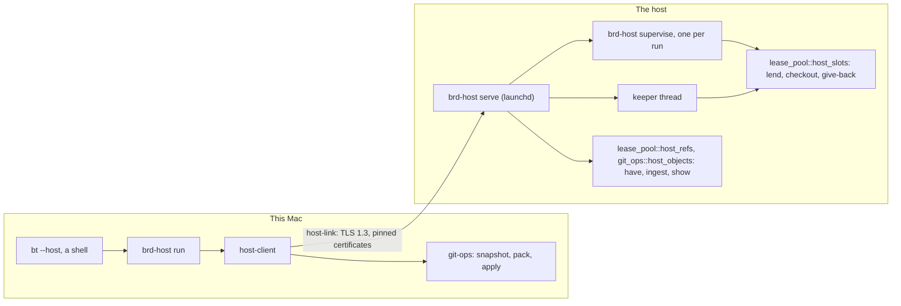

# Host Runs

**Status:** Draft
**Updated:** 2026-11-24
**Tags:** [host, remote-run, lease, brd-host, yonder]

## Problem

A heavy check (the full `cargo nextest run --workspace`, `pnpm e2e`, a test suite of the IntelliJ monorepo) runs on
another Mac of the user, the host. Until 2026-10-28 yonder did this. yonder lived in `community/tools/yonder` of the
IntelliJ monorepo: a client, the agent `yonderd` and the link that they shared. It called Branch Deck as child
processes: `brd lease host lend|give-back|have|ingest|show|snapshot|changes|git` on the host and `brd host
snapshot|pack|apply` on the client.

That seam was the cost. Each git step of a run was a `brd` process with a JSON answer. The tests of yonderd faked brd in
a shell script (`FAKE_BD`). The host needed a brd of the same features as the agent, and the two shipped in two release
cycles of two repositories. The slot policy and the git rules lived in Branch Deck already (`lease_pool::host_slots`,
the scan tests), so yonder kept only the transport and the processes.

## Solution Overview

The remote runs move into this workspace as one binary, `brd-host`. It is the client and the agent. It calls
`lease-pool`, `git-ops` and `git-executor` in process, so no `brd` child runs and no JSON crosses a process boundary.
The protocol is new (host-link, schema 1, port 7742).

`brd-host` is a binary of its own. Neither `brd` nor the app links it, so the app binary does not grow. On macOS the app
bundle carries it as a file (`BranchDeck.app/Contents/MacOS/brd-host`), and `brd install` links
`~/.local/bin/brd-host`. The release build gets it through its own Tauri config, `tauri.macos-bd-host.conf.json`, as
the Windows build gets `brd.exe`: Tauri merges `tauri.macos.conf.json` into every macOS build, and a plain `cargo build`
of the app would then need the binary first. The contract of the CLI, the refusal codes and the report of a run are in
[brd-host](../../openspec/specs/cli/host/spec.md), the setup of a host for a person in
[Runs on Another Mac](../guide/host-runs.md).

## Design

### Architecture

| Crate | Content | Depends on |
|---|---|---|
| `host-link` | The identity files, TLS 1.3 with pinned certificates, the frames, the protocol, the allow list, the relay through `/usr/bin/nc`, the refusal codes, `[host]` of `.branchdeck.toml` | rustls, rcgen, tokio, tokio-rustls, tokio-util, `sync-utils` |
| `host-client` | The run, the commit of the working tree, the thin pack, the follow, the cancel, the fetch, the base sync, the host files, the sets of hosts and the choice of a member, the upgrade | `host-link`, `git-ops`, `git-executor`, tokio |
| `host-agent` | `serve`, the supervisor, the run directories, the login environment, the prepare steps, the keeper, the power assertions, the upgrade | `host-link`, `lease-pool`, `git-ops`, `git-executor` |
| `brd-host` | The CLI of both ends | `host-agent`, `host-client`, `host-link` |

The direction rules are in [Crates](rust-domain-authority.md#crates-и-направление-зависимостей), and
`crates/bd-cli/src/architecture_test.rs` checks them.

### The link

Both ends run the link on tokio (`host_link::channel`). TLS 1.3 is tokio-rustls on the rustls of the app, and the
frames are a `Framed` whose codec is `LengthDelimitedCodec`: a kind byte, then the big-endian u32 length and the
payload that the codec reads and writes. Each read and each write of a channel runs under `tokio::time::timeout`, a
deadline of the channel and not of the socket, so it holds through the relay, whose pipes have no socket timeout. The
`Framed` collects the frames in its buffer and writes it to TLS when it holds 64 KiB, at a flush, before a read and at
the close, so the many small files of a fetch go in few TLS records. A frame is the one of the blocking link before
it, byte for byte, so the schema stayed 1 and an agent of an older build took the next binary over the link.

- **The relay** (`host_link::relay`) is the stdin and the stdout of `/usr/bin/nc` as one stream under TLS; the drop of
  the connection kills `nc`.
- **Heartbeats** stay messages of the protocol (`Reply::Heartbeat` every 15 s, an empty chunk of a pack): `nc` carries
  no keepalive of TCP, and a run that says nothing for an hour must differ from a dead link.
- **The client** (`host-client`) is async; `brd-host` runs each request on a current-thread runtime. The steps that go
  on beside each other, the follow and the pack of a run, the base sync, the cancel of a Ctrl+C, the `Have` beside
  the status of the checkout, are futures of one task (`tokio::join!`). A step stops another by a `CancellationToken`,
  and the stopped future drops its connection with it. The git of a step that goes on beside a connection, the status
  and the build of a pack, runs on the blocking pool.
- **The agent** (`serve`) runs a multi-thread runtime: a task per connection, the TLS accept under the deadline of the
  handshake, the blocking work (git, the walks of the disk, the reads of a follow) on the blocking pool while the task
  sends the heartbeats. A follow reads the run files on a blocking task, which hands each batch of replies to the
  task of the connection through a channel. The keeper, the cleanup and the other loops of `serve` stay threads.
- **The tests** of the channel and of the client run on paused time (`#[tokio::test(start_paused = true)]`) over pipes in
  memory (`tokio::io::duplex`; `MemoryNet` of the fake agent of `host-client`): a deadline passes exactly when
  nothing else can go on, and no test waits for the clock. The process tests of the agent run a real `serve` in real
  time.

### The slot model in short

A remote slot holds no state of its own. The commit comes from the client, and `--fetch`, the outputs and `--apply`
bring back the rest. So a slot is lent to one run for the time of that run only. The host keeps a fixed set of warm
slots per repository (`branchdeck.hostSlots`, 4 by default) as plain `ready` leases of the holders `brd-host/<n>`.

- **A limit of 0**: a fill keeps the smaller of `branchdeck.hostSlots` and the limit of the last shrink (`brd-host
  slots --local --shrink N`, `HostSlots::limit`). At 0 no slot ever comes, so the agent refuses the start of a run with
  `no_slots` (`host_slots::SlotLimit`), naming each limit at 0 and the command that raises it, before the run exists;
  a supervisor checks again before its heavy turn and when a wait for a slot finds the host without one. On 2026-11-25
  a laptop of `branchdeck.hostSlots 0` took runs of `run any`, and a run of a shrink limit of 0 took the heavy turn and
  waited 1 h for `0 of 0 lent …; the host prepares its slots`, which it never would. The estimate tells the limit
  (`Estimate::slots`), and a set chooses no member of 0, the first one neither.

- A run gets the idle slot that its affinity (`checkout-<12 hex>` of the local checkout path) used last, else the idle
  slot used longest ago, else it waits in a first-come queue. A waiting run gives back a slot that a gone run left
  itself, without waiting for the keeper. The lend says which it chose and whether the run waited
  ([The slot of a run](#the-history-of-the-runs)).
- The give-back at the end of each run stops the processes that the run left, keeps the Bazel servers of the slot,
  and discards the changes. The ignored files stay as the warm cache until the slot has waited idle
  `branchdeck.hostSlotIdleClean` (6 hours by default): then the keeper applies the repository's clean rules. A process
  older than the lend quarantines the slot.
- The keeper fills, cleans and shrinks the slots. Nothing on the client keeps or returns a slot.

The lend table, the give-back, the clean and the shrink are in "Host slots" of
[Git Operations](git-operations.md#host-slots) and of [brd lease](../../openspec/specs/cli/lease/spec.md).

### Heavy runs

A full `cargo nextest run --workspace`, a full `pnpm e2e` or a long `bt` uses every core of the host. Two of them at
once run 3 to 4 times slower, and the tests of both fail on their timeouts: on 2026-11-14 the E2E suite ran 3.6 times
slower beside a `cargo nextest run --workspace` of another agent, and 4 tests failed at 30 s. Both of those were large.
So the heavy runs of a host share its cores by what their commands used before. They wait in one queue, whatever their
repository, and the other runs go as before. Until 2026-11-18 they ran one at a time: a queue waited 45 to 50 min,
mostly behind runs that did not fill the host. `pnpm lint:backend` measured 5 to 17 of the 20 cores of the Studio
while it ran, and `bt --lane fast` alone held a load of 77 to 122, as Bazel counts twice the cores of the host.

- **What is heavy** is the repository's to say: `heavy` of `[host]` lists the patterns of its heavy commands
  (`cargo nextest run*--workspace*`, `pnpm e2e*`), `*` any characters, matched against the words of the command after
  a leading `env` and its assignments. `brd-host run --heavy` marks a command that no pattern names. No flag marks a
  run light: an agent that forgets a flag still waits, and a single E2E spec waits too, since it is the run that a
  heavy neighbour fails. `bt --host` passes no flag, so a bt run is heavy only once its repository names it in
  `heavy`; the IntelliJ monorepo decides that on its own, since every bt there is a Bazel build of every core.
- **The client decides**, from `[host]` of the commit it ships, which it reads for the outputs anyway, and sends
  `RunSpec::heavy`. The agent reads `[host]` only after the lend and the pack, so a decision there would move the pack
  before the lend, and a run would wait for a pack without a slot while a Homebrew upgrade of git holds its
  host-object calls.
- **An older agent** refuses every run of a commit with `heavy`, a light one too, as an unknown key of `[host]`. The
  client knows both the table and the features of the agent, so it refuses before the start with `bad_config` and
  names `brd-host upgrade`; a `--heavy` run of a commit without the key runs on such an agent beside the others.
- **The heavy turn** (`lease_pool::host_turn`) is `~/.cache/brd-host/heavy/turn.json`: the holders, the tickets of
  the waiting runs, the runs that are not heavy with their live cores, each with the pid of its supervisor, the cores
  of the host and the schema of the table, which a supervisor of another build refuses rather than misread. A heavy
  run takes its cores before its lend, in the phase `heavy`, so it holds no slot while it waits and the runs that are
  not heavy keep every slot.
- **The admission**: the head of the queue is admitted while the expected cores of the holders, the live cores of the
  runs that are not heavy and its own expected cores fit the cores of the host (`branchdeck.hostCores` of the global
  git config of the host, else what the system counts). Only the head: a run of the queue never overtakes one that
  waits for more, so a host that frees cores gives them to the run at the head; the one exception is an exclusive head
  whose drain ended (below). The place in the queue takes turns between groups, first come first inside one, but for a
  short run (below). A run without a
  measure, or whose command measured the whole host, takes the whole host: it waits for every holder and for a quiet
  host, and no heavy run joins it. The samples of the runs miss what no run counts (on 2026-11-19 the Studio ran at a
  load of 61 to 84, `top` saying 0 % idle, while the turn counted 8.9 of its 20 cores held), so `serve` samples the busy
  cores of the whole host every 2 s (`sync_utils::host_cpu`, `host.json` beside the turn), and an admission counts the
  larger of the live cores of the runs that are not heavy and the busy cores of the host less the live use of the
  holders. A quiet host is busy with at most a fifth of its cores outside the heavy runs. A new command, a first `bt --lane fast` among them, so runs alone until its runs say otherwise, which is
  the behaviour of the turn before. A run that is not heavy waits for nothing; its live cores only keep a heavy run
  from joining a host they already load.
- **A holder past its grace**: a holder counts its expectation only until its use is known. On 2026-11-24 the first
  run of the class `accio-typing-gate` held the whole Studio for over 2 h at 0.6 of its 20 cores on average (18.3 at
  its peak, its late phases on one core), and the heavy runs behind it ended with `heavy_timeout`. So from 10 min after
  its admission (`HOLD_GRACE`) a holder that is not exclusive counts the most of its live use of the last 5 min
  (`USE_WINDOW`), its own supervisor noting each sample into `recent` of its entry, the most of each half minute,
  instead of the larger of its expectation and its live use; without a measure, or with one of the whole host, it held
  the whole host until then. A burst counts at its next sample. Not its peak since its start: that is the burst of
  its build, 18.3 of 20, and frees nothing. The window is 5 min, longer than the lull between two bursts of a test run
  (a link, the start of the next binary), short enough that a tail on one core frees the cores within minutes. The
  samples of the runs of 2026-11-24 (`cores.json` of each run on the Studio) bear it out: past a grace of 10 min, the
  gates held 1.5 to 5.2 cores on average with a window of 5 min, 2.5 to 7.5 with one of 10 min and 1.0 to 4.0 with one
  of 3 min, and a burst of 8 cores or more after a window under 4 came 0 to 2 times a run with either window; a test
  suite, an E2E run and a fast lane of idea-1 end within the grace or about it, and count as before. The grace is
  twice the window, so the window begins after the first 5 min, which a build or the start of the servers of a gate
  fill. A window that spans less than 5 min, whose last sample is more than a minute old, or that leaves less than a
  fifth of the host beside it (the background of a quiet host) counts as in the grace, but past the grace never below
  the most of the samples of the last 5 min that its window holds: such a holder counted its measure or its last
  sample before, and of 39 holder-minutes past the grace on 2026-11-25, 13 counted so, 7.8 cores (p50) below that most;
  a fast lane of a peak of 17.3 counted its measure of 12.6. A holder without a measure, or with one of the whole host,
  still holds the whole host then. A supervisor of an older build
  rewrites the table without `recent`: the window begins again at the next sample of the holder, so the loss costs the
  queue 5 min of what the holder counted in its grace, never an admission beside a run whose use is unknown. A run of
  the queue without a measure still needs the whole host: only a holder has samples. The risk taken: a holder quiet for
  longer than the window that bursts then runs over the runs admitted beside it while the burst lasts; the window
  holds back the next admission for 5 min after it, and a gate's bursts last minutes against hours of its tail.
- **A busy free turn**: as the runs that are not heavy wait for no heavy run, a host of steady light runs is never
  quiet. On 2026-11-21 a UI lane of idea-1 without a measure waited 2 h at a free turn of the Studio, busy with 20 of
  its 20 cores outside the heavy runs, and ended with `heavy_timeout`; the runs behind it waited too. So the head of the
  queue that has waited 15 min since it joined the queue (`LOAD_BOUND`) takes a free turn whatever that load. The bound
  counts from the join, not from the free turn: the field is one that a supervisor of the build before keeps, and a
  run that waited long behind holders has waited its share. A reservation that also holds the runs that are not heavy
  back, as the drain of an exclusive run does, was not taken: it stops every agent of the host, and the processes of
  no run never drain. A default measure was not taken either: a first `bt --lane fast` uses every core, and a guess
  below that runs it beside another heavy run. The bound costs the head a slower run on a loaded host, never a wait of
  hours, and an exclusive run, a measurement, still waits for its quiet host.
- **A short run** (`host_turn::place`): first come first ran one heavy run at a time on the Studio, as nextest and
  E2E take about 12 of its 20 cores and a lint about 9. In 22.6 h before 2026-11-24 the heavy runs waited 3189
  min and ran 346, and `pnpm lint:backend` (30 to 58 s) waited 50 to 70 min behind runs of 10 min. So a run that is
  not exclusive, whose command has a measure below the whole host, and whose last passed runs took at most 2 min
  (`SHORT_WALL`; the 80th percentile of the walls of the last 5 runs of the command whose exit was 0, of 3 at least)
  joins the queue before the first entry from which every entry to the end may be passed: a run that is not short,
  that short runs passed fewer than 4 times (`PASS_BUDGET`), and no exclusive head whose drain began, the one window
  of its measurement. A long run so waits at most 4 short runs longer, about 8 min. The walls are of passed runs only
  (`walls.json` beside `cores.json`): a lint that fails by its purpose in seconds would push its passing runs out of
  the last 5, as the measures of the cores count every run. The rule of the admission does not change, only the place
  of a new run in `turn.json`: a supervisor of the build before admits its head and reads the new order right, as no
  field of the table is new. The classes and the passes are in `passes.json` beside the table, by the id of the run
  (a supervisor of the build before rewrites `turn.json` and `cores.json` without the fields it does not know, as it
  did to `exclusive`), and a run that supersedes a waiting one takes its passes, so a run of a checkout that an agent
  starts again is not passed 4 more times. A short run counts the earliest join of the runs it went ahead of for its
  15 min in the queue: a head that it passed on a busy free turn would else wait a new bound behind it. A run without
  a measure is never short: an accio measurement of a new command takes the whole host, and nothing goes beside it. A
  measure of the whole host is never short either: it waits for every holder and would hold back a run behind it that
  fits beside them. The two rejected ways above stay rejected: no core is kept back for the light runs, and no command
  is guessed short without its runs.
- **The turns of the groups** (`host_turn::place`, `host_turn::turn_place`): first come first could not tell who sent
  a run. On one day of 2026-11 a 20-core host ran 579 runs, 297 heavy, which waited 248 h against 37 h of work; 87 of
  them, of one class (`--measure-as`, command p50 10 min), came from the 5 to 6 agents of one orchestrating session,
  each in a checkout of its own, and the heavy runs of the other sessions waited p50 25 to 60 min behind them. Its
  agents took a hand-made `mkdir` lock instead, which leaked with a dead agent and kept the session to one run on an
  idle host. So a run names its group (`brd-host run --group`, `BRD_HOST_GROUP`, `RunSpec::group`), which an
  orchestrator sets once for all its agents; without one the group is its affinity, as one checkout is one agent. The
  affinity could not be the group: it also picks the slot, the base of the packs and the supersede. The round of a run
  of the queue is the count of the runs of its group before it, read from the queue at each join, never stamped. A new
  run may not pass the head (index 0), a run of its own group, or a run that 8 runs of the turns got ahead of; behind
  the last of those it joins before the first run whose round is above the count of its own group's waiting runs, else
  at the end, and passes every run from there to the end. So it goes ahead of the later runs of a group with more runs
  waiting, also when a short run waits at the end: a first rule kept every round-0 run, a short one included, and a
  short run that waited at the end, as one whose backlog had used up its short passes, then put every later run of
  another group behind the whole backlog. With one waiting run per group every round is 0, and the queue is first
  come first exactly as before, also for an agent that waits for each of its runs. Rounds stamped at the join, with the
  round each group was served at, were tried and not taken: with them a checkout whose run just took the turn waited
  behind every new checkout, and a head that could not start kept every new group ahead of every served one. The order
  still changes only at the join, in `turn.json` itself, so a supervisor of the build before admits its head right.
  The bound is a budget, as the short lane's: at most 8 runs of the turns get ahead of a run (`TURN_PASS_BUDGET`),
  counting those that wait ahead of it and those that took the turn ahead of it, whatever the count of the groups and
  whether the head can start. Rounds alone bound the passes per other group, not the groups: a stream of new groups,
  each of round 0, would pass a backlog for as long as it came. The price: once 8 runs of other groups got ahead of a
  backlog, the next ones wait behind it again; and with the short lane's 4 a run waits up to 12 runs longer than first
  come first, which behind runs of an hour is past its 2 h, so it can end with `heavy_timeout` where first come first
  would have started it. `groups.json` beside the table, a file no older build reads or writes (builds 1.24 to 1.27
  rewrite `passes.json` without the fields they do not know, so it could not hold the turns), names the group of each
  run, the runs it went ahead of and whether it took the turn, with a schema of its own: a file of another schema
  refuses as the table does, one that does not parse says so in the log and gives every waiting run its whole budget
  again. The count of the passes of a run is derived from it and the queue, never kept as a number: a run that leaves
  without the turn, by a cancel, a start of `admit_now` refused `busy`, the end of its process or a failed write of the
  table, counts no pass, and the file is written before the table under its lock, so no failure counts a pass for a
  run that is not in the queue. The turns touch none of the short lane: no pass of `passes.json`, no earliest join, so
  a short run still passes a backlog that other groups went ahead of and a run of the turns counts its load bound from
  its own join. A run that supersedes one of its group takes its place and the runs it went ahead of; one of another
  group takes its own turn, so it never waits ahead of the earlier runs of its new group. The join is one function
  (`host_turn::join_queue`) of the table and its files in memory: the join writes what it changed, and the estimate of a
  start applies it to a copy, so the two place a run alike by construction, which a test over generated queues checks.
  A run that `groups.json` does not name is of the group of its entry, its `--group`, else its affinity, else alone. No cap of holders or cores per group was taken: the admission by cores decides how many runs of
  a group hold cores at once, as for any run, and a cap idles the host when one group alone waits, the defect of the
  lock it replaces. An agent without the feature `group` gets no `group` and queues the run first come first, which
  its client says for a heavy run; the estimate places a run by the same place function, and an older agent ignores
  `group` and estimates the end of its queue, where it puts the run. `brd-host runs`, the line of a wait, the history
  line and `brd-host stats` (`groups`: the runs, the waits, the wait for the heavy turn and the work by group, 30 at
  most and the rest in one entry) name the group.
- **An exclusive run** (`brd-host run --exclusive`): a measurement such as the A/B pair of a fast lane needs a quiet
  host, and a run of the whole host gives none, as the runs that are not heavy go beside it. An exclusive run is heavy,
  is admitted only without a holder, with no run that is not heavy in its command (a run is in `light` of the turn for
  the time of its command), and when every sample of the host of the last 30 s is quiet: one sample let it in during a
  lull of a bursty `scripts/bench ab-run` twice on 2026-11-19 (0 to 1.8 cores in its lulls, 10 to 11 at its peaks), and
  the load median of the measured lane doubled. While it holds no heavy run is admitted and each new run that is not
  heavy waits for its end before its lend, in the step `exclusive`. The Studio has steady light traffic all day (the narrow bt runs of many
  sessions), so a drain alone would often reach the 2 h of the wait: while an exclusive run is at the head of the queue
  and no heavy run holds, the new runs that are not heavy wait for it too, for at most 5 min from the start of the
  drain (`drain.json`), after which they start again and the exclusive run waits on. The bar is 5 min: on 2026-11-25
  the commands of the runs that are not heavy took 0.9 min (p50) and 5.0 min (p95) over 272 runs, so a drain that is not
  quiet after 5 min was not quiet after 15 either, and the drain of 15 min at 10:27 kept the Studio about 16 cores idle
  while 11 heavy runs waited. It is an explicit flag, never a pattern of
  `[host]`: a check that took the host this way would stop every agent of the host for its whole run. The holder is also in
  `exclusive.json` beside the table: a supervisor of the build before, of a run that began before an upgrade, rewrites
  `turn.json` at each sample of its run and drops the fields it does not know (on 2026-11-19 the first exclusive run
  lost its mark that way, and runs of idea-1 and accio started beside it).
- **A heavy run past an exclusive run**: the runs that are not heavy wait for no heavy run, and a run of hours (an accio
  benchmark on 8 cores) outlives a drain. On 2026-11-21 an exclusive run of idea-1 waited at the head of the queue of
  the Studio while such runs kept 20 of its 20 cores busy, and the 8 heavy runs behind it ended with `heavy_timeout`
  after 2 h, though no heavy run held cores. So once the drain of an exclusive head has ended without a quiet host, the
  first heavy run behind it that is not exclusive starts past it while the head cannot start and the admission above
  admits that run: beside the holders and the load, or on a free turn after its own 15 min in the queue. The others
  follow in their order, and each such holder names the exclusive run that it passed (`passed` of its entry). No run
  passes an exclusive head before its drain ends. Behind a heavy holder its drain has not begun, and a run beside that
  holder would keep the host from the drain. While it drains, the drain is the one window of the host for the
  measurement, and the new runs that are not heavy wait for it too. The exclusive run keeps its place at the head, its
  drain never starts again, and it starts once a look finds no holder, no run in its command and a quiet window. A run
  passes only while the head cannot start, so a quiet moment goes to the head first. The rule reads `drain.json`, which
  a supervisor of the build before writes too, and the entries of the queue: no field of `turn.json` is new to it. A
  waiting supervisor of the build before never passes, and the runs behind it wait behind it. The line of each waiting
  run names the drain of an exclusive head, and `brd-host runs` reads it from `head_drain` beside the table of
  `Reply::Runs`.
- **The measure** (`host_agent::cores`, `lease_pool::host_cores`): the supervisor of every run samples the CPU of its
  command every 10 s: the processes of its command group, the Bazel servers of its slot (a server leaves the group, and
  its CPU is the work of the run) and every descendant of either (a test of nextest in a group of its own, an action of
  a Bazel server), each with the CPU of its reaped children (`process_scan::cpu_times`). So a process that starts and
  ends between two samples, a rustc or a test, counts in the process that waited for it, in the live cores too. A
  process that a sample saw alive counts once: its parent counts it again when it reaps it, and its time at that sample
  is a credit that the next growth pays off. At the end the measure takes the larger of the sampled CPU and the CPU of
  the reaped children of the supervisor (`RUSAGE_CHILDREN`) over the wall time. Neither alone was enough: on 2026-11-19 a
  cold `cargo build -p git-ops` used 221 s of CPU in 108 s (2.0 cores) and the run measured 0.8, as the samples missed
  each rustc between two of them and `RUSAGE_CHILDREN` lost the build, since `zsh -c` execs its last command and macOS
  drops the reaped children of a process at its exec. Each run of 10 s or more adds its measure to the last 5 of its
  repository and command, in `cores.json` beside the turn, and a command is expected to use the 80th percentile of
  their levels of work (`host_cores::work_level`): the live cores at or above which 30 % of the core seconds of its
  samples ran, at least its mean. Not the mean: a gate of `accio-typing-gate` builds, tests and lints on 16 to 18
  cores for 1 to 3 min a few times and runs on one core for the rest, a mean of 0.4 to 1.4 of 20 in 1 to 3 h, and five
  gates admitted at 1.0 built at once, 4 to 5 times the cores of the host, the E2E runs beside them took 39 min
  instead of 5 at a mean of 1.5, and the timing tests of nextest failed. The share is 30 %, not a half: by the samples
  of 2026-11-24, a half of the work of the one gate that ran alone ran on 7.5 cores or more and 30 % on 15.9 or more,
  of the gates that ran beside each other 2.9 to 6.5 and 5.8 to 10.5; a test suite of Branch Deck has 12.6 to 13.0
  against its mean of 12.0 to 12.2, an E2E run 14.3 to 14.9 against 12.5, a fast lane of idea-1 16.0 to 17.4 against
  12.7 to 13.9, and a peak (a sample of 10 s) would cost them 15.6 to 17.8. Once its grace ended a holder counts its
  live use (above), so a high expectation keeps the next gate out only for the first 10 min of a gate, never for its
  hours. A run that ran beside others measures less than it needs, the level as the mean: its bursts get fewer cores
  for longer. A measure of a build before the level, or that a supervisor of such a build rewrote, has none, and its
  mean counts. The
  key (`host_link::heavy::measure_key`) is the key of the supersede with each path of a directory that the run fetches
  as one word: an agent writes the outputs of each run to a directory of its own (`--fetch out/air/light1` and `mkdir
  -p out/air/light1 && … > out/air/light1/run.json`, then `light5`), and on 2026-11-21 the measure of one lane did not
  count for the next. Only the fetched directories go: no word of a command tells an output from an input, and a path
  that the run does not fetch may name what it checks. A command whose text changes every run still has a new key each
  time: an accio gate runs as `bash -c "$(cat gate.sh)" … <base> <tip>` with its commits and paths in its words, so it
  never got a measure and waited for an empty Studio, 26 min for a run of 35 min that used 3.6 to 7.7 of its 20 cores;
  over 7 days such commands waited 7.7 h. `brd-host run --measure-as <class>` (`RunSpec::measure_as`, feature
  `measure_as`, heavy too) names the class instead: the key is the SHA-256 of `<measure-as>` and the class, whatever the
  command, its environment and its fetch, and the same function gives it to the admission, the record, the estimate,
  the queue record and the history, so they never disagree. Its first run takes the whole host and is measured, as any
  new command. The client names the class, not the agent: no rule of the words tells two runs of one work from two
  works, and a guess that joins them would let a heavy run in beside others on a light one's measure. The line of a wait
  without a measure names the flag, and `brd-host runs` and `brd-host stats` name the class (`TurnEntry::measure_as`,
  `HistoryLine::measure_as`). A run that waits reads the measures again at each look, so a
  run of its command that ends meanwhile counts. So the stats follow the changes, never a calibration of once: a command that got heavier is
  expected heavier at its next run, one that got lighter (a faster fast lane) frees its cores within a few runs, and a
  cancelled run counts by its own measure. A holder holds the larger of its expectation and its live use in its grace,
  so a run that grows past its expectation holds more at once, for the admissions that follow, not only at its end.
- **A starved run adds no measure** (`lease_pool::host_cores::starved`): beside each sample the supervisor notes the busy
  cores of the whole host by the sample of `serve` (`host.json`), less the run's own, and at the end it keeps no measure
  and no wall when their mean and the run's mean exceed the cores of the host (`branchdeck.hostCores`), the room that
  an admission counts. Its log says so in one line. On 2026-11-24 the first runs of a laptop host under a load of 40 to
  140 of agent sessions measured `pnpm lint:backend` at 0.5 cores in 13 min 45 s (58 s and 6.7 cores on the Studio)
  and `cargo nextest run --workspace` at 1.1 cores in 46 min 37 s: a starved measure tells the admission that the
  command needs almost nothing, so the laptop takes it beside the next load and starves it again, while its estimate
  says the wall of the load. A start by the load bound (15 min) is no reason of its own: the load may end after the
  start, and the measure is right then. A host that is never quiet so keeps a command without a measure, and its runs
  take the whole host, as the runs of a new command do; a member of a set takes no such run.
- **The upgrade**: `heavy.json`, the table of one holder of the build before, stays for its supervisors, which go on
  after an upgrade; its live holder holds the whole host for the runs of this build. A supervisor of the build before
  that waits in `heavy.json` takes its turn without seeing the holders of `turn.json`, so for the hours after an
  upgrade two heavy runs can run at once, as they do when one of them is not heavy. Its wait is the wait for a slot: looks of 2 s, so a cancel ends it, one watch of the
  directory of the table for the whole wait, which holds nothing else, a look every 5 s, and a line at once and once
  a minute with the holder, the runs ahead and the time left. A look waits 2 s for `turn.lock`; a lock that another
  process holds longer costs the look, not the run, which keeps its place in the queue, says so at once and once a
  minute, and looks again. On 2026-11-21 a wait of 60 s for the lock ended two runs with `agent_error`, one after 72 min
  in the queue, and the end of each took its ticket out. The lock is a polled `flock` with no order between processes,
  and each change of the table, a sample of every run among them, woke every run that waited, each of which took the
  lock. So a look of a run behind the head of the queue reads the table without the lock: only the head can be
  admitted, and such a look changes nothing. A process that is gone holds no lock, as the system frees a `flock` with
  its process; a live holder that hangs is not broken, as the record of the lock names it in the line. It gives the turn back after its give-back, so the
  processes that it left are gone first. A killed supervisor holds nothing: the next run takes the turn of a gone
  holder at its next look. A wait past 2 h ends with `heavy_timeout`. A plain run of the command on the client is still
  the run under load that the turn keeps from failing; a run to a set of hosts goes to another member only by its
  estimate, and to a laptop only when its agent admits the run at once ([Sets of hosts](#sets-of-hosts)). The line of the wait says that it is a wait, not a hang,
  since an agent reads only the output and cancelled runs that only waited.
- **A later run supersedes a waiting one of its checkout and command.** On 2026-11-18 one session queued the same
  hour-long A/B batch of `pnpm e2e` on every new commit, and each queued run would have run in its turn. A heavy run new
  to the queue takes the place of the runs that wait there with its affinity (the checkout of its client) and its
  command by what it runs (`host_link::heavy::run_key`: the words without `nice`, `time` and the like before them, the
  environment kept, as it changes what a run checks), and they move to `superseded` with its id. The next look of each
  answers it, and its supervisor ends it with `superseded` (exit 75) before its lend: a run of the queue holds no slot
  and started no command, so nothing of it ran. The holder is never superseded, as its command may run. The later run
  says whom it replaces, and names the other runs of its checkout that wait with another command, so an agent sees a
  second batch that it queued. An entry of an older build has no affinity and no key, and supersedes nothing.
- **A client that a signal stops** cancels its run: SIGTERM and SIGHUP count as Ctrl+C, so a tool that kills an
  agent's call at its timeout leaves no run waiting for the turn and running for nobody. A SIGKILL cannot be caught;
  the run goes on until `brd-host cancel`.
- **`brd-host runs`** names the holder and each waiting run with their times, the first thing an agent reads before
  it starts a heavy run.
- **`brd-host slots`** marks a slot `(abandoned)` only as the agent judged it on the host and named it beside the table
  (`RepositorySlots::abandoned`): the pid of a lend is a process of the host. Until 2026-11-18 the client judged the
  pids of the host by its own processes and marked every lent slot of a live run abandoned; an agent of an older build
  names none, and its client marks none.

### The finished runs

A client forgets its run once it saw the end and every file came, so before 2026-11-16 a run left the host at its
end: `brd-host runs` showed only what ran now, and `brd-host follow` of a run a minute old answered `unknown_run`. A
forget now keeps the run without its files: the stage, the outputs and the changes go, the log keeps its last 1 MiB
from the start of an event (`KEPT_LOG`, after a line of the agent that says how many bytes went), and the spec, the end
and the phases stay. So `brd-host runs` lists the finished runs with their exit, start and duration
(`RunInfo::ended_ms`, `forgotten`), and a follow answers the tail of the output and the exit.
- **On disk, not in memory**: a run is its directory, and an upgrade or a restart of `serve` (several a day while
  the agent changes) must not lose the runs that a person looks for afterwards; the runs that go on live there already.
- **The bound**: the last 100 forgotten runs by their end (`KEPT_FORGOTTEN`), each for at most the day that an ended
  run has always had (`KEEP`), so at most 100 MiB of logs. A forget removes the runs past the count at once, and the
  hourly cleanup removes them by age. A run that ended and that nobody forgot keeps its files for its day, as before:
  its client may still fetch them, and its line says `its files kept`.
- **A forget cut short**: `forgotten` comes first, as the intent, so a run never looks unforgotten with half its files
  gone; the next forget or the hourly cleanup goes on from where it stopped, and the cut is recorded in `forgotten`
  before the cut log (`events.log.cut`) is renamed over `events.log`, so a retry cuts once. A forget holds the flock
  of `forget.lock` for its whole time, so a request and the cleanup never cut one log at once (the cleanup skips a run
  whose forget goes on), and a record of another inode than the log's is repaired.
- **The offsets of a cut log** stay those of the log before the cut: a follow reads the log that it opened, so one
  that began before the rename reads the old file to its end, and a follow of the cut log (told by the inode that
  `forgotten` records) maps the offset of a client into it and each end out of it. A client that follows again goes
  on where it was; from inside the part that went, at the note, so the reader learns that bytes are missing.
- **The end of a lost run** is the time the agent saw the loss, not the end of the run, so its `RunInfo` has no
  `ended_ms` and its line no `took`.

### The history of the runs

The series of the heavy turn by the minute is in [The series of the heavy turn](#the-series-of-the-heavy-turn).
On 2026-11-24 the heavy queue was the bottleneck of the Studio: in 22.6 h its 144 runs waited 3189 min for the heavy
turn against 346 min of commands, the median wait 37 min, and the checkout, the prepare, the slot and the pack took
about a minute in all. `brd-host runs` shows the runs of the last day, one at a time, and the rules of the queue that
come next (a lane for short runs, a choice of the host at the start) need the waits of several days, by command. So the
agent keeps a line of each ended run, and `brd-host stats` sums them on the host.

- **Where**: `~/.cache/brd-host/history/<YYYY-MM>.jsonl`, one `HistoryLine` (`lease_pool::host_history`) per run, in
  the month of its end by UTC, and `bases-<YYYY-MM>.jsonl`, one line per pack of a base, which belongs to no run. The
  hourly cleanup removes a month whose every line is more than 90 days old (`KEEP_DAYS`).
- **One writer, at one point**: `serve`, as the run directory goes, by its age (`Runs::remove_expired`) or past the
  kept forgotten runs (`Runs::remove_forgotten_past`). The line is read from the directory before the removal, when the
  bytes of every fetch of the run are final, and appended after it, so a removal that fails leaves no line for a run
  that stays. The removals of a process go one at a time, so a forget and the cleanup never write one run twice. There
  are no markers and no dedupe: until its directory goes the run is its directory, and after it its line; the summary
  reads both.
- **A line**: the run, the repository, the affinity, the commit, the command as the heavy turn names it (one line of
  200 characters: never the whole text, since a command can hold `env TOKEN=…`), the key of its measures
  (`measure_key`, with the repository the key of `cores.json`), the class of `--measure-as` (the summary names a
  command of a class by it), the group of `--group` (the summary sums by it, else by the affinity), `heavy`,
  `exclusive`, the start, the end (none for a
  lost run), the exit, the code of the refusal, `lost`, the phases, the cores (mean, peak, CPU and wall time of the
  command), the bytes, the queue and the slot.
- **The bytes**: nothing counted them before. A pack adds what came to `pack.json` of its run, a fetch what it sent to
  `fetched.json` (each fetch of the run, as each crossed the link), and the output is `events.log` with what a forget
  cut of it. They tell whether the output and the files or the packs hold the link, before anything of the link is
  compressed.
- **The queue of a heavy run** (`queue.json`, `QueueRecord`): its place as the rule of the queue gave it (a short run
  joins ahead of the long ones), the holders then, the cores of the host, what its measures led to expect and what it
  needed (`NeedKind`: the cores of its measure, or the whole host without one, past one or for a measurement), whether
  it was short and how often short runs passed it (its mark in `passes.json`, which leaves with the run, so the watch
  keeps the last one it read), and its wait split in two: behind the holders or the runs before it,
  and at the head of a free turn for the load of the host (a quiet host, or room beside the runs that are not heavy).
  Without the split a summary cannot tell a first-come queue from a wait for a quiet host. An exclusive run also names
  the part of the second in which it drained the host (`drain_ms`, from `head_drain` at each look), the part of the
  first in which it waited at the head for the holders before its drain (`pending_ms`), and when a look first found
  each (`drain_at_ms`, `pending_at_ms`). The supervisor writes it
  after the phase `heavy`, whatever its end; a watch of the wait reads the table without its lock at most once a
  second, at the stop check of each look, so it holds no look back and changes nothing of the turn. The file is the
  run's own and not a field of `turn.json`: a supervisor of an older build rewrites the table without the fields that
  it does not know.
- **The slot of a run** (`slot.json`, `SlotRecord`): per repository 14, 11 and 32 local checkouts shared the 4 host
  slots of a host in November 2026, and whether a run finds the ignored files of its own checkout in its slot decides
  much of its build, so `branchdeck.hostSlots` needs, per command, the share of runs that got a warm slot of their
  checkout, what the others took, and why they missed it. The slot was named only by the line `running in <slot> (slot
  <n>)` of the log, which a forget cuts. The lend knows most of it as it chooses (`host_slots::Lend`): `choice` is
  `affinity` for the idle slot whose last lend had the affinity, else `idle`, the one used longest ago, and `waited`
  says that the ticket of the run was in the queue of the slots before the call that lent, whatever kept it there (busy
  slots, runs before it, a fill, an upgrade of git; the phase `slot` has the time); a lend after a wait chooses by the
  same rule, so a waiting run can still get its own slot, and the two are kept apart.
  - **Cleaned**: a clean keeps the affinity of a slot, so the choice says nothing of its files: the clean after a run,
    the idle clean of `branchdeck.hostSlotIdleClean` and a relief empty the slot and leave `affinity` as it was, and a
    relief may also stop its Bazel servers and drop its output bases. So the lend also says `cleaned`: the slot has no
    `returned` of a give-back since its last lend (a clean takes it away) and a `cleaned_at` after it, the second test
    for a give-back of a build before `returned`. The choice stays as it was, since a cleaned slot of the affinity still
    has the tree of its checkout. A last lend of the affinity that ended before its checkout (a refusal while it waited
    for its pack, a cancel) left the files of the checkout before it: the table does not tell it, so such a hit reads as
    warm.
  - **Why a miss**: at the lend the table shows whether a slot of the affinity is lent to another run of the checkout
    (`lent`), is not ready (`unavailable`), or whether no slot has the affinity (`no_slot`). The table keeps only the
    last affinity of a slot, so whether the checkout had a slot that another checkout took since is not known there; the
    summary tells it by the earlier lends of the window (`first` or `taken`), in the order of the end of their phase
    `slot`, not of their starts, as a heavy run waits for its turn before its lend. Only `taken` shrinks with more
    slots: `first` is the cost of a checkout new to the host, and `lent` of the concurrency of one checkout.
  - **Cancelled**: a cancel sends SIGINT to the command, and the command exits with what it chooses (Bazel 8, 137 after
    the SIGKILL of the grace), so the supervisor writes `cancelled` into `exit.json` when it sent the command group the
    SIGINT of a stop (`GroupEnd::interrupted`), and the line carries it: such a run is no failure, an outcome of its
    own, and in no spread. A cancel that comes after the command exited, while the supervisor ends what the command left
    in its group, interrupted nothing and leaves the run complete.
  - **The summary** gives per repository the runs whose line names their slot, the warm hits, the hits on a cleaned
    slot, the misses by cause and the runs that waited, and per command (`command_key`, the measure class of
    `--measure-as` where a run has one; the 10 with the most runs, the rest in one entry) a bucket of the warm hits, of
    the cleaned hits and of the misses: the runs whose command ran to its end, and the p50 and p90 of their `command`,
    `checkout` and `prepare`, as a switch to another tree costs in all three (`SlotStats`). A command of one repository
    compares like with like; across the commands of a repository the repeats that hit and the first heavy builds that
    miss would make a cost of a miss that no command had. The line prints a p50 only from 5 runs (`MIN_SPREAD_RUNS`) and
    names the runs of each bucket. Two spellings of one repository (a symlink, a trailing `/`) are two entries, as in
    the other parts of the summary.
  - The supervisor writes the record with the number of the slot after the lend, the run's own file, as `queue.json` is;
    `RunInfo` names it as `slot`, with the repository of the run, `~/` expanded as in the line and the summary, as
    `repo`, and the line as `slot`. A choice or a cause of a later build reads as `other` (`SlotChoice::Other`,
    `SlotMiss::Other`) and counts as no hit. An older agent or supervisor writes none of it, and its client shows
    nothing for it: the fields are optional, and `RunInfo` and the summary have no `deny_unknown_fields`, so an older
    client ignores them.
- **The summary on the host**: `Request::Stats` (feature `stats`: an older agent closes the connection on a request
  that it does not know, so the client checks the hello first) sums the lines of its window and the ended runs that the
  agent keeps, with the pure `host_history::aggregate`, and only the summary crosses the link: the waits against the
  work by phase, the queue, the slots by repository, the outcomes by exit and refusal (255 is any refusal), the waits
  of the runs that never ran their command, the cores, the 30 commands that waited longest and the rest in one entry,
  so the reply stays far below the 1 MiB of a message, and the bytes by day.
- **The cost of the exclusive runs**: on 2026-11-25 the exclusive rules caused 47.7 % of the wait of the Studio, and the
  8 runs of `bt --lane fast --no-cache --json` of the day ended with exit 3. A rule cannot tell a needed measurement
  from a routine one, so the summary shows the cost to the person who starts them (`ExclusiveCost`): per exclusive
  command, the time its runs held the turn (their phases after `heavy`), the time they drained the host, the other runs
  whose wait for the heavy turn or for a measurement overlapped either, with the time of the overlap, and its outcomes.
  The wait of an exclusive head for the holders counts apart, with the heavy runs that waited behind it then: no run
  behind the head starts in that time but a short one new to the queue, though such a run can wait for the cores too.
  A gate of an hour before the head makes that the larger part of the cost.
  The spans come from the start of each run and its phases in their order, so they are as exact as the phases; a line of
  a supervisor before the drain counts apart (`drain_unknown`). A need of a later build reads as `other`
  (`NeedKind::Other`), so its line still counts after a downgrade. A command fails when it ran and exited with a code other than 0
  and 130 (a cancel). The aggregate lives on the side of the agent: `host-link` and `host-client` reach no pool.

### The series of the heavy turn

The agent kept no series of the host: `host.json` holds the last sample only, and the line of a wait comes once a
minute into the log of each waiting run, which goes with the run. On 2026-11-25, 428 of the 949 waiting minutes of a
day had no line left, so a check of the admission rested on the 27 % that a script could rebuild. So `serve` writes one
`TurnMinute` (`lease_pool::host_series`) a minute while a heavy run holds cores or waits.

- **Where**: `~/.cache/brd-host/history/turn-<YYYY-MM-DD>.jsonl`, a file of each UTC day, beside the history of the
  runs. A day stops at 4 MiB (`DAY_BYTES`, about three busy days), and the hourly cleanup removes the days more than
  30 days old (`KEEP_DAYS`). A minute of a busy host is about 1 KiB.
- **A minute**: the mean and the most busy cores of the samples of the minute, the live cores of the runs that are not
  heavy, the busy cores outside the heavy runs as an admission counts them, each holder with what it counts and its
  last sample, the length of the queue, the head with its need and whether it fits, the drain of an exclusive head and
  the run that may pass it, and why no run started (`IdleCause`): an exclusive run holds, an exclusive head drains,
  waits for the holders or for a quiet host, the run needs the whole host, a holder whose command runs counts the whole
  host (no measure in its grace, or a measure of the whole host), the holders count cores before their command (their
  slot, checkout or prepare), or the cores. The cause is of the run that can start: the head, or the run
  that may pass an exclusive head whose drain ended, as the rule of the turn reads it (`admits`, `passer`).
- **A dry backfill**: the runs that the backfill of a run behind the head would start now, each with its cores, its
  passed wall `W` and the estimated start `S` of the head (`host_estimate::head_start`). The rule: a run behind the
  head, scanned to the end of the queue, not exclusive, of a measure below the whole host, admitted now with the head
  left out and no load bound, of a passed wall of at most 30 min (`BACKFILL_WALL`), with `1.25 W` within `S`; no
  unknown wall before the head, no drain, no exclusive holder, and a head passed fewer than 4 times. Behind an
  exclusive head whose drain ended, the head is the run that may pass it. The writer keeps the dry starts from minute to
  minute (`DryState`), as a real backfill would leave its traces: a started run leaves the candidates, holds its cores
  for the next candidate and for `S` until its `W` ends, and counts a pass of its head with the passes of the short
  runs; a run that leaves the queue leaves the state. Without it the same run shadowed the candidates behind it each
  minute and a head took more than 4 dry passes. The state is in memory: a restart of `serve` begins with none. Nothing
  acts on it: a day of minutes tells how often a backfill would start and how wrong `S` was, against the same queue,
  before any admission changes.
- **A thread of its own**: the minute reads `turn.json`, the drain, the marks and the walls of each run, which can take
  seconds on a slow volume, and the admissions count a sample of `host.json` only while it is 10 s old at most. So the
  sampler hands each sample to the writer of the series through a queue of 64 without a wait (`SeriesFeed`); a writer
  that lags loses samples, never the sampler. A panic of a minute is caught and ends that minute only, and a failure
  is said in the log once per state (a read, a write, a full day), again after a minute is written.
- **One reader of the turn**: the writer reads `turn.json` without its lock, as `brd-host runs` does, so it holds no
  look back and a supervisor of an older build never meets the series.
- **Later builds**: each enum of a minute (`IdleCause`, `MinuteDrain`) reads a value that it does not know as
  `other`, so a summary of a later agent reads in this client, and a line of a later agent counts after a downgrade.
- **The summary**: `brd-host stats` reads the days of its window and gives the minutes in which heavy runs waited, the
  idle cores of the host then (its cores less the mean busy cores of each minute), the same by cause, and the runs that
  the dry backfill started (`host_series::aggregate`). Its line names the days that it covers: at most the 30 that the
  series keeps, also for `--days 90`.

### Waiting in bounded calls

The tool of a coding agent ends a call after 10 min, and a SIGTERM or SIGHUP of `brd-host run` cancels its run, as
Ctrl+C does, so a run is never left to wait for its slot for nobody. An agent therefore started its heavy runs in the
background and waited by hand: on 2026-11-23, 93 follows in `timeout 59x`, 59 polls of a marker file, 82 `brd-host runs
| grep` and 92 `grep -v` of the lines of the heavy turn in one day (#258). `brd-host wait <alias> <run> [--max 9m]`
waits in calls that end before the tool does (`host_client::wait`), and `brd-host run … --max 9m` starts a run and
waits for it the same way, so a run of minutes takes one call and a longer one a few.

- **Polls, not a follow**: a wait asks the agent for its runs (`Request::Runs`) every 5 s, each on a new connection,
  so a lost link costs one poll and no reconnect logic. The agent writes the steps that have ended to `phases.json` at
  the end of each step, and `Reply::Runs` carries them and the heavy turn, so the state of a run (`state::RunState`:
  the heavy turn, a slot, the checkout and prepare, the command, the stage) comes from an agent of any build, and the
  feature needs no upgrade of a host. A wait says a line only when that state changes, with the local time.
- **The output once, at the end**: the offset of a follow counts the bytes of the event log of the agent, not of the
  output, so a client cannot resume it from the size of a local file. A wait takes the output from its first byte into
  `<run>.log` of the checkout by one `Follow` after the end and before the forget, which keeps only the last 1 MiB on
  the host. Its summary names the log and shows its last 30 lines, so an agent reads the end of a suite without the
  whole output in its context.
- **One finisher**: the `run` of the run, alive in the background, and a `wait` of the same run would both fetch and
  apply the changes. The process that finishes a run holds `<run>.lock` of the checkout from before its fetch to its
  end file `<run>.end.json`. This lock is no repository lock: it serializes only the clients of one run in one
  checkout, so it is held across the fetch, and a wait that finds it held finishes nothing. A wait after the end
  answers from the end file without the host.
- **Resumable**: `--max` bounds the wait for the end, not the fetch after it, so a large fetch can outlast a call. A
  fetch that fails writes no end, and the next wait fetches again; the end file says what came, and a later wait
  only forgets a run that the call before could not.
- **`run --max` follows no output**: after its pack, which it never leaves before, a bounded run polls as a wait does
  and finishes the run through the same finisher. A flag of its own (`--wait`) would only switch on what `--max` says
  already, so the bound is the switch.
- **124 only for a host that answered**: past `--max` a wait exits 124 (`still_running`) and the run goes on. A host
  that answered no poll in the whole call is `timed_out` (255), so a host that is down never keeps an agent waiting
  call after call, and nothing is kept between the calls.

### The process model

- **`serve`** is the agent. launchd starts it (`com.jetbrains.brd-host`, `KeepAlive`, `AbandonProcessGroup`). It
  listens on 7742, answers one request per connection, and keeps no run in memory: a run is its directory.
- **The supervisor** is `brd-host supervise <run dir>`, one process per run, in a session of its own. `serve` starts it
  for each `Start`. It lends the slot with its own pid, so the lend lasts as long as the process. It waits for the
  pack, checks out the commit, runs the prepare steps and the command, stages the outputs, writes `exit.json` and gives
  the slot back on every way out. A restart of `serve` does not stop it. A cancel sends SIGINT to the process group of
  the command, SIGINT again a second later to each process of the group that started as it came, and SIGKILL after
  120 s (decision 9). Its stderr is `supervisor.log` of the run, its stdout the log of `serve`. A client forgets a run
  once it ended and never reads `supervisor.log`, so the lines after `exit.json` (the give-back, a quarantine, the
  heavy turn, their failures) go to the log of the agent too, with the id of the run.
  launchd never rotates that log: a run adds its start line and a few lines of its give-back, and a flood from a host
  of the network one line a minute (`tally`).
- **The keeper** is a thread of `serve`. It wakes once a minute and when a run names a repository. It brings the git
  of the host to its floor (`ensure_host_git`), takes up what a gone process left (`reclaim`, `reclaim_refs`), keeps
  the minimum free space (`keep_free`), and fills the missing slots (`fill`). A failed fill waits 1, 5, then 15
  minutes. Below `branchdeck.leaseMinFree` the relief takes the steps of a get (the trash, the trim of every pool of
  the host, the shrink, the eviction) without one, once per volume and tick (`ReliefRound`), since the repositories
  of a host share one. Those steps take free slots only, so below the minimum still each repository relieves its idle
  host slots, used longest ago first: their clean rules with keep 0, then their Bazel output bases
  (`relieve_host_slots`). A relief that leaves a volume below it waits 15 minutes, and its line names the pools and
  the slots that hold the most by `disk/`, without a walk, and what a person can do: return leases, `brd-host trim`,
  or move a pool with `branchdeck.leasePool`. On 2026-11-18 the Studio said "nothing to delete" for hours while the
  leased slots held 400 GiB, and nobody could tell from the log what held the space.
- **Ahead of the minimum.** Above `branchdeck.leaseMinFree` but below one and a half of it, the relief prunes ahead of
  the minimum, up to that threshold (`Relieved::ahead`). First it deletes the trash that earlier deletes left in the
  pools of the machine. A shrink stops its delete at the threshold and leaves the rest in the trash, so without this
  step each round would make one more slot cold. Below the threshold still, it runs the shrink alone: the leased slots
  by the cargo rules of their leases, the largest build output by `disk/` first, then the free slots but the one each
  pool's next get takes, which stays warm. It takes the lock of the shrink of the machine only when no get holds it; a
  get that shrinks frees the volume anyway. A prune ahead that ends below the minimum relieves no host slot and starts
  no wait: the next round, a minute later, runs the whole relief. Each
  leased slot is pruned at most once in the smallest `age` of its cargo rules. A prune ahead that freed nothing writes
  no line, and the next one waits 10 minutes (`AHEAD_BACKOFF`): it would mark every free slot `cleaning` again once a
  minute for nothing. On 2026-11-24 a dozen leases building on the user's Mac took it from 139 to 82 GiB free in an hour,
  below its `100G`: the relief at the minimum came too late, and each get shrank first. The line of a relief names
  each pruned leased slot with its holder and the leased slots where cargo builds, which the line before left out.
- **Sleep.** `serve` holds the power assertions of `caffeinate -i -s -w <pid>` while a client has a connection after
  its hello, and each supervisor holds them for its whole life. So a command runs to its end without its client.

### A local host

`brd-host setup --local` makes the machine of the client its own host. A laptop then gets warm host slots and the
keeper: a run there builds in a slot whose Bazel server and ignored outputs stay between runs, not in the lease of a
session, which starts cold.

- **No ssh.** `brd-host` links the agent, so the setup runs the agent setup in process (`host_agent::setup`), then
  writes the host file and asks the hello as `setup <alias>` does (`Client::setup_local`). The client and the agent
  keep two identities (`~/.config/brd-host/` and its `agent/`), so both pins are the ones of a host over ssh: the
  client in the allow list, the fingerprint of the agent in the host file.
- **The loopback only.** The `LaunchAgent` runs `serve --bind 127.0.0.1`, and the host file names `127.0.0.1` alone.
  No other machine reaches the agent of a laptop. macOS Local Network privacy does not cover the loopback address, so
  a connect never gets `EHOSTUNREACH` there and no relay through `nc` starts.
- **No pack.** The repository of the host is a repository of this machine, and a lease shares the objects of its
  repository, so the `Have` finds the commit of the run.
- **The binary.** On a client `~/.local/bin/brd-host` is the client: `brd install` links it to the `brd-host` of the
  bundle of the app, so the client follows each update of the app, and launchd never runs a file of the bundle. So the
  `LaunchAgent` of a local host runs a copy of its own, `~/.local/share/brd-host/agent/brd-host`, outside the `PATH`
  and the bundle (`Home::local_binary_file`). The setup puts it there by a rename when another build is there
  (`put_binary`), as `setup <alias>` copies the binary to a host of another build, and leaves `~/.local/bin/brd-host`
  as it is. An upgrade replaces the binary that the `LaunchAgent` names, so `brd-host upgrade local` replaces the
  copy; after an update of the app, the hello of the new client names that upgrade.
  A copy at `~/.local/bin/brd-host`, the path of a host, would replace the link: the client of this machine would stay
  at the build of the setup for its runs to every host until a manual upgrade.
- **The keeper** is the keeper of every host. Below `branchdeck.leaseMinFree` it relieves every pool of this machine,
  the pools of the sessions too, by the steps of a get, which a `brd lease get` there takes anyway, and below one and
  a half of it it prunes ahead of the minimum, so a get meets it less often. It works only where an agent runs (`setup
  --local` or a host): a machine without one frees space only inside a get. Below the floor of
  the git of a host it runs `brew upgrade git`; a Mac whose git of Homebrew is current never meets the floor.
- **One agent per machine.** The `LaunchAgent` has one label. A later `setup --agent` of another client on the same
  machine writes the plist without the bind, and the agent then listens on every address again.

### Sets of hosts

A run names one host, and on 2026-11-23 the heavy queue of the Studio held runs for a median of 37 min while a
laptop beside it was free. A set of hosts lets a run go to the member where it ends first, by what each member says of
it at the start; the run never moves after that.

- **The set.** `~/.config/brd-host/sets/<name>.json` names its members in the order of the fallback (`brd-host set any
  studio local --idle-only local`). A name of a host file is never the name of a set, and a host file comes first, so
  `run studio` is as before. `--exclusive` refuses with `usage` for a set: a measurement needs the quiet host that it
  measures. `idle_only` is a field of the set, not of the host file: `write_host` writes the host file whole, and a
  client of an older build in the same checkout would drop a field there.
- **The estimate is a hint.** `Request::Estimate` (feature `estimate`) answers `has_commit`, `warm`, `cores`,
  `expected_cores`, `expected_wall_ms`, `start_in_ms`, `unknown_ahead` and `os`, read without a lock
  (`lease_pool::host_estimate`). The run takes its place in the heavy queue as a new run would, by the one function of
  the place (`host_turn::place`: a short run ahead of the runs that it may pass); the holders end after the walls of
  their commands (of their passed runs, else of every measure), which the specs of their run directories name, and
  the queue before the run is admitted in its order by the rule of the turn (`host_turn::admits`). The load outside the
  heavy runs is the most of the last 30 s: one sample of 2 s had misled a choice. A run of an unknown wall takes no
  time there and counts in `unknown_ahead`. The client reads the feature from the hello of the connection of the
  estimate: `featured_host` costs two TLS handshakes, and a member gets 3 s.
- **The choice** (`host_client::choose`): every member is asked at once, 3 s each. The rank is `start_in_ms +
  unknown_ahead × 10 min + expected_wall_ms`, a tie by the order of the set, and one line says it: `brd-host: studio:
  starts in ~12 min, runs ~4 min; local: starts now, runs ~6 min, only at once; chose local`. The first member may
  take any run, but a member whose estimate tells a slot limit of 0 takes none. A heavy run goes to another member only
  with its own measure of the command there (of its class with
  `--measure-as`; a member whose agent lacks `measure_as` has no estimate of such a run), so a new command
  (the scripts of a measurement of accio) stays on the Studio, and what a laptop may take is what ran there once. A
  wall that a member does not know is the longest that another member knows; a member without an estimate ranks last.
- **A laptop keeps no queue.** A member of `idle_only` gets the start with `RunSpec::admit_now`: its supervisor takes
  the heavy turn in one look under the lock of the table, or a run that is not heavy finds no measurement, and writes
  `admitted`; else its run ends with `busy` before its lend, its ticket out of the queue at once. The start answers
  once the supervisor decided (up to 30 s), so the client goes to the next member by the rank before any pack. The
  admission decides, not the estimate, so several clients never meet on one free laptop: one is admitted, the others
  get `busy` (exit 75 before the start) and stay on the Studio. A run that every member refused ends with the `busy` of
  the first member: nothing ran anywhere, and it goes to the set again later, never to the client as a plain command.
- **Cores of a laptop.** `branchdeck.hostCores` bounds only the admission. `branchdeck.hostJobs` of the host gives each
  command `CARGO_BUILD_JOBS`, `NEXTEST_TEST_THREADS` and `BRD_HOST_JOBS` (before `[host.env]`, which still decides). It
  stays below `hostCores`: a command that uses every core measures the whole host and waits for a quiet one.
- **The host of a run.** `RunReport.alias` is the member that ran it. `<run>.host` beside the run record names it,
  since `RunRecord`, `RunEnd` and `RunReport` refuse a field that they do not know, and a client of the build before in
  the same checkout would refuse a record with one. A `wait`, `cancel`, `follow`, `fetch` or `forget` to the name of a
  set goes to that member; without the file it refuses with `usage` and names the members. `Request::Runs` takes the
  run (`run`) a wait asks about, which an older agent ignores and answers with every run: the client finds its run in
  either list.
- **The risk** is the load of a laptop after the start: the sessions of its person come later, and a test can fail by a
  timeout. The statistics of the runs name the failures of a command by host; a command that fails there leaves the
  laptop by a new set without it.

### The output of a run

The supervisor reads the stdout and the stderr of the command and writes them to `events.log` of the run as pieces
(`host_link::proto::Piece`). A piece is a line without its line end, or a part of a line: a line longer than 64 KiB is
several pieces, cut between two characters. `partial` tells that no line end comes after a piece, so a cut and a last
line without a line end add no line end. A piece that is not UTF-8 has its bytes in `base64` beside its lossy `text`.
The reader keeps every byte, a carriage return included. A follow sends each piece as `Reply::Output`, and the client
writes its bytes and, unless it is partial, a line end. So the stdout of `brd-host run` and of `brd-host follow` is the
stdout of the command, byte for byte. A line comes when it ends, and a line longer than 64 KiB comes in parts.

The stderr of a run holds every byte of the stderr of the command in its order, and the lines of brd-host. A line of
brd-host starts a line of its own: the client ends a stderr line of the command that stopped inside a line before it
writes its own line. The log of the agent ends the open line of a stream before a line of the agent, and before a piece
of another pipe. Each pipe is a source of the log (`EventLog::source`); a prepare step writes both of its pipes to the
stderr.

### The end of a lease

A run of a lease of Branch Deck has no client after the end of the lease: no process of the slot follows it, and a
later holder of the slot has no use for it. A heavy run of it keeps its place in the queue of the host up to
`heavy_timeout`. So each end of a lease (`lease::finish_return`: the return, `pick --return`, the takeover of a get,
the reclaim of `brd lease reclaim`, of a get and of the keeper of a host) cancels the runs of the slot that have no
end, before it changes the slot.

- **Which runs.** A run whose record in the git directory of the slot has `<run>.host` and no `<run>.end.json`. A slot
  without such a record starts no process (`lease_pool::host_cancel::unfinished_runs`, a read of one directory). A
  directory or a `<run>.host` that cannot be read is no slot without runs: the answer names it with
  `records_unreadable`.
- **Through the binary.** brd links no client of the remote runs, and the pool reaches none
  (`crates/bd-cli/src/architecture_test.rs`). The end runs `brd-host cancel-unfinished --json --max 5s` in the slot:
  the running binary when it is `brd-host` (the keeper of the agent), else the `brd-host` beside the real path of the
  binary (the app bundle, which `~/.local/bin/brd` links to, or a build directory). The client sends `Cancel` to each
  host of the runs, the hosts in parallel, each for at most `--max`, and forgets the record of each cancelled run, so a
  later end of a lease of the slot does not cancel it again.
- **What stays.** The client writes `<run>.host` before it sends `Start`, so an agent that knows no such run may still
  get its start: such a run counts as cancelled only 120 s after its record, and stays before. The forget takes
  `<run>.lock` first and keeps the lock file: a process that holds it finishes the run and keeps its record, and no
  waiter ever locks a second file beside it.
- **A host that does not answer** holds the end for `--max` and the 3 s of the child at most. The pipes of the child
  are read for 0.5 s after its exit, not to their end (`run_child_lines`): a process that another thread of the keeper
  started meanwhile can inherit them, and the reclaim of a get holds the pressure turn of the machine. The end goes on, as the
  slot is the pool's and the cancel is a courtesy to the host: a sleeping laptop must not keep a slot leased. Its runs
  stay in `uncancelled_runs` with the command that cancels each, and their records stay for the next end of a lease of
  the slot, until the records expire after 7 days.
- **Out of scope**: a rule of the agent that cancels a waiting run with no client. A client leaves a run by design
  (`run --max` exits 124, and `wait` comes back later), so the host cannot tell an abandoned run from a waited one.

### Versions and the upgrade

The hello carries the protocol schema, the version of Branch Deck (`package.json`, as `brd version` reads it) and the
SHA-256 of the binary as its build id. A different schema refuses with `schema`, exit 75. A different build of the
same schema runs, and the client adds one line that names `brd-host upgrade <alias>`. The client hashes its own binary
only for a run and for `hello`, the commands that compare the builds; the hash reads the whole executable.

A change that an older end cannot read raises the schema. A new field that an older end ignores stays within it, such
as `partial` and `base64` of a piece of output: an older client writes `text` and a line end after each piece, and an
older agent sends neither field, so each of its pieces is a whole line. Only a client and an agent of this build or
later keep every byte of the output.

`brd-host upgrade <alias>` keeps the behavior of `yonder upgrade`:

1. The client sends its own executable over the link, with its size and its SHA-256. The same build goes only with
   `--force`.
2. The agent checks the size, the SHA-256 and `<staged> version` (the schema and the feature `upgrade`). A lower
   version refuses with `downgrade` unless `--force`.
3. The agent keeps the old binary as `~/.local/bin/brd-host.previous`, writes the new one as `~/.local/bin/brd-host` by
   a rename, answers, drains its requests and exits. launchd starts the new `serve`.
4. A watchdog brings back the previous binary when the new one does not listen in time (`rolled_back`).

The binary is ad-hoc signed, so each build is another code identity for macOS. Full Disk Access, which macOS asks of a
process for a volume other than the one of the system and the home, is kept for an identity: after an upgrade the agent
and its runs have none, and an `open` on such a volume waits on a consent that a `LaunchAgent` cannot show (2026-11-18
and 19: every checkout of the pools on `/Volumes/ssd` of the Studio hung for 13 to 50 minutes after each upgrade). So
the pools of a host stay on the home volume, and `upgrade` and `setup` warn of each slot below `/Volumes/`.

The agent links `lease-pool`, so the host needs no `brd` binary of the same version. The strict gates of revision 5
(an installed app only, `origin/master` only) are left out: the user installs local builds.

### The migration from yonderd

The migration ended on 2026-10-28. During it, `brd-host serve` on 7742 and yonderd on 7741 served the Studio side by
side and lent from one `host-slots.json`. `brd-host setup --import-yonder` copied the identities, the host files and
the allow list of yonder, so no new pairing was needed. `brd-host setup --retire-yonderd` then removed yonderd, its
cache and its refs `refs/yonder/*`. After that, the import, the retire, the `.yonder.toml` fallback of `[host]`, and
the `brd lease host …` and `brd host …` commands of brd were removed.

## Key Decisions

1. **Decision**: One binary for both ends, outside `brd` and the app.
   **Rationale**: The release yonder client is 3.4 MB and yonderd 3.7 MB. Linked into the app they would grow its
   binary for every user, and only a few users run a host.
2. **Decision**: `brd-host` does not depend on `bd-core`.
   **Rationale**: `bd-core` reaches the HTTP clients and the engine of the operations. The agent needs none of them.
   The refusal codes of a host run are a contract of their own, with the exits 75, 130 and 255.
3. **Decision**: A new protocol, not schema 3 of yonder.
   **Rationale**: A new port let both agents run side by side during the migration. `Pack` names its target (`{"run": …}` or
   `{"base": …}`) instead of a ref of `refs/yonder/`, and `RunSpec` has no `reference`.
4. **Decision**: The rustls provider of the app (`aws-lc-rs`), not `ring`.
   **Rationale**: The workspace links `aws-lc-rs` through reqwest already, so no second provider comes in.
5. **Decision**: A host has no app and no `brd`. The agent keeps its disk: the keeper frees space below the minimum,
   and `brd-host trim` trims the pools on request (2026-11-05).
   **Rationale**: Before, a host trimmed itself only on a `brd lease get` there, and only with `branchdeck.leaseMinFree`
   set. A host that only runs never got one, and the one way left to free its disk was `brd lease trim` there, which
   needs `brd`, the binary of the app. An agent that wanted to free the disk of the Studio upgraded `brd-host`, found
   the `brd` of an old app there, and copied the app binary over. `brd-host upgrade` replaces only the agent, so every
   function a host needs lives in the agent.
6. **Decision**: A piece of output says whether a line end comes after it (`partial`), and a piece that is not UTF-8
   carries its bytes in base64; the schema stays 1 (2026-11-13).
   **Rationale**: Each event was a line, so the cut of a line longer than 64 KiB added a line end, and bt of the IntelliJ
   monorepo could not parse the JSON on the stdout of a run. A raised schema would refuse each run of an older client
   with `schema`, and the agent of an older build refuses a binary of another schema in `brd-host upgrade`, so each host
   would need `brd-host setup` again. The optional fields keep both older ends as they were.

7. **Decision**: The heavy runs of a host take one turn, and the repository names them in `heavy` of `[host]`; a flag
   only adds a run (2026-11-14).
   **Rationale**: Overlapping heavy runs made agents fix flakes that did not exist. A flag of each run alone would be
   forgotten. A pattern list is an explicit value of the repository, not a detection from its state, and the default
   of a command it does not name is the behaviour before.
8. **Decision**: An unknown key of `[host]` names the keys of the build and the updates of both ends (2026-11-14).
   **Rationale**: Both ends refuse an unknown key, so a typo never drops a step. A new key then fails each run of an
   older end; its message says so, and a repository adds the key only after both ends know it.
9. **Decision**: A second after the SIGINT of a cancel, each process of the command group that started as it came (a
   second before it or later), but the command itself, gets SIGINT once more (2026-11-15).
   **Rationale**: A shell that gets the SIGINT between two commands (`sh -c 'trap … INT; a; b'`) runs the next one
   before its trap, and a process that it forks as the signal comes resets the handlers it had of the shell before its
   `exec`: neither sees the SIGINT, and the shell waits for it. A cancel then ended only when that process ended by
   itself, or at the SIGKILL of 120 s: 9 of 300 runs of the cancel test took 62 s under load, the `sleep 60` that the
   shell started as the cancel came. A second SIGINT to the whole group would force a tool that cleans up on the first
   one (Playwright stops at once on a second), and SIGTERM ends a shell before its trap; only a process that started as
   the SIGINT came can have missed it. A process that a trap started in that second and that still runs gets the
   SIGINT too. The starts compare in the unit of the platform (`process_scan::start_clock`: clock ticks since the boot
   on Linux), not on the wall clock, where Linux adds the ticks to `btime`, the boot in whole seconds, and would tell a
   process forked just before the SIGINT up to a second early.

10. **Decision**: A local host is the agent of every host on the loopback address, not code in `brd` (2026-11-21).
    **Rationale**: `brd` links no crate of the remote runs (decision 1). The client, the protocol, the lend and the
    keeper work across one machine as across two, so the only new parts are the in-process setup and the bind.

11. **Decision**: `brd-host wait` reads the state of a run from the steps that `Reply::Runs` carries, not from a new
    field or reply of the agent (2026-11-23).
    **Rationale**: The steps that have ended and the heavy turn name every state that an agent waits on, and a new
    field would work only after `brd-host upgrade` of each host. A new reply in the stream of a follow would break the
    clients of the schema.

12. **Decision**: The link runs on tokio: tokio-rustls, a `Framed` of `LengthDelimitedCodec`, the deadlines by
    `tokio::time::timeout`, the client and the agent async (2026-11-24).
    **Rationale**: The blocking link had a length prefix, a socket timeout per deadline, a closer that shut a socket down
    from another thread, and a relay of two copy threads around a loopback socket. A socket timeout does not reach the
    pipes of the relay, and the tests raced real sleeps against real deadlines: two failed under load on 2026-11-23. On
    tokio a deadline is a timeout of the channel, a stop is the drop of a future, and the tests run on paused time. The
    frames kept their bytes, so the upgrade of each host went over the link. ssh as the transport was rejected by the
    user: the agent keeps its own pins and allow list, and a host needs no ssh after its setup.

13. **Decision**: A run to a set of hosts chooses its member once at the start by the estimates of the members, and a
    member of `idle_only` admits it at once or refuses it with `busy` (2026-11-24).
    **Rationale**: The heavy queue of the Studio held runs for a median of 37 min while a laptop was free. A run that
    moves between queues later needs a withdraw with a definite answer and an intent in the checkout; the choice at the
    start needs neither, and the statistics show first whether it errs often. The admission, not the estimate, decides
    for a laptop, so two clients that read the same free laptop never both run there. No key of `[host]` names a set:
    an older end refuses the whole file for an unknown key.

14. **Decision**: Each end of a lease cancels the runs of the slot without an end, through `brd-host
    cancel-unfinished` in a child process, and goes on when a host does not answer (2026-11-25).
    **Rationale**: An agent of the lease `idea-15` returned its lease while 4 exclusive heavy runs waited on the Studio.
    They held the head of the heavy queue for 2 h and ended with `heavy_timeout`, the largest cause of waits there. The
    child keeps brd free of the client, as decision 1 wants. A return that waits for a sleeping host would keep the
    slot from the next get, so the bound is a few seconds and the answer names what stays.

## Alternatives Considered

- **Borrow only** (revision 3): brd gets `brd lease borrow`, and yonder stays as it is.
  - Why not: two release cycles, coupled by the JSON of a child, and the git of the agent stays outside the rules of
    Branch Deck.
- **`brd host` as a family of `brd`** (revision 5): one binary for everything.
  - Why not: the app binary grows, and the upgrade of a host must then replace the whole `brd`.
- **`--nowatchfs` in each host slot** (idea-1, 2026-11-20): a `[[host.prepare]]` step adds `common --nowatchfs` to
  `.bazelrc-user.bazelrc` of the slot. Each Bazel command then stats every file that it knows.
  - Why not: a hung fseventsd of the Studio caused the failures, not `--watchfs`. The Bazel servers of three slots
    missed events of a checkout. They built with an old `MODULE.bazel.lock` or without a `.bzl` file of the commit. A
    restart of fseventsd ended the failures. The scan costs about 1.7 s for each Bazel command of each run: a no-op
    build took 2.58 s instead of 0.87 s. A fault of the host does not justify that cost.

## Risks

- A run that a set sends to a laptop meets the load that the person of the laptop starts after it: its tests can fail
  by a timeout ([Sets of hosts](#sets-of-hosts)).
- A run that is not heavy still runs beside a heavy one: a `cargo nextest run -p <crate>` compiles beside a full suite.
- An exclusive run gets one drain. On a host of runs that are not heavy and last longer than it, it may never find a
  quiet host and end with `heavy_timeout`, while the heavy runs behind it pass it.
- The command of a killed supervisor lives on until the keeper or a waiting lend gives its slot back, up to a minute,
  beside the next heavy run.
- The holder of the turn waits for a slot of its repository while all of them are lent, up to an hour, and the heavy
  runs of the other repositories wait behind it although their slots are free. Only runs that are not heavy hold those
  slots then (one heavy run at a time), four of them at once by default, and they are short; a run that took a slot
  first and the turn after would hold a slot idle for every heavy run in the queue instead.

- A slot serves several checkouts. Ignored outputs of another branch stay, and a tool that trusts timestamps can build
  stale output. The same risk exists today within one checkout.
- A daemon that leaves the slot directory escapes the process scan of the give-back. The process group kill of the
  run catches what stays in the group.
- The port was large (about 22,000 lines with the tests). yonderd served until the migration ended, so a slow port broke
  nothing.
