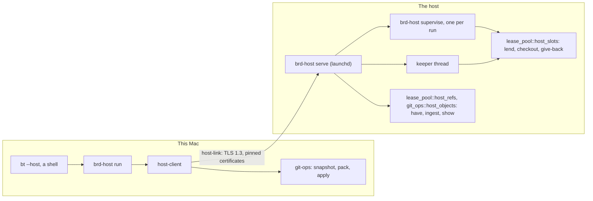

# Host Runs

**Status:** Draft
**Updated:** 2026-11-05
**Tags:** [host, remote-run, lease, brd-host, yonder]

## Problem

A heavy check (the full `cargo nextest run --workspace`, `pnpm e2e`, a test suite of the IntelliJ monorepo) runs on
another Mac of the user, the host. Until 2026-10-28 yonder did this. yonder lived in `community/tools/yonder` of the
IntelliJ monorepo: a client, the agent `yonderd` and the link that they shared. It called Branch Deck as child
processes: `brd lease host lend|give-back|have|ingest|show|snapshot|changes|git` on the host and `brd host
snapshot|pack|apply` on the client.

That seam was the cost. Each git step of a run was a `brd` process with a JSON answer. The tests of yonderd faked brd in
a shell script (`FAKE_BD`). The host needed a brd of the same features as the agent, and the two shipped in two release
cycles of two repositories. The slot policy and the git rules lived in Branch Deck already (`lease_pool::host_slots`,
the scan tests), so yonder kept only the transport and the processes.

## Solution Overview

The remote runs move into this workspace as one binary, `brd-host`. It is the client and the agent. It calls
`lease-pool`, `git-ops` and `git-executor` in process, so no `brd` child runs and no JSON crosses a process boundary.
The protocol is new (host-link, schema 1, port 7742).

`brd-host` is a binary of its own. Neither `brd` nor the app links it, so the app binary does not grow. On macOS the app
bundle carries it as a file (`BranchDeck.app/Contents/MacOS/brd-host`), and `brd install` links
`~/.local/bin/brd-host`. The release build gets it through its own Tauri config, `tauri.macos-bd-host.conf.json`, as
the Windows build gets `brd.exe`: Tauri merges `tauri.macos.conf.json` into every macOS build, and a plain `cargo build`
of the app would then need the binary first. The contract of the CLI, the refusal codes and the report of a run are in
[brd-host](../../openspec/specs/cli/host/spec.md), the setup of a host for a person in
[Runs on Another Mac](../guide/host-runs.md).

## Design

### Architecture

| Crate | Content | Depends on |
|---|---|---|
| `host-link` | The identity files, TLS 1.3 with pinned certificates, the frames, the protocol, the allow list, the relay through `/usr/bin/nc`, the refusal codes, `[host]` of `.branchdeck.toml` | rustls, rcgen, `sync-utils` |
| `host-client` | The run, the commit of the working tree, the thin pack, the follow, the cancel, the fetch, the base sync, the host files, the upgrade | `host-link`, `git-ops`, `git-executor` |
| `host-agent` | `serve`, the supervisor, the run directories, the login environment, the prepare steps, the keeper, the power assertions, the upgrade | `host-link`, `lease-pool`, `git-ops`, `git-executor` |
| `brd-host` | The CLI of both ends | `host-agent`, `host-client`, `host-link` |

The direction rules are in [Crates](rust-domain-authority.md#crates-и-направление-зависимостей), and
`crates/bd-cli/src/architecture_test.rs` checks them.

### The slot model in short

A remote slot holds no state of its own. The commit comes from the client, and `--fetch`, the outputs and `--apply`
bring back the rest. So a slot is lent to one run for the time of that run only. The host keeps a fixed set of warm
slots per repository (`branchdeck.hostSlots`, 4 by default) as plain `ready` leases of the holders `brd-host/<n>`.

- A run gets the idle slot that its affinity (`checkout-<12 hex>` of the local checkout path) used last, else the idle
  slot used longest ago, else it waits in a first-come queue. A waiting run gives back a slot that a gone run left
  itself, without waiting for the keeper.
- The give-back at the end of each run stops the processes that the run left, keeps the Bazel servers of the slot,
  and discards the changes. The ignored files stay as the warm cache until the slot has waited idle
  `branchdeck.hostSlotIdleClean` (6 hours by default): then the keeper applies the repository's clean rules. A process
  older than the lend quarantines the slot.
- The keeper fills, cleans and shrinks the slots. Nothing on the client keeps or returns a slot.

The lend table, the give-back, the clean and the shrink are in "Host slots" of
[Git Operations](git-operations.md#host-slots) and of [brd lease](../../openspec/specs/cli/lease/spec.md).

### The process model

- **`serve`** is the agent. launchd starts it (`com.jetbrains.brd-host`, `KeepAlive`, `AbandonProcessGroup`). It
  listens on 7742, answers one request per connection, and keeps no run in memory: a run is its directory.
- **The supervisor** is `brd-host supervise <run dir>`, one process per run, in a session of its own. `serve` starts it
  for each `Start`. It lends the slot with its own pid, so the lend lasts as long as the process. It waits for the
  pack, checks out the commit, runs the prepare steps and the command, stages the outputs, writes `exit.json` and gives
  the slot back on every way out. A restart of `serve` does not stop it.
- **The keeper** is a thread of `serve`. It wakes once a minute and when a run names a repository. It brings the git
  of the host to its floor (`ensure_host_git`), takes up what a gone process left (`reclaim`, `reclaim_refs`), keeps
  the minimum free space (`keep_free`), and fills the missing slots (`fill`). A failed fill waits 1, 5, then 15
  minutes. Below `branchdeck.leaseMinFree` the relief takes the steps of a get (the trash, the trim of every pool of
  the host, the shrink, the eviction) without one, once per volume and tick (`ReliefRound`), since the repositories
  of a host share one. Those steps take free slots only, so below the minimum still each repository relieves its idle
  host slots, used longest ago first: their clean rules with keep 0, then their Bazel output bases
  (`relieve_host_slots`). A relief that leaves a volume below it waits 15 minutes.
- **Sleep.** `serve` holds the power assertions of `caffeinate -i -s -w <pid>` while a client has a connection after
  its hello, and each supervisor holds them for its whole life. So a command runs to its end without its client.

### The output of a run

The supervisor reads the stdout and the stderr of the command and writes them to `events.log` of the run as pieces
(`host_link::proto::Piece`). A piece is a line without its line end, or a part of a line: a line longer than 64 KiB is
several pieces, cut between two characters. `partial` tells that no line end comes after a piece, so a cut and a last
line without a line end add no line end. A piece that is not UTF-8 has its bytes in `base64` beside its lossy `text`.
The reader keeps every byte, a carriage return included. A follow sends each piece as `Reply::Output`, and the client
writes its bytes and, unless it is partial, a line end. So the stdout of `brd-host run` and of `brd-host follow` is the
stdout of the command, byte for byte. A line comes when it ends, and a line longer than 64 KiB comes in parts.

The stderr of a run holds every byte of the stderr of the command in its order, and the lines of brd-host. A line of
brd-host starts a line of its own: the client ends a stderr line of the command that stopped inside a line before it
writes its own line. The log of the agent ends the open line of a stream before a line of the agent, and before a piece
of another pipe. Each pipe is a source of the log (`EventLog::source`); a prepare step writes both of its pipes to the
stderr.

### Versions and the upgrade

The hello carries the protocol schema, the version of Branch Deck (`package.json`, as `brd version` reads it) and the
SHA-256 of the binary as its build id. A different schema refuses with `schema`, exit 75. A different build of the
same schema runs, and the client adds one line that names `brd-host upgrade <alias>`. The client hashes its own binary
only for a run and for `hello`, the commands that compare the builds; the hash reads the whole executable.

A change that an older end cannot read raises the schema. A new field that an older end ignores stays within it, such
as `partial` and `base64` of a piece of output: an older client writes `text` and a line end after each piece, and an
older agent sends neither field, so each of its pieces is a whole line. Only a client and an agent of this build or
later keep every byte of the output.

`brd-host upgrade <alias>` keeps the behavior of `yonder upgrade`:

1. The client sends its own executable over the link, with its size and its SHA-256. The same build goes only with
   `--force`.
2. The agent checks the size, the SHA-256 and `<staged> version` (the schema and the feature `upgrade`). A lower
   version refuses with `downgrade` unless `--force`.
3. The agent keeps the old binary as `~/.local/bin/brd-host.previous`, writes the new one as `~/.local/bin/brd-host` by
   a rename, answers, drains its requests and exits. launchd starts the new `serve`.
4. A watchdog brings back the previous binary when the new one does not listen in time (`rolled_back`).

The agent links `lease-pool`, so the host needs no `brd` binary of the same version. The strict gates of revision 5
(an installed app only, `origin/master` only) are left out: the user installs local builds.

### The migration from yonderd

The migration ended on 2026-10-28. During it, `brd-host serve` on 7742 and yonderd on 7741 served the Studio side by
side and lent from one `host-slots.json`. `brd-host setup --import-yonder` copied the identities, the host files and
the allow list of yonder, so no new pairing was needed. `brd-host setup --retire-yonderd` then removed yonderd, its
cache and its refs `refs/yonder/*`. After that, the import, the retire, the `.yonder.toml` fallback of `[host]`, and
the `brd lease host …` and `brd host …` commands of brd were removed.

## Key Decisions

1. **Decision**: One binary for both ends, outside `brd` and the app.
   **Rationale**: The release yonder client is 3.4 MB and yonderd 3.7 MB. Linked into the app they would grow its
   binary for every user, and only a few users run a host.
2. **Decision**: `brd-host` does not depend on `bd-core`.
   **Rationale**: `bd-core` reaches the HTTP clients and the engine of the operations. The agent needs none of them.
   The refusal codes of a host run are a contract of their own, with the exits 75, 130 and 255.
3. **Decision**: A new protocol, not schema 3 of yonder.
   **Rationale**: A new port let both agents run side by side during the migration. `Pack` names its target (`{"run": …}` or
   `{"base": …}`) instead of a ref of `refs/yonder/`, and `RunSpec` has no `reference`.
4. **Decision**: The rustls provider of the app (`aws-lc-rs`), not `ring`.
   **Rationale**: The workspace links `aws-lc-rs` through reqwest already, so no second provider comes in.
5. **Decision**: A host has no app and no `brd`. The agent keeps its disk: the keeper frees space below the minimum,
   and `brd-host trim` trims the pools on request (2026-11-05).
   **Rationale**: Before, a host trimmed itself only on a `brd lease get` there, and only with `branchdeck.leaseMinFree`
   set. A host that only runs never got one, and the one way left to free its disk was `brd lease trim` there, which
   needs `brd`, the binary of the app. An agent that wanted to free the disk of the Studio upgraded `brd-host`, found
   the `brd` of an old app there, and copied the app binary over. `brd-host upgrade` replaces only the agent, so every
   function a host needs lives in the agent.
6. **Decision**: A piece of output says whether a line end comes after it (`partial`), and a piece that is not UTF-8
   carries its bytes in base64; the schema stays 1 (2026-11-13).
   **Rationale**: Each event was a line, so the cut of a line longer than 64 KiB added a line end, and bt of the IntelliJ
   monorepo could not parse the JSON on the stdout of a run. A raised schema would refuse each run of an older client
   with `schema`, and the agent of an older build refuses a binary of another schema in `brd-host upgrade`, so each host
   would need `brd-host setup` again. The optional fields keep both older ends as they were.

## Alternatives Considered

- **Borrow only** (revision 3): brd gets `brd lease borrow`, and yonder stays as it is.
  - Why not: two release cycles, coupled by the JSON of a child, and the git of the agent stays outside the rules of
    Branch Deck.
- **`brd host` as a family of `brd`** (revision 5): one binary for everything.
  - Why not: the app binary grows, and the upgrade of a host must then replace the whole `brd`.

## Risks

- A slot serves several checkouts. Ignored outputs of another branch stay, and a tool that trusts timestamps can build
  stale output. The same risk exists today within one checkout.
- A daemon that leaves the slot directory escapes the process scan of the give-back. The process group kill of the
  run catches what stays in the group.
- The port was large (about 22,000 lines with the tests). yonderd served until the migration ended, so a slow port broke
  nothing.
