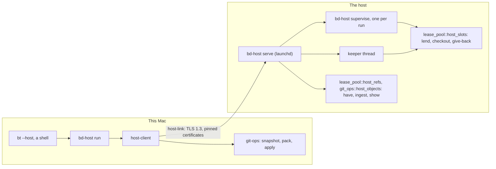

# Host Runs

**Status:** Draft
**Updated:** 2026-10-28
**Tags:** [host, remote-run, lease, bd-host, yonder]

## Problem

A heavy check (the full `cargo nextest run --workspace`, `pnpm e2e`, a test suite of the IntelliJ monorepo) runs on
another Mac of the user, the host. Until now yonder did this. yonder lives in `community/tools/yonder` of the IntelliJ
monorepo: a client, the agent `yonderd` and the link that they share. It calls Branch Deck as child processes:
`bd lease host lend|give-back|have|ingest|show|snapshot|changes|git` on the host and `bd host snapshot|pack|apply` on
the client.

That seam is the cost. Each git step of a run is a `bd` process with a JSON answer. The tests of yonderd fake bd in a
shell script (`FAKE_BD`). The host needs a bd of the same features as the agent, and the two ship in two release
cycles of two repositories. The slot policy and the git rules live in Branch Deck already (`lease_pool::host_slots`,
the scan tests), so yonder keeps only the transport and the processes.

## Solution Overview

The remote runs move into this workspace as one binary, `bd-host`. It is the client and the agent. It calls
`lease-pool`, `git-ops` and `git-executor` in process, so no `bd` child runs and no JSON crosses a process boundary.
The protocol is new (host-link, schema 1, port 7742). So `bd-host serve` and `yonderd` (port 7741) run side by side on
one host during the migration, and both lend from the same lend table.

`bd-host` is a binary of its own. Neither `bd` nor the app links it, so the app binary does not grow. On macOS the app
bundle carries it as a file (`BranchDeck.app/Contents/MacOS/bd-host`), and `bd install` links
`~/.local/bin/bd-host`. The contract of the CLI, the refusal codes and the report of a run are in
[bd-host](../../spec/cli/host.spec.md).

## Design

### Architecture

| Crate | Content | Depends on |
|---|---|---|
| `host-link` | The identity files, TLS 1.3 with pinned certificates, the frames, the protocol, the allow list, the relay through `/usr/bin/nc` | rustls, rcgen, `sync-utils` |
| `host-client` | The run, the commit of the working tree, the thin pack, the follow, the cancel, the fetch, the base sync, the host files, the upgrade | `host-link`, `git-ops`, `git-executor` |
| `host-agent` | `serve`, the supervisor, the run directories, the login environment, the prepare steps, the keeper, the power assertions, the upgrade | `host-link`, `lease-pool`, `git-ops`, `git-executor` |
| `bd-host` | The CLI of both ends | `host-agent`, `host-client`, `host-link` |

The direction rules are in [Crates](rust-domain-authority.md#crates-и-направление-зависимостей), and
`crates/bd-cli/src/architecture_test.rs` checks them.

### The slot model in short

A remote slot holds no state of its own. The commit comes from the client, and `--fetch`, the outputs and `--apply`
bring back the rest. So a slot is lent to one run for the time of that run only. The host keeps a fixed set of warm
slots per repository (`branchdeck.hostSlots`, 4 by default) as plain `ready` leases of the holders `bd-host/<n>`.

- A run gets the idle slot that its affinity (`checkout-<12 hex>` of the local checkout path) used last, else the idle
  slot used longest ago, else it waits in a first-come queue.
- The give-back at the end of each run stops the processes that the run left, keeps the Bazel servers of the slot,
  and discards the changes. The ignored files stay as the warm cache. A process older than the lend quarantines the
  slot.
- The keeper fills, cleans and shrinks the slots. Nothing on the client keeps or returns a slot.

The lend table, the give-back, the clean and the shrink are in "Host slots" of
[Git Operations](git-operations.md#host-slots) and of [bd lease](../../spec/cli/lease.spec.md).

### The process model

- **`serve`** is the agent. launchd starts it (`com.jetbrains.bd-host`, `KeepAlive`, `AbandonProcessGroup`). It
  listens on 7742, answers one request per connection, and keeps no run in memory: a run is its directory.
- **The supervisor** is `bd-host supervise <run dir>`, one process per run, in a session of its own. `serve` starts it
  for each `Start`. It lends the slot with its own pid, so the lend lasts as long as the process. It waits for the
  pack, checks out the commit, runs the prepare steps and the command, stages the outputs, writes `exit.json` and gives
  the slot back on every way out. A restart of `serve` does not stop it.
- **The keeper** is a thread of `serve`. It wakes once a minute and when a run names a repository. It brings the git
  of the host to its floor (`ensure_host_git`), takes up what a gone process left (`reclaim`, `reclaim_refs`), and
  fills the missing slots (`fill`). A failed fill waits 1, 5, then 15 minutes.
- **Sleep.** `serve` holds the power assertions of `caffeinate -i -s -w <pid>` while a client has a connection after
  its hello, and each supervisor holds them for its whole life. So a command runs to its end without its client.

### Versions and the upgrade

The hello carries the protocol schema, the version of Branch Deck (`package.json`, as `bd version` reads it) and the
SHA-256 of the binary as its build id. A different schema refuses with `schema`, exit 75. A different build of the
same schema runs, and the client adds one line that names `bd-host upgrade <alias>`.

`bd-host upgrade <alias>` keeps the behavior of `yonder upgrade`:

1. The client sends its own executable over the link, with its size and its SHA-256. The same build goes only with
   `--force`.
2. The agent checks the size, the SHA-256 and `<staged> version` (the schema and the feature `upgrade`). A lower
   version refuses with `downgrade` unless `--force`.
3. The agent keeps the old binary as `~/.local/bin/bd-host.previous`, writes the new one as `~/.local/bin/bd-host` by
   a rename, answers, drains its requests and exits. launchd starts the new `serve`.
4. A watchdog brings back the previous binary when the new one does not listen in time (`rolled_back`).

The agent links `lease-pool`, so the host needs no `bd` binary of the same version. The strict gates of revision 5
(an installed app only, `origin/master` only) are left out: the user installs local builds.

### Migration from yonderd

1. yonderd keeps its lends in the same `host-slots.json` already. So `bd-host serve` on 7742 and `yonderd` on 7741
   share the slots of a host, and no adopt step exists.
2. `bd-host setup --import-yonder` takes the identity and the allow list of the agent from `~/.cache/yonderd`, and the
   identity and the host files of the client from `~/.config/yonder`. So both ends keep their fingerprints, and no new
   pairing and no ssh is needed. The first install on a host is a yonder run of `bd-host setup --import-yonder`.
3. A commit without `[host]` in `.branchdeck.toml` gets the `.yonder.toml` of the commit, until the monorepo moved.
4. `bd-host setup --retire-yonderd` waits until no yonderd run lives, boots out `com.jetbrains.yonderd`, deletes the
   refs `refs/yonder/*` and `~/.cache/yonderd`. Only the user starts it.

The `bd lease host …` and `bd host …` commands of bd stay while yonderd and the yonder client call them. Their removal
is a later step.

## Key Decisions

1. **Decision**: One binary for both ends, outside `bd` and the app.
   **Rationale**: The release yonder client is 3.4 MB and yonderd 3.7 MB. Linked into the app they would grow its
   binary for every user, and only a few users run a host.
2. **Decision**: `bd-host` does not depend on `bd-core`.
   **Rationale**: `bd-core` reaches the HTTP clients and the engine of the operations. The agent needs none of them.
   The refusal codes of a host run are a contract of their own, with the exits 75, 130 and 255.
3. **Decision**: A new protocol, not schema 3 of yonder.
   **Rationale**: A new port lets both agents run side by side. `Pack` names its target (`{"run": …}` or
   `{"base": …}`) instead of a ref of `refs/yonder/`, and `RunSpec` has no `reference`.
4. **Decision**: The rustls provider of the app (`aws-lc-rs`), not `ring`.
   **Rationale**: The workspace links `aws-lc-rs` through reqwest already, so no second provider comes in.

## Alternatives Considered

- **Borrow only** (revision 3): bd gets `bd lease borrow`, and yonder stays as it is.
  - Why not: two release cycles, coupled by the JSON of a child, and the git of the agent stays outside the rules of
    Branch Deck.
- **`bd host` as a family of `bd`** (revision 5): one binary for everything.
  - Why not: the app binary grows, and the upgrade of a host must then replace the whole `bd`.

## Risks

- A slot serves several checkouts. Ignored outputs of another branch stay, and a tool that trusts timestamps can build
  stale output. The same risk exists today within one checkout.
- A daemon that leaves the slot directory escapes the process scan of the give-back. The process group kill of the
  run catches what stays in the group.
- The port is large (about 22,000 lines with the tests). yonderd serves until the migration ends, so a slow port
  breaks nothing.
