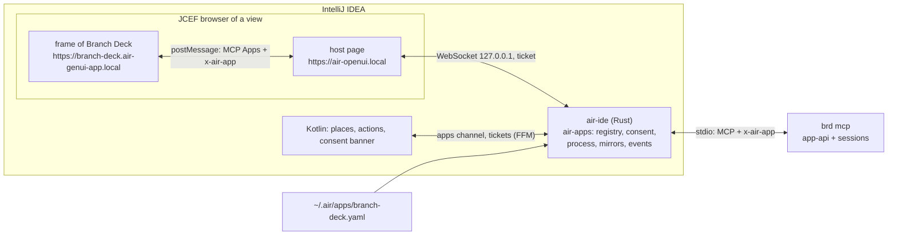
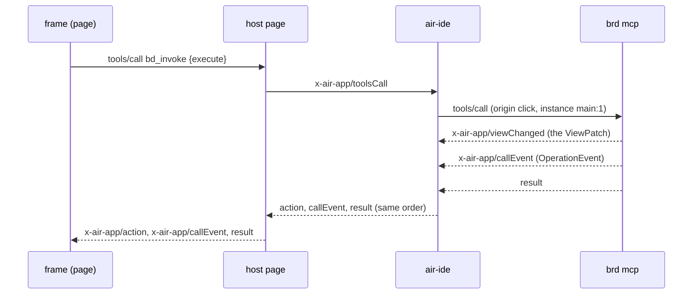

# IDE Embedding

**Status:** Draft  
**Updated:** 2026-11-12  
**Tags:** [ide, air, mcp, protocol, windows]

## Problem

Branch Deck is a Tauri window beside the IDE where its users work. Moving it into IntelliJ IDEA must not fork the
page or the backend: the page stays the React page of `src/`, the rules stay in Rust
([Rust as the Domain Authority](rust-domain-authority.md)), and the windows stay windows: a main window, a review per
target, Settings, two dialogs.

The IDE side is Air of idea-1, which already hosts MCP Apps (SEP-1865) in the agent session. That host has no tool
window, takes one HTML document per page and routes every message through Kotlin, so a big diff would cross the JVM
twice. Air needed a general way to host an app of the user; Branch Deck is its first app.

## Solution Overview

The IDE reads `~/.air/apps/branch-deck.yaml` (written by the installer of Branch Deck) and starts `branch-deck cli mcp`
(`brd mcp`) for each project, after the user's consent. The page runs in a sandboxed frame of the IDE with its own
origin. Three links carry one protocol, `x-air-app`: the frame talks MCP Apps to a host page by postMessage; the host
page talks to `air-ide` (the Rust library of Air) over a loopback WebSocket; `air-ide` talks MCP to `brd mcp` over
stdio. Kotlin places the views and holds the browsers, but it is not in the path of the data.

`brd mcp` is a third host of `app-api` beside the Tauri shell and `test-server`: the same commands, the same sessions,
the same data directories (`org.develar.branch-deck`), so the desktop app and the IDE can be open on the same
repository at once.

## Design

### Architecture

The registry of `air-apps` turns the YAML into the apps channel of a project; Kotlin builds a tool window, a tab, an
editor tab, a frame or a dialog for each instance in it. A view gets a one-use ticket that binds its WebSocket to its
instance, so a page never says which window it is.

### A call that changes state

### Key decisions

1. **Decision**: The state of a view is a mirror channel; the events are a lossless ordered stream.
   **Rationale**: a `ViewPatch` can be replaced by a snapshot (the page already handles "another epoch asks for a
   snapshot"), so `air-ide` may resync a slow page from its mirror without asking `brd`. An `OperationEvent`, a toast or
   a file diff must arrive once, so it never resyncs; a stream over the hard cap fails its call instead.
2. **Decision**: One `x-air-app/viewChanged` per `ViewPatch`, its ops by the table rule of Air: replace a part, set or
   remove one entry of a keyed part.
   **Rationale**: `TableChanges` is that shape already (parts whole, keyed parts by key with `removed*`), so the
   conversion is mechanical and generic; the `Version` of the session stays inside `brd`, and the page rebuilds its
   patch from the `serverSeq` of `air-ide`. The news become the part `news` of the kept list, which the page tells by
   id, so a resync tells none twice.
3. **Decision**: The mirror key is the repository path.
   **Rationale**: `subscribe_view` answers per session, not per window, so every view of a repository shares one
   mirror; the window only matters for `forget_window`, which the life of the place drives.
4. **Decision**: Two tools only, both app-only: `bd_invoke {command, args}` and `bd_bootstrap {view}`.
   **Rationale**: the page already calls commands by name (`for_each_command!`), so one generic tool keeps the page
   unforked and `app-api` the one list of commands; no agent reaches it (`agent.tools: none`), and the origin `agent`
   is refused besides.
5. **Decision**: The channel of a command is bound to its call (`callId` is the id of the `tools/call`).
   **Rationale**: every command has at most one channel, so no argument has to name it, and the order "events before
   the answer" is the order of one stdio stream.
6. **Decision**: The life of a window comes from the place, never from the WebSocket.
   **Rationale**: a WebSocket drops on a JCEF reload or a sleep while the tab stays; `forget_page` and
   `forget_window` must follow the tab, so `viewClosed` is the only close.
7. **Decision**: Sub-windows are views: the review an editor tab per target (`instances: many`, restored after a
   restart of the IDE), Settings a frame of 880 × 640, the conflicting files and the missing commits non-modal
   dialogs; OS notifications and the Dock badge become IDE notifications and the badge of the tool window.
   **Rationale**: the IDE gives detaching, persistence and focus for free; the desktop semantics map one to one.
8. **Decision**: The contract is Air's, with a copy here.
   **Rationale**: Air serves other apps with the same protocol; `docs/design/ide-embedding/protocol/` holds the
   schemas and the golden corpus of idea-1 plus `branch-deck-app.ndjson`, the app link as `brd mcp` writes it, which
   the tests of `mcp-host` run.

### Implementation notes

- `crates/app-api`: `dispatch::invoke_json(name, args, call, sink)` over `for_each_command!`, moved out of
  `crates/test-server/src/invoke.rs` (`run<C>`), which then uses it.
- `crates/mcp-host` (planned): the JSON-RPC over stdio on tokio and the hosts of `app-api`: `EventSink` →
  `callEvent`, `AppEvents` → `event`, `WindowHost` → `openView`; `DialogHost` gives way to `roots/list`; `MenuHost`,
  `Updater`, `RestartHost` and `AgentCliHost` do nothing. `crates/bd-cli/src/architecture_test.rs` admits it to
  `app-api` and keeps Tauri out of it.
- Settings in two processes: a write under an inter-process lock merges only the changed keys, and a watch tells the
  other process ([Distributed Settings](distributed-settings.md)).
- The page: `src/platform/air/` shims `__TAURI_INTERNALS__` (`invoke` → `bd_invoke`, `Channel` → call events,
  `subscribe_view` → the mirror, `listen`/`emit` → events, the plugins → `ui/open-link`, `air_copy`, `notify`, the
  log); `src/air-main.ts` awaits `bd_bootstrap`; `vite build --mode air` builds the files that `brd mcp` embeds and
  serves as `ui://branch-deck/<path>`.
- The install: beside the agent CLI, "IntelliJ IDEA" writes `~/.air/apps/branch-deck.yaml` with `current_exe`
  (`crates/bd-cli/src/install.rs`), and Remove deletes it.

## Alternatives Considered

- **Through Kotlin (`JBCefJSQuery`)**: every patch and every diff stream would cross the JVM twice, and Kotlin would hold
  a second copy of the protocol.
  - Why not: the size of a diff and the cost of two translations.
- **Branch Deck serves its own WebSocket or HTTP**: the consent, the ticket and the origin checks would be Branch
  Deck's, different for every app.
  - Why not: the trust rules belong to the host.
- **A JVM plugin of Branch Deck**: a build per IDE version and a forked page.
  - Why not: the page and the rules would fork.
- **Events as state**: a resync would drop a toast or a step of a push.
  - Why not: events must arrive exactly once.

## Performance Considerations

- **Constraint**: a big diff opens without a message over 16 MiB, and a common diff never goes stale or resyncs.
- **Solution**: the diff streams as call events (one file per event), the page loads its chunks and its worker as
  separate resources, and a page that falls behind 8 MiB of state gets one snapshot instead of a backlog.
- **Measurement**: the walking skeleton of stage 0 measures the chain JCEF → WebSocket → `air-ide` → stdio; its numbers
  become benchmarks of `tests/perf/`.

## References

- Spec: [Branch Deck in the IDE](../../openspec/specs/repository/ide-embedding/spec.md)
- The contract of Air (idea-1): `plugins/air/native/air-apps/protocol/`, the OpenSpec capability `air-apps-host`, the
  decision record `plugins/air/docs/decisions/2026-11-11-the-ide-hosts-an-app-of-the-user-over-x-air-app.md`
- The copy: `docs/design/ide-embedding/protocol/` (its `README.md` has the rules of a runner)
- Related docs: [Distributed Settings](distributed-settings.md), [Rendering Performance](rendering-performance.md),
  [E2E Testing](e2e-testing.md)
