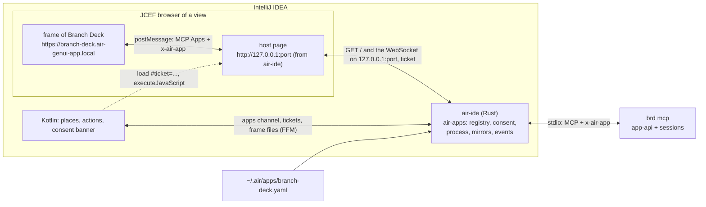
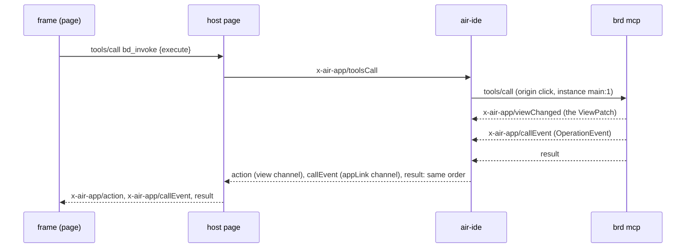

# IDE Embedding

**Status:** Draft  
**Updated:** 2026-11-13  
**Tags:** [ide, air, mcp, protocol, windows]

## Problem

Branch Deck is a Tauri window beside the IDE where its users work. Moving it into IntelliJ IDEA must not fork the
page or the backend: the page stays the React page of `src/`, the rules stay in Rust
([Rust as the Domain Authority](rust-domain-authority.md)), and the windows stay windows: a main window, a review per
target, Settings, two dialogs.

The IDE side is Air of idea-1, which already hosts MCP Apps (SEP-1865) in the agent session. That host has no tool
window, takes one HTML document per page and routes every message through Kotlin, so a big diff would cross the JVM
twice. Air needed a general way to host an app of the user; Branch Deck is its first app.

## Solution Overview

The IDE reads `~/.air/apps/branch-deck.yaml` (written by the installer of Branch Deck) and starts `branch-deck cli mcp`
(`brd mcp`) for each project, after the user's consent. The page runs in a sandboxed frame of the IDE with its own
origin. Three links carry one protocol, `x-air-app`: the frame talks MCP Apps to a host page by postMessage; the host
page talks to `air-ide` (the Rust library of Air) over a loopback WebSocket; `air-ide` talks MCP to `brd mcp` over
stdio. Kotlin places the views and holds the browsers, but it is not in the path of the data. `air-ide` serves the host
page itself, on a port of `127.0.0.1`: Chromium lets a page open a loopback socket without a prompt only when the page
came over loopback HTTP.

`brd mcp` is a third host of `app-api` beside the Tauri shell and `test-server`: the same commands, the same sessions,
the same data directories (`org.develar.branch-deck`), so the desktop app and the IDE can be open on the same
repository at once.

## Design

### Architecture

The registry of `air-apps` turns the YAML into the apps channel of a project; Kotlin builds a tool window, a tab, an
editor tab, a frame or a dialog for each instance in it. A view gets a one-use ticket that binds its WebSocket to its
instance, so a page never says which window it is. The IDE loads `http://127.0.0.1:<port>/#ticket=…`: the fragment goes
in no request, and the host page removes it from its address; after a drop or a reload the IDE gives the page a new
ticket by `executeJavaScript`, when the instance in the apps channel turns not `connected`. The files of the frame of
Branch Deck (`https://branch-deck.air-genui-app.local`, a stable origin, so its `localStorage` survives a restart of
the IDE) come from the request handler of the IDE, which reads them by `x-air-ide/appResourceRead` of the apps
channel, and `air-ide` from `brd mcp` by `resources/read`.

Branch Deck speaks two of the links: the page the frame link, `brd mcp` the app link. The page link between the host
page and `air-ide` is Air's, and a change of it changes neither. On it a mirror is one table channel,
`x-air-ide:/appView/<n>`, which every view of the mirror subscribes to through `x-air-app/viewOpen`: one state and one
`serverSeq` for each change, whatever the count of views. The events, the call events and the progress of the process
are notices of its own channel, `x-air-ide:/appLink/<n>`, which no page subscribes to and whose number changes with
each run of `brd mcp`. The echo of an intent holds its result in `_meta["x-air-ide"].result`. A cancel of a page call
is a notification of the root channel, which `air-ide` serves at once, never behind the call it cancels: the call gets
exactly one answer, and `brd mcp` gets `notifications/cancelled`.

### A call that changes state

### Key decisions

1. **Decision**: The state of a view is a mirror channel; the events are a lossless ordered stream.
   **Rationale**: a `ViewPatch` can be replaced by a snapshot (the page already handles "another epoch asks for a
   snapshot"), so `air-ide` may resync a slow page from its mirror without asking `brd`. An `OperationEvent`, a toast or
   a file diff must arrive once, so it never resyncs; a stream over the hard cap fails its call instead.
2. **Decision**: One `x-air-app/viewChanged` per `ViewPatch`, its ops by the table rule of Air: replace a part, set or
   remove one entry of a keyed part.
   **Rationale**: `TableChanges` is that shape already (parts whole, keyed parts by key with `removed*`), so the
   conversion is mechanical and generic; the `Version` of the session is the part `version`, set last in each change,
   so the page rebuilds its patch between the versions of brd and compares them with those the commands answer. The
   news become the part `news` of the kept list, which the page tells by id, so a resync tells none twice.
3. **Decision**: The mirror key is the repository path.
   **Rationale**: `subscribe_view` answers per session, not per window, so every view of a repository shares one
   mirror, which Air keeps as one channel that each of them subscribes to; the window only matters for
   `forget_window`, which the life of the place drives.
4. **Decision**: Every tool is app-only: `bd_invoke {command, args}` and `bd_bootstrap {view}` for the page, and the
   tools of the actions of the app file, `sync` and `open_command_palette`, for the IDE (the origin `action`).
   **Rationale**: the page already calls commands by name (`for_each_command!`), so one generic tool keeps the page
   unforked and `app-api` the one list of commands; an action of the IDE calls a tool by its name, and Air accepts an
   app-only tool from the origins `click` and `action`. No agent reaches one (`agent.tools: none`), and the origin
   `agent` is refused besides.
5. **Decision**: The channel of a command is bound to its call (`callId` is the id of the `tools/call`).
   **Rationale**: every command has at most one channel, so no argument has to name it, and the order "events before
   the answer" is the order of one stdio stream.
6. **Decision**: The life of a window comes from the place, never from the WebSocket.
   **Rationale**: a WebSocket drops on a JCEF reload or a sleep while the tab stays; `forget_page` and
   `forget_window` must follow the tab, so `viewClosed` is the only close.
7. **Decision**: Sub-windows are views: the review an editor tab per target (`instances: many`, restored after a
   restart of the IDE), Settings a frame of 880 × 640, the conflicting files and the missing commits non-modal
   dialogs; OS notifications and the Dock badge become IDE notifications and the badge of the tool window, both asked
   by brd. The close of a window of the page (`plugin:window|close`, Escape in the review and the dialogs) is
   `x-air-app/closeView` of its instance. The menu of the desktop app is the title of the tool window: the actions
   Sync Virtual Branches, Branch Deck Command Palette and Branch Deck Settings of the app file (`titleActions`).
   **Rationale**: the IDE gives detaching, persistence and focus for free; the desktop semantics map one to one.
8. **Decision**: The contract is Air's, with a copy here.
   **Rationale**: Air serves other apps with the same protocol; `docs/design/ide-embedding/protocol/` holds the
   schemas and the golden corpus of idea-1 plus `branch-deck-app.ndjson`, the app link as `brd mcp` writes it, which
   the tests of `mcp-host` run.

### Implementation notes

- `crates/app-api/src/dispatch.rs`: a command of `for_each_command!` by its name, its arguments as the page's `invoke`
  sends them, its answer as JSON or bytes, its channel one sink of JSON values. The e2e server runs every route through
  it (`crates/test-server/src/invoke.rs`), and `brd mcp` every `bd_invoke`.
- `crates/app-api/src/app/services.rs`: the services of a process on the user's machine (the sessions, Patronus,
  GitHub, YouTrack, the sign-ins) over a `ContextSource`, and `AppServices::into_context`, the one construction of its
  `AppContext`; the Tauri shell gives them the state it manages (`src-tauri/src/services.rs`), `brd mcp` the context it
  built. The seed of the main view from the frame of its session is `app_api::app::warm_start::seed`, which the init
  script of the app and `bd_bootstrap` both take.
- `crates/mcp-host` (`brd mcp`, `branch-deck cli mcp`; on Windows `brd.exe mcp`): `server.rs` the connection and its
  methods, `mirror.rs` the patch as one change, `hosts.rs` the hosts of app-api, `notices.rs` the notifications of the
  IDE, `link.rs` the one ordered queue of
  what brd writes, `resources.rs` the files of `dist-air/` built into the binary by `build.rs` (a stub page without
  them; a new build of the page is picked up as the directory changes), `process.rs` the stdio loop and the context on
  `org.develar.branch-deck`. `crates/bd-cli/src/architecture_test.rs` admits it to `app-api` and keeps Tauri out of it.
- **The window of a call** is the instance of its view: the main window for `main:<n>`, else the instance itself
  (`review:3`), so two review tabs are two windows of `forget_window`. A sub-window opened by `open_sub_window` is
  `x-air-app/openView` of the view of its URL (`/review` → `review`), with `params.data` the data of the open; a
  review is keyed `<kind>:<target>` (`branch:feature`), any other view by its window id. A second open answered with
  the instance shown already sends it `init-data-updated {data}` and `setViewTitle`.
- **A mirror** subscribes the session once for all the views of a repository, under a window of its own
  (`mirror:<path>`), and the last unsubscribe forgets that window; the patches that come before the answer of the
  subscription are in its state, which holds the `version` of the view, set last in each change. `set_demand` of a
  view names the subscription of its mirror (brd puts it in). The session dropping the subscription of a shown mirror
  is `x-air-app/viewEnded {reason: "sessionClosed"}`, the one reason of the contract: brd cannot tell a repository that
  is gone from a session that closed. Air ends the channel of the mirror for each view of it with that reason, and
  an exit of brd ends each mirror with `serverExited` before it fails the calls in flight. A subscription again to a
  mirror brd holds (`bd_invoke` of `subscribe_view` from the page, or `x-air-app/subscribe` of another view) takes the
  session of the prefix the git config names now (`session_key_now`), as a window of the desktop app that subscribes
  again does: a mirror of another prefix moves to that session in one change that replaces every part
  (`MirrorView::parts`, the `version` of another epoch last), before the answer; the subscription of the old session
  ends, none of its patches reaches the mirror after the move, and the new one takes the demand a view set last. So a
  prefix set in a terminal, in Settings or as the app's prefix reaches every view of the mirror, and the channel of the
  mirror never ends for it.
- **`bd_bootstrap {view}`** gives `settings: {values, version}` (the snapshot of the window, `window_snapshot`),
  `warmFrame` (the `CachedModel` of the repository of the main view, or null), `initData` (`{repositoryPath, roots,
  params}` of the main view, `{data, params}` of another) and `titleBar: {kind: "native", checkForUpdates: false,
  folderDialog: false}`: the dialog host of brd has no folder dialog (`DialogHost::has_folder_dialog`), so the page
  offers no Open Repository… beside its selector or in the command palette and no Add Companion…; the roots of the
  project are its repositories.
- **The desktop of the page**: an event the page emits for the other windows is `bd_invoke` of
  `plugin:event|emit {event, payload, target}`, which brd tells the views (`x-air-app/event`, with the instance of the
  window `target` names). The page sets the badge, the progress and its notifications only through brd, by `bd_invoke`
  of the plugin calls of Tauri (`plugin:window|set_badge_count`, `plugin:window|set_progress_bar`,
  `plugin:notification|notify` → `setBadge`,
  `setProgress` of `main`, `notify`). The actions of the app file are tools only for the app, which `tools/list`
  names: Sync Virtual Branches is `sync`, Branch Deck Command Palette is `open_command_palette`, which sends the main
  view the event `open_command_palette` as the menu of the desktop app does, and Branch Deck Settings opens the view
  `settings` in the IDE alone. `plugin:window|close` of a page is `x-air-app/closeView` of its instance. A change of
  the Git roots of the project is the event `roots-changed` to the main view.
- **The notifications** (`notices.rs`): the failure of a robot, a news that a patch of a mirror brings, is
  `x-air-app/notify` from brd itself while the main view is not shown (`viewHidden` after its `viewShown`) and "Safe
  Push failures" of Settings is on, worded in Rust ("Safe Push of auth failed" / "auth → master", or "… needs review"),
  with the action Show in Branch Deck: `run: {tool: "reveal_branch", arguments: {repositoryPath, branchName}}`, the
  branch of the robot or the root of its whole stack. The IDE runs it with the origin `action`; brd asks `openView` of
  `main` (the IDE shows the tool window and answers its instance) and tells that instance `reveal-branch`, which the
  page reveals as Go to of the palette does (`useRevealBranchEvent`). The page's own notification of a news
  (`announce` while its frame has no focus) carries `extra: {repositoryPath, news}`: brd leaves it out when it told
  that news, and else gives it the kind and the action of the news, so a failure is one notification of the IDE and
  it opens its branch. Another notification of the page (a review request, a merge) stays as the page words it.
- **The repositories of the main view** (`projects.rs`): the views see the Git roots of the project as their recent
  projects (`recentProjects`), the root the main view shows first, each with what the recent projects of the settings
  keep of it: in the snapshot of `bd_bootstrap`, in each `settings_changed` and in the answers that carry changes
  (`set_setting`, `get_settings_changes`, `sub_window_loaded`). So the page, unchanged, selects that root, its
  selector lists the roots, and no rule of it is in TS. A write of `recentProjects` by the page is a pick: brd shows
  its first root, remembers it by the set of the roots in `ideRootPicks` of `repository-state.json`
  (`app_settings::ide_roots`), which the next start of the project shows, and writes what the page changed of each root
  into the recent projects in their place; their order, which selects the repository of the desktop app, stays. A
  change of the roots after a page took the settings writes `recentProjects` as it is, so the views get the roots in a
  change newer than every one they have.
- **The e2e server** serves the same connection on a WebSocket (`GET /repositories/{id}/mcp`, `mcp_socket.rs`), in the
  context of the test repository with the events and the desktop of the connection, for the fake host of the page in
  Air; `mcp_corpus_test.rs` runs `branch-deck-app.ndjson` on it.
- **The check of the copy** (`src/platform/air/contract.test.ts`): each line of the corpus against
  `x-air-app.schema.json`, each result and action that the line schema takes as any value against the def of its
  method, and each app file (the example and those the corpus writes) against `air-app.schema.json`, by Ajv, which
  validates the draft 2020-12 of both schemas, and `yaml`; both are dev dependencies of the page, so the check runs with
  `pnpm test:unit` and needs no crate.
- Settings in two processes: a write under an inter-process lock merges only the changed keys, and a watch tells the
  other process ([Distributed Settings](distributed-settings.md)).
- The page: `src/air-main.ts` answers `ui/initialize` with `x-air-app`, applies the theme of the host context, awaits
  `bd_bootstrap {view}` (the globals of the init script of a window: `__TAURI_STORE__`, `__BD_MODEL__`,
  `__INIT_DATA__`, `__SUB_WINDOW_OPEN__`, `__BD_TITLE_BAR__`), installs the shim and runs `src/main.tsx` on the page of
  its view (`main` is `/`). `vite build --mode air` writes `dist-air/`, which `brd mcp` embeds and serves as
  `ui://branch-deck/<path>`, `index.html` for every view; the chunks and the highlight worker stay files of their own
  (no blob worker: the CSP of SEP-1865 refuses it).
  - `src/platform/tauri-page.ts`: the internals of Tauri without the shell (`__TAURI_INTERNALS__`, the listeners of the
    event plugin, the table of the channels of `crates/app-api/commands.json`), installed by the page of the IDE and by
    the page mock of the E2E tests alike.
  - `src/platform/air/shim.ts`: `invoke` → `tools/call bd_invoke {command, args}` with the arguments as the page sent
    them; the `Channel` the table names gets the `x-air-app/callEvent` of its call (`callId` is the id of the
    `tools/call`); `structuredContent.value`, `bytes` (base64) or `error`. `listen` hears `x-air-app/event`; `emit` and
    `emit_to` are `bd_invoke` of `plugin:event|emit {event, payload, target}`, which `brd mcp` tells the views of the
    app. The plugins: `ui/open-link` for a link, the host tool `air_copy`, the log as `notifications/message`; the
    badge, the progress and the notification (the browser's `Notification` too) are `bd_invoke` of their plugin calls,
    and the close of a window `bd_invoke` of `plugin:window|close`; the size, the zoom and the theme are the place's,
    and do nothing.
  - `src/platform/air/view-mirror.ts`: `subscribe_view` is `x-air-app/subscribe {params: {repositoryPath}}`. The state
    of the mirror is the `RepositoryView` of the session, one part per field, with the part `version` (the page compares
    the versions that commands answer, `SyncAnswer.version`, `Outcome.versionAfter`, with that of its view). Each
    `x-air-app/action` of `x-air-app/viewChanged` becomes the `ViewPatch` from the version the page holds: a keyed part
    (`branches`, `stacks`, `pushes`, … as `TableChanges` removes them) by `set` and `remove` (a `set` of `branches` holds
    the whole `BranchView`), another part whole by `part`, and the sections, the Patronus view and the facts by the
    entries that differ from the state before. A resync replaces the state and sends a patch from no base, so the page
    asks `get_snapshot`, which the shim answers from the state of the mirror; the end of a mirror
    (`x-air-app/subscriptionEnded`, whatever its reason: `sessionClosed`, `serverExited` or one the page does not know)
    does the same, and the snapshot then comes from `brd mcp`. A change to a version of another epoch (the mirror moved
    to the session of another prefix) is no patch of the view the page holds either: the page asks for the snapshot.
  - **One view for each frame**: Air holds one view for each page connection, so for each frame. A `viewOpen` while
    another runs gets `-32011 viewOpen` at once, and one while the connection holds a view waits up to 1 s for its end
    and then gets the same. The page subscribes again before it leaves (`openSession` of another repository before the
    first answer, `resubscribeSession` after `prefix_changed`, which holds the old subscription until the new one
    answers), so the shim keeps the one view of the frame (`FrameView`) and the subscriptions of the page share it: one
    of the repository the frame holds joins it and asks `brd mcp` with `bd_invoke` of `subscribe_view`, which moves the
    mirror before it answers, and its answer is the state of the mirror, or nothing when the page holds it at that
    version (`have`); one of another repository sends its `x-air-app/subscribe` once the view before it answered and
    was unsubscribed or ended. The last subscription that leaves the view unsubscribes the frame.
  - `src/platform/air/theme.ts`: each variable of the host (`styles.variables`, `com.jetbrains.air/variables`) is set on
    the root as `--air-host-<name>`, and the semantic tokens (`--background`, `--card`, `--primary`, `--border`, …) read
    them while the page shows the theme of the IDE: the canvas the first background of the host (the background of the
    place, so the page is one surface with its tool window), the cards, the popups and the fields the second, the
    raised surface, lighter than the first in both themes, so the canvas is darker than the cards in the dark theme
    too (the desktop app follows Islands Dark instead, whose window is lighter than its islands); the query of the
    system's dark appearance answers the theme of the IDE, so the setting System follows it, and
    `host-context-changed` switches it without a reload.
- The install: the row IntelliJ IDEA of Settings → Tools, after `brd` (`install_ide_app`, `remove_ide_app`, the status
  in `agent_cli_status`), runs `bd_cli::install::install_ide_app` (`crates/bd-cli/src/install.rs`): it writes
  `~/.air/apps/branch-deck.yaml` and the icons of the tool window in `~/.air/apps/icons/`, each file whole through a
  rename, since the IDE reads the file at each change. The file is the example of the contract with the binary of the
  app (`app_binary`, never a translocated one): the app binary with `cli mcp`, `brd` (`brd.exe` beside the app on
  Windows) with `mcp`. Remove deletes the file and the two icons. The status reads the file and compares it with what an
  install writes now, so a file another Branch Deck wrote (an app moved or a second copy) says so and Install writes it
  for this one. `brd mcp` serves the Air build of the page built into it: each build of the app runs `pnpm build:air`
  before cargo (`beforeBuildCommand` of `src-tauri/tauri*.conf.json`). `brd mcp` installs nothing: its
  `agent_cli_status` answers `installable: false`, so the page in the IDE shows neither `brd` nor IntelliJ IDEA on
  Tools and no install of the Agent CLI on Agents or in the hint of the agents.

## Alternatives Considered

The transport is Air's decision, with its measurements in JCEF: the decision record of idea-1 names them.

- **Through Kotlin (`JBCefJSQuery`)**: every patch and every diff stream would cross the JVM, 3 to 8 times slower than
  a socket, and the function of the query is visible to the sandboxed frame of an app.
  - Why not: speed, and a frame of Branch Deck could reach the handler of the host.
- **The built-in server of the IDE (port 63342)**: it admits any loopback page and a request without `Origin`, shares
  its origin with the files of the projects and every plugin, and is off in the dev runs of remote development.
  - Why not: the checks of the origin would be the server's, not Air's.
- **A grant of the loopback permission (a content setting, DevTools, a Chromium flag) or a `file:` page**: a global
  setting with one owner, a grant that the close of any browser resets, a switch for every page of JCEF, or the
  `Origin` `null`.
  - Why not: none keeps a narrow, stable check; the content setting stays Air's fallback.
- **Branch Deck serves its own WebSocket or HTTP**: the consent, the ticket and the origin checks would be Branch
  Deck's, different for every app.
  - Why not: the trust rules belong to the host.
- **A JVM plugin of Branch Deck**: a build per IDE version and a forked page.
  - Why not: the page and the rules would fork.
- **Events as state**: a resync would drop a toast or a step of a push.
  - Why not: events must arrive exactly once.

## Non-goals

- Remote development: in a split IDE the frame runs in the client and `air-ide` on the backend, so the loopback port is
  on the other machine; Air serves no app there in its first version.
- One `brd mcp` for all the projects of a user (P2), and a project that is not on this machine.

## Performance Considerations

- **Constraint**: a big diff opens without a message over 16 MiB, and a common diff never goes stale or resyncs.
- **Solution**: the diff streams as call events (one file per event), the page loads its chunks and its worker as
  separate resources, and a page that falls behind 8 MiB of state gets one snapshot instead of a backlog.
- **Measurement**: the walking skeleton of stage 0 measures the chain JCEF → WebSocket → `air-ide` → stdio; its numbers
  become benchmarks of `tests/perf/`.

## References

- Spec: [Branch Deck in the IDE](../../openspec/specs/repository/ide-embedding/spec.md)
- The contract of Air (idea-1): `plugins/air/native/air-apps/protocol/`, the OpenSpec capability `air-apps-host`, the
  decision record `plugins/air/docs/decisions/2026-11-11-the-ide-hosts-an-app-of-the-user-over-x-air-app.md`
- The copy: `docs/design/ide-embedding/protocol/` (its `README.md` has the rules of a runner)
- Related docs: [Distributed Settings](distributed-settings.md), [Rendering Performance](rendering-performance.md),
  [E2E Testing](e2e-testing.md)
