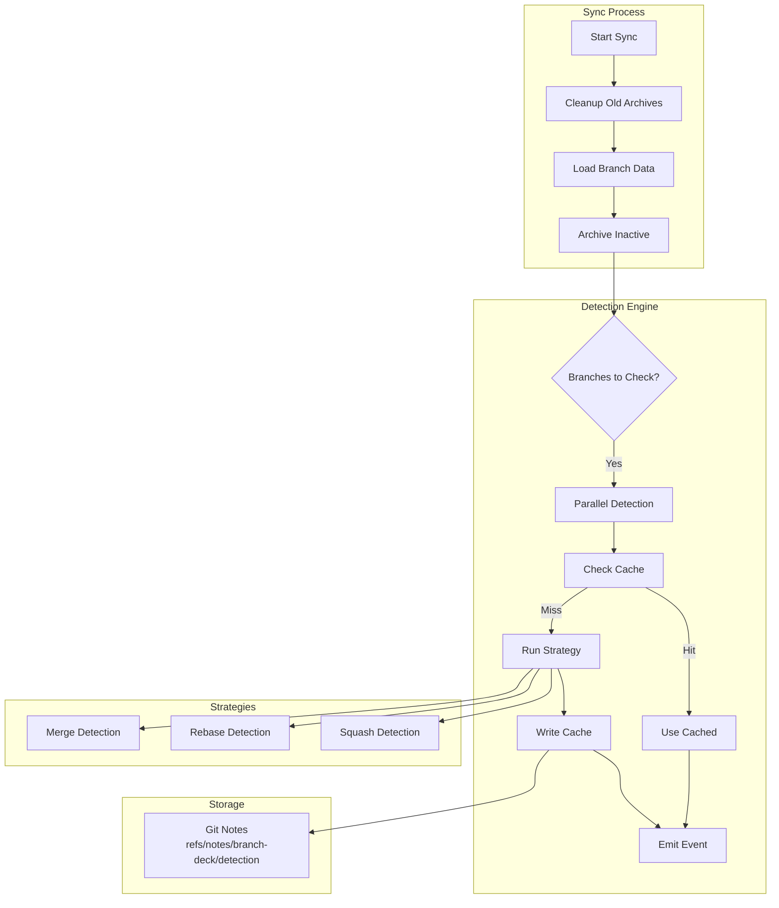

# Integration Detection and Caching

**Status:** Implemented  
**Updated:** 2025-08-22  
**Tags:** [git, performance, caching]

## Problem

Developers need to know which branches have been integrated into the baseline (merged, rebased, or squashed) to clean up completed work. Without detection, branches accumulate indefinitely, making it hard to distinguish active work from completed features.

Detecting integration is expensive - it requires analyzing commit history for every branch. Without caching, this becomes a performance bottleneck as repositories grow.

## Solution Overview

By default, detect branch integration using only the rebase/cherry-pick strategy for optimal performance. This fast detection covers most common workflows where commits are cherry-picked or rebased onto the baseline. Full detection including merge and squash strategies is available via environment variable when needed.

Results are cached as git notes on branch tip commits, providing instant lookups for unchanged branches while automatically invalidating when branches receive new commits. The system runs detection in parallel for performance, writes cache entries sequentially to avoid races, and uses compact JSON encoding to minimize storage overhead.

## Design

### Architecture

### Key Decisions

1. **Decision**: Use git notes for caching
   **Rationale**: Travels with repo, survives rebases, automatic invalidation when tip changes

2. **Decision**: Parallel detection with sequential cache writes
   **Rationale**: Maximizes performance while avoiding git notes write races

3. **Decision**: Compact JSON with abbreviated field names
   **Rationale**: 15-85% smaller cache entries, significant with thousands of branches

4. **Decision**: Default to Rebase strategy only
   **Rationale**: Fast cherry-pick detection covers most workflows; Full detection optional via env var

5. **Decision**: Cache all statuses, not just integrated
   **Rationale**: Avoid re-computation for any unchanged branch. The exception is a stacked branch: only `Integrated`
   is cached for it, because its result also depends on its parent

6. **Decision**: An archived stacked branch is detected from its stack base
   **Rationale**: Its virtual branch contains its parent's commits too. The sync writes a note on the tip of every
   rebuilt stacked branch (`refs/notes/branch-deck/stack`, the commit it was built on); detection reads those notes
   for the branches it detects afresh (one `log --no-walk --stdin`, one `cat-file --batch-check` for the bases that
   still exist) and excludes `^<base>` from the cherry-mark scans and the merge count, and uses the base as the merge
   base of the squash check

7. **Decision**: An integrated branch names the baseline commit that brought it in (`commit: UpstreamCommit`, with
   its id, author, committer and commit time; `integratedAt` is that commit time)
   **Rationale**: "Merged" alone doesn't say where the work is, or who pushed it (a Safe Push robot, a reviewer).
   Each strategy already finds the commit for the time, so the id and the names come from the same process, with
   `%H%x00%an%x00%cn%x00%ct` instead of `%ct`:
   - merge: the oldest merge on the ancestry path from the branch to the baseline;
   - rebase: the newest baseline commit that `--cherry-mark` marks as equivalent;
   - squash: the newest baseline commit whose message has the subject of the branch tip.

   The cache stores it as `"x": [id, author, committer]` (the time is `ia`); a note written before has no `x` and
   still parses, without a commit. The archived card shows it as "Merged as abc12345 by <committer>, 2 hours ago",
   with the full hash to copy.

8. **Decision**: `ArchivedBranchesFound` carries `newlyArchived`, the branches this sync archived
   **Rationale**: Archiving is the moment a branch landed; the archived card marks those rows "New" for the rest of
   the session, until the user dismisses what landed, instead of the branch silently moving into a collapsed card.

9. **Decision**: Landed commits are found by author email, author time and subject without the `(prefix)`, with the
   replay onto the upstream as the ground truth where it is known
   **Rationale**: Archiving sees only whole branches, and only after the update. A Safe Push robot, `git rebase` and
   `cherry-pick` keep the author, the author time and the message, and the pushed message is the local one without the
   prefix (see [Virtual Branches](virtual-branches.md)), so the key names the baseline commit that carries a local
   commit, with its committer (the robot), before and after the update and also partly (3 of 12 commits of a branch).
   Patch ids would miss a commit whose fixups the robot folded in. Where the check replayed the local commits onto the
   upstream, a commit `git replay` drops as empty is landed even without a key match: a fixup with its target, or a
   branch squashed into one commit (no upstream commit then). Without a replay (a commit the user squashed, reworded
   or dropped between two syncs is also gone), only key matches count.

   Three moments, three places, no overlap (`crates/sync-core/src/landed.rs`):
   - **Before the update** (the check of every sync, `BaselineStatus.landing`): the Update button says "brings in your
     wsm", the branch row shows "Landed", the commit row "in origin/master".
   - **The update** (`UpdateProjectResult.landed`): the toast leads with what landed.
   - **After it** (`BaselineStatus.landed`): the undismissed report in `branch-deck/landed.json` of the worktree's git
     directory, shared by the app and `bd`, shown as the Landed island until Dismiss (or 7 days). Each sync keeps where
     the branch was; when the merge base moved since (an update here or in the IDE, `git pull --rebase`), the commits
     that were local then and match the upstream now are added. Amend, reword and squash keep the merge base, so they
     cost nothing and report nothing.

### Implementation Notes

- **Detection Strategies**: 
  - Merge: Uses `git branch --merged` (see `crates/branch-integration/merge.rs`)
  - Rebase: Cherry-pick markers via `--cherry-mark` (see `rebase.rs`)
  - Squash: Diff comparison and tree matching (see `squash.rs`)

- **Cache Management**:
  - Stored at branch tip SHA, auto-invalidates on new commits
  - Versioned format for future migration
  - Compact encoding with field omission for defaults

- **Performance Optimizations**:
  - Batch fetch all branch data (tips and subjects in one `for-each-ref`, notes in one `log --no-walk --stdin`)
  - `detect_integrated_branches` is synchronous and runs in one `spawn_blocking`; fresh detections run on
    `std::thread::scope` workers bounded by `git_executor::concurrency::max_parallel_git_processes()`
  - Stream results as events for UI responsiveness; cache notes are written sequentially afterwards

## Alternatives Considered

- **External Database for Cache**:
  - Why not: Doesn't travel with repo, adds infrastructure complexity

- **File-based Cache in .git**:
  - Why not: Doesn't survive clones, manual invalidation needed

- **Commit Messages for Tracking**:
  - Why not: Requires modifying history, incompatible with existing repos

- **Always Detect Without Caching**:
  - Why not: O(n*m) complexity becomes prohibitive at scale

## Performance Considerations

- **Constraint**: Must handle 10,000+ archived branches
- **Solution**: Parallel detection, git notes for O(1) lookups
- **Measurement**: Detection + caching for 1000 branches < 5 seconds

Key optimizations:
- Single `git log --no-walk` fetches all notes
- Parallel detection with configurable concurrency
- "Detect once, cache forever" for integrated branches
- Compact cache format reduces I/O

## References

- Implementation: `crates/branch-integration/`
- Cache format: `crates/branch-integration/cache.rs`
- Detection strategies: `merge.rs`, `rebase.rs`, `squash.rs`; the integration commit format: `common.rs`
- UI: `src/stores/archived-branches.ts` (`newlyArchived`, `clearNewlyArchived`), `src/lib/integration-commit.ts`
- Tests: `crates/integration-detection-tests/`
- Related: [virtual-branches.md](virtual-branches.md)