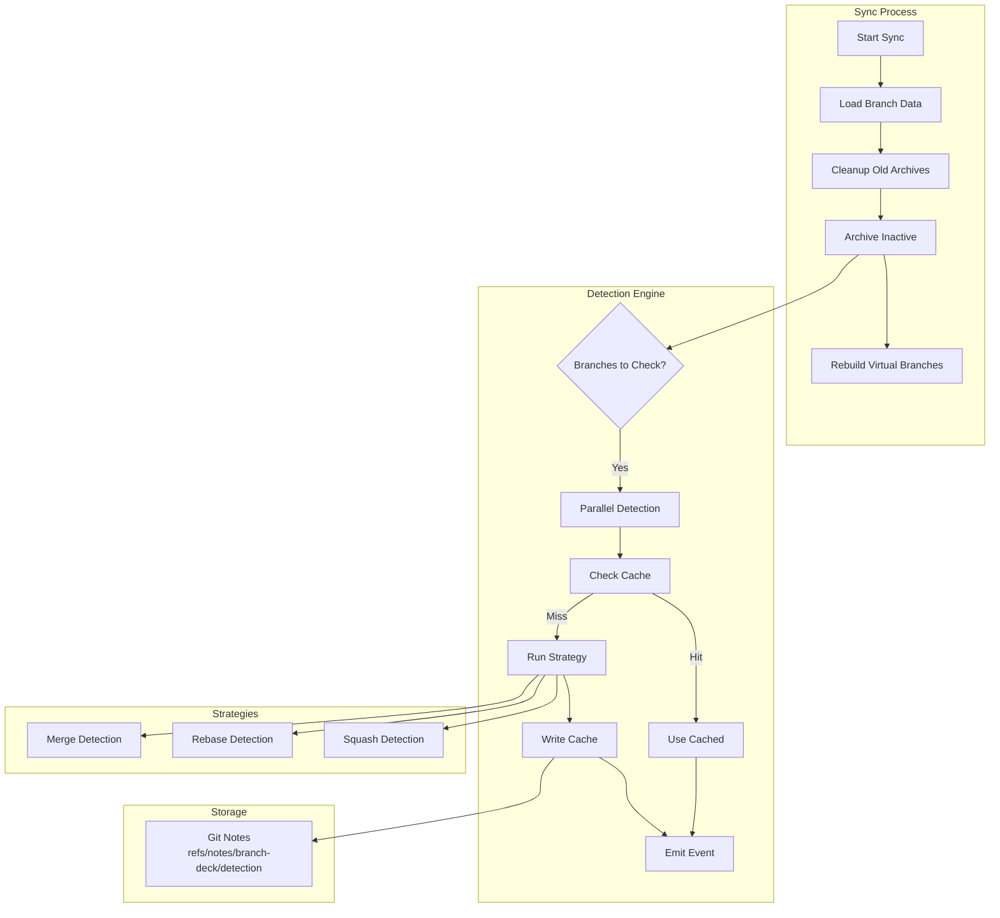

# Integration Detection and Caching

**Status:** Implemented  
**Updated:** 2026-10-24  
**Tags:** [git, performance, caching]

## Problem

Developers need to know which branches have been integrated into the baseline (merged, rebased, or squashed) to clean up completed work. Without detection, branches accumulate indefinitely, making it hard to distinguish active work from completed features.

Detecting integration is expensive - it requires analyzing commit history for every branch. Without caching, this becomes a performance bottleneck as repositories grow.

## Solution Overview

By default, detect branch integration using only the rebase/cherry-pick strategy for optimal performance. This fast detection covers most common workflows where commits are cherry-picked or rebased onto the baseline. Full detection including merge and squash strategies is available via environment variable when needed.

Results are cached as git notes on branch tip commits, providing instant lookups for unchanged branches while automatically invalidating when branches receive new commits or the baseline moves: a `NotIntegrated` result holds only for the baseline it was checked against, and is checked again against the baseline commits added since. The system runs detection in parallel for performance, writes cache entries sequentially to avoid races, and uses compact JSON encoding to minimize storage overhead.

## Design

### Architecture

### Key Decisions

1. **Decision**: Use git notes for caching
   **Rationale**: Travels with repo, survives rebases, automatic invalidation when tip changes

2. **Decision**: Parallel detection with sequential cache writes
   **Rationale**: Maximizes performance while avoiding git notes write races

3. **Decision**: Compact JSON with abbreviated field names
   **Rationale**: 15-85% smaller cache entries, significant with thousands of branches

4. **Decision**: Default to Rebase strategy only
   **Rationale**: Fast cherry-pick detection covers most workflows; Full detection optional via env var

5. **Decision**: A result is cached on the tip; a `NotIntegrated` one also records the baseline commit it was checked
   against (`b`) and its orphaned commits (`u`), and is checked again against the baseline commits since then when the
   baseline moved (`^<b>` in the cherry-mark scan)
   **Rationale**: `Integrated` and `Partial` are final for a tip, but "not integrated" is only true for one baseline:
   a note reused forever kept a merged branch "not integrated" in the archived card, and a stack parent "has no
   commits" instead of "landed" (a tip noted at 12:28, merged at 12:30, archived at 12:37 from the stale note). A full
   re-detection is no option for old archives (21.7 s for a 5-month-old one against 78k upstream commits, while the
   patch ids of one day of upstream commits cost 0.15 s). So `detect_archived_branches`:
   - `Integrated` or `Partial`, or `NotIntegrated` with `b` equal to the baseline: reported from the note;
   - `NotIntegrated` with a `b` the baseline descends from (`merge-base --is-ancestor`, one process per distinct `b`):
     the incremental recheck (`rebase::recheck_rebase_status`). The scan keeps the branch side as it is and shrinks
     the baseline side to the new commits: a commit still orphaned is one of `u` marked `>` again; other commits of
     the branch side (integrated before, or a parent's once the stack base of an archived child is gone) are left
     alone; one that left the branch side is reachable from the baseline now. None left: `Integrated` with the
     commit count of the note and the newest equivalent since the last check as the commit, or the tip itself when
     the commits left the branch side (a fast-forward: the tip is the baseline commit that brought the branch in);
     else `NotIntegrated` with the new counts and the newer of the integration times. The merge check runs as for
     a fresh detection; the squash check compares the whole branch with the baseline, so a recheck runs it only
     for a branch archived within the retention period;
   - `NotIntegrated` without `b` (written by version 1, before the baseline was recorded) or with a `b` the baseline
     doesn't descend from (rewound, renamed, a commit gone in a gc): detected in full once, but only within the
     retention period of the archive (`retention_days`, `ARCHIVE_RETENTION_DAYS` by default, against the date in its name). An older such note is
     reported as is, permanently: the bounded migration keeps a sync from spending seconds per old archive, and such a
     branch is never cleaned up (only `Integrated` archives are);
   - no note: a fresh detection.

   The jobs are one per tip: two archived names with one tip (an issue branch archived, then again under its new
   name) are detected once and reported under both. Every result is cached, a stacked branch's too: its stack base
   keeps its parent's commits out, and a `NotIntegrated` result is checked again when the baseline moves.

6. **Decision**: Detection compares commits, not names: a sync passes the baseline commit it read at its start
   (`RepoFacts`) to `detect_archived_branches` and `empty_parent_states_listed`; `detect_integrated_branches` and a
   read-only placement resolve it once (`resolve_baseline`, `rev-parse --verify <baseline>^{commit}`). The id goes into
   every range, `--merged=` and the squash `merge-tree`; the branch side is the tip the job was listed with
   (`DetectionJob.tip`), the branch name only names it in the results and the log. Every revision argument follows
   `--end-of-options` (`b` and the stack base come from notes).
   **Rationale**: A fetch runs without the repository lock, so `origin/master` may move during a sync. With the id, the
   scanned range and the `b` recorded in the note are the same commit by construction, and the same one the remote
   statuses and the update check of the sync compare with. The result is cached on the tip, and git resolves a name to
   a tag of the same name before the branch: detected by the name, a branch whose name is also a tag was the tag's
   commit, cached on the branch's tip.

7. **Decision**: An archived stacked branch is detected from its stack base
   **Rationale**: Its virtual branch contains its parent's commits too. The sync writes a note on the tip of every
   rebuilt stacked branch (`refs/notes/branch-deck/stack`, the commit it was built on); detection reads those notes
   for the branches it detects afresh (one `log --no-walk --stdin`, one `cat-file --batch-check` for the bases that
   still exist) and excludes `^<base>` from the cherry-mark walk and the merge count, and uses the base as the merge
   base of the squash check

8. **Decision**: An integrated branch names the baseline commit that brought it in (`commit: UpstreamCommit`, with
   its id, author, committer and commit time; `integratedAt` is that commit time)
   **Rationale**: "Merged" alone doesn't say where the work is, or who pushed it (a Safe Push robot, a reviewer).
   Each strategy already finds the commit for the time, so the id and the names come from the same process, with
   `%H%x00%an%x00%cn%x00%ct` instead of `%ct`:
   - merge: the oldest merge on the ancestry path from the branch to the baseline; the branch's commits are the ones
     it brought in (`rev-list --count <tip> ^<merge>^1`, and `^<stack base>`), not the baseline commits before or after
     it. Without such a merge, or with one whose first parent has the tip already (the branch was fast-forwarded, the
     merge is a later one), the merge check has no result and the cherry-mark scan names the tip;
   - rebase: the newest baseline commit that `--cherry-mark` marks as equivalent, from the same walk that counts the
     branch side (see "Implementation Notes");
   - squash: the newest baseline commit whose message has the subject of the branch tip.

   The cache stores it as `"x": [id, author, committer]` (the time is `ia`); a note written before has no `x` and
   still parses, without a commit. The archived card shows it as "Merged as abc12345 by <committer>",
   with the full hash to copy; the "Integrated" column shows the time once.

9. **Decision**: The archive step runs before the virtual branches are rebuilt, best effort, by namespace
   **Rationale**: `archive_and_clean_up` (cleanup and archive, ref writes only) runs right after the grouping;
   `detect_archived_branches` then runs beside the rebuild. Run beside it, the archive raced the rebuild of a renamed
   group: `(foo)` renamed to `(foo/bar)` can't create `virtual/foo/bar` while `virtual/foo` exists (git's
   directory/file rule). Each step is one `RefTransaction` with the tips read as old values (`branch-deck: archive`,
   `branch-deck: clean up archived branches`); a failure, e.g. a tip `bd` moved in another process (the app's sync takes
   no repository lock), leaves everything in place for the next sync and still detects the archived branches. A branch
   checked out in a worktree (`%(worktreepath)` of the one `for-each-ref`) is neither archived nor cleaned up: an
   `update-ref` delete would leave that worktree on an unborn branch. A branch is virtual or archived by its namespace
   (`strip_branch_namespace`, `BranchKind::Archived`), never by a `/virtual/` anywhere in it: a group name may contain
   one, and an unapplied branch named `x/archived/y` must not be cleaned up. A detection that fails leaves no result;
   when the sync ends, the UI shows such a row as "Not checked" (`settleArchivedPlaceholders`).

10. **Decision**: `ArchivedBranchesFound` carries `newlyArchived`, the branches this sync archived
   **Rationale**: Archiving is the moment a branch landed; the archived card marks those rows "New" for the rest of
   the session, until the user dismisses what landed, instead of the branch silently moving into a collapsed card.

11. **Decision**: Landed commits are found by author email, author time and subject without the `(prefix)`, with the
   replay onto the upstream as the ground truth where it is known
   **Rationale**: Archiving sees only whole branches, and only after the update. A Safe Push robot, `git rebase` and
   `cherry-pick` keep the author, the author time and the message, and the pushed message is the local one without the
   prefix (see [Virtual Branches](virtual-branches.md)), so the key names the baseline commit that carries a local
   commit, with its committer (the robot), before and after the update and also partly (3 of 12 commits of a branch).
   Patch ids would miss a commit whose fixups the robot folded in. The key's subject is the one the virtual branch
   commit was pushed with (`stripped_subject`), so a fixup of a prefix branch, pushed without its marker, matches its own
   upstream commit. The key names a candidate; only a proof leaves a local commit out of a replay. Before every replay,
   the check pairs each local commit with the upstream commit of its key, one to one, and proves the pair by a ladder
   (`landed_pairing::pair_twins`): the same patch id; a cherry-pick onto the upstream commit's own parent that writes
   its tree (`replayed`: twins that landed in another order, whose context lines differ); the same changed lines, paths
   and modes (`changed_lines`: a cherry-pick that conflicts on the line next to it). A proven twin is never replayed: a
   clean merge of it onto other context can add its lines a second time. When the replay conflicts, the check also
   pairs the commits of the same patch id under another key, once (`landed_pairing::pair_landed`). A proven commit
   landed as its upstream commit, also under a reworded message. When the replay conflicts because the robot folded
   fixups into their target, the update leaves the candidates out too if a `merge-tree` of each candidate's change
   proves nothing local is lost (see "Update project" in [Git Operations](git-operations.md)). Where the check
   replayed the local commits onto the
   upstream, a commit `git replay` drops as empty is landed even without a key match: a fixup with its target, or a
   branch squashed into one commit (no upstream commit then). Without a replay (a commit the user squashed, reworded
   or dropped between two syncs is also gone), only key matches count.

   Three moments, three places, no overlap (`crates/sync-core/src/landed.rs`; the pairing by key and by patch id is
   `crates/git-ops/src/landed_pairing.rs`):
   - **Before the update** (the check of every sync, `BaselineStatus.landing`): the Update button says "brings in your
     wsm", the branch row shows "Landed", the commit row "in origin/master".
   - **The update** (`UpdateProjectResult.landed`): the toast leads with what landed.
   - **After it** (`BaselineStatus.landed`): the undismissed report in `branch-deck/landed.json` of the worktree's git
     directory, shared by the app and `bd`, shown as the Landed island until Dismiss (or 7 days). Each sync keeps where
     the branch was; when the merge base moved since (an update here or in the IDE, `git pull --rebase`), the commits
     that were local then and match the upstream now are added. Amend, reword and squash keep the merge base, so they
     cost nothing and report nothing.

### Implementation Notes

- **Detection Strategies**: 
  - Merge: `for-each-ref --merged=<baseline>`, then the merge that brought the tip in (see `crates/branch-integration/src/merge.rs`)
  - Rebase: one walk of both sides, `log --no-merges --left-right --cherry-mark --source
    --format=%m%x00%S%x00<UPSTREAM_COMMIT_FORMAT> --end-of-options <baseline>...<tip> [^<stack base>] [^<b>]`
    (`rebase::scan_cherry_marks`): the patch ids of both sides are the cost of a cherry-mark walk, so the counts of the
    branch side and the integration commit come from one. `%m` is `=` for an equivalent commit of either side, so the
    side of one is `%S`, the revision it was reached from (the tip for the branch side; `rev-list` has no `--source`).
    The format has no placeholder that `log.*`, `notes.*` or a `.mailmap` change (`%an`, not `%aN`)
  - Squash: one `merge-tree --write-tree` of the tip into the baseline (with `--merge-base=<stack base>` for a stacked
    branch, else git finds the merge base) is clean and gives the baseline's tree: every change of the branch is in the
    baseline, an empty one too (`squash::SquashCheck`). The baseline tree is read once per detection, the tip subject
    for the integration commit (`log -F --grep`) comes from the branch listing

- **Cache Management**:
  - Stored at branch tip SHA, auto-invalidates on new commits
  - Versioned format (`"v": 2`): `{"v":2,"s":{"k":"n","tc":2,"ic":1,"oc":1,"ia":1760000000,"b":"<baseline id>","u":["<id>"]},"sum":"…"}`.
    `b` and `u` are written only for `NotIntegrated`, always both: `u` lists exactly the commits a recheck compares, so
    the branch side may grow (the parent's commits of an archived child whose stack base was pruned) without them ever
    counting as orphaned. `CachedDetection { info, check: Option<Recheck { baseline, orphaned }> }` is what a note
    parses to (`check` is `None` for a final result and for a note without `b` or `u`); `BranchIntegrationStatus`,
    sent to the UI, has neither field
  - Compact encoding with field omission for defaults
  - `empty_parent_states` (stacked branches) applies the same rule (`BaselineAncestry::plan`) to the virtual or newest
    archived branch of a parent without commits before the placement: a note that holds labels the parent, a
    `NotIntegrated` note the baseline moved on from is rechecked incrementally, a note without a usable `b` is detected
    in full (an archived parent only within the retention period). So the parent is "landed" on the first sync after
    its merge, and in `bd status`, which writes no notes

- **Performance Optimizations**:
  - Batch fetch all branch data: the tips in one `for-each-ref` that reads no commit (`list_branches`, which a sync
    reads with its other refs and passes to `archive_and_clean_up_listed`), the detection notes with the subjects and
    the committer times of the tips in one `log --no-walk --stdin` (`git_ops::notes::read_noted_commits`), which orders
    the archived branches newest tip first; the stack notes are read by `git_ops::notes::read_notes` (commit -> note of
    one notes ref)
  - `archive_and_clean_up` and `detect_archived_branches` are synchronous, each in one `spawn_blocking` (the first
    before the rebuild, the second beside it; `detect_integrated_branches` runs both); fresh detections run on
    `std::thread::scope` workers, each job in a slot of a `git_executor::concurrency::ProcessPermits`, which a sync
    shares with its branch builds, so the two together stay within `max_parallel_git_processes()`
  - Stream results as events for UI responsiveness; cache notes are written sequentially afterwards

## Alternatives Considered

- **External Database for Cache**:
  - Why not: Doesn't travel with repo, adds infrastructure complexity

- **File-based Cache in .git**:
  - Why not: Doesn't survive clones, manual invalidation needed

- **Commit Messages for Tracking**:
  - Why not: Requires modifying history, incompatible with existing repos

- **Always Detect Without Caching**:
  - Why not: O(n*m) complexity becomes prohibitive at scale

## Performance Considerations

- **Constraint**: Must handle 10,000+ archived branches
- **Solution**: Parallel detection, git notes for O(1) lookups
- **Measurement**: Detection + caching for 1000 branches < 5 seconds

Key optimizations:
- Single `git log --no-walk` fetches all notes
- One cherry-mark walk per detected tip, for the counts and the integration commit alike; the processes of a detection
  by subcommand are pinned in `crates/branch-integration/src/process_budget_test.rs`
- Parallel detection with configurable concurrency
- "Detect once, cache forever" for integrated branches; a not integrated one costs one scan of the new baseline
  commits per baseline move
- Compact cache format reduces I/O

## References

- Implementation: `crates/branch-integration/`
- Cache format: `crates/branch-integration/src/detection_notes.rs`
- Detection strategies: `merge.rs`, `rebase.rs`, `squash.rs`; the integration commit format: `common.rs`
- UI: `src/stores/archived-branches.ts` (`newlyArchived`, `clearNewlyArchived`), `src/lib/integration-commit.ts`
- Tests: the detection without a sync in `crates/branch-integration/src/*_test.rs` (`archive_cleanup_test.rs`,
  `detection_notes_test.rs`, `process_budget_test.rs`), the detection a sync runs in
  `crates/sync-core/src/detection_*_test.rs` (helpers in `detection_test_helpers.rs`, the shared fixtures in
  `crates/test-utils/src/sync_fixtures.rs`)
- Related: [virtual-branches.md](virtual-branches.md)