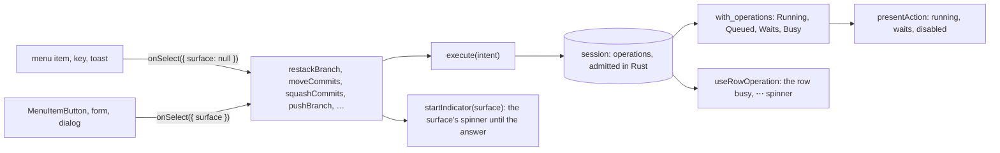

# Running Operations

**Status:** Implemented  
**Updated:** 2026-10-28  
**Tags:** [frontend, actions, ux, concurrency]

## Problem

An action of the app (Unstack, Move, Squash, an amend) is a backend command and then the sync that shows its result.
Nothing recorded that it runs: a menu item's `onSelect` started it and forgot it, and the only guard
(`getRewriteBlocker`) disabled the rewrites during the sync, which starts after the command returns. A triple click on
"Unstack from air" in the notice of the expanded row sent three `restack_branch`: the backend ran them one after the
other under the repository lock, and the second and third, reading the stack the first had changed, failed with
"tool-events is not stacked" in two sticky error toasts.

The busy state that did exist was kept in a different place per action, nine of them: `activeInline.processing` of the
inline forms, `applying` of the conflict fix, `useState` flags in the Safe Push popover, the move form, the squash
dialog, the commit message editor, and the push, Safe Push, robot, pull request and Update Project stores. Each
covered only its own surface; another surface of the same action (the menu, a key, the review window) neither saw it
nor waited for it. The rule "one busy indicator per operation" of [UI Theme](ui-theme.md) was written, but nothing
held it.

## Solution Overview

One registry of the operations that run, the session's in Rust (`operations::registry`, admitted by
`domain_policy::admission`), and one way to start an action: `execute` of its intent. The registry is a part of the
view (`RepositoryView.operations`), so every window and every surface reads the same operations:

- **join**: a second start of the same intent (a double click, the same item in another surface or window) runs
  nothing and gets the answer of the first;
- **queue**: a rewrite while another rewrite or Update Project holds HEAD waits for it and runs after it, in the order
  of the starts, never refused; its menu item stays enabled and says what its start waits behind ("Waits for Unstacking
  tool-events…"). A remote action whose resource an operation holds (a ref a push writes, a field of a pull request, a
  robot) is disabled with that operation's busy state ("Pushing branch login…", "Restarting robot r1…");
- **one indicator**: the surface that started it shows the spinner until its answer; a start from a menu, a key or a
  toast shows it on the "⋯" of the object's row;
- **the whole action**: a rewrite ends once it asked the sync that shows its result, and its `execute` answers once
  that sync ended: its toast comes beside what it changed.

Rust lays the operations over the actions of the view (`domain_policy::actions::with_operations`): the item of an
intent that runs or waits is `Running` or `Queued`, a rewrite that can start `Waits` behind the newest holder of HEAD,
a remote action behind an operation that holds what it needs `Disabled(Busy)`. The page presents them
(`src/presenters/actions.ts`) and keeps only what a window alone knows: which of its surfaces started an operation
(`src/stores/indicators.ts`). Every rewrite of the page (Move, Rename, Stack On, Unstack, Ungroup, Park, Unpark,
Reword, Squash, Squash Fixups, Amend, Add Issue Reference, Apply Fix, Unapply, Reapply, Pick Remote Commits, the
deletes of an archived and an unapplied branch, and their Undo), the pushes, the starts of a robot, the writes to GitHub
and YouTrack, Update Project, the Fetch of a merge toast and Dismiss Landed are operations of the session
([Rewrites](#rewrites), [Update Project](#update-project)).

What has no repository as its subject is no operation of a session: the sign-in of an account (the token is one for
the app, and Settings opens without a repository) is a command of the app, `sign_in` with its events on the channel of
the call, `cancel_sign_in` and `sign_out` (`remote_facts::sign_in`: GitHub, YouTrack and the `youtrack` CLI;
[GitHub Sign-In](../../spec/repository/github-sign-in.spec.md), [YouTrack](../../spec/repository/youtrack.spec.md)).
It joins as an operation does: one sign-in of each provider runs, a second call of the same request hears its current
event and gets its end, another request of the provider (a pasted token, another YouTrack) ends it first; its status
is the fact `auth` of every session, which the host has read again after a sign-in or a sign-out.

So every command of the app that writes is `execute` or `cancel_operation` of the engine, or a command of the app
with its one writer and the reason no session admits it: the ticket of a sync and the focus of a window (the session's
own), the cancel of a read, the page's journal, the writers of the settings (`set_setting`, `set_repository_config`,
the links of Reviews, each serialized per file), the app itself (its menu, its CLI, its update, its restart), the CLIs
of Settings → Tools and the accounts. The class is part of the entry of each command in the registry of app-api
(`crates/app-api/src/commands.rs`: `read`, `engine`, or `app(<reason>)` with an `AppReason` of `registry.rs`), so a
new command is classified where it is declared; `registry_test.rs` pins the two of the engine, and
`crates/test-server/src/command_registry_test.rs` lets no E2E test answer a write in the page.

## Design

### The record

An operation of the session (`RunningOperation`) is its intent, the resources it holds, its step, its origin (this
process or another, `Origin`), the moves of rows it makes and how many requests joined it. The page keeps no record of
its own: `startIndicator(surface, label)` (`src/stores/indicators.ts`) remembers which surface of the window started
it and the busy state the window gave it ("Unstacking oauth from login"), from the click until its `execute`
answered, its operation by its id once the channel of the `execute` named it.

### Conflicts

`domain_policy::admission` is the one rule of the registry, and `domain_policy::actions::with_operations` lays the same
operations over the actions the surfaces offer.

1. **The same intent** joins: the answer of the running one, also of one that waits. An intent names what it acts on
   (the commits and the target of a move, the commit and the message of a reword, the commits and the message of a
   squash, the files of an amend, the key of an added issue reference, the table it was asked on): a drag of another
   commit of the branch onto the same target is a move of its own, which waits in the queue, never one that resolves
   with the first and moves nothing. A menu item names no commits, files or message, so Move to…, Amend Changes… and
   Add Issue Reference… only wait; the items of the intents they name in full (Rename, Stack On, Unstack, Ungroup,
   Squash Fixups, Unapply, Park, Unpark, Pick Remote Commits, a push, a restart, a cancel) show running.
2. **A rewrite waits for any rewrite of the process, in the queue of the session.** Every rewrite holds HEAD
   (`Resource::Head`; the deletes only the ref they drop); the session runs them one after the other, each on what the
   one before it left, as the triple Unstack showed it must, and its item says what its start waits behind (`Waits`).
   A rewrite is never refused; what it acts on the session reads when it runs, in the repository of its click
   (`repositoryPath`), whichever the main window shows by then: a move, a squash, a reword, an amend and an added issue
   reference name the commits on the table the window showed (`TableWitness`), and the session resolves them on HEAD
   as the rewrite before it left it (by the new ids that rewrite reported, else by the commit key after its sync); a
   commit that is gone changes the plan (`plan_changed`). A branch goes by its name. The check and the move of Update
   Project wait behind them in the queue of the session, and the rewrites after it behind them ([Update
   Project](#update-project)).
3. **A remote action waits for an operation that holds what it needs**: a push for the push of a stack that sends its
   branch, a cancel for the restart of its robot, a retarget for a review request that pushes first. In the process the
   registry queues it; its item is disabled meanwhile with that operation's busy state (`Busy`), as an action another
   process runs is (the registry of the repository refuses it as `busy`). A retarget and a review request of one pull
   request hold other fields of it (`PullRequestField::Base`, `Reviewers`) and run side by side, unless the review
   request pushes first, which may retarget it too.
4. **A rewrite and a remote action run side by side**, but a push: it waits behind the rewrites of the process admitted
   before it (`RunningGuard::wait_behind`, its step `Queued`, holding no HEAD, so a rewrite after it runs at once) and
   for the sync they end with, then is decided again on what they left: it sends the branches as they leave them.

A sync is no operation and disables no rewrite (C14): a rewrite started during one goes to the session at once (an Undo
in a toast during the auto-sync on focus, a drag during a held sync), named on the table the window shows; the app's
sync writes no HEAD, so the rewrite runs once HEAD is as its witness says, and the session's scheduler runs one more
sync after it (`AfterRewrite`), which reads the result. Only the push waits for a sync that rebuilds its branch
(`ActionBlocker::Syncing`): its virtual branch is not built yet.

### Items

Rust decides the state of every action of a subject with the operations laid over it (`RepositoryView.actions`,
`Availability`): `running` and `queued` (its intent runs or waits: disabled, a spinner in place of its icon, a start
joins it), `waits` (enabled, its start queues behind the operation named), `disabled` with `Busy` (a remote action
behind the operation that holds what it needs) or any other reason. `presentAction` words them: an item that runs or
waits as its operation says the busy state the "⋯" of its row says (`presentOperationBusy`: "Unstacking oauth…",
"Unstacking oauth after the sync…", "Waits for Moving 1 commit to docs…", whom it waits for while another holder has
the repository lock), the operation named by the words of its surface where it has its own (a restart: "Restarting the
Safe Push…"); an item that waits behind an operation or that one keeps busy names it ("Waits for Unstacking oauth…",
"bd: Pushing auth…"). The name of an operation of this window is the one it gave it (`BlockerWords.named`, which the
caller selects with the operations: `useOperationWords` while an item of it runs, waits or is busy,
`getOperationWords` for a builder), of another process its row's ("bd: Pushing auth"; such an operation only keeps an
item busy, none runs or waits as it), else the view's; one rule names it, for the items and the "⋯" of its row alike
(`presentOperationLabel` of `src/presenters/operations.ts`). The commit menus are the page's and stay enabled: their move, squash and reword queue in the session. A surface
that renders a builder reads it through a selector cached by the states of the stores it reads, the view and the
indicators among them (`useBranchMenu`, `menuSources`): a store read inside a builder that the React Compiler memoizes
would show a stale menu ([Rendering Performance](rendering-performance.md)). A disabled submenu (Stack On ›) is an item
that says why on hover.

`MenuItem.onSelect` takes a `SelectContext`: `{ surface }` of the button that started it, `FROM_MENU` (`surface:
null`) for a menu, a key or a toast. The action passes it to its indicator (`startIndicator`).

A surface that is no menu runs the item itself (`selectMenuItemById`, `findMenuItem` in `src/lib/menu.ts`), so it
can't miss a reason the builder knows: the keys of a branch row (P, D, O, M, `selectRowItem`; a disabled or running
item says why in an `info` toast) and the review window, which asks the main window to run an item by its id; the main
window relays the items unchanged, running ones included, and a request of one that runs is that start already (a
click in the window and on the row at once run it once). A toast's action (Undo, the unstack the move offers) calls the
action itself, which waits or joins as any start does.

### The indicator

A surface that stays while its action runs claims its key (`useIndicatorClaim`, a count per key in
`src/stores/indicators.ts`) and shows the spinner of what it started from the click until its `execute` answered
(`startIndicator`, `useSurfaceBusy`, its words those of its operation in the view once the channel named it): a
`MenuItemButton` with a `surface` (the Unstack of the notice, `unstack-alert:<branch>`), an inline form
(`inline:<branch>`, its progress row in place of itself), the Safe Push popover (its status line), the squash dialog,
the commit message editor, the move form, Apply Fix. An operation of the view whose surface has no mounted claim (a
menu, a key, a toast, a popover the click closed, another window, another process) shows its spinner on the "⋯" of the
row it is about (`useUnclaimedOperation`, `MoreActionsMenu busy`; of a move the row of its first commit), and of the
branch preview's header while it is open. Every row an operation of the view works on is busy (`useRowOperation`,
`worksOnRow`: a rewrite of the branch or of its commits, the retarget of its pull request): no right-click menu, "⋯"
disabled, no drag, no push; a push or a start never holds its row.

### Waiting for the repository lock

The session orders the rewrites of the app; another process (an agent's `bd pick --follow`, a `bd` rewrite) or a push
of the app may still hold the repository lock when a rewrite reaches its core. An operation of the app waits for the
app's own ones in the line of its process (a fair queue before the file lock, in the order they came, never refused),
then for another process as long as the holder lives (the undo of a pick and of an update for a bound, as `bd undo`;
[Git Operations](git-operations.md), "Repository lock"), and its
step in the view says whom for: `waitingForLock` with the holder ("Waiting for `bd pick` (pid 4242, for 12 s)", told
again about once a second, `presentLockWait`), `queued` behind another operation (the busy state of that one).
`operationBusyOf` (`src/stores/indicators.ts`, `presentOperationBusy` of `getOperationWords`) says it in place of the busy state, so every
surface of the operation shows it, in every window: the spinner's hover on the "⋯" of its row
(`useUnclaimedOperation`), its item in the menus, the label of a `MenuItemButton`, the progress row of an inline form,
and `LockWaitNotice` on the surfaces that show their own busy state (the squash dialog, the commit message editor, the
move form, the squash of the fixups, Apply Fix).

Stop Waiting is one builder, `presentStopWaiting(waitingOf(operation))` of `src/presenters/lock-wait.ts` (null while it
waits for nobody, and for an operation of another process), and every surface that shows the waiting operation renders it: the "⋯" opens a menu of it, a `MenuItemButton`
and an inline form show it beside themselves, `LockWaitNotice` beside the text. It calls `cancel_operation` of the
operation: the rewrite answers the code `canceled`, nothing changed, and says so in an info toast ("Canceled squashing
2 commits before it started", `canceledBeforeStart`), never an error; the surface that started it stays (the squash
dialog keeps its message). A push and a Safe Push start, operations of the session too, say it in their step in the
view (`OperationStep.waitingForLock` with the holder its record names, so every window says it): the hover of the push
button (`useBranchPushProgress`, `lockWaitProgress`) and the step of the Safe Push (`LandRun.waitingFor`), each with
its Stop Waiting (`stopWaitingPushItem`, `stopStartItem`: `cancel_operation` of the operation). Update Project says it
in the run of its window (`UpdateRun.lockWait`, from the step `waitingForLock` its channel tells), with Stop Waiting
beside the Update button: `cancel_operation` of its operation, nothing changed but the fetch.

### Rewrites

`runRewriteIntent(spec, rewrite)` (`src/lib/rewrite-run.ts`) runs every rewrite of the page, a rewrite of the engine
(`execute` of the intent `rewrite`, no `prepare`: the rewrite names the table the window shows, `TableWitness` of the
view's header, and asks nothing to accept): Move (a drag, Move to…, Remove Prefix), Ungroup (the intent `ungroup`, the
move back of the commits the branch has when it runs), Rename, Stack On,
Unstack, Park, Unpark, Reword, Squash, Squash Fixups and Squash Into, Amend, Add Issue Reference, Apply Fix, Unapply,
Reapply, Pick Remote Commits, the deletes of an archived and an unapplied branch (`deleteKeptBranch`), and the Undo of
each (`undoRewrite`, the rewrite `undo` of the token of its outcome, in the repository of the click: a regroup's token,
a squash's `<previous>..<new>`, `unapply:`, `reapply:`, `pick:`). The session admits it: a second click of the same
rewrite joins it, another rewrite waits behind it in the queue of the session (an Undo clicked during an Unstack, a
second drag during a move, a rewrite during a sync: no info toast, its rows say "Waits for Unstacking tool-events"),
each decided again on what
the one before left; it ends once it asked its sync, and its `execute` answers once that sync ended, with the version
of its last patch, which the page waits for (`whenSessionViewAt`) before its toast with Undo. A delete asks no sync: its
answer names the patch that removed its row. The view shows it on every surface from its admission until it asked its
sync (`RepositoryView.operations`, the actions Rust lays it over); the surface that started it shows its spinner from
the click until the answer (`startIndicator`); the page queues nothing. A failure is an error toast in the words of the rewrite (`presentRewrite`) or
the title its caller gives, a stopped wait an info toast. The toast closes and the Activity entry (naming the operation)
says "undone" only once the undo undid it (`recordRewrite`); after a failed or stopped one both keep their Undo.

The inline forms run `withRowProgress` around their action, an operation that tells its outcome itself (rename,
ungroup, park, amend, add issue reference, unapply, squash fixups, the deletes, the close of the stack's pull request):
the form shows its progress row while it runs and closes once it is done, or comes back with its input after a
failure where it has one.

The family in the engine is `Intent::Rewrite` ([Rewrite in the engine](git-operations.md#rewrite-in-the-engine)):
each holds `Resource::Head` (a delete only `Resource::Ref` of the branch it drops, a reapply that ref too), so a second
click joins it, another rewrite of the process (an undo too) waits in the queue of the session and is decided again on
what it left, and a push waits behind it without holding HEAD (`RunningGuard::wait_behind`); a wait for the lock is its step `WaitingForLock`, stopped by
`cancel_operation`, and on a table seeded from a frame its wait for the first sync of the session is the step
`WaitingForSync`, stopped the same way (`RunningGuard::stopped`; decision 3); every step the queue gives it (`Queued` behind another, then the step it starts at) goes to its
caller as the view shows it.

The rewrites of `bd` (`bd group`, `rename`, `restack`, `unstack`, `reword`, `fold`, `park`, `unpark`, `unapply`,
`reapply`, `undo`, `move-hunk`), `bd update` and `bd pick` are records of the operations registry of the repository,
as the app's operations are (`bd_core::operation_record::recorded`): before the command takes any lock, its record
goes into the file as the intent of the app's family (`Intent::Rewrite`, `Intent::UpdateProject`, `Intent::Pick`;
`bd group` and `bd move-hunk` as `RewriteIntent::Group` and `RewriteIntent::MoveHunk`, which only `bd` runs: the
engine of the app refuses them and a pick as `invalid_arguments`), holding what the app's admission of it holds
(`engine::unplanned_request`: HEAD, the kept branch of a reapply); it leaves with the end of the command, before its
`--sync`, its entry in the journal under the `operation_id` of its JSON with what the command cost. HEAD makes no
other process busy, nor does the same rewrite of another process (`Intent::ordered_by_repository_lock`): the
repository lock orders them, and the second runs on what the first left. So the record is what the windows show of an
agent's rewrite ("bd: Unstacking beta…") and what Activity lists of it ("Unstacked beta", an agent's marked); a record
of a `bd` killed in its rewrite leaves at the next admission, and no window shows it once its process is gone. Three
Unstacks of beta, two of the app and one of an agent, are one rewrite of the app and the agent's `invalid_plan` ("beta
is not stacked") once it got the lock.

### Remote actions

- **The robot**: its restart (with the push first of a robot whose branch moved past its commit) and its cancel are
  operations of the session in Rust (`RestartRobot`, `CancelRobot` of `operations::robot`, holding `Resource::Robot`;
  `src/lib/robot-run.ts` runs them with `runIntent` of `src/model/intents.ts`): Rust lays the one that runs over the actions of its robot
  (`robot:<id>`: the restart or the cancel `Running`, the other `Busy` behind it), so the slot, the details and the
  landing overview show it (a spinner in place of its icon) in every window; a second restart joins it in Rust, and a
  cancel during it waits there.
- **The pull request**: the retarget of the next step (`retargetToTarget`: the retarget an operation of the session,
  `Retarget` of `operations::pull_request`, which holds its base, so a review request of it runs beside; its row busy
  and its item running in the slot, from the view). The creation, "Continue on GitHub" and "Request Review…" are operations
  of the session in Rust (`CreatePullRequest`, `RequestReview` of `operations::pull_request`; `src/lib/pull-request-run.ts`
  runs them with `runIntent`), each with its push first: the creation holds the head of its subject (a second submit joins
  it, another text waits for it and is decided again), a review request the reviewers of its pull request; the dialog
  and the popover read theirs from `RepositoryView.operations` (`pullRequestOperationIn`), in every window.
- **The review of a pull request**: Approve, Request Changes and Approve and Safe Push are an operation of the session
  in Rust (`SubmitReview` of `operations::review`, holding the review of the pull request: a second write of it waits,
  the same one joins); `getReviewBusy` reads them from `RepositoryView.operations`, for the review list and the review
  window (`ReviewWindowState.busy`).

The next step reads the operation of the view on its row (`busyOf`, `useRowOperation`): the slot's own action runs
(`running`, a retarget), the others wait with its busy state, but an action that writes another field of the pull
request.

### Update Project

Update Project (⌘T, `runUpdateProject`), the Fetch of a merge toast (`runFetchBaseline`) and Dismiss Landed
(`dismissLanded`) are operations of the session (`execute` of the intents `updateProject`, `fetchBaseline` and
`dismissLanded`, `operations::update`; [Git Operations](git-operations.md), "Update project"):

- **The fetch** is the operation `FetchBaseline`, holding the tracking ref of the baseline: a Fetch of any window
  during the fetch of an update joins it, and the fetch of an update during a Fetch joins that one, so one transfer
  serves both; the fetch lock joins a fetch of another process (an agent's `bd update`).
- **The update** holds nothing while its fetch runs, so a park, an Unstack or an Undo during the network runs at once;
  then it holds HEAD (`Resource::Head`, `RunningGuard::hold`): it waits behind the rewrites of the process before it
  (its step `queued`, the run's `waiting`), and a rewrite pressed during its check or its move waits behind it, never
  refused. A second ⌘T joins it. Its check runs before the repository lock, its wait for another holder is its step
  `waitingForLock`, stopped by `cancel_operation`.
- **The end**: the operation asks the sync after its fetch and its move, then ends; the toast comes with its outcome
  (the `done` event), and an applied update answers once that sync ended, which is the last step of its run. A failure
  after the fetch is the failed `update` effect of the outcome: a toast, with "Retry Without Fetch" for an error the
  same request may pass (`retry: same`), the intent with `fetch: false`.
- **The page** keeps the run it shows of each repository (`src/stores/update-project.ts`): its steps and the percent of
  its fetch from the channel of its `execute` (`update-progress.ts`; they tick too often for the view), one run per
  repository, an update pressed during the Fetch of a toast going on from that fetch with its check, and the outcome
  of an operation told once, also to a start that joined it. The hover of the idle Update button names the rewrite that
  holds HEAD as the view shows it (`useHeadWait`), which the check of an update would wait for.

### Review fetch

The review window fetches the pull request it shows as an operation of the session of its repository (`execute` of
`fetchReview { number }`, `operations::review_fetch`; [Git Operations](git-operations.md), "Review fetch"): its head
and its base as the review requests of the session name them, its review refs held (`Resource::Ref`), so the fetch of
the same pull request from another window joins it. Its first step names its operation: a newer request of the window
stops it (`cancel_operation`), and the close of the window that started it stops it too (`WindowFetches` of the app,
by the label of the window). The review refs are pruned by the session, not by an operation: at each change of the
review windows of its demand.

### Moves

An action that is the move of a row says so: the node of the row reads the moves that run before the next step, so a
row leaves the user's moves at the click, on every surface that starts the action, not when Patronus or GitHub answer
([Landing](landing.md)). A move (`RunningMove` of `src/presenters/running-move.ts`) names the row (a branch, or
`stack:<root>` of a whole stack), whether a robot comes that lands it (`lands`), and the hover of its node meanwhile.

The operations of the remote move into Rust family by family ([Rust as the Domain Authority](rust-domain-authority.md),
s9-engine-remote): the registry of a session there (`operations::registry`, admitted by `domain_policy::admission`) is
a part of its view (`RepositoryView.operations`), and the moves its operations declare (`RunningOperation.moves`) are
laid over the nodes (`presentOperationMoves`), in every window, from the admission of the operation:

- the start of a Safe Push or a Dry Run (`RunningMove::Starting`, `operations::engine::execute_land`; `lands`:
  Landing, and the branches its Safe Push lands beside; a Dry Run waits);
- the restart of a robot, its push first included (`RunningMove::Restarting`, `operations::robot::execute_restart`;
  the same `lands`);
- the creation of a pull request, "Continue on GitHub" too (`RunningMove::CreatingPullRequest`), and a review request
  (`RunningMove::RequestingReview`, `operations::pull_request::execute_pull_request`): Waiting.

The page's own operations declare no move.

Between processes, the operations registry of the repository admits an operation first
([Git Operations](git-operations.md), "Operations registry"): while an agent's `bd push`, `bd safe-push` or
`bd request-review` runs what it needs (the same intent, a branch it lands or pushes, a robot, a field of a pull
request), the app's operation is refused as `busy`, its toast naming the holder ("`bd` (pid 4242) has run the Safe
Push of auth for 12 s", `describeError`), and the other way round; operations of one process never refuse each other,
and a rewrite of another process (an agent's `bd unstack`, its `bd update`, its `bd pick`) refuses none: its record
holds HEAD, which only the repository lock orders between processes (Rewrites).
While a window shows the session, the registry is watched (`operations::registry_watch`, `Registry::subscribe`): the
operations of `bd` of the branch prefix of the session are in its view as operations of another process
(`Origin::OtherProcess`), so the slot of a row shows the start an agent runs ("bd: Safe Push of auth…", the pid on
hover, `presentOtherProcess` of `src/presenters/operations.ts`, `LandRun.by`) and a start of the row says why it can't
start before it asks Rust; they decide no admission of the session, the file does. Without a watch the registry is read
again on a focus and after each admission. `bd` touches the stamp of the repository after each mutation, and the watch
syncs the sessions a window shows (`SyncReason::Stamp`): what an agent changed shows without a focus.

A start whose answer was lost (its request went out, no answer came, or its process was killed after it went out) is
no operation of any process any more, but its record stays in the registry and holds what it held for every process,
the app's own too ([Git Operations](git-operations.md), "A start whose answer was lost"): the row shows "Start Unknown"
with Open in Patronus and Forget This Start (`getStartActionItems` of the `op:<id>` actions Rust offers), a start of the
row says why it can't start, and an admission it holds back settles it by a read of Patronus first
(`operations::reconcile`), as a list of the robots of the session does: its robot started, or none did. Never a second
start by itself: Forget This Start (`Intent::ForgetStart`) is the user's word that the subject may start again.

An operation that ended, of any process, is an entry of the journal of its repository ([Git Operations](git-operations.md),
"Journal"), which Activity shows ([Activity](../../spec/repository/activity.spec.md)): the page records no operation of
the remote itself; the main window reads the log again after each `execute` it ran (`executeIntent` of
`src/model/intents.ts`, the one module of the page that calls the engine), and it and the Activity window when the watch of the registry sees the journal change
(`activity-changed`, an operation of the app or of an agent), and each words the entries as their toasts had them
(`presentActivity` of `src/presenters/activity.ts`).

A retarget declares none: the Safe Push after it is the user's move again, and the node would blink out of Your Move
and back. The other operations pass, as a sync does: the node keeps the state they started from.

### The pushes and the start in Rust

- **Every push** is the intent `Push` of the engine (`operations::push::execute_push`, [Push and
  land](git-operations.md#push-and-land)): of a branch alone and of an unapplied branch (`pushBranch`,
  `pushUnappliedBranch`), of a stack (the push button that pushes the stack, Push Stack, Push with Children, Push Up to
  Here: `pushFromButton`, `pushStack`, `pushWithChildren`, `pushUpTo`) and of the stack branch of a whole stack alone
  (`pushWholeStack`), all in `src/lib/push-run.ts`, which plans each (`planIntent`) and runs its plan (`executePlan` of
  `src/model/intents.ts`). Rust admits it per ref it writes
  (`Resource::Ref`, the refs its plan pushes in their order): the same intent joins it (a second click, the push of
  an action that asks the same push; the record counts the joins, `RunningOperation.joined`, so every window and a
  test see the second click admitted), another push of one of its refs waits in the queue and is decided again on what
  it left, the pushes of other refs run side by side. Its steps are the view's `operations` (`Checking`,
  `WaitingForSync`, `WaitingForLock`, `Pushing`): `pushOperationIn` says which branches a running push holds (its
  spinner on their push buttons, a stack branch under `stack:<root>`), `useStackPush` what a push of a stack started
  from a row sends ("Pushing 3 branches 45%", `isStackPushing` for the menus), and the window that runs it shows how
  far it is (`operationPushProgress` of `src/model/intents.ts`, the percent by operation in `pushProgressStore`); whom a wait
  for the repository lock is for comes from its step in the view in every window (`useBranchPushProgress`,
  `presentOperationLockWait`), with Stop Waiting (`cancel_operation`). A push never
  holds its row (its menu stays open, its button shows the percent). A push inside another operation (the creation of
  a pull request, a review request, a Safe Push start, a restart) is a step of it, its `Push` effect, shown on the push
  button of its branch (or of its whole stack) from the operation of the view in its push step.

The start of a Safe Push or a Dry Run is an operation of the session (`execute`, [Push and
land](git-operations.md#push-and-land)): its steps are the view's (`OperationStep`: checking, waiting for the lock,
pushing, starting), which the slot and the next step read (`useLandRun` of `src/stores/safe-push.ts`), with the percent
of its push and whom a wait is for from the channel of the window that asked; before it, the click that waits for its
plan says "Checking…" (`asking`), the popover the user answers is the page's own (`ask`).

The push is read where the registry is: the next step, the menus and the keys see a push or a start as they see an
operation.

## Key Decisions

1. **Decision**: one registry for every window's actions, not a flag per action: the session's in Rust
   (`operations::registry`), laid over the actions of the view (`with_operations`); the page keeps only which of its
   surfaces started what (`src/stores/indicators.ts`), and `pnpm lint:arch` (`operations-store`) refuses an admission
   of its own.
   **Rationale**: the surfaces of an action are many (menu, button, key, toast, review window, another window); only a
   shared record lets all of them say the same, and only the one that admits can say what a start waits for.
2. **Decision**: a second start of the same action joins the first instead of being refused.
   **Rationale**: a double click is no mistake to report; the caller of the second start gets the first one's result.
3. **Decision**: a rewrite of the engine (`Rewrite`, `operations::rewrite`) and Update Project (`operations::update`)
   end once they asked the sync that shows what they changed, and their `execute` answers once that sync ended (a
   rewrite's toast comes then, an update's with its outcome); the indicator of the surface that started a rewrite, and
   the run of an update on the page, last until that answer.
   **Rationale**: the row shows the state before the rewrite until the sync; offering the action again then is what
   ran it three times. In Rust a second click joins the running rewrite, and a rewrite after it names its commits on
   what the first left (its `TableWitness`, the new ids the first reported, the commit keys), so it needs no wait for
   the sync, which would hold every rewrite queued behind it for as long; for the same reason no sync disables a
   rewrite (C14). A push is the one that waits for the rewrites before it and their sync: it sends refs the sync
   writes. The one wait of a rewrite for a sync is on a table seeded from the frame of an earlier run
   (`TableState::cached`, s13-warm-start): what the window named there is of no HEAD this process read, so the rewrite,
   admitted and holding HEAD, waits for the first sync of the session to commit (its step `WaitingForSync`, joining
   the sync the session started as it opened; a `cancel_operation` of it ends it, `canceled`, and its surfaces say
   "Unstacking oauth after the sync"; the page offers Stop Waiting only for the wait for the lock so far), then
   resolves what it named on that table, by the keys the frame kept; a press on the frame is never lost nor refused,
   and the rewrites queued behind it wait no longer than they would for it.
   A rewrite names the repository of its click (`RewriteRunSpec.repositoryPath`), and so does its Undo: one of a repository the main window no longer shows (an Undo clicked after a switch) runs in the
   session of that repository, which syncs it.
4. **Decision**: every rewrite of the app expects the HEAD its witness resolved, the regroups too
   (`RewriteOptions::expect_head`, `RegroupOptions::expect_head`, `MoveCommitsParams::expect_head`); an undo expects
   none, its token moves each ref back with compare-and-swap.
   **Rationale**: the rewrite names its commits on the table its window showed, and the session resolves them on the
   HEAD it reads once it is admitted ([Conflicts](#conflicts)); the core must write on that HEAD, or it would act on
   commits nobody named. Two rewrites of the app never meet there: the queue of the session runs the second on what
   the first left. A process that moved HEAD between that read and the lock (a `bd` rewrite, `bd update`, `bd pick`,
   a commit) makes the core refuse it (`head_moved`), nothing written, and the engine resolves the rewrite again on
   that HEAD and runs its core once more, at most three runs (`operations::rewrite::resolve_and_run`): it runs on what
   the other one left, as decision 7 says, by the name of its branch or its commits found by their keys once the sync
   shows that HEAD, and is `plan_changed` only when they are gone. Only such a refusal of a moved ref runs it again
   (`ErrorCode::moved_ref`): a failure after the core's own write (an amend whose index could not follow) is its
   answer, and a Stop Waiting that came once the wait had taken the lock is `canceled` before the rewrite is resolved
   again. One that moved only the stores (a `bd unstack` of the same branch) leaves HEAD, so the core computes once
   more under the lock on what it left, and the second Unstack is `invalid_plan`. The registry closes the double start
   in the app (the same intent joins, in every window), and the record of a `bd` rewrite shows it on the rows
   (decision 7).
5. **Decision**: the identical error toast updates in place (`notifyError` passes an id of the title and the
   description; Base UI updates the open toast of that id).
   **Rationale**: a poll or two surfaces must not stack copies of one error; Activity still records each.
6. **Decision**: the pushes and the start of a Safe Push are operations of the session in Rust, not records of the
   page.
   **Rationale**: what they hold (the refs a push writes, a start's step across a popover) is decided where the push and
   the start run: a second click joins in Rust, a push of a ref another push writes waits there, every window shows the
   same operation. The operations are of the repository the main window shows: a push or a start that runs on after a
   switch of the repository shows nothing on the branch of the same name there, nor holds its push or start back.
7. **Decision**: between processes, one file of the repository (the operations registry), changed under a lock of its
   own for one read-modify-write at a time, no daemon; every operation of the app and of `bd` is a record there (the
   rewrites, the updates and the picks of `bd` too, before any lock); an operation of the remote that needs what an
   operation of another process holds is `busy`, never joined or queued; a rewrite, an update and a pick make no other
   process busy, the same one neither: the repository lock orders them.
   **Rationale**: the app and every `bd` of the repository (the agents in their leases share its common dir) run
   without a service between them, and the outcome of another process never reaches the caller: it could neither
   resolve with it nor be decided again on what it left. So the refusal names the holder, and only the short section of
   the repository lock of another process is waited for, as long as its holder lives. A start whose answer was lost
   keeps its record, so no process sends it again until Patronus settles it or the user forgets it. A rewrite waits for
   the lock instead of a refusal: its core runs on what the other one left and answers by itself (nothing to do, a
   refusal of its own), and its record is what the windows show of it and the journal keeps; that closes the gap of
   decision 4, a rewrite of `bd` the app could not see.
