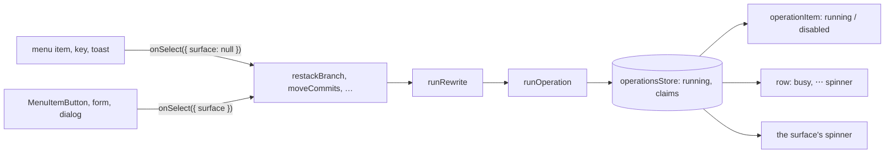

# Running Operations

**Status:** Implemented  
**Updated:** 2026-10-20  
**Tags:** [frontend, actions, ux, concurrency]

## Problem

An action of the app (Unstack, Move, Squash, an amend) is a backend command and then the sync that shows its result.
Nothing recorded that it runs: a menu item's `onSelect` started it and forgot it, and the only guard
(`getRewriteBlocker`) disabled the rewrites during the sync, which starts after the command returns. A triple click on
"Unstack from air" in the notice of the expanded row sent three `restack_branch`: the backend ran them one after the
other under the repository lock, and the second and third, reading the stack the first had changed, failed with
"tool-events is not stacked" in two sticky error toasts.

The busy state that did exist was kept in a different place per action, nine of them: `activeInline.processing` of the
inline forms, `applying` of the conflict fix, `useState` flags in the Safe Push popover, the move form, the squash
dialog, the commit message editor, and the push, Safe Push, robot, pull request and Update Project stores. Each
covered only its own surface; another surface of the same action (the menu, a key, the review window) neither saw it
nor waited for it. The rule "one busy indicator per operation" of [UI Theme](ui-theme.md) was written, but nothing
held it.

## Solution Overview

One registry of the operations that run (`src/stores/operations.ts`), and one way to start an action:
`runOperation(spec, run)`. While an operation runs, every surface of the app reads the same record:

- **join**: a second start of the same action of the same object (a double click, the same item in another surface)
  runs nothing and resolves with the first;
- **wait**: an action that conflicts with a running one doesn't start; its menu item is disabled with the running
  operation's busy state as the reason ("Unstacking tool-events…");
- **one indicator**: the surface that started it shows the spinner; a start from a menu, a key or a toast shows it on
  the "⋯" of the object's row;
- **the whole action**: a rewrite runs until the sync that shows its result ends (`runRewrite`), so a row never offers
  the action again while it still shows the state before it.

## Design

### The record

An `Operation` is the action's `id` (the `id` of its menu item: `unstack`, `move-to`, `squash-fixups`), its `subject`
(`branch:auth`, the row whose menu starts it), the `objects` it works on (the branches whose rows are busy), its `kind`,
its busy state (`label`: "Unstacking tool-events"), its repository, the `surface` that started it, and, for an action
that is the move of a row, its `move` ([Moves](#moves)).

### Conflicts

`getOperationBlocker(running, key)` is the one rule; `runOperation` and every builder read it.

1. **The same action of the same subject** joins: the promise of the running one.
2. **A rewrite waits for any rewrite of the repository.** Every rewrite moves HEAD or a ref of Branch Deck under one
   repository lock; the backend would run them one after the other, the second on what the first left, as the triple
   Unstack did.
3. **A remote action waits for a remote action of its subject or of a branch it works on** (restart and cancel of one
   robot).
4. **A rewrite and a remote action run side by side**, as before the registry: a push during a rewrite waits for the
   sync itself and pushes what it leaves.

A sync is no operation: a rewrite started during one still runs (an Undo in a toast during the auto-sync on focus), the
backend lock orders them and the sync chain reads the result again. Only the menus disable the rewrites during a sync
(`getRewriteBlocker`, "Wait for the sync to finish"), as they did.

### Items

A builder marks its items with `operationItem(running, item, key)`: the running action's item is `running` and
disabled, an item that must wait is disabled with the busy state as its `description`, an item disabled for its own
reason keeps it. The rewrites of the branch menu go through `rewriteItem` (the sync blocker first), the commit menus
through the same call. A surface that renders a builder reads it through a selector cached by the states of the stores it reads, the
registry among them (`useBranchMenu`), or subscribes to the registry and passes its snapshot (`useOperations`): a store
read inside a builder that the React Compiler memoizes would show a stale menu
([Rendering Performance](rendering-performance.md)). Callers outside React (the keys, the review window's bridge) pass
`getOperations()`. A disabled submenu (Stack On ›, Move to Existing ›) is an item that says why on hover.

`MenuItem.onSelect` takes a `SelectContext`: `{ surface }` of the button that started it, `FROM_MENU` (`surface:
null`) for a menu, a key or a toast. The action passes it to its operation.

A surface that is no menu runs the item itself (`selectMenuItemById`, `findMenuItem` in `src/lib/menu.ts`), so it
can't miss a reason the builder knows: the keys of a branch row (P, D, O, M, `selectRowItem`; a disabled item says why
in an `info` toast) and the review window, which asks the main window to run an item by its id. A toast's action
(Undo, the unstack the move offers) calls the action itself, which waits or joins as any start does.

### The indicator

A surface that stays while its action runs claims its key (`useIndicatorClaim`, a count per key in the store) and shows
the spinner of the operation it started (`useSurfaceBusy`): `MenuItemButton` with a `surface` (the Unstack of the
notice, `unstack-alert:<branch>`), an inline form (`inline:<branch>`, its progress row in place of itself), the Safe
Push popover (its status line), the squash dialog, the commit message editor, the move form, Apply Fix. An operation
whose surface has no mounted claim (a menu, a key, a toast, a popover the click closed) shows its spinner on the "⋯" of
its subject's row (`useUnclaimedBusy`, `MoreActionsMenu busy`), and of the branch preview's header while it is open.
Every row the operation works on is busy (`useObjectBusy`): no right-click menu, "⋯" disabled, no drag, no push.

### Rewrites

`runRewrite(spec, failureTitle, command, applied)` (`src/lib/rewrite.ts`) is the one runner of a rewrite: the command,
`notifyError` on a failure, `applied` (reveal the moved commits, say whether anything changed), then the sync, then
the toast `applied` returns, with Undo. The toast comes after the sync: the user sees the result beside its Undo, and
an Undo clicked at once never meets its own running operation. An Undo is a rewrite of its own (`undoRegroup`,
`undoSquash`). A start that must wait says so in an info toast titled as its failure ("Cannot undo the move",
"Unstacking tool-events…").

Through it: Stack On and Unstack, rename, move (and ungroup, remove prefix), squash, squash fixups and squash into,
reword, the conflict fix, and their undos. The inline forms run theirs through `withRowProcessing` (amend, unapply,
add issue reference; delete archived as a remote action), whose function includes the sync, or `withRowProgress` around
an action that is an operation itself (rename, ungroup, squash fixups, close the stack's pull request).

### Remote actions

- **The robot**: its restart, the push and restart of a robot whose branch moved past its commit
  (`runPushAndRestart`: the push is a step of it) and its cancel (`runRobotAction`, subject `robot:<id>`);
  `getRobotActions` marks them with `operationItem`, so the slot, the details and the landing overview show the running
  one (a spinner in place of its icon), a second restart joins it and the cancel waits.
- **The pull request**: the retarget of the next step (`retargetToTarget`, subject `pr:<n>`), the creation and
  "Continue on GitHub" (`submitPullRequest`, `continueOnGitHub`: a second submit joins; one that must wait throws
  why), "Request Review…" (`RequestReviewForm`, its button the surface).
- **The review of a pull request**: Approve, Request Changes and Approve and Safe Push (`runReviewWrite`, subject
  `review:<n>`); `getReviewBusy` is what the review list and the review window read (`ReviewWindowState.busy`).

The next step reads the operation on its row (`NextStepFacts.busy`): the slot's own action runs (`running`), the
others wait with its busy state.

- **Update Project** (`runUpdateProject`, `UPDATE_OPERATION`): a rewrite of the repository for its whole run, the fetch
  included: the backend lock would only queue its apply behind a regroup, and a regroup behind it; its steps and
  percent stay in its own store (`update-progress.ts`), which ticks too often for the registry's subscribers.

### Moves

An action that is the move of a row says so in its spec: `move` (`RunningMove`, `src/lib/running-move.ts`) names the
row (a branch, or `stack:<root>` of a whole stack), whether a robot comes that lands it (`lands`), and the hover of its
node meanwhile. The node of the row reads the moves that run (`getOperationMoves`, and the starts of a Safe Push past
their checks, `safePushStartMoves`) before the next step, so a row leaves the user's moves at the click, on every
surface that starts the action, not when Patronus or GitHub answer ([Landing](landing.md)):

- the restart and the push and restart of a robot (`lands`: Landing, and the branches its Safe Push lands beside; a Dry
  Run waits);
- the creation of a pull request (not "Continue on GitHub": the user creates it there) and a review request: Waiting.

A retarget declares none: the Safe Push after it is the user's move again, and the node would blink out of Your Move
and back. The other operations pass, as a sync does: the node keeps the state they started from.

### Outside the registry

Two runs keep their own record, each one place for every surface of it:

- **Push and stack push** (`pushingBranches`, `stackPushes` in `branch-sync.ts`, the percent in `pushProgressStore`):
  a stack push carries the branches it sends, learned after the sync it waits for; a push of the stack branch joins a
  stack push that takes it along instead of waiting; a push never holds its row (its menu stays open, its button shows
  the percent). A second click joins the running push (`pushOne`, `pushTogether`). A push inside an operation (the
  creation of a pull request, a review request, a push and restart, a Safe Push start) is a step of it, not an
  operation of its own.
- **The start of a Safe Push or a Dry Run** (`safePushStore.starting`): its steps (checking, pushing, starting) span
  the check, the popover the user answers, and the start; the next step reads it as the row's busy state
  (`busyFact`), the slot shows its step.

Both are read where the registry is: the next step, the menus and the keys see a push or a start as they see an
operation.

## Key Decisions

1. **Decision**: one registry for every window's actions, not a flag per action.
   **Rationale**: the surfaces of an action are many (menu, button, key, toast, review window); only a shared record
   lets all of them say the same.
2. **Decision**: a second start of the same action joins the first instead of being refused.
   **Rationale**: a double click is no mistake to report; the caller of the second start gets the first one's result.
3. **Decision**: a rewrite lasts until its sync ends, and its toast comes then.
   **Rationale**: the row shows the state before the rewrite until the sync; offering the action again then is what
   ran it three times.
4. **Decision**: no `expect_head` for the regroups.
   **Rationale**: an unstack writes only `refs/branch-deck/stack-parents`, HEAD may stay; the registry closes the
   double start in the app, and a `bd` process meanwhile gets the exact error under the lock.
5. **Decision**: the identical error toast updates in place (`notifyError` passes an id of the title and the
   description; Base UI updates the open toast of that id).
   **Rationale**: a poll or two surfaces must not stack copies of one error; Activity still records each.
6. **Decision**: the push and the start of a Safe Push keep their own record.
   **Rationale**: what they hold (the branches a stack push sends, its percent, a start's step across a popover) is not
   an operation's; their surfaces already read one record each, join a second click and show one indicator.
