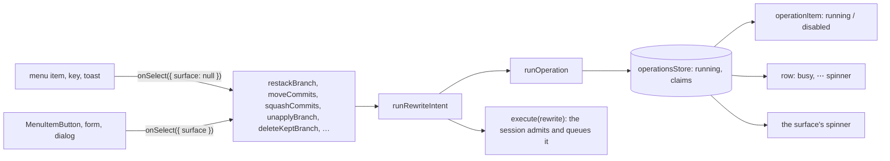

# Running Operations

**Status:** Implemented  
**Updated:** 2026-10-27  
**Tags:** [frontend, actions, ux, concurrency]

## Problem

An action of the app (Unstack, Move, Squash, an amend) is a backend command and then the sync that shows its result.
Nothing recorded that it runs: a menu item's `onSelect` started it and forgot it, and the only guard
(`getRewriteBlocker`) disabled the rewrites during the sync, which starts after the command returns. A triple click on
"Unstack from air" in the notice of the expanded row sent three `restack_branch`: the backend ran them one after the
other under the repository lock, and the second and third, reading the stack the first had changed, failed with
"tool-events is not stacked" in two sticky error toasts.

The busy state that did exist was kept in a different place per action, nine of them: `activeInline.processing` of the
inline forms, `applying` of the conflict fix, `useState` flags in the Safe Push popover, the move form, the squash
dialog, the commit message editor, and the push, Safe Push, robot, pull request and Update Project stores. Each
covered only its own surface; another surface of the same action (the menu, a key, the review window) neither saw it
nor waited for it. The rule "one busy indicator per operation" of [UI Theme](ui-theme.md) was written, but nothing
held it.

## Solution Overview

One registry of the operations that run (`src/stores/operations.ts`), and one way to start an action:
`runOperation(spec, run)`. While an operation runs, every surface of the app reads the same record:

- **join**: a second start of the same action of the same object with the same parameters (a double click, the same
  item in another surface) runs nothing and resolves with the first;
- **queue**: a rewrite that conflicts with a running one waits for it and runs after it, in the order of the starts;
  its menu item stays enabled, and its rows and its surface say what it waits for ("Waits for Unstacking
  tool-events"). A remote action that conflicts with a running one doesn't start; its menu item is disabled with the
  running operation's busy state as the reason ("Restarting the Safe Push…");
- **one indicator**: the surface that started it shows the spinner; a start from a menu, a key or a toast shows it on
  the "⋯" of the object's row;
- **the whole action**: a rewrite runs until the sync that shows its result ends (`runRewriteIntent`), so a row never
  offers the action again while it still shows the state before it.

Every rewrite of the page is a rewrite of the engine (Move, Rename, Stack On, Unstack, Park, Unpark, Reword, Squash,
Squash Fixups, Amend, Add Issue Reference, Apply Fix, Unapply, Reapply, Pick Remote Commits, the deletes of an archived
and an unapplied branch, and their Undo), admitted by the session in Rust: its record here only shows it, the session
joins and queues it ([Rewrites](#rewrites)); the page queues no rewrite. Update Project, the one rewrite the page still
runs itself, waits for the rewrite records before its check (`whenRewritesDone`).

## Design

### The record

An `Operation` is the action's `id` (the `id` of its menu item: `unstack`, `move-to`, `squash-fixups`), its `subject`
(`branch:auth`, the row whose menu starts it), the `objects` it works on (the branches whose rows are busy), its `kind`,
its busy state (`label`: "Unstacking tool-events"), its repository and the `surface` that started it. It declares no
move: the moves of a row are those of the operations of the session ([Moves](#moves)).

### Conflicts

`getOperationBlocker(running, key)` is the one rule; `runOperation` and every builder read it.

1. **The same action of the same subject with the same parameters** joins: the promise of the running one, also of one
   that waits. An action whose starts differ by what they act on names it (`parameters`: the commits and the target of a
   move, the commit and the message of a reword, the commits and the message of a squash, the files of an amend, the
   key of an added issue reference): a drag of another commit of the branch onto the same target is a move of its own,
   which waits in the queue, never one that resolves with the first and moves nothing. A menu item names none, so it
   shows running only an action without parameters; its start of another move queues.
2. **A rewrite waits for any rewrite of the repository, in the queue of the session.** Every rewrite moves HEAD or a
   ref of Branch Deck (the deletes only the ref they drop); the session runs them one after the other, each on what the
   one before it left (`Resource::Head`, [Rewrites](#rewrites)), as the triple Unstack showed it must. `runOperation`
   records a rewrite at once and starts it at once: the page queues none. Its record says what it waits for as the steps
   of its operation tell it (`setSessionStep`: `waitsFor`, the busy state of the rewrite it waits behind, and
   `operationLabel` says "Waits for Unstacking tool-events"; `lockWait`, whom it waits for while another holder has the
   repository lock), its rows are busy, and it is never refused. What it acts on the session reads when it runs, in the
   repository of its click (`repositoryPath`), whichever the main window shows by then: a move, a squash, a reword, an
   amend and an added issue reference name the commits on the table the window showed (`TableWitness`), and the
   session resolves them on HEAD as the rewrite before it left it (by the new ids that rewrite reported, else by the
   commit key after its sync); a commit that is gone changes the plan (`plan_changed`). A branch goes by its name. A
   push waits for the rewrites of its repository, their syncs included (`whenRewritesDone`): it sends what they leave;
   Update Project waits for them before its check the same way.
3. **A remote action waits for a remote action of its subject or of a branch it works on**, and on the page is
   refused meanwhile. The restart and the cancel of one robot wait for each other in Rust instead (the registry of the
   session queues the cancel behind the restart and decides it again once the restart ended), as a retarget waits
   for a retarget of the same pull request.
   Where an action names the resources it writes (`resources`: a field of a pull request, `pr:<n>:base` of a retarget,
   `pr:<n>:reviewers` of a review request), two such actions wait only for one that writes the same resource: a
   retarget and a review request of one pull request run side by side. A review request that pushes first names the
   base too: the push may retarget the pull request (`retargetBeforePush`), so the slot's retarget waits for it.
4. **A rewrite and a remote action run side by side**, as before the registry: a push during a rewrite waits for the
   sync itself and pushes what it leaves.

A sync is no operation: a rewrite started during one still runs (an Undo in a toast during the auto-sync on focus), the
backend lock orders them and the session's scheduler runs one more sync after it (`AfterRewrite`), which reads the
result. Only the menus disable the rewrites during a sync
(`getRewriteBlocker`, "Wait for the sync to finish"), as they did.

### Items

A builder marks its items with `operationItem(running, item, key)`: the running action's item is `running` and
disabled; the item of a rewrite that must wait stays as it is (its start queues), the item of a remote action that must
wait is disabled with the busy state as its `description`; an item disabled for its own reason keeps it. The rewrites of the branch menu go through `rewriteItem` (the sync blocker first), the commit menus
through the same call. A surface that renders a builder reads it through a selector cached by the states of the stores it reads, the
registry among them (`useBranchMenu`), or subscribes to the registry and passes its snapshot (`useOperations`): a store
read inside a builder that the React Compiler memoizes would show a stale menu
([Rendering Performance](rendering-performance.md)). Callers outside React (the keys, the review window's bridge) pass
`getOperations()`. A disabled submenu (Stack On ›) is an item that says why on hover.

`MenuItem.onSelect` takes a `SelectContext`: `{ surface }` of the button that started it, `FROM_MENU` (`surface:
null`) for a menu, a key or a toast. The action passes it to its operation.

A surface that is no menu runs the item itself (`selectMenuItemById`, `findMenuItem` in `src/lib/menu.ts`), so it
can't miss a reason the builder knows: the keys of a branch row (P, D, O, M, `selectRowItem`; a disabled item says why
in an `info` toast) and the review window, which asks the main window to run an item by its id. A toast's action
(Undo, the unstack the move offers) calls the action itself, which waits or joins as any start does.

### The indicator

A surface that stays while its action runs claims its key (`useIndicatorClaim`, a count per key in the store) and shows
the spinner of the operation it started (`useSurfaceBusy`): `MenuItemButton` with a `surface` (the Unstack of the
notice, `unstack-alert:<branch>`), an inline form (`inline:<branch>`, its progress row in place of itself), the Safe
Push popover (its status line), the squash dialog, the commit message editor, the move form, Apply Fix. An operation
whose surface has no mounted claim (a menu, a key, a toast, a popover the click closed) shows its spinner on the "⋯" of
its subject's row (`useUnclaimedOperation`, `MoreActionsMenu busy`), and of the branch preview's header while it is open.
Every row the operation works on is busy (`useObjectBusy`): no right-click menu, "⋯" disabled, no drag, no push.

### Waiting for the repository lock

The session orders the rewrites of the app; another process (an agent's `bd pick --follow`, a `bd` rewrite) or a push
of the app may still hold the repository lock when a rewrite reaches its core. An operation of the app waits for the
app's own ones in the line of its process (a fair queue before the file lock, in the order they came, never refused),
then for another process as long as the holder lives ([Git Operations](git-operations.md), "Repository lock"), and its
step says whom for: a rewrite hears its steps on the channel of its `execute` (`runRewriteIntent`, `setSessionStep`):
`waitingForLock` with the holder sets the record's `lockWait` ("Waiting for `bd pick` (pid 4242, for 12 s)", told
again about once a second, `presentLockWait`), `queued` behind another operation sets `waitsFor` (the busy state of that
one), and the record keeps the id of its operation (`op`). `operationLabel` says it in place of the busy state, so every
surface of the operation shows it: the spinner's hover on the "⋯" of its row (`useUnclaimedOperation`), the label of a
`MenuItemButton`, the progress row of an inline form, and `LockWaitNotice` on the surfaces that show their own busy
state (the squash dialog, the commit message editor, the move form, the squash of the fixups, Apply Fix).

Stop Waiting is one builder, `presentStopWaiting(operation)` of `src/presenters/lock-wait.ts` (null while it waits for
nobody), and every surface that shows the waiting operation renders it: the "⋯" opens a menu of it, a `MenuItemButton`
and an inline form show it beside themselves, `LockWaitNotice` beside the text. It calls `cancel_operation` of the
operation: the rewrite answers the code `canceled`, nothing changed, and says so in an info toast ("Canceled squashing
2 commits before it started", `canceledBeforeStart`), never an error; the surface that started it stays (the squash
dialog keeps its message). A push and a Safe Push start, operations of the session too, say it in their step in the
view (`OperationStep.waitingForLock` with the holder its record names, so every window says it): the hover of the push
button (`useBranchPushProgress`, `lockWaitProgress`) and the step of the Safe Push (`LandRun.waitingFor`), each with
its Stop Waiting (`stopWaitingPushItem`, `stopStartItem`: `cancel_operation` of the operation). Update Project, not an
operation of the engine yet, keeps it in its run (`UpdateRun.lockWait`, Stop Waiting beside the Update button: the
command `cancel_lock_wait` of its progress channel).

### Rewrites

`runRewriteIntent(spec, rewrite)` (`src/lib/rewrite-run.ts`) runs every rewrite of the page, a rewrite of the engine
(`execute` of the intent `rewrite`, no `prepare`: the rewrite names the table the window shows, `TableWitness` of the
view's header, and asks nothing to accept): Move (a drag, Move to…, Ungroup, Remove Prefix), Rename, Stack On,
Unstack, Park, Unpark, Reword, Squash, Squash Fixups and Squash Into, Amend, Add Issue Reference, Apply Fix, Unapply,
Reapply, Pick Remote Commits, the deletes of an archived and an unapplied branch (`deleteKeptBranch`), and the Undo of
each (`undoRewrite`, the rewrite `undo` of the token of its outcome, in the repository of the click: a regroup's token,
a squash's `<previous>..<new>`, `unapply:`, `reapply:`, `pick:`). The session admits it: a second click of the same
rewrite joins it, another rewrite waits behind it in the queue of the session (an Undo clicked during an Unstack, a
second drag during a move: no info toast, its rows say "Waits for Unstacking tool-events"), each decided again on what
the one before left; it ends once it asked its sync, and its `execute` answers once that sync ended, with the version
of its last patch, which the page waits for (`whenSessionViewAt`) before its toast with Undo. A delete asks no sync: its
answer names the patch that removed its row. Its record in `operationsStore` shows it on its surfaces from the click
until then, never queued by the page. A failure is an error toast in the words of the rewrite (`presentRewrite`) or
the title its caller gives, a stopped wait an info toast. The toast closes and the Activity entry (naming the operation)
says "undone" only once the undo undid it (`recordRewrite`); after a failed or stopped one both keep their Undo.

The inline forms run `withRowProgress` around their action, an operation that tells its outcome itself (rename,
ungroup, park, amend, add issue reference, unapply, squash fixups, the deletes, the close of the stack's pull request):
the form shows its progress row while it runs and closes once it is done, or comes back with its input after a
failure where it has one.

The family in the engine is `Intent::Rewrite` ([Rewrite in the engine](git-operations.md#rewrite-in-the-engine)):
each holds `Resource::Head` (a delete only `Resource::Ref` of the branch it drops, a reapply that ref too), so a second
click joins it, another rewrite of the process (an undo too) waits in the queue of the session and is decided again on
what it left, and a push runs beside it; a wait for the lock is its step `WaitingForLock`, stopped by
`cancel_operation`; every step the queue gives it (`Queued` behind another, then the step it starts at) goes to its
caller as the view shows it.

### Remote actions

- **The robot**: its restart (with the push first of a robot whose branch moved past its commit) and its cancel are
  operations of the session in Rust (`RestartRobot`, `CancelRobot` of `operations::robot`, holding `Resource::Robot`;
  `src/lib/robot-run.ts` runs them, `runIntent`): `getRobotActionItems` marks the item of one the session runs running
  (`RepositoryView.operations`), so the slot, the details and the landing overview show it (a spinner in place of its
  icon) in every window; a second restart joins it in Rust, and a cancel during it waits there.
- **The pull request**: the retarget of the next step (`retargetToTarget`, subject `pr:<n>`: its slot and its row
  busy, the retarget itself an operation of the session, `Retarget` of `operations::pull_request`, which holds its
  base, so a review request of it runs beside). The creation, "Continue on GitHub" and "Request Review…" are operations
  of the session in Rust (`CreatePullRequest`, `RequestReview` of `operations::pull_request`; `src/lib/pull-request-run.ts`
  runs them, `runIntent`), each with its push first: the creation holds the head of its subject (a second submit joins
  it, another text waits for it and is decided again), a review request the reviewers of its pull request; the dialog
  and the popover read theirs from `RepositoryView.operations` (`pullRequestOperationIn`), in every window.
- **The review of a pull request**: Approve, Request Changes and Approve and Safe Push are an operation of the session
  in Rust (`SubmitReview` of `operations::review`, holding the review of the pull request: a second write of it waits,
  the same one joins); `getReviewBusy` reads them from `RepositoryView.operations`, for the review list and the review
  window (`ReviewWindowState.busy`).

The next step reads the operation on its row (`NextStepFacts.busy`): the slot's own action runs (`running`), the
others wait with its busy state.

- **Update Project** (`runUpdateProject`, `UPDATE_OPERATION`): its fetch (`fetch_baseline`) runs outside the registry,
  so the rewrites of the page run during the network; then its check, apply and sync (`update_project` without a fetch)
  are a rewrite of the repository, which waits for a running regroup in the queue (its step `waiting`) and the regroups
  for it. A second ⌘T joins the running update, ⌘T during the Fetch of a toast goes on from that fetch without its
  own, and a Fetch during an update joins it. Its steps and percent stay in its own store (`update-progress.ts`), which
  ticks too often for the registry's subscribers.

### Moves

An action that is the move of a row says so: the node of the row reads the moves that run before the next step, so a
row leaves the user's moves at the click, on every surface that starts the action, not when Patronus or GitHub answer
([Landing](landing.md)). A move (`RunningMove` of `src/presenters/running-move.ts`) names the row (a branch, or
`stack:<root>` of a whole stack), whether a robot comes that lands it (`lands`), and the hover of its node meanwhile.

The operations of the remote move into Rust family by family ([Rust as the Domain Authority](rust-domain-authority.md),
s9-engine-remote): the registry of a session there (`operations::registry`, admitted by `domain_policy::admission`) is
a part of its view (`RepositoryView.operations`), and the moves its operations declare (`RunningOperation.moves`) are
laid over the nodes (`presentOperationMoves`), in every window, from the admission of the operation:

- the start of a Safe Push or a Dry Run (`RunningMove::Starting`, `operations::engine::execute_land`; `lands`:
  Landing, and the branches its Safe Push lands beside; a Dry Run waits);
- the restart of a robot, its push first included (`RunningMove::Restarting`, `operations::robot::execute_restart`;
  the same `lands`);
- the creation of a pull request, "Continue on GitHub" too (`RunningMove::CreatingPullRequest`), and a review request
  (`RunningMove::RequestingReview`, `operations::pull_request::execute_pull_request`): Waiting.

The page's own operations declare no move.

Between processes, the operations registry of the repository admits an operation of the remote first
([Git Operations](git-operations.md), "Operations registry"): while an agent's `bd push`, `bd safe-push` or
`bd request-review` runs what it needs (the same intent, a branch it lands or pushes, a robot, a field of a pull
request), the app's operation is refused as `busy`, its toast naming the holder ("`bd` (pid 4242) has run the Safe
Push of auth for 12 s", `describeError`), and the other way round; operations of one process never refuse each other.
While a window shows the session, the registry is watched (`operations::registry_watch`, `Registry::subscribe`): the
operations of `bd` of the branch prefix of the session are in its view as operations of another process
(`Origin::OtherProcess`), so the slot of a row shows the start an agent runs ("bd: Safe Push of auth…", the pid on
hover, `presentOtherProcess` of `src/presenters/operations.ts`, `LandRun.by`) and a start of the row says why it can't
start before it asks Rust; they decide no admission of the session, the file does. Without a watch the registry is read
again on a focus and after each admission. `bd` touches the stamp of the repository after each mutation, and the watch
syncs the sessions a window shows (`SyncReason::Stamp`): what an agent changed shows without a focus.

A start whose answer was lost (its request went out, no answer came, or its process was killed after it went out) is
no operation of any process any more, but its record stays in the registry and holds what it held for every process,
the app's own too ([Git Operations](git-operations.md), "A start whose answer was lost"): the row shows "Start Unknown"
with Open in Patronus and Forget This Start (`getStartActionItems` of the `op:<id>` actions Rust offers), a start of the
row says why it can't start, and an admission it holds back settles it by a read of Patronus first
(`operations::reconcile`), as a list of the robots of the session does: its robot started, or none did. Never a second
start by itself: Forget This Start (`Intent::ForgetStart`) is the user's word that the subject may start again.

An operation that ended, of any process, is an entry of the journal of its repository ([Git Operations](git-operations.md),
"Journal"), which Activity shows ([Activity](../../spec/repository/activity.spec.md)): the page records no operation of
the remote itself; the main window reads the log again after each `execute` it ran (`executeIntent` of
`src/lib/run-intent.ts`), and it and the Activity window when the watch of the registry sees the journal change
(`activity-changed`, an operation of the app or of an agent), and each words the entries as their toasts had them
(`presentActivity` of `src/presenters/activity.ts`).

A retarget declares none: the Safe Push after it is the user's move again, and the node would blink out of Your Move
and back. The other operations pass, as a sync does: the node keeps the state they started from.

### The pushes and the start in Rust

- **Every push** is the intent `Push` of the engine (`operations::push::execute_push`, [Push and
  land](git-operations.md#push-and-land)): of a branch alone and of an unapplied branch (`pushBranch`,
  `pushUnappliedBranch`), of a stack (the push button that pushes the stack, Push Stack, Push with Children, Push Up to
  Here: `pushFromButton`, `pushStack`, `pushWithChildren`, `pushUpTo`) and of the stack branch of a whole stack alone
  (`pushWholeStack`), all in `src/lib/push-run.ts` over `runIntent`. Rust admits it per ref it writes
  (`Resource::Ref`, the refs its plan pushes in their order): the same intent joins it (a second click, the push of
  an action that asks the same push; the record counts the joins, `RunningOperation.joined`, so every window and a
  test see the second click admitted), another push of one of its refs waits in the queue and is decided again on what
  it left, the pushes of other refs run side by side. Its steps are the view's `operations` (`Checking`,
  `WaitingForSync`, `WaitingForLock`, `Pushing`): `pushOperationIn` says which branches a running push holds (its
  spinner on their push buttons, a stack branch under `stack:<root>`), `useStackPush` what a push of a stack started
  from a row sends ("Pushing 3 branches 45%", `isStackPushing` for the menus), and the window that runs it shows how
  far it is (`operationPushProgress` of `run-intent.ts`, the percent by operation in `pushProgressStore`); whom a wait
  for the repository lock is for comes from its step in the view in every window (`useBranchPushProgress`,
  `presentOperationLockWait`), with Stop Waiting (`cancel_operation`). A push never
  holds its row (its menu stays open, its button shows the percent). A push inside another operation (the creation of
  a pull request, a review request, a Safe Push start, a restart) is a step of it, its `Push` effect, shown on the push
  button of its branch (or of its whole stack) from the operation of the view in its push step.

The start of a Safe Push or a Dry Run is an operation of the session (`execute`, [Push and
land](git-operations.md#push-and-land)): its steps are the view's (`OperationStep`: checking, waiting for the lock,
pushing, starting), which the slot and the next step read (`useLandRun` of `src/stores/safe-push.ts`), with the percent
of its push and whom a wait is for from the channel of the window that asked; before it, the click that waits for its
plan says "Checking…" (`asking`), the popover the user answers is the page's own (`ask`).

The push is read where the registry is: the next step, the menus and the keys see a push or a start as they see an
operation.

## Key Decisions

1. **Decision**: one registry for every window's actions, not a flag per action.
   **Rationale**: the surfaces of an action are many (menu, button, key, toast, review window); only a shared record
   lets all of them say the same.
2. **Decision**: a second start of the same action joins the first instead of being refused.
   **Rationale**: a double click is no mistake to report; the caller of the second start gets the first one's result.
3. **Decision**: a rewrite of the engine (`Rewrite`, `operations::rewrite`) ends once it asked the sync that shows
   it, and its `execute` answers once that sync ended, so the toast of its window comes then; its record on the page
   lasts until that answer.
   **Rationale**: the row shows the state before the rewrite until the sync; offering the action again then is what
   ran it three times. In Rust a second click joins the running rewrite, and a rewrite after it names its commits on
   what the first left (its `TableWitness`, the new ids the first reported, the commit keys), so it needs no wait for
   the sync, which would hold every rewrite queued behind it for as long.
   A rewrite names the repository of its click (`RewriteRunSpec.repositoryPath`), and so does its Undo: one of a repository the main window no longer shows (an Undo clicked after a switch) runs in the
   session of that repository, which syncs it.
4. **Decision**: no `expect_head` for the regroups.
   **Rationale**: an unstack writes only `refs/branch-deck/stack-parents`, HEAD may stay; the registry closes the
   double start in the app, and a `bd` process meanwhile gets the exact error under the lock.
5. **Decision**: the identical error toast updates in place (`notifyError` passes an id of the title and the
   description; Base UI updates the open toast of that id).
   **Rationale**: a poll or two surfaces must not stack copies of one error; Activity still records each.
6. **Decision**: the pushes and the start of a Safe Push are operations of the session in Rust, not records of the
   page.
   **Rationale**: what they hold (the refs a push writes, a start's step across a popover) is decided where the push and
   the start run: a second click joins in Rust, a push of a ref another push writes waits there, every window shows the
   same operation. The operations are of the repository the main window shows: a push or a start that runs on after a
   switch of the repository shows nothing on the branch of the same name there, nor holds its push or start back.
7. **Decision**: between processes, one file of the repository (the operations registry), changed under a lock of its
   own for one read-modify-write at a time, no daemon; an operation of the remote that needs what an operation of
   another process holds is `busy`, never joined or queued.
   **Rationale**: the app and every `bd` of the repository (the agents in their leases share its common dir) run
   without a service between them, and the outcome of another process never reaches the caller: it could neither
   resolve with it nor be decided again on what it left. So the refusal names the holder, and only the short section of
   the repository lock of another process is waited for, as long as its holder lives. A start whose answer was lost
   keeps its record, so no process sends it again until Patronus settles it or the user forgets it.
