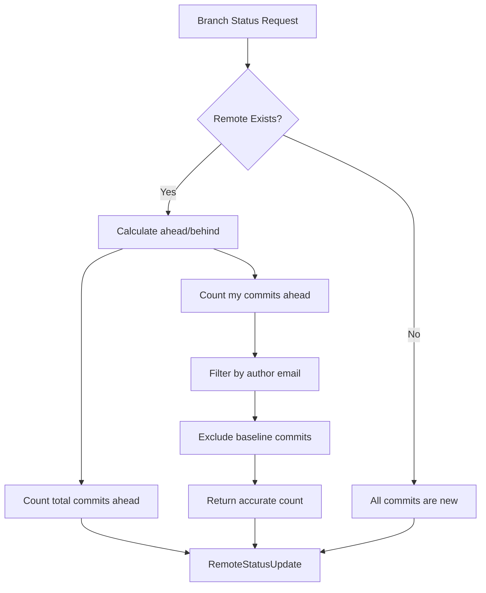

# Remote Status for Virtual Branches

**Status:** Implemented  
**Updated:** 2026-10-18  
**Tags:** [git, remote-status, virtual-branches]

## Problem

Virtual branches are continuously rebased onto the latest baseline (main), accumulating both feature commits and baseline commits. When displaying remote status, we need to accurately show:
- How many commits are ahead/behind the remote
- Which commits are actually the user's new work versus baseline commits
- Clear indication of what will be pushed to remote

The challenge is counting only what the remote lacks. A branch pushed a while ago and rebased onto a baseline that
moved 356 commits since is not "356 commits to push": the remote has those commits (they are the baseline), and it has
the user's commits by content. Counting hashes summed such baseline drift over every branch into a meaningless total.

Additionally, when virtual branches are rebased onto the latest baseline, they create a diverged history where:
- Local branch has commits with new SHAs (after rebase)  
- Remote branch has commits with old SHAs (before rebase)
- The commit content is identical, but naive SHA comparison shows misleading "commits behind"
- Users see confusing messages like "1 commit you removed or changed locally" when they haven't changed anything

## Solution Overview

Compare content, not hashes, with Git's cherry-pick algorithm:
- **Commits ahead** are the commits whose content the remote lacks: the baseline and the rebased copies of pushed
  commits are left out. A branch only rebased onto a newer baseline is up to date.
- **Reworded** are the commits the remote has by content in another version: the same changes, another message or
  author (`commits_reworded`). Not ahead, yet the remote branch is not the branch: a push replaces their copies.
- **Commits behind** are the remote commits whose content the branch lacks, sorted by what a push does with them:
  - **amended**: an older version of a commit of the branch, amended here (`commits_amended`); one that makes the same
    changes, only on other lines around them, is a rebased copy and counts nowhere;
  - **restacked**: an older version of a commit of a stack ancestor, which was amended or rebuilt since the branch was
    pushed: a child's remote branch has its parent's commits as they were (`commits_restacked`);
  - **landed**: an older version of a commit the baseline has above the remote branch, as a Safe Push landed it
    (`commits_landed`, the newest ten in `landed_commits` with the baseline commit of each);
  - **dropped**: the rest, work a push drops (`commits_behind`). The status lists the newest ten of them
    (`dropped_commits`: id, subject, author, time), so the Force Push button can say what it drops.
- **Remote tip** (`remote_tip`) is the commit of the remote-tracking ref the counts were computed against. A push leases on it: it
  replaces the remote branch only as the status showed it ([Git Operations](git-operations.md), "Push lease").
- **"My commits"** are the commits ahead authored by the user.
- **Fast-forward** says whether the remote branch is an ancestor of the local one. A rebased branch is not, so its push
  is a force push; it follows the refs, not the result of the last sync, and stays the same across restarts.
- **UI display** shows the user's share only when it differs: `n↑` when all n commits are the user's, `mine (n)↑`
  otherwise (`0 (n)↑`: none is theirs).

## Design

### Architecture

### Key Decisions

1. **Decision**: Filter "my commits" by author email, also for a branch not on the remote
   **Rationale**: Virtual branches may contain commits from multiple authors; users need to see their own contributions

2. **Decision**: Exclude `^baseline` and patch-equivalent commits from the commits ahead
   **Rationale**: The remote has the baseline commits, and a rebased copy of a pushed commit adds nothing; counting them
   reports the distance the baseline moved, summed over every branch

3. **Decision**: Separate counts for total vs "my" commits
   **Rationale**: Users need both perspectives - total shows the commits of others the push sends too, "my" shows
   personal contributions

4. **Decision**: Pass baseline branch through sync pipeline
   **Rationale**: Consistent access to baseline reference for filtering operations

5. **Decision**: Use patch equivalence (`--cherry-mark`) for commits behind calculation, without `^baseline`
   **Rationale**: After rebasing, commits have different SHAs but same content. Patch equivalence correctly identifies patch-equivalent commits, preventing false "commits behind" counts that confuse users with messages about "commits you removed or changed locally". The baseline stays in the walk: a remote commit that reached the baseline as a copy (cherry-pick, squash merge) is matched by that copy, not reported as dropped.

6. **Decision**: Force push from the walk of the remote commits, not from the sync status
   **Rationale**: The sync reports a branch as rewritten only in the sync that rewrote it; the next sync or a restart
   reported the same remote state as a plain push. The refs give the same answer every time. The walk of the commits
   behind marks a remote commit patch-equivalent to a local one (`--cherry-mark`) instead of leaving it out
   (`--cherry-pick`), so it also says whether the remote has any commit the branch doesn't: none means the remote tip
   is the branch's tip or one of its ancestors, a fast-forward. That answer cost a `merge-base --is-ancestor` of its
   own before.

7. **Decision**: A remote commit whose identity matches a commit the branch has is amended or restacked, not dropped
   **Rationale**: An amend changes the content, so `--cherry-pick` can't match the older version on the remote, and
   every such commit read "drops remote commits" in `warning`. In a stack it cascaded: one amend in a parent put a
   `1↓` on every descendant, because a child's remote branch contains the parent's commits as they were (11 of 28
   branches of a real repository, every one a false alarm). An amend and a rebuild keep the author, the author time
   and the subject, so the identity of [landed commits](integration-detection.md) tells the older version from
   someone's work: `CommitKey` (`crates/sync-core/src/commit_key.rs`, author email, author time, subject without the
   `(prefix)`), shared with `landed.rs`. A remote commit with the key of an unpushed commit of the branch is
   amended, unless both make the same changes: a commit rebuilt on a parent or a baseline that changed the lines
   around its change has another patch id, which `--cherry-pick` can't match, and is only a rebased copy (in a real
   stack the children of the amended parent had such copies, which read "1 amended" though nobody touched them). With
   the key of a commit of a stack ancestor (the effective base, then its base, down to the baseline) it is restacked;
   the rest stays dropped. `commits_behind` and `dropped_commits` keep their meaning, what a push drops, so the
   confirmation, the `warning` hue and `bd push`'s refusal without `--force` stay for real drops only.
   **Risk**: a different amend made elsewhere (another clone, the IDE of another machine) with the same author email,
   author time and subject is replaced without a question, as an older version would be. It needs the same author,
   so it is the user's own work in another form; landed commits accept the same rule.

8. **Decision**: A remote commit whose identity matches a commit of the baseline above the remote branch landed, not
   dropped
   **Rationale**: After a Safe Push of the whole stack, a member's remote branch keeps its commits as they were
   before the landing; once Update Project put the branch on the baseline and it got a new commit, every one of them
   read as dropped and `bd push` asked for `--force`, a separate approval for a push that loses nothing. `--cherry-mark`
   matches only the ones whose patch the baseline has as it is: the robot rebuilds on a newer target, so a change below
   a commit changes its patch. In the ultimate monorepo, 7 remote commits of `jvm-runner-goes` had a counterpart of the
   same `CommitKey` in master, the copies of the robot; their patch ids with context matched for none, without context
   (`-U0`) for 2 (one changed line was the call of a function whose signature a commit below changed). So the identity
   decides, as for an amend and as Update Project finds landed commits (`landed.rs`): only when commits are left
   dropped, one `rev-list --fixed-strings --author=<email>… <baseline> ^<remote tip>` of their authors finds the
   baseline commits above the remote branch, and a remote commit with the key of one is landed. The record of the
   robot (`landed_by`) is not needed: the baseline is the truth, also off Space.
   **Risk**: as for amended, a different version of the commit made elsewhere with the same author, author time and
   subject is replaced; its newer version is in the baseline.

9. **Decision**: A copy the remote has by content but in another version is reworded, and the branch is not up to date
   **Rationale**: The content is the whole comparison of a rebuilt branch, so a reword (or a new author) left the
   branch "up to date, only rebased": nothing to push, and a Safe Push started, or restarted, from the remote branch
   with the old message (robot `9d7a6cbd`, after a reword of a commit of `bd-lease`). Patronus lands the messages it
   gets. Both walks carry the raw messages (`walk_commits_with_messages`, `%B` after the fields, each commit ended by
   `\x01`), and the walk of the commits ahead marks the copies (`--cherry-mark` instead of `--cherry-pick`): a local
   copy (`=`) whose author, author email, author time and message no remote copy (`=` of the walk behind) has is
   reworded. No process more; a rebased copy keeps all four, so a branch only rebuilt stays up to date.

### Implementation Details

The remote status calculation uses git's cherry-pick algorithm for patch-equivalent comparison:
- **Remote tip**: `git for-each-ref --format='%(objectname) %(refname)' refs/remotes/origin/branch
  refs/heads/branch` (the app's push compares with `origin`, `bd push --remote` with its remote) says whether the
  remote branch exists and returns the commit it points to (`remote_tip`) and the branch's commit, in the one process
  the existence check needs anyway; a ref name holds no glob character, so each pattern matches its ref only. The sync
  reads the remote tips of all its branches with the local ones, in its one `for-each-ref` of `refs/heads/<prefix>/`
  and `refs/remotes/origin/<prefix>/`, and the baseline's commit with one `rev-parse` (`RemoteStatusMemo`). The
  [Patronus](../../spec/branch/patronus.spec.md) chip matches a Safe Push of the IDE or the CLI to the branch by it.
  The walks below use these commits, not the ref names, so a fetch or a sync meanwhile can't make the counts disagree
  with it.
- **Remote at the tip**: a remote tip equal to the branch's tip is up to date and a fast-forward without a walk; only
  the push time is read. It is the state of a branch after its push until the sync rebuilds it: the status the app's
  push computes after it, and the first sync after the push, whose statuses of the branch were of other commits.
- **The walks** are one `rev-list` of `crates/sync-core/src/commit_walk.rs` (`walk_commits`, shared with the robot
  commit map): `--format=%m%x00%H%x00%an%x00%ae%x00%at%x00%s`, the caller's options, then the revs between
  `--end-of-options` and `--`; the two walks of a pushed branch read the raw messages too
  (`walk_commits_with_messages`).
- **Commits ahead and mine**: one walk, `git rev-list --reverse --cherry-mark --right-only ^baseline
  origin/branch...local`; the lines marked `=` are copies the remote has by content, the rest is ahead. The user's
  commits are the ones whose author email matches, and the identity (`CommitKey`) of each unpushed commit is what an
  amended remote commit matches: the new version of an amended commit has other content, so it is unpushed. A copy
  whose version (author, email, author time, message) no remote copy has is reworded.
- **Commits behind (patch-aware)**: `git rev-list --cherry-mark --left-only --date-order <remote tip>...local`, newest
  first (a child before its parent). A line
  marked `=` (`%m`) is patch-equivalent to a local commit: the branch has it by content, it is not behind. Of the
  others, a line with the identity of an unpushed commit is an older version of it, one with the identity of a stack
  ancestor's commit restacked; of the rest, when there is any, one more walk of the baseline above the remote tip by
  the authors of those commits finds the landed ones (Decision 8); what remains is `commits_behind`, and its first ten
  are `dropped_commits`.
- **Amended or a rebased copy**: only when an older version was found, one `git diff-tree --stdin -p -U0` of the
  pairs and one `git patch-id --stable` of its output: without context lines, and with the line numbers and
  whitespace a patch id ignores, equal ids are the same changes, a rebased copy; different ones are amended. The
  approach of `update_resolve.rs`, which pairs landed commits by patch id.
- **Stacked branch**: the walk of the commits ahead (with or without a remote branch) also excludes the parent,
  `^<parent>` (`StackParent::base`): the commits up to it are the parent's. In the sync that is the parent's new head the child was built on, never the parent's ref:
  the sync finishes the branches in parallel, so a child can compute its status before its parent's `finish_branch`
  moves the parent's ref, which is then absent (a new stack: the walk failed) or at the old head (the parent's new
  commits counted as the child's). The app's push and `bd push` pass the parent's ref, which is current there.
- **Stack ancestors**: the sync passes their identities, built once per sync (`ancestor_keys` in `sync.rs`) from the
  commits of every branch along the chain of effective bases (`AncestorCommits::Known`, no process). The app's push and
  `bd push` outside the sync read them only while a behind commit matches nothing of the branch: one `git rev-list
  ^baseline <parent>` (`AncestorCommits::ReadWhenNeeded`); the parent's virtual branch
  contains the commits of every ancestor.
- **A failed status**: the sync logs it as a warning with the branch and the error, and sends nothing for the branch,
  which keeps the status it had (the store keeps the last remote status across syncs, so a push label doesn't
  flicker); the next sync computes it again.
- **Fast-forward**: the walk of the commits behind lists no line at all, not even a `=` one: the remote side of
  `<remote tip>...local` is empty, so the remote tip is the branch's tip or one of its ancestors. A rebased branch
  lists its remote commits as `=`, nothing behind, and is no fast-forward: the push replaces them with their copies.
- **Branch not on the remote**: the same walk without the remote, `git rev-list ^baseline local`.
- **Push time** (`last_push_time`): the newest entry of the remote-tracking ref's reflog that git's push wrote,
  `update by push`, a literal git never translates, so a fetch that moved the ref later doesn't count. The time is the
  selector's, `<ref>@{<time>}` with `--date=unix`, cut at the last `@{`: a ref name may hold a `{`, never an `@{`. No
  push from this clone (or no reflog) is 0. The sync and `bd push --remote` read the push times of all their branches
  with one process (`PushTimes`), when the first status needs one: `git reflog show --stdin
  '--grep-reflog=^update by push$' --date=unix --format=%gD`, the refs on stdin, so their number is not bounded by the
  command line; `%gD` names the full ref, and the newest time of each ref counts. It reads every push entry of those
  reflogs (`-1` would count the entries of all refs together), a few hundred lines. A ref deleted since its tip was
  read fails the whole read; then each status reads its own, `git reflog show -1 … --format=%gd <ref>`, which stops at
  the newest push, as one status outside an operation does (the app's push).

The cherry-pick algorithm ensures accurate comparison:
1. `--cherry-pick` - Excludes commits that are patch-equivalent (same content, different SHA); `--cherry-mark`, in
   the walk of the commits behind, marks them `=` instead
2. `--left-only` / `--right-only` - Shows commits unique to remote/local respectively
3. `^baseline` - Excludes the baseline commits, which the remote has

Key components:
- **Remote status calculation**: `crates/sync-core/src/remote_status.rs`
- **UI display**: `src/lib/remote-status.ts`
- **Branch processor**: `BranchSyncContext` carries the baseline branch and `RemoteStatusMemo` the baseline commit and the
  remote tips, read once per sync (`crates/sync-core/src/branch_processor.rs`)
- **Sync orchestration**: Propagates baseline through entire pipeline

## UI Display Considerations

### Commit Count Display
- `n↑` when the n commits to push are all the user's, `mine (n)↑` only when some are others' (`0 (n)↑` when none is
  theirs): in a single-author repository the total in parentheses only repeated the count. `formatPushCount` in
  `src/lib/push-summary.ts` writes it for the status text of the row.
- The push labels count the commits the push sends (`Push (3)`, `Force Push (3)`), whoever authored them; the
  description says the user's share: "2 of 3 commits to push are yours."
- The commits behind are named for what they are, the remote's: "The remote has 2 commits your branch doesn't (by Ann
  and Bob).", never "commits you removed": after a rebase the patch-equivalent copies don't count, so what remains is
  someone else's work or the user's own dropped commit, and the authors tell which.
- The older versions follow the commits to push, before the dropped ones: `1↑ · 1 amended`, `1 reworded`,
  `1↑ · 7 landed`, `4↑ · restacked`, `restacked` (nothing of its own to push), `1↑ · 1 amended · 2↓`. The description
  says "The remote has an older version of 1 commit amended here.", "The remote has the old message of 1 commit
  reworded here.", "Rebuilt on the new auth: the remote has older versions of 2 of its commits." and "The remote has
  older versions of 7 commits that landed."; the Force Push button starts with what it replaces, "Force push replaces 1
  commit amended here." or "Force push replaces the older versions of auth's commits.", instead of those lines, and its
  toast says "replaced 1 amended commit", "replaced 1 reworded commit", "replaced the parent's older commits" or
  "replaced 7 landed commits".

### Colours
One rule colours a push: the hue comes from its risk (`getPushHue` and `getPushColor` in `src/lib/push-summary.ts`),
`warning` for a push that drops remote commits (behind), `primary` otherwise, also for the force push of a rebased
branch, which only replaces the remote commits with their copies, and of an amended or restacked one, which replaces
their older versions (landed and reworded ones too). Up to date, and a safe push of none of the user's commits, are
neutral; a restacked branch with nothing of its own to push keeps `primary`, its remote branch is behind the user's
work. Whether the remote is up to date is one function, `isRemoteUpToDate`: nothing to push, nothing amended,
reworded, restacked, landed or dropped. A robot's restart reads it too (`getRobotRestartAction`): a branch whose
remote is not up to date is pushed first. The push button and the
status text use it. See [Outgoing Commits](../../spec/repository/outgoing.spec.md).

The `warning` hue is also the one push that asks first (`dropsRemoteCommits`): it drops someone else's work, so its
click opens the description with the dropped commits and a destructive Force Push that pushes. A safe push, the force
push of a rebased, amended or restacked branch too, pushes on the click: asking there would teach the user to confirm
without reading.

### Handling Rebased Branches
When branches are rebased onto latest master, the remote still has old pre-rebase commits. The `--cherry-pick` algorithm correctly identifies these as patch-equivalent: 0 behind and 0 ahead, so the branch is up to date. With new commits on top, only those are ahead, and the push is a safe force push (not a fast-forward, nothing dropped).

### Review Status
The commit a review took, the source revision of a Patronus robot or the head of a pull request, is compared with the
remote tip and the counts, never with the local tip: the sync rebuilds an unchanged branch on every newer baseline, and
a hash comparison made a false "the branch changed" after each sync. The branch changed since the review when that
commit is not the remote tip, or the branch is not up to date. The remote tip at that commit with an up-to-date branch
is the same commits on an older baseline: no warning, a quiet line in the details (`getReviewCommitState` in
`src/lib/review-commit.ts`; [Patronus](../../spec/branch/patronus.spec.md),
[Pull Requests](../../spec/branch/pull-requests.spec.md)).

## Alternatives Considered

- **Count every commit ahead by hash, the baseline included** (the earlier design):
  - Why not: the remote has the baseline commits, so they cost nothing to push and are not under review. The count
    grew with every baseline update and summed the same commits over every branch.

- **Complex Commit Tracking with Metadata**:
  - Why not: Git's built-in exclusion syntax is simpler and more performant

- **Calculate Merge Base for Each Commit**:
  - Why not: Expensive operation, especially for branches with many commits

- **Use Git Notes for Commit Attribution**:
  - Why not: Adds complexity when simple exclusion syntax suffices

## Performance Considerations

- **Constraint**: Must not slow down status calculation
- **Same commits, same status**: a status is a function of the branch's tip, the remote tip, the baseline commit, the
  parent's head (a stacked branch) and the user's email. The sync walks these commits, not the refs, and remembers
  the status by them (`RemoteStatusMemo`):
  - **in the process**, push time included (at most 4096 statuses): a sync in which a branch, its remote and the
    baseline did not move answers its status without git, so the usual sync of the app, on focus, runs no remote
    status process at all. Its push time is the one of the first status of these commits, also after a push of the
    same commit again once the remote branch was elsewhere (push X, fetch Y, push X), a case the app accepts;
  - **in the object cache** (`remote_status`, `$GIT_COMMON_DIR/branch-deck/cache`), without the push time: every `bd`
    is a new process, and an unchanged `bd sync` walks no branch, it reads only the push times of all branches with one
    `reflog`. The key is a hash of the commits (full ids only: a status with a ref name is only remembered by the
    process), the email and where the commits of the stack ancestors came from (the sync knows them, a push outside it
    reads them), so those two never share an entry. The value holds the walks' answer, the commits ahead and the first
    `DROPPED_COMMITS_LIMIT` dropped ones, so the limit is part of the version, which a change of the walks bumps. The
    computed statuses are written in one transaction when the memo drops, none for a remote branch at the branch's tip,
    which ran no walk.
- **Solution**: one `for-each-ref` for the tips (none in the sync, which reads them with its branches), two walks per
  branch (ahead with mine and the identities, behind with the dropped commits, the identities and the fast-forward),
  none when the remote branch is at the branch's tip, and one `reflog` per operation for the push times of all its
  branches; the `^baseline`
  exclusion keeps the walk to the branch's own commits instead of every baseline commit since the last push. The
  commits ahead no longer carry baseline hashes to the UI. The identities of the stack ancestors cost the sync no
  process (it has every branch's commits); a push outside the sync reads them with one `rev-list`, and only when a
  behind commit matches nothing of the branch. Telling an amend from a rebased copy costs two processes, only for a
  branch with an older version of its own commit.

## References

- Implementation: `crates/sync-core/src/remote_status.rs`
- Tests: `crates/integration-detection-tests/src/remote_status_tests.rs`
- Related: [virtual-branches.md](virtual-branches.md) - Virtual branch architecture