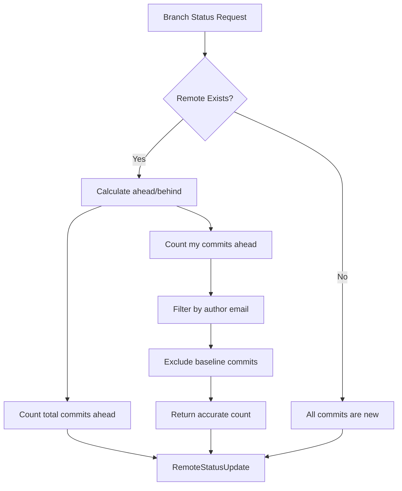

# Remote Status for Virtual Branches

**Status:** Implemented  
**Updated:** 2026-10-14  
**Tags:** [git, remote-status, virtual-branches]

## Problem

Virtual branches are continuously rebased onto the latest baseline (main), accumulating both feature commits and baseline commits. When displaying remote status, we need to accurately show:
- How many commits are ahead/behind the remote
- Which commits are actually the user's new work versus baseline commits
- Clear indication of what will be pushed to remote

The challenge is counting only what the remote lacks. A branch pushed a while ago and rebased onto a baseline that
moved 356 commits since is not "356 commits to push": the remote has those commits (they are the baseline), and it has
the user's commits by content. Counting hashes summed such baseline drift over every branch into a meaningless total.

Additionally, when virtual branches are rebased onto the latest baseline, they create a diverged history where:
- Local branch has commits with new SHAs (after rebase)  
- Remote branch has commits with old SHAs (before rebase)
- The commit content is identical, but naive SHA comparison shows misleading "commits behind"
- Users see confusing messages like "1 commit you removed or changed locally" when they haven't changed anything

## Solution Overview

Compare content, not hashes, with Git's cherry-pick algorithm:
- **Commits ahead** are the commits whose content the remote lacks: the baseline and the rebased copies of pushed
  commits are left out. A branch only rebased onto a newer baseline is up to date.
- **Commits behind** are the remote commits whose content the branch lacks: a push drops them. The status lists the
  newest ten (`dropped_commits`: id, subject, author, time), so the Force Push button can say what it drops.
- **Remote tip** (`remote_tip`) is the commit of the remote-tracking ref the counts were computed against. A push leases on it: it
  replaces the remote branch only as the status showed it ([Git Operations](git-operations.md), "Push lease").
- **"My commits"** are the commits ahead authored by the user.
- **Fast-forward** says whether the remote branch is an ancestor of the local one. A rebased branch is not, so its push
  is a force push; it follows the refs, not the result of the last sync, and stays the same across restarts.
- **UI display** shows the user's share only when it differs: `n↑` when all n commits are the user's, `mine (n)↑`
  otherwise (`0 (n)↑`: none is theirs).

## Design

### Architecture

### Key Decisions

1. **Decision**: Filter "my commits" by author email, also for a branch not on the remote
   **Rationale**: Virtual branches may contain commits from multiple authors; users need to see their own contributions

2. **Decision**: Exclude `^baseline` and patch-equivalent commits from the commits ahead
   **Rationale**: The remote has the baseline commits, and a rebased copy of a pushed commit adds nothing; counting them
   reports the distance the baseline moved, summed over every branch

3. **Decision**: Separate counts for total vs "my" commits
   **Rationale**: Users need both perspectives - total shows the commits of others the push sends too, "my" shows
   personal contributions

4. **Decision**: Pass baseline branch through sync pipeline
   **Rationale**: Consistent access to baseline reference for filtering operations

5. **Decision**: Use `--cherry-pick` for commits behind calculation, without `^baseline`
   **Rationale**: After rebasing, commits have different SHAs but same content. Using `--cherry-pick` correctly identifies patch-equivalent commits, preventing false "commits behind" counts that confuse users with messages about "commits you removed or changed locally". The baseline stays in the walk: a remote commit that reached the baseline as a copy (cherry-pick, squash merge) is matched by that copy, not reported as dropped.

6. **Decision**: Force push from `merge-base --is-ancestor`, not from the sync status
   **Rationale**: The sync reports a branch as rewritten only in the sync that rewrote it; the next sync or a restart
   reported the same remote state as a plain push. The refs give the same answer every time.

### Implementation Details

The remote status calculation uses git's cherry-pick algorithm for patch-equivalent comparison:
- **Remote tip**: `git rev-parse --verify --quiet refs/remotes/origin/branch` (the sync and the app compare with
  `origin`, `bd push --remote` with its remote) says whether the remote branch exists and
  returns the commit it points to (`remote_tip`), in the one process the existence check needs anyway. The
  [Patronus](../../spec/branch/patronus.spec.md) chip matches a Safe Push of the IDE or the CLI to the branch by it.
  The walks below use this commit, not the ref name, so a fetch meanwhile can't make the counts disagree with it.
- **Commits ahead and mine**: one walk, `git rev-list --cherry-pick --right-only --format=%H %ae ^baseline
  origin/branch...local`; the user's commits are the ones whose author email matches.
- **Commits behind (patch-aware)**: `git rev-list --cherry-pick --left-only --date-order
  --format=%H%x00%at%x00%an%x00%s <remote tip>...local`, newest first (a child before its parent): the line count
  is `commits_behind`, the first ten are `dropped_commits`.
- **Fast-forward**: `git merge-base --is-ancestor <remote tip> local`, when nothing is behind.
- **Branch not on the remote**: `git rev-list --format=%H %ae ^baseline local`.

The cherry-pick algorithm ensures accurate comparison:
1. `--cherry-pick` - Excludes commits that are patch-equivalent (same content, different SHA)
2. `--left-only` / `--right-only` - Shows commits unique to remote/local respectively
3. `^baseline` - Excludes the baseline commits, which the remote has

Key components:
- **Remote status calculation**: `crates/sync-core/src/remote_status.rs`
- **UI display**: `src/lib/remote-status.ts`
- **Branch processor**: Uses `BranchProcessingParams` to carry baseline reference
- **Sync orchestration**: Propagates baseline through entire pipeline

## UI Display Considerations

### Commit Count Display
- `n↑` when the n commits to push are all the user's, `mine (n)↑` only when some are others' (`0 (n)↑` when none is
  theirs): in a single-author repository the total in parentheses only repeated the count. `formatPushCount` in
  `src/lib/push-summary.ts` writes it for the status text of the row and the outgoing overview alike.
- The push labels count the commits the push sends (`Push (3)`, `Force Push (3)`), whoever authored them; the
  description says the user's share: "2 of 3 commits to push are yours."
- The commits behind are named for what they are, the remote's: "The remote has 2 commits your branch doesn't (by Ann
  and Bob).", never "commits you removed": after a rebase the patch-equivalent copies don't count, so what remains is
  someone else's work or the user's own dropped commit, and the authors tell which.

### Colours
One rule colours a push: the hue comes from its risk (`getPushHue` and `getPushColor` in `src/lib/push-summary.ts`),
`warning` for a push that drops remote commits (behind), `primary` otherwise, also for the force push of a rebased
branch, which only replaces the remote commits with their copies. Up to date, and a safe push of none of the user's
commits, are neutral. The push button, the
status text and the header bars use it; the bars add lightness for authorship (solid mine, light others'). See
[Outgoing Commits](../../spec/repository/outgoing.spec.md).

### Handling Rebased Branches
When branches are rebased onto latest master, the remote still has old pre-rebase commits. The `--cherry-pick` algorithm correctly identifies these as patch-equivalent: 0 behind and 0 ahead, so the branch is up to date. With new commits on top, only those are ahead, and the push is a safe force push (not a fast-forward, nothing dropped).

## Alternatives Considered

- **Count every commit ahead by hash, the baseline included** (the earlier design):
  - Why not: the remote has the baseline commits, so they cost nothing to push and are not under review. The count
    grew with every baseline update and summed the same commits over every branch.

- **Complex Commit Tracking with Metadata**:
  - Why not: Git's built-in exclusion syntax is simpler and more performant

- **Calculate Merge Base for Each Commit**:
  - Why not: Expensive operation, especially for branches with many commits

- **Use Git Notes for Commit Attribution**:
  - Why not: Adds complexity when simple exclusion syntax suffices

## Performance Considerations

- **Constraint**: Must not slow down status calculation
- **Solution**: one `rev-parse` for the remote tip, two walks per branch (ahead with mine, behind with the dropped
  commits) and a `merge-base` only when nothing is behind; the `^baseline` exclusion keeps the walk to the branch's own
  commits instead of every baseline commit since the last push. The commits ahead no longer carry baseline hashes to
  the UI.

## References

- Implementation: `crates/sync-core/src/remote_status.rs`
- Tests: `crates/integration-detection-tests/src/remote_status_tests.rs`
- Related: [virtual-branches.md](virtual-branches.md) - Virtual branch architecture