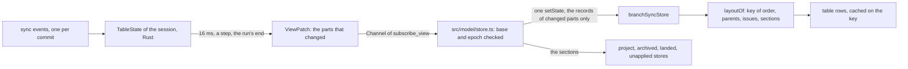

# Rendering Performance

**Status:** Implemented  
**Updated:** 2026-10-27  
**Tags:** [frontend, react, zustand, performance]

## Problem

The main window shows every branch of a repository. Each row has about 20 store subscriptions: the branch, its tip
and remote tip, the robot, the pull request, the push state, the landing span. A row re-renders its whole subtree
(actions, chips, the Safe Push slot) when one of them changes.

The sync streams one event per commit, plus one status and one remote status per branch. Two things made this cost
more than the rows themselves:
- **Selectors ran on every event.** Each event was its own store update, and `useStore` (on `useSyncExternalStore`)
  runs every subscriber's selector on every update. Among them were the table rows (about ten subscribers, O(n²)), the
  stack descendants of every row (O(n²) in total) and the robot of every branch (a scan of all robots, so
  O(branches × robots)).
- **Every row re-rendered at least twice per sync.** Each row read the whole project record, and a sync replaced that
  record two or three times, even when the issue links it sent were unchanged.

## Solution Overview

- **Rendering:** [React Compiler](https://react.dev/learn/react-compiler) memoizes every component and hook, so a
  subtree re-renders only when its inputs change.
- **Selectors:** the store does less per update. The session in Rust gathers the events of a sync for about a frame
  and sends one patch of what changed; the page applies a patch in one update.
  Derived structure (rows, stack children, the robot of a branch) is cached on what it is computed from. Records that
  a refresh answers unchanged keep their identity. A component selects the field it shows, not the record that holds
  it.

## Design

### Architecture

- **Batching in Rust.** The session of a worktree and its prefix (`repository_model::session`, its actor in
  `runtime.rs`) folds the events of its sync into `TableState` (`table.rs`) and sends its subscribers a `ViewPatch`
  of what changed (`state.rs`): at most one every 16 ms, at once on the start of a run, on its step from building to
  detection and on its end. A patch names the parts of a branch that changed (`head`, `commits`, `sync`, `copies`,
  `remote`, `structure`: its stack, whether it is parked and its section, placed once per grouping by
  `repository_model::derive`, the fields it lacks left out); the page splits the order into the rows of each section by
  it (`rowsOf`, `src/model/structure.ts`), never a second list of the same names on the wire. So the first sync of
  `branch_table_large` sends fewer bytes in its patches than its events had, and a sync that changes nothing sends the
  state of its run only (`the_patches_of_a_large_table_cost_less_than_its_events` in `state_test.rs` checks both,
  `patch_bytes_test.rs` measures them through the channel). Late events of a
  run that ended are dropped by its run id; a session opened again starts another epoch.
- **Applying in the page.** `src/model/store.ts` subscribes the main window to the session of the selected repository
  (`subscribe_view`, by path, the prefix Rust's) and applies each patch whose base is the version it holds
  (`applyViewPatch`, `src/model/patch.ts`, as `repository_model::patch` does): one of another epoch, or after a gap,
  asks for the snapshot (`get_snapshot`), one that came before the subscription answered waits for its view, a
  session that went away is subscribed again, and so is one whose request answers another epoch than the view's while
  the session open now has no view of the view's epoch either (its actor died and took the subscription with it); one
  that does is the window's, so the answer is of a session the window left (the late answer of the prefix it left) and
  is dropped, the subscription kept. A subscription made again counts the requests still in flight on the one it
  replaces, so Sync stays busy for them. A patch builds again only the records of the branches and stacks it
  names; a branch whose state alone changed keeps its commits and their index, so the row of an untouched branch does
  not render again.
  [@test] ../../src/model/store.test.ts (`takes the snapshot when a patch of another epoch comes: the session was opened again`, `subscribes again when the snapshot finds the session gone, keeping the table until the new view comes`, `subscribes again when a sync answers another epoch than its view's: the actor of the session died, and the sync opened it again`, `keeps Sync busy for the requests still in flight when it subscribes again: the subscription made again counts them`, `drops the late answer of the session of the prefix it left: its subscription to the new one holds, Sync busy for the request of the new one`)
  - Updates of other stores run in the same pass: the issue links (`updateProject`), the archived names (marked new
    only for what this patch archived), the landed status, the unapplied branches.
  - Nothing depends on the moment of arrival in the page: the session orders a push against the syncs
    (`TableState::end_push`, [Session facts](git-operations.md#session-facts)), so the applier shows every remote
    status a patch brings. The outcome of a push (or of the deletion of an archived or unapplied branch) is one patch
    of the parts it changed, whose version the command answers (`whenSessionViewAt`); no sync follows it.
  - `isSyncing` is true from the request (`sync`, `requestSessionSync`) until the store holds the version its answer
    names (`SyncAnswer.version`), the last patch of the run that served it; a request of a session the window left
    counts for that session only.
- **Structure.** Where each branch is (its parent, children, descendants, ancestors, main line, parked state and
  section) is Rust's, a part of its view that keeps its identity while no patch carries it. `layoutOf` builds a key from
  the order and each branch's parent, issue and section, and reuses the previous layout while the key is the same.
  - `branchTableRowsIn` keeps one cache for all rows and one for a filter's `visible` set, so the ten subscribers share
    one computation per layout; depth and lanes are the page's presentation of the parents.
  - `getStackChildren`, `getStackDescendants` and `mainLineOf` read the structure: no walk of the order.
- **Landing.** What the rules decide for each subject (a branch, `stack:<root>` the whole stack) is Rust's too, a part
  of the view by the subject's key ([Session facts](git-operations.md#the-landing-of-a-session)): the next step and
  the node (`nextSteps`), the actions with their reasons (`actions`, `robot:<id>` a robot's), the decisions of the
  default starts (`lands`), the push orders (`pushes`), the open pull request (`openPullRequests`), what landed it
  (`landedStates`) and whether its robot needs the user (`attention`, which the landing overview and the Dock list).
  `View::diff` derives them on every patch over the table and the facts (the pushes, the lands and
  what landed not while a sync runs) and sends only the keys whose value changed (`diff_keyed`, by `PartialEq`) and
  those removed, so a patch that moves one branch carries the parts of that branch and of what its change decides, and
  `applyViewPatch` replaces only those records. A row reads its part with one kept reference (`useRowPart(name,
  "landing")`, `useRowPart(name, "actions")`) and words it in the render (`presentNextStep`, `presentLandingNode`,
  `presentAction`): no row derives a rule, and no selector reads the seven stores the step was made of
  (`useNextStepStores` and its `getBranchNextStepNow` per row on every change of a store are gone). Beside the part
  a row selects only what its words need (`useStepInputs`: the target, the operation and the start that run on it,
  the robot of a restart and its actions, the pull request a review step names) and the move that runs on it, which
  the page lays over the step.
  [@test] ../../crates/repository-model/src/derive_budget_test.rs (`a_flush_derives_the_next_steps_of_the_141_rows_of_the_large_table_within_its_budget`)
- **Push progress** has its own store (`pushProgressStore`). Its ticks, every 100 ms, reach only
  `useBranchPushProgress`, not every selector of the branch store. The one push of a stack writes the tick of all
  its branches in one update (`setBranchesPushProgress`).
- **The robot of a branch:** the session names it in its view (`robotId`, matched in Rust by one index per list of
  robots, `domain_policy::robot_match`), and a row reads it by id (`useBranchRobot`); the landing overview takes the
  ids of every row once per view (`useRowRobots`, a `WeakMap`).

### Key Decisions

1. **Decision**: React Compiler through its Rust port, `oxc-transform-react` (the `compiler` option of
   `@vitejs/plugin-react`, `vite.config.ts`), not Babel (`babel-plugin-react-compiler`).
   **Rationale**: the port compiles the same 572 functions as the Babel plugin 1.0, fails the build for the same
   reasons, and passes all E2E tests; the build takes 1.5 s instead of 7.4 s and there is no Babel. The port is still
   marked experimental: `oxc-transform-react` is pinned to the version `@vitejs/plugin-react` declares (`^0.152.0`
   is `<0.153.0`), and both move together.

2. **Decision**: `panicThreshold: "all_errors"`: a function the compiler cannot compile fails `vite build` and the dev
   server's transform.
   **Rationale**: by default the compiler skips such a function quietly and it runs without memoization. Its usual
   causes are caught early instead:
   - a disable comment for a React rule (Oxlint reports it as `react/rule-suppression`): read the latest values
     through `useEffectEvent` instead (`InlineForm`, `DiffView`);
   - `try` with `finally` but no `catch`: use `promise.finally(…)` (`SquashCommitsDialog`);
   - a JSX element as a parameter default: use `prop ?? <… />` in the body (`ui/toast.tsx`).

3. **Decision**: the compiler does not replace narrow store selectors.
   **Rationale**: memoization saves the render, not the selector, which runs on every store update. Selectors return a
   primitive, a joined string, or an interned record. The hooks a row calls for its own parts do not even run on a
   change of the others: `useBranchSyncEntry(field, key, select)` (its branch, the next step and the actions of its
   subject: `useBranch`, `useRowPart`) wakes only when its entry is another object, `useBranchSyncField(field, select)`
   (the operations of the session, the baseline) only when its field is, and `select` gets that part alone, so it
   reads nothing it is not woken for (`src/stores/branch-sync.ts`: one listener of the store compares the parts). The selected project is read by field
   (`useSelectedProjectPath`, `useSelectedProjectField`); `useSelectedProject` re-renders on every change of the
   metadata. A menu a component renders comes from a selector cached by the states of the stores its builder reads
   (`getBranchMenuNow` and `useBranchMenu`, `getStackIslandMenuNow` of the "⋯" of an island header, `menuSources`),
   or takes the state it marks as a parameter
   (the running operations, `useOperations`, [Running Operations](operations.md)): a `getState()` inside the builder
   would be memoized on its other arguments, and a menu reopened while it still fades out showed its first state (a
   Safe Push the pull request no longer allowed). The "⋯" of an island opened before the pull requests loaded showed
   "Create Pull Request of the Stack…" and never the items of #12. The node of a row is its part of the view, one kept
   reference (`useRowPart(name, "landing")`), worded in the render (`useLandingNode`, `presentLandingNode`); only the
   move that runs on the row, which the page lays over the node, is a selector of its text. What reads the nodes of many rows (the
   filter chips, the states of a stack, the landing overview) counts their kinds without the words (`getNodeKindNow`)
   and words only the nodes it lists.

4. **Decision**: the batch of about 16 ms is the session's, in Rust (`PATCH_INTERVAL` of `runtime.rs`, wall time), not
   a timer of the page; the page applies each patch as its channel delivers it.
   **Rationale**: no animation frames run in a hidden window, and WebKit throttles the timers of a hidden page to a
   second; the start of a run, its step to detection and its end send at once anyway. Within a sync, a reader of the
   store sees it at most one patch late.

5. **Decision**: unchanged answers keep their identity:
   - `updateProject` with values equal to the stored ones (`stableStringify` for objects);
   - a part of the session's view equal to the one it sent last (`View::diff`, by `PartialEq`): no patch names it, so
     the page keeps its record (a remote status, the commits of a branch whose state alone changed);
   - the same issue groups;
   - the pull requests a listing answers unchanged (the session's `PullRequestsFact`, keyed by branch: a patch names
     only the pull requests that changed, as the robots by id);
   - an archived branch whose integration info is the same.

   **Rationale**: every row selects from these records. A new object with the same content re-renders every row and
   evicts caches keyed on the object, such as the compiled issue patterns.

6. **Decision**: a sync event carries a conflict without its contents (`MergeConflictInfo`: the commits, the file
   names with their conflict counts, the missing commits); a view that shows the conflict reads what it shows
   (`src/stores/file-merges.ts`: one `get_file_merges` per conflict and whitespace choice for the conflicting files;
   the missing commits read their diffs per commit; "Loading the conflict…" in an open item until then). The conflict
   windows get the conflict and the repository in their data and read the merges themselves.
   **Rationale**: the contents are whole files, up to 8 MiB each: 20 KiB to 40 MiB a conflict in the monorepo, and a
   sync sends each conflict twice (the error of the commit and the status of the branch) at every run. Rust serialized
   them, the IPC carried them, the page parsed them and the stores kept them, for conflicts nobody opened. A conflict
   in a 5.6 MiB file was 2 × 28 MiB of JSON per sync, now 2 × 1.3 KiB.

7. **Decision**: the roots of Base UI a row would mount for its popups mount when they are first wanted, and a table has
   one context menu for its rows.
   - A tooltip or a popover of a row is `lazy` (`<Tooltip lazy>`, `<Popover lazy>`, `<HoverDescription lazy>`: the
     status text, the name and the stack chip, the node, the chips, the push, the step, the Safe Push button) and the
     "⋯" of a row (`MoreActionsMenu`) mounts its menu and its tooltip the same way (`useLazyRoot`): until the first
     pointer over its trigger or focus in it, the trigger is a plain element with the same look, name and ARIA
     (`PlainTrigger`: `aria-haspopup`, `aria-expanded="false"`), and the content is not rendered. The first intent
     mounts the root in the same event (`flushSync`: a press that follows meets the real trigger) and replays itself
     on the trigger that took the place of the plain one: the focus moves to it, the pointer enters and moves over it,
     so the hover opens its popup after the delay it always had. The root stays from then on; one opened from code (a
     confirm of a push) mounts while it is open. No IPC: the hover reads ahead what it read before (`hoverIpc`). The
     intent replays once (a ref marks it): a view of the main window runs the effects of its rows again as it shows
     (React's `Activity`), and a replay there opened the popup of every trigger hovered before with the pointer
     elsewhere and gave the focus back to a push button focused before ([Main Views](../../spec/repository/main-views.spec.md)).
     A trigger that came under a still pointer (WebKit tells its enter at once) is mounted, but its replay is no move:
     the popup opens with the next move over it (`hoverOpensOnMove`, `src/lib/pointer-moves.ts`).
   - In the content of a popover the roots mount with their triggers (`EagerRootsContext`, set by `PopoverContent`):
     a popup mounts its content as it opens, one at a time, so it has no mount to save; and a trigger swapped under the
     pointer would close a popup a hover opened, whose safe polygon keeps it open for the element the pointer went to
     (the `relatedTarget` of the `mouseleave` of its trigger), which the swap took out of the page: the Safe Push of
     the robot's popover, the steps of the landing overview and the buttons of the Safe Push popover closed their
     popup under the press.
   - The right-click of every row of a table opens one menu (`TableContextMenu`, the body a `TableMenuBody`): the
     branch table, its stack islands and the Parked card share it, the archived and the unapplied tables have one
     each. The body finds the row by `data-branch-name` and opens the menu of that row at the pointer, none on a row
     an operation works on (`data-processing`); outside a row (the commits under it, an inline form) the right-click
     stays the page's.

   **Rationale**: a root of Base UI is a store, its floating context and its interactions; a menu root also a
   composite list. A row mounted a dozen of them (the context menu, the "⋯" menu and its tooltip, the tooltips of the
   status text, the folder button and the stack chip, the popovers of the node, the push, the chips), and the 141 rows
   of `branch_table_large` spent most of their first mount on roots nobody opened (the profile below). A tooltip or a
   popover is opened on a few rows of a session; a menu at a time.

### The main thread of a sync

`pnpm perf:table` (`tests/perf/branch-table.perf.ts`, Chromium) measures what a sync costs the page: the script and
task time of its events and of everything they derive (`Performance.getMetrics` of the page, before and after), on the
`branch_table_large` template, 141 rows with robots running on ten, in a page of its own per run (the setup of a
repository keeps the page and its rows, and a sync onto them is no first sync), the median of 5 runs, on an M-series
Mac with other work beside it, master and the change measured in turns:

| 2026-10-21 | first sync, script / task | sync that changes nothing, script / task | `get_repository_view` per run |
|---|---|---|---|
| the hold and landing rule in the page | 325–327 / 498–518 ms | 47–51 / 108–115 ms | — |
| the repository view of the backend | 234–271 / 389–471 ms | 45–55 / 111–116 ms | 2 |

The rule was three maps (`landingSpansIn`, `landedByIn`, `pushHoldsIn`) memoized in one slot on the identity of the
branches, which every 16 ms batch of a sync copies: each batch computed them again. Then the backend decided it for the
table the last sync of the session kept, asked by the page (`get_repository_view`, the table above); since s7-4 the
session derives it itself and sends it as the part `patronus` of its view ([Git Operations](git-operations.md#session-facts)),
and the page indexes the part (`factsOf` in `src/stores/patronus.ts`):
- the session derives it only when an input changed (the table it committed, the robots, the remote branches a push
  moved: `patronus_inputs`), one derivation at a time, and the patch carries only the branches and stacks whose facts
  changed, so the page asks nothing and a sync that changed nothing derives nothing;
- the facts of a view keep their objects while they are equal (`keptFacts`), so no row renders again for a patch that
  changed another branch;
- the Dock waits for the view of the robots as they are (`useRepositoryViewCurrent`: the part not `stale` while it is
  derived), so no badge comes and goes before it.

[@test] ../../src/stores/patronus.test.ts (`keeps the facts of a branch as the same objects when a patch of the view changes only another branch`)
[@test] ../../crates/repository-model/src/session_test.rs (`the_session_derives_the_patronus_view_and_its_landing_needs_once_patronus_answered`)

A sync that changes nothing cost little before and costs the same now. The rest of the per-row work was then the
page's (`getNextStepFacts` of each row on every change of a store); since s8 the session derives it too (below).

| 2026-10-24 | first sync, script / task | sync that changes nothing, script / task |
|---|---|---|
| the `SyncEvent` channel, its events sent once the sync was done (the mock before) | 235–245 / 412–464 ms | 32–55 / 72–119 ms |
| the `SyncEvent` channel, its events sent as the sync ran (as the app's channel sent them) | 387–465 / 749–908 ms | 66 / 112–142 ms |
| the patches of the session | 345–395 / 779–967 ms | 31–50 / 71–97 ms |
| the patches of the session, the stage landed, at load 42–84 | 408–455 / 1134–1321 ms | 39–44 / 114–136 ms |
| the `SyncEvent` channel of master `abaec1e3`, streamed, in the same turns | 482–613 / 1031–1423 ms | 77–166 / 153–292 ms |
| 2026-10-25, the facts in the session (s7), on the Mac Studio at load 15, three turns, master first | 547–632 / 1124–1317 ms | 47–54 / 127–135 ms |
| master `20d2b938` (the page asks the facts and the view of the robots), in the same turns | 524–648 / 1114–1433 ms | 50–57 / 123–129 ms |
| 2026-10-26, the rules in `domain-policy` (s8), on the Mac Studio at load 4.5–7.5, three turns, master first | 473–549 / 942–1059 ms | 46–57 / 107–126 ms |
| master `21e7e183` (the page derives the next step, the node and the actions of each row), in the same turns | 499–543 / 1042–1094 ms | 41–50 / 121–135 ms |

The rows before 2026-10-24 measured less than the app spent: the mock server answered the sync command before the session
with its `SyncEvent`s once the sync was done, so the page applied its 432 events in one or two batches and rendered the rows once,
1.1 s after the click, while the app's channel sent them as the sync ran. The session sends its patches as the run
goes in the mock too (at most one per `PATCH_INTERVAL`, 16 ms, `runtime.rs`), so the first sync now includes about 40
renders of the progress of the rows, which show 0.3 s after the click instead of at the end. Measured in turns against
master with its events sent the same way (a throwaway change of its mock), the first sync costs the same task time and
less script, and a sync that changes nothing about half. Measured again in three turns once the stage landed, with
the focus, the push outcomes, the review window and the late facts of master in, at a load of 42 to 84 on 18 cores
(other sessions building and testing beside it): the first sync costs less script and about the same task time (10 %
more in two turns, less in the third), a sync that changes nothing half the script and less task time.

Once the facts of the remote services came in the patches of the session (s7), the page applies them and asks none:
measured against master on the Mac Studio, both sides waiting until no step of a row waits for a fact before the sync
that changes nothing (`waitForStepFacts`: the landing needs come in a patch of the Patronus view after the rows and
chips, 28 KB, which a run without the wait counted in that sync when the first one was fast), the first sync and a sync
that changes nothing cost what they cost on master: in three turns at a load of 15 on 20 cores the medians of the
stage are 558 / 1158 ms and 51 / 133 ms against 616 / 1408 ms and 51 / 124 ms. Turns at a load of 9 to 60 (other
sessions' tests on the Studio) spread two- to fourfold on both sides and are no comparison.

Once the rules came into Rust (s8: the next step, the node, the actions, the decisions of the starts and the push
orders are parts of the view, [Landing](#architecture) above), a row presents its part and derives nothing: in three
turns against master on the Mac Studio, each the median of three runs, the medians of the stage are 498 / 988 ms for
the first sync and 47 / 112 ms for a sync that changes nothing, against 522 / 1059 ms and 45 / 128 ms: 5 % less script
and 7 % less task time for the first sync, the same script and 12 % less task time for a sync that changes nothing.
The goal of the stage for the script of the first sync, 30 % less (B4 of [Rust as the Domain
Authority](rust-domain-authority.md#бюджеты-производительности)), is not reached.

`PERF_PROFILE=1 pnpm perf:table` adds a run of the first sync under the CPU profiler
(`tests/results/perf/first-sync-chromium.cpuprofile`). Its profile at the end of s9 said where the time goes: the
mount of the 141 rows was about half of the busy main thread, its JavaScript mostly the roots of Base UI each row
mounts (tooltips, popovers, its context menu and its "⋯" menu) and React; the patches of the progress of the rows
woke every selector of the store, 7,324 of them for each of the 54 changes of the store; the last three patches
changed the next step and the actions of every subject as the Patronus view and the landing needs came; and a
composite of Base UI asked the style of a filter chip while the rows were mounting, a recalc of the whole page. Since,
the hooks of a row wake only for their own part (Decision 3: 1,300 listeners a patch) and the chosen chip is the
active item of its group (`FilterChip`). In three turns against master `21e7e183` on the Mac Studio, each the median
of three runs: 487 / 911 ms for the first sync and 44 / 84 ms for a sync that changes nothing, against 499 / 1029 ms
and 45 / 121 ms: 2 % less script and 11 % less task time for the first sync, 30 % less task time for a sync that
changes nothing. The script of the first sync is the mount of the rows and the patches of every subject, which the
listeners did not cost; what is left of B4 goes to s13 (the roots of Base UI mounted on the first hover, one menu of
the table, the cached frame).

Since s13 the roots of Base UI a row would mount for its popups mount at the first hover or focus of their trigger, and
a table has one context menu for its rows (Key Decision 7). In three turns on the Mac Studio at a load of 4 to 10, each
the median of three runs, master `21e7e183`, the stage before the step (`cbc347f37`) and the step in that order: the
first sync costs 278 / 728 ms of script / task against 574 / 1061 ms before the step and 622 / 1305 ms on master, a sync
that changes nothing 33 / 87 ms against 50 / 137 and 50 / 130 ms; 52 % less script for the first sync than before the
step, 55 % less than master. The goal of B4, at most 365 ms of script for the first sync, is reached. The IPC stays as
it was (`hoverIpc` 1, `menuIpc` 0, `popoverIpc` 1, three commands until the rows). The profile of the first sync
after the step: 864 ms of a busy main thread against 1,159 ms, React's own work 158 ms against 231 ms; the hooks of
the roots of Base UI (`fastHooks`, 134 ms with their callees) are gone from the rows; a composite of Base UI still
spends 31 ms (`CompositeRoot`), which s13-7 left: with B4 reached it is no lever of the patches.

s13-7 looked at what the patches of the end of a sync carry (a log of the channel of the page on the same template):
the first sync sends the next steps and the actions of every subject three times after its commit, with the commit,
with the view of the robots and with their landing needs (198, 345 and 286 KB). The end of a sync now waits for the
view of its robots when its commit derives it again, one interval at most, so the two go in one patch
([Git Operations](git-operations.md#the-table-of-a-session)); the cold first sync keeps its three, as Patronus is asked
for the robots of a table only once there is one (their view comes about 120 ms after the commit), and a debug build of
the test server derives the view of 141 rows in about 20 ms, past the interval (a release build within it). The
patches that went are those of the warm start: the frame lost the landing needs, so the view Patronus answered over
its table set the step of every row to wait for them and their answer set it back (100 and 78 KB); a frame keeps them
with their inputs now, by branch name, and the first sync that leaves the tips of the frame computes them not again.
perf:table measures the warm start (the robots and the needs a first page read in the frame, its first sync held
until the rows are in the page; the main thread from the reload until the page holds the view of the session with the
sync committed and the view of its robots and their needs derived over it). Three turns on the Mac Studio at a load of
5 to 7, each the median of three runs, master `21e7e183`, the stage before the step (`e7212dea0`) and the step:

| 2026-10-28 | first sync, script / task | sync that changes nothing | warm start, script / task | warm start, patches | rows of the frame | commands before the rows |
|---|---|---|---|---|---|---|
| master `21e7e183` | 577 / 1194 ms | 48 / 121 ms | — | — | — | — |
| before the step | 261 / 695 ms | 33 / 82 ms | 219 / 425 ms | 11, 392 KB | 358 ms | 1 |
| the step | 258 / 704 ms | 32 / 93 ms | 172 / 337 ms | 10, 231 KB | 329 ms | 1 |

The first sync costs 55 % less script than master: B4 (at most 365 ms) holds. The warm start costs 21 % less script
and task and 41 % fewer bytes, and asks one command before its rows, the subscription (B7).

[@test] ../../src/stores/branch-sync.test.ts (`wakes the hooks of a branch only when its own entry changed, those of a field only when the field did`)

What the page no longer derives the session derives on every patch, so its time is a budget too (B10 there, at most
2 ms in a release build for the 141 rows): `derive_budget_test.rs` takes the least of nine runs of a flush (the
readiness the session asks, the next step, the node and the actions of every row and whole stack) and of the whole
first patch of the view (every part derived and compared from nothing). In a release build on the Mac Studio, three
runs at a load of 3: 0.60–1.09 ms per flush and 1.70–2.14 ms for the whole first patch (medians 0.60 and 1.71 ms); a
debug build asserts a flush within 20 ms.

### The IPC of the branch view

`pnpm perf:table` counts the IPC of the page on the same template too, in every engine, from the counters of the Tauri
mock (`window.__ipcStats`, [E2E Testing](e2e-testing.md)), each read once the page shows its state and no command is
pending: the messages of the first sync and the commands invoked until its rows and chips (`firstSyncPatches`, the
patches of the session on the channel of `subscribe_view`, before 2026-10-24 the `SyncEvent`s of the sync command;
`firstSyncInvokes`), the bytes of a sync that changes nothing (`resyncIpcBytes`: parameters, answers and channel
messages), and the commands of a rest of the pointer on a row (`hoverIpc`, past the dwell of the intent,
`page.clock.fastForward`), of its menu opened by a right click (`menuIpc`, the one menu of the table) and of its
robot's popover (`popoverIpc`). The counts are exact, the same in every run, except the patches: the session sends at
most one per 16 ms of the run, so their number follows how long the sync took. The commands of the app's own timers are
left out (`withoutAppTimers` of ipc-helpers.ts, as the E2E test of these numbers): the debounced writes of the settings
(`set_setting`: the settled layout of the view, the record of the sync) and the check for updates after the start
(`check_for_updates`), which fire wherever a run is; the rows before 2026-10-25 count them (3 `set_setting` in the
first sync of Chromium and 2 in the hover of WebKit once s6 landed). What the session sends, its patches and their bytes
without the page, prints an ignored test of the mock server (`patch_bytes_test.rs`):
`cargo nextest run -p test-server --run-ignored only -E 'test(/patch_bytes/)' --no-capture`.

| 141 rows, robots on ten | first sync: messages / invokes | sync that changes nothing: bytes | hover / menu / popover |
|---|---|---|---|
| 2026-10-22, the `SyncEvent` channel | 432 / 8 | 201670 | 1 / 0 / 0 |
| 2026-10-24, the `SyncEvent` channel on master | 432 / 11 | 201890 | 1 / 0 / 0–1 |
| 2026-10-24, the patches of the session, Chromium | 65–77 / 10 | 24784 | 1 / 0 / 0 |
| 2026-10-24, the patches of the session, WebKit | 49–71 / 10 | 24657–24784 | 1 / 0 / 0 |
| 2026-10-24, the stage landed, Chromium | 63 / 12 | 25054 | 1 / 0 / 0 |
| 2026-10-24, the stage landed, WebKit | 72 / 10 | 24784 | 3 / 0 / 0 |
| 2026-10-25, the facts in the session (s7), Chromium, the app's timers left out | 60–102 / 1 | 25290–25691 | 1 / 0 / 1 |
| 2026-10-26, the rules in `domain-policy` (s8), Chromium, three turns | 61–63 / 3 | 25290–26384 | 1 / 0 / 1 |
| master `21e7e183`, Chromium, in the same turns | 61–63 / 1 | 26384–26388 | 1 / 0 / 1 |

A sync on the `SyncEvent` channel sent every branch again, changed or not: one `commitSynced`, `branchStatusUpdate` and
`remoteStatusUpdate` per branch, and the `branchesGrouped` of the whole table (about 100 KB of the 200 KB). A patch
carries only the parts of a branch that changed (`TableState`, [Git Operations](git-operations.md#session-facts)):
a sync that changes nothing sends the state of the run and the build and copies of each branch, no commit, 24 KB in
5 patches by the mock server's own count (`patch_bytes_test.rs`: the first sync 46 patches, 195 KB, the snapshot
177 KB). The facts of the remote services come in the patches of the session too (`facts`: the robots, the pull
requests, the readiness, the review requests, the details of a robot): no store asks them and none polls on a timer of
its own (`poll-timer` of `pnpm lint:arch`), so the first sync invokes only `sync` and two `set_demand` (11 or 12
commands on master `20d2b938`, the reads of the facts and of the view of the robots; since s8 the page tells the rows
it shows as they are, and Rust asks the readiness of those whose step waits for it, `domain_policy::readiness::wanted`,
where the page filtered them before), the menu of a row nothing and the popover of its
robot one `set_demand` (the details it shows, which the session reads and sends as a patch, again every minute of a
running robot while it is open); the hover of a row reads ahead the review of the branch (`prefetch_branch_review`) and
no fact.
An E2E test pins these numbers.
[@test] ../../tests/e2e/patronus/patronus.spec.ts (`should ask the session nothing for the hover and the menu of a row, and tell it only the details of the robot whose popover opens`)

### Loading

Every window loads the same `index.html`. A sub-window (`/branch-review`, `/conflicting-files`, `/missing-commits`)
used to download and compile the main window's tree before its own page: 61 modulepreloads, about 1.1 MB of JS.
- The main page is a `lazy` route (`src/router.ts`), like the sub-window pages.
- The main window's Create Pull Request dialog (`src/pages/IndexPage.tsx`) loads on first open and then stays mounted;
  Settings is a sub-window of its own (`/settings`).
- The commit preview (`CommitList`) loads on first open too. It pulls in the file tree; the commit review and the
  resizable panels load only in the review window.
- A sub-window is built hidden, on the canvas colour of the theme, and shows once its page settled the content of the
  latest open (`markWindowContentReady`: `WindowPage` on its render, a review once `DiffView` painted its first
  screen), at most 300 ms after the page committed its shell (`sub_window_drawn`, said by the first render of
  `WindowTitleBar`; the budget kept by the backend, because a hidden page's timers are throttled). Nothing on that
  path waits for an animation frame: a hidden WKWebView runs none, and a show from `requestAnimationFrame` waited 3 s
  for the fallback. The painter of `DiffView` paints in its
  effects and its scroll events, never on an animation frame ([Diff View](diff-view.md)).
- The main window is built hidden too and shows the same way (`show_when_settled`, `sub_window_ready`), on its first
  frame with content: the title row with the first rows of its sync, or with a state that has no rows (no repository,
  Welcome, Ready to Sync, an error), said by `BranchCreator` ([Title Bar](../../spec/repository/title-bar.spec.md#main-window)).
  It used to show right after its build: a bare canvas for about 0.3 s, then the title row over an empty body for
  0.5 s, then the rows. Its budget is 1 s after the page committed its shell, the title row and the loading table
  (the rows of the IntelliJ monorepo came about 0.6 s after the load), then the shell shows; 3 s after the load when
  the page commits no shell, 3 s after the build when it never loads. The budget counted from the load once: at load
  60–96 the first render may come long after it, and the budget showed a bare canvas. Each deadline holds only until
  the page gets a stage further: the fallback of the build once showed a page that had loaded 2.26 s after the build,
  0.74 s later, before its budget and with the warning that it did not load. Until the window showed, no patch waits for a timer
  of the page, which WebKit throttles in a hidden page up to a second: the session merges them on its clock in Rust,
  and the page applies each as it comes. The deadlines run on the backend's clock (`wait_for_deadline`), never on a timer of the hidden page. The
  log has the time of the first rows from the build ("main open 812 ms: loaded 240, shell 300") and, from the backend,
  what showed the window. A cold first start after an install on the monorepo ("main open 6199 ms: loaded 1506"): the
  budget showed the title row and the loading table 1.0 s after the load (WebKit's `window visible 1` 2.5 s after the
  build); the sync started 2.25 s after the build and sent its rows 3.7 s later,
  1.9 s of it in the listing of the branches (`read_baseline_listing`), whose `for-each-ref --sort=-committerdate`
  with the subjects read the commits of 452 refs from a cold pack (0.09 s warm), none of which the rows show. The
  listing reads refs only since (0.03 s); the rest of those 3.7 s is cold work the rows need, the commit list ahead of
  the baseline with its notes and the stores of the grouping, while the update check reads beside them
  ([Git Operations](git-operations.md#virtual-branch-sync)).
- The main window starts warm: before it is built, Rust opens the session of the selected project seeded from the
  frame its last run saved and puts the seed into the init script (`window.__BD_MODEL__`, `src-tauri/src/warm_start.rs`,
  [Onboarding](../../spec/repository/onboarding.spec.md#before-the-first-sync)), so the first frame with content is the
  rows of that frame, not the loading table, and `BranchCreator` says the content settled on them. The lazy main route
  puts the seed into the store before the first render (`adoptCachedModel` in `src/router.ts`, beside the import of the
  page) and subscribes holding it: one `subscribe_view`, whose answer is the patch from the seed (or nothing), and its
  channel, before the rows (B7, `warm-start.spec.ts`), beside what every page tells as it loads and which reads nothing
  of the repository (`sub_window_loaded`, `get_settings_changes`, the `set_demand` of its subscription: `PAGE_PROTOCOL`
  of `tests/e2e/helpers/ipc-helpers.ts`). The page reads no prefix and no git setup of its own (the view names the
  prefix, the subscription answers a missing git with its code) and asks no sync as it opens: the first sync, which the
  session started before the webview loaded, patches only what differs from the frame (`startup-read` of
  `pnpm lint:arch` keeps those reads out of the start). The JSON of
  the view is a string the page parses (`JSON.parse('…')`), which JavaScript engines parse faster than the same object
  as a literal. Without a frame (a first start, another schema, a prefix the config left) the page starts as above.
- The first frame of a window is its content: a window due to show waits for its webview to present the page as it
  is (`show_window`, `-[WKWebView _doAfterNextPresentationUpdate:]`, then `[CATransaction flush]`), at most 1 s. A
  page says its content settled from an effect, after React's commit and before WebKit's rendering update, and the
  window used to be ordered in at once, 6–8 ms before the update that painted the rows: its first frames were the
  layers of the frame before, the title row over an empty table (or the bare canvas when no frame had the shell yet),
  for 25–80 ms in the check copy of the release app and for 0.67 s when the page was busy for 0.6 s after its ready,
  as it is on a loaded machine. WebKit does not stop a hidden page: the remote layer tree paints and commits while the
  window is hidden ("Should we suspend painting while not visible … Probably", `RemoteLayerTreeDrawingArea`), and no
  reason freezes the layer tree then; the presentation answers 15–80 ms after the ready, and the window is ordered in
  after it, on the rows ([Real App Checks](../guidelines/real-app-checks.md#an-agents-check-copy)). Elsewhere the
  webview tells no presentation and the window shows at once, with no earlier frame to show. WebKitGTK paints nothing
  while its view is not visible (`DrawingAreaCoordinatedGraphics::suspendPainting`): in the VM the shell entered the
  DOM 0.25–0.6 s before the show and the first rendering update came 50–160 ms after it; a capture of the X window at
  60 fps from 60 ms after the show had 8 transparent frames, then one frame with the rows and without the title row,
  then the whole page, never a canvas (GNOME rounds the window, which is transparent). WebView2 paints a hidden page (it is `visible` to itself,
  its first rendering update came 6–9 ms after the shell, while the window was hidden), and Windows fades the window
  in from that frame: the frames of the fade had the shell or the Welcome card from the first one on, never a bare
  canvas.
- The review page imports `CommitReviewCode` statically (the route is the lazy chunk): a `React.lazy` there committed
  its fallback even after the chunk was loaded and revealed the diffs only after React's 300 ms throttle. The page
  starts the highlight worker when its module loads, beside the reads of the files and the diffs.
- A review window starts its reads with its page (`startReviewWindowReads` of `main.tsx`): the files and the patch of
  the commit review into their stores, the segments of the branch review for its first read (`readBranchReview`).
  Its route chunk holds the diff engine (about 640 KB to parse, about 100 ms in the release build), and the reads
  waited for it before.
- A loading line ("Loading changes…", "Loading diff…", "Loading files…", `LoadingLine`) shows only after 300 ms: a
  read from a cache answers before, and a spinner that flashes for a frame reads as a delay where there was none. The
  review shows what it has meanwhile (the tree, the headers of the files).
- The page logs the phases of each open ("commit-review open 96 ms: loaded 41, files 44, diffs 47, painted 88"): a new
  window loads the app (`loaded`), a reused one only renders.

The eager part, which every window loads before its page (B13 of [Rust as the Domain
Authority](rust-domain-authority.md#бюджеты-производительности); `pnpm build`, the entry and the modulepreloads of
`dist/index.html`), is the entry and 15 modulepreloads: 801,652 bytes (261,332 gzipped) after s13 against 797,568
(258,780) on master `5879479e5` before it, 0.5 % more. s13 removed the reads of the start (1.8 KB of
`stores/repository.ts`, `lib/branch-prefix.ts` and `repositorySettings.ts`) and added the seed (1.2 KB of
`model/store.ts`) and the lazy roots of the popups of a row (3.1 KB: `useLazyRoot`, `popover`, `tooltip`), so the goal
of B13, less, is not reached. By the source maps 596 KB of it are packages (react-dom 207 KB, Base UI 105 KB,
react-router 93 KB, zod 88 KB for the schemas of the settings stores) and 179 KB the modules of the page, the store of
the main window among them (`model/store.ts` 15 KB, `stores/branch-sync.ts` 12 KB), in master too: the root of every
window reaches it (`App.tsx` imports `stores/auth.ts`, which imports `model/store.ts`; the presenters of Activity and
of the outcome toasts import `lib/patronus.ts`, which imports `stores/branch-sync.ts`), so its import beside the page
in the main route moves nothing (rolldown warns `INEFFECTIVE_DYNAMIC_IMPORT`). That graph is the lever of B13. Before
its first render the main window loads 67 files, 1,773,561 bytes with the chunk of its page and what that imports
(1,767,354 on master).

`preloadInterFont` (`vite.config.ts`) adds a `<link rel="preload">` for the upright InterVariable face to the built
`index.html`. Without it the browser finds the font only after the CSS applies, and a window paints first in the
system font, then lays out again.

### Checking what the compiler compiled

`react({ compiler: { panicThreshold: "all_errors", logDiagnostics: true } })` in a temporary copy of `vite.config.ts`
logs the recoverable diagnostics of the compiler through Vite. With `all_errors`, a function it would skip stops the
build anyway. Each compiled function allocates its cache with the compiler runtime (`_c(n)` in the dev server's
output); `Symbol.for("react.memo_cache_sentinel")` in a build with `build.minify: false` counts its memoized values.

## References

- `vite.config.ts`: the plugin and its options
- `crates/repository-model/src/runtime.rs`, `state.rs`, `table.rs`: the session's fold of the events and its patches
- `crates/repository-model/src/derive.rs`, `action_view.rs`: the structure of each branch and the rows of each section,
  the landing parts of each subject; `derive_budget_test.rs`: their time
- `src/model/store.ts`, `src/model/patch.ts`: the page's applier of the patches, `useRowPart`
- `src/presenters/`: the words of the landing parts (`presentNextStep`, `presentLandingNode`, `presentAction`, `presentLand`)
- `src/stores/branch-sync.ts`: `layoutOf`, `branchTableRowsIn`
- `src/stores/file-merges.ts`: `useFileMerges`, the merges of the shown conflicts
- `src/stores/patronus.ts`: `useBranchRobot`, `useRowRobots`, the robot of a row from the view
- `src/router.ts`, `src/App.tsx`, `src/pages/IndexPage.tsx`: the lazy main page and dialogs
- [Distributed Settings](distributed-settings.md): the persisted stores the selectors read
