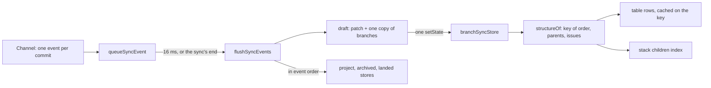

# Rendering Performance

**Status:** Implemented  
**Updated:** 2026-10-18  
**Tags:** [frontend, react, zustand, performance]

## Problem

The main window shows every branch of a repository. Each row has about 20 store subscriptions: the branch, its tip
and remote tip, the robot, the pull request, the push state, the landing span. A row re-renders its whole subtree
(actions, chips, the Safe Push slot) when one of them changes.

The sync streams one event per commit, plus one status and one remote status per branch. Two things made this cost
more than the rows themselves:
- **Selectors ran on every event.** Each event was its own store update, and `useStore` (on `useSyncExternalStore`)
  runs every subscriber's selector on every update. Among them were the table rows (about ten subscribers, O(n²)), the
  stack descendants of every row (O(n²) in total) and the robot of every branch (a scan of all robots, so
  O(branches × robots)).
- **Every row re-rendered at least twice per sync.** Each row read the whole project record, and a sync replaced that
  record two or three times, even when the issue links it sent were unchanged.

## Solution Overview

- **Rendering:** [React Compiler](https://react.dev/learn/react-compiler) memoizes every component and hook, so a
  subtree re-renders only when its inputs change.
- **Selectors:** the store does less per update. Events gather for about a frame and are applied in one update.
  Derived structure (rows, stack children, the robot of a branch) is cached on what it is computed from. Records that
  a refresh answers unchanged keep their identity. A component selects the field it shows, not the record that holds
  it.

## Design

### Architecture

- **Batching.** `queueSyncEvent` (`src/stores/branch-sync.ts`) collects the channel's events. `flushSyncEvents` applies
  them to a draft and commits the draft in one `setState`, about 16 ms later, or synchronously when
  `commands.syncBranches` returns and in its `finally`. That keeps the order of the sync's end (archived placeholders
  settled, then `isSyncing: false` once the chain of syncs ends, its follow-up included) unchanged. Runs are serialized,
  and the events a superseded run's channel still delivers are dropped, so the queue never mixes two runs.
  - The draft copies `branches` once, on the first change of a branch.
  - Updates of other stores run during the flush, in event order: the issue links (`updateProject`), the archived
    names, the landed status.
  - The integration infos of the archived branches go into one `updateFromIntegrationInfos`, applied before any
    `archivedBranchesFound` that follows them.
  - What depends on the moment of arrival is decided in `queueSyncEvent`: a remote status for a branch that is
    pushing is dropped then. The push result is authoritative, and if the push ended before the flush, a check at the
    flush would let the status the sync computed mid-push overwrite it.
  - Events are applied to the repository of their sync (the issue links go to its project), and `resetBranchSync`
    drops the queued ones.
- **Structure.** `structureOf` builds a key from the order and each branch's parent and issue, and reuses the previous
  structure while the key is the same.
  - `branchTableRowsIn` keeps one cache for all rows and one for a filter's `visible` set, so the ten subscribers share
    one computation per structure.
  - `stackDescendantsIn` and `getStackChildren` walk a children index instead of the whole order.
- **Push progress** has its own store (`pushProgressStore`). Its ticks, every 100 ms, reach only
  `useBranchPushProgress`, not every selector of the branch store.
- **The robot of a branch:** `findBranchRobot` (`src/lib/patronus.ts`) looks it up in an index. The index holds the
  preferred robot per branch name and per source revision, and is built once per robots record (a `WeakMap`).

### Key Decisions

1. **Decision**: React Compiler through its Rust port, `oxc-transform-react` (the `compiler` option of
   `@vitejs/plugin-react`, `vite.config.ts`), not Babel (`babel-plugin-react-compiler`).
   **Rationale**: the port compiles the same 572 functions as the Babel plugin 1.0, fails the build for the same
   reasons, and passes all E2E tests; the build takes 1.5 s instead of 7.4 s and there is no Babel. The port is still
   marked experimental: `oxc-transform-react` is pinned to the version `@vitejs/plugin-react` declares (`^0.152.0`
   is `<0.153.0`), and both move together.

2. **Decision**: `panicThreshold: "all_errors"`: a function the compiler cannot compile fails `vite build` and the dev
   server's transform.
   **Rationale**: by default the compiler skips such a function quietly and it runs without memoization. Its usual
   causes are caught early instead:
   - a disable comment for a React rule (Oxlint reports it as `react/rule-suppression`): read the latest values
     through `useEffectEvent` instead (`InlineForm`, `CommitReviewCode`);
   - `try` with `finally` but no `catch`: use `promise.finally(…)` (`SquashCommitsDialog`);
   - a JSX element as a parameter default: use `prop ?? <… />` in the body (`ui/toast.tsx`).

3. **Decision**: the compiler does not replace narrow store selectors.
   **Rationale**: memoization saves the render, not the selector, which runs on every store update. Selectors return a
   primitive, a joined string, or an interned record. The selected project is read by field
   (`useSelectedProjectPath`, `useSelectedProjectField`); `useSelectedProject` re-renders on every change of the
   metadata.

4. **Decision**: a batch of about 16 ms, by `setTimeout`, not `requestAnimationFrame`.
   **Rationale**: no animation frames run in a hidden window, and the sync's own end flushes anyway. Within a sync, a
   reader of the store sees it at most one batch late.

5. **Decision**: unchanged answers keep their identity:
   - `updateProject` with values equal to the stored ones (`stableStringify` for objects);
   - a remote status with the same fields;
   - the same issue groups;
   - the pull requests a refresh answers unchanged (`mergePullRequests`, as `mergeRobots` does for robots);
   - an archived branch whose integration info is the same.

   **Rationale**: every row selects from these records. A new object with the same content re-renders every row and
   evicts caches keyed on the object, such as the compiled issue patterns.

6. **Decision**: a sync event carries a conflict without its contents (`MergeConflictInfo`: the commits, the file
   names with their conflict counts, the missing commits); a view that shows the conflict reads them
   (`useConflictContents`, `src/stores/conflict-contents.ts`: one `get_conflict_contents` for the conflicting files and
   the missing commits of a conflict, kept while a view of it is mounted, "Loading the conflict…" in an open item until
   then). The conflict windows get the conflict and the repository in their data and read the contents themselves.
   **Rationale**: the contents are whole files, up to 8 MiB each: 20 KiB to 40 MiB a conflict in the monorepo, and a
   sync sends each conflict twice (the error of the commit and the status of the branch) at every run. Rust serialized
   them, the IPC carried them, the page parsed them and the stores kept them, for conflicts nobody opened. A conflict
   in a 5.6 MiB file was 2 × 28 MiB of JSON per sync, now 2 × 1.3 KiB.

### Loading

Every window loads the same `index.html`. A sub-window (`/branch-review`, `/conflicting-files`, `/missing-commits`)
used to download and compile the main window's tree before its own page: 61 modulepreloads, about 1.1 MB of JS.
- The main page is a `lazy` route (`src/router.ts`), like the sub-window pages.
- The main window's Create Pull Request dialog (`src/pages/IndexPage.tsx`) loads on first open and then stays mounted;
  Settings is a sub-window of its own (`/settings`).
- The commit preview (`CommitList`) loads on first open too. It pulls in the file tree; the commit review and the
  resizable panels load only in the review window.
- A sub-window is built hidden, on the canvas colour of the theme, and shows once its page settled the content of the
  latest open (`markSubWindowContentReady`: `WindowPage` on its render, a review once `prepareFirstDiffs` readied its
  first screen), at most 300 ms after the page loaded (`sub_window_loaded`, the budget kept by the backend, because a
  hidden page's timers are throttled). Nothing on that path waits for an animation frame: a hidden WKWebView runs
  none, and a show from `requestAnimationFrame` waited 3 s for the fallback. Pierre renders on animation frames too, so
  the first screen of a review is highlighted into the pool's cache before `CodeView` mounts and renders it in its
  mount; a scroll to the initial file renders at once (`render(true)`).
- The review page imports `CommitReviewCode` statically (the route is the lazy chunk): a `React.lazy` there committed
  its fallback even after the chunk was loaded and revealed the diffs only after React's 300 ms throttle. The page
  starts the worker pool when its module loads, beside the reads of the files and the patch.
- A review window starts its reads with its page (`startReviewWindowReads` of `main.tsx`): the files and the patch of
  the commit review into their stores, the segments of the branch review for its first read (`readBranchReview`).
  Its route chunk holds the diff engine (about 640 KB to parse, about 100 ms in the release build), and the reads
  waited for it before.
- A loading line ("Loading changes…", "Loading diff…", "Loading files…", `LoadingLine`) shows only after 300 ms: a
  read from a cache answers before, and a spinner that flashes for a frame reads as a delay where there was none. The
  review shows what it has meanwhile (the tree, the headers of the files).
- The page logs the phases of each open ("commit-review open 96 ms: loaded 41, files 44, patch 47, engine 70, primed
  88"): a new window loads the app (`loaded`), a reused one only renders.

The eager part is now 7 modulepreloads, about 590 KB.

`preloadInterFont` (`vite.config.ts`) adds a `<link rel="preload">` for the upright InterVariable face to the built
`index.html`. Without it the browser finds the font only after the CSS applies, and a window paints first in the
system font, then lays out again.

### Checking what the compiler compiled

`react({ compiler: { panicThreshold: "all_errors", logDiagnostics: true } })` in a temporary copy of `vite.config.ts`
logs the recoverable diagnostics of the compiler through Vite. With `all_errors`, a function it would skip stops the
build anyway. Each compiled function allocates its cache with the compiler runtime (`_c(n)` in the dev server's
output); `Symbol.for("react.memo_cache_sentinel")` in a build with `build.minify: false` counts its memoized values.

## References

- `vite.config.ts`: the plugin and its options
- `src/stores/branch-sync.ts`: `queueSyncEvent`, `flushSyncEvents`, `structureOf`, `branchTableRowsIn`
- `src/stores/conflict-contents.ts`: `useConflictContents`, the contents of the shown conflicts
- `src/lib/patronus.ts`: `findBranchRobot` and its index
- `src/router.ts`, `src/App.tsx`, `src/pages/IndexPage.tsx`: the lazy main page and dialogs
- [Distributed Settings](distributed-settings.md): the persisted stores the selectors read
