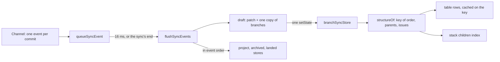

# Rendering Performance

**Status:** Implemented  
**Updated:** 2026-10-16  
**Tags:** [frontend, react, zustand, performance]

## Problem

The main window shows every branch of a repository. Each row has about 20 store subscriptions: the branch, its tip
and remote tip, the robot, the pull request, the push state, the landing span. A row re-renders its whole subtree
(actions, chips, the Safe Push slot) when one of them changes.

The sync streams one event per commit, plus one status and one remote status per branch. Two things made this cost
more than the rows themselves:
- **Selectors ran on every event.** Each event was its own store update, and `useStore` (on `useSyncExternalStore`)
  runs every subscriber's selector on every update. Among them were the table rows (about ten subscribers, O(n²)), the
  stack descendants of every row (O(n²) in total) and the robot of every branch (a scan of all robots, so
  O(branches × robots)).
- **Every row re-rendered at least twice per sync.** Each row read the whole project record, and a sync replaced that
  record two or three times, even when the issue links it sent were unchanged.

## Solution Overview

- **Rendering:** [React Compiler](https://react.dev/learn/react-compiler) memoizes every component and hook, so a
  subtree re-renders only when its inputs change.
- **Selectors:** the store does less per update. Events gather for about a frame and are applied in one update.
  Derived structure (rows, stack children, the robot of a branch) is cached on what it is computed from. Records that
  a refresh answers unchanged keep their identity. A component selects the field it shows, not the record that holds
  it.

## Design

### Architecture

- **Batching.** `queueSyncEvent` (`src/stores/branch-sync.ts`) collects the channel's events. `flushSyncEvents` applies
  them to a draft and commits the draft in one `setState`, about 16 ms later, or synchronously when
  `commands.syncBranches` returns and in its `finally`. That keeps the order of the sync's end (archived placeholders
  settled, `isSyncing: false`) unchanged.
  - The draft copies `branches` once, on the first change of a branch.
  - Updates of other stores run during the flush, in event order: the issue links (`updateProject`), the archived
    names, the landed status.
  - The integration infos of the archived branches go into one `updateFromIntegrationInfos`, applied before any
    `archivedBranchesFound` that follows them.
- **Structure.** `structureOf` builds a key from the order and each branch's parent and issue, and reuses the previous
  structure while the key is the same.
  - `branchTableRowsIn` keeps one cache for all rows and one for a filter's `visible` set, so the ten subscribers share
    one computation per structure.
  - `stackDescendantsIn` and `getStackChildren` walk a children index instead of the whole order.
- **Push progress** has its own store (`pushProgressStore`). Its ticks, every 100 ms, reach only
  `useBranchPushProgress`, not every selector of the branch store.
- **The robot of a branch:** `findBranchRobot` (`src/lib/patronus.ts`) looks it up in an index. The index holds the
  preferred robot per branch name and per source revision, and is built once per robots record (a `WeakMap`).

### Key Decisions

1. **Decision**: React Compiler through Babel (`babel-plugin-react-compiler` in `@rolldown/plugin-babel`, the
   `reactCompilerPreset` of `@vitejs/plugin-react`, `vite.config.ts`), not the Rust port (`compiler: true`).
   **Rationale**: the Babel plugin is the stable 1.0 release; the Rust port (`oxc-transform-react`) is experimental.

2. **Decision**: `panicThreshold: "all_errors"`: a function the compiler cannot compile fails `vite build` and the dev
   server's transform.
   **Rationale**: by default the compiler skips such a function quietly and it runs without memoization. Its usual
   causes are caught early instead:
   - an `eslint-disable` of a `react-hooks` rule: read the latest values through `useEffectEvent` instead
     (`InlineForm`, `CommitReviewCode`);
   - `try` with `finally` but no `catch`: use `promise.finally(…)` (`SquashCommitsDialog`);
   - a JSX element as a parameter default: use `prop ?? <… />` in the body (`ui/toast.tsx`).

3. **Decision**: the compiler does not replace narrow store selectors.
   **Rationale**: memoization saves the render, not the selector, which runs on every store update. Selectors return a
   primitive, a joined string, or an interned record. The selected project is read by field
   (`useSelectedProjectPath`, `useSelectedProjectField`); `useSelectedProject` re-renders on every change of the
   metadata.

4. **Decision**: a batch of about 16 ms, by `setTimeout`, not `requestAnimationFrame`.
   **Rationale**: no animation frames run in a hidden window, and the sync's own end flushes anyway. Within a sync, a
   reader of the store sees it at most one batch late.

5. **Decision**: unchanged answers keep their identity:
   - `updateProject` with values equal to the stored ones (`stableStringify` for objects);
   - a remote status with the same fields;
   - the same issue groups;
   - the pull requests a refresh answers unchanged (`mergePullRequests`, as `mergeRobots` does for robots);
   - an archived branch whose integration info is the same.

   **Rationale**: every row selects from these records. A new object with the same content re-renders every row and
   evicts caches keyed on the object, such as the compiled issue patterns.

### Loading

Every window loads the same `index.html`. A sub-window (`/branch-review`, `/conflicting-files`, `/missing-commits`)
used to download and compile the main window's tree before its own page: 61 modulepreloads, about 1.1 MB of JS.
- The main page is a `lazy` route (`src/router.ts`), like the sub-window pages.
- The Settings and Theme dialogs (`src/App.tsx`) load on first open and then stay mounted.
- The commit preview (`CommitList`) loads on first open too. It pulls in the commit review, the file tree and the
  resizable panels.

The eager part is now 7 modulepreloads, about 590 KB.

`preloadInterFont` (`vite.config.ts`) adds a `<link rel="preload">` for the upright InterVariable face to the built
`index.html`. Without it the browser finds the font only after the CSS applies, and a window paints first in the
system font, then lays out again.

### Checking what the compiler compiled

The `logger` option of `reactCompilerPreset` reports one event per function: `CompileSuccess`, or `CompileError` with
the reason. A temporary copy of `vite.config.ts` with
`logger: { logEvent(file, event) { if (event.kind !== "CompileSuccess") console.log(file, event) } }` lists
everything the compiler skipped. With `all_errors`, a `CompileError` stops the build anyway.

## References

- `vite.config.ts`: the plugin and its options
- `src/stores/branch-sync.ts`: `queueSyncEvent`, `flushSyncEvents`, `structureOf`, `branchTableRowsIn`
- `src/lib/patronus.ts`: `findBranchRobot` and its index
- `src/router.ts`, `src/App.tsx`: the lazy main page and dialogs
- [Distributed Settings](distributed-settings.md): the persisted stores the selectors read
