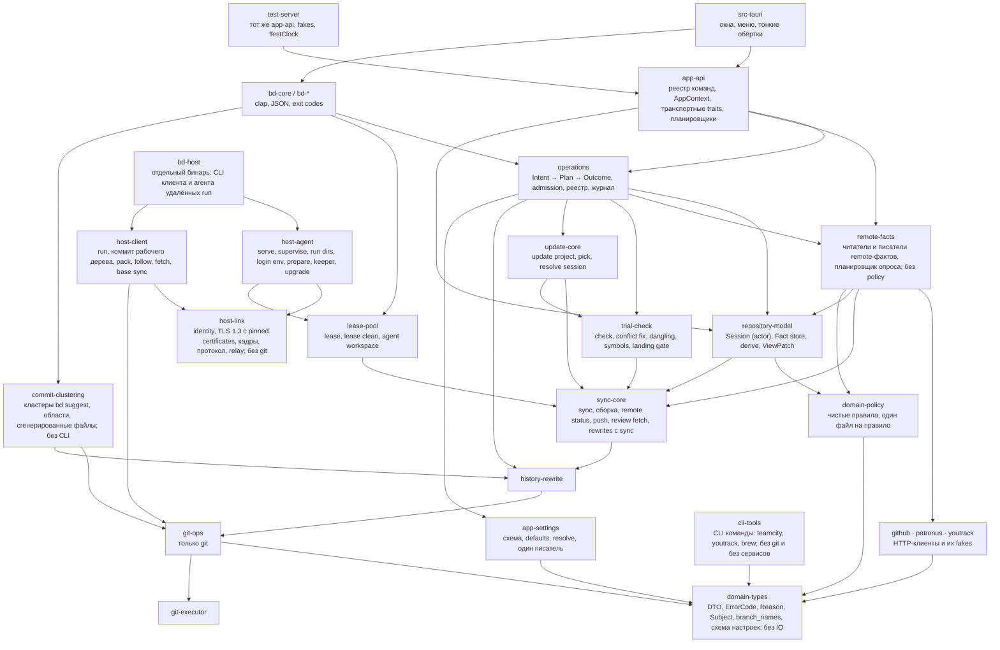
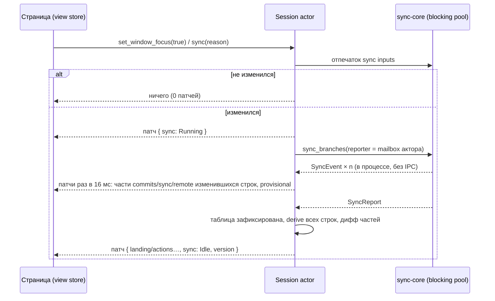

# Rust как источник предметных правил Branch Deck

**Status:** Draft

**Updated:** 2026-10-28

**Tags:** [architecture, rust, cli, tauri, landing, session, operations]

## Назначение и результат

Branch Deck сегодня принимает каждое предметное решение дважды: страница (TypeScript) решает, что ветка переносит в
master, можно ли её запустить, что нужно подтвердить и в каком порядке выполнить шаги; `bd` решает то же самое своим
кодом. Этот документ описывает переход к одному владельцу: **Rust владеет моделью репозитория, фактами о remote,
правилами над ними и исполнением каждого изменяющего действия**. Страница держит патчируемую копию модели и
представляет её; `bd` и приложение — два адаптера одной библиотеки; E2E-сервер размещает ту же библиотеку с фальшивыми
сервисами.

Результат оценивается по цели владельца: быстрое и корректное приложение с понятным кодом. Стоимость не ограничение.
Заменённый код удаляется в том же этапе, который его заменил; параллельных реализаций и слоёв совместимости нет.
Каждый этап приземляется в master отдельно и оставляет приложение и `bd` работающими.

Это вторая версия документа. Первая (`0a74afc6`) строила «landing-башню» рядом с frontend, который оставался
владельцем таблицы, фактов, опросов и реестра операций; её разбор — в [Альтернативы](#альтернативы).

## Проблема

### Что уже есть

Нижние слои разделены и остаются: `GitCommandExecutor` запускает git, `git-ops` реализует операции, `history-rewrite`
и `sync-core` держат инварианты, блокировки и последовательности git-шагов, `repository-model` хранит таблицу последнего
sync на `(repository, prefix)` и выводит одно правило для обоих клиентов (`patronus_view`). Приложение и `bd` — один
бинарник: `src-tauri/src/main.rs` передаёт `bd`/`cli` в `bd_cli::run`. Фальшивые сервисы существуют:
`crates/github/src/fake_github.rs`, `crates/patronus/src/fake_patronus.rs` (feature `fake`). Landing gate
(`trial_check::landing_gate`: `check_landing_gate` над `Subject`, `LandingRefusal` и `LandingFix` из
`domain_types::landing`, `LandingAllowances` в `domain_types::patronus`) уже решается в Rust и показывается поповером —
это образец того, как должно быть устроено всё остальное.

### Проверенные факты (master `f3bea2b9`)

Номера строк — ориентиры; этап перепроверяет их перед действием.

| Факт | Где |
| --- | --- |
| Допустимость Safe Push решается дважды | `src/lib/safe-push-decision.ts` (факты из `src/hooks/useSafePush.ts:240-345`) и `plan()` в `crates/bd-remote/src/safe_push_command.rs:860-1190` (файл 1943 строки) |
| Исполнение Safe Push оркестрируется дважды | `src/lib/safe-push-start.ts`, цикл ответа `src/stores/patronus.ts:1373-1384`; `safe_push()` в `safe_push_command.rs:415-601` |
| `bd safe-push` держит repository lock во время HTTP | lock `:431`; список роботов `:915`, `start_options` `:1042`, список PR `:1056`, readiness `:1146`, retarget `:515-526`, cancel `:531`; `drop(lock)` `:566`, вне lock — только старт (`:572-600`) |
| Push оркестрируется дважды, с разным порядком retarget | приложение retarget **до** push (`src/lib/git/push.ts:136`, `new-pull-request.ts:128`); `bd push` **после** push и lock (`push_command.rs:235-248`); `bd safe-push` до (`:507-523`) |
| Push в приложении идёт без repository lock | `src-tauri/src/commands/push.rs:21-47` проверяет только `not_built`; `bd push` держит lock |
| `start_patronus_robot` без проверок parked, landed, approvals, overlap | `src-tauri/src/commands/patronus.rs:208-249`; после `f3bea2b9` проверяет только landing gate |
| Hold ветки решается один раз, в Rust; продублированы адаптеры и hold stack branch | решение — `hold` в `repository-model/src/patronus_view.rs`; `push_holds()` (`crates/bd-remote/src/push_hold.rs:147-166`) и `getPushHold` (`src/stores/patronus.ts:677`, из `factsOf` `:264-283`) только читают его. Дважды: проверка статуса и cancel/restart держащего робота перед push (`checkPushHold`/`cancelHoldingRobot`, `src/lib/git/push.ts:249-290`; `push_locked`/`--restart-running` в `push_command.rs`) и hold stack branch (`stackBranchHoldReasonIn`, `stores/patronus.ts:468`: parked member, landed, робот стека; `push_command.rs:692`, `safe_push_command.rs:893`) |
| Таблица, факты и опросы принадлежат странице | `src/stores/branch-sync.ts` (1814 строк, per-commit `SyncEvent`, flush 16 мс); опрос — `setTimeout` в `review-requests.ts:345`, `pull-requests.ts:234`, `patronus.ts:1189,1403`, `review-readiness.ts:319`, единственный `setInterval` — `usePatronusRobotDetails.ts:60` |
| Страница отправляет выводы обратно в Rust | `RemoteFact.up_to_date` из `remoteFactsIn` (`stores/patronus.ts:511`), `GetRepositoryViewParams.matched` из `robotMatchIn` (`:491`) |
| `table_generation` — один глобальный `AtomicU32`, страница его игнорирует | `repository-model/src/views.rs:30,53`; приём по `revision` в `stores/patronus.ts:583-584` |
| `git-ops` владеет UI DTO | `Commit`, `BranchError`, `BranchSyncStatus`, `CommitSyncStatus`, `WordResolutionSummary`, `UpdateCheck`, `CommitInfo` — импорт в `sync-types/src/lib.rs:2-4`, `branch_name_suggestion.rs:3` |
| `patronus → git-ops` ради чистых имён веток | `BranchKind` и `strip_branch_namespace`, `crates/patronus/src/service.rs:7` |
| У `settings.json` уже два писателя и ручные читатели со своими defaults | `LazyStore` (`src/stores/settings/app-store.ts:65`); `restart_app` (`src-tauri/src/title_bar.rs:250-262`); `zoom.rs:35-40` (1.0), `menu.rs:156-161` (`autoSyncOnFocus` = true), `title_bar.rs:237`, `bd-core/src/context.rs:293-318` |
| Префикс ветки разрешается дважды | `computeEffectiveBranchPrefix` (`src/stores/repository.ts:107-114`) и `resolve_branch_prefix` (`sync-core/src/branch_prefix.rs:27`) |
| Неудачное чтение правил GitHub читается как «push сохраняет approvals» | `src/hooks/useDismissesStaleReviews.ts:19-26`: `forget` удаляет ответ и возвращает `false`; до следующего вопроса peek-кэш держит `false` |
| Matching роботов держится общей фикстурой, которую читают обе стороны | `src/test-support/robot-match-cases.json`: `patronus_start_test.rs:126`, `src/lib/patronus.test.ts:39`; комментарий `patronus_start.rs:49` называет файл неверно |
| Три реестра команд; 35 команд в e2e никогда не доходили до Rust (после `s0b-remote-bridge` — 4, только окна) | `collect_commands!` (112, `src-tauri/src/lib.rs`), ручные маршруты `/invoke/*` в `crates/test-server/src/lib.rs` (до s0b 77, после 108 по командам плюс `get_blob_syntax`; `browse_repository/{repo_id}` — маршрут команды `browse_repository`); `tests/e2e/setup/tauri-mocks.ts` — локальные обработчики окон и плагинов, всё остальное проксируется на сервер (`proxyToTestServer`), 405 роняет тест; `routeCommand(page, "start_patronus_robot")` был в 25 тестах, после s0b ни одного: `command_registry_test.rs` держит `PAGE_MOCKED` (4) и храповик ответов страницы в `tests/e2e` |
| Test-server переизобретал логику (снято в `s0b-remote-bridge`) | `get_branch_review_readiness` (~70 строк поверх `to_branch_readiness`), `resolve_patronus_revisions` в `tauri_command_bridge.rs`; теперь маршрут зовёт реальное ядро (`branch_review_readiness`, `prepare_robot_start`) с реальными сервисами за fakes репозитория (`remote_host.rs`) |
| Draft-правило у UI и CLI совпадает | UI `blockedByDraft = isDraft && mode !== "dryRun"` (`src/lib/patronus.ts:867`); CLI отказывает только при `pushes` (`safe_push_command.rs:919,1111`) |
| `bd status` читает Patronus | `landed_by`: `landed_branches(&PatronusFacts::read(.., read_robots(..)))` (`crates/bd-remote/src/status.rs:393-424`); список роботов с курсором `since` в object cache (`robot_list.rs:135-147`); флага `--remote` нет |

Поправки к первой версии документа: «сетевые чтения вне lock, как в CLI» — неверно, вне lock только старт; «один
писатель settings.json» — уже не так; `tableGeneration` не per-repository, а глобальный; фикстуру matching читают обе
стороны, сломан только комментарий; «push hold в трёх копиях» — решение одно (`patronus_view`), дублируются адаптеры.

### Реестр расхождений

D — одинаковый ввод даёт разный результат в приложении и в `bd`; R — правило продублировано без известного
расхождения; S — состояние с двумя владельцами. Правый столбец называет владельца после переработки.

| id | Что | Приложение / `bd` (или вторая копия) | Одно правило |
| --- | --- | --- | --- |
| D1 | Push сбрасывает approvals, которые считает Patronus | **закрыт (s1)**: UI отказывает (`safe-push-decision.ts:171-173`); `bd` не вызывал `read_branch_rules`, теперь `plan()` читает правила target одним GET там, где их читает приложение, и отказывает `push_dismisses_approvals` (`rules_check`, поле `rules`) | `domain-policy::review`: отказ `push_dismisses_approvals { pr }`, исправление `push_then_request_review` |
| D2 | Профиль с `skipsReview` | **закрыт (s1)**: UI пропускает проверку approvals (`:110-112`); `bd` отказывал при `Missing`, если нет `--without-approvals`/`--create-pull-request`, теперь пропускает её для профиля, который пропускает review, на API-маршруте (`ApprovalsSkippedBy::of`, `review.skipped_by`) | `skips_approvals = mode == SafePush && !create_pull_request && (without_approvals \|\| route == Api && profile.skips_review)`; у comment-маршрута профиля нет; `--without-approvals` у `bd` — «стартовать всё равно» на любом маршруте, как до s1 |
| D3a | Порядок retarget при push | **закрыт (s9-engine-remote, s9-5)**: приложение до push, `bd push` после, `bd safe-push` до; теперь `bd push` тоже до push, после lock (`push_retargets_before_it_pushes_and_a_refused_push_keeps_the_retarget`) | `Retarget` в плане всегда **перед** `Push`; отказ GitHub на retarget собственного PR останавливает `Land`, а в `Push` только попадает в outcome |
| D3b | PR в другую базу (release-ветка) | **закрыт (s8-policy)**: UI блокировал Safe Push строкой 5′ и при старте без review, `bd` стартовал через API и игнорировал PR (`other_base_pull_request_start`, удалён); теперь база — одно правило `domain_policy::pull_request::base_of`, старт со считающимися approvals отказывает у обеих сторон (страница — строкой 5′, `bd` — `pull_request_other_base` с retarget как следующим шагом), а старт без review и профиль `skips_review` (`domain_policy::review::skips_approvals`; у страницы шаг next step держит такой старт только причинами субъекта на любой строке — sync, сбой, нет коммитов, роботы, parked, landed, то, что идёт на строке (`subjectBlocker`; факта sync у решения нет), — никогда своими (approvals, draft, другая база), `startStepBlocker`) идут через API; `--create-pull-request` с таким PR тоже отказывает | `OtherBase` блокирует только старт, чьи approvals считаются (Safe Push по default checks); Dry Run, старт без review и профиль `skips_review` не блокирует; молча не retarget'ит — `Retarget` предлагается как исправление; `bd` получает отказ `pull_request_other_base { number, base }` |
| D4 | Push поверх remote, который сдвинулся, но не имеет коммитов, которых нет у ветки | **закрыт (s8-policy)**: приложение повторяло push один раз в TS (`push.ts`), `bd` отвечал `lease_rejected`; теперь повтор в Rust у обеих сторон: `push_guard` (lock, проверки и коммиты заново, `PushBranchesParams::over_moved`), `bd push` (новые lease; с s9-5 у обеих одно ядро `operations::push::send`: те же замороженные коммиты, lease на головах после fetch, без второго lock) и stack branch у `bd safe-push --whole-stack`, исход называет статусы, поверх которых шёл push (`pushed_over`) | `RemoteStatusUpdate::pushes_again` (`domain_types::remote_status`; до s16-1 — `domain_policy::push::over_moved_remote`): один повтор, только если `dropped_commits` пуст и у ветки есть работа; `bd` сообщает `pushed_over`; remote с чужими коммитами — `lease_rejected` у обоих |
| D5 | Request review | **закрыт (s9-engine-remote, s9-10)**: кандидаты — одно правило с s8-policy (`domain_policy::review::candidates`); push первым шагом — `Push` плана intent'а `RequestReview` (`operations::pull_request::review_planned`), у приложения `pushFirst`, `bd request-review` без `--push` отказывает `needs_push` (`Reason::NeedsPush`), с ним пушит тем же движком; до s9-10 приложение пушило в TS (`RequestReviewForm.tsx`), `bd` не пушил | в плане `RequestReview` есть шаг `Push`, если remote отстаёт; приложение подтверждает его, `bd` отказывает `needs_push` без `--push`; одна функция кандидатов |
| D6 | Create PR | **закрыт (s9-engine-remote, s9-10)**: один intent `CreatePullRequest` (`operations::pull_request::create_planned`: push кнопки первым, затем создание с `wait_for_mirror`; «Continue on GitHub» — тот же intent с `onGitHub`, эффект `WaitForMirror`), тот же эффект `CreatePullRequest` у `bd safe-push --create-pull-request`; IPC `create_pull_request`, `wait_for_github_branch` удалены; до s9-10 приложение: push → `wait_for_github_branch` → `create_pull_request` (`create-pull-request-context.ts`) | один intent `CreatePullRequest` с `wait_for_mirror`; IPC `wait_for_github_branch` удаляется |
| D7 | Закрытие PR, которые перенёс слившийся робот | **закрыт (s9-engine-remote, s9-11)**: правило одно с s8-policy (`domain_policy::landed::pull_requests_to_close`): новость слияния сессии несёт PR, которые закрывает приземление (`NewsEvent::RobotMerged.closes`, после вида Patronus этих роботов); страница по новости просит сессию репозитория робота закрыть их — intent `CloseLandedPullRequests` (`operations::close::close_landed_plan`: план снова из фактов сессии, комментарий каждого в Rust, ресурс `PullRequest{State}`, каждый close независимо), в том числе после смены репозитория главного окна; `bd robot` перечисляет `closes` и не закрывает (решение владельца 4); до s8 решал TS (`findLandedPullRequests`), до s9-11 закрывал TS (`landed-stack.ts`) | правило `domain-policy::landed::pull_requests_to_close`; intent `CloseLandedPullRequests` из сессии приложения; `bd` по-прежнему не закрывает (решение landing.md), но `bd robot`/`bd status` перечисляют `closes` той же функцией |
| D8 | Родитель для состава whole stack | **закрыт (s8-policy)**: обе стороны читают одно правило `domain_policy::stack::whole_stack_of` по объявленному родителю (решение владельца 5): whole stack ветки — стек её корня по объявленному родителю, stack branch корня, пока стек ветвится, иначе прямая цепочка от корня, которую приземляет её последняя не parked ветка; вид кладёт его на структуру корня (`BranchStructure.wholeStack`), `bd safe-push --whole-stack` и `bd robot --whole-stack` читают то же (`bd_core::stack_summary::whole_stack`); до s8: TS `effectiveBase ?? declaredParent` (`useStackNextStep.ts`), Rust `effective_base ?? blocked_by.parent` (`stack_summary::whole_stack_of`, удалён); случай (`s0c-scenarios`): A с проблемой стека (`(A/A)`) ← B без коммитов, сохранённый родитель B → A (`bd restack`) ← C `(B/C)` — теперь C корень своего стека, а whole stack A — A один | одна функция в Rust (`domain-policy::stack`) |
| D9 | Неудачное чтение правил GitHub читается как `false` | **закрыт (s1)**: приложение читало ошибку как «approvals остаются» и стартовало, теперь `useDismissesStaleReviews` отвечает `keep` \| `dismiss` \| `unknown` с причиной (неудача не кешируется, каждый старт спрашивает снова), а `getSafePushDecision` подтверждает `rulesUnknown` (строка поповера `safe-push-rules-unknown`); `bd` отказывает `rules_unknown`, который снимает `--allow-unknown-rules` | `Fact::Unavailable` никогда не превращается в разрешение; см. D1 и решение владельца о случае без токена |
| D10 | Прямой IPC обходит проверки | **закрыт (s1)**: `start_patronus_robot`, `restart_`, `cancel_patronus_robot`, `push_branch(es)` шли без проверок и без lock; теперь push приложения читает роботов сам, берёт lock и отказывает parked, landed, hold, not built (`push_guard`), а старт, restart и cancel отказывают parked, landed, not built и overlap по таблице и роботам, которых Rust читает сам (`start_guard`) | вся допустимость — в движке операций; низкоуровневый IPC удаляется в `s9-engine-remote`; до того `s1-holes` добавляет проверки в Rust |
| D11 | PR в виртуальную базу (ветка родителя, другая ветка таблицы, приземлённая) | **закрыт (s8-policy)** по решению владельца 9: приложение отказывало в Safe Push строкой 5 и предлагало retarget отдельным шагом, `bd` делал retarget первым эффектом старта; теперь обе стороны решают `domain_policy::land::decide`, чей первый эффект — `PlannedEffect::Retarget` в target, и стартуют от этого PR (с s9-8 у обеих сторон его исполняет движок, `operations::land_execute`; строка 5 больше не отказывает, её слот остаётся retarget до шага next step в Rust); readiness обеих спрашивается с ним (`domain_policy::pull_request::start_pull_request`: PR в target или, у ветки, в виртуальную ветку) | `Retarget` — шаг плана `Land` у обеих сторон, подтверждаемый там же, где `Push`; приложение перестаёт отказывать |
| D12 | Push поверх чужого коммита на remote (`dropped_commits` непуст) | **закрыт (s8-policy)**: решение Safe Push в приложении не читало чужие коммиты и стартовало с force push (спрашивала только кнопка push), `bd` отказывал `push_refused`; теперь обе стороны решают `domain_policy::land::decide`: отказ `Reason::DropsRemote` (страница — словами кнопки push, `bd` — `push_refused`), с `--force` у `bd` (`LandingAllowances::allow_force`) — подтверждение `ForcePushDrops` и force push | `domain-policy::push`: отказ `drops_remote_commits` у обеих сторон, подтверждение — явный шаг плана, не кнопка |
| D13 | PR слит GitHub'ом с коммитами ветки | **закрыт (s8-policy)**: приложение держало ветку (строка 1, `mergedCurrent`), `bd` читал только открытые PR и роботов и стартовал через API; теперь одно правило `domain_policy::landed::landed_state` (fetched baseline, слившиеся Safe Push, PR, слитый с её коммитами: head = tip или remote tip без отличий) — вид отдаёт `RepositoryView.landedStates`, решение старта у обеих сторон получает блокер `Reason::PullRequestMerged` (`bd` — `landed`) | `domain-policy::landed`: слитый PR с текущими коммитами — приземление у обеих сторон |
| D14 | Review без ответа: pre-check упал (`unavailable`) или репозиторий только на Space | **закрыт (s8-policy)** по решению владельца 10: приложение подтверждало строкой review (`isReviewUnjudged`, `reviewFactOf: space`), `bd` отказывал; теперь обе стороны решают `domain_policy::land::decide`: упавший pre-check — подтверждение `ReviewUnknown` (строка поповера, `--allow-unknown-review` у `bd`), merge request Space — недостающие approvals (`approvals_missing` у обеих), чтение Space одно (`domain_policy::review::review_state`) | `Fact::Unavailable` — ожидание или подтверждение, не отказ; одно чтение `space` у обеих сторон |
| D15 | Dry Run, чей push идёт в ветку, которую приземляет идущий Safe Push ветки над ней (span hold) | **закрыт (s8-policy)**: приложение отказывало (`pushHeld` из hold представления), `bd` для dry run отказывал только по последнему коммиту, пушил и стартовал; теперь обе стороны отказывают одним правилом `domain_policy::land::start_refusal`: Dry Run, который пушит, ждёт span hold своей ветки (`Reason::Held`), а hold решает `domain_policy::holds::branch_hold` | hold из `patronus_view` действует на push любого старта у обеих сторон (`domain-policy::holds`) |
| R1 | Needs push, порядок push стека | `isRemoteUpToDate`, `getPushAction` (`push-summary.ts:24-62`), `needsPush`, `stackPushOrder` (`stack.ts:156-188`); `has_work_for_remote` (`push_command.rs:727`), `stack_branches_to_push` (`:674`) | `domain-policy::push::plan` |
| R2 | Hold stack branch и порядок перед push держащего робота | **правило hold закрыто (s8-3)**: hold ветки и stack branch решает `domain_policy::holds` (`branch_hold`, `stack_branch_hold`), вид несёт `landing.hold`, `bd push` и проверки приложения читают то же; до s8: решение hold ветки одно (`patronus_view`); hold stack branch — TS `stackBranchHoldReasonIn` и проверки parked в `push_command.rs:692`, `safe_push_command.rs:914`; статус, cancel и restart держащего робота — `checkPushHold`/`cancelHoldingRobot` (`push.ts:249-290`) и `push_locked`/`--restart-running` | `domain-policy::holds` получает hold ветки из `patronus_view` и hold stack branch (s8); порядок «статус → cancel → push» — `operations::push` (s9); `push_hold.rs` (чтение представления для `bd push`) удаляется в s9 |
| R3 | Parked | `src/lib/parked.ts:21-63`; `sync_core::parked::parked_state` (`parked.rs:126`) | `domain-policy::parked` (закрыт в s8-2: правило одно, страница читает `BranchView.structure.parked`) |
| R4 | Отказ в старте | **закрыт (s8-3)**: `domain_policy::land::start_refusal` у обеих сторон, вид несёт `landing.start`/`landing.dryRun` (`Reason`); до s8: `canStartRobot`, `isStartBlocked`, `allowsPushMode` (`src/lib/patronus.ts:520-625,823`); `BranchPatronus.start`, `StackPatronus.start` (`domain-types/src/repository_view.rs`; правило одно — `repository_model::patronus_view::start_blocked`) — Rust-поля читает только `bd` | `domain-policy::land` |
| R5 | Matching роботов | `findBranchRobot` (`patronus.ts:78`); `domain_policy::robot_match` (`RobotIndex`, `match_table`; с s7-1 вместо `find_branch_robot` из `patronus_start.rs`) | только Rust; `RobotMatch` перестаёт быть входом |
| R6 | Next step, landing node, решение Safe Push | `branch-next-step.ts` (657), `landing-node.ts` (234), `safe-push-decision.ts` (211), `useStackNextStep.ts`, `whole-stack.ts`; `plan()` в `bd` | `domain-policy::{next_step, landing_node, land}` |
| R7 | Restart, Push and Restart | **правило закрыто (s8-3)**: `domain_policy::holds::restart_action` и `land::restart_refusal`, вид несёт `restarts` по id робота; оркестрация `runPushAndRestart` остаётся до intent s9; до s8: `getRobotRestartAction` (`patronus.ts:425`), `runPushAndRestart` (`patronus-actions.ts:77-120`); `bd push --restart-running` | intent `RestartRobot` |
| R8 | Предпросмотр группировки коммита | `groupFor`/`parseSubject`/`findIssueKey`/`sanitizeBranchName` (`src/lib/commit.ts:114-216`, 14 потребителей); `CommitGrouper`, `sync-utils` | Rust `preview_group(message)`, debounce в inline-форме |
| R9 | Markdown тела коммита | `parseCommitBody` (`src/lib/commit-message.ts`); `commit_body_markdown` (`remote-facts/src/pull_request_text.rs`) | Rust; диалог PR получает текст из `get_new_pull_request` |
| R10 | Валидация имени ветки | `useBranchNameValidation.ts`; `is_valid_branch_prefix` (`domain-types/src/branch_names.rs`), `stack_path` (`domain-types/src/stack.rs:213`) | Rust (`domain-types::branch_names`, чистая); при заметной задержке ввода — TS-проверка против Rust-оракула (фикстура, которую пишет Rust-тест) |
| R11 | Эффективный префикс ветки | см. факты | Rust; с `s6-session-table` сессия ключуется разрешённым префиксом |
| S1 | Таблица веток | страница (`branch-sync.ts`) и Rust (`RepositoryViews::keep`) | сессия в Rust |
| S2 | Факты о remote | строки страницы, результаты push, `remoteStatusUpdate` отбрасывается во время push | сессия, `Fact<T>` с порядковым номером наблюдения |
| S3 | Идущие операции | `src/stores/operations.ts` (только приложение), `pushingBranches`/`stackPushes`, `safePushStore.starting`, repository lock (между процессами, только ожидание) | реестр в Rust: in-process плюс общий файл |
| S4 | Настройки | `LazyStore`, `restart_app`, ручные читатели | `app-settings`, один писатель |
| S5 | Activity | только страница (`src/stores/activity.ts`, ключ `settings.json` главного окна); действия `bd` не видны | журнал в Rust плюс записи страницы через одного писателя |
| S6 | Список команд e2e | три реестра | один реестр (`app-api`); сделано в s12: `for_each_command!` порождает обёртки и регистрацию приложения, маршруты test-server и `commands.json` |

Тесты каждой строки D: у разыгранного случая — тесты групп его случаев ([Таблица сценариев](#таблица-сценариев)),
у записанного (`recorded`: решение ни одной стороны его не достигает) — существующие тесты, на которые указывает запись
`discrepancies.json`; тест реестра проверяет, что каждый её указатель (`path#text`, `path:line#text`) есть в файле, а у `path:line#text` — на этой строке. У D10
теста поведения нет: прямой IPC никто не проверяет, его держит только указатель.

- **D1.** Закрыт в s1-holes (`closed: "s1-holes"`, обе стороны отказывают; `rules-dismiss-not-counted` — сброс
  approvals, которых Patronus не считает: подтверждение и предупреждение `rules`):
  [@test] ../../crates/bd-remote/src/safe_push_test.rs (`a_push_that_dismisses_the_approvals_patronus_counts_refuses_the_safe_push`)
  [@test] ../../crates/bd-remote/src/scenario_test.rs (`the_discrepancy_cases_name_every_id_as_the_register_does`, `the_safe_push_review_cases_answer_alike_in_the_app_and_bd`)
- **D2.** Закрыт в s1-holes (`closed: "s1-holes"`, его бывший twin `skips-review-profile` отвечает одному ожиданию):
  [@test] ../../crates/bd-remote/src/safe_push_test.rs (`a_profile_that_skips_the_review_starts_without_the_approvals_through_the_api`)
  [@test] ../../crates/bd-remote/src/scenario_test.rs (`the_safe_push_review_cases_answer_alike_in_the_app_and_bd`)
- **D3a.** Сегодняшнее поведение закреплено:
  [@test] ../../src/lib/push-run.test.ts (`retargets a pull request into a virtual branch to the baseline before the push, and says it in the toast of the push`)
  [@test] ../../crates/test-server/src/github_host_test.rs (`a_push_retargets_the_pull_request_of_its_branch_out_of_a_virtual_branch_first`)
  [@test] ../../crates/bd-remote/src/safe_push_test.rs (`push_retargets_a_pull_request_into_a_virtual_branch_to_the_baseline`)
  [@test] ../../crates/bd-remote/src/safe_push_test.rs (`the_pull_requests_of_the_branch_and_of_the_parents_it_pushes_go_into_the_target_before_the_start`)
- **D3b.** Закрыт в s8-policy (`closed: "s8-policy"`, бывший twin `row-5-prime-another-base` и
  `row-5-prime-another-base-without-review` отвечают одному ожиданию): обе стороны отказывают старту со считающимися
  approvals и пропускают старт, который их не считает:
  [@test] ../../crates/domain-policy/src/pull_request_test.rs (`a_pull_request_goes_into_the_target_into_a_virtual_branch_it_leaves_or_into_another_base`)
  [@test] ../../crates/bd-remote/src/safe_push_test.rs (`a_pull_request_into_another_base_refuses_only_a_safe_push_whose_approvals_count`, `create_pull_request_retargets_the_pull_request_of_a_virtual_branch_and_refuses_one_into_another_base`)
  [@test] ../../crates/domain-policy/src/land_test.rs (`missing_approvals_refuse_unless_skipped_and_approvals_judged_at_the_start_confirm`, `the_pull_request_decides_the_route_a_draft_refuses_and_another_base_refuses_only_counted_approvals`)
  [@test] ../../src/presenters/land.test.ts (`lets a start without review wait for its profile, and confirm the one that skips the review`)
  [@test] ../../crates/bd-remote/src/scenario_test.rs (`the_next_step_row_cases_answer_alike_in_the_app_and_bd`)
- **D4.** Закрыт в s8-policy (`closed: "s8-policy"`): одно правило `RemoteStatusUpdate::pushes_again` (до s16-1 —
  `domain_policy::push::over_moved_remote`), повтор обеих сторон в Rust, remote с чужими коммитами — `lease_rejected`
  у `bd` и тост у приложения:
  [@test] ../../crates/domain-types/src/remote_status_test.rs (`pushes_again_over_a_moved_remote_only_when_nothing_of_it_is_lost`)
  [@test] ../../crates/operations/src/push_test.rs (`pushes_again_over_a_moved_remote_only_when_the_remote_has_no_commits_the_branch_lacks`)
  [@test] ../../crates/bd-remote/src/push_test.rs (`pushes_again_over_a_moved_remote_that_lacks_nothing_of_the_branch`, `a_moved_remote_branch_is_fetched_and_reported_and_force_replaces_it`)
- **D5.** Закрыт в s9-10 (`closed: "s9-engine-remote"`): кандидаты — одно правило (`domain_policy::review::candidates`),
  push первым шагом — шаг плана `RequestReview` у обеих сторон, `bd` только с `--push`:
  [@test] ../../tests/e2e/next-step/next-step.spec.ts (`should push the commits the remote lacks as the first step of Request Review…`)
  [@test] ../../crates/domain-policy/src/review_test.rs (`are_the_suggested_ones_of_the_missing_groups_one_per_group_nobody_is_asked_for_chosen_each_once`)
  [@test] ../../crates/operations/src/pull_request_test.rs (`a_review_request_pushes_first_only_when_told_to_and_asks_the_preselected_code_owner`)
  [@test] ../../crates/bd-remote/src/request_review_test.rs (`asks_the_suggested_code_owner_of_the_missing_group_once`, `a_branch_its_remote_lacks_is_refused_without_push_and_pushed_first_with_it`)
- **D6.** Закрыт в s9-10 (`closed: "s9-engine-remote"`): один intent `CreatePullRequest` с ожиданием зеркала:
  [@test] ../../tests/e2e/next-step/next-step.spec.ts (`should open GitHub's form of a branch not on the remote yet from its preview, after the push`)
  [@test] ../../crates/operations/src/pull_request_test.rs (`continue_on_github_pushes_and_waits_until_github_has_the_branch`, `a_creation_again_finds_the_pull_request_the_search_does_not_list_yet`)
  [@test] ../../crates/bd-remote/src/safe_push_test.rs (`the_approvals_count_in_the_pull_request_it_opens_and_the_safe_push_starts_from_it`)
- **D7.** Закрыт в s9-11 (`closed: "s9-engine-remote"`): правило одно с s8-policy
  (`domain_policy::landed::pull_requests_to_close`); закрывает только приложение, intent `CloseLandedPullRequests` в
  сессии репозитория робота, `bd robot` перечисляет `closes` (решение владельца 4):
  [@test] ../../crates/operations/src/close_test.rs (`the_closes_of_a_merged_robot_close_what_its_landing_closes_with_a_comment_of_the_robot`)
  [@test] ../../src/stores/patronus.test.ts (`closes the pull requests in the robot's repository when the main window shows another one`)
  [@test] ../../crates/domain-policy/src/landed_test.rs (`closes_the_pull_requests_of_the_branches_a_merged_robot_landed_whole_not_of_its_own_branch`)
  [@test] ../../crates/repository-model/src/facts_test.rs (`a_merge_waits_for_the_view_of_its_robots_and_names_the_pull_requests_its_landing_closes`)
  [@test] ../../crates/bd-remote/src/robot_test.rs (`a_merged_robot_lists_the_pull_requests_its_landing_closes_and_closes_none`)
  [@test] ../../crates/bd-remote/src/scenario_test.rs (`the_discrepancy_cases_name_every_id_as_the_register_does`)
- **D8.** Закрыт в s8-policy (`closed: "s8-policy"`): одно правило `domain_policy::stack::whole_stack_of` по объявленному
  родителю у обеих сторон, одно ожидание:
  [@test] ../../crates/bd-remote/src/scenario_test.rs (`the_whole_stack_of_a_blocked_branch_with_an_inactive_declared_parent_is_d8`)
  [@test] ../../crates/domain-policy/src/stack_test.rs (`the_whole_stack_of_a_blocked_branch_follows_its_declared_parent_not_what_blocks_it`)
- **D9.** Закрыт в s1-holes (`closed: "s1-holes"`; приложение подтверждает `rulesUnknown`, `bd` отказывает
  `rules_unknown` — асимметрия по замыслу, решение владельца 6; `rules-unknown-allowed` — подтверждение и
  `--allow-unknown-rules`, обе стороны стартуют):
  [@test] ../../crates/bd-remote/src/safe_push_test.rs (`rules_github_does_not_answer_refuse_the_safe_push_unless_allowed`)
  [@test] ../../crates/domain-policy/src/land_test.rs (`the_rules_of_a_push_into_an_approved_pull_request_refuse_confirm_or_wait`)
  [@test] ../../tests/e2e/patronus/patronus-actions.spec.ts (`should confirm a push into an approved pull request whose rules can't be read, never reading them as keeping the approvals`)
  [@test] ../../crates/bd-remote/src/scenario_test.rs (`the_discrepancy_cases_name_every_id_as_the_register_does`, `the_safe_push_review_cases_answer_alike_in_the_app_and_bd`)
- **D10.** Закрыт в s1-holes (`closed: "s1-holes"`, запись recorded: `today` называет guard'ы обеих сторон): push
  приложения — lock и отказы нет строки, parked, landed, hold, stack branch не built в Rust (`push_guard`); старт,
  restart и cancel — отказы parked, landed whole, not built и overlap по роботам, которых Rust читает сам (`start_guard`;
  старт с s9-8, restart и cancel с s9-9 — план `execute`, решённый заново до первого эффекта, `start_guard` удалён):
  [@test] ../../crates/bd-remote/src/scenario_test.rs (`the_discrepancy_cases_name_every_id_as_the_register_does`)
  [@test] ../../crates/operations/src/push_test.rs (`a_push_of_a_stack_runs_the_processes_of_the_core_push`)
  [@test] ../../crates/test-server/src/remote_fixtures_test.rs (`a_push_into_a_branch_whose_safe_push_runs_is_refused_before_git_pushes`)
  [@test] ../../crates/operations/src/robot_test.rs (`a_restart_restarts_alone_while_the_remote_has_the_branch_and_pushes_first_a_branch_that_changed`, `a_cancel_of_a_robot_that_finished_is_as_it_ended_and_cancels_nothing`)
  [@test] ../../crates/operations/src/land_execute_test.rs (`a_start_refused_before_its_first_effect_cancels_pushes_and_starts_nothing`)
  [@test] ../../crates/test-server/src/remote_fixtures_test.rs (`a_start_its_plan_refuses_is_refused_before_patronus_or_github_is_asked`)
- **D11.** Закрыт в s8-policy: три случая строки 5 отвечают обеими сторонами стартом, первый эффект которого —
  retarget (`PlannedEffect::Retarget`), правило — `domain_policy::land::decide`:
  [@test] ../../crates/bd-remote/src/scenario_test.rs (`the_next_step_row_cases_answer_alike_in_the_app_and_bd`)
  [@test] ../../crates/repository-model/src/derive_test.rs (`the_view_decides_the_default_starts_of_each_branch_and_a_read_answers_another_intent`)
  [@test] ../../crates/operations/src/land_execute_test.rs (`a_start_cancels_the_robot_it_replaces_pushes_and_starts_in_the_order_of_its_plan`)
- **D12.** Закрыт в s8-policy: случай `remote-behind` отвечает обеими сторонами отказом (`Reason::DropsRemote`):
  [@test] ../../crates/bd-remote/src/scenario_test.rs (`the_landing_cases_answer_alike_in_the_app_and_bd`)
- **D13.** Закрыт в s8-policy (`closed: "s8-policy"`): случай `row-1-merged-pull-request` отвечает обеими сторонами
  приземлением, правило — `domain_policy::landed::landed_state`:
  [@test] ../../crates/domain-policy/src/landed_test.rs (`a_pull_request_lands_the_branch_only_merged_with_the_commits_it_has`)
  [@test] ../../crates/bd-remote/src/scenario_test.rs (`the_next_step_row_cases_answer_alike_in_the_app_and_bd`)
- **D14.** Закрыт в s8-policy: `readiness-space-required` отвечает обеими сторонами отказом, `readiness-unavailable` и
  `row-11-unavailable` — подтверждением `ReviewUnknown` (у `bd` — флагом, `asymmetry: byDesign`):
  [@test] ../../crates/bd-remote/src/scenario_test.rs (`the_safe_push_review_cases_answer_alike_in_the_app_and_bd`, `the_next_step_row_cases_answer_alike_in_the_app_and_bd`)
- **D15.** Закрыт в s8-policy: случай `dry-run-while-a-safe-push-of-a-child-lands-the-branch` отвечает обеими сторонами
  отказом, правило — `domain_policy::land::start_refusal`:
  [@test] ../../crates/bd-remote/src/scenario_test.rs (`the_landing_cases_answer_alike_in_the_app_and_bd`)
  [@test] ../../crates/domain-policy/src/land_test.rs (`a_dry_run_waits_for_the_last_commit_and_for_the_span_hold_of_the_push_it_makes`)

Реестр и документ держит тест реестра: у каждого id есть строка реестра и запись выше, а у строки, оставляющей правило
владельцу («владелец»), — нумерованный пункт в [Решениях владельца](#решения-которые-подтверждает-владелец), который
называет id.

## Область изменений

Входит: всё, что решает «можно», «нужно», «что переносит», «кто держит», «какие ветки» и всё, что выполняет
последовательность эффектов (git, remote, GitHub, Patronus, YouTrack): Safe Push и Dry Run, restart и cancel, push
ветки, предков, детей и whole stack, создание PR, retarget, request review, закрытие перенесённых PR, review чужого PR,
регруппировки и остальные rewrite'ы, Update Project, sign-in, Mark Fixed; факты, их актуальность и опрос; реестр
операций; настройки; ошибки; реестр команд и E2E-сервер.

Остаётся за страницей: выбор строк, фокус, scroll, раскрытие стека, поповеры, hover, layout, какая поверхность
показывает индикатор, формулировки, иконки, клавиши. TS-функция, которая решает «можно/нужно/переносит/держит», —
дефект; с `s14-fence` её ловит lint.

Не переписываются: diff renderer, группировка (`CommitGrouper`), merge/replay, mapping notes, object cache, устройство
lease pool, инварианты git-слоя (`GitCommandExecutor`, запрет записи в working tree кроме `worktree_update.rs`,
`RefTransaction` с CAS, batching, бюджеты процессов). Они переезжают между crates вместе с тестами и исключениями
scan-тестов, не меняясь. Daemon не появляется: `bd` работает без запущенного приложения.

## Целевая архитектура

### Принципы

1. **Rust владеет каждым предметным решением и каждым многошаговым эффектом.** Страница представляет и держит
   локальное UI-состояние.
2. **Один входной протокол.** Страница отправляет **intents** (что попросил пользователь) и **demand** (что она
   показывает). Она никогда не отправляет выводы: ни `needsPush`, ни `upToDate`, ни `matched`, ни `canStart`.
3. **Факты несут свою достоверность.** `Fact<T>` различает Fresh, Stale(reason), Loading, Unavailable(reason) и
   Unknown. Ни одно правило не превращает Unknown или Unavailable в разрешение или в «не требуется». Решение над
   фактом Loading, Unknown или Unavailable — ожидание или блок с этим фактом как причиной, никогда действие, которое
   следующий ответ заменит другим: «Safe Push», через три секунды ставший «Awaiting Review», успевал подтвердить старт
   через API, чьи approvals не считаются (монорепозиторий, 2026-10-24; [Facts without an
   answer](../../spec/branch/next-step.spec.md#facts-without-an-answer)).
4. **Каждый внешний эффект планируется, допускается, перепроверяется перед собой и записывается.** Откатов нет;
   outcome называет, что произошло.
5. **`bd` и приложение — два адаптера одной библиотеки.** Координация между процессами — на диске: repository lock,
   реестр операций, refs с CAS, object cache, stamp-файл. Daemon нет.
6. **Одно место для каждого правила.** Каждое правило живёт в одном файле с `//!`-заголовком, который его называет
   ([Индекс правил](#индекс-правил)); таблица индекса попадает в AGENTS.md на этапе `s8-policy`.
7. **Старый код удаляется в этапе, который его заменяет.** Единственное допустимое соседство — сравнение внутри теста,
   пока этап в работе.

### Crates и направление зависимостей

**Запрещённые рёбра** проверяет тест над `cargo metadata` (`crates/bd-cli/src/architecture_test.rs`, рядом с `process_budget_test.rs`, с
`s0a-safety-net`; первый allowlist перечисляет сегодняшние нарушения и сжимается на каждом этапе, в `s14-fence` он
пуст). Он идёт по обычным рёбрам; optional ребро идёт как обычное, если его включает `default` или любая feature, кроме
тестовых (`TEST_FEATURES`: `fake` сервиса, `fixtures` bd): `specta` и `schemars`, которые включают приложение и
`bd-core`, — это то, что crate есть, fake, который включает dev-dependency чужих тестов, — нет. Тестовую feature может
включить и обычное ребро (`patronus = { features = ["fake"] }` в `[dependencies]` test-server): тогда fake есть в каждой
сборке зависимого crate, поэтому обход несёт features, которые включает каждое ребро (`features` ребра и `x/f` из
включённых features crate перед ним), и идёт по optional рёбрам, которые они активируют; переименованную зависимость
(`ops = { package = "git-ops" }`) он узнаёт по имени из манифеста (`rename`), как пишут её записи features.
`cargo tree -p <crate>` показывает ребро fake из-за объединения features по workspace (`.cargo/config.toml`). Правила:

- `domain-types` и `domain-policy` не достигают ничего с IO, в том числе транзитивно: ни `git-ops`, ни executor, ни
  reqwest, tokio, tauri, clap.
- Crates git (`git-ops`, `history-rewrite`, `sync-core`, `trial-check`, `update-core`, `lease-pool`) не достигают
  `domain-policy` (с s16-1, B11): правила читают над ними модель, факты и движок, поэтому правка правила не
  пересобирает ни одного из них. То, что crate git берёт из правил, — факт или метод его типа в `domain-types`:
  что push делает по статусу remote-ветки — методы `RemoteStatusUpdate` (`domain_types::remote_status`:
  `push_action`, `needs_push`, `replaces_older_versions`, `drops_remote_commits`, `pushes_again`), а не
  `domain_policy::push`.
- `sync-core` не достигает `github`, `patronus`, `youtrack`, `file-diffs`, `code-symbols` (`file-diffs` сам зависит от
  `code-symbols` без feature, `file-diffs/Cargo.toml:9`, поэтому каждый модуль, который читает `file_diffs`, ушёл в
  `trial-check` в `s3-3`; читатели и писатели `github`, `patronus`, `youtrack` ушли в `remote-facts` в `s3-5`).
- `remote-facts` не достигает `trial-check`, `update-core`, `lease-pool`, `file-diffs`, `code-symbols`: он добывает
  ответы GitHub и Patronus, а не проверяет и не обновляет.
- `patronus` не достигает `git-ops`.
- `cli-tools` не достигает `git-ops`, executor, `patronus`, `youtrack`, `github` и tauri: он запускает только сами CLI
  (Settings → Tools), а то, что о них знает сервис (последний релиз, токен для `youtrack`), приносит вызывающий.
- `repository-model` не достигает `remote-facts`: модель хранит значения, а не добывает их.
- Никто не зависит от `app-api` и `src-tauri`. `bd-*` — слой CLI: `bd-core` — его основа; каждый `bd-<семейство>`
  (`bd-lease`, `bd-remote`, `bd-rewrite`, `bd-update`) зависит от `bd-core` и библиотек ниже, но не от другого
  семейства; `bd-cli` собирает все семейства; dev-dependency семейства на `bd-cli` с feature `fixtures` разрешена (тестовый
  цикл, который cargo допускает). Вне слоя от `bd-*` зависит только `src-tauri`: от `bd-cli` (`bd`/`cli` и `install`)
  и от `bd-core` (`bd_command`, `Environment`). `agent_defaults` — ядро `lease-pool` (с `s3-4`), поэтому
  `src-tauri` от `bd-lease` не зависит.
  `bd-clustering` — библиотека без CLI и в `s3-crates` переименовывается в `commit-clustering`.
- `bd-*` не зависят от `tauri` (сегодня не зависят; `app-settings` поэтому не использует `tauri-plugin-store`).
- Удалённые run (2026-10-28, IJAI-4792, [Host Runs](host-runs.md)) — четыре crate вне `bd` и вне приложения.
  `host-link` не достигает `git-ops`, executor, `lease-pool`, `github`, `patronus`, `youtrack`, reqwest, tokio и
  tauri: это канал и протокол, без git и без runtime.
- `host-client` не достигает `lease-pool`, `host-agent`, `trial-check`, `update-core`, `github`, `patronus`,
  `youtrack`, `operations` и tauri: клиент делает свой git через `git-ops` и не держит слотов.
- `host-agent` не достигает `host-client`, `trial-check`, `update-core`, `file-diffs`, `code-symbols`, `github`,
  `patronus`, `youtrack`, `operations` и tauri: агент одалживает слоты через `lease_pool::host_slots` в процессе.
- `lease-pool` не достигает `host-link`, `host-client` и `host-agent`: пул не знает, кто одалживает его слоты.
- `bd-host` — отдельный бинарь. Он зависит от `host-agent`, `host-client`, `host-link` и библиотек ниже, но не от
  `bd-core`: `bd-core` тянет HTTP-клиенты и engine операций, а агенту на хосте они не нужны. Поэтому `bd-host` не
  достигает `bd-core`, `github`, `patronus`, `youtrack`, reqwest, `operations` и tauri. Его коды отказов — свои
  (`spec/cli/host.spec.md`), не `ErrorCode`.
- `bd-cli` и `src-tauri` не достигают `host-link`, `host-client`, `host-agent` и `bd-host`. Приложение на macOS несёт
  `bd-host` как файл (Tauri `externalBin`), не как зависимость, поэтому бинарь приложения не растёт.

| Crate | Из чего | Ответственность | Удаляется или поглощается |
| --- | --- | --- | --- |
| `domain-types` | переименование `sync-types`; DTO из `git-ops::model`, `commit_list::Commit`, `UpdateCheck`, `CommitInfo`; чистые `branch_names`; `ErrorCode` из `bd-core/src/error.rs:18`; owned-форма `LandingSubject` как единственный `Subject`; данные отказов landing gate — `LandingRefusal`, `LandingFix`, `ReferenceKind` (`sync-core/src/landing_gate.rs:52,82,92`) и `StackCommit` (`check.rs:165`) | единственный дом каждого типа, пересекающего границу процесса или окна; serde, `specta` и `schemars` за features; wire-имена не меняются | `crates/sync-types`; `sync-test-utils` (59 строк) в `test-utils` |
| `domain-policy` | новый | чистые функции над явными срезами фактов: `land`, `next_step`, `landing_node`, `holds`, `push`, `parked`, `stack`, `landed`, `pull_request`, `review`, `robot_match`, `actions`, `admission`, `news`, `refresh`, `reason`; только табличные тесты | правила TS-модулей и `bd-remote` ([Реестр расхождений](#реестр-расхождений)) |
| `git-ops` | без изменений, зависит от `domain-types` | только git; `landed_pairing` (2026-10-25, из `sync-core` и `update_resolve`): `CommitKey`, обходы коммитов по автору, сопоставление по ключу для update, `same_changes`, `pair_by_patch_id`; `autosquash_targets` (цели fixup по правилам git, из `history-rewrite`), так что check update зовёт их сам, без closure | DTO-модули уезжают |
| `history-rewrite` | без изменений | rewrites, stores, repository lock; грамматика subject (`parse_subject`, `stripped_subject`, маркеры autosquash) — в `sync_utils::commit_subject` | — |
| `sync-core` | сужается | sync и сборка, `stack_branch`, `remote_status`, `push`/`push_lease`/`remote_command`/`transfer_progress`, `review_fetch`, `target_conflict`, `robot_commits`/`robot_landing` (содержимое), rewrites, которым нужен sync, конфигурация | HTTP-модули → `remote-facts`, проверки → `trial-check`, update → `update-core`, lease → `lease-pool` |
| `trial-check` | из `sync-core` | `check`, `conflict_fix`, `dangling_*`, `inverted_stack`, `missing_declarations`, `dependencies`, `symbol_scan`, `symbol_dependencies`, `module_roots`, `landing_gate` (~7 тыс. строк); а также всё, что читает `file_diffs`: `diff_scan`, `move_hunk` с `dangling_fix`, `declaration_checks`, проверочная половина `missing_commits` (`changed_files`, `missing_commits`; `CommitOwners`, который читает sync, остаётся в `sync-core`) | — |
| `update-core` | из `sync-core` | `update_project`, `pick`, `resolve_session`, `resolve_copies` | — |
| `lease-pool` | из `sync-core` | `lease`, `lease_clean`, `clone_dir`, `agent_workspace` и `agent_defaults` (из `bd-lease/src/workspace_command.rs`); `git_ops::lease_slot` остаётся в `git-ops` (его считает scan). Зависит от `sync-core` (`repository_config`, `uncommitted_changes`, `agent_workspace.rs:8-9`) и через него от `history-rewrite` (`repository_lock`, `lease.rs:16`); две ссылки в `update-core` (`pick::baseline_tracking_ref`, `resolve_copies::display_path`, `lease.rs:9-10`) уезжают вниз: в `sync_core::baseline` (рядом с `resolve_baseline_upstream`, который он зовёт; `git-ops` не знает `detect_baseline_branch` из `history-rewrite`) и `sync-utils` | — |
| `remote-facts` | из `sync-core` | читатели: `pull_requests`, `review_requests`, `branch_rules`, `review_readiness`, `patronus_review` (`PreMergeCommitDto`, `patronus_review.rs:10`), `patronus` (список, детали, проблемы, профили), `robot_stats` (история роботов статистики Safe Push, без git и без других модулей `sync-core`); писатели: `pull_request_create`, `pull_request_writes`, `patronus_command`, start/restart/cancel; текст: `pull_request_text`, `stack_pull_request`; каждая функция возвращает типизированное значение или типизированный отказ, ни одна не решает policy; `scheduler` опроса (с s7) спрашивает `domain-policy::refresh`, когда и что читать | `bd-remote/src/patronus_facts.rs`, `robot_list.rs` (половина fetch), `pull_request_retarget.rs` |
| `cli-tools` | новый (2026-10-23) | CLI команды в Settings → Tools: поиск, версия, `auth status`, скил `teamcity`, действие строки, установка и обновление через Homebrew в `ToolEnvironment` (процесс или fakes `test_utils::fake_cli_tools`) | — |
| `repository-model` | вырастает из `repository-view` | `Session` на `SessionKey` — один actor; `Fact<T>`; инкрементальная модель таблицы на `SyncEvent`; `derive()` → `RepositoryView`; диффинг `ViewPatch` по частям; `ContentMemo`; demand | глобальный `AtomicU32`; `GetRepositoryViewParams.{matched, remote, robots, revision}` |
| `operations` | новый | `Intent`, `Plan`, `Effect`, `Outcome`; `admit`; `prepare`/`execute` по семействам (`land`, `push`, `robot`, `pull_request`, `review`, `rewrite`, `update`, `sign_in`); witness; `reconcile`; реестр `operations.json`; журнал; оборачивает существующие `*_core`, git не добавляет | оркестрация `bd-remote/src/{safe_push_command, push_command, robot_command, request_review_command, landed, status}.rs`; TS-оркестрация |
| `app-settings` | новый | типизированный `AppSettings`; `SettingsFile { app, other }` с сохранением неизвестных и UI-only ключей; defaults; `resolve_branch_prefix` с источником; единственный писатель (атомарная запись, порядок, версия) | ручные читатели; файловая половина `restart_app` |
| `app-api` | новый: в `s4-errors` только `api_error` (одна цепочка downcast типизированных ошибок ядер в `ApiError`, общая для Tauri и test-server); в `s12-app-api` тела `src-tauri/src/commands/*` (2,9 тыс. строк) | `AppContext` (executor, cache, sessions, services, settings, clock); реестр `api_commands!` из `async fn(ctx, params) -> Result<T, ApiError>`; транспортные traits `EventSink<T>` (Tauri `Channel`, SSE); планировщики сессий | тела команд; ручные маршруты `test-server/src/lib.rs` — удалены (s12): тела по семействам `reads/`, `session/`, `remote/`, `app/`, один список `commands.rs`, класс записи `read` / `engine` / `app(<AppReason>)` вместо списков реестр-теста |
| `bd-*` | сжимаются | clap → `Intent`; `Outcome` → JSON-схема и exit codes; сводки check уезжают в `bd-core` | ребро `bd-remote → bd-rewrite` (`check_command`, `safe_push_command.rs:39`); `bd-clustering` → `commit-clustering` (библиотека; `bd-remote/src/branch_stats.rs` читает `areas`, `generated`); `safe_push_command.rs` с 1943 строк до нескольких сотен отображения |
| `test-server` | тонкий | размещает `app-api` с `FakeGitHub`/`FakePatronus`/фальшивым YouTrack за **реальными** сервисами, `TestClock`; fixture-эндпоинты пишут состояние fakes, эндпоинты счётчиков читают их журналы запросов | ручные маршруты `test-server/src/lib.rs` (109: 108 команд и `get_blob_syntax`) и `tauri_command_bridge.rs` — удалены (s12): маршрут `/invoke/<name>` каждой записи реестра (`invoke.rs`), `AppContext` тестового репозитория (`AppState::context_of`), host-traits (`host.rs`) |
| `host-link` | порт `yonder-link` (`community/tools/yonder` монорепозитория) | identity клиента и агента, TLS 1.3 с pinned certificates на rustls-провайдере приложения (`aws-lc-rs`), кадры, протокол host-link (schema 1, порт 7742), allow list, relay через `/usr/bin/nc`, коды отказов и их exit-коды, `[host]` из `.branchdeck.toml`; правило имени run и base — `sync_utils::host_ref_name`, общее с `git_ops::host_objects` | `crates/yonder-link` |
| `host-client` | порт `yonder-client` | run, коммит рабочего дерева, thin pack, follow, cancel, fetch, base sync, host files, upgrade; git через `git_ops::host_client`, `host_objects`, `worktree_snapshot` в процессе | `crates/yonder-client`; `bd host snapshot\|pack\|apply` (шов клиента yonder) — удалён 2026-10-28 |
| `host-agent` | порт `bins/yonderd` | serve, supervise, run dirs, login env, prepare, keeper, caffeinate, upgrade; таблица одалживания и git хоста через `lease_pool::host_slots`, `host_refs`, `host_git` в процессе | `bins/yonderd`; `bd lease host …` (шов yonderd) — удалён 2026-10-28 |
| `bd-host` | порт `bins/yonder` и CLI `yonderd` | бинарь `bd-host`: `run`, `follow`, `cancel`, `fetch`, `runs`, `hello`, `slots`, `setup`, `upgrade`, `serve`, `schema`, `skill install` | `bins/yonder` |
| `integration-detection-tests` | сворачивается | 4,3 тыс. строк тестов: те, что гоняют `sync_branches` (7 файлов из 10 и `test_helpers`), становятся `crates/sync-core/src/detection_*_test.rs`; три без sync (`archive_cleanup`, `detection_notes`, `process_budget`) — `crates/branch-integration/src/*_test.rs` (dev-dependency `branch-integration → sync-core` собрала бы `branch-integration` дважды: `DetectionStrategy` теста и `SyncOptions` — два типа) | crate |

### Индекс правил

Новичок находит каждое правило в одном файле. С `s8-policy` таблица того, что есть, — в `docs/contributing/code-map.md` (Rule Index), эта
таблица — план с тем, что заменено; каждый файл начинается с `//!`, называющего правило.

| Правило | Один файл | Заменяет |
| --- | --- | --- |
| Группировка коммитов в ветки | `history-rewrite/src/commit_grouper.rs` (без изменений) | TS-клон в `src/lib/commit.ts` (R8) |
| Соответствие робота ветке и whole stack | `domain-policy/src/robot_match.rs` | `findBranchRobot`, `patronus_start.rs`, общая фикстура (R5) |
| Статистика Safe Push: что считается, robots per merge, медиана людей, часы старта | `domain-policy/src/robot_stats.rs` (из `remote-facts/src/robot_stats_aggregate.rs`, чистый, импортирует только `domain-types`) | — |
| Что робот переносит или перенёс, по содержимому | `sync-core/src/robot_landing.rs` (факт с git) | содержательная половина `patronus_view.rs` |
| Hold ветки и stack branch, отказ в старте, push действия, restart | `domain-policy/src/holds.rs`, `land.rs`, слова — `reasons.rs` (`Reason`), раскладка в вид — `repository-model/src/derive.rs` (`decide_landing`, s8-3) | hold-правила `patronus_view.rs`, `stackBranchHoldReasonIn`, проверки parked stack branch в `push_command.rs`/`safe_push_command.rs`, `actionPushBlocker`, `canStartRobot`, `getRobotRestartAction` (R2, R4, R7) |
| Needs push, push action, эквивалентность remote по содержимому, повтор поверх сдвинутого remote | `domain-types/src/remote_status.rs` — методы `RemoteStatusUpdate` (`push_action`, `needs_push`, `pushes_again`; s8-1 в `domain-policy/src/push.rs`, перенесены в s16-1: их ставит sync, который правил не достигает); `domain-policy/src/push.rs` — что держит ветку вне push (`kept`), порядки и вердикты | `push-summary.ts`, `stack.ts::needsPush`, `pushesOverMovedRemote`, `has_work_for_remote`, `RemoteSummary::has_work` (R1, D4) |
| Piece, предки, whole stack, порядок push, родитель | `domain-policy/src/stack.rs` (`whole_stack_of`, `whole_stack_members`, `whole_stack_rest`), `push.rs` (`push_plan`, `branch_push`, `stack_branch_along`), раскладка в вид — `repository-model/src/derive.rs` (`BranchStructure.wholeStack`, `StackLanding.rest`, `push_view` → `RepositoryView.pushes`, s8-4) | `stack.ts` (`stackAncestors`, `stackPushOrder`, `buttonStackPushOrder`, `stackChildrenPushOrder`, `stackAskFirst`, `offersPushWithChildren`), `useStackNextStep.ts` (`getWholeStackMembers`, `getWholeStackRest`, `isForkingStack`), `whole-stack.ts` (`getStackBranchBlocker`, `getStackBranchAlong`), `takesStackBranchAlong`, `stack_summary::whole_stack_of`, решение `stack_branches_to_push` (D8) |
| Parked | `domain-policy/src/parked.rs` | `parked.ts`, `sync_core::parked::parked_state` (R3) |
| Допустимость Safe Push и Dry Run | `domain-policy/src/land.rs` | `safe-push-decision.ts`, `readSafePush`, решающая половина `plan()` (R6, D2, D3b) |
| Разделы Reviews: каждый PR, в котором участвует пользователь, один раз; ссылки, которые уходят | `domain-policy/src/reviews.rs`, раскладка в вид — `repository-model/src/review_view.rs` (`RepositoryView.reviews`), слова — `src/presenters/reviews.ts` | — |
| Review: что считается, сброс push'ем, кандидаты | `domain-policy/src/review.rs` | `useDismissesStaleReviews.ts`, `request-review.ts` (с s9-10 — только слова, `presenters/review.ts`), `suggested_reviewers` (D1, D5, D9) |
| База PR, retarget, другая база | `domain-policy/src/pull_request.rs` | `branch-next-step.ts:505-524`, `push.ts:136`, `safe_push_command.rs:1090-1097` (D3a, D3b) |
| Next step ветки и whole stack | `domain-policy/src/next_step.rs` (s8-9), раскладка в вид — `repository-model/src/derive.rs` (`next_steps` → `RepositoryView.nextSteps`), слова `bd` — `bd-core/src/next_step_summary.rs` | `branch-next-step.ts` и сборка фактов `useStackNextStep.ts` удалены (s8-10): страница читает `nextSteps` (`useRowPart(name, "landing")`), слова — `src/presenters/next-step.ts` |
| Landing node | `domain-policy/src/landing_node.rs` (s8-9) | `landing-node.ts` удалён (s8-10): узел — `view.node`, слова и наложение идущего хода — `src/presenters/landing-node.ts` |
| Что перенесено и какие PR закрыть | `domain-policy/src/landed.rs` | `landed-stack.ts`, `landed_by` (D7) |
| Доступность каждого действия (disabled с причиной) | `domain-policy/src/actions.rs` (s8-12; PR к ревью — `review_actions`, ключ `pull:<number>`), раскладка в вид — `repository-model/src/action_view.rs` и `review_view.rs` (`RepositoryView.actions`), слова — `src/presenters/actions.ts` | предметная половина `useBranchContextActions.ts` (860 строк), `getRobotActions`; палитра ⌘K показывает действия ветки в фокусе из того же строителя меню (`spec/repository/command-palette.spec.md`) |
| Робот, которому нужен пользователь: упавший робот ветки или whole stack как есть, которого ничто другое не несёт | `domain-policy/src/attention.rs` (s10-9), раскладка в вид — `repository-model/src/derive.rs` (`attention_of` → `RepositoryView.attention`) | `needsRobotAttention`, `needsBranchRobotAttention`, `needsStackRobotAttention` (`src/lib/patronus.ts`), предикаты «несёт» `useRobotOverview.ts` (`getLandingAncestor`, `getStackLandingMember`, `useIsFullyLanded`), строка ALLOWLIST `lint:arch` |
| Допуск операции (join, wait, side by side) | `domain-policy/src/admission.rs` | `getOperationBlocker` (`src/stores/operations.ts:87`) |
| Когда обновлять факт (каденция, demand, батчи) | `domain-policy/src/refresh.rs` | константы и таймеры `patronus.ts:56-72`, `pull-requests.ts`, `review-readiness.ts`, `review-requests.ts` |
| PR, с которого стартует Safe Push; пришли ли approvals; ждёт ли subject approvals; у каких показанных subject спрашивать readiness | `domain-policy/src/readiness.rs` (s7; `wanted` — s8-9) | `findApprovalNews`, правило `getPullRequestStart` для readiness сессии (страница держит своё до s8) |
| Какой работающий Safe Push несёт недостающее объявление | `domain-policy/src/landing_needs.rs` (s7) | `name_landing_robots` в `sync-core` |
| Новости (approvals пришли, робот слился или упал, запрошен review), каждая с ключом события своего объекта | `domain-policy/src/news.rs` | переходы аппликаторов фактов сессии (s7: `News` вида, `readiness::approval_news`); ключи `toastKeys` (`src/lib/event-toast.ts`) |
| Порядок эффектов каждого действия | `operations/src/<family>.rs` | `safe-push-start.ts`, `git/push.ts`, `git/stack-push.ts`, `landed-stack.ts`, `create-pull-request-context.ts`, `patronus-actions.ts`; `safe_push()`, `push_locked` |
| Коды ошибок | `domain-types/src/error.rs` | `command_error.rs`, `bd-core/src/error.rs` |
| Настройки, которые читает Rust: схема и defaults | `domain-types/src/settings.rs` (создаёт s5) | `appSettings.ts` (для этих ключей), ручные читатели |
| Формулировка, иконка, цвет кода | `src/presenters/<area>.ts` | форматирующие половины TS-модулей (остаются в TS) |

## Снимки и факты

### Идентичность и версии

- `SessionKey { worktree, prefix }` — один worktree под одним разрешённым префиксом; таблица никогда не смешивает два.
  `bd` строит одноразовую сессию с тем же ключом.
- `Version { epoch, seq }`: `epoch` случаен на процесс и сессию, `seq` растёт на единицу с каждым патчем. Патч
  применяется только при `base == current`; иначе и при чужой `epoch` страница запрашивает `get_snapshot`. Потеря
  патча стоит один снимок и никогда не показывает неверное состояние. Это заменяет `revision`, глобальный
  `tableGeneration` и `syncGeneration`. Четырёхчастная версия первой редакции отвергнута: части ничего не добавляли.

### Факты

`Fact<T> { value, state, seq, observed_at, inputs }`, `FactState = Fresh | Loading | Stale(reason) |
Unavailable(reason) | Unknown | Cached`.

- `Cached` (s13) — значение из кадра прошлого запуска, которого ни одно наблюдение этого процесса ещё не ответило:
  правила шага и узла читают его как значение, старт ждёт свежего ответа, как при `Loading` (`land::standing`),
  remote-действия — `Disabled{Cached}` (`actions::on_cached_frame`, вместе с `RepositoryView.cached` таблицы из
  кадра), `attention` его роботов пуст, первый свежий ответ после него — не новость (`news::tells_after`).

- `seq` — порядковый номер наблюдения из одного счётчика сессии; результат применяется, только если его `seq` новее
  сохранённого. Outcome push'а поэтому побеждает remote status sync'а, начатого до push'а, — это заменяет сброс
  `remoteStatusUpdate` в `branch-sync.ts`.
- `inputs` — хеш того, из чего факт вычислен (head и base PR для readiness; отпечаток таблицы и запись роботов для
  раздела Patronus). Факт, чьи `inputs` разошлись с моделью, становится `Stale` без TTL.
- Семейства: `remote` (tips и up-to-date по содержимому), `robots`, `robot_details` (по demand), `pull_requests`,
  `readiness` (по subject), `branch_rules` (по target), `profiles`, `review_requests` (с остальной частью Reviews по
  demand), `youtrack_issues` (по demand),
  `auth`, `settings`.
- Опрос поднят в Rust и работает на `Clock` (`SystemClock`, `TestClock` в тестах и test-server, без `sleep`):
  роботы 60 с в фокусе и 5 мин в фоне одним запросом с `since`, проблемы и детали только для роботов, чьё состояние
  изменилось или которых просит demand; PR — условный GET на фокус и после push; readiness — одна очередь по
  `READINESS_BATCH_SIZE`, упорядоченная demand'ом, со скрытыми строками, ждущими approval; review requests — как
  сегодня. Скрытый webview замедляет свои таймеры, планировщик Rust — нет; `News` приходит патчем и в скрытое окно.
- **Какие часы.** На `Clock` идут только таймеры, которые решают, что и когда спросить или признать устаревшим: каденция
  опроса, повторы и backoff, heartbeat реестра и возраст его записей (тест реестра осиротит запись сдвигом `TestClock`;
  в e2e часы стоят, поэтому ни одна запись не сиротеет). На стенных часах (`Instant`) — то, что ограничивает только
  задержку доставки: слияние патчей (16 мс) и ограниченное ожидание flock. E2E ждёт их через `data-view-version`,
  никогда через `advanceBackendClock`.
- **Опросом владеет не сессия.** Сессия (`repository-model`) хранит значения и выводит представление; читатели —
  `remote-facts`; планировщик опроса — `remote-facts::scheduler` (с `s7-session-facts`): он читает `Demand` сессии,
  вызывает читателей и применяет результат (`Session::apply(FactResult)`); его запускает хост (`src-tauri` и
  `test-server`, с `s12-app-api` — `AppContext`). Ребро идёт `remote-facts → repository-model`, обратного нет.

### Представление: снимок и патчи

`RepositoryView { version, sync: Idle | Running{step} | Failed{error}, header, order, branches, stacks, sections
(unassigned, archived, unapplied, landed, review requests), operations, facts_summary }`.

`BranchView` разрезан на части, которые меняются по разным причинам: `head` (имя, заголовок, issue, счётчики),
`commits` (только с sync), `sync` (статус, сводка конфликта без содержимого, проблема стека), `remote` (статус и
`PushAction`), `landing` (node, next step, hold, робот, PR, readiness, landed-by и `LandDecision { blockers,
confirmations }` для Safe Push и Dry Run — результат того же `land::decide`, который в s9 вызывает `prepare`),
`actions` (`Vec<ActionState { id, availability: Enabled | Running{op} | Waits{op} | Disabled{reason} }>`).
`StackView` по корню — то же для whole stack.

Инварианты:

- Часть попадает в патч, только если отличается по `PartialEq` от последней отправленной. Rust решает равенство;
  `keptView` с `JSON.stringify` (`patronus.ts:604-625`) удаляется. Страница сохраняет идентичность нетронутых
  частей, поэтому узкие селекторы `rendering-performance.md` выживают.
- **Выводить всё, диффить всё.** Каждое изменение факта пересчитывает все строки `domain-policy` и диффит части.
  Графа инвалидации нет; инкрементальный вывод появится только если бенч нарушит бюджет (≤ 2 мс на 141 строку).
- Строки идущего sync — `provisional`; каждый rewrite на них `Disabled{Syncing}`, push — `Waits` до конца sync.
- `Reason { code, params }` не несёт текста. TS форматирует его исчерпывающей таблицей `satisfies Record<ReasonCode,
  …>`, `bd` — исчерпывающим `match`; фикстура каталога (`crates/domain-policy/src/reason_catalog_test.rs`,
  `src/presenters/reasons.test.ts`, вводятся в `s8-policy`) проверяет, что у каждого кода есть оба форматирования.
- Процент передачи и прошедшее время не входят в представление: они идут каналом операции (`OperationEvent::Progress`)
  в локальный store поверхности, как сегодня `pushProgressStore`.
- Rust сливает патчи не чаще одного на 16 мс, пока sync идёт, — это заменяет flush в TS.
- **Поздний факт не двигает раскладку.** Часть, чей факт ещё `Loading` (чип PR, шаг, Your Turn, счёт moves
  заголовка, вторая строка шапки острова стека), занимает место, которое займёт ответ: треки столбцов и острова
  над таблицей держат ширины и высоты последнего установившегося кадра репозитория (`settledLayout` в `repositoryState`, сегодня `useSettledLayout`),
  счёт moves — место одной цифры, полоса — всегда; после первого ответа каждого факта раскладка следует содержимому и
  сохраняется для следующего старта. Строка, столбец и контрол заголовка не уходят из-под указателя ни при ответе
  Patronus, ни GitHub, ни review requests.

### Demand

`Demand { focused, online, visible_branches, visible_stacks, needed, robot_details, watched_robots, reviews,
review_windows }` (`domain_types::session`, s7) — единственное, что страница сообщает о себе. Он управляет readiness
(`needed` сразу отдельным вызовом, показанные раньше скрытых), деталями роботов (`robot_details`: читаются, пока их
показывает поверхность, вместо интервала на поповер), опросом роботов без ветки (`watched_robots`), остальной частью
Reviews (`reviews`: пока вид Reviews показан, каждый список review requests читает её тем же GraphQL-запросом,
[Reviews](../../spec/repository/reviews.spec.md)), действиями PR, которые показывают окна ревью (`review_windows`: они
остаются в виде, и когда ни один список их уже не называет), и каденцией опроса (фокус, offline); сессия держит demand
каждой подписки и спрашивает по объединению. Части приходят со своими потребителями: `issues` (YouTrack) и
`robot_stats` (вид Landing: пока он виден, `remote-facts` читает статистику, сейчас это `get_robot_stats` при показе
и фокусе окна); `previewed` и `review_windows` плана s7 удалены в s7-8, их не читал ни один факт, а `review_windows`
вернулся со своим потребителем — действиями `pull:<number>`. `set_demand` — ≤ 4 в секунду и только изменение, без ожидания ([Session
facts](git-operations.md#session-facts)).

## Планирование и исполнение операций

### Контракты

- `Subject = Branch { name } | WholeStack { root }` (`domain_types::landing`, s2) — один enum в `domain-types`,
  struct-варианты ради `tag = "kind"` на проводе; внутри процесса это единственная форма «ветка или весь стек»: её
  строят `bd safe-push` (`Start`), gate, `patronus_view` (`RobotSpanFacts`, `RobotOf` через `Subject::robot_of`),
  `LandedBranch` и `PushHold` bd; слова «auth» / «the whole auth stack» даёт только `Subject::words`, предложение
  вставляет их (`the_words_of_a_whole_stack_come_only_from_subject_words` в `landing_test.rs` ищет формат по всем
  исходникам); «свой робот» — `Subject::is_branch` (`LandedBranch::is_own`, `PushHold::is_own`,
  `LandingRefusal::words`). Формы провода остаются до своих этапов: `RobotOf { branch, whole_stack }` (`RobotOf::subject`
  читает его обратно), `whole_stack: bool` в `RobotArgs`, `GetBranchReviewParams`, `StackPushBranch`,
  `LandedBySummary`, `stack_root` в `PatronusRobot`, `RobotLandingRequest`, `GetRobotCommitMapParams` — их заменяет
  `Intent { subject }` в `s9-engine-remote`. `WholeStack::{Chain, Forking}` в `safe_push_command.rs` — не субъект, а
  ветка, с которой стартует весь стек (последняя ветка цепочки или stack-ветка); строковый `stack:<root>` исчезает.
- `Intent`: `Land { subject, mode: SafePush | DryRun, profile: Default | Id | None, without_approvals, allow:
  LandingAllowances }`, `Push { subject, scope: Alone | WithAncestors | WithChildren | UpTo{commit} | Unapplied,
  expect_remote, force, restart_running }`, `RestartRobot`, `CancelRobot`, `Retarget { pull_request }`,
  `CreatePullRequest { subject, text, draft, reviewers }`, `RequestReview { subject, reviewers, push_first }`,
  `ClosePullRequest`, `CloseLandedPullRequests { robot }`, `SubmitReview { pull_request, verdict, then_land }`,
  `Rewrite(RewriteIntent)` (Move, Rename, Restack, Unstack, Park, Unpark, Unapply, Reapply, Squash, SquashFixups,
  Reword, Amend, MoveHunk, AddIssueReference, ApplyConflictFix, DeleteArchived, DeleteUnapplied, Undo{token}),
  `UpdateProject`, `FetchBaseline`, `DismissLanded`, `SetIssueState`, `FetchReview { pull_request }` (fetch и prune
  refs review), `ForgetStart { op }`. Intent — действие над репозиторием: его допускает реестр сессии по
  `SessionKey`. То, у чего субъект не репозиторий, — не intent, а команда приложения в `APP_COMMANDS` со своим
  единственным писателем, и ключ сессии для неё не выдумывается: запись настроек приложения (`set_setting`), запись
  git config (`set_repository_config`: глобальный ключ пишется и без репозитория, а ключ префикса меняет сам
  `SessionKey`), вход и выход аккаунтов GitHub и YouTrack (Settings открываются и без репозитория, а токен один на
  приложение).
- `Plan { intent, fingerprint, lands, effects, confirmations, blockers: Vec<Reason>, waits: Vec<FactWait>,
  alternatives, pull_request, approvals_skipped_by }` (у старта: PR, с которого он комментирует или который берёт
  `create_pull_request`, и почему approvals его не держат). `PlannedEffect`: `Fetch`, `Retarget`, `CancelRobot`,
  `Push { refs (leases), atomic }`, `StartRobot { route: Api{profile} | Comment{pr}, source_ref, tip }`,
  `CreatePullRequest`, `RequestReviewers`,
  `ClosePullRequest`, `RefTransaction`, `WorktreeMove`, `Sync`. Отказы landing gate — `Reason::LandingRefused
  (LandingRefusal)` с его `LandingFix`; движок вызывает `check_landing_gate`, не переписывая его.
- `Outcome { op: OperationId, effects: Vec<EffectRecord { effect, status: Done | Failed(ApiError) | Unknown |
  Skipped }>, result, undo: Option<UndoToken>, version_after, stats { git processes by subcommand, http, ms } }`.
- `Confirmation`: `LandsMoreThanRow{count}`, `CancelsRobot{id}`, `NonDefaultProfile`, `ApprovalsJudgedAtStart`,
  `StackPullRequestApprovalsDontCount{pr}`, `RetargetMayDismiss{pr}`, `ForcePushDrops{commits}`,
  `PushesFirst{branches}`, `RulesUnknown{pr}`. Правило «клавиша всегда подтверждает» остаётся в TS.

### Инварианты планов

- `prepare` не меняет ни ref, ни remote, ни PR, ни робота. Его чтения фактов не имеют эффектов, кроме `Fetch`,
  который intent объявляет. `bd safe-push --check` сохраняет документированный pre-sync, который его адаптер
  выполняет до `prepare`.
- `Fingerprint` хеширует intent, tips вовлечённых refs, remote leases, номер/состояние/head/base/draft PR, `seq`
  readiness, пересекающихся роботов (id и состояние), профиль и маршрут, эффективные настройки, которые читал план.
- `execute(intent, fingerprint, accepted)` готовит план заново из текущих фактов. Расходиться может только
  `observed_at`-подобное поле; **любое** изменение readiness, состояния PR, leases, профиля или вовлечённых роботов
  ведёт к новому решению, и если решение (эффекты, `lands`, подтверждения) отличается — `PlanChanged { plan }` без
  единого эффекта (дешёвый witness или полный под lock; поздний witness перед стартом — ниже). Принятое подтверждение
  никогда не разрешает больший landing.
- Witness читается **дважды**: дешёвый — в начале `execute`, без lock (один `for-each-ref` вовлечённых refs, PR
  number/head/base/draft, пересекающиеся роботы), он отсекает устаревший план без ожидания lock; полный — под lock,
  **до первого внешнего эффекта**; под lock — только он и заморозка tips и leases, которые пушит план
  ([Конкурентность, повторы и скорость](#конкурентность-повторы-и-скорость), п. 1–2). `locked` или `PlanChanged`
  первого дешёвого или полного witness ничего не отменяет и не retarget'ит, потому что эффекты идут только после
  полного witness. `Retarget`, `CancelRobot` и push идут после unlock: push несёт замороженные oids и leases, rewrite
  между unlock и push не меняет того, что пушится. Чтения фактов — до lock.
- **Поздний witness** (дешёвый, после push, до старта) ловит rewrite между unlock и стартом: virtual ветка ушла с
  запушенного oid. Его `PlanChanged` приходит, когда `Retarget`, `CancelRobot` и push уже сделаны, и их не
  откатывает: cancel должен идти до push (push hold отказывает ветке под работающим роботом,
  [Push and land](git-operations.md#push-and-land)). `Outcome` честно перечисляет `Retarget Done`,
  `CancelRobot Done { robot }`, `Push Done`, `StartRobot Skipped(PlanChanged)`; toast «Cannot start Safe Push of
  auth» с причиной «auth changed after the push; Safe Push #812 was canceled» предлагает «Start Safe Push» — новый
  intent из новой таблицы, чей план уже без cancel и push, — и Open in Patronus отменённого робота. Окно — от unlock
  до второго `for-each-ref`, сетевой push включительно; робот не теряется молча. Тест — rewrite на барьере
  pre-receive fifo в `crates/operations/src/land_test.rs` (s9).
- Порядок фаз: факты и fetch (без lock, параллельно) → дешёвый witness → lock → полный witness и заморозка → unlock →
  `Retarget` → `CancelRobot` (робот, уже закончившийся, — `AlreadyFinished`, не ошибка) → leased atomic push
  замороженных oids (`over_moved_remote` один раз) → дешёвый witness → перечитать роботов и PR, проверить overlap и
  approvals для comment-маршрута → `pending_start` в реестр → старт → факты и патч → журнал. Отказ, известный из
  фактов, ничего не отменяет, не пушит и не создаёт; отказ GitHub на retarget собственного PR останавливает `Land`
  до cancel и push.

### Поток sync (приложение)

Планировщик sync (один запуск, один тихий повтор, перепроверка после цепочки: `syncChain`, `followUpRequested`,
`recheckAfterChain`, `syncIfChanged` в `branch-sync.ts:1140-1240`) переезжает в `repository-model::sync_scheduler`.
`SyncEvent` остаётся внутренним типом и больше не пересекает IPC. Неудачный sync сохраняет таблицу (`Failed{error}`),
строки не provisional; отложенный git-ом (rebase в процессе, detached HEAD) тоже сохраняет её и говорит, чего ждёт
(`Deferred{error}`). Планировщик помнит, что прочитал последний закончившийся запуск и чем он кончился: фокус с теми же
входами отвечает его ошибкой без запуска, `Open` и `Manual` запускают снова. Операции, ждавшие sync, разрешаются после финального патча.

### Рендер

Окно подписывается (`subscribe_view(path)`: подписка открывает сессию и отвечает её снимком). Под-окно (review, conflict,
Activity) подписывается на ту же сессию по пути репозитория: сессия принадлежит процессу (Tauri state), не окну, и
создаётся, если её нет; реле через главное окно (`sub-window-link.ts`, большая часть `branch-review-window.ts`)
сжимается до открытия и фокуса. **Жизнь сессии:** она живёт, пока на неё подписано хоть одно окно или идёт её
операция. Без подписчиков `Demand` пуст, и планировщик опроса этой сессии останавливается сразу (ни одного запроса
для репозитория, которого не показывает ни одно окно); через 2 мин без подписчиков и операций сессия удаляется (с
`s13-warm-start` она перед этим сохраняет последнее зафиксированное представление).
Один store на сессию (`src/model/store.ts`) применяет патчи по ключу; строка читает
`useRowPart(name, "landing")` — одну сохранённую ссылку вместо 7 подписок `useNextStepStores`. Презентеры
(`src/presenters/*.ts`, чистые) отображают `NextStep`/`LandingNode`/`Reason`/`ActionState` в подписи, иконки и
`MenuItem` с `onSelect = execute(intent, surface)`; они не читают stores и ничего не решают. Hover, меню и клавиши
не вызывают IPC.

### Safe Push (приложение; `bd` совпадает с шага 2)

1. Slot показывает `landing.next`; доступность — из `actions`. Клик, `S` или Enter в поповере.
2. `prepare(Land{…})`, один IPC. `operations::prepare` добирает через `remote-facts` и применяет к сессии факты, которых нет Fresh для этого subject (readiness, правила
   target, профили), не более одного запроса на каждый, **без** repository lock (для `bd` это изменение,
   документируется в `s9-engine-remote`). `domain-policy::land::decide` отдаёт `Plan` или блокеры; Loading-факт даёт
   `waits`, slot показывает «Checking the code-owner review…».
3. Поповер рендерит `plan.confirmations`; без подтверждений и не с клавиши старт идёт сразу.
4. `execute` по порядку фаз выше; `RunningOperation { moves }` появляется в представлении при допуске, так что узел
   уходит из Your Move при клике, на всех поверхностях и во всех окнах (`operations.md`, Moves).
5. Toast и запись Activity строятся из `Outcome` и несут `operation_id`. Toast — следующее состояние события
   объекта: открытый toast того же ключа (робота subject'а, его approvals) обновляется на месте, второго нет
   ([s9](#s9-engine-remote), «Toast из `Outcome`»).

### Регруппировка (Move, Unstack, Rename…)

`execute(Rewrite(…), expect)` без `prepare`: движок готовит план внутри. `expect` — не `Version` (её `seq` растёт с
каждым патчем фактов, в том числе с опросом роботов), а `TableWitness { head, store_refs }` из части `head`
представления: HEAD и tips `refs/branch-deck/{issue-groups, stack-parents, parked}`, которые читает rewrite; патч
фактов о remote его не меняет. Совпал — план из текущей таблицы. Не совпал — движок готовит план заново из текущей
таблицы и исполняет его, если его эффекты те же для того же subject (ветка на месте, тот же коммит); иначе
`PlanChanged { plan }` без эффекта. `expect_head` в `RewriteOptions` берётся из того же witness. Допуск: rewrite
ждёт любой rewrite репозитория (в процессе и между процессами); тот же rewrite того же subject присоединяется.
`*_core` с `RewriteOptions { held_lock, expect_head }` без изменений; движок последним эффектом запускает sync и
завершает операцию после его финального патча (решение 3 `operations.md`). `Outcome.undo` → toast с Undo →
`execute(Rewrite(Undo{token}))`. Тройной клик даёт один rewrite и из двух окон, и из приложения с `bd`.

### Разделение между `bd` и приложением без daemon

- Один код: `bd` строит одноразовую сессию своего sync (`repository_model::one_shot::OneShot`: `TableState` и
  `FactStore`, без актора, планировщика и подписчиков), факты добираются по `needs(intent)` (`operations::facts::fill`
  через `ServiceFactSources` над `bd_core::services::BdServices`, тот же читатель, что у приложения); те же `prepare`/`execute`, тот же pre-sync, та же JSON-схема и exit codes (`domain-types/src/error.rs`).
  `bd status` сохраняет сегодняшние чтения: локальная таблица плюс список роботов Patronus с курсором `since` в
  object cache (`robot_list.rs:135-147`) ради `landed_by` (`status.rs:393-424`); остальные внешние факты — `Unknown`;
  бюджет процессов не меняется (14 на неизменённом sync монорепозитория).
- На диске: repository lock `$GIT_COMMON_DIR/branch-deck.lock` (git-записи; только критические секции,
  [Конкурентность, повторы и скорость](#конкурентность-повторы-и-скорость)); реестр
  `$GIT_COMMON_DIR/branch-deck/operations.json` с собственным `operations.lock`; `fetch.lock` с pid держателя в
  `$GIT_COMMON_DIR/branch-deck/` (fetch baseline, s10); CAS на refs; LMDB object cache;
  mapping notes; stamp-файл `$GIT_COMMON_DIR/branch-deck/stamp`, который `bd` касается после любой мутации
  (rewrites тоже).
- Приложение видит `bd`: `operations::registry_watch` (его запускает подписка окна, `Registry::subscribe`) наблюдает
  каталог реестра (`operations.json`, `stamp`, журнал) через `notify` и применяет чужие записи того же префикса к
  сессии (`OperationPatch::Foreign`); без наблюдателя — перечитывание на фокусе и после каждого допуска. Чужая запись становится
  `RunningOperation { origin: OtherProcess { tool, pid } }` — строки показывают «bd: Safe Push of auth…» и ждут;
  `stamp` запускает проверку sync inputs, так что `bd group` агента виден в приложении в пределах секунды.
- Расхождение версий возможно только пока старый процесс переживает обновление: у реестра `schema: 1`, неизвестная
  схема читается как «занято, неизвестно» и не перезаписывается.

### Конкурентность

**Допуск** — одно правило, `domain-policy::admission`, для окон приложения, процессов `bd` и каждого семейства
intent'ов. Ресурсы операции: имена веток (subject, то, что она пушит или переносит, stack branch), id роботов,
номера PR. `Land` резервирует своё `lands`, поэтому второй Safe Push, который перенёс бы предка, в том же процессе
встаёт в очередь (`WaitingFor{op}`) и перерешается после первого, а из другого процесса получает `Busy { holder }`
(п. 5 [инвариантов](#инварианты)) — межпроцессная форма сегодняшнего правила overlap в `canStartRobot`.

| Идёт → новая | Тот же intent и subject | Rewrite | Remote-действие с пересечением ресурсов | Remote-действие без пересечения | Sync |
| --- | --- | --- | --- | --- | --- |
| Rewrite | join | **wait**: допущена, ждёт в FIFO окончания; в процессе без границы и без `Busy`; между процессами — пока держатель жив ([Ожидание lock](#конкурентность-повторы-и-скорость)) | run | run | допускается сразу с `TableWitness` (sync приложения не пишет HEAD); Undo из toast допускается и ждёт в очереди за идущим rewrite, никогда не `Busy` |
| Remote-действие | join в процессе; из другого процесса — `Busy { holder }` | run | wait в очереди по ресурсу (PR — по полю); ресурс другого процесса — `Busy { holder }` | run | push и land допускаются со step `WaitingForSync` и **держат свои ресурсы**, пока ждут tip своего subject'а в зафиксированной таблице, не конца цепочки sync |

In-process реестр: его **данные** — раздел `operations` сессии (`RunningOperation { id, intent, resources, step,
origin, moves, joined }`, тип в `domain_types::operation`, потому что вид несёт его окнам; хранит его `TableState`;
`joined` — сколько запросов того же intent присоединилось, `OperationPatch::Joined` при допуске), из которого
`derive` выводит `Running{op}`/`Waits{op}`; его **писатель** — `operations::registry`, который допускает, меняет step и
применяет изменения к сессии на её actor (`Sessions::apply_with` с `TableState::apply_operation(OperationPatch)`: допуск
и запись — одно изменение) и к файлу (s10). Ребро остаётся `operations → repository-model`; никто другой состояние операций не хранит. Удаляются: допуск `src/stores/operations.ts` (`getOperationBlocker`,
`runOperation`, `findSame`), `safePushStore.starting`, `pushingBranches`/`stackPushes`. `useIndicatorClaim`/
`useSurfaceBusy` остаются локальным UI (`src/stores/indicators.ts`): TS помнит `opId → surface` из вызова `execute`.

**Файл реестра** `operations.json` (`operations::registry_file`, camelCase): `{ schema, operations: [{ id (ULID),
tool, pid, process_started_at, host, started_at, heartbeat_at, session, intent, resources, step, status, external: {
pending_start: { source_ref, tip, route, pr, comment_id, sent_at, url } } }] }`; subject — `Intent::subject()`,
отпечатка нет; `status` — `running` или `unknown`; `comment_id` — id комментария `/patronus` из ответа GitHub на POST
(для comment-маршрута, пока ответ не получен — пусто).

- Lock: read-modify-write под `operations.lock` — flock с ограниченным ожиданием, только на время файловой операции,
  никогда поперёк git или HTTP. Это **отдельный** lock от repository lock, который `bd` сегодня держит поперёк sync и push
  (`push_command.rs:218-233`); иначе допуск приложения ждал бы за долгим sync `bd`. Запись атомарна (tmp + rename),
  по образцу `leases.json` (`crates/lease-pool/src/lease.rs`).
- Живость: heartbeat каждые 30 с. Запись осиротела: того же host — сразу, как только pid мёртв или его start time не
  совпадает (защита от переиспользования pid; heartbeat здесь не нужен); другого host — когда heartbeat старше 5 мин
  (pid там непроверяем).
  Осиротевшая без `external.pending_*` отбрасывается при следующем допуске; с ним — становится `Unknown`, блокирует
  те же ресурсы до `reconcile` и **никогда** не отбрасывается автоматически, также с другого host. `reconcile`
  повторяется при каждом допуске этих ресурсов и с каждым опросом роботов. Выход, когда он не может решить (Patronus
  недоступен, токен истёк): intent `ForgetStart { op }` — действие «Forget This Start» в строке (без
  подтверждения: его toast говорит «Patronus may still run it»; рядом Open in Patronus) и `bd operation forget <id>`; оно снимает
  запись и пишет в журнал `StartUnknown → Forgotten`. `bd safe-push` на занятых ресурсах получает `busy` с id
  держателя и подсказкой этой команды.
- Не хранит токенов и секретов; записи уходят по завершении, история — в журнале.
- Писатель только `operations::registry_file` (scan-тест по образцу исключений `update-ref` с точным числом). Clean-правил
  нет: lock — `flock`, который система снимает вместе с держателем, так что `operations.lock` и `fetch.lock` не
  устаревают, а удалённый lock-файл, который ещё держит другой процесс, пустил бы двух держателей; запись ушедшего
  процесса уходит при следующем допуске, а clean-правила `.branchdeck.toml` чистят рабочее дерево слота, где common dir
  нет. Раздел «Operations registry» в `git-operations.md` и жёсткое правило в AGENTS.md «Git Operations»
  (`s10-registry-journal`).

**Частичные эффекты.** Эффекты идут в порядке плана; первый отказ останавливает операцию, `Outcome` перечисляет Done,
Failed и Skipped. Неявного отката нет. Push без старта говорит так: `Push Done`, `StartRobot Failed(code)`; toast
предлагает «Start Safe Push» — новый intent, чей план уже без push.

**Потерянный ответ на старт** (timeout, разрыв после POST) даёт `StartUnknown { source_ref, tip, route }`; повторного
POST нет. `reconcile(op)`: роботы с этим source ref и revision, начатые после `sent_at`; для comment-маршрута —
ответ бота на комментарий по его `comment_id` (реакции, один условный GET, как `read_patronus_command_reply`,
`patronus_command.rs:52-67`). Если потерян сам ответ GitHub на POST комментария, `comment_id` ищется среди
комментариев PR от того же пользователя после `sent_at` с тем же телом (тело — одна из трёх статических команд
`patronus_command_body`, `:18-24`); допуск резервирует PR, так что второй такой комментарий в окне невозможен. Команда
`/patronus` не меняется: протокол Patronus не трогаем. Найдено — Done с id; доказуемо отсутствует после ответа Patronus за
то же окно — Failed, старт можно предложить снова; иначе остаётся Unknown, UI говорит «Cannot tell whether the Safe
Push started» с Open in Patronus.

**Падение между эффектами.** При следующем допуске тех же ресурсов `step` и `external` осиротевшей записи говорят,
что могло произойти; движок сначала `reconcile`, потом планирует. **Сдвиг witness под lock** (конкурентный rewrite
между чтением и witness) даёт один автоматический re-prepare; при материально другом результате — `PlanChanged`,
иначе операция продолжается. Пользователь никогда не подтверждает молча расширенный план.

## Конкурентность, повторы и скорость

Регрессия 2026-10-23: после `s1-holes` push приложения держал repository lock поперёк сетевого push
(`push_guard.rs:250`), и второй Safe Push того же приложения ждал 10 с и падал с «`branch-deck` (pid …) holds the
repository». Аудит всех функций в тот же день нашёл тот же класс ошибок в `bd`, Update Project, допуске страницы,
фактах о remote, настройках и окне review. Правила владельца ниже — инварианты каждого этапа;
[Инварианты планов](#инварианты-планов) и [Конкурентность](#конкурентность) приведены с ними в согласие, а
исключение до этапа названо там, где оно действует (п. 1). Раздел меняет `operations.md` (решение 3, ожидание и
блокировка rewrites во время sync) и AGENTS.md «Repository lock» (кто и что держит под lock): что и в каком этапе —
в [Карте документации](#карта-документации). Приоритет — скорость: операция не ждёт того, от чего не зависит её
результат.

### Инварианты

1. **Короткая критическая секция.** Repository lock (`$GIT_COMMON_DIR/branch-deck.lock`) держится только на
   проверки, полный witness, заморозку точных oids и remote leases и CAS-запись (ref transaction, `read-tree -m -u`,
   запись store-ref). Всё, что считается на замороженных oids — merge-tree, `replay`, resolve by words, trial session
   landing gate, поиск первого конфликта, landing report `bd pick`, отчёт landed, — идёт до lock или после него. Тест
   «lock span» каждого ядра утверждает подкоманды, которые стартуют между lock и unlock (`test_utils::lock_span`);
   ядра, их подкоманды под lock и тесты — одна таблица [Lock spans](git-operations.md#lock-spans) (s14-3).
   С s11-10 regroup (move, ungroup, rename, restack, unstack, apply conflict fix, reword приложения и `bd`, `bd group`)
   и его undo, park и unpark, squash приложения и его undo, squash fixups (`bd fold`) читают снимок или историю и
   считают (merge-tree, `replay`, `fast-import` объектов на временные refs) до lock; под lock — witness (HEAD с его
   веткой и tips store-refs одним `for-each-ref`; у записи одних store-refs — CAS её транзакции), при сдвиге один
   re-prepare под lock, затем CAS-транзакция и move индекса (`lock_prepared`, `a_<op>_locks_only_the_witness_and_the_write`).
   С s11-11 так же amend и add issue reference (`PreparedRewrite`, `PreparedReword`), move-hunk (`PreparedMoveHunk`)
   и moves, за которыми идут файлы: unapply, reapply, pick remote и undo update, pick, unapply и reapply
   (`lock_prepared_move`, `lock_checked_undo`): их witness читает тем же `for-each-ref` и метку прерванного move
   worktree (`pending_mark`), метка там — файлы догоняют под lock (`finish_pending_update`), затем re-prepare; отказ
   dry run по локальным изменениям до lock читает метку один раз. Первый раунд сессии `bd update` (replays до
   конфликта, найденного бинарным поиском проверки, merge раунда, объекты) считается до lock на HEAD и upstream
   проверки (`prepare_session_start`); под lock — witness update, state с session ref одной транзакцией и копии
   раунда, вид раунда — после release. Update Project с `fix/locks-io` — только witness, локальные изменения и move.
   `bd sync` и sync после rewrite `bd` идут без lock (CAS как у приложения). **Остаток исключений** (s11 их не снял): sync
   внутри remote-intent'а `bd push`/`bd safe-push` (s9) идёт под lock со своим merge-tree, и `bd update --continue`
   (найдено в s14-3) держит lock от чтения сессии до конца finish: commit раунда, replay остатка, точная проверка
   finish и move. Lock span каждого пути утверждает исключение как есть
   (`a_push_of_bd_locks_its_sync_and_the_freeze_and_pushes_after_it`,
   `a_continue_of_a_resolve_session_holds_the_lock_for_its_round_and_its_finish`), ни один шаг не добавляет под lock
   новых вычислений; расчёт до lock, как у старта сессии (`prepare_session_start`), — follow-up обоих.
2. **Ничего поперёк сети или ожидания пользователя.** Ни repository lock, ни слот операции, ни async mutex
   (`TokenChain.state`, auth YouTrack) не держится поперёк `git push`/`fetch`, HTTP GitHub, Patronus и YouTrack,
   процесса-источника токена или диалога. Push безопасен без lock: refspec несёт замороженный oid
   (`<oid>:refs/heads/<ref>`), remote защищает `--force-with-lease=<ref>:<lease>`. Повторные чтения одного источника
   объединяет single-flight, не mutex. Ограда (с s14-2a) — scan-тест `crates/git-executor/src/concurrency_scan_test.rs`
   на `production_sources`, как scan-тесты git, по коду без литералов и комментариев: guard async mutex или RwLock
   (`let … = ….lock().await`, `.read().await`, `.write().await`, их `_owned`) не живёт через другой `.await` своей
   области (до конца блока или `drop(name)` в нём; guard, который блок отдаёт значением, живёт в binding, что его
   берёт), guard repository lock (`lock_repository*`, `try_lock_repository*`, `lock_prepared*`, `lock_checked_undo`,
   `lock_as_another_process*`, `LockWait`/`RewriteOptions::lock*`, `lock` `bd`, вызов `Locker`) — через
   `execute_remote_command*`, `fetch_baseline`, `push_baseline`, `push_leased`, `reqwest`, `.send()` запроса, метод
   сервиса GitHub, Patronus, YouTrack или `ServiceFactSources`, `block_on`. Сеть внутри вызванной функции скан не видит
   — её видит lock span ядра (п. 1). Исключение — файл, причина и точное число попаданий; оба списка пусты. Guards
   поперёк `.await` ушли в s14-2b, в коде нет ни одного async mutex: single-flight `sync_utils::single_flight` (карта
   полётов — `std` mutex только на join или регистрацию, ждущие — на `watch` ответа; лидер, которого не стало, —
   его место занимает ждавший; `single_flight_test.rs`) — источник токена `TokenChain` (C6,
   `five_first_requests_at_once_run_gh_once`; sign-in во время чтения — новое поколение,
   `a_read_in_flight_during_a_sign_in_keeps_nothing_of_its_answer`), чтение статистики роботов по репозиторию и target
   (`two_reads_at_once_ask_once`), поиск TeamCity CLI приложения; renewal YouTrack — один полёт в состоянии поколения,
   join атомарен с чтением состояния, store — `std` mutex на потоке записи
   (`a_renewal_held_at_the_hub_leaves_the_status_free_and_is_shared_by_the_lookups`,
   `a_lookup_that_waited_for_a_renewal_whose_lookup_went_away_renews_in_its_place`); reconcile реестра — список во время
   reconcile присоединяется и идёт в нём после, никто не ждёт
   (`the_lost_starts_of_a_prefix_settle_by_one_list_since_the_oldest`); открытие под-окна — `std` mutex без `await`;
   in-flight test-server — счётчик команд, который удаление выжидает. Repository lock поперёк сети нет нигде.
3. **Конфликт — по ресурсу, не по репозиторию** ([Ресурсы](#ресурсы)). Операции над разными ветками, refs, PR,
   роботами и worktree идут параллельно; сериализуются (очередь) или объединяются (join) только операции, которые
   пишут один ресурс. PR делится по полям: создание, base, reviewers, состояние.
4. **Операции одного процесса не отказывают друг другу.** Перед файловым lock стоит in-process FIFO: процесс ждёт
   свою же короткую секцию в очереди; `locked`/`Busy` называет только другой процесс, с держателем (tool, команда,
   pid, сколько держит). Ни одна операция не падает из-за предыдущей операции своего процесса или её sync.
5. **Повтор объединяется или встаёт в очередь, никогда не ошибка** — внутри одного процесса, из любого его окна. Тот
   же intent с тем же subject и параметрами — join: оба вызывающих получают один `Outcome`. Пересекающийся intent —
   очередь со step `WaitingFor{op}`, видимым на поверхности («Waits for Moving 1 commit to auth»), без toast-отказа;
   в свою очередь он перерешается (re-resolve по `CommitKey` и `TableWitness`) и исполняется, если subject и эффект те
   же, иначе `PlanChanged`. Undo всегда встаёт в очередь; запись Activity помечается undone, а toast закрывается
   только после `Ok` undo. **Между процессами** (s10) join невозможен — `Outcome` другого процесса не доходит до
   вызывающего: ресурс реестра, который держит другой процесс (робот и его `lands`, PR, remote ref — держатся на время
   сети), отвечает `Busy { holder }` с id, tool и pid держателя (`bd` — `busy`, приложение — «Cannot start Safe Push of
   auth» с держателем «bd: Safe Push of auth…»); это не ошибка своего процесса по п. 4. Короткую секцию
   repository lock другого процесса операция ждёт ([Ожидание lock](#конкурентность-повторы-и-скорость)).
6. **Поздний ответ не применяется к другому репозиторию, ветке или subject.** Intent фиксирует `SessionKey` (путь и
   префикс), baseline и subject при допуске и передаёт их каждому шагу; ни один шаг не читает выбранный проект после
   `await`. Ответ, чей ключ или поколение уже не текущие, применяется к своей сессии или отбрасывается. Факты
   упорядочены `seq`: старое чтение (sync, поиск PR, чтение конфига) не перезаписывает более новую запись (outcome
   push, retarget, reviewers, close, запись конфига).
7. **Своя запись — не вход.** Outcome обновляет известные sync inputs (remote tips после push), поэтому фокус после
   своего push sync не запускает; его запускает только запись другого писателя. Удаление ref, который sync только
   перечисляет (archived, unapplied), — патч сессии, не sync.
8. **Кэш не роняет операцию.** Проигранный CAS notes ref (mapping, detection) — один повтор от нового tip, затем
   предупреждение, sync завершается. Проигранный CAS virtual ветки — один тихий повтор sync, строка `Syncing`, не
   `Error`.
9. **Снимок — точные oids.** Каждая фаза операции работает на oids, замороженных в её начале (`RepoFacts.head`,
   `baseline_commit`), никогда на имени (`baseline..HEAD`).
10. **Бюджет на действие.** У каждого действия, его повтора и пары «два подряд» есть бюджет git-процессов по
    подкомандам, HTTP по endpoint и IPC на шаг ([Бюджеты конкурентности](#бюджеты-конкурентности)); одно действие
    читает каждый факт не более одного раза (один список роботов и одна trial session на старт).
11. **Без фиксированных таймаутов на состояние.** Ожидание идёт за событием или состоянием (загрузка префикса, ответ
    бота), никогда за `setTimeout`, который под нагрузкой роняет операцию.
12. **У каждой защиты есть тест пути**, который её повторяет или комбинирует: повтор, два подряд, во время sync, два
    окна, `bd` рядом с приложением ([Пути конкурентности](#пути-конкурентности)). Барьеры в fakes (pre-receive hook на
    fifo, fake Patronus, удержание маршрута test-server), не `sleep`.

**Ожидание lock.** В процессе — очередь без предела: секции коротки по п. 1. Между процессами приложение ждёт, пока
держатель жив (`LockHolder` с pid и start time), показывает его step'ом («Waiting for `bd push` of auth, pid 4242,
12 s») и даёт отмену; `bd` сохраняет ограниченное ожидание (`lock_timeout`, `locked`, exit 3). Следующий шаг после
замеров lock span — lock на worktree (HEAD, индекс, файлы) плюс CAS на общих refs, чтобы leases на разных ветках не
ждали друг друга (`s11-engine-rewrites`).

### Ресурсы

| Ресурс | Кто пишет | Цель: защита записи | Сегодня |
| --- | --- | --- | --- |
| `{prefix}/virtual/<b>`, `stack/<root>`, conflict refs | sync приложения и `bd` | CAS в одной транзакции; проигрыш — тихий повтор sync | приложение без lock; `bd sync` под lock всего sync |
| HEAD, индекс и файлы worktree | rewrites, apply Update Project, `bd pick`, unapply/reapply и их undo | repository lock на witness, транзакцию и move (`commit_while`) | lock common dir на всю операцию |
| store refs (`issue-groups`, `stack-parents`, `parked`) | regroup под lock; drop'ы sync | CAS; drop sync — `try_lock` без ожидания, занято — пропуск; regroup перечитывает снимок один раз, если новый коммит store — только drop | drop sync — `try_lock` (`fix/sync-lease`); перечитывание regroup — нет |
| remote ref ветки, stack, unapplied | push приложения и `bd` | lease на замороженный remote tip; в процессе — join по ref | repository lock поперёк push |
| tracking ref baseline | fetch Update Project и Fetch, `bd update` | `fetch.lock` с pid в `$GIT_COMMON_DIR/branch-deck/`: второй fetch ждёт первый и берёт его результат | два transfer; второй может упасть на `cannot lock ref` |
| notes refs | sync, detection, resolve | `from <ref>^0` и один повтор; sync не падает | отказ всего sync |
| PR: создание, base, reviewers, состояние | Create PR, Retarget, Request Review, Close, Close Landed | по полю; создание — join через REST `pulls?head=` | один ресурс `pr:<n>` на все поля, отказ |
| робот и его `lands` | Land, Restart, Cancel | резерв `lands` при допуске (в процессе с s9, между процессами с s10); cancel заменяемого робота идемпотентен | check-then-act без резерва |
| `.git/config` | Settings → Repository, `bd describe` | mutex на common dir в процессе вокруг read-check-write; отказ `config.lock` — повтор с backoff ≈ 1 с | две записи гоняются за `config.lock` |
| `settings.json` | `SettingsService` | один писатель, tmp + rename, патч по полю, версия | два писателя, `fs::write` без rename |
| слот пула lease | `bd lease get`, `return`, `clean` | `Returning`/`cleaning` под pool lock с CAS по lease id | сделано (`fix/sync-lease`) |
| токен GitHub, auth YouTrack | цепочка токена, refresh Hub | single-flight на источник и на refresh; состояние под коротким std mutex | async mutex поперёк процессов и HTTP |

### По областям

«live» — исправление, которое не ждёт этапа ([Исправления вне этапов](#исправления-вне-этапов)); этап сохраняет его
поведение и убирает временную форму.

| Область | Сегодня | Цель | Этап |
| --- | --- | --- | --- |
| Push приложения (Push, with Children, Up to Here, unapplied) | lock поперёк сетевого push, fetch после отказа и статусов (`push_guard.rs:250`): второй push, rewrite, Update Project и `bd` ждут 10 с и падают; полный список роботов до любой работы git, ещё один на re-push над сдвинувшимся remote (`push.ts:142`), три на Push and Restart; unapplied push — список и полный sync (`unapplied-push.ts:49`) | lock — проверки и заморозка; push без lock на замороженных oids; разные ветки параллельно, та же — join; список роботов параллельно с подготовкой, ноль для unapplied; re-push — в Rust, одна операция; outcome — патч статуса | live (`fix/app-push-queue`), s6, s9 |
| Push и sync | push ждёт всю цепочку sync с detection, update check и follow-ups (`push.ts:116`, `stack-push.ts:212`, `patronus.ts:670`); не ждёт идущего rewrite (`getRunningRewrite` читает только `useCommitDrag.ts`); ветка помечена pushing до ожидания, и новый remote status sync теряется (`branch-sync.ts:1468`) | push ждёт только свой ресурс: tip subject'а в зафиксированной таблице (фиксация до detection и update check); идущий rewrite — `WaitingForSync`, порядок из новой таблицы; ожидание — не pushing; outcome и статусы sync по `seq` | s6, s9; ожидание rewrite — live |
| Safe Push приложения | 4 шага читают репозиторий заново (`safe-push-start.ts:67-88`): смена проекта шлёт старт в другой; 3–4 полных списка роботов и две trial session на старт; landing и target check друг за другом; замена закончившегося робота падает на cancel (`start_guard.rs:136`) | `Land` замораживает `SessionKey`, baseline и subject; `prepare` читает факты параллельно по `needs(intent)`: один список, одна trial session (из `landing_needs` при равных inputs); cancel заменяемого — `AlreadyFinished`, не ошибка | live (ключ, cancel), s9 |
| Comment-маршрут старта | `post_patronus_command` без guards parked, landed, not built, overlap, gate (`src-tauri/src/commands/patronus.rs:471`); ответ бота матчится на прежнего робота того же PR, принятый старт без робота за минуту — ошибка (`patronus.ts:1460`), `bd` — то же (`safe_push_command.rs:1840`) | `RemoteActions::start_from_pull_request` за теми же guards; матч по mode, tip и «не известный до POST», самый новый; принятый без робота — Started, поиск в опросе | live, s9, s10 (`comment_id`) |
| Пересекающиеся старты | ветка и родитель, ветка и весь стек, приложение и `bd`: check-then-act (`start_guard.rs:283`), два робота | резерв `lands`: в процессе тот же subject — join, пересечение — очередь; между процессами — `Busy { holder }` | s9 (в процессе), s10 (между процессами) |
| `bd push`, `bd safe-push` | lock поперёк sync, HTTP (роботы, PR, правила, readiness, start options, YouTrack), trial, retarget, cancel, push, restart (`safe_push_command.rs:501-590`, `push_command.rs:221-236`); target fetch до sync на том же потоке | под lock — sync, проверки, заморозка; HTTP до lock и параллельно с sync; trial и target на замороженных oids; retarget, cancel, push, restart после unlock; перед стартом дешёвый witness | push-часть — live вместе с push приложения; s9 |
| `bd sync`, sync после rewrite `bd` | lock на весь sync (`sync_command.rs:378`, `rewrite.rs:159-164`), хотя sync приложения того же lock не берёт | sync без repository lock, CAS как у приложения; rewrite отпускает lock после транзакции | s11 (можно раньше) |
| Sync приложения | обход `baseline..HEAD` по имени (`commit_list.rs:35`); проигранный CAS notes роняет sync (`sync.rs:828`, `detector.rs:171`); проигранный CAS ветки — `Error` без повтора (`branch_processor.rs:435`); отпечаток без remote `stack/` и `unapplied/` (`sync_inputs.rs:31`); `.idea/vcs.xml` запускает sync, а issue config из кэша на час (`repository_state.rs:71`); таймаут префикса 5 с (`branch-sync.ts:1313`); один `syncChain` на окно: смена репозитория ждёт старый sync (`useSyncOnOpen.ts:25`) | oids `RepoFacts`; notes — повтор и предупреждение; `SyncReport.retry` — один тихий повтор; отпечаток — все `refs/remotes/*/{prefix}/`; кэш issue config по stamp файла; префикс в Rust; планировщик на сессию, поздние события по epoch | live (oids, notes, отпечаток, vcs.xml), s5, s6 |
| Rewrites (Move, Unstack, Rename, Park, Reword, Squash, Amend, Unapply…) | отказ во время любого sync, фокуса тоже (`branch-drop.ts:52`, `useBranchContextActions.ts:387-401`, `useRewordCommit.ts:70`); rewrite во время rewrite или его sync — отказ (`operations.ts:149`); операция длится всю цепочку sync (`rewrite.ts:38`); `rev-parse --git-common-dir` на каждый lock и повторные `rev-parse`/`symbolic-ref` под lock; drop store-line sync роняет regroup (`store_lines.rs:264`) | допуск сразу с `TableWitness`; rewrite → rewrite — FIFO с re-resolve; операция кончается с запуском sync, который её обслуживает; common dir из сессии, чтения одной фазы — один процесс; drop sync — `try_lock` | очередь — live-стопгап в TS; s7, s11 |
| Undo из toast и Activity | отказ или `locked` поглощает Undo: toast закрыт, запись undone (`activity.ts:154`, `command.ts:33`); undo regroup и park — в репозитории, выбранном при клике (`useParkBranch.ts:70`, `useStackActions.ts:105`); undo park без CAS | очередь; undone после `Ok`; токен несёт репозиторий; undo park — токен с CAS на `refs/branch-deck/parked` | live (результат, захват), s11 |
| Update Project и Fetch | слот rewrite страницы на весь fetch (`update-project.ts:144-165`): rewrites и Undo отказаны; ⌘T во время rewrite — отказ, во время Fetch — молча потерян (`:169`); check (replay, resolve, landed candidates, binary search) и landed report под lock (`update_project.rs:199-234`); `LOCKED_MESSAGE` теряет держателя и сделанный fetch; toast «Update Project» обновляет выбранный репозиторий (`safe-push-start.ts:74`, `patronus.ts:1023`); параллельные fetch без join (`baseline.rs:114`) | fetch — `FetchBaseline` на tracking ref, не rewrite; ⌘T во время fetch присоединяется (update без fetch), во время rewrite — в очередь; prepare вне lock на замороженных oids, под lock — witness и apply, отчёт после unlock; `Busy{holder}` и «Retry Without Fetch»; toast несёт свой репозиторий; `fetch.lock` | live (слот, toast, join, повтор fetch), s4, s10, s11 |
| `bd pick`, `bd update --continue` | landing report под lock (`pick.rs:163`); check (fork point, replay, dry runs) под lock; `--continue --dry-run` берёт lock (`resolve_session.rs:318`) | landing после unlock; check до lock, под lock witness и move; dry run без lock | live |
| PR-действия | Create PR и Request Review читают `currentKey()` после push (`pull-requests.ts:371,294`); Close Landed читает ветки и PR выбранного проекта и может закрыть чужой PR (`landed-stack.ts:74`); Retarget и Request Review отказывают друг другу (`operations.ts:93`); повтор Create при отставании поиска — ошибка (`pull_request_create.rs:285`); поздний поиск перезаписывает оптимистичные retarget, close и reviewers (`pull-requests.ts:190`) | ключ замораживается при клике; ресурсы по полю PR; Create — join через REST; факты PR с `seq`, retarget запускает refresh | live (ключ, REST), s7, s9 |
| Факты Patronus | `/problems` каждого работающего робота на каждом конце sync и фокусе (`patronus.ts:1119-1124`); `loadReviewProblems` — IPC на робота; `failingInFlight` один на все репозитории | `/problems` только после ответа списка или опроса, по ключу; одна команда на пачку | live, s7 |
| Readiness | один глобальный batch из 8 последовательных pre-check (`review-readiness.ts:156,232`, `review_readiness.rs:123`); demand ждёт batch, Safe Push сдаётся через 20 с (`useSafePush.ts:60`) | demand — отдельный вызов сразу; batch параллельно (≤ 4); попадания кэша до очереди; in-flight по репозиторию | стопгап в TS — live; s7 |
| GitHub: токен и лимиты | `TokenChain.state` — async mutex поперёк `gh`, `security`, `git credential fill` (до 10 с), до fast path `accepted`, без dedupe (`token.rs:125`); rate limit учитывает только Your Turn (`review-requests.ts:319`); без `read:org` два GraphQL-поиска на каждое обновление (`pull_requests.rs:97`) | single-flight на источник, короткий std mutex, отрицательный кэш с TTL; `retry_at` на токен в `GitHubService`; scope запоминается до смены токена | сделано (live: `fix/remote-perf`; s14-2b: полёт `sync_utils::single_flight` вместо async mutex слота, `a_read_in_flight_during_a_sign_in_keeps_nothing_of_its_answer`) |
| YouTrack | auth mutex поперёк refresh Hub, до 25 с (`youtrack/src/service.rs:165`): статус, sign-in и sign-out ждут | snapshot под lock, refresh single-flight, `status()` не ждёт | сделано (live: `fix/sync-lease`; s14-2b: renewal — полёт поколения в состоянии, store — std mutex на потоке записи, `a_lookup_that_waited_for_a_renewal_whose_lookup_went_away_renews_in_its_place`) |
| Настройки | `settings.json` переписывается целиком после каждого sync без rename (`branch-sync.ts:1359`, plugin store `fs::write`); `bd` читает обрезанный файл и молча берёт другой префикс (`bd-core/src/context.rs:293`); под-окно пишет весь объект и откатывает поле главного (`app-store.ts:174`); изменение во время загрузки под-окна потеряно (`window_management.rs:226`); выход в 500 мс теряет запись | один писатель tmp + rename; патч по полю с версией; рассылка сразу, debounce только диска; flush на `ExitRequested`; `sub_window_loaded` отдаёт изменения с внедрённой версии; летучие поля sync — вне `settings.json` | s5 |
| Settings → Repository | две записи `.git/config` параллельно — отказ `config.lock` (`repository_config.rs:475`); старый ответ поверх нового (`RepositoryPage.tsx:113`) | mutex на common dir, повтор lock, ответы по порядку | сделано (live; s12: тело команды в `app-api`, ответы по `seq`) |
| Окно review | range review — два `diff-tree -M --numstat` параллельно (`file-diffs/src/service.rs:509`); prefetch соседей по заголовкам, cores-1 потоков на поток (`CommitReview.tsx:117`); Find — ⌈blobs/64⌉ параллельных `cat-file` (`blob-texts.ts:87`); подсветка шлёт текст в каждом вызове (`backend-syntax.ts:154`); повтор ⌘B — две file view, поздний ответ в другом коммите (`useSymbolNavigation.ts:75`); accio убит через 5 с, под нагрузкой ответ индекса теряется, отмены нет (`accio.rs`); имя объявления выделяется не больше 10 кадров, под нагрузкой не выделяется (`DiffView.tsx`); refresh uncommitted во время чтения теряется, ключ без репозитория (`file-stream.ts:71`) | один кэш списка range с join; соседи после `complete` или с низким приоритетом в общем пуле, join пары; блобы последовательно; текст один раз; одна навигация в полёте с поколением; accio без срока, пока работает, статус у имени, Escape и Cancel убивают поиск окна (`cancel_symbol_search`); выделение имени при отрисовке его строки с текстом; trailing refresh, ключ с путём | live |
| Lease pool | повтор `bd lease return` или `clean --free` чистит слот, уже выданный другому (`lease.rs:992`); `worktree prune` соседнего get может удалить admin dir клона (`lease.rs:673`) | `Returning`/`cleaning` под pool lock; `worktree add --lock`, `unlock` после swap | live |
| Смена репозитория | результаты push, старт, PR-действия, toast и Activity применяются по имени к новому репозиторию (`push.ts:206`, `activity.ts:120`); `pushingBranches` по имени блокирует push одноимённой ветки | всё по `SessionKey`; состояние операций — в сессии | сделано (live: захват; s6, s9; s12: ключ каждой команды сессии строит её фрейм) |
| Async-команды Tauri | `get_robot_stats` открывал object cache (`rev-parse`, LMDB) на потоке tokio (`patronus.rs:126`); сделано (`fix/remote-perf`): открытие в `run_blocking`; scan-тест `an_async_function_makes_the_blocking_reads_off_the_async_workers` (s12: каждая async-функция `app-api`, `object_cache`, `git_common_dir`, `github_repository`) | блокирующее — только в `run_blocking`, scan-тест | сделано (live: object cache; s12) |

### Бюджеты конкурентности

Дополняют [B1–B16](#бюджеты-производительности); считаются через `with_process_stats`, счётчики fakes и
`__ipcStats`. «До / после»: до — замер плана (s0a), после — бюджет, который тест в графе «Чем проверяется»
утверждает сегодня (s14-3). Выполнены все четырнадцать (s14-9): «после» каждой строки не выше «Цели»; у C9
каталоги — один `rev-parse` на операцию (`with_dirs_of`), у C11 под lock — witness, локальные изменения
(`update-index` вместо `status`) и ход.

| # | Действие | До / после | Цель | Чем проверяется | Этап |
| --- | --- | --- | --- | --- | --- |
| C1 | процессы под repository lock на push приложения | вся операция, `git push` тоже / `for-each-ref` (полный witness и заморозка), push после unlock | заморозка (`for-each-ref`), больше ничего | `a_push_locks_only_the_witness_and_the_freeze`, `a_push_that_sends_holds_no_lock_and_sends_the_commit_it_froze` (`crates/operations/src/push_test.rs`); старт — `a_start_locks_only_the_witness_and_the_freeze` (`crates/operations/src/land_execute_test.rs`); [Lock spans](git-operations.md#lock-spans) | live, s9 |
| C2 | старт Safe Push из поповера | 3 полных списка, 2 trial session / 1 список (сессии; план, witness и старт — на нём), своей trial session нет (gate — landing needs сессии) | 1 список, 1 trial session | `a_start_through_execute_asks_no_list_of_its_own` (`crates/test-server/src/remote_fixtures_test.rs`, счётчик fake Patronus); чтения старта `bd` — `a_check_reads_each_fact_once_side_by_side` (`crates/operations/src/http_budget_test.rs`) | s9 |
| C3 | push только unapplied | 1 список, 1 полный sync / 0 списков, 0 sync | 0 списков, 0 sync | `the_push_of_an_unapplied_branch_reads_no_robots` (`crates/operations/src/push_test.rs`), `a_read_the_facts_already_answer_is_never_made` (`http_budget_test.rs`: `needs` пуст), e2e «should push an unapplied branch under its own name from both menus, its status shown with no sync, and refuse its Safe Push with why» (`unapplied-branches.spec.ts`, `data-sync-count`) | s6, s9 |
| C4 | фокус после своего push | полный sync / 0 sync (проверка входов, 2 процесса) | 0 sync | `a_focus_after_the_sessions_own_push_runs_no_sync` (`crates/repository-model/src/session_test.rs`), `a_focus_after_the_sessions_own_push_runs_nothing` (`crates/repository-model/src/sync_scheduler_test.rs`) | s7 (из s6) |
| C5 | конец sync или фокус при N работающих роботах | N запросов `/problems` / 0; после ответа списка или poll — один запрос падающих | 0 без нового ответа списка | `asks_after_an_answer_only_sync_ends_and_focus_events_the_list_gate_refuses_ask_nothing_each_poll_still_asks` (`crates/remote-facts/src/scheduler_test.rs`) | live, s7 |
| C6 | 5 одновременных первых запросов GitHub одного репозитория | до 5 `gh auth token` подряд / 1 | 1 | `five_first_requests_at_once_run_gh_once` (`crates/github/src/token_test.rs`) | live, s14-2b |
| C7 | открытие range review | 2 `diff-tree` / 1, повторное открытие — 0 | 1 | `the_list_and_the_diffs_of_a_range_run_one_diff_tree` (`crates/file-diffs/src/range_files_test.rs`) | live |
| C8 | Find в review на 2000 блобов | ~32 `cat-file --batch` параллельно / ≤ 1 вызов `get_blob_texts` в полёте, по 64 блоба | ≤ 1 в полёте | `src/stores/blob-texts.test.ts` («reads the batches of a large Find one after another, at most one call in flight») | live |
| C9 | lock rewrite приложения | +1 `rev-parse --git-common-dir`; unapply — 10 `rev-parse` / 0 на lock (каталоги — один `rev-parse` на операцию, `with_dirs_of`); unapply — 4 `rev-parse` | 0 на lock; 1 `rev-parse` на фазу | `a_drop`, `an_amend`, `a_squash` (`crates/sync-core/src/process_budget_test.rs`) | s7, s11 |
| C10 | demand readiness при batch в полёте | до 8 pre-check перед своим / свой сразу, отдельным вызовом, без чужих pre-check | ≤ 1 | `asks_a_demanded_branch_at_once_in_its_own_call_while_the_batch_is_in_flight` (`crates/remote-facts/src/scheduler_test.rs`), HTTP-бюджет | s7 |
| C11 | процессы под lock в Update Project | весь check, replay, landed report / `read-tree`, `rev-parse`, `symbolic-ref`, `update-index`, `update-ref` | `rev-parse`, `status`/`diff-index`, `update-ref`, `read-tree` | `the_lock_of_the_apps_update_spans_only_the_witness_the_local_changes_and_the_move` (`crates/update-core/src/update_project_test.rs`), `bd update` — `the_check_of_an_update_runs_before_the_lock` (`crates/bd-update/src/update_test.rs`); [Lock spans](git-operations.md#lock-spans) | s11 |
| C12 | удаление archived или unapplied ветки | полный sync / 0 sync | 0 sync | e2e «should delete an archived branch from its menu, the row gone with no sync after it» (`archived-branches.spec.ts`), «should delete an unapplied branch after its name is typed, with no sync after it» (`unapplied-branches.spec.ts`) | s6 |
| C13 | обновление PR токеном без `read:org` | 2 GraphQL на каждое / 1 после первого (запрос без teams) | 1 после первого | `a_token_without_read_org_is_asked_again_without_teams` (`crates/remote-facts/src/pull_requests_test.rs`) | live |
| C14 | rewrite из меню во время sync | отказ / 1 rewrite, принят сразу, его sync — один | 1 rewrite, `data-sync-count` +1 за rewrite | e2e «should take the drop of a branch while a sync runs: its move goes to the session at once» (`combine-branches.spec.ts`), «should keep the actions of the branch menu during a sync, the rewrites enabled» (`branch-row-layout.spec.ts`); `a_rewrite_is_run_by_its_core_and_ends_once_it_asked_its_sync_with_its_undo` (`crates/operations/src/rewrite_test.rs`) | s11 |

### Исправления вне этапов

Ошибки, которые не ждут своего этапа (LIVE аудита 2026-10-23), исправляются сейчас, каждая своим коммитом со своим
тестом пути; этап, который владеет областью, сохраняет поведение и убирает временную форму.

- **Lock:** push приложения отпускает lock до сети (`fix/app-push-queue`; `git-operations.md` инвариант 8, «App stack
  push» и AGENTS.md «Repository lock» в том же коммите), с ним push-часть `bd push` и `bd safe-push`; landing
  `bd pick` после unlock; `bd update --continue --dry-run` без lock (AGENTS.md «Repository lock»: `--continue` и
  `--abort` держат lock, dry run — нет; `bd pick` держит его на move обоих worktree, не на отчёт); повтор fetch на
  `cannot lock ref`. Сделано (`fix/locks-io`): `--continue --dry-run` без lock
  (`a_dry_run_of_continue_answers_while_another_process_holds_the_lock`); landing `bd pick` — после move и unlock, с
  замороженного head (`the_landing_of_a_pick_is_read_after_the_lock`); `bd sync` и `--sync` rewrite `bd` (после
  unlock) — без lock (`a_rewrite_beside_a_running_sync_does_not_wait_for_it`,
  `the_sync_of_a_rewrite_runs_after_the_lock`), раньше s11; check Update Project (replay, resolve by words, landed
  candidates) — до lock на замороженных HEAD и upstream, под lock — witness (сдвиг — один re-prepare под lock),
  `blocking_paths` и move, notes resolve by words, счёт `rev-list` и landed report — после unlock (C11;
  `the_check_of_an_update_runs_before_the_lock`,
  `a_regroup_during_the_replay_of_an_update_is_done_and_the_update_checks_again`), re-prepare под lock — снова шаг
  `Checking` (`the_check_again_after_the_wait_for_the_lock_is_the_check_step`); запись `landed.json` после unlock — под
  своим `landed.lock`, и поздняя запись update, чей HEAD уже сдвинут, только добавляет отчёт
  (`a_late_record_of_an_update_keeps_the_record_of_the_update_after_it`); законченная resolve session удаляет свои копии
  до unlock; toast `locked` Update Project
  называет держателя из его записи (с s4 — `ErrorDetails::Locked { holder }` и `describeError` в `errors.ts`; `Busy { holder }` — s10). Сделано (`fix/pick-lock-span`, жалоба
  2026-10-23: `bd pick --follow` держал lock 48 с на idea-1, Safe Push приложения получил `locked`): check `bd pick`
  (fork point, replay, dry runs обоих worktree на копиях индекса) — до lock; check, который ничего не двигает, — ответ
  без lock; под lock — метки прерванных move, witness (ветка, оба HEAD, upstream), локальные изменения по путям move
  (по содержимому путей, точный dry run — только если они что-то нашли) и move обоих worktree
  (`the_check_of_a_pick_runs_before_the_lock`, `another_writer_takes_the_lock_while_a_pick_replays`); сдвиг witness —
  check снова без lock, после двух — под lock
  (`a_commit_on_the_target_during_the_replay_of_a_pick_is_kept_and_the_pick_checks_again`,
  `a_target_that_moves_during_every_check_is_checked_under_the_lock_at_last`). На APFS-копии idea-1 (load average 36–57) lock span
  115 с → 59 и 15 с (два замера), процессов под lock 49 → 30: под lock остались два `read-tree -m -u` (около 7 с CPU
  каждый, 5–37 с wall при этой нагрузке) и около 3 с witness и локальных изменений. Сделано (`fix/remote-perf`):
  повтор fetch на `cannot lock ref`; s10 заменил его ожиданием на `fetch.lock` с результатом держателя
  (`a_fetch_beside_another_fetch_of_its_tracking_ref_takes_its_result`).
- **Push и sync (стопгап до s6):** ожидание push — не pushing для статусов sync: push, который ждёт sync, получает его
  remote status и шлёт поверх нового tip один раз (`setBranchPushWaiting`, `fix/sync-lease`; `applies the remote status
  of a sync that a push of the branch waits for: the push sends over it after the wait`; путь `pushBranch` с настоящей
  таблицей — `pushes once, over the remote tip that the fetch of the sync it waited for brought`); порядок по `seq` — s6.
- **Очередь в TS до s11:** `runOperation` ставит rewrite в очередь вместо `onBlocked`; Undo помечается выполненным
  после `Ok`; слот Update Project — только apply (`fetch_baseline`, затем `update_project` без fetch); ⌘T во время
  Fetch присоединяется; push ждёт идущий rewrite. `operations.md` в том же коммите: «Conflicts», «Items» и
  «Rewrites» — rewrite, который должен ждать, встаёт в очередь со step на поверхности, его пункт не отключается и info
  toast «Cannot undo the move» не приходит; Undo помечается выполненным после `Ok`. Решение 3 и блокировка rewrites
  во время sync (`whileSyncing` поверх `actions` в `src/presenters/actions.ts`) остаются до s11.
- **Захват репозитория:** Safe Push start, toast «Update Project», Create PR и Request Review, Close Landed, undo
  park и regroup, результаты push по (репозиторий, ветка). Сделано (`fix/remote-perf`): повтор Create при отставании
  поиска находит PR через REST `pulls?head=<owner>:<branch>&state=open` и отвечает `created: false`
  (`a_pull_request_that_already_exists_is_found_and_left_as_it_is`). Сделано (`fix/remote-perf`): ответ обновления PR,
  начатого до записи приложения (retarget, close, reviewers), её не перезаписывает (`writeSeq` в
  `pull-requests.ts`), retarget запускает обновление; факты PR с `seq` в сессии — s7.
- **Старт:** comment-маршрут за guards; матч ответа бота с этим комментарием; cancel закончившегося заменяемого
  робота. Сделано (`fix/patronus-start`): `check_start_from_pull_request` перед комментарием в обоих хостах;
  `findCommentRobot` / `comment_robot` — mode, «не известный до POST», самый новый, принятый без робота — Started с
  поиском в фоне, до него слот «Starting…» (слот своего репозитория, переживает переключение) и повтор того же PR
  и mode присоединяется (`lateCommentStarts`, в реестре `pending_start` s9); минута ответа бота — от комментария, не от
  проверок перед ним; сверка по tip и `comment_id` — `operations::reconcile` (s10-6); `CancelCheck::AlreadyFinished` для `replaced`.
- **Sync:** точные oids, notes без отказа, отпечаток всех remote refs префикса, кэш issue config по stamp. Сделано
  (`fix/settings-config`): кэш issue config по stamp `.idea/vcs.xml`, того же, что хэширует отпечаток
  (`issue_config_follows_a_rewrite_of_vcs_xml`). Сделано
  (`fix/sync-lease`): обход коммитов — `<baseline_commit>..<head>` из `RepoFacts`, не по именам
  (`a_fetch_and_a_commit_during_a_sync_change_nothing_of_what_it_groups`); проигранный CAS notes ref sync и detection —
  один повтор от нового tip, затем предупреждение (`write_cache_notes`,
  `a_sync_that_loses_the_notes_ref_to_another_writer_writes_again_and_finishes`); отпечаток — все
  `refs/remotes/*/{prefix}/**`, с `stack/` и `unapplied/` (`changes_with_what_a_sync_reads_and_not_with_what_it_writes`);
  drop store-line sync — `try_lock` без ожидания, занято — пропуск до следующего sync
  (`a_sync_leaves_the_stack_parents_to_a_regroup_that_holds_the_lock`).
- **Настройки до s5:** `bd` перечитывает непарсимый `settings.json` до 200 мс (запись плагина на месте), так что чтение
  рядом с записью приложения берёт префикс приложения (`the_prefix_of_the_app_is_read_while_the_app_rewrites_its_settings_file`);
  `lib.rs` внедряет `{}` вместо непарсимого файла (`stored_settings`); sync ждал загрузку префикса без 5-секундного
  таймаута. Сделано (`fix/settings-config`); один писатель tmp + rename, летучие поля вне файла, явный источник
  fallback в JSON и префикс в Rust остаются s5. В s5-6 ожидание исчезло вместе с параметром: sync называет только
  репозиторий (`is Rust's: the sync names only the repository and waits for no load of the page`). Под-окно шлёт поля,
  которые изменило (`fields` у `store-set-request`), главное окно берёт только их, обновление не откатывает поля
  неотвеченных записей, а под-окно, начав слушать, спрашивает снимок (`store-snapshot-request`): изменение во время
  загрузки не теряется (`should keep the Activity panel the main window opened when a review window hides its sidebar
  right after`); `set_setting` в Rust и версии остаются s5.
- **Факты и сервисы:** `/problems` после ответа; single-flight токена GitHub и refresh YouTrack; scope `read:org`;
  записи `.git/config`. Single-flight токена GitHub сделан (`fix/remote-perf`): источник-процесс один раз на всех
  спрашивающих, ответ (и отсутствие токена) хранится `SOURCE_TTL` 30 с, состояние цепочки — короткий `std` mutex
  (`five_first_requests_at_once_run_gh_once`, `an_accepted_repository_answers_while_the_credential_of_another_is_read`).
  `retry_at` на токен в `GitHubService` сделан (`fix/remote-perf`): листинг (PR, Your Turn) с токеном под rate limit
  не спрашивает GitHub до сброса, запись пользователя идёт (`after_a_rate_limit_no_listing_is_asked_before_its_retry_at`).
  Scope `read:org` сделан (`fix/remote-perf`): отказ `INSUFFICIENT_SCOPES` запоминается на токен, следующее обновление —
  один поиск без команд (C13, `a_token_without_read_org_is_asked_again_without_teams`). Стопгап readiness в TS сделан
  (`fix/remote-perf`): demand и recheck — отдельный вызов сразу, batch в полёте — по репозиторию (C10,
  `asks a demanded branch at once in its own call while the background batch is in flight`); ответ вызова, начатого
  раньше показанного, отбрасывается, а его pre-check не перезаписывает в кэше ответ, сохранённый после начала
  (`keeps the answer of Check Approvals Again when the background batch asked before it answers later`,
  `a_background_answer_after_a_recheck_beside_it_keeps_the_answer_of_the_recheck`); параллельный batch в Rust
  и попадания кэша до очереди — s7. Записи `.git/config` сделаны (`fix/settings-config`): mutex на файл в процессе, повтор
  `config.lock` чужого процесса до секунды, ответы перекрывающихся записей — только своё поле, затем чтение заново
  (`two_writes_at_once_both_succeed`, `ConfigWrites`); в s12 `ConfigWrites` заменил `seq` ответа (`newer`). `/problems` после ответа сделано (`fix/patronus-start`: `loadRobotFacts` в задаче списка и
  опроса, `failingInFlight` по ключу); одна команда на пачку `loadReviewProblems` — s7.
  Refresh YouTrack сделан (`fix/sync-lease`): состояние auth — короткий `std` mutex, refresh — single-flight
  (`renewal`) и для отказа: ждавшие поиски берут его `Expired` или сбой, не повторяя запрос к Hub
  (`the_lookups_that_wait_for_a_refused_renewal_answer_the_expired_sign_in_without_asking_again`), поколение `forget`
  отбрасывает поздний ответ Hub; `status()` синхронный и не ждёт
  (`a_renewal_held_at_the_hub_leaves_the_status_free_and_is_shared_by_the_lookups`,
  `a_sign_out_during_a_renewal_keeps_nothing_of_the_answer`). Sign-in и sign-out кладут токен в состояние до записи
  файла (`replace_stored`, новое поколение), записи файла идут по одной под `store`: поиск во время записи не читает
  старый токен из файла и не обновляет его (`a_lookup_during_the_removal_of_a_sign_out_renews_nothing`,
  `a_lookup_during_the_write_of_a_sign_in_sends_the_new_token`).
- **Окно review:** кэш списка range, prefetch после `complete`, блобы по одному запросу в полёте, текст подсветки
  один раз, поколение навигации, trailing refresh uncommitted с путём в ключе. Сделано (`fix/remote-perf`): один кэш
  списка range у `get_range_files` и `FileDiffs::stream` (C7, `the_list_and_the_diffs_of_a_range_run_one_diff_tree`);
  блобы — один фоновый `get_blob_texts` в полёте (Find, read-ahead), тексты на экране — сразу, мимо этой очереди (C8,
  `reads the batches of a large Find one after another, at most one call in flight`, `reads the shown texts at once,
  also the ones a Find still queues, while a background call hangs`); текст подсветки — один раз (`sends the text of a blob once: later pages go without it, and a Missing
  answer brings it back once`); поколение навигации (`NavigationGate`, `should open one file for a name clicked twice
  before the answer, so one Back returns to the review`); prefetch соседей — после конца потока показанного
  (`whenFileDiffsEnded`, `tells the end of a subject's read only once its stream ended: the neighbours of a review are
  read after it`); join пары в Rust не нужен: соседи находят общие пары в кэше.
- **Lease pool:** `Returning`/`cleaning`, `worktree add --lock`. Сделано (`fix/sync-lease`): return резервирует слот
  (`returning` под pool lock с CAS по lease id) до первого действия, повтор return ждёт идущий и отвечает `joined`,
  обогнанный return тоже `joined`, clean — маркер `cleaning`
  (`a_return_that_a_retry_overtook_answers_joined_and_leaves_the_next_lease_of_the_slot_alone`,
  `a_return_retried_while_the_first_acts_on_the_slot_waits_for_it_and_answers_joined`,
  `a_slot_that_clean_cleans_is_reserved_against_a_get`); новый слот клоном — `worktree add --lock`, `unlock` после swap
  (`a_prune_while_a_cloned_slot_is_away_keeps_its_registration_until_the_unlock`).

### Пути конкурентности

Каждая строка [По областям](#по-областям) получает пять путей в этапе, который её доставляет (live — в коммите
исправления):

| Путь | Что утверждает | Как |
| --- | --- | --- |
| Повтор | второй клик, клавиша или вызов того же intent даёт один эффект и один `Outcome` у обоих | счётчики fakes (старты, push в журнале remote, POST PR), e2e тройного нажатия |
| Два подряд | второе действие на другом ресурсе завершается, пока первое держит сеть; на том же ресурсе — исполняется после первого, без toast-отказа | pre-receive hook на fifo, удержание маршрута test-server, барьер fake Patronus и GitHub |
| Во время sync | действие во время sync (фокус, follow-up) допускается, `data-sync-count` растёт не больше чем на 1 за действие | удержание маршрута sync test-server |
| Два окна | действие из под-окна и из главного окна, смена репозитория посреди операции: эффект только в своём репозитории | e2e с двумя фикстурными репозиториями, журналы fakes по репозиторию |
| `bd` рядом | `bd` в другом процессе (и в другом слоте lease) во время операции приложения и наоборот: обе завершаются, `locked` — только при настоящем пересечении секций | фикстуры `bd-cli`, `LockSpan` с метками времени |

### Пути по областям

Строка — строка [По областям](#по-областям), графа — [путь](#пути-конкурентности), ячейка — тесты, которые его
утверждают: функция Rust в `` ` ``, e2e — заголовок в «»; файл каждого — в ссылках под таблицей, которые проверяет
`pnpm lint:specs`. «Не применим» — только с причиной. Строки 1–8 (s14-4), 9–15 (s14-5), 16–23 (s14-6).

| Строка | Повтор | Два подряд | Во время sync | Два окна | `bd` рядом |
| --- | --- | --- | --- | --- | --- |
| 1. Push приложения | `the_pushes_of_one_ref_wait_for_each_other_and_both_push` (второй клик присоединяется: один push, один `op`), `a_request_of_the_same_intent_joins_the_running_one` (оба вызывающих слышат один `Outcome`) | `the_pushes_of_two_branches_run_side_by_side`, `a_push_queued_behind_a_push_of_its_ref_is_decided_again_on_what_that_one_left` | «should push a branch pressed during a sync once, over the remote tip the sync brought, the row as it was meanwhile», «should offer Push with Children while a sync runs and when the root is pushed»; sync во время push — `a_push_that_sends_holds_no_lock_and_sends_the_commit_it_froze` | «should push a branch in its repository when another repository opens while its push sends», `the_outcome_of_a_push_in_one_session_leaves_the_branch_of_the_same_name_in_another` | `the_apps_safe_push_beside_bd_of_the_same_branch_is_busy_naming_bd` (push docs рядом со стартом `bd`), `a_push_waits_while_the_holder_of_the_lock_lives_and_stops_when_told`, «should show the Safe Push bd runs on its row, refuse a start and a push of it, and push another branch beside it» |
| 2. Push и sync | «should push a branch pressed again during a sync once after it, in one toast» | `a_push_clicked_during_a_rewrite_waits_behind_it_and_its_sync_and_pushes_what_it_left` | «should push a branch pressed during a sync once, over the remote tip the sync brought, the row as it was meanwhile», «should refuse a push pressed during a sync that could not build the branch, its virtual branch an older build», `a_push_that_waited_for_a_first_sync_that_failed_is_refused_and_sends_nothing` | «should push a branch a review window asks for during a sync once that sync ended, in the main window» (селектор репозитория во время sync отключён: смена репозитория посреди sync невозможна) | «should sync while another process holds the repository lock, and push once it released it» |
| 3. Safe Push приложения | «should start a Safe Push asked again while its start waits at Patronus once: one start, one toast» | «should start the Safe Pushes of two branches pressed one after the other, side by side», «should push once and start the Safe Push pressed while the push of its branch sends», `a_start_that_waited_runs_on_the_plan_the_wait_left_while_the_user_accepted_what_it_asks` | «should start a Safe Push pressed during a sync at once, on the table of the last sync, the sync ending once» | «should start the Safe Push in its repository when another repository opens during its checks», «should start the Safe Push without review the window's dialog offers in the main window» | `the_apps_safe_push_beside_bd_of_the_same_branch_is_busy_naming_bd`, `bd_beside_the_apps_safe_push_of_the_same_branch_is_busy_naming_the_app`, «should run two Safe Pushes and a move started while another process holds the repository lock once it released it» |
| 4. Comment-маршрут старта | «should hold a start Patronus accepted until it lists the robot: a repeat posts no second comment» | «should push another branch while a start Patronus accepted looks for its robot, and go on holding the start» | «should comment once for a start pressed during a sync, the sync ending once» | «should keep holding a start Patronus accepted through a switch to another repository and back» | «should post no comment while bd runs the Safe Push of the branch, and comment once after it ended», «should open the pull request of a comment start whose answer was lost» |
| 5. Пересекающиеся старты | `a_remote_action_joins_the_same_intent_waits_for_a_held_resource_and_runs_beside_the_rest`, `a_new_operation_waits_behind_the_newest_that_holds_what_it_needs` (тот же intent, что ждущий, — join) | `only_an_equal_resource_is_held` (старт auth ждёт старта login, который его несёт), `an_operation_waits_for_what_it_needs_and_runs_in_the_order_it_came` | «should queue a Safe Push pressed while the push of its branch waits for a sync, and start it once after them, the sync ending once» | «should start once the Safe Push a review window asks for while the row's own start waits at Patronus: the request joins it» | `a_safe_push_beside_the_safe_push_of_another_process_is_busy_with_its_holder`, `another_process_holds_the_same_intent_and_its_resources_and_under_another_prefix_only_the_shared_ones`, `a_robot_of_what_it_lands_started_meanwhile_skips_the_start` |
| 6. `bd push`, `bd safe-push` | `pushes_with_a_lease_and_prints_the_pull_request` (второй `bd push` — `up_to_date` на голове, которую видел sync), `a_robot_on_the_last_commit_refuses_and_one_on_an_older_commit_is_canceled_when_told` | `the_robot_list_of_a_push_is_read_outside_the_repository_lock` (`bd park` берёт lock, пока список роботов в полёте), `a_safe_push_frees_the_repository_lock_after_its_sync` | `a_push_beside_a_held_sync_does_not_wait_for_it` | не применим: у команды `bd` нет окна, её репозиторий — `-C` процесса до конца | `bd_beside_the_apps_safe_push_of_the_same_branch_is_busy_naming_the_app`, `a_safe_push_beside_the_safe_push_of_another_process_is_busy_with_its_holder`, `a_bd_killed_between_its_push_and_its_start_leaves_a_lost_start_the_app_settles_and_starts_once`, `the_network_push_holds_no_repository_lock` |
| 7. `bd sync`, sync после rewrite `bd` | `a_sync_beside_a_held_sync_ends_and_both_leave_one_build` | `the_sync_of_a_rewrite_runs_after_the_lock` | `a_rewrite_beside_a_running_sync_does_not_wait_for_it` | не применим: у команды `bd` нет окна | `the_apps_squash_beside_a_held_sync_never_waits_for_it`, `syncs_while_another_process_holds_the_lock`, `a_sync_that_loses_the_notes_ref_to_another_writer_writes_again_and_finishes` |
| 8. Sync приложения | `a_ticket_resolves_when_the_run_that_serves_it_ends`, `a_ticket_resolves_when_its_run_ends_not_the_chain` | `the_sync_of_another_session_ends_while_the_sync_of_one_is_held` | `a_focus_during_a_run_is_one_check_after_it`, `a_focus_during_a_run_checks_the_inputs_once_after_the_chain`, «checks a focus during the first sync once after it, with no second run» | `a_focus_during_the_first_run_of_an_opened_session_checks_once_after_it` (окно, открытое во время sync, обслуживает тот же run), `two_worktrees_of_one_repository_are_two_sessions`, «should send Sync and Settings from a sub-window to the main window» | «should sync when bd touched the stamp of the repository after a mutation, without a focus», «should sync while another process holds the repository lock, and push once it released it», `a_moved_branch_is_retried_once_and_syncing_until_then` |
| 9. Rewrites | `a_triple_unstack_is_one_rewrite_with_one_outcome` (три клика, из двух окон тоже: один rewrite, один `Outcome`, HEAD сдвинут раз), `the_triple_unstack_of_the_app_and_bd_is_one_rewrite_journaled_once_by_each` | `a_move_queued_behind_a_move_names_its_commit_through_the_new_id_the_first_answered`, `an_unapply_queued_behind_a_reword_of_its_branch_unapplies_what_the_reword_left`, «should take a second drag while the first move runs, wait for it in the queue and move the commit as the first move left it» | «should unstack from the menu during a held sync once that sync ended, without a refusal, one sync for the rewrite», «should take the drop of a branch while a sync runs: its move goes to the session at once», `an_unstack_on_a_seeded_table_waits_for_the_first_sync_and_runs_once_it_committed` | `a_reword_and_an_unstack_from_two_windows_at_once_are_both_applied_in_order`, «should amend in the repository of its start once the rewrite before it ended, though the window switched to another one meanwhile» | `a_rewrite_waiting_for_the_lock_of_another_process_runs_on_the_head_it_left`, «should wait for the holder in the squash dialog, say whom for, and squash once it released the lock», `the_apps_squash_beside_a_held_sync_never_waits_for_it` |
| 10. Undo из toast и Activity | «offers the Undo of a rewrite for the window of its toast, once» (Undo toast и Activity — один вызов в странице), `a_triple_undo_is_one_undo_with_one_outcome` (три Undo одного токена в engine — один undo) | `an_undo_during_a_rewrite_waits_behind_it_and_runs_after_it`, «should run the Undo of a move pressed while another rewrite runs after it, the toast and its Undo kept until it undid» | «should undo a move pressed during a held sync once that sync ended, without a refusal, one sync for the undo» | «should take the park back in its repository with the Undo of its toast clicked after a switch of the repository», «should offer the Undo of a squash while the toast's lasts, in the window» (Undo окна Activity исполняет главное окно, один раз) | `an_undo_waiting_for_the_lock_of_another_process_that_commits_on_top_is_stale_and_writes_nothing`, `bd_undo_answers_the_code_of_each_refusal_that_the_app_answers_and_a_moved_head_makes_it_stale`, «should run the Undo of a move pressed while another rewrite runs after it, the toast and its Undo kept until it undid» (lock держит другой процесс) |
| 11. Update Project и Fetch | `a_second_update_joins_the_update_and_a_fetch_joins_its_fetch` | `an_update_during_a_fetch_goes_on_from_that_fetch`, `an_update_waits_behind_a_rewrite_and_a_rewrite_after_it_behind_the_update`, «should run a rewrite pressed during the check of an update after it, on what the update left» | «should run an update pressed during a held sync at once, its result once that sync ended, one sync for the update» | «should go on from the Fetch of the toast with an update pressed during it: the update checks and moves on that fetch» (toast другого репозитория делает Fetch своего, ⌘T после возврата присоединяется) | `the_fetch_of_the_app_beside_bd_update_takes_its_transfer`, «should let a rewrite run during the fetch of an update, which checks and applies after it» (fetch `bd update` агента держит `fetch.lock`), «should name the holder of the repository lock and retry the update without a fetch», «should say in the toast of a merge what a sync found landed after an update outside the app» |
| 12. `bd pick`, `bd update --continue` | `a_dry_run_writes_no_ref_and_a_pick_again_finds_every_commit_present` (второй pick находит всё на месте), `an_interrupted_finish_is_completed_by_the_next_continue` | `a_pick_during_an_open_update_session_is_carried_by_its_finish`, `a_commit_on_the_target_during_the_replay_of_a_pick_is_kept_and_the_pick_checks_again`, `peers_commits_on_top_become_more_rounds` | `a_pick_beside_a_held_sync_does_not_wait_for_it`; `--continue` держит lock своего раунда, sync не берёт lock: `syncs_while_another_process_holds_the_lock` | не применим: у команды `bd` нет окна, её репозиторий — `-C` процесса до конца | `another_writer_takes_the_lock_while_a_pick_replays` (Safe Push или regroup приложения берёт lock, пока pick проверяет), `a_dry_run_of_continue_answers_while_another_process_holds_the_lock`, `a_continue_of_a_resolve_session_holds_the_lock_for_its_round_and_its_finish` (названное исключение [Lock spans](git-operations.md#lock-spans)) |
| 13. PR-действия | `a_creation_again_finds_the_pull_request_the_search_does_not_list_yet` (повтор Create при отставании поиска — join через REST), `a_request_of_the_same_intent_joins_the_running_one` | «should create the pull request asked for while the push of its branch sends, on what that push left», `a_review_request_waits_for_a_retarget_of_its_pull_request_only_when_its_push_retargets_it`, `a_late_listing_keeps_the_retarget_the_reviewers_and_the_close_written_after_it_started` | «should create the pull request asked for during a held sync once that sync ended, its push first, the sync ending once» | «should create the pull request in the window it was asked in, through the main window», «should create the pull request asked from the review window in its repository when the main window opens another during its push» | «should hold the confirmation of the close of the pull request of the whole stack while another process holds its state, and close it after», `another_process_holds_the_same_intent_and_its_resources_and_under_another_prefix_only_the_shared_ones` |
| 14. Факты Patronus | `the_refresh_button_and_a_start_during_a_list_ask_once_more_after_it` (запросы во время списка — один список после него), `an_idle_poll_asks_one_request_and_problems_only_for_changed_robots` | `lists_the_robot_a_start_needs_at_once_since_shortly_before_the_last_list`, `a_list_started_before_a_write_or_a_poll_never_rolls_their_robot_back` | `asks_after_an_answer_only_sync_ends_and_focus_events_the_list_gate_refuses_ask_nothing_each_poll_still_asks` (C5), `a_change_of_the_table_asks_the_problems_of_a_failed_robot_it_matched_anew` | `the_demand_of_a_session_is_the_union_of_its_windows_and_goes_with_each` (окна одной сессии — одно чтение по объединению), `another_repository_lists_and_asks_its_problems_while_the_list_of_the_first_is_held` (`/problems` по ключу сессии, не один на все репозитории) | `a_list_of_the_robots_of_a_session_settles_its_lost_starts` (список приложения закрывает потерянный старт `bd`), `a_bd_killed_between_its_push_and_its_start_leaves_a_lost_start_the_app_settles_and_starts_once` |
| 15. Readiness | `answers_the_cache_before_the_queue`, `asks_a_demanded_branch_at_once_in_its_own_call_while_the_batch_is_in_flight` (demand субъекта, которого очередь уже спрашивает, ждёт тот вызов) | `asks_the_shown_rows_before_the_hidden_awaiting_ones_at_most_four_in_parallel`, `keeps_the_answer_of_a_recheck_when_the_batch_asked_before_it_answers_later`, `the_answer_of_an_ask_started_before_a_recheck_never_replaces_the_rechecks` | `a_demand_during_a_sync_is_asked_at_once_and_the_end_of_the_sync_asks_it_once_more_only_for_new_inputs`, `new_inputs_make_the_readiness_stale_and_a_hidden_subject_is_asked_only_for_new_reviews` | `a_repository_change_during_a_batch_does_not_wait_for_it`, `the_demand_of_a_session_is_the_union_of_its_windows_and_goes_with_each` | `the_kept_answers_come_from_the_cache_without_asking_patronus` и `parallel_processes` (ответ `bd safe-push` хранится в общем object cache, сессия приложения читает его без pre-check), `a_background_answer_after_a_recheck_beside_it_keeps_the_answer_of_the_recheck` |
| 16. GitHub: токен и лимиты | `five_first_requests_at_once_run_gh_once` (C6), `a_second_sign_in_joins_the_one_that_runs_hears_its_code_and_ends_with_it` (второй Sign In слышит код первого, один device code) | `an_accepted_repository_answers_while_the_credential_of_another_is_read`, `a_read_in_flight_during_a_sign_in_keeps_nothing_of_its_answer`, `after_a_rate_limit_no_listing_is_asked_before_its_retry_at`, `a_rate_limit_that_ended_lets_the_listing_ask_again` | `after_a_rate_limit_nothing_is_asked_before_retry_at_but_manual` (конец sync в лимите ничего не спрашивает), `stops_while_github_rejects_the_token_until_a_focus_asks_again`, `a_token_without_read_org_is_asked_again_without_teams` (C13: scope помнится до смены токена, на каждое обновление после первого — один запрос) | «should sign in from the hint of a repository without a token, and ask GitHub again» (вход в окне Settings, главное окно спрашивает GitHub снова), `the_sign_ins_are_read_when_a_window_opens_the_session_after_a_sign_in_and_on_a_late_focus` | `the_sign_in_of_the_app_comes_after_gh_and_before_git` (цепочка `bd` читает токен входа приложения), `a_reader_that_holds_the_file_open_never_fails_the_write` (вход приложения заменяет файл токена целиком, пока `bd` его держит) |
| 17. YouTrack | `an_expiring_access_token_is_renewed_once_for_parallel_lookups_and_kept`, `a_second_youtrack_sign_in_joins_the_browser_one_a_pasted_token_is_checked_and_the_cli_ends_the_apps_first` | `a_renewal_held_at_the_hub_leaves_the_status_free_and_is_shared_by_the_lookups`, `a_lookup_that_waited_for_a_renewal_whose_lookup_went_away_renews_in_its_place`, `a_sign_out_during_a_renewal_keeps_nothing_of_the_answer`, `a_lookup_during_the_write_of_a_sign_in_sends_the_new_token` | «should mark the issue of a branch fixed from its menu pressed during a held sync at once, the sync ending once» | «should sign in in the browser to the YouTrack the issue links name, and sign out» (вход в окне Settings, ссылки главного окна открывают popover) | `a_service_without_renewal_sends_a_valid_token_and_leaves_an_expiring_one_to_the_app` (`bd safe-push` не обновляет токен: refresh token приложения остаётся в силе), `the_sign_in_for_the_cli_asks_hub_once_keeps_nothing_and_its_token_makes_and_revokes_a_permanent_token` |
| 18. Настройки | `a_change_older_than_the_applied_version_is_an_echo`, «never rolls a key back with a late echo of an older change», «sends the next change only after the answer of the one before, the changes made meanwhile as one» | `the_changes_are_saved_in_the_order_they_arrive_so_the_last_one_is_on_disk`, `two_origins_that_patch_two_fields_of_one_key_at_once_keep_both`, `a_flush_soon_after_a_patch_saves_it_without_waiting_for_the_debounce` | `a_patch_of_the_repository_state_leaves_the_settings_file_untouched` (поля sync — в `repository-state.json`, `settings.json` sync не пишет), `a_settings_file_of_before_moves_the_fields_of_a_sync_to_the_repository_state_and_drops_them_on_its_next_save` | «should zoom every window from Appearance with the items of the View menu», «keeps the field of its own change the writer has not answered when another window's change of the key arrives», `a_page_that_loads_takes_the_changes_after_the_snapshot_of_its_build`, «takes the settings changed while the page loaded once it listens, before it says its shell and its content» | `a_reader_of_the_file_never_sees_a_missing_prefix_while_the_service_writes_it` (`bd` читает `settings.json`, пока пишет приложение), `a_save_replaces_the_file_and_leaves_no_temporary_file` |
| 19. Settings → Repository | «keeps the newest of answers that arrive in reverse order», «should keep a prefix saved while a switch's write runs, when the switch's older answer comes last» | `two_writes_at_once_both_succeed`, «takes an answer of as many writes: a read again finds a git config of meanwhile» | «should write stacked branches turned off during a held sync at once, the main window syncing it once after that sync» | «should write nothing when the repository is switched while a field holds typing», `a_config_write_goes_to_the_main_window_and_a_journal_change_to_every_window`, «should turn stacked branches off and on, and back to the default, the main window syncing each change» | `a_write_waits_for_a_config_lock_another_process_holds` (`bd describe`, `git config` пользователя), `a_write_fails_on_a_config_lock_that_stays` |
| 20. Окно review | «joins a repeat of the same name: two ⌘B open one view», `the_list_and_the_diffs_of_a_range_run_one_diff_tree` (C7: повторное открытие — 0 `diff-tree`), «reads a subject once per policy, the files in view first», «sends the text of a blob once: later pages go without it, and a Missing answer brings it back once», «reads the uncommitted changes once more after a refresh asked during a read, never dropping it» (два refresh во время чтения — одно чтение после него) | «drops an answer whose subject changed, and one another name replaced», «reads the batches of a large Find one after another, at most one call in flight» (C8), «reads the shown texts at once, also the ones a Find still queues, while a background call hangs», «tells the end of a subject's read only once its stream ended: the neighbours of a review are read after it», `a_canceled_search_kills_its_query` | «should read the stack again from the window's own session when a sync of the main window moves a tip of it, and keep a branch that left» | «keeps the uncommitted changes of two repositories apart, each read from its own working tree», «gives the first read of the page the read its load started, once, and only for the same review», `a_change_of_the_review_windows_prunes_the_review_refs_of_the_others` | `a_working_tree_text_is_read_by_its_path_and_checked_against_its_id` (файл, который другой процесс изменил после списка, — `Missing`, не чужой текст; объекты по id не меняет никто), `waits_for_a_slow_index_as_long_as_it_runs` (индекс accio другого процесса — без срока, пока работает) |
| 21. Lease pool | `a_return_retried_while_the_first_acts_on_the_slot_waits_for_it_and_answers_joined`, `a_return_that_a_retry_overtook_answers_joined_and_leaves_the_next_lease_of_the_slot_alone` | `two_leases_never_get_the_same_slot`, `a_running_return_reserves_the_slot_against_a_get`, `a_slot_that_clean_cleans_is_reserved_against_a_get`, `a_get_that_must_add_a_slot_waits_for_the_one_that_adds_a_slot` | `a_get_and_a_return_beside_a_held_sync_do_not_wait_for_it` | не применим: у пула нет окна — слоты арендует только `bd lease`, Settings → Agents пишет лишь git config (`branchdeck.agentLease`) | `no_worktree_command_of_the_pool_runs_beside_the_registration_of_a_new_slot` (регистрация нового слота под `worktrees.lock`: adopt другого процесса ждёт), `a_killed_holder_frees_the_clones_lock_with_its_process`, `a_preparing_lease_of_a_gone_process_is_taken_by_the_next_get`; file lock на Linux и Windows — те же тесты платформ ([Platform Checks](../guidelines/platform-checks.md)), здесь не запущены |
| 22. Смена репозитория | «should keep holding a start Patronus accepted through a switch to another repository and back», «does nothing for the repository the main window shows and synced» | «should push a branch in its repository when another repository opens while its push sends», «should start the Safe Push in its repository when another repository opens during its checks», «should add the issue reference in the repository of its start once the rewrite before it ended, though the window switched to another one meanwhile» | `the_sync_of_another_session_ends_while_the_sync_of_one_is_held` (сессия на репозиторий: смена не ждёт старого sync; селектор во время sync отключён), «switches the main window to another repository and waits for its first sync», «forgets the branches of the previous repository on a switch» | «should take the park back in its repository with the Undo of its toast clicked after a switch of the repository», «should create the pull request asked from the review window in its repository when the main window opens another during its push», `the_outcome_of_a_push_in_one_session_leaves_the_branch_of_the_same_name_in_another` | `a_window_shows_the_operations_another_process_runs_under_its_prefix_while_it_watches` (реестр — файл общего git dir: операция `bd` видна только в своём репозитории), `activity_reads_the_journal_of_each_repository_once_and_lists_one_it_cannot_read` |
| 23. Async-команды Tauri | `two_reads_at_once_ask_once` (два чтения статистики роботов сразу — одно), `callers_that_ask_while_a_read_runs_get_its_answer` | `a_read_with_nothing_to_ask_does_not_wait_for_a_running_read`, `flights_of_other_keys_do_not_wait_for_each_other`, `an_async_function_makes_the_blocking_reads_off_the_async_workers` (scan: блокирующее — только вне async-потоков) | «should read the statistics of the Landing view shown during a held sync at once, the sync ending once» | `a_reopen_while_the_page_loads_shows_the_window_on_the_content_of_the_reopen`, `an_open_while_the_page_loads_waits_for_the_page` (открытие под-окна — `std` mutex без `await`) | `parallel_processes` (object cache, который команда открывает вне async-потоков, — общий LMDB процессов `bd` и приложения), `object_cache_lives_in_the_common_dir_of_the_repository` |

Ссылки матрицы, по строкам:

- **1. Push приложения**
  [@test] ../../crates/operations/src/push_test.rs (`the_pushes_of_one_ref_wait_for_each_other_and_both_push`, `the_pushes_of_two_branches_run_side_by_side`, `a_push_queued_behind_a_push_of_its_ref_is_decided_again_on_what_that_one_left`, `a_push_that_sends_holds_no_lock_and_sends_the_commit_it_froze`, `a_push_waits_while_the_holder_of_the_lock_lives_and_stops_when_told`)
  [@test] ../../crates/operations/src/registry_test.rs (`a_request_of_the_same_intent_joins_the_running_one`)
  [@test] ../../tests/e2e/outgoing/outgoing.spec.ts (`should push a branch pressed during a sync once, over the remote tip the sync brought, the row as it was meanwhile`, `should push a branch in its repository when another repository opens while its push sends`)
  [@test] ../../tests/e2e/stacked-branches/stacked-branches.spec.ts (`should offer Push with Children while a sync runs and when the root is pushed`)
  [@test] ../../crates/repository-model/src/session_test.rs (`the_outcome_of_a_push_in_one_session_leaves_the_branch_of_the_same_name_in_another`)
  [@test] ../../crates/bd-cli/src/cross_process_test.rs (`the_apps_safe_push_beside_bd_of_the_same_branch_is_busy_naming_bd`)
  [@test] ../../tests/e2e/operations/foreign-operation.spec.ts (`should show the Safe Push bd runs on its row, refuse a start and a push of it, and push another branch beside it`)
- **2. Push и sync**
  [@test] ../../tests/e2e/outgoing/outgoing.spec.ts (`should push a branch pressed again during a sync once after it, in one toast`, `should push a branch pressed during a sync once, over the remote tip the sync brought, the row as it was meanwhile`, `should refuse a push pressed during a sync that could not build the branch, its virtual branch an older build`, `should push a branch a review window asks for during a sync once that sync ended, in the main window`)
  [@test] ../../crates/operations/src/rewrite_test.rs (`a_push_clicked_during_a_rewrite_waits_behind_it_and_its_sync_and_pushes_what_it_left`, `a_push_that_waited_for_a_first_sync_that_failed_is_refused_and_sends_nothing`)
  [@test] ../../tests/e2e/repository/repository-lock.spec.ts (`should sync while another process holds the repository lock, and push once it released it`)
- **3. Safe Push приложения**
  [@test] ../../tests/e2e/patronus/patronus-actions.spec.ts (`should start a Safe Push asked again while its start waits at Patronus once: one start, one toast`, `should start the Safe Pushes of two branches pressed one after the other, side by side`, `should push once and start the Safe Push pressed while the push of its branch sends`, `should start a Safe Push pressed during a sync at once, on the table of the last sync, the sync ending once`, `should start the Safe Push in its repository when another repository opens during its checks`, `should run two Safe Pushes and a move started while another process holds the repository lock once it released it`)
  [@test] ../../crates/operations/src/land_execute_test.rs (`a_start_that_waited_runs_on_the_plan_the_wait_left_while_the_user_accepted_what_it_asks`)
  [@test] ../../tests/e2e/branch-review/branch-review.spec.ts (`should start the Safe Push without review the window's dialog offers in the main window`)
  [@test] ../../crates/bd-cli/src/cross_process_test.rs (`the_apps_safe_push_beside_bd_of_the_same_branch_is_busy_naming_bd`, `bd_beside_the_apps_safe_push_of_the_same_branch_is_busy_naming_the_app`)
- **4. Comment-маршрут старта**
  [@test] ../../tests/e2e/patronus/patronus-actions.spec.ts (`should hold a start Patronus accepted until it lists the robot: a repeat posts no second comment`, `should push another branch while a start Patronus accepted looks for its robot, and go on holding the start`, `should comment once for a start pressed during a sync, the sync ending once`, `should keep holding a start Patronus accepted through a switch to another repository and back`, `should post no comment while bd runs the Safe Push of the branch, and comment once after it ended`)
  [@test] ../../tests/e2e/operations/foreign-operation.spec.ts (`should open the pull request of a comment start whose answer was lost`)
- **5. Пересекающиеся старты**
  [@test] ../../crates/domain-policy/src/admission_test.rs (`a_remote_action_joins_the_same_intent_waits_for_a_held_resource_and_runs_beside_the_rest`, `a_new_operation_waits_behind_the_newest_that_holds_what_it_needs`, `only_an_equal_resource_is_held`, `another_process_holds_the_same_intent_and_its_resources_and_under_another_prefix_only_the_shared_ones`)
  [@test] ../../crates/operations/src/registry_test.rs (`an_operation_waits_for_what_it_needs_and_runs_in_the_order_it_came`)
  [@test] ../../tests/e2e/patronus/patronus-actions.spec.ts (`should queue a Safe Push pressed while the push of its branch waits for a sync, and start it once after them, the sync ending once`, `should start once the Safe Push a review window asks for while the row's own start waits at Patronus: the request joins it`)
  [@test] ../../crates/bd-cli/src/cross_process_test.rs (`a_safe_push_beside_the_safe_push_of_another_process_is_busy_with_its_holder`)
  [@test] ../../crates/operations/src/land_execute_test.rs (`a_robot_of_what_it_lands_started_meanwhile_skips_the_start`)
- **6. `bd push`, `bd safe-push`**
  [@test] ../../crates/bd-remote/src/push_test.rs (`pushes_with_a_lease_and_prints_the_pull_request`, `the_robot_list_of_a_push_is_read_outside_the_repository_lock`, `the_network_push_holds_no_repository_lock`)
  [@test] ../../crates/bd-remote/src/safe_push_test.rs (`a_robot_on_the_last_commit_refuses_and_one_on_an_older_commit_is_canceled_when_told`, `a_safe_push_frees_the_repository_lock_after_its_sync`)
  [@test] ../../crates/bd-cli/src/sync_test.rs (`a_push_beside_a_held_sync_does_not_wait_for_it`)
  [@test] ../../crates/bd-cli/src/cross_process_test.rs (`bd_beside_the_apps_safe_push_of_the_same_branch_is_busy_naming_the_app`, `a_safe_push_beside_the_safe_push_of_another_process_is_busy_with_its_holder`, `a_bd_killed_between_its_push_and_its_start_leaves_a_lost_start_the_app_settles_and_starts_once`)
- **7. `bd sync`, sync после rewrite `bd`**
  [@test] ../../crates/bd-cli/src/sync_test.rs (`a_sync_beside_a_held_sync_ends_and_both_leave_one_build`, `a_rewrite_beside_a_running_sync_does_not_wait_for_it`, `the_apps_squash_beside_a_held_sync_never_waits_for_it`, `syncs_while_another_process_holds_the_lock`)
  [@test] ../../crates/bd-rewrite/src/rewrite_test.rs (`the_sync_of_a_rewrite_runs_after_the_lock`)
  [@test] ../../crates/sync-core/src/sync_test.rs (`a_sync_that_loses_the_notes_ref_to_another_writer_writes_again_and_finishes`)
- **8. Sync приложения**
  [@test] ../../crates/repository-model/src/sync_scheduler_test.rs (`a_ticket_resolves_when_the_run_that_serves_it_ends`, `a_focus_during_a_run_checks_the_inputs_once_after_the_chain`, `a_focus_during_the_first_run_of_an_opened_session_checks_once_after_it`)
  [@test] ../../crates/repository-model/src/session_test.rs (`a_ticket_resolves_when_its_run_ends_not_the_chain`, `the_sync_of_another_session_ends_while_the_sync_of_one_is_held`, `a_focus_during_a_run_is_one_check_after_it`, `two_worktrees_of_one_repository_are_two_sessions`, `a_moved_branch_is_retried_once_and_syncing_until_then`)
  [@test] ../../tests/e2e/startup/warm-start.spec.ts (`checks a focus during the first sync once after it, with no second run`)
  [@test] ../../tests/e2e/repository/title-bar.spec.ts (`should send Sync and Settings from a sub-window to the main window`)
  [@test] ../../tests/e2e/operations/foreign-operation.spec.ts (`should sync when bd touched the stamp of the repository after a mutation, without a focus`)
  [@test] ../../tests/e2e/repository/repository-lock.spec.ts (`should sync while another process holds the repository lock, and push once it released it`)
- **9. Rewrites**
  [@test] ../../crates/operations/src/rewrite_test.rs (`a_triple_unstack_is_one_rewrite_with_one_outcome`, `a_move_queued_behind_a_move_names_its_commit_through_the_new_id_the_first_answered`, `an_unapply_queued_behind_a_reword_of_its_branch_unapplies_what_the_reword_left`, `an_unstack_on_a_seeded_table_waits_for_the_first_sync_and_runs_once_it_committed`, `a_reword_and_an_unstack_from_two_windows_at_once_are_both_applied_in_order`, `a_rewrite_waiting_for_the_lock_of_another_process_runs_on_the_head_it_left`)
  [@test] ../../crates/bd-cli/src/cross_process_test.rs (`the_triple_unstack_of_the_app_and_bd_is_one_rewrite_journaled_once_by_each`)
  [@test] ../../crates/bd-cli/src/sync_test.rs (`the_apps_squash_beside_a_held_sync_never_waits_for_it`)
  [@test] ../../tests/e2e/move-commits/move-commits.spec.ts (`should take a second drag while the first move runs, wait for it in the queue and move the commit as the first move left it`)
  [@test] ../../tests/e2e/stacked-branches/stacked-branches.spec.ts (`should unstack from the menu during a held sync once that sync ended, without a refusal, one sync for the rewrite`)
  [@test] ../../tests/e2e/move-commits/combine-branches.spec.ts (`should take the drop of a branch while a sync runs: its move goes to the session at once`)
  [@test] ../../tests/e2e/amend-changes/amend-changes.spec.ts (`should amend in the repository of its start once the rewrite before it ended, though the window switched to another one meanwhile`)
  [@test] ../../tests/e2e/repository/repository-lock.spec.ts (`should wait for the holder in the squash dialog, say whom for, and squash once it released the lock`)
- **10. Undo из toast и Activity**
  [@test] ../../crates/operations/src/rewrite_test.rs (`a_triple_undo_is_one_undo_with_one_outcome`, `an_undo_during_a_rewrite_waits_behind_it_and_runs_after_it`, `an_undo_waiting_for_the_lock_of_another_process_that_commits_on_top_is_stale_and_writes_nothing`)
  [@test] ../../crates/bd-update/src/error_code_test.rs (`bd_undo_answers_the_code_of_each_refusal_that_the_app_answers_and_a_moved_head_makes_it_stale`)
  [@test] ../../src/stores/activity.test.ts (`offers the Undo of a rewrite for the window of its toast, once`)
  [@test] ../../tests/e2e/move-commits/move-commits.spec.ts (`should run the Undo of a move pressed while another rewrite runs after it, the toast and its Undo kept until it undid`, `should undo a move pressed during a held sync once that sync ended, without a refusal, one sync for the undo`)
  [@test] ../../tests/e2e/parked-branches/parked-branches.spec.ts (`should take the park back in its repository with the Undo of its toast clicked after a switch of the repository`)
  [@test] ../../tests/e2e/activity/activity.spec.ts (`should offer the Undo of a squash while the toast's lasts, in the window`)
- **11. Update Project и Fetch**
  [@test] ../../crates/operations/src/update_test.rs (`a_second_update_joins_the_update_and_a_fetch_joins_its_fetch`, `an_update_during_a_fetch_goes_on_from_that_fetch`, `an_update_waits_behind_a_rewrite_and_a_rewrite_after_it_behind_the_update`)
  [@test] ../../crates/bd-update/src/update_test.rs (`the_fetch_of_the_app_beside_bd_update_takes_its_transfer`)
  [@test] ../../tests/e2e/update-project/update-project.spec.ts (`should run a rewrite pressed during the check of an update after it, on what the update left`, `should run an update pressed during a held sync at once, its result once that sync ended, one sync for the update`, `should let a rewrite run during the fetch of an update, which checks and applies after it`, `should name the holder of the repository lock and retry the update without a fetch`)
  [@test] ../../tests/e2e/update-project/landing-toast.spec.ts (`should go on from the Fetch of the toast with an update pressed during it: the update checks and moves on that fetch`, `should say in the toast of a merge what a sync found landed after an update outside the app`)
- **12. `bd pick`, `bd update --continue`**
  [@test] ../../crates/bd-update/src/pick_test.rs (`a_dry_run_writes_no_ref_and_a_pick_again_finds_every_commit_present`, `a_pick_during_an_open_update_session_is_carried_by_its_finish`, `a_commit_on_the_target_during_the_replay_of_a_pick_is_kept_and_the_pick_checks_again`, `a_pick_beside_a_held_sync_does_not_wait_for_it`, `another_writer_takes_the_lock_while_a_pick_replays`)
  [@test] ../../crates/bd-update/src/resolve_test.rs (`an_interrupted_finish_is_completed_by_the_next_continue`, `peers_commits_on_top_become_more_rounds`, `a_dry_run_of_continue_answers_while_another_process_holds_the_lock`, `a_continue_of_a_resolve_session_holds_the_lock_for_its_round_and_its_finish`)
  [@test] ../../crates/bd-cli/src/sync_test.rs (`syncs_while_another_process_holds_the_lock`)
- **13. PR-действия**
  [@test] ../../crates/operations/src/pull_request_test.rs (`a_creation_again_finds_the_pull_request_the_search_does_not_list_yet`, `a_review_request_waits_for_a_retarget_of_its_pull_request_only_when_its_push_retargets_it`)
  [@test] ../../crates/operations/src/registry_test.rs (`a_request_of_the_same_intent_joins_the_running_one`)
  [@test] ../../crates/repository-model/src/pull_request_facts_test.rs (`a_late_listing_keeps_the_retarget_the_reviewers_and_the_close_written_after_it_started`)
  [@test] ../../crates/domain-policy/src/admission_test.rs (`another_process_holds_the_same_intent_and_its_resources_and_under_another_prefix_only_the_shared_ones`)
  [@test] ../../tests/e2e/pull-requests/pull-requests.spec.ts (`should create the pull request asked for while the push of its branch sends, on what that push left`, `should create the pull request asked for during a held sync once that sync ended, its push first, the sync ending once`)
  [@test] ../../tests/e2e/branch-review/branch-review.spec.ts (`should create the pull request in the window it was asked in, through the main window`)
  [@test] ../../tests/e2e/next-step/next-step.spec.ts (`should create the pull request asked from the review window in its repository when the main window opens another during its push`)
  [@test] ../../tests/e2e/stack-island/whole-stack.spec.ts (`should hold the confirmation of the close of the pull request of the whole stack while another process holds its state, and close it after`)
- **14. Факты Patronus**
  [@test] ../../crates/remote-facts/src/scheduler_test.rs (`the_refresh_button_and_a_start_during_a_list_ask_once_more_after_it`, `an_idle_poll_asks_one_request_and_problems_only_for_changed_robots`, `lists_the_robot_a_start_needs_at_once_since_shortly_before_the_last_list`, `asks_after_an_answer_only_sync_ends_and_focus_events_the_list_gate_refuses_ask_nothing_each_poll_still_asks`, `a_change_of_the_table_asks_the_problems_of_a_failed_robot_it_matched_anew`, `another_repository_lists_and_asks_its_problems_while_the_list_of_the_first_is_held`)
  [@test] ../../crates/repository-model/src/facts_test.rs (`a_list_started_before_a_write_or_a_poll_never_rolls_their_robot_back`)
  [@test] ../../crates/repository-model/src/session_test.rs (`the_demand_of_a_session_is_the_union_of_its_windows_and_goes_with_each`)
  [@test] ../../crates/operations/src/reconcile_test.rs (`a_list_of_the_robots_of_a_session_settles_its_lost_starts`)
  [@test] ../../crates/bd-cli/src/cross_process_test.rs (`a_bd_killed_between_its_push_and_its_start_leaves_a_lost_start_the_app_settles_and_starts_once`)
- **15. Readiness**
  [@test] ../../crates/remote-facts/src/scheduler_test.rs (`answers_the_cache_before_the_queue`, `asks_a_demanded_branch_at_once_in_its_own_call_while_the_batch_is_in_flight`, `asks_the_shown_rows_before_the_hidden_awaiting_ones_at_most_four_in_parallel`, `keeps_the_answer_of_a_recheck_when_the_batch_asked_before_it_answers_later`, `a_demand_during_a_sync_is_asked_at_once_and_the_end_of_the_sync_asks_it_once_more_only_for_new_inputs`, `a_repository_change_during_a_batch_does_not_wait_for_it`)
  [@test] ../../crates/repository-model/src/readiness_facts_test.rs (`the_answer_of_an_ask_started_before_a_recheck_never_replaces_the_rechecks`, `new_inputs_make_the_readiness_stale_and_a_hidden_subject_is_asked_only_for_new_reviews`)
  [@test] ../../crates/repository-model/src/session_test.rs (`the_demand_of_a_session_is_the_union_of_its_windows_and_goes_with_each`)
  [@test] ../../crates/remote-facts/src/review_readiness_test.rs (`the_kept_answers_come_from_the_cache_without_asking_patronus`, `a_background_answer_after_a_recheck_beside_it_keeps_the_answer_of_the_recheck`)
  [@test] ../../crates/object-cache/src/cache_test.rs (`parallel_processes`)
- **16. GitHub: токен и лимиты**
  [@test] ../../crates/github/src/token_test.rs (`five_first_requests_at_once_run_gh_once`, `an_accepted_repository_answers_while_the_credential_of_another_is_read`, `a_read_in_flight_during_a_sign_in_keeps_nothing_of_its_answer`, `the_sign_in_of_the_app_comes_after_gh_and_before_git`)
  [@test] ../../crates/remote-facts/src/sign_in_test.rs (`a_second_sign_in_joins_the_one_that_runs_hears_its_code_and_ends_with_it`)
  [@test] ../../crates/github/src/service_test.rs (`after_a_rate_limit_no_listing_is_asked_before_its_retry_at`, `a_rate_limit_that_ended_lets_the_listing_ask_again`)
  [@test] ../../crates/remote-facts/src/scheduler_test.rs (`after_a_rate_limit_nothing_is_asked_before_retry_at_but_manual`, `stops_while_github_rejects_the_token_until_a_focus_asks_again`, `the_sign_ins_are_read_when_a_window_opens_the_session_after_a_sign_in_and_on_a_late_focus`)
  [@test] ../../crates/remote-facts/src/pull_requests_test.rs (`a_token_without_read_org_is_asked_again_without_teams`)
  [@test] ../../crates/sync-utils/src/atomic_file_test.rs (`a_reader_that_holds_the_file_open_never_fails_the_write`)
  [@test] ../../tests/e2e/github-sign-in/github-sign-in.spec.ts (`should sign in from the hint of a repository without a token, and ask GitHub again`)
- **17. YouTrack**
  [@test] ../../crates/youtrack/src/service_test.rs (`an_expiring_access_token_is_renewed_once_for_parallel_lookups_and_kept`, `a_renewal_held_at_the_hub_leaves_the_status_free_and_is_shared_by_the_lookups`, `a_lookup_that_waited_for_a_renewal_whose_lookup_went_away_renews_in_its_place`, `a_sign_out_during_a_renewal_keeps_nothing_of_the_answer`, `a_lookup_during_the_write_of_a_sign_in_sends_the_new_token`, `a_service_without_renewal_sends_a_valid_token_and_leaves_an_expiring_one_to_the_app`)
  [@test] ../../crates/remote-facts/src/sign_in_test.rs (`a_second_youtrack_sign_in_joins_the_browser_one_a_pasted_token_is_checked_and_the_cli_ends_the_apps_first`)
  [@test] ../../crates/youtrack/src/sign_in_session_test.rs (`the_sign_in_for_the_cli_asks_hub_once_keeps_nothing_and_its_token_makes_and_revokes_a_permanent_token`)
  [@test] ../../tests/e2e/youtrack/issue-popover.spec.ts (`should mark the issue of a branch fixed from its menu pressed during a held sync at once, the sync ending once`)
  [@test] ../../tests/e2e/youtrack/youtrack-sign-in.spec.ts (`should sign in in the browser to the YouTrack the issue links name, and sign out`)
- **18. Настройки**
  [@test] ../../crates/app-settings/src/service_test.rs (`a_change_older_than_the_applied_version_is_an_echo`, `the_changes_are_saved_in_the_order_they_arrive_so_the_last_one_is_on_disk`, `two_origins_that_patch_two_fields_of_one_key_at_once_keep_both`, `a_flush_soon_after_a_patch_saves_it_without_waiting_for_the_debounce`, `a_patch_of_the_repository_state_leaves_the_settings_file_untouched`, `a_settings_file_of_before_moves_the_fields_of_a_sync_to_the_repository_state_and_drops_them_on_its_next_save`, `a_reader_of_the_file_never_sees_a_missing_prefix_while_the_service_writes_it`)
  [@test] ../../crates/app-api/src/windows_test.rs (`a_page_that_loads_takes_the_changes_after_the_snapshot_of_its_build`)
  [@test] ../../crates/app-settings/src/file_test.rs (`a_save_replaces_the_file_and_leaves_no_temporary_file`)
  [@test] ../../src/stores/settings/persistent-store.test.ts (`never rolls a key back with a late echo of an older change`, `sends the next change only after the answer of the one before, the changes made meanwhile as one`, `keeps the field of its own change the writer has not answered when another window's change of the key arrives`)
  [@test] ../../tests/e2e/settings/settings.spec.ts (`should zoom every window from Appearance with the items of the View menu`)
  [@test] ../../src/lib/sub-window.test.ts (`takes the settings changed while the page loaded once it listens, before it says its shell and its content`)
- **19. Settings → Repository**
  [@test] ../../crates/sync-core/src/repository_config_test.rs (`two_writes_at_once_both_succeed`, `a_write_waits_for_a_config_lock_another_process_holds`, `a_write_fails_on_a_config_lock_that_stays`)
  [@test] ../../crates/app-api/src/events_test.rs (`a_config_write_goes_to_the_main_window_and_a_journal_change_to_every_window`)
  [@test] ../../src/lib/repository-config.test.ts (`keeps the newest of answers that arrive in reverse order`, `takes an answer of as many writes: a read again finds a git config of meanwhile`)
  [@test] ../../tests/e2e/settings/repository-settings.spec.ts (`should keep a prefix saved while a switch's write runs, when the switch's older answer comes last`, `should write stacked branches turned off during a held sync at once, the main window syncing it once after that sync`, `should write nothing when the repository is switched while a field holds typing`, `should turn stacked branches off and on, and back to the default, the main window syncing each change`)
- **20. Окно review**
  [@test] ../../crates/file-diffs/src/range_files_test.rs (`the_list_and_the_diffs_of_a_range_run_one_diff_tree`)
  [@test] ../../crates/file-diffs/src/accio_test.rs (`a_canceled_search_kills_its_query`, `waits_for_a_slow_index_as_long_as_it_runs`)
  [@test] ../../crates/repository-model/src/session_test.rs (`a_change_of_the_review_windows_prunes_the_review_refs_of_the_others`)
  [@test] ../../crates/file-diffs/src/service_test.rs (`a_working_tree_text_is_read_by_its_path_and_checked_against_its_id`)
  [@test] ../../src/lib/navigation-gate.test.ts (`joins a repeat of the same name: two ⌘B open one view`, `drops an answer whose subject changed, and one another name replaced`)
  [@test] ../../src/stores/file-diffs.test.ts (`reads a subject once per policy, the files in view first`, `reads the uncommitted changes once more after a refresh asked during a read, never dropping it`, `tells the end of a subject's read only once its stream ended: the neighbours of a review are read after it`, `keeps the uncommitted changes of two repositories apart, each read from its own working tree`)
  [@test] ../../src/lib/diff/highlight/backend-syntax.test.ts (`sends the text of a blob once: later pages go without it, and a Missing answer brings it back once`)
  [@test] ../../src/stores/blob-texts.test.ts (`reads the batches of a large Find one after another, at most one call in flight`, `reads the shown texts at once, also the ones a Find still queues, while a background call hangs`)
  [@test] ../../tests/e2e/branch-review/branch-review.spec.ts (`should read the stack again from the window's own session when a sync of the main window moves a tip of it, and keep a branch that left`)
  [@test] ../../src/lib/review-window-reads.test.ts (`gives the first read of the page the read its load started, once, and only for the same review`)
- **21. Lease pool**
  [@test] ../../crates/bd-lease/src/lease_test.rs (`a_return_retried_while_the_first_acts_on_the_slot_waits_for_it_and_answers_joined`, `a_return_that_a_retry_overtook_answers_joined_and_leaves_the_next_lease_of_the_slot_alone`, `two_leases_never_get_the_same_slot`, `a_running_return_reserves_the_slot_against_a_get`, `a_get_and_a_return_beside_a_held_sync_do_not_wait_for_it`, `no_worktree_command_of_the_pool_runs_beside_the_registration_of_a_new_slot`, `a_preparing_lease_of_a_gone_process_is_taken_by_the_next_get`)
  [@test] ../../crates/bd-lease/src/lease_clean_test.rs (`a_slot_that_clean_cleans_is_reserved_against_a_get`)
  [@test] ../../crates/bd-lease/src/clones_lock_test.rs (`a_get_that_must_add_a_slot_waits_for_the_one_that_adds_a_slot`, `a_killed_holder_frees_the_clones_lock_with_its_process`)
- **22. Смена репозитория**
  [@test] ../../crates/repository-model/src/session_test.rs (`the_sync_of_another_session_ends_while_the_sync_of_one_is_held`, `the_outcome_of_a_push_in_one_session_leaves_the_branch_of_the_same_name_in_another`)
  [@test] ../../crates/operations/src/registry_watch_test.rs (`a_window_shows_the_operations_another_process_runs_under_its_prefix_while_it_watches`)
  [@test] ../../crates/operations/src/journal_test.rs (`activity_reads_the_journal_of_each_repository_once_and_lists_one_it_cannot_read`)
  [@test] ../../tests/e2e/patronus/patronus-actions.spec.ts (`should keep holding a start Patronus accepted through a switch to another repository and back`, `should start the Safe Push in its repository when another repository opens during its checks`)
  [@test] ../../src/lib/show-repository.test.ts (`does nothing for the repository the main window shows and synced`, `switches the main window to another repository and waits for its first sync`)
  [@test] ../../tests/e2e/outgoing/outgoing.spec.ts (`should push a branch in its repository when another repository opens while its push sends`)
  [@test] ../../tests/e2e/amend-changes/amend-changes.spec.ts (`should add the issue reference in the repository of its start once the rewrite before it ended, though the window switched to another one meanwhile`)
  [@test] ../../tests/e2e/onboarding/onboarding.spec.ts (`forgets the branches of the previous repository on a switch`)
  [@test] ../../tests/e2e/parked-branches/parked-branches.spec.ts (`should take the park back in its repository with the Undo of its toast clicked after a switch of the repository`)
  [@test] ../../tests/e2e/next-step/next-step.spec.ts (`should create the pull request asked from the review window in its repository when the main window opens another during its push`)
- **23. Async-команды Tauri**
  [@test] ../../crates/remote-facts/src/robot_stats_test.rs (`two_reads_at_once_ask_once`, `a_read_with_nothing_to_ask_does_not_wait_for_a_running_read`)
  [@test] ../../crates/sync-utils/src/single_flight_test.rs (`callers_that_ask_while_a_read_runs_get_its_answer`, `flights_of_other_keys_do_not_wait_for_each_other`)
  [@test] ../../crates/app-api/src/command_scan_test.rs (`an_async_function_makes_the_blocking_reads_off_the_async_workers`)
  [@test] ../../crates/app-api/src/windows_test.rs (`a_reopen_while_the_page_loads_shows_the_window_on_the_content_of_the_reopen`, `an_open_while_the_page_loads_waits_for_the_page`)
  [@test] ../../crates/object-cache/src/cache_test.rs (`parallel_processes`)
  [@test] ../../crates/app-api/src/repository_state_test.rs (`object_cache_lives_in_the_common_dir_of_the_repository`)
  [@test] ../../tests/e2e/landing/statistics.spec.ts (`should read the statistics of the Landing view shown during a held sync at once, the sync ending once`)

## Ошибки и настройки

### Ошибки

- `ErrorCode` переезжает в `domain-types::error` с прежними serde snake_case и JsonSchema, получает specta, так что TS
  имеет тот же union.
- `ApiError { code, message, details: Option<ErrorDetails>, retry, operation_id }` в `domain-types::error`
  (`operation_id` — ключ записи Activity к строкам лога, как было у `CommandError`). `ErrorDetails` — enum с
  `tag = "type"`, типизирован по данным кода: `Conflict { commits, paths }` (target/hunk/stack/reapply/drop),
  `Paths { paths }` (`uncommitted_overlap`), `Branches { branches }` (`lease_rejected`), `Blocks { blocks }`,
  `Locked { holder: Option<LockHolderInfo { tool: Bd | App, command, pid, held_for }> }`; код без данных — `details:
  null`. Позже: `Refused{reasons}` и `LandingRefused{refusals}` с `Plan` (s9), `Busy { op, holder }` с реестром
  (s10) — код `busy` появляется вместе со своим производителем. `effects` (`EffectRecord`) — с s9.
- `retry: No | Same | AfterReread` — один `ErrorCode::retry()`; `retryable` bd (`retry != No`) и его wire не меняются.
  `locked` и `network_error` — `Same`, `head_moved`/`*_moved` — `AfterReread`, остальное `No`.
- Новые коды реестра: `internal` (ошибка без кода: `{err:#}` в `message`, exit 5; `bd` для нетипизированной ошибки
  печатает `git_error`, как сегодня) и `canceled` (пользователь прервал: sign-in, review fetch, действие CLI tool,
  ожидание lock; exit 4, `retry: No`). До s4 пять мест читали `message === "canceled"`; теперь отмена — тип:
  `LockWaitCanceled`, `SignInError::Canceled`, `DeviceFlowError::Canceled`, `ActionError::Canceled`,
  `StoppedCommand::Cancelled` (`is_canceled` в `crates/app-api/src/api_error.rs`).
- Одна цепочка downcast: `app_api::api_error(anyhow::Error) -> ApiError` (`crates/app-api/src/api_error.rs`) в
  новом crate `app-api` (в s4 только этот модуль; s12 наполняет его телами команд), от которого зависят только
  `branch-deck` и `test-server` (`architecture_test.rs` в `bd-cli`). Код у самого типа — `RegroupError::code()` и
  `SyncDeferred::code()`, а также `ParkError::code()`, `GuardRefusal::code()`, `UnapplyRefusal::code()` и
  `ReapplyRefusal::code()`: их вызывают и мапперы команд `bd` (`park_error`, `unapply_error`, `reapply_error`,
  `update_command::core_error`), и `classify` `app-api`. Ошибки с одним кодом (`HeadMoved`, `RefLocked`,
  `MoveBlocked`, `FetchFailed`, …) обе стороны находят downcast'ом; `RepositoryLocked` → `locked` с держателем
  (`ErrorDetails::Locked`) — только `app-api`; lock-файл git (`RefLocked`) — `locked` без `details`, так что
  страница показывает его слова (путь и «удалите файл, когда git не работает»), а не «другая операция Branch Deck».
  Код ошибки отмены — одно правило `ErrorCode::in_undo` (сдвинутый ref → `undo_stale`, `retry: No`; план токена →
  `invalid_arguments`): `bd undo` (`undo_core_error`, `undo_command.rs`) и команды отмены приложения
  (`app_api::api_error::undo_error`: `undo_regroup`, `undo_unapply_branch`, `undo_reapply_branch`,
  `restore_branch_head` — отмена squash и squash fixups, чей сдвинутый branch — типизированный `HeadMoved`). Что обе стороны
  отвечают один код на каждую ошибку, проверяет одна таблица ошибок с их кодами `update_core::error_cases` (feature
  `fixtures`): на ней тестируются мапперы `bd` (`bd-update/src/error_code_test.rs`, `bd-rewrite/src/park_error_test.rs`)
  и `api_error` (`app-api/src/api_error_test.rs`), потому что `app-api` недоступен crate'ам `bd` (без кода: `git_error`
  в `bd`, `internal` в приложении). Ошибки только
  `bd` (`ResolveError`, `PickRefusal`, `LeaseRefusal`, `MoveHunkError`) — только там, приложение отвечает на них
  `internal`. Контракт адаптеров — фикстура
  `crates/app-api/fixtures/api_errors.json` на случаи `app_api::api_error::contract_cases`
  (`src-tauri/src/api_error_contract_test.rs`, `crates/test-server/src/api_error_contract_test.rs`).
- `CommandError`/`CommandErrorKind` (`src-tauri/src/command_error.rs`) удалены; `OperationInProgress` и
  `DetachedHead` становятся кодами. Test-server отвечает тем же JSON (`CommandFailure` уходит:
  `Rejection { Error(ApiError) | Panicked }` в `tauri_command_bridge.rs`, потому что `IntoResponse` для `ApiError`
  вне `domain-types` не реализовать; 500 только для паники команды). Блокирующий шаг обоих адаптеров принимает
  `E: app_api::api_error::IntoApiError` (ошибка ядра через `api_error`, строка — `internal`): `From` чужой ошибки
  в `ApiError` вне `domain-types` тоже не написать.
- `bd-core` сохраняет исчерпывающее по `ErrorCode` отображение в exit codes и свой schema-тест. `notifyError`
  (`src/lib/errors.ts`) ветвится по `code`, никогда по `message` (правило `lint:arch` с `s4-errors`:
  `scripts/lint-arch.mjs`, `pnpm lint:arch`).
- Предметные отказы до эффектов — `Reason` в `Plan.blockers`, не ошибки; `execute` заблокированного плана —
  `ApiError{code: refused}`.

### Настройки

- Схема `AppSettings` для ключей, которые Rust читает или на которых должен сойтись с UI (`globalUserBranchPrefix`,
  `patronusNewApi`, `zoom`, `autoSyncOnFocus`, `systemTitleBar`; serde, specta, defaults в `impl Default`), и типы
  префикса `GitBranchPrefix` (из `sync-core/src/branch_prefix.rs`) и `ResolvedBranchPrefix { prefix, source }` лежат в
  `domain-types::settings` — wire-типы, которые пересекают окно и процесс; `s2-types` этот модуль не создал, его
  создаёт `s5-settings`. `app-settings` владеет файлом (`SettingsFile`), писателем и `resolve`. Настройки агентов
  (`branchdeck.agentLease`, `branchdeck.agentSubjectBranch`, Settings → Agents) — не ключи `settings.json`, а git
  config: ими владеет `sync-core/src/repository_config.rs` (`:32,36`; scope, отказ при worktree config и `git -c`,
  правило «Git config writes» AGENTS.md), и `app-settings` их не касается. Неизвестные и UI-only ключи (diff view, тема, recent projects, свёрнутые стеки) ходят raw JSON в
  `other`. Zod остаётся только для UI-only ключей; типы Rust-ключей приходят из bindings.
- **Один писатель.** `SettingsService` (в `app-settings`, без `tauri`; `src-tauri` даёт ему путь файла) сериализует
  записи по порядку прихода, пишет атомарно, хранит не-default форму (решение 5 `distributed-settings.md`), даёт
  каждой записи `version`. Каждое окно, главное тоже, вызывает `set_setting`; Rust валидирует Rust-ключи, сохраняет и
  рассылает `settings_changed{version, key, value, origin}`; окно применяет версию больше последней применённой, своё
  эхо узнаёт по `origin`. Это заменяет `EchoTracker`, роль главного окна (`MainStoreSync`, `SubWindowStoreSync`,
  `store-set-request`/`store-response`). Патч — `SettingsPatch::Fields{key, fields}` (поля ключа, `null` удаляет поле)
  или `Value{key, value}` (весь ключ, `null` удаляет ключ); `SettingsChange.value` — весь ключ после патча, а
  `appSettings` в окна идёт в полной форме (`AppSettings::to_full`: каждое поле Rust с его default), так что defaults
  этих полей страница берёт из Rust; на диск — только не-default. `set` отвечает сразу; диск пишет один поток не позже
  500 мс после первой несохранённой правки; неудачная запись оставляет значение в памяти, повторяется следующей
  правкой или `flush` и сообщается `on_save_error` раз на серию неудач. `changes_since(version)` даёт последнее
  изменение каждого ключа после версии снимка (для `sub_window_loaded`).
- Первый рендер остаётся синхронным: in-memory копия внедряется как `window.__TAURI_STORE__` в каждое окно при
  создании, под-окна тоже; `getStoreSnapshot` открывающего окна не передаётся. `__TAURI_STORE__` остаётся объектом
  значений по ключам (его читают шесть помощников e2e), версия копии ложится рядом — `window.__TAURI_STORE_VERSION__`.
  Летучие поля sync (`lastSyncTime`, `lastBranchCount`, `updateTimings`, `lastFetchTime`, `landedHiddenUntil`) живут в `repository-state.json` того же app
  data dir, который пишет тот же `SettingsService` (вторая `SettingsFile`, ключ → файл по таблице), так что
  `settings.json` переписывает только пользователь.
- `restart_app` вызывает `set_setting`, потом перезапускается. `bd` читает через `app-settings` с теми же defaults и
  не пишет.
- `resolve_branch_prefix` живёт в `app-settings::resolve` с `source` (флаг CLI, конфиг репозитория, настройка
  приложения, глобальный конфиг). В `s5-settings` он вызывается в Rust на каждую команду (по ключу
  `RepositoryViews`), команды теряют параметр `branch_prefix` (и Patronus-команды — `new_api`: `patronusNewApi` Rust
  читает сам), `computeEffectiveBranchPrefix` удаляется; ключевание сессии разрешённым префиксом приходит с
  `s6-session-table`. Команда не платит git-процессом за префикс: `BranchPrefixes` (state `src-tauri`, в test-server
  тот же тип) держит `GitBranchPrefix` по пути репозитория и обновляется каждым чтением git config — командой
  `resolve_branch_prefix` (бывшая `get_branch_prefix_from_git_config`, страница зовёт её при открытии и на фокус),
  `ConfigSnapshot` каждого sync — и записью Settings → Repository; страница получает `ResolvedBranchPrefix` и
  показывает им имена веток, не решая ничего.

## Наблюдаемость

- `OperationId` — ULID, создаётся при допуске (уникален между процессами; `op-<ms>-<counter>` отвергнут: столкновения
  приложения и `bd` в общем реестре). Корневой span `operation{op, operation_id, tool, subject}` (`engine::run`; у
  `bd` — `operation{op, operation_id}` в `bd_cli::run`) оборачивает допуск, тело и конец операции; `run_blocking` переносит `Span::current()` в
  `spawn_blocking`, так что каждый git-процесс, HTTP-запрос и ожидание lock логируются с `operation_id`. `bd` печатает
  `operation_id` в каждом JSON (аддитивно); test-server логирует его.
- **Журнал** `operations::journal`: одна запись на завершённую операцию (id, tool, pid, worktree, префикс, lease slot
  или нет, intent, subject, эффекты со статусами, результат или ошибка, начало и конец, git-процессы, HTTP-запросы и
  время от допуска по `sync_utils::operation_tally`, переход старта с потерянным ответом) в
  `$GIT_COMMON_DIR/branch-deck/journal.jsonl` под `operations.lock`, с ограничением как у Activity (200 записей,
  30 дней). Операции `bd` попадают туда же. Регрессия производительности видна в реальной работе, не только в
  бюджетных тестах.
- **Activity** — представление журналов: оба окна (главное и Activity) читают одним IPC (`read_activity`) журналы
  репозиториев из списка recent projects (он остаётся app-wide) и слышат `activity-changed`. Путь журнала Rust
  запоминает при подписке окна на сессию (ключ `journalPaths` в `settings.json`, по пути репозитория), так что
  открытие Activity не запускает git; журналы читаются параллельно в blocking pool с общим сроком 200 мс, журнал
  недоступного пути (снятый диск, удалённый репозиторий) пропускается, а журнал показанного репозитория помечается в
  окне. По умолчанию Activity показывает операции приложения и `bd` вне lease slot'ов; операции агентов в слотах пула
  (`leaseSlot` записи, который журнал берёт из `leases.json`, когда операция кончилась) — за фильтром «Agents», а
  записи страницы (`ActivityKind`: отчёты landed, новости роботов и review requests, ошибки, а до s11, где они
  станут операциями движка, rewrites с Undo и Update Project) живут в журнале app data dir, куда их пишет
  `record_activity` через того же писателя (`journal.lock`); ключ `activity` в `settings.json` удалён. У записи есть
  `operationId`; «Copy Diagnostics» копирует её слова, время и `operation_id=<id>`, по которому находятся строки
  лога. Undo остаётся сессионным: токен в памяти по id записи. Спецификация — `spec/repository/activity.spec.md`.

## Этапы

Каждый этап приземляется в master отдельно и оставляет приложение и `bd` работающими; шаги внутри — 3–8 коммитов не
более ~1,5 тыс. изменённых строк каждый, каждый приземляется отдельно, пока suite зелёный. Этап удаляет то, что
заменил, и меняет спецификации, test-ссылки, `targets:` и design docs в тех же коммитах. Порядок — факты до
правил, правила до движка.

**Общая приёмка каждого этапа:** `pnpm lint:backend`, `cargo nextest run --workspace`, `pnpm lint:frontend`,
`pnpm test:unit`, `pnpm e2e`, `pnpm lint:cpd`, `pnpm lint:specs`; тест bindings, бюджеты процессов, scan-тесты;
read-only `target/debug/branch-deck cli status|check -C <fixture>` в сравнении с установленным `bd`; раздел
[Прогресс](#прогресс) соответствует master.

**Зависимости этапов.** Строка «Зависит от» каждого этапа называет его настоящие предпосылки: код, типы, crates, IPC
или контракты, которые вводит другой этап; файлы, которые другой этап переносит или переименовывает (массовый перенос —
предпосылка каждого этапа, который трогает перенесённое); поведение, которое проверяют его тесты. Граф после `s0b`:
`s0c ∥ s2` → `s1` → `s3` → `s4 ∥ s5` → `s6` → `s7` → `s8` → `s9` → `s10` → `s11` → `s12 ∥ s13` → `s14`. Бок о бок
идут три пары: `s0c` (таблица сценариев: данные и тесты, Rust-тест гонит сам `safe_push()` с `--check`) и `s2` (переименование типов);
`s4` (тип ошибки каждой команды, `errors.ts`) и `s5` (настройки, `app-settings`, параметр `branch_prefix` девяти
команд: общие файлы только в `src-tauri/src/commands/`, строки разные); `s12` (`app-api`, тела команд, маршруты
test-server) и `s13` (сохранённое представление, старт без ожидания sync: общий только `src-tauri/src/lib.rs`).
Остальное — одна цепь: `s1` правит на месте функции, чьи сигнатуры меняет `s2` (`Subject`, gate) и чьи модули
переносит `s3`; `s6` строит сессию в `repository-model` (имя из `s3`) с ключом по префиксу, который разрешает `s5`,
и командами с ошибкой `s4`; `s7` кладёт факты в сессию `s6`; `s8` читает факты `s7`; `s9` отдаёт `plan.confirmations`
того же `decide`, что `s8`, с `ApiError` `s4` и настройками `s5`; `s10` пишет реестр операций `s9`; `s11` регистрирует
rewrites между процессами через файл `s10`; `s12` ждёт окончательной поверхности IPC `s11`; `s13` убирает стартовые
чтения, последнее из которых (`auth`) становится фактом в `s11`; `s14` — после всех. Этапы одной пары трогают в
основном разные файлы; пара приземляется в любом порядке, второй из них делает `git rebase master` и чинит импорты.
После `s14` бюджеты закрывают два этапа без предпосылок друг на друга: `s16-rust-budgets` (crates Rust, Rust-тесты,
гонки e2e) рядом с `s15-page-budgets` (страница, `tests/perf`).

### Этап 0 — страховочная сеть

Три этапа, каждый приземляется отдельно; поведение не меняется.

#### s0a-safety-net

- **Цель:** регенерация bindings без GUI, фиксация реестра команд, baseline'ы и каркас границ.
- **Зависит от:** —
- **Объём и файлы:**
  - `UPDATE_BINDINGS=1 cargo nextest run -p branch-deck -E 'test(/the_bindings_are_what_the_export_writes/)'` пишет
    `src/lib/bindings.ts` (`src-tauri/src/bindings_test.rs`); сообщение теста называет эту команду; экспорт в `run()`
    (`src-tauri/src/lib.rs`) удаляется; строка Verification в AGENTS.md меняется.
  - Тест-реестр (`crates/test-server/src/command_registry_test.rs`, скан трёх источников как scan-тесты git): каждое
    из 111 имён `collect_commands!` либо маршрутизируется test-server (сегодня 76 имён из 77 маршрутов; 77-й —
    `get_blob_syntax`, команда сырых байт вне `collect_commands!`), либо стоит в `PAGE_MOCKED` с причиной и точным
    числом (сегодня 35: 6 обработчиков `COMMAND_HANDLERS` в `tauri-mocks.ts` — окна, меню, обновления — и 29 команд,
    которые достигают сервера только через `routeCommand` теста, иначе 405); число никогда не растёт. Четыре обёртки
    `COMMAND_HANDLERS` над маршрутом (`get_file_diffs`, `get_file_merges`, `sync_branches`, `set_repository_config`)
    считаются маршрутизированными. Прокси неизвестных команд на сервер и отказ на 405 уже есть
    (`tauri-mocks.ts:106,153-157,595`) и не пишутся заново. Сделано: число команд (`COMMAND_COUNT` = 111) тоже
    зафиксировано, а запись `PAGE_MOCKED` без команды, маршрут или обработчик без команды роняют тест;
    `install_update` и `restart_app` не вызывает ни один e2e-тест. Числа этого абзаца — на момент `s0a`; с
    `wait_landing_needs` (2bbb7090) `COMMAND_COUNT` = 112, после `s0b` `PAGE_MOCKED` = 4.
  - `architecture_test.rs` над `cargo metadata` с правилами [Crates](#crates-и-направление-зависимостей) и allowlist
    сегодняшних нарушений: `sync-types → git-ops`, `patronus → git-ops`, `sync-core → github/patronus/youtrack/
    file-diffs/code-symbols`, `bd-remote → bd-rewrite`, `src-tauri → bd-lease`. `bd-clustering` до переименования
    тест считает библиотекой, не семейством; dev-dependency на `bd-cli` с `fixtures` правила разрешают. Сделано:
    правила и allowlist — данные (`UNREACHABLE`, `ALLOWED` с этапом, который убирает запись); достижимость — по
    normal-рёбрам без записей allowlist, прямые правила (`branch-deck`, `tauri*`, слой `bd-*`) — по рёбрам любого вида;
    запись, чьего ребра нет или без которой ничего не ломается, роняет тест; `--no-deps` видит внешние crates только
    как прямые зависимости crates workspace.
  - Span на каждую команду Tauri и `bd` с `operation_id`: тип `OperationId` (ULID, `sync-utils`) пока создаётся на
    каждый вызов (корневой span `operation{op, operation_id}` в `bd_cli::run`; в приложении span
    `operation{operation_id}` на тело каждой команды, которая может упасть: `operation`, `operation_now`, один
    blocking-шаг `run_blocking`, `src-tauri/src/operation.rs`; замыкания и futures, отданные другому потоку, входят в
    span вызывающего — `sync_utils::span::in_current_span`, скан `thread_span_scan_test.rs`); с `s10` его создаёт допуск. `CommandError` (с s4 — `ApiError`) несёт `operation_id`
    (аддитивно), запись Activity об ошибке — `operationId`; JSON `bd` до `s10` не меняется. Сделано: `OperationId`
    свой (ULID на `getrandom`, без нового crate); у всех 113 команд (112 `collect_commands!` и `get_blob_syntax`) есть `#[instrument]`;
    поле на проводе `operation_id` (snake_case, как поля Rust в bindings), в записи Activity — `operationId`; без
    подписчика `tracing` отдаёт `log` событие без его span'ов, поэтому приложение ставит подписчика `tracing_log`
    (строка события со всеми span'ами в `tauri_plugin_log`, строка о начале span'а, как раньше); span команды, чей
    аргумент держит коллекцию, — `skip_all` и поле-другое, иначе строка лога несла бы весь Debug (скан
    `command_scan_test.rs`); лог приложения — 10 MB и `KeepSome(3)`: файл ротируется при записи за размер, и в сессии
    тоже, остаются текущий файл и три предыдущих, а не 40 KB и `KeepOne` с удалением файла при ротации; одно описание
    ретенции — комментарий `LOG_FILE_BYTES` в `src-tauri/src/lib.rs`, версию плагина закрепляет `log_rotation_test.rs`.
  - Baseline'ы, записанные в этот документ: `pnpm perf:table` (с новыми счётчиками `tauri-mocks.ts`: события sync и
    вызовы на sync, байты IPC, IPC на hover строки, открытие меню и поповера), `pnpm perf:monorepo pin`/`measure`,
    `pnpm perf:bd-rebuild measure`, длительность nextest и e2e, размер eager JS, байты `SyncEvent` полного sync на
    `branch_table_large` (измерительный `#[ignore]`-тест test-server). Перерисованные строки (B3) в production-сборке
    не считаются (`Profiler` там пуст): `s0a` записывает аналитическое значение, счётчик на профилирующей сборке
    `perf:table` приходит в `s8` вместе с его целью. Сделано: [Baseline s0a](#baseline-s0a) и столбец «Сегодня»
    бюджетов. Выводы замеров копятся вне `tests/results`, пока идут другие замеры: Playwright (`perf:table`,
    `pnpm e2e`) очищает этот каталог, свой `outputDir`, при каждом запуске.
  - Комментарий `patronus_start.rs:49` исправлен: файл — `src/test-support/robot-match-cases.json`, его читают и
    `patronus_start_test.rs`, и `src/lib/patronus.test.ts`.
- **Удаляется:** экспорт bindings в `run()`.
- **Проверки:** suite зелёный; `bindings.ts` байт в байт; реестр-тест; baseline'ы закоммичены.
- **Критерий выхода:** bindings регенерируются headless; `PAGE_MOCKED` = 35 зафиксирован; таблица baseline'ов в
  документе заполнена.

#### s0b-remote-bridge

- **Цель:** e2e исполняет реальные Rust-пути Safe Push, Patronus, PR и sign-in за фальшивыми сервисами.
- **Зависит от:** s0a-safety-net (реестр команд `PAGE_MOCKED`, который этап снижает).
- **Объём и файлы** (шаги по семействам, каждый снижает `PAGE_MOCKED`): test-server поднимает `FakeGitHub`/
  `FakePatronus` и фальшивый YouTrack за **реальными** `GitHubService`/`PatronusService`/`YouTrackService`;
  (1) старт, restart, cancel, `post_patronus_command`, `read_patronus_command_reply`; (2) create, retarget, close PR,
  request reviewers, submit review, branch rules; (3) sign-ins GitHub и YouTrack, `set_youtrack_issue_state`.
  Fixture-эндпоинты (`/repositories/{id}/pull-requests`, `/patronus`, `/patronus-progress`, `/review-requests`,
  `/review-answers`, `crates/test-server/src/lib.rs:94-102`) пишут состояние fakes;
  новые эндпоинты читают их счётчики и журналы запросов (`start_calls`, `cancel_calls`, записанные тела PATCH/POST).
  Спецификации e2e, которые `routeCommand`'или remote-запись, утверждают журнал fake. Храповик — скан в
  `command_registry_test.rs` (четвёртый источник реестра, `tests/e2e/**/*.ts`): `routeCommand` мутирующей команды —
  ошибка, число `routeCommand` каждой читающей команды закреплено и только падает; `routeCommandError` остаётся путём
  ошибки. Ответом страницы считается и `page.route` на `/invoke/<name>`, который отвечает без `route.fetch()`.
  Push был исключением среди записей (`PUSHES_IN_PAGE`, `routePush`/`routePushBranches`): origin шаблонов был `.`,
  отказ или сдвиг remote взять было неоткуда. С s9-1 origin шаблонов — bare `.git/upstream.git`; с s9-2 каждый push
  e2e идёт в него через ядро сервера, `PUSHES_IN_PAGE` и `POST /sessions/pushed-in-page` удалены, push — обычная запись
  `MUTATING`, а спеки утверждают refs remote и журнал принятых им push (`remotePushes`). R12 (переизобретения в test-server)
  удаляется из реестра расхождений.
- **Модель размещения (уточнено по коду при планировании):**
  - fakes — по одному на `TestRepository`, лениво, каждый на своём loopback-порту через общий
    `test_utils::fake_server::FakeServer` (crate `test-utils`, feature `http`; его же поднимает `remote_host.rs`
    test-server), который и запускают `start_fake` crates `github`, `patronus`, новый `fake` feature crate
    `youtrack`), сервисы `PatronusService`/`GitHubService`/`YouTrackService` — тоже на репозиторий, с данными приложения в `test_root_dir/{id}.app-data` (token files; рядом с репозиторием, как
    его `{id}.gitconfig`, не внутри рабочего дерева), без keychain, без `teamcity`; всё гасится вместе с репозиторием. Один общий слушатель невозможен: обработчики fakes держат
    `State<Arc<FakeX>>`, а префикс пути для репозитория потребовал бы Router на репозиторий.
  - Space и GitHub репозитории тестового репозитория — факты хоста, а не templates: origin шаблонов — `.`, так что
    fixture `/patronus` задаёт `SpaceRepository` (нет — `NotPatronus`), fixture `/pull-requests` пишет
    `branchdeck.githubRepository` в конфиг репозитория, который читает реальный `resolve_github_repository`.
  - fixture-эндпоинты остаются в форме DTO (`PatronusRobot`, `PullRequest`: 16 и 10 spec-файлов), test-server один раз
    переводит DTO в wire-JSON fake (`robot_json`, узлы GraphQL `search.nodes`), и round-trip тест на каждую форму
    держит верность: реальный парсер (`to_robot`, `parse_pull_requests`) возвращает DTO фикстуры. Пустой или `~N`
    `sourceRevision` разрешается hook'ом fake при ответе по полному `sourceBranch` — имён веток test-server больше
    не кодирует.
  - Машины состояний sign-in (`generation`, `pending`, start/wait/cancel/sign-out, `keep`) уезжают из
    `src-tauri/src/commands/{github,youtrack}.rs` в ядра `github::sign_in_session` и `youtrack::sign_in_session`;
    команда Tauri и маршрут test-server зовут одно ядро, у Tauri остаётся только `app.emit`; в e2e событие
    `*-auth-changed` шлёт обёртка `COMMAND_HANDLERS` над маршрутом (как `set_repository_config`). Шаг браузера
    YouTrack делает тест: URL страницы Hub, который записал `plugin:opener`, он открывает из Node, и fake Hub
    перенаправляет его со своим кодом на слушатель (`redirect_uri?code&state`), как Hub уже согласившегося
    пользователя; обмен кода проверяет PKCE. `GITHUB_OAUTH_CLIENT_ID` — параметр ядра, test-server даёт постоянный.
  - `check_for_updates`, `get_update_status`, `install_update`, `restart_app` получают маршруты (`UpdateInfo` и
    `UpdateStatus` переезжают в `sync-types`; установка и перезапуск отвечают `CommandFailure` «test server has no
    updater»): `PAGE_MOCKED` = 4, только окна. `get_review_requests` и `fetch_review_head` остаются на фикстуре
    (локальный диапазон вместо fetch, не remote-запись).
- **Удаляется:** TS-моки 31 из 35 команд `PAGE_MOCKED` (27 remote-команд и 4 команды updater и перезапуска; остаются
  4 команды окон); `get_branch_review_readiness`,
  `ownership_requirement`, `find_fixture_robot`, ручной отчёт `get_robot_failure` и `resolve_patronus_revisions` в
  `tauri_command_bridge.rs`; заглушки `get_branch_rules`, `get_github_auth_status`, `get_youtrack_auth_status`,
  `get_patronus_start_options`.
- **Проверки:** e2e Safe Push утверждает журнал fake («один старт с профилем X на `refs/heads/u/virtual/oauth`»);
  `pnpm e2e` ≤ baseline + 15 %.
- **Критерий выхода:** `PAGE_MOCKED` ≤ 5 (только page-local плагины и окна); `e2e-testing.md` описывает fakes и
  счётчики.

#### s0c-scenarios

- **Цель:** таблица сценариев фиксирует сегодняшнее поведение обеих сторон и каждое расхождение по id.
- **Зависит от:** s0b-remote-bridge (fakes, через которые Rust-тест гонит `plan()`); с `s2-types` идёт бок о бок:
  новые файлы (`cases/`, тест в `bd-remote`, Vitest) и одна строка видимости `plan`.
- **Объём и файлы:** `crates/domain-policy/cases/*.json` (crate пока только данные; Rust-тест живёт в `crates/bd-remote`,
  у которого уже есть dev-dependency на фикстуры `bd-cli`, Vitest — в `src/lib`): каждая строка
  Next Step, каждый Safe Push и Dry Run, ветка и whole stack, профиль, bypass, draft, другая база, виртуальная база,
  parked, not built, landed, overlap, неизвестная readiness, неизвестные правила, landing gate; D8 — конкретный случай
  заблокированной ветки без effective base с объявленным родителем ≠ `blocked_by.parent`. У случая ожидания `app` и
  `bd`; Vitest заполняет сторы и спрашивает читателей приложения (`getBranchNextStep`, `getStackNextStep`,
  `readSafePush`), Rust-тест гонит сам `safe_push()` с `--check` через фикстуры `bd-cli` с fakes и пишет для Vitest
  факты, которые у приложения считает Rust (`cases/facts/<id>.json`: tips, роботы, `patronus_view`, readiness), так
  что TS-адаптер не копирует ни одного правила Rust. D1–D15 записаны там, где `app != bd`; suite зелёный, потому что
  ожидания — текущие.
- **Удаляется:** ничего.
- **Проверки:** оба теста зелёные; каждый D-id встречается в таблице ([Таблица сценариев](#таблица-сценариев)), в
  реестре документа, в списке тестов и, где правило за владельцем, в его решениях (тест реестра).
  Разыграны D1 и D9 (в реестре), D2, D3b, D11–D15 (их `twins` в группах `review`, `next-step-rows` и `landing`), D8 —
  своей парой тестов. D3a, D4–D7 и D10 только записаны с указателями: ни `plan()`, ни решение Safe Push их сегодня не достигают —
  порядок retarget и push, повтор push поверх remote, push перед request review, ожидание mirror, закрытие PR и прямой
  IPC живут в исполнении, а не в решении. Их закрывает `s9-engine-remote`, где они становятся шагами плана (D10
  до того частично — проверки `s1-holes`).
- **Критерий выхода:** таблица покрывает все строки `spec/branch/next-step.spec.md` и матрицу Safe Push.

### s1-holes

- **Цель:** закрыть известные дыры на месте, до переноса.
- **Зависит от:** s0c-scenarios (приёмка — строки D1, D2, D9 таблицы), s2-types (правит `plan()`,
  `start_patronus_robot` и вызовы gate, чьи типы — `Subject`, `ErrorCode`, пути `domain_types` — меняет s2).
- **Объём и файлы:**
  - D1, D9: `bd` читает правила через `read_branch_rules` и отказывает `push_dismisses_approvals`; неудачное чтение в
    UI — ожидание или подтверждение `RulesUnknown`, не `false` ([Решения владельца](#решения-которые-подтверждает-владелец)).
  - D2: `bd` учитывает `skips_review` выбранного профиля на API-маршруте.
  - D10: `push_branch(es)` берут repository lock и проверяют parked, landed и holds в Rust; `start_patronus_robot`,
    `restart_`, `cancel_` проверяют parked, landed, not built, overlap и отказ в старте **из таблицы `RepositoryViews`
    и списка роботов, который Rust читает сам** (один запрос), не из роботов, переданных страницей.
  - Hold ветки для этих guard'ов Rust берёт из `patronus_view` (`hold` в `RepositoryViews`), тем же путём, что
    `push_holds()` в `bd`; `push_hold.rs` не переезжает (он только читает представление и уходит в s9).
  - Спецификации и документы: `agent-cli` (код отказа D1), `patronus.spec` (неизвестные правила), `git-operations`
    (push приложения под lock), AGENTS.md «Repository lock» (push приложения — держатель lock).
- **Уточнения по коду (планирование s1):**
  - D1/D9 в `bd`: правила читаются в `plan()` только там, где их читает приложение (`readStartBasics`): Safe Push,
    не dry run, `push_needed`, PR, с которого стартует робот, имеет approval. `dismiss` при readiness `approved` —
    отказ `push_dismisses_approvals` (exit 4, исправление `bd push`, затем `bd request-review`); `dismiss` при другой
    readiness — предупреждение в `rules`; неудачное чтение — отказ `rules_unknown` (exit 4), который снимает
    `--allow-unknown-rules` (решение владельца 6: приложение подтверждает `rulesUnknown`, `bd` — флагом, как
    `--allow-missing`). Один GET правил, тем же `read_branch_rules`. Сделано (`rules_check`, поле `rules` вывода
    `{dismiss_stale_reviews_on_push: bool | null, message}`); fake GitHub фикстур `bd` отвечает правилам `master`
    `[]` («keep»), `given.rules` сценария — `dismiss` (правило `pull_request`), `unknown` (500), `loading` = `keep`.
  - D9 в приложении (s1-3): `useDismissesStaleReviews` отвечает `keep` | `dismiss` | `{ kind: "unknown", reason }`;
    неудача не кешируется (следующее чтение спрашивает снова), и каждый старт (`requestSafePush`) забывает пришедшую
    неудачу (`forgetUnknownRules`), так что ждёт нового ответа. `DismissFact.dismisses` — этот ответ или `null`
    (ожидание). `getSafePushDecision`: `dismiss` при `approved` — отказ, как раньше; `unknown` у PR с approval —
    подтверждение `rulesUnknown` при любой readiness, как `rules_unknown` у `bd`; строка поповера
    `safe-push-rules-unknown`. Request Review предупреждает только о `dismiss`. «`app == bd`» для D9 — по классу у
    `rules-unknown-allowed` (подтверждение и `--allow-unknown-rules`); без флага запись реестра несёт `asymmetry`
    `byDesign`, как `--allow-missing`.
  - D2: `skips_approvals = pushes && !create_pull_request && (without_approvals || pull_request.is_none() &&
    profile.skips_review == Some(true))` над выбранным профилем (`--profile` или профиль последнего робота;
    `ApprovalsSkippedBy::of` в `safe_push_command.rs`); `--without-approvals` и со стартом из PR остаётся «стартовать
    всё равно», как до s1. `review.skipped_by` (`profile` | `without_approvals`) говорит агенту, почему
    `readiness: missing` не отказ.
  - D10, факты remote: `BranchTable` получает `remote: RemoteFacts` из sync'а (tips из `SyncReport::remote_tips`,
    `up_to_date` из `RemoteStatusUpdate`, которые sync излучает; `remote_of` из `bd-remote/patronus_facts.rs`
    переезжает в `repository-view` одной функцией для обеих сторон). Guard'ы строят `patronus_view` из таблицы,
    её remote-фактов и роботов, которых Rust читает сам; `GetRepositoryViewParams.remote` страницы остаётся до s7.
    Сделано (s1-4): `BranchTable::remote` и `remote_facts` в `branch_table.rs`; `has_work_for_remote` — в
    `sync_core::remote_status`; статусы собирает `RemoteStatusCollector` (там же), обёртка репортёра у
    `sync_branches` приложения и маршрута test-server (с s6 — у `GitSessionHost` сессии), у `bd` —
    `SyncOutput::remote_statuses` (с s6 — статусы его `TableState`); `PatronusFacts::read`
    берёт `table.remote`, отдельного параметра нет.
  - D10, push: `push_branch(es)` приложения и маршруты test-server идут через одну последовательность `repository-view`
    (`RemoteActions::push_branches`): список роботов (один запрос в фоновом режиме, best effort как `bd push`: не на Space, без токена,
    без ответа или пока запросы в backoff — без hold'ов; до lock'а: сетевой запрос под lock'ом не выполняется), затем в
    блокирующем шаге lock (`lock_repository_in` на `git_common_dir`, который знает хост: в приложении из
    `RepositoryStateCache`, ни одного git-процесса), затем отказы в словах `bd push`: нет строки в таблице, parked (сама
    или built on), landed whole (`HoldKind::Landed`), hold своего или span-робота, hold stack branch, stack branch не
    `built`; unapplied ветка — только lock. Робот, которого страница отменила перед Push and Restart, — `Canceling` и
    не держит.
    Сделано (s1-5): `repository_view::push_guard` — `RemoteActions::push_branches` / `push_branch` (роботы, затем
    `push_guarded`: lock, `guard_facts`, `check_push`, затем `push_branches` ядра; `sync_core::push::push_branch` удалён:
    одна ветка — stack из неё одной, `as_stack`/`of_stack`); `RepositoryViews::guard_facts` строит представление через memo видов;
    `BranchTable::parked` несёт заметки (для `Parked::reason`). Слова hold'ов (`landed_words`, `every_branch_landed`,
    `own_hold_words`, `span_hold_words`, `stack_hold_words`) переехали из `bd-remote` в `push_guard`, `bd` их вызывает;
    свой hold приложение называет своим средством («restart it on the current branch»), `bd` — `--restart-running`.
    Роботов приложение читает `PatronusService::robots_for_checks` (полный список, запрошенный сейчас, никогда не из
    кеша страницы: робот, которого IDE или `bd` запустили после списка страницы, должен держать; фоновый запрос: backoff и
    отклонённый токен — без запроса). Кешированный полный список (`FULL_LIST_REUSE` 10 с) служит только спискам страницы;
    start, restart, cancel, poll, увидевший изменение, и reconcile, нашедший робота старта с потерянным ответом,
    сбрасывают его и список в полёте (поколение `forget_full_lists`).
    Занятый lock: «Nothing was pushed: <держатель | another Branch Deck operation> holds the repository; try
    again when it is done». Проверка landing gate поповера (`check_landing_gate`) берёт landed-коммиты из того же
    представления на роботах Rust (`start_guard::check_landing`), а не от страницы (`getLandedCommits` удалён,
    `LandingGateParams.landed_commits` удалён). Запись D10 реестра: push обеих сторон закрыт, старт/restart/cancel — нет.
  - D10, роботы: `start_patronus_robot` читает роботов сам (ошибка списка — ошибка старта, как в `bd safe-push`),
    строит факты и отказывает в parked, landed whole, not built (stack branch не `built`), `start`/`dry_run` refusal
    представления (overlap, last commit, ancestor), затем gate и target (`prepare_robot_start`). `landed_commits`
    уходит из `StartPatronusRobotParams`: gate берёт их из представления (`landed_commits(&view)`), страница их больше
    не передаёт (`LandingGateParams` для `check_landing_gate` страницы — пока да). `restart_` находит робота в списке
    (чужой или temporary ref — отказ), применяет те же проверки к его subject, исключая его самого из `LastCommit`;
    `cancel_` отказывает роботу не из списка и не активному. Слова отказов — `start_refusal_text`, который переезжает
    из `bd-remote/patronus_facts.rs` в `repository-view`.
    Сделано (s1-6): `repository_view::start_guard` — `check_start`, `check_restart`, `check_cancel` и вся
    последовательность обеих сторон (`start_robot`, `restart_robot`, `cancel_robot` и `check_landing` поповера — методы
    одного `repository_view::actions::RemoteActions` с сервисом, Space-репозиторием, git и видами, которого каждый хост
    строит одним `RemoteActions::new`; не на Space — отказ действия словами `NOT_ON_SPACE`); роботов читает `PatronusService::robots_for_action` (полный список; ответ не
    `available` — ошибка действия словами неудачного действия). Отказы: parked (сама, built on, член whole stack),
    landed whole (`HoldKind::Landed`, у whole stack — каждый член), not built (`not_built`, stack branch не `built`:
    слова `stack_not_built_words` и `stack_conflict_words`, которые зовёт и `bd`), затем `start`/`dry_run` вида
    (`branch_start_refusal`, `stack_start_refusal` в `patronus_view` — одна цепочка для вида и для restart без своего
    робота). Restart субъекта без строки таблицы не проверяется (Patronus перезапускает на remote-ветке, как разрешает
    spec). `prepare_robot_start` берёт `landed_commits` параметром (`landed_commits(&view)`); lock старт не берёт.
  - Закрытое расхождение в реестре: запись получает `closed: "<этап>"` и остаётся ключом id (тест реестра требует
    запись каждого id); у exercised-записи стороны одного класса без `today.why`, у recorded `today` называет, где
    каждая сторона делает это теперь. Правило «D1–D15 закрыты» s8 — все записи с `closed`.
- **Удаляется:** fallback `false` в `useDismissesStaleReviews.ts`; `remote_of` в `bd-remote`; `landed_commits` в
  `StartPatronusRobotParams`.
- **Проверки:** таблица сценариев: D1, D2, D9 — `app == bd`; Rust-тест каждого guard вызывает команду напрямую с
  parked, landed и overlapped subject; бюджет процессов push приложения получает lock и ничего больше.
- **Критерий выхода:** прямой вызов `start_patronus_robot` с parked subject отказывает.
- **Сделано:** все четыре дыры закрыты на месте, записи D1, D2, D9 и D10 реестра несут `closed: "s1-holes"`.
  - `bd`: правила target читает `plan()` (`rules_check` в `crates/bd-remote/src/safe_push_command.rs`, один GET
    `read_branch_rules`; отказы `push_dismisses_approvals` и `rules_unknown`, флаг `--allow-unknown-rules`, поле
    `rules`); профиль, пропускающий review, на API-маршруте — `ApprovalsSkippedBy::of` и `review.skipped_by`.
  - Приложение: `useDismissesStaleReviews` отвечает `keep` | `dismiss` | `unknown` и не кеширует неудачу
    (`forgetUnknownRules` перед каждым стартом); `getSafePushDecision` подтверждает `rulesUnknown`.
  - Таблица: `BranchTable.remote` (`remote_facts` в `crates/repository-model/src/branch_table.rs`) из статусов, которые
    собирает `RemoteStatusCollector` (`crates/sync-core/src/remote_status.rs`), — одни remote-факты обеих сторон.
  - Guard'ы приложения в Rust: `crates/repository-model/src/actions.rs` (`RemoteActions`: на чём работают push, landing
    check и действия с роботом обеих сторон), `crates/repository-model/src/push_guard.rs` (роботы, lock, затем нет строки,
    parked, landed whole, hold и stack branch не built — `push_branch(es)` и маршруты test-server) и
    `crates/repository-model/src/start_guard.rs` (`check_start`,
    `check_restart`, `check_cancel` и последовательности `start_robot`, `restart_robot`, `cancel_robot` по таблице
    `RepositoryViews` и роботам, которых читает `PatronusService::robots_for_action`; `check_landing` поповера читает
    их тем же `robots_for_action`: список, которого Patronus не дал, — ошибка проверки («Not checked whether …»), а не
    пустой landed, который отказал бы старту, чью нужду смёрженный Safe Push уже приземлил. Старт из поповера стоил тогда три
    полных списка — landing check, push, старт; четвёртый — отмена заменяемого робота; с s9 старт идёт через
    `execute` на фактах сессии и своих списков не читает — C2, тест
    `a_start_through_execute_asks_no_list_of_its_own` в `crates/test-server/src/remote_fixtures_test.rs`).
  - Удалено: fallback `false` в `useDismissesStaleReviews.ts`; `remote_of` в `bd-remote/patronus_facts.rs` (его место —
    `BranchTable.remote`); поле `landed_commits` в `StartPatronusRobotParams` (gate берёт `landed_commits(&view)`);
    слова отказов и hold'ов в `bd-remote` (`start_refusal_text`, `landed_words` и соседи живут в guard'ах, `bd` их
    вызывает).
  - Приёмка этапа пройдена в lease: `pnpm lint:backend`, `cargo nextest run --workspace`, `pnpm lint:frontend`,
    `pnpm test:unit`, `pnpm e2e`, `pnpm lint:cpd`, `pnpm lint:specs`; `cli status` отладочной сборки и установленного
    `bd` на одной фикстуре отвечают одним и тем же JSON (`schema` 2), не создав ни одного ref.

### s2-types

- **Цель:** один crate типов без IO; `git-ops` зависит от него, а не наоборот.
- **Зависит от:** — (только приземлённые s0a, s0b; идёт бок о бок с s0c-scenarios).
- **Объём и файлы:** `sync-types` → `domain-types`; DTO из `git-ops` (`model.rs`, `commit_list::Commit`,
  `update_branch::UpdateCheck`, `CommitInfo`) переезжают, `git-ops → domain-types`; чистые `branch_names`
  (`BranchKind`, `to_final_branch_name`, `strip_branch_namespace`, `is_valid_branch_prefix` из
  `git-ops/src/branch_names.rs`; `stack_path` из `history-rewrite/src/stack.rs:58`) → `domain-types`, `patronus`
  теряет `git-ops`; `ErrorCode` → `domain-types::error` (serde/schemars без изменений, добавлен specta);
  owned `Subject` из `LandingSubject`, gate принимает его; данные отказов gate (`LandingRefusal`, `LandingFix`,
  `ReferenceKind`, `StackCommit`) → `domain-types`, `landing_gate`/`check` их только строят; `sync-test-utils` → `test-utils`. `targets:` спецификаций,
  `//!`-карты crates, AGENTS.md File Structure.
- **Уточнения по коду (планирование s2):**
  - DTO тянут за собой поля своих типов: `Commit` — `NoteSource` и `NoteResolution` (`git-ops/src/notes.rs:22,30`;
    `MappingNote` и разбор нот остаются в `git-ops`); `MergeConflictInfo` — `ConflictAnalysis`, `MissingCommit`,
    `DivergenceSummary` (`conflict_analysis.rs:18-60`; функции анализа остаются); `UpdateCheck` — `UpdateKind`,
    `UpdateCommit`, `UpdateState`, `UpdateResolvedCommit` (`word_replay.rs:25`) и `AppliedUpdate`. Остальные
    `specta`-типы `git-ops` не переезжают: `CommitFiles` держит `CommitFile` из `object-cache` (LMDB, IO), а параметры
    amend, commit files и owners — аргументы функций `git-ops`, не предметные типы; feature `specta` у `git-ops`
    остаётся для них. Модули `domain-types` называют, что в них лежит (`commit`, `conflict`, `update_project`,
    `branch_names`), не `model`.
  - `stack_path` переезжает вместе со `StackSyntaxError`, `stack_of` и `leaf_of` (`stack.rs:48-85`): один синтаксис
    префикса `(parent/child)` в одном месте; `stacks_enabled` и лес остаются в `history-rewrite`.
  - `Subject` в s2 — внутренний тип: провод `LandingGateParams` (`branchName`, `stack`) не меняется, поэтому
    `bindings.ts` остаётся байт в байт; `landing_check` и `bd safe-push` строят `Subject` из своих параметров.
  - `ErrorCode` уносит `exit_code` и `retryable`; `CONFLICT_EXIT` и `CliError` остаются в `bd-core`; `domain-types`
    получает feature `schemars` (как `specta`), `bd-core` включает её.
  - `sync-test-utils` становится модулем `test_utils::sync_fixtures` (`TestReporter`, `placed_branch`); `test-utils`
    зависит от `domain-types`, цикла нет (`domain-types` без dev-dependencies).
  - Комментарии `///` переезжающих типов не меняются: specta пишет их в `bindings.ts`, schemars — в `bd schema`.
  - Сделано: модули `domain-types` — `commit`, `conflict`, `update_project`, `branch_names`, `stack`, `error`,
    `landing`; `git-ops/src/model.rs` удалён. Методы, которым нужны внутренности `git-ops`, стали его функциями:
    `update_branch::blocked_state` (был `UpdateState::blocked`) и `word_replay::resolve_note` (был
    `UpdateResolvedCommit::note`). `Subject` — `Branch { name }` и `WholeStack { root }`, не newtype-варианты: serde
    отказывает внутренне тегированному enum (`tag = "kind"`) на newtype-варианте строки; `LandingSubject` удалён,
    `LandingGateParams::subject()` строит `Subject`; `bd safe-push` строит его из `Start = Branch(name) |
    WholeStack(&StackBranchUpdate)` (один enum: субъект и ветка старта не расходятся), `patronus_view` держит его в
    `RobotSpanFacts` и строит из него `RobotOf` (`Subject::robot_of(robot_id)`), `LandedBranch` и `PushHold` bd держат
    его вместо пары `by: String, whole_stack: bool`; `RobotSource` из `patronus_start` удалён, `find_robot` и
    `is_push_into_robot_risky` берут `&Subject`; слова «the whole auth stack» даёт только `Subject::words`, и
    scan-тест `the_words_of_a_whole_stack_come_only_from_subject_words` не пускает формат в другое место (пять
    предложений `bd safe-push`, `bd push` и `bd robot` вставляют `words()`); «свой робот» — `Subject::is_branch`.
    `architecture_test.rs`: `UNREACHABLE` запрещает `domain-types` достигать `git-ops`, `git-executor`,
    `object-cache`, `reqwest`, `tokio`, Tauri и `clap`, `patronus` — `git-ops` и `git-executor`; optional ребро тест
    проходит как обычное, если его включает `default` или feature вне `TEST_FEATURES` (`fake`, `fixtures`) — по
    `packages[].features` из `cargo metadata` (`dep:x`, `x/f`, цепочки features, `rename` зависимости), — или
    тестовая feature, которую включило обычное ребро обхода (`features` ребра, `x/f` включённых features), поэтому
    `test-utils` за feature `fake` (`fake_server` для `fake_patronus`) правило не нарушает, а `default = ["fake"]`,
    optional `git-ops` за `schemars` или `github = { features = ["fake"] }` в `[dependencies]` patronus нарушили бы. `cargo tree -p patronus -e normal` всё же показывает `git-executor` через ребро fake:
    `.cargo/config.toml` объединяет features по workspace; с `--config 'resolver.feature-unification="selected"'`
    git-crates нет. Убрать ребро совсем — вынести `fake_server` из `test-utils`, вне s2.
- **Удаляется:** `crates/sync-types`, `crates/sync-test-utils`; записи allowlist `sync-types → git-ops`,
  `patronus → git-ops`.
- **Проверки:** `bindings.ts` байт в байт (specta не зависит от путей crates); `bd schema` без изменений;
  `cargo tree -p domain-types` без git- и IO-crates; `cargo tree -p patronus -e normal --config
  'resolver.feature-unification="selected"'` без git-crates (без `--config` виден `git-executor` за feature `fake`, см.
  выше); `architecture_test` держит оба правила.
- **Критерий выхода:** `domain-policy` может зависеть от `domain-types`, не наследуя IO.

### s3-crates

- **Цель:** `sync-core` перестаёт быть мешком; правка в движке не пересобирает sync.
- **Зависит от:** s2-types (`domain-types`, от которого зависят новые crates; allowlist без `sync-types`),
  s1-holes (переносит `branch_rules`, `patronus_view`/`RepositoryViews` и guard'ы, которые s1 правит на месте).
- **Объём и файлы** (по одному коммиту на выделение, `git mv`, затем импорты, `touch` против устаревших
  fingerprint'ов): `sync-core` → `sync-core`, `trial-check`, `update-core`, `lease-pool`, `remote-facts`;
  `repository-view` → `repository-model` (переименование, внутренности пока те же); `bd-remote` теряет `bd-rewrite`
  (`check_command`: `CheckConflict`, `CheckWarning`, `dangling_references_in`, `session_of_sync` → `bd-core`);
  `bd-clustering` → `commit-clustering` (`bd-remote` и `bd-rewrite` читают `areas`, `generated`);
  `agent_defaults` → `lease-pool`, `src-tauri` теряет `bd-lease`; `integration-detection-tests` →
  `sync-core/src/detection_*_test.rs` и `branch-integration/src/*_test.rs`. Каждый модуль, читающий `file_diffs`
  (`diff_scan`, `move_hunk`, `dangling_fix`, `declaration_checks`, проверочная половина `missing_commits`), уходит в `trial-check`, `pick` — в `update-core`,
  `patronus_review` — в `remote-facts`; `CommitOwners` остаётся в `sync-core`. `baseline_tracking_ref` → `sync_core::baseline`,
  `display_path` → `sync-utils`, чтобы `lease-pool` не зависел от `update-core`. Шаг начинается с `accio impact`
  каждого уходящего модуля; модуль, который нужен sync и читает `file_diffs`, — дефект плана, о нём сообщают до переноса.
  Обновляются: `package.json` `test-server:dev`, `.branchdeck.toml`, `adding-git-operation.md`, Feature Index, scan-тесты
  (читают весь workspace).
- **Уточнения по коду (планирование s3, master `6bad27e8`):**
  - Линии разреза внутри `sync-core` режутся до первого выделения, одним коммитом: `GitHubRepository`,
    `GitHubRepositorySource`, `GITHUB_REPOSITORY_CONFIG`, `resolve_github_repository*`, `detect_github_repository_source`,
    `parse_github_repository`, `parse_space_mirror` (`pull_requests.rs:82,208-335`, без HTTP; их читают
    `config_snapshot`, `repository_config`, `review_fetch`) → `sync-core/src/github_repository.rs`; `SYMBOLS_CONFIG_KEY`
    и `SymbolMode` (`symbol_scan.rs:25,31`) → `config_snapshot`; `update_project.rs` делится: `BaselineUpstream`,
    `TrackedUpstream`, `resolve_baseline_upstream`, `baseline_upstream_of`, `modified_time`, `fetch_baseline`,
    `BaselineCheck`, `check_baseline_update*`, `KnownBaseline`, `check_known_baseline_update` (их читают `sync`,
    `repo_facts`, `grouping`, `patronus`, `baseline_fetch`) → `sync-core/src/baseline.rs`, а `update_project_core`,
    `update_and_resolve`, `record_landed_update`, `undo_update_core` уезжают в `update-core`; `UndoBlocked`
    (`update_project.rs:562`, его делят `unapply_branch` и undo update/pick) → `git_ops::update_branch`;
    `CommitOwners` (`missing_commits.rs`, читают `sync` и `branch_processor`) → `sync-core/src/commit_owners.rs`;
    `get_stack_independence` и `StackIndependenceParams` (`stack_operations.rs:39,79`, trial build) → `trial-check`
    вместе с `check`, `rename_branch`, `restack_branch`, `undo_regroup` остаются; `prepare_robot_start` и
    `RobotStartBranches` (`patronus.rs:62-100`, единственный вызов — `start_guard.rs`) → `repository-model::start_guard`,
    остальной `patronus.rs` (`SpaceRepository`, review commits) остаётся в `sync-core`; `pick::baseline_tracking_ref` →
    `sync_core::baseline`, `resolve_copies::display_path` → `sync_utils::paths`; `branch_processor`, `cache_memo` и
    `conflict_chain` становятся `pub mod` (`check` гоняет сборку ветки: `build_branch`, `BranchSyncContext` с
    `ChainMemo`, `CacheMemo`, `seeded_tree_cache`). Сделано в `s3-1`.
  - Рёбра сверх графа, которые даёт код: `update-core → trial-check` — постоянное (граф выше исправлен): `pick`
    проверяет зависимости того, что переносит, рёбрами по строкам (`compute_dependencies` над `diff_scan`,
    `pick.rs:243`), это trial check; `repository-model → trial-check` — до s7 (`landing_needs` считает
    `RepositoryViews`, `prepare_robot_start` зовёт gate), запись `ALLOWED` с `removed_in: s7-session-facts`;
    `repository-model → patronus` (HTTP-клиент в `RemoteActions`, `actions.rs`) — до s9, запись `ALLOWED` (удалена в
    s9-9 вместе с `actions.rs` и `start_guard.rs`: `ALLOWED` пуст). Новые правила
    `UNREACHABLE`: `trial-check`, `update-core`, `lease-pool` не достигают `github`, `patronus`, `youtrack`;
    `lease-pool` и `remote-facts` не достигают `trial-check`, `update-core`, `file-diffs`, `code-symbols`;
    `repository-model` не достигает `remote-facts`, `update-core`, `lease-pool`.
  - `branch_rules` — читатель GitHub, уезжает в `remote-facts` (таблица crates), не в `repository-model`: модель
    хранит значения. `robot_stats_aggregate` едет в `remote-facts` рядом с `robot_stats` до s8.
  - Порядок выделений: `update-core` раньше `trial-check` (`pick` в `update-core` читает `dependencies` и `diff_scan`
    ещё из `sync-core`, после выделения `trial-check` — из него); `lease-pool` и `remote-facts` — после линий разреза, в
    любом порядке; переименования и слой `bd` — после.
  - `agent_defaults` теряет `Environment` (`bd-core`): принимает `Option<&GitCommandExecutor>`, `bd workspace` передаёт
    `counted_git(environment).ok()`, приложение — свой executor.
  - Тест `sync-core`, который читает уезжающий модуль, едет с ним (`word_resolve_sync_test` читает `check_plan`);
    ссылки спецификаций на тесты — относительные пути, каждый перенос правит их (`pnpm lint:specs`).
  - `scripts/perf/bd-rebuild.mjs` получает правки `remote` (`pull_requests.rs`, `list_pull_requests`), `check`
    (`check.rs`, `check_plan`), `update` (`update_project.rs`, `update_project_core`), `lease_pool` (`lease.rs`,
    `pool_dir`): файл ищется по имени в `crates/*/src/`, поэтому одна правка измеряется до и после переноса; `before`
    снимается до первого выделения, `after` — в последнем шаге, `compare` попадает в строку «Сделано».
  - `.branchdeck.toml` не называет crate'ов и не меняется.
  - `update-core` выделен в `s3-2`: `update_project`, `pick`, `resolve_session`, `resolve_copies` с их тестами;
    `landed_test` едет с ними (он гоняет update через фикстуру `update_project_test`, `landed` остаётся в `sync-core`),
    `an_update` — в `update-core/src/process_budget_test.rs`; счётчики процессов обоих тестов бюджета —
    `test_utils::process_budget`.
  - `trial-check` выделен в `s3-3`: `check`, `conflict_fix`, `dangling_*`, `declaration_checks` (дочерний модуль
    `symbol_dependencies`), `dependencies`, `diff_scan`, `inverted_stack`, `landing_gate`, `missing_commits`,
    `missing_declarations`, `module_roots`, `move_hunk`, `symbol_scan`, `symbol_dependencies` с их тестами и
    `word_resolve_sync_test`; `accio impact` не нашёл модуля, который нужен sync и читает `file_diffs`
    (`uncommitted_changes` называет `file_diffs` только в комментарии). Тесты бюджета проверок — в
    `trial-check/src/process_budget_test.rs`; общие фикстуры (`repo_on_origin`, `alpha_and_beta_on_origin`,
    `empty_cache`) — `test_utils::process_budget`, `baseline_repo` — `test_utils::git_test_utils`, планы
    перегруппировки (`plan`, `issue_group_plan`) — `history_rewrite::test_commit`. `cargo tree -p sync-core -e normal`
    больше не показывает `file-diffs`, `code-symbols` и tree-sitter (`text-diff` остаётся через `git-ops`).
  - `lease-pool` выделен в `s3-4`: `lease`, `lease_clean`, `clone_dir`, `agent_workspace` с их тестами;
    `AgentDefaults` и `agent_defaults(Option<&GitCommandExecutor>)` — из `bd-lease/src/workspace_command.rs` в
    `agent_workspace` (`JsonSchema` за feature `schemars`, который включает `bd-cli` для схемы `bd install`);
    `bd install` передаёт `counted_git(environment).ok().as_ref()`, приложение (`install_agent_cli`) — свой executor
    из `State`. `toml` и `libc` уехали из `sync-core`, `uuid` остался (соль `robot_stats`). Allowlist
    `src-tauri → bd-lease` удалён; `lease-pool` не достигает `github`, `patronus`, `youtrack`, `trial-check`,
    `update-core`, `file-diffs`, `code-symbols` (пока `sync-core → github/patronus/youtrack` в allowlist, достижимость
    через них не считается).
  - `remote-facts` выделен в `s3-5`: `pull_requests`, `pull_request_create`, `pull_request_text`,
    `pull_request_writes`, `stack_pull_request`, `review_requests`, `branch_rules`, `review_readiness`,
    `patronus_review`, `patronus_command`, `robot_stats`, `robot_stats_aggregate` с их тестами; тесты
    `read_review_inputs` — из `patronus_test` в `patronus_review_test`, бюджеты текста нового pull request — в
    `remote-facts/src/process_budget_test.rs`; `pull_requests_test` получил свои помощники вместо помощников
    `github_repository_test`. В `sync-core` остались `patronus` (Space-репозиторий и коммиты ревью), `patronus_start`,
    `robot_commits`, `robot_landing`, `target_conflict`, `review_fetch`, push, `remote_status`, `issue_navigation`,
    `github_repository` (без HTTP); `github`, `patronus`, `youtrack` и `uuid` ушли из его манифеста, записи allowlist
    `sync-core → github/patronus/youtrack` удалены, и правило `sync-core` действует без исключений.
  - `repository-view` переименован в `repository-model` в `s3-6` (`git mv`, внутренности те же; `//!` crate'а говорит,
    что он вырастает в модель). Правило `repository-model` в `architecture_test.rs` запрещает `trial-check`,
    `remote-facts`, `update-core`, `lease-pool`, `patronus`, `github`, `youtrack`; разрешены `→ trial-check` до
    `s7-session-facts` и `→ patronus` (`PatronusService` в `RemoteActions`) до `s9-engine-remote`; `github` и `youtrack`
    он не достигает. Ссылки спецификаций, документов и реестра расхождений (`discrepancies.json`) идут на
    `crates/repository-model/`; имя view в API (`get_repository_view`, `domain_types::repository_view`) осталось.
  - `bd-clustering` переименован в `commit-clustering` в `s3-7`; сводки проверки (`CheckWarning`, `CheckConflict`,
    `dangling_references_in`, `session_of_sync`, `FixProver`) — в `bd-core/src/check_summary.rs`, `bd-remote` больше
    не зависит от `bd-rewrite` (цена: правка `trial-check` пересобирает и `bd-core`). `integration-detection-tests`
    растворён в `s3-8`: восемь тестов sync — `sync-core/src/detection_*_test.rs`, `archive_cleanup`,
    `detection_notes` и бюджет процессов — `branch-integration/src/*_test.rs`; 78 тестов до и после, имена те же.
  - Сделано: crates этапа (строк `wc -l` кода без `*_test.rs` / тестов): `sync-core` 11625 / 14508 (было 27702 / 23169
    на `4004222e`), `trial-check` 8874 / 6858, `remote-facts` 3730 / 2982, `lease-pool` 2169 / 378,
    `commit-clustering` 1874 / 867, `repository-model` 1813 / 1231, `update-core` 1727 / 1494. `architecture_test.rs`
    держит `UNREACHABLE`: `sync-core` ↛ `github`, `patronus`, `youtrack`, `file-diffs`, `code-symbols`;
    `update-core`, `trial-check` ↛ HTTP-crates; `lease-pool` ↛ HTTP-crates, `trial-check`, `update-core`, `file-diffs`,
    `code-symbols`; `remote-facts` ↛ `trial-check`, `update-core`, `lease-pool`, `file-diffs`, `code-symbols`;
    `repository-model` ↛ `trial-check`, `remote-facts`, `update-core`, `lease-pool`, HTTP-crates; в `ALLOWED` остались
    только `repository-model → trial-check` (s7) и `repository-model → patronus` (s9), слой `bd` — по префиксу
    `bd-`. `cargo tree -p sync-core -e normal` прямых зависимостей: `branch-integration`, `domain-types`,
    `git-executor`, `git-ops`, `history-rewrite`, `object-cache`, `sync-utils` и внешние без HTTP; `grep -E
    'github|patronus|youtrack|reqwest|file-diffs|code-symbols|tree-sitter'` по дереву пуст. `pnpm perf:bd-rebuild
    compare` (3 прогона, медианы стены own / cli / bin, секунды, до → после; владелец правки после — новый crate):
    `remote` 4.5 / 6.6 / 5.9 → 2.0 / 3.5 / 1.9, `check` 4.4 / 8.9 / 14.3 → 3.6 / 3.9 / 2.5, `update` 32.3 / 8.8 /
    4.9 → 1.7 / 2.9 / 1.5, `lease_pool` 3.7 / 4.6 / 3.0 → 1.1 / 2.8 / 1.3; `sync` 1.1 / 3.3 / 2.0 → 1.1 / 3.4 / 1.6 и
    `safe_push` 4.0 / 2.8 / 2.0 → 3.2 / 3.0 / 1.3 не изменились (CPU-медианы: `remote` bin 14.7 → 6.3, `update` bin
    11.2 → 3.5, `lease_pool` bin 9.4 → 3.3, `check` bin 13.4 → 9.0). По `--timings` первого прогона правка
    `list_pull_requests` пересобирает `remote-facts`, `bd-remote`, `bd-cli` (было: `sync-core`, `repository-view` и все
    `bd-*`), `update_project_core` — `update-core`, `bd-update`, `bd-cli`, `pool_dir` — `lease-pool`, `bd-lease`,
    `bd-cli`; правка `check_plan` — `trial-check` и то, что от него зависит (`update-core`, `repository-model`, все
    `bd-*`), но не `sync-core`. `bindings.ts` и `bd schema` отличаются от master только строками комментариев, которые
    называют переехавшие модули (`trial_check::landing_gate`, `remote_facts::review_readiness`,
    `crates/trial-check/src/check.rs`): типы и команды те же; `cargo nextest run --workspace` — 2372 теста, все
    зелёные.
- **Удаляется:** `crates/repository-view`, `crates/integration-detection-tests`, `crates/bd-clustering` (как имя);
  записи allowlist `sync-core → github/patronus/youtrack/file-diffs/code-symbols`, `bd-remote → bd-rewrite`,
  `src-tauri → bd-lease`.
- **Проверки:** `cargo tree -p sync-core` без HTTP-crates, `file-diffs`, `code-symbols` и tree-sitter; `pnpm perf:bd-rebuild compare`: правка в
  `remote-facts` или `trial-check` не пересобирает `sync-core`; бюджеты процессов и `bd schema` без изменений.
- **Критерий выхода:** граф из [Crates](#crates-и-направление-зависимостей) без allowlist, кроме рёбер, которые
  появятся с новыми crates.

### s4-errors

- **Цель:** один `ErrorCode` на IPC, в `bd` и в test-server.
- **Зависит от:** s2-types (`ErrorCode` в `domain-types`, куда ложится `ApiError`), s3-crates (меняет сигнатуру
  каждой команды `src-tauri/src/commands/*` и test-server, чьи импорты s3 переписывает). Бок о бок с s5-settings.
- **Объём и файлы:** `ApiError` в `domain-types`; команды Tauri возвращают его; `errors.ts` и каждая проверка `kind`
  ветвятся по `code`; test-server отвечает тем же JSON; `e2e-testing.md` (ошибки команд), `agent-cli.md` (один реестр
  кодов). `bd` на wire не меняется. **Конкурентность:** `locked` несёт держателя из `RepositoryLocked.holder`
  (`repository_lock.rs`, `LockHolder`) на IPC как `ErrorDetails::Locked { holder }` (`Busy { holder }` — с реестром
  s10); toast говорит «`bd push auth` (pid 4242) has held the repository for 40 s» (`describeError` в `errors.ts`) без
  пути lock-файла; `retry` отличает повторяемый `locked` (`Same`) от `head_moved` (`AfterReread`); у Update Project
  после завершённого fetch (шаг fetch в `UpdateProgress` пройден) — действие «Retry Without Fetch». Ожидание lock с
  отменой (`LockWaitCanceled`) приземлилось отдельно (`fix/lock-wait-everywhere`, `1d7ef573`); s4 дал ему код
  `canceled` (`isLockWaitCanceled` в `src/lib/lock-wait.ts`).
- **Удаляется:** `src-tauri/src/command_error.rs`, `CommandFailure` в `tauri_command_bridge.rs`; `LOCKED_MESSAGE`,
  `locked_message` и `app_error` в `crates/update-core/src/update_project.rs` (слова о держателе — у `errors.ts` по
  `details.holder`); чтения `message === "canceled"` в `review-fetch.ts`, `youtrack.ts`, `cli-tools.ts`,
  `github-auth.ts`.
- **Проверки:** контрактный тест адаптеров (одинаковый JSON `ApiError` из Tauri и test-server для набора кодов);
  e2e путей ошибок; `lint:arch` стартует с правилом «нет чтения `error.message` для управления»; `bindings.ts`
  меняется только в типе ошибки; `update_takes_the_repository_lock_after_the_fetch_and_says_it_waits` утверждает и
  держателя; unit-тест `errors.ts` на toast с держателем; путь «`bd` рядом»: `bd push` держит lock, Update Project
  показывает его команду и pid (e2e `should name the holder of the repository lock and retry the update without a
  fetch`, ошибка `locked` с держателем через `routeCommandError`).
- **Критерий выхода:** ни `CommandErrorKind`, ни чтения `kind` у ошибки: `accio references CommandErrorKind` пуст,
  `accio locate 'error\.kind' --mode regex --scope src/ --scope tests/` пуст (`kind ==` у размеченных union —
  `NextStep`, строки diff — остаётся); `pnpm lint:arch` зелёный.

### s5-settings

- **Цель:** один писатель `settings.json`, одни defaults в Rust и `bd`, префикс разрешается в Rust.
- **Зависит от:** s2-types (`domain-types` как дом wire-типов; модуль `settings` в нём создаёт сам s5), s3-crates
  (`RepositoryViews` живёт в `repository-model`, импорты команд). Бок о бок с s4-errors: общие только 9 файлов команд с
  `branch_prefix`, строки разные.
- **Объём и файлы:** `app-settings` (схема, `SettingsFile`, defaults, `resolve_branch_prefix` с источником,
  `SettingsService`); окна вызывают `set_setting` и применяют версии; снимок внедряется из Rust в каждое окно;
  `restart_app` через писателя; `bd` читает через `app-settings`; команды теряют `branch_prefix` — Rust разрешает его
  на каждую команду по ключу `RepositoryViews`. `distributed-settings.md` переписан; `settings.spec`, `onboarding.spec`.
  **Конкурентность:** `set_setting` принимает патч поля (`{key, field, value}`), а не весь объект ключа, и Rust
  применяет его к своей копии; рассылка сразу, debounce — только записи на диск; flush ожидающей записи на
  `RunEvent::ExitRequested`; `sub_window_loaded` возвращает версию и ключи, изменённые после внедрённой копии, и
  страница применяет их до первого ready; летучие поля каждого sync (`lastSyncTime`, `updateTimings`,
  `lastBranchCount`) уходят из `settings.json` в app data, так что sync не переписывает файл, который читает `bd`;
  `lib.rs` внедряет `{}` вместо непарсимого файла; ожидание префикса в sync исчезает вместе с параметром.
- **Удаляется:** `MainStoreSync`, `SubWindowStoreSync`, `EchoTracker`, `store-set-request`/`store-response`,
  писатель `LazyStore` (`app-store.ts`, `sub-window-app-store.ts`, части `sync-utils.ts`); ручные читатели в
  `zoom.rs`, `menu.rs`, `title_bar.rs`, `bd-core/context.rs`; `computeEffectiveBranchPrefix`; ожидание загрузки
  префикса в `runSync` (`branch-sync.ts`, таймаут снят в `fix/settings-config`); параметр `store_cache` у `open_sub_window` и `SubWindowUpdate`.
- **Проверки:** отсутствующий, старый, частично невалидный файл и неизвестные ключи round-trip; быстрые правки из двух
  окон и позднее эхо, которое не откатывает — **два поля одного ключа** (`activityPanel` из главного, `reviewSidebar`
  из review); ошибка сохранения показана; `bd` читает те же эффективные значения без приложения; путь «`bd` рядом»:
  поток пишет через `SettingsService` в цикле, `bd` читает префикс в цикле и всегда получает его (fallback — только
  явный, с источником в JSON); изменение zoom во время загрузки под-окна видно в нём; выход через 100 мс после
  правки её сохраняет; повреждённый файл даёт парсимый init script; Real App Check первого кадра (единственный этап,
  где он нужен; выполняет владелец).
- **Критерий выхода:** `grep -r "settings.json" src/ src-tauri/src crates/` показывает одного писателя.
- **Итог (приземлён):** всё из «Удаляется» удалено: `git grep` по `MainStoreSync`, `SubWindowStoreSync`,
  `EchoTracker`, `store-set-request`, `store-snapshot`, `LazyStore`, `store_cache`, `read_app_branch_prefix`,
  `computeEffectiveBranchPrefix` вне этого документа пуст; zoom окна, меню и заголовок берут значения из `AppSettings`
  писателя (`zoom.rs` получает уровень от строителя окна), `bd-core/context.rs` — `SettingsFile::load` (`app_settings_of`). `grep -r settings.json` показывает одного
  писателя (`SettingsService` в `crates/app-settings/src/service.rs`, открытый в `src-tauri/src/settings.rs` и в
  `TestRepository::store` e2e-сервера), остальное — комментарии, имя файла (`SETTINGS_FILE_NAME`) и тесты. Сверх
  плана: летучие поля sync — ключ `repositoryState` в `repository-state.json` того же писателя (ключ → файл, одна
  версия; загрузчик переносит их из `recentProjects` старого файла); `sub_window_loaded` отдаёт изменения после
  версии сборки окна, главное окно догоняет `get_settings_changes`. `unapply_branch`, `reapply_branch` и
  `find_conflict_fix` тоже без `branch_prefix`: ядро получает префикс отдельным аргументом (`bd` — свой из контекста,
  команда — из `PrefixInputs`). `lastFetchTime` и `landedHiddenUntil` — в `repositoryState`. Defaults Rust-полей
  `appSettings` страница берёт из bindings (`APP_SETTINGS_DEFAULTS`, тип `AppSettings`). Real App Check первого кадра (единственный этап, где он нужен) агенты не выполняли:
  он ждёт владельца.

### s6-session-table

- **Цель:** сессия в Rust владеет таблицей, sync и remote tips; страница получает снимок и патчи.
- **Зависит от:** s3-crates (`repository-model`), s5-settings (`SessionKey` по префиксу, который разрешает Rust;
  общие `branch-sync.ts`, `sync_branches.rs`, `repository.ts`), s4-errors (новые команды сессии и SSE test-server
  с `ApiError`).
- **Объём и файлы:** `repository-model::{session, state, runtime (actor), sync_scheduler, patch}`; `Version { epoch,
  seq }`; `SessionKey` по разрешённому префиксу; `open_session`, `get_snapshot`, `subscribe_view(Channel<ViewPatch>)`,
  `set_window_focus`, `sync(reason)`; канал, очередь и flush (`branch-sync.ts:1325-1508`) и applier
  `applySyncEvent` с помощниками (`:1539-1700`: `createBranchFromGroup` `:1594`, `applyBranchesGrouped` `:1660`)
  переезжают в `repository-model::table`; жизнь сессии (остановка опроса без подписчиков, удаление через 2 мин); патчи раз в 16 мс; outcome push обновляет remote tips в сессии по `seq`; под-окна
  подписываются на сессию по пути; `bd` строит ту же сессию из своего sync. Страница: `src/model/store.ts` применяет
  патчи за прежним API селекторов (`useBranchSync` держит формы, компоненты не меняются); `data-view-version` для
  ожиданий e2e; test-server размещает сессии и шлёт патчи через SSE. `rendering-performance.md` (поток патчей),
  `git-operations.md` «Repository view», `e2e-testing.md` (сессии, ожидание версии).
  **Конкурентность:** планировщик — один на сессию: смена репозитория не ждёт sync старого, его поздние события
  отбрасываются по `epoch`; `sync(reason)` возвращает билет запуска, который обслуживает вызывающего, и ожидающий
  ждёт этот запуск, а не всю цепочку с follow-ups; таблица фиксируется патчем до detection и update check (они —
  отдельные патчи), так что tip subject'а известен push'у раньше; `SyncReport.retry` (любой `MovedElsewhere`) — один
  тихий повтор, строка `Syncing`; outcome push обновляет remote tips **и** известные sync inputs (своя запись — не
  вход); remote status упорядочен `seq`: статус sync старше outcome push его не заменяет, а ожидание sync — не
  «pushing»; удаление archived или unapplied ветки отвечает патчем; состояние push и старта (`pushingBranches`,
  `stackPushes`, `safePushStore.starting`) ключуется сессией, результат другой сессии к этой не применяется.
- **Удаляется:** `queueSyncEvent`/`flushSyncEvents`/`structureOf`/`branchTableRowsIn`/`stackDescendantsIn` и sync-chain
  в TS (большая часть 1814 строк), реле состояния таблицы в `branch-review-window.ts`/`sub-window-link.ts`, `Channel<SyncEvent>`
  к странице, глобальный `AtomicU32`, `GetRepositoryViewParams.revision`; ранний выход `useSyncOnOpen.ts:25-27` при
  идущем sync; `void syncBranches(…)` после удаления (`ArchivedBranchTableCard.tsx:181`,
  `UnappliedBranchTableCard.tsx:172`); сброс `remoteStatusUpdate` по `isBranchPushing` (`branch-sync.ts:1465-1470`).
- **Проверки:** тесты сессии: патч чужой `epoch`, отсутствующая `base` → снимок, смена проекта посреди запроса, sync
  во время опроса, push без sync, неудачный sync сохраняет таблицу, два worktree одного common dir, последний
  подписчик ушёл (0 запросов дальше, сессия удалена по `TestClock`); пути: выбор B при идущем sync A запускает sync B
  до ответа A, поздние события A не доходят до B; push во время sync, принёсшего новый remote tip, пушит один раз с
  этим tip; фокус после своего push — 0 sync (C4); удаление archived — 0 sync (C12); CAS-проигрыш `bd sync` рядом —
  один повтор, строка `Synced`; результат push в A после смены на B не трогает одноимённую ветку B; B1, B2
  ([Бюджеты](#бюджеты-производительности)); `perf:table` ≤ baseline; `bd status` без изменений.
- **Критерий выхода:** страница не получает ни одного `SyncEvent`; `grep SyncEvent src/` пуст.
- **Уточнения планировщика (2026-10-24, по коду master `38ed2dd2`):**
  - Имя снимка: пока `get_repository_view` жив (его удаляет s7), снимок сессии и его части живут в
    `domain_types::session` под именем `TableView { version, sync, header, order, branches, stacks, sections }` с
    `BranchView { head, commits, sync, copies, remote }`; s7 добавляет `landing` и `facts_summary` и переименовывает тип в
    `RepositoryView`, когда старый `RepositoryView` (`repository_view.rs`) исчезает вместе с командой.
  - Части (s6-1, по замеру на `branch_table_large`): копии коммитов (`copies`: hash, статус, ошибка, resolved) — своя
    часть, иначе каждое `BranchStatusUpdate` пересылало бы их снова, и патчи первого sync были бы больше его событий;
    `commitCount` выводит страница из `commits`; `BaselineStatus` лежит в `sections.landed` вместе с landing и landed
    (одно событие); `SyncStep` — `Grouping | Building | Detection`: detection и update check идут рядом со сборкой, и
    ни одно событие не говорит, что осталось; `Version` — два `u32` (число в TypeScript, `u64` specta не экспортирует).
  - `SyncReport.retry` в коде нет: s6 вводит его в `sync-core`, выводя из `BranchMove::MovedElsewhere`
    (`branch_processor.rs:435`, `stack_branch.rs:555`); событие `BranchStatusUpdate { Error }` для `bd` не меняется.
  - `Clock` в коде нет: s6 вводит минимальный `sync_utils::clock::{Clock, SystemClock, TestClock}` для жизни сессии
    (остановка без подписчиков, удаление через 2 мин); s7 расширяет его на опрос (`/clock/advance`).
  - Реле под-окон (`sub-window-link.ts`, `branch-review-window.ts`): в s6 к подписке на сессию переезжают только части
    таблицы (`tips`, `baselineBranch`, `stackCommits`, коммиты веток); `items`, `menus` и `commitMenus` остаются в
    реле до s8, потому что их строят правила TS, которые s8 переносит.
  - `statusText` — презентация страницы: Rust шлёт `status` и проблему стека, applier `src/model/store.ts` выводит
    текст. Пометок раскрытия (`autoExpandRequested`, `autoScrollRequested`, `SyncOptions` с `autoExpand`) больше нет:
    в master их никто не читал, и s6 удалил их вместе с цепочкой sync в TS.
  - Удаление archived и unapplied ветки (C12) и push unapplied (C3) отвечают патчем сессии: команда применяет
    результат к сессии (`Session::apply`), страница после неё sync не зовёт.
  - Хосты (s6-3): `sync` отвечает `SyncAnswer { outcome, version }` — версию вида после последнего патча своего
    запуска: патч и ответ идут разными путями, и окно ждёт патч этой версии; `subscribe_view` отвечает
    `ViewSubscription { id, view }` (вид в момент подписки, атомарно с ней), патч может прийти раньше ответа;
    `unsubscribe_view` — по `id`; `get_snapshot` закрытой сессии — `null`. Канал Tauri ушедшей страницы не падает на
    `send`, поэтому подписки окна снимаются на `Destroyed` и на каждой загрузке его страницы; приложение подметает
    сессии раз в 30 с. Test-server закрывает сессии репозитория при его удалении (`Sessions::close_worktree`), иначе
    поток `subscribe_view` держал бы репозиторий до `DELETE_WAIT`.
  - Префикс сессии (ревью s6): запуск сверяет ключ с префиксом конфига, который он прочёл
    (`SessionEnvironment::run_setup`); другой префикс (`git config` в терминале) — `prefix_changed`, ничего не собрано,
    таблица как была. Страница на этот код и на смену префикса открывает сессию нового префикса (`useSyncOnOpen`),
    которая синхронизируется при открытии сама (с s13-4: `SessionHost::synced_before`); собственный Sync пользователя в репозитории, который ещё не
    синхронизировался (его такая синхронизация не обслуживает), страница просит ещё раз, уже у сессии нового префикса.
    Подписка окна держится за страницу, которая её просила (`WindowSubscriptions`): ответ после перезагрузки или
    закрытия снимает её. Актор, упавший в панике (debug; release падает целиком), открывается заново в новой эпохе:
    `sweep` и следующий вызов убирают мёртвую запись; подписчики ушли вместе с актором, и окно подписывается заново,
    когда ответ его запроса назовёт эпоху, отличную от эпохи его вида, а открытая сейчас сессия (`get_snapshot`) этой
    эпохи тоже не имеет (`whenServedViewAt`); если имеет, ответ — от сессии, которую окно оставило (поздний ответ
    прежнего префикса), и окно его отбрасывает, подписку не трогая. Новая подписка считает запросы, ещё летящие по
    старой, и Sync занят, пока они не ответят. Время патчей
    (≤ 1 на 16 мс, конец сборки сразу) закреплено тестом сессии на остановленных часах tokio.
  - Порядок remote status в s6 (s6-6, по коду): порядок — собственный счёт записей сессии, не `seq` факта (его вводит
    s7): `TableState` нумерует каждую запись вне sync, а запуск помнит номер своего старта. Push сообщает сессии своё
    начало и свой исход (`Sessions::push` вокруг guarded push в `push_branch`, `push_branches` приложения и
    test-server, под ключом, который push разрешил сам; `RunningPush` шлёт конец и тогда, когда future команды
    сброшен): пока push субъекта идёт (`RemoteSubject`: ветка, stack branch целого стека, unapplied), статус sync для
    него откладывается и показывается, только если push не удался; исход записывается в часть remote, запуск, начатый
    раньше записи, её не заменяет, а неудачный или отложенный запуск восстанавливает таблицу вместе с ней. Так же
    удаление archived и unapplied ветки (`remove_archived`, `remove_unapplied`): запуск, который перечислил её до
    удаления, её не возвращает. Команда отвечает `ViewAnswer { outcome, version }` (удаление — `Option<Version>`), и
    страница ждёт патч этой версии (`whenSessionViewAt`). Push, который только ждёт sync, — не «идёт»: статус sync к
    нему применяется, и он пушит поверх него. `setBranchRemoteStatus`, `setStackBranchRemoteStatus`, `isBranchSending`
    и `setBranchPushWaiting` удалены; `pushingBranches`/`stackPushes` — состояние спиннера по пути репозитория до s9.
    Push, на который в e2e отвечает страница (`routePush`), отдаёт исход сессии через `POST /sessions/pushed-in-page`
    (удалён в s9-2: каждый push e2e идёт в remote репозитория).
    C4 (фокус после своего push — 0 sync) s6-6 не делает: отпечаток входов (`sync_inputs_fingerprint`) включает
    remote-ветки префикса, и свой push их двигает; путь — отпечаток по частям (хэш остального и remote-ветки префикса
    списком), в котором сессия заменяет то, что записал её push, без процесса git.
  - Фокус окна: страница зовёт `set_window_focus(path, focused)` на фокус и на потерю фокуса; `autoSyncOnFocus`
    читает хост (`SessionHost::syncs_on_focus`, настройка писателя s5), страница её не проверяет. `sync(reason:
    focus)` остаётся для ⌘R во время sync (`syncIfChanged`).
  - E2E: `rewriteNextSyncEvents`/`rewriteNextRemoteStatus` (перезапись потока `sync_branches` в странице) заменяются
    фикстурой test-server `POST /repositories/{id}/sync-overrides` (remote status веток и стеков, issue links;
    действует на следующий запуск sync), которую применяет обёртка репортёра хоста сессии; патчи остаются настоящими,
    число ответов страницы на чтения только падает.
  - `bd`: таблица `Session::one_shot` в s6 — это `TableState`, которым `bd sync` сворачивает события своего sync
    (`bd-core::sync_command`, ребро `bd-core → repository-model`, библиотека для семейств уже); сводка читает вид, а
    не второй раз события; факты one_shot — s7. JSON `bd sync`/`bd status` не меняется.
    Сделано (s6-8): `TableReporter` применяет каждое событие к `TableState` сразу (`begin_sync`, `apply`,
    `finish_sync`); `summarize` читает из таблицы статусы, ошибки и конфликты, копии, разрешённые словами, remote
    status, archived, unassigned, baseline с landing и landed и stack branches; из отчёта — tips, базы стека и
    `baseline`. Два факта таблицы — не части вида: порядок stack branches, объявленный группировкой
    (`TableState::stacks`; вид держит их по корню, а `stacks` `bd sync` идут в порядке sync), и коммиты, которые ветка
    оставила без копии (`blocked_commits` из `CommitsBlocked`; строки их не отмечают). `CollectingReporter` с
    `Vec<SyncEvent>` и разбор событий в `summarize` удалены; процессов git не прибавилось.
  - Итог (s6-9, по коду): из списка «Удаляется» остались `structureOf`, `branchTableRowsIn` и `stackDescendantsIn`
    (`branch-sync.ts`): они раскладывают строки по дереву стеков и parked (`collectParkedStates` из `parked.ts`), то
    есть по правилам, которые переносит s8, и уходят вместе с ними; `items` и `menus` реле под-окон — тоже s8 (см.
    выше). C4 не сделан (см. s6-6) и переходит в s7, где remote tips становятся фактом сессии. `branch-sync.ts` —
    1168 строк вместо 1921 (push, строки, поиск), applier — `src/model/store.ts` (733) и `src/model/patch.ts` (74).
    Мёртвый `batchTimer` (`src/lib/batch-timer.ts`, flush TS для скрытого окна) удалён: патчи сливает часы сессии в
    Rust, страница применяет каждый при доставке (требование `title-bar.spec.md`). Критерий выхода выполнен:
    `grep -rn SyncEvent src/` пуст (последним был doc comment `LandedSection` в `bindings.ts`).
    `perf:table` по очереди с master `abaec1e3` (его события потоком): первый sync — меньше script и примерно тот же
    task, sync без изменений — вдвое меньше script ([Rendering Performance](rendering-performance.md)); `bd status` и
    `bd sync` (два sync и status на копиях одного репозитория) — тот же JSON, что у установленного `bd`.

### s7-session-facts

- **Цель:** факты о remote, matching, опрос и demand — в сессии.
- **Зависит от:** s6-session-table (сессия, патчи, `Version`), s3-crates (`remote-facts` для планировщика).
- **Объём и файлы** (шаги: роботы и matching; PR, readiness, правила, профили, review requests; demand и `Clock`):
  `Fact<T>` с `seq` и `inputs`; `domain-policy::robot_match` (первый файл правил; кейсы `robot-match-cases.json`
  становятся его тестом); `domain-policy::refresh` с сегодняшними константами; `remote-facts::scheduler` на `Clock` (`TestClock`,
  `/clock/advance`, хелпер `advanceBackendClock` рядом с `page.clock`); `set_demand`; readiness-очередь и правило
  скрытых строк; `News` как патч; обнаружение слившихся роботов становится фактом (закрытие PR — в `s9`).
  `get_repository_view` исчезает: представление приходит патчами.
  **Конкурентность:** `Fact<T>` с `seq` упорядочивает записи и чтения: ответ, чей запрос начался до записи (retarget,
  reviewers, close), сохраняет записанные поля; retarget запускает обновление PR, как другие записи; readiness —
  очередь сессии с приоритетами (demand > shown > hidden-awaiting): demand уходит сразу отдельным вызовом, batch
  спрашивает параллельно (≤ 4, `buffer_unordered`), попадания кэша отвечают до очереди, кэш LMDB — в blocking pool;
  `/problems` только для роботов, чьё состояние изменил ответ списка или опроса; rate limit GitHub — факт сессии
  (`retry_at` на токен в `GitHubService`, записи тоже получают отказ с причиной), и `domain-policy::refresh` не
  спрашивает до `retry_at`; токен и scope (`read:org`) — факт `auth`, чтения источников — single-flight; сессия
  знает `git_common_dir` и передаёт его в `RewriteOptions` и `UpdateOptions`, так что lock не стартует `rev-parse`.
  Факты репозитория одной операции уже читаются один раз на её входе и передаются вниз (`RepoFacts` sync,
  `ConfigSnapshot`, `read_baseline` для fetch и Update Project, каталоги репозитория — на executor операции,
  `with_dirs_of`, без `rev-parse` у guards и lock; сессия проверки и `bd move-hunk` берут базу, её коммит, HEAD и
  вершины веток из одного листинга, `read_listed_baseline`, а сессия после sync — из `SyncReport`; правило «Batch» в
  git-operations.md); сессия становится их владельцем, и операция берёт их у неё. Rewrites в `history-rewrite`
  (regroup, squash, park) пока читают базу через `detect_baseline_branch`: листинг живёт в `sync-core`, и сессия
  отдаст им его.
- **Факт без ответа** (правило приложения с 2026-10-24, `fix/first-frame-truth`): каждое семейство — `Loading` с
  открытия сессии и смены репозитория до первого ответа, сегодня это `isPatronusPending` (Patronus не ответил или вид
  роботов первого ответа списка не посчитан), `isPullRequestsLoading`, `isRobotProblemsPending` и readiness без
  записи (`src/stores/patronus.ts`, `pull-requests.ts`, `review-readiness.ts`); неудача — `Unavailable(reason)`,
  никогда вечный `Loading` и никогда «нет»: неудачный листинг PR — `Unavailable`, не пустой список. Вид роботов после
  первого ответа при смене роботов — `Stale`, и строки его не ждут (иначе каждый опрос мигал бы строками).
- **Удаляется:** `RobotMatch`, `RemoteFacts`, `askRepositoryView`, `remoteFactsIn`, `robotMatchIn`, `keptView`,
  таймеры `stores/patronus.ts`, `pull-requests.ts`, `review-readiness.ts`, `review-requests.ts:345`, `refresh-gate.ts`,
  `useDismissesStaleReviews.ts`, интервал `usePatronusRobotDetails.ts`, TS-половина фикстуры matching, IPC
  `get_branch_review_readiness`, `get_branch_rules`, `get_patronus_start_options`, `get_pull_requests`,
  `get_patronus_robots`, `poll_patronus_robots`, `get_repository_view`.
- **Проверки:** счётчики fakes (`patronus_list_calls`, `pull_request_calls`, `review_readiness_calls`) равны
  сегодняшним тестам политики опроса; в `src/stores` и `src/hooks` нет таймера опроса (`setTimeout`/`setInterval`
  вне UI-задержек: сегодня `review-requests.ts:345`, `pull-requests.ts:234`, `patronus.ts:1189,1403`,
  `review-readiness.ts:319`, `usePatronusRobotDetails.ts:60`), правило `lint:arch` с allowlist (`useNow.ts`); B8; e2e опросов через `advanceBackendClock`;
  C5, C9 (lock без `rev-parse`), C10; пути: поздний поиск PR после retarget, reviewers и close не откатывает их;
  demand во время batch отвечает после не более одного pre-check; смена репозитория во время batch не ждёт его;
  после ответа rate limit ни один запрос до `retry_at` (счётчик fake GitHub), ручное обновление спрашивает; ответ
  `INSUFFICIENT_SCOPES` запомнен: два обновления — 3 GraphQL, не 4; C4 (из s6): отпечаток входов по частям — хэш
  остального и remote-ветки префикса списком, в котором сессия заменяет то, что записал её push, без процесса git.
- **Критерий выхода:** страница не отправляет Rust ни одного вывода; `GetRepositoryViewParams` не существует.
- **Уточнения планировщика (2026-10-25, по коду master `259ca45f`; шаги s7-1…s7-8, каждый с итогом по коду):**
  - Ребро `repository-model → trial-check` снимает этот этап (запись `ALLOWED` в `architecture_test.rs`): landing needs
    считает хост через `SessionEnvironment::landing_needs` (`trial_check::landing_gate::landing_needs_of` в blocking pool),
    актор хранит их фактом с `inputs` (baseline, tips, landed) и применяет по `seq`; landing check поповера и старта идёт
    через `LandingGate` (trait в `repository-model` только над `domain-types`, реализация хостов), `KeptChecks` переезжает
    в `trial-check`, чистое `name_landing_robots` — в `domain-policy::landing_needs`. `RepositoryViews` (`views.rs`)
    удаляется целиком: `BranchTable` последнего sync и `ContentMemo` держит актор (`SessionHost::run` отвечает отчётом и
    таблицей), guards читают их у `Sessions::table`; `wait_landing_needs` и `landing_generation` исчезают вместе с
    `get_repository_view` (s7-4), снимок переименовывается в `RepositoryView` там же.
  - `Clock` остаётся в `sync-utils` без tokio (`app-settings` и `cli-tools` зависят от него и не достигают tokio):
    `Clock::until(at) -> Wait { Elapsed | Wall(Duration) | Signal(TestWait) }`, `TestWait` — std `Waker`, которых будит
    `advance`; ожидание `sleep_until` — хелпер `repository_model::runtime` на tokio, им ждёт планировщик.
  - Планировщик: `Sessions::events()` — один поток событий сессий (open/close, focus, demand, таблица зафиксирована, push
    закончен, `refresh(family, reason, subject)`), задача на сессию, чтения через `FactSources` (trait в `remote-facts`;
    реализации в src-tauri и test-server, вторая считает сегодняшние счётчики `patronus_list_calls`, `pull_request_calls`,
    `review_readiness_calls`, так что хелперы e2e не меняются), применение `Sessions::apply_facts(key, seq, FactResult)`;
    `seq` берётся в начале наблюдения (`Sessions::begin`), и им же упорядочен remote part (счётчик записей s6-6 уходит).
    Новые IPC: `set_demand` и `refresh_facts { family, reason: manual | after_write, subject?, recheck? }` (кнопка
    обновления, Check Approvals Again, список после комментария до s9). Удаляются сверх списка этапа `get_review_requests`,
    `get_patronus_robot_details`, `get_patronus_robot_problems`; `COMMAND_COUNT` 127 → 117.
  - s7-2 (по коду): `seq` — один счётчик сессии (`repository_model::facts::Sequence`, в `TableState`): запуск sync
    берёт номер при старте, запись (исход push, удаление archived и unapplied) — когда применяется, а не когда началась:
    чтение, начатое во время записи, могло прочитать до неё; счётчик записей s6-6 удалён. `Fact<T>`/`FactState` —
    в `domain_types::session`, `FactRecord` (правило факта без ответа, `inputs`, `FactTiming` для `refresh`) — в
    `facts.rs`; первый факт `FactStore` — таблица последнего успешного sync с `ContentMemo` (`Sessions::table`,
    `SessionHost::run` отвечает `SyncedTable`). C4 сделан: `read_sync_inputs` отвечает `SyncInputs { rest,
    remote_refs }`, конец push кладёт `refs/remotes/origin/<имя>` в известные входы (`SyncScheduler::pushed`, и в то,
    что прочли идущие проверка или запуск); push, на который ответила страница e2e (`pushed-in-page`, до s9-2),
    писал только таблицу. s7-2b: `Clock::until -> Wait { Elapsed | Wall | Signal(TestWait) }` (std `Waker`, без tokio),
    `repository_model::runtime::sleep_until`; `Demand` (+`needed`: нужное сейчас — поповер Safe Push, диалог PR, раньше
    показанного) приходит `set_demand { subscription, demand }`: сессия держит demand каждой подписки (окна) и
    спрашивает по их объединению, demand уходит с подпиской; фокус фактов — из demand, `Message::Focus` и поле
    `focused` актора удалены, `set_window_focus` только спрашивает sync. Страница: `src/model/demand.ts` (части со
    счётчиком, ≤ 4/с, повтор на новую подписку); фокус и online проведены, вызовы `show`/`need`/`preview`/
    `robotDetails` переезжают со своими семействами (s7-6, s7-7). `POST /clock/advance { ms }` + sweep,
    `advanceBackendClock(ms)`; `COMMAND_COUNT` 128.
  - s7-3a (по коду): планировщик `remote_facts::scheduler` (задача на сессию поверх `Sessions::events`, решения
    `domain_policy::refresh`, ожидание `sleep_until`, чтения `FactSources`, применение через порт `FactsPort` =
    `Sessions::begin`/`apply_facts`) ведёт список и опрос роботов; `RobotsFact` хранит у каждого робота номер записавшего
    его наблюдения (список, начатый до старта или опроса, их не откатывает), часть `facts.robots` вида — по id, патч несёт
    только изменённых. Робот старта, рестарта и отмены попадает в сессию из команды (`Sessions::write_robot`), watched-
    роботы — через `Demand.watched_robots`, фокус опроса — `set_window_focus` (`SessionEventKind::Focus`) и demand. Первый
    список — после первой зафиксированной таблицы наблюдаемой сессии (как раньше после sync), не на открытии: фикстура
    теста, выставленная до sync, читается им. `refresh_facts` отвечает версией после патча своего чтения (кнопка
    обновления, список после 👍 комментария: `AfterWrite` → `RefreshReason::Demand`, который `robots_list_due` теперь
    пропускает и повторяет после списка в полёте). Страница: `applyRobotsFacts` через `onSessionFacts` главного окна;
    удалены `get_patronus_robots`, `poll_patronus_robots`, ворота и таймеры списка и опроса, `COMMAND_COUNT` 127.
    s7-3b: после каждого ответа списка или опроса планировщик спрашивает failing работающих роботов, не известных
    failing (одним чтением, как сегодня: вариант A по B8 — без него предупреждение «A required check failed» пришло бы
    только когда робот уже упал), и problems упавших роботов таблицы (по одному чтению на робота, `robot_problems_due`);
    смена таблицы спрашивает problems только у вновь сопоставленного упавшего робота. `AppliedFacts` (ответ
    `apply_facts`) несёт digest, по которому решается «после ответа». Переходы — `News { id, event: robotMerged |
    robotFailed { needsReview } }`, последние 32 в виде, патч несёт новые; failure ждёт problems (или их отказ), робот
    без чтения problems — сразу. `RobotCanceled` не введён: странице нечего с ним делать. Check Approvals Again —
    `refresh_facts { family: robotProblems }`. Удалены `get_patronus_failing_robots`, `get_patronus_robot_problems`,
    `findMergedRobots`/`findFailedRobots`, 15-секундное ожидание problems, `COMMAND_COUNT` 125.
  - s7-4 (по коду): вид Patronus выводит сессия: `facts::derive_patronus` (matching `domain_policy::robot_match`,
    `robotId` у `BranchPatronus` и `StackPatronus`, затем `patronus_view`) — после зафиксированной таблицы, ответа или
    записи роботов и конца push, только при смене входов (`patronus_inputs`: номер ответа таблицы, remote-ветки сессии
    `session_remote` — статус из `TableState`, который пишет push, поверх таблицы; поля роботов), одно выведение за
    раз в blocking pool, применяется по `seq`; часть `patronus` вида (`PatronusPart { state, landingNeeds, view }`,
    патч `PatronusChange` по ключам веток и стеков) — `Loading` до первого ответа Patronus и первого вида, `Stale` пока
    выводится новый, `Unavailable` при ошибке без прежнего вида; ответ Patronus выводит упавший вид снова. Landing needs
    — факт сессии с входами (`landing_inputs`), считает хост (`SessionEnvironment::landing_needs`:
    `trial_check::landing_gate::landing_needs_of`; E2E-сервер держит репозиторий на время счёта, его удаление ждёт),
    по одному, новейшие желаемые входы следом; ошибка — `Unavailable`. Landing check старта и поповера —
    `repository_model::landing::LandingGate` (один метод `check`; `LandingGateParams`, `LandingCheck`,
    `LandingRefused` переехали в `domain_types::landing`), хосты — `AppLandingGate` и `TestLandingGate` поверх
    `trial_check::landing_gate::KeptChecks`; `name_landing_robots` — `domain_policy::landing_needs`. Guards читают
    `Sessions::table` (таблица, memo и remote сессии); `views.rs`, `get_repository_view`, `wait_landing_needs`,
    `RobotMatch`, `GetRepositoryViewParams`, `WaitLandingNeedsParams` удалены, `TableView` → `RepositoryView`,
    `COMMAND_COUNT` 123; ребро `repository-model → trial-check` снято. Страница: `askRepositoryView`,
    `watchRepositoryView`, `findBranchRobot`/`findStackRobot` и их тесты удалены, кейсы matching —
    `crates/domain-policy/src/robot_match_cases.json` (в `cases/` их читали бы сценарии); читатели берут `robotId`
    вида (`useBranchRobot`, `useRowRobots` для обзора).
  - s7-5 (по коду): pull requests — факт сессии (`repository_model::pull_request_facts::PullRequestsFact`, часть
    `facts.pullRequests` по ветке и корню стека, патч несёт только изменённые). Список — `refresh::pull_requests_due`
    (зафиксированная таблица раз в минуту, фокус после двух минут, push, который запушил, — `SessionEventKind::PushEnded`
    с вершинами, — и запись приложения — `PullRequestWritten` — всегда, кнопка обновления; во время списка push и кнопка
    повторяют после него; вне GitHub и до `retry_at` rate limit — только кнопка), и ещё один через 5 с на часах сессии,
    если GitHub показал старую вершину запушенной ветки. Записи (retarget, close, reviewers, create) команды обоих хостов
    кладут в сессию (`Sessions::write_pull_request`), номер — когда запись применяется (как у push и робота: список,
    начатый во время записи, мог прочитать до неё), список с номером старше сохраняет записанное; retarget, reviewers и
    create спрашивают список снова, close — нет (сегодня страница не спрашивала, закрытия при merge дали бы списки);
    созданный PR держится до списка, который его покажет, не дольше 5 минут; команды отвечают версией вида после патча.
    Правила (`facts.rules` по base) читаются раз за сессию для base открытых PR с approve (пустой base — цель baseline,
    `branch_names::baseline_on_remote`), `Unavailable` — снова по `refresh_facts { branchRules, afterWrite }`, который шлёт
    старт, и кнопкой. Профили (`facts.profiles`) — один факт на сессию (цель baseline таблицы, `TableCommitted {
    baseline }`), спрашиваются поповером и кликом (`refresh_facts { profiles, afterWrite }`) по `profiles_due` или при
    смене baseline; default по последнему роботу — страница (`withLastRobotProfile`: профиль, названный ответом, иначе
    из его details, один раз). Удалены IPC `get_pull_requests`, `get_branch_rules`, `get_patronus_start_options`,
    `GetPatronusStartOptionsParams`, `useDismissesStaleReviews.ts`, `mergePullRequests`, `recheckTimer`, `writeSeq`,
    `refreshPullRequestsAfterPush(es)`, кэш профилей страницы; `COMMAND_COUNT` 120. `refresh-gate.ts` остаётся до s7-7:
    им пользуется `review-requests.ts`. E2E: правила и профили держит и роняет fake (`branchRules`, `profiles` в
    `holdRemoteAnswers`), новый старт приложения — `closeSessions`.
  - s7-6 (по коду): readiness — факт сессии (`repository_model::readiness_facts::ReadinessFact`, часть `facts.readiness`
    по subject: ветка или `stack:<root>`). Ask строит актор из вида, как его видит страница (вершина — копия новейшего
    коммита, стек — только `Built`; старт — `domain_policy::pull_request::start_pull_request` с GitHub-репозиторием из
    ответа Patronus), ожидаемые inputs (хэш ask и числа перепроверок) ставятся перед каждым патчем, так что патч с новой
    вершиной несёт `Stale`; Check Approvals Again — новые inputs (`refresh_facts { readiness, manual, subject }` через
    актор). Планировщик (`scheduler_readiness.rs`): `needed` и перепроверки — сразу, каждый своим вызовом; очередь —
    показанные, затем скрытые с ожиданием approvals той же вершины и старта, ≤ 4 одновременно (счётчик цикла событий
    вместо `buffer_unordered`), перед ней одно чтение сохранённых ответов (`kept_review_readiness`, кэш LMDB в blocking
    pool); `unavailable` — снова через 5 минут на часах сессии; Patronus не отвечает репозиторию — ничего не
    спрашивается, нужные subject — `Unavailable`. Ответ — по `seq`; пришедшие approvals — `News::ApprovalsArrived`
    (`domain_policy::readiness::approval_news`, с s8 — `news::approval_news`). Страница: аппликатор `applyReadinessFacts`, demand и показ — в
    `src/model/demand.ts` (страница шлёт показанные subject, чей шаг ждёт readiness, как `visibleBranches`/
    `visibleStacks` до s8); 20-секундная сдача клика удалена (каждый факт отвечает). Удалены IPC
    `get_branch_review_readiness`, `GetBranchReviewReadinessParams`, маршрут и ответ в странице
    (`routeReviewRequirement`; Space merge request — фикстура `mergeRequest` fake), `scan`, батч в 8, `findApprovalNews`;
    `COMMAND_COUNT` 119.
  - s7-7 (по коду): детали робота — факт сессии по demand (`facts.robotDetails` по id, `FactStore::robot_details`):
    `Loading` с demand, снимаются вместе с ним, поздний ответ отбрасывается; планировщик (`scheduler_details.rs`)
    читает их сразу, при смене статуса и раз в 61 с у работающего робота (`robot_details_due`,
    `RUNNING_DETAILS_REFRESH`), ответ деталей кладёт на робота то, чего не называет список
    (`RobotsFact::details_answer`: профиль, failing у работающего). Гонку нашёл e2e: ответ, применённый до смены demand,
    нёс старый digest и перетирал новый — `SessionEventKind::Robots { digest, version }`, digest ответа берётся только
    из более новой версии. Общий `TestClock` делал e2e нестабильными (`advanceBackendClock` одного теста двигал опросы
    всех), поэтому часы — у каждой сессии свои (`SessionClocks`: `OneClock` приложения, `WorktreeClocks` test-server),
    маршрут `POST /repositories/{id}/clock/advance` и хелпер `repo.advanceBackendClock(ms)`; глобальный
    `/clock/advance` и хелпер `wait-helpers.ts` удалены; таймеры планировщика молчат, пока сессию никто не смотрит.
    Review requests — факт сессии (`facts.reviewRequests`, `review_request_facts::ReviewRequestsFact`: сортировка,
    отказ после ответа — `Stale`, без токена и вне GitHub — сброс, `NewsEvent::ReviewRequested` по `(number,
    requestedAt)`, первый ответ после подписки без news); планировщик (`scheduler_review_requests.rs`):
    `review_requests_due`, опрос через `review_requests_poll_delay` после ответа, rate limit, offline из demand,
    «открыт на GitHub» — `AfterWrite`, за ним фокус; пока subject ждёт approvals (`domain_policy::readiness::
    awaits_approval`), каждый опрос спрашивает и PR. Страница: `src/stores/robot-details.ts` (`readRobotDetails` —
    demand до ответа), `useRobotDetails`, `applyReviewRequestsFacts`; ограда `poll-timer` в `scripts/lint-arch.mjs` (15
    записей ALLOWLIST с причинами: `useNow`, циклы старта `stores/patronus.ts` до s9, чтение CLI `setup.ts`, задержки
    UI); B6 — e2e `patronus.spec.ts` (hover — один `prefetch_branch_review`, меню — ничего, поповер — один
    `set_demand`). Удалены IPC `get_review_requests`, `get_patronus_robot_details`, `GetReviewRequestsParams`,
    `usePatronusRobotDetails.ts`, `robot-progress.ts`, `markRobotFailing`, `rememberRobotProfile`, `refresh-gate.ts`,
    таймеры и ворота `review-requests.ts` (`pollTimer`, `retryAt`, `refreshOnFocus`, `MIN_SYNC_GAP_MS`, …),
    `findNewRequests`, `sortReviewRequests`; `COMMAND_COUNT` 117.
  - `News` в s7 — переходы, которые знают аппликаторы фактов (робот слился, упал, отменён; approvals пришли; новые review
    requests), часть `news` вида с растущими id; страница показывает их как сегодня (toast, OS-уведомление, закрытие PR
    `landed-stack.ts` до s9); правило `domain-policy::news` — s8. Семейство `auth` — s11 (как в «Зависимостях этапов»):
    в s7 планировщик спрашивает `retry_at` и scope у `GitHubService` (сделаны live). `youtrack_issues` и `robot_stats` в
    `Demand` появляются с их потребителями, не здесь. `profiles` — факт на target (список профилей); выбор default по
    последнему роботу и правило «чей шаг ждёт readiness» (`wantedOf`) остаются странице до s8 (страница шлёт такие строки
    в `Demand.visible_branches`).
  - Итог (s7-8, по коду): критерий выхода выполнен: `GetRepositoryViewParams`, `getRepositoryView`, `askRepositoryView`,
    `robotMatchIn`, `remoteFactsIn`, `keptView`, `RobotMatch`, `get_repository_view` и `wait_landing_needs` не
    встречаются в `src`, `src-tauri` и `crates`; страница не отправляет Rust ни одного вывода (только `Demand`, нажатия
    и `refresh_facts`), `setTimeout`/`setInterval` в `src/stores` и `src/hooks` — только записи ALLOWLIST `poll-timer`.
    Последние остатки удалены: `RemoteFact`/`RemoteFacts` больше не пересекают границу процесса и переехали из
    `domain_types::repository_view` в `repository_model::branch_table` без serde; части `previewed` и `review_windows`
    у `Demand` (их не читал ни один факт: они придут со своими потребителями, как `issues` и `robot_stats`);
    `isPushingRobot` и экспорт четырёх внутренних помощников `src/lib/patronus.ts`; имена удалённых команд в doc
    comments. «Repository view» в `git-operations.md` стал «Session facts» (семейства, кто читает и пишет, `seq`,
    планировщик и его часы, demand, landing needs через хост, guards на таблице сессии). `perf:table` по очереди с
    master `20d2b938` на Mac Studio, обе стороны ждут, пока ни один шаг строки не ждёт факта (`waitForStepFacts`:
    landing needs приходят патчем вида Patronus в 28 KB после строк и чипов, и быстрый первый sync отдавал его sync без
    изменений): три тура при load 15, медианы script / task — первый sync 558 / 1158 мс против 616 / 1408, sync без
    изменений 51 / 133 против 51 / 124 мс ([Rendering Performance](rendering-performance.md)); первый sync вызывает
    только `sync` (на master 11–12 команд), sync без изменений — 25,3–25,7 KB, B6 — hover 1, меню 0, поповер 1
    (`set_demand`); счётчики `perf:table` не считают таймеров приложения (`withoutAppTimers`, как e2e B6). Приёмка на
    Studio: nextest 2800 тестов за 232,8 с, e2e 695 тестов за 2,7 мин (16 workers; baseline B12 и B16 сняты на
    другой машине), `cli status` и `cli check` — тот же JSON, что у установленного `bd`. Остаётся странице до s8:
    правило «чей шаг ждёт readiness» (`wantedOf`: страница шлёт такие строки в `Demand.visible_branches` и
    `visible_stacks`), default профиля по последнему роботу (`withLastRobotProfile`), правило news
    (`domain-policy::news`), `structureOf`/`branchTableRowsIn`/`stackDescendantsIn` и реле `items`/`menus` (из s6). s9:
    ожидание ответа `/patronus` и позднего робота старта (циклы `stores/patronus.ts`, `pending_start`), закрытие PR
    слившегося стека (`landed-stack.ts`), факты `bd` через `needs(intent)` (сегодня `bd status` и `bd safe-push` читают
    свои: `robot_list.rs`, `PatronusFacts::read`). s11: семейство `auth` и C9 «0 `rev-parse` на lock» — закрыто s11:
    факт `auth` сессии (s11-8a); rewrites и Update Project — намерения движка, каждое ядро читает каталоги один раз на
    входе (`with_dirs_of`), lock берётся по известному `$GIT_COMMON_DIR` без процесса (s11-10, s11-11).

### s8-policy

- **Цель:** правила в `domain-policy`, представление решает; хуки становятся презентерами.
- **Зависит от:** s7-session-facts (`Fact<T>` readiness, роботов, правил и PR, над которыми считает `decide`;
  `domain-policy` заведён), s0c-scenarios (таблица сценариев получает одно ожидание), s1-holes (D1, D2, D9 уже
  сошлись).
- **Объём и файлы** — один коммит на семейство, каждый переключает **обоих** потребителей (презентер и `bd`) и удаляет
  TS-правило в том же коммите: (1) remote и push action (R1, D4, D12: отказ `drops_remote_commits` у обеих сторон); (2) stack, whole stack, родитель
  (D8 по решению владельца), parked (R3); (3) holds и отказ в старте (R2, R4, D15: hold из `patronus_view` держит push
  любого старта, Dry Run тоже); (4) `land::decide`, `review`, `pull_request` (D1, D2, D3b, D9, D11 и D14 по решению
  владельца); (5) next step и landing node (R6); (6) `actions` и доступность; (7) `news`, `landed` (D7 правило, D13:
  слитый PR с текущими коммитами — приземление);
  `reason` и каталог с тестами пары. `BranchView`/`StackView` несут `landing` (с `LandDecision { blockers,
  confirmations }` из `land::decide`) и `actions`; поповер Safe Push рендерит `landing.land.confirmations` — это
  замена `ConfirmReason` из `safe-push-decision.ts:73,102`, а не второе понятие: в s9 `prepare` отдаёт тот же
  `decide` над свежими фактами как `Plan.confirmations`; `src/presenters/`;
  `bd status`/`check` получают `next_step`/`blockers` (аддитивно); `targets:` и test-ссылки 15 TS-файлов
  `next-step.spec.md`, `patronus.spec.md`, `whole-stack.spec.md`, `stacked-branches.spec.md` переезжают на Rust-таблицы;
  индекс правил — в AGENTS.md. **Конкурентность:** `domain-policy::admission` решает по ресурсам
  [таблицы](#ресурсы) (ref, поле PR, робот и его `lands`, tracking ref, worktree), не по репозиторию; ответ —
  `Run | Join{op} | Queue{op} | Busy{holder}`, где `Busy` только для держателя в другом процессе; `actions` получает
  `Queued{op}` («Update after Unstacking auth»), а не `Disabled` за идущей операцией или sync.
- **Факт без ответа — правило `domain-policy`.** Решение next step, landing node и `LandDecision` над фактом
  `Loading`, `Unknown` или `Unavailable` даёт строку 0 (`NextStep::Pending { fact }`): ожидание с фактом как причиной,
  `actions` каждой поверхности `Disabled{Pending(fact)}`, узел ждёт и не считается ходом; Dry Run ждёт только Patronus;
  причина ветки (строка 1, робот предка, блок, parked, операция) и известная landing need (строка 1′) перекрывают
  её. Landing needs — такой же факт: `Loading`, пока фоновая проверка sync'а не ответила для представления, которое
  читают строки («Checking what JIRA-456 needs to land…»). Замерено 2026-10-24: на монорепозитории они приходят через
  0.2 s после строк с тёплым кэшем и через 0.7–1.2 s с холодным (9 веток), в e2e-фикстурах через 0.1–0.2 s, поэтому
  Safe Push их ждёт, а не предлагает старт, который gate откажет после нажатия. Неудачный ответ — не «нет»:
  `Unavailable` PR оставляет PR неизвестным (строки 5–10 не применяются, Safe Push подтверждается и называет
  причину), а временная неудача после листинга (ошибка, rate limit) — `Stale` последнего листинга, по которому шаги и
  решают. `Unavailable` Patronus (CLI Safe Push не залогинен, Patronus отвечает ошибкой) и `Unavailable` problems
  упавшего робота — тоже строка 0, но действие шага — то, что помогает: «Copy Login Command», «Refresh Patronus»,
  либо restart и промпты для агента `Disabled` с причиной неудачи, которую Check Approvals Again спрашивает заново;
  старты каждой поверхности `Disabled` с той же причиной. Ошибка Patronus после списка — `Stale` этого списка, как у
  GitHub; неудачный вид роботов поверх прежнего — `Stale` прежнего (holds, landing ancestors и needs остаются), без
  прежнего — `Unavailable` («Patronus didn't tell what its robots hold and land»), и тот же неудачный вход не
  спрашивается снова от собственного изменения store (раньше это был бесконечный цикл запросов). GitHub signed out или
  failing оставляет строку 7 возможной: старт без review остаётся выбором пользователя. Apply Fix, кнопка Push футера
  превью и заголовка окна обзора, секции PR и робота превью, группы «Needs approval» окна обзора и YouTrack ждут того
  же факта или держат место, не решая по «ничего». `Stale` readiness
  сохраняет шаг и его подпись, действие — `Disabled{Pending(readiness)}`, тихий шаг остаётся. Табличные тесты s8
  покрывают каждую строку `next-step.spec.md` с каждым входным фактом не `Fresh` (`Loading`, `Stale`, `Unavailable`,
  `Unknown`): ни один вход не отвечает действием, которое тот же вход с `Fresh` заменил бы другим. Rust-версия держит
  зелёными: `tests/e2e/next-step/facts-without-answer.spec.ts` (`should wait with Checking… for the pull requests and
  the approvals, S and the menu saying why, then start the Safe Push they allow`, `should never offer Create Pull
  Request… before GitHub lists the pull requests, say a failed listing, and keep the last listing through a failed
  refresh`),
  `tests/e2e/repository/header.spec.ts` (`should keep its controls in place when Patronus answers after the sync`),
  `tests/e2e/branch-row-layout/late-facts.spec.ts` (`should keep the rows and the columns where the last start left
  them while Your Turn, the pull requests and the approvals come back`, `should keep the second header line of a stack
  island in its place while the pull requests come back`), те же `facts-without-answer.spec.ts` (`should offer the
  login instead of a Safe Push while the Safe Push CLI is not logged in, and a refresh while Patronus fails`, `should
  restart a failed Safe Push and copy its prompt only once Patronus tells why it failed, and say a failed answer`),
  `tests/e2e/next-step/landing-needs.spec.ts` (`should check what a branch needs to land before it offers its Safe
  Push, S and the popover waiting for the answer`) и кейс `row-11-not-asked-yet` таблицы сценариев (`asymmetry:
  byDesign`: `bd` спрашивает readiness до плана).
- **Новость — состояние события объекта.** `domain-policy::news` отдаёт каждую новость с ключом события её объекта
  (`NewsKey`), тем же, что сегодня `toastKeys` страницы (`src/lib/event-toast.ts`): робот; роботы subject'а в одном
  режиме push (рестарт и новый старт — более новый робот того же ключа); слияние в baseline репозитория, которое
  приносит его Update Project; update репозитория; push ветки; approvals subject'а; PR другого автора (запрос review,
  review, Safe Push его); запросы review нескольких PR одного ответа; задача YouTrack. Более позднее состояние того же ключа заменяет
  прежнее, а не объявляется вторым: падение робота, о котором уже сказал «A required check of auth failed», — тот же
  toast, пока он открыт, и только запись Activity, когда его нет; старт subject'а занимает место toast'а его
  approvals. Новость не несёт действий: их считает `actions` над текущими фактами на каждом рендере, так что
  кнопка toast'а — действие текущего состояния объекта, не того, в котором он показан
  ([One toast per event](../contributing/ux-writing.md#one-toast-per-event)). Какой toast открыт, знает окно, не
  сессия: правило ключа — в `news`, замена на месте — в презентере.
- **Удаляется:** `branch-next-step.ts`, `landing-node.ts`, `safe-push-decision.ts`, правила `whole-stack.ts`,
  `parked.ts`, `push-summary.ts`; в `patronus.ts`: `canStartRobot`, `isStartBlocked`, `allowsPushMode`,
  `getRobotRestartAction`; в `stack.ts`: `needsPush`, `stackPushOrder`, `stackAskFirst`, `stackAncestors`; в
  `useStackNextStep.ts`: `getWholeStackMembers`, `getWholeStackRest`, `isForkingStack`; `useNextStepStores`,
  `getBranchNextStepNow` и его 5 вызовов (`useBranchNextStep.ts:299,315`, `useStackNextStep.ts:302,337`,
  `useBranchContextActions.ts:650`); `stackBranchHoldReasonIn`/`getStackBranchHoldReason` (`stores/patronus.ts:458-483`)
  и проверки parked stack branch в `push_command.rs:692`, `safe_push_command.rs:914`; TS-половина таблицы сценариев
  (`scenario-case.ts`, `scenario-facts.ts`, `scenario-cases.test.ts`) и то, что служило только ей: `cases/facts/*.json`,
  `Situation::facts`, `assert_facts_kept`, `no_facts_file_is_of_a_case_that_is_gone`, `UPDATE_SCENARIO_FACTS` и его
  упоминание в AGENTS.md; решающая половина `plan()` в `safe_push_command.rs`; `stack_summary::whole_stack_of`; из s6 —
  `structureOf`, `branchTableRowsIn`, `stackDescendantsIn` (`branch-sync.ts`): раскладку строк по стекам и parked
  присылает вид.
- **Проверки:** таблица сценариев с одним ожиданием на случай — D3b, D4 (правило), D5 (кандидаты), D8, D11, D12
  (правило), D13, D14, D15 сходятся;
  табличные тесты покрывают каждую строку `next-step.spec.md`; e2e каждой поверхности next step и Safe Push; B3, B4,
  B6, B10; `lint:arch` запрещает новые модули правил в `src/lib`; табличный тест `admission` на каждую пару (идущая,
  новая): тот же intent — join, Undo за rewrite — queue, Retarget и Request Review одного PR — run, rewrite во время
  sync — run, push на другой ветке во время push — run, операция своего процесса — никогда `Busy`.
- **Критерий выхода:** `src/lib` не содержит функции, возвращающей «можно/нужно/переносит/держит».
- **Уточнения плана (2026-10-25, планировщик s8):**
  1. Вход правил — `domain_policy::facts::Repository<'a>`: заимствованные части `RepositoryView` (`domain-types`), без
     копий. Единственный конструктор — `repository_model::derive` из `TableState` и `FactStore`; `bd` кладёт свои ответы
     (роботы, PR, readiness, правила, профили, landing gate, target check) в тот же `FactStore` как `Fresh` и выводит
     той же функцией, так что у обеих сторон один вход и одна функция; `plan()` оставляет себе чтения, решает
     `land::decide`.
  2. `ActionState` в s8 — `Enabled | Disabled { reason }` (`reason` включает `Pending(fact)`); `Running{op}`,
     `Waits{op}` и `Queued{op}` появляются вместе с разделом `operations` сессии (раздел пришёл в s9, реестр между
     процессами в s10, в `ActionState` они входят в s11); до тех пор
     страница накладывает `src/stores/operations.ts` на представленные пункты как локальное состояние UI.
  3. `domain-policy::admission` и его табличный тест — в s9-engine-remote, где у правила первый вызов; в s8 без
     потребителя это мёртвый код.
  4. `landing.land` вида — решения двух default-intent'ов (Safe Push с default-профилем, Dry Run). Выбор профиля и
     «без review» в поповере решает read-IPC `decide_land(intent)` над фактами сессии тем же `land::decide`
     (test-server — тот же маршрут); в s9 его заменяет `prepare`.
  5. Семейство может занять два соседних коммита (правило и `bd`, затем приложение), когда один коммит превысил бы
     ~1.5k строк; в конце семейства TS-правила нет.
  6. D4: `bd` сообщает `pushed_over` уже в s8, в семействе push: один повтор живёт в Rust-последовательности push обеих
     сторон (`push_guard::push_branches`, `push_command`) одной функцией `push::over_moved_remote`.
  7. D11 в s8: правило `pull_request::base_of`; retarget как первый эффект старта приложения выполняет
     `safe-push-start.ts` (как `push.ts` перед push) до движка s9; строка 5 перестаёт отказывать.
  8. Раскладка строк: вид отдаёт `structure` ветки (объявленный родитель — D8, дети, предки по effective base, потомки,
     parked, секция) и порядок таблицы; строки секций — порядок, разделённый по `structure.section` (`rowsOf`
     страницы: вторым списком тех же имён провод платил бы бюджет B15), lanes остаются презентацией (`stack-lanes.ts`).
  9. Действие push (шаг s8-1) — поле `RemoteStatusUpdate::action` (`PushAction { Create | Push | Force { drops,
     replaces } | UpToDate }`), а не только `BranchRemote.action`: статус доходит до страницы пятью путями (строка,
     stack-ветка, unapplied-ветка, исход push, `pushed_over`), и единственный производитель (`sync_core::remote_status`)
     ставит ответ `domain_policy::push::action`, единственный переписчик (сервер e2e: overrides и push страницы)
     выводит его заново из чисел; тест страницы задаёт действие явно (`CREATE`, `PUSH`, `forcePush`), не правилом.
  10. Whole stack и порядок push (шаг s8-4): обёртки `RepositoryView.stacks: StackView` нет — whole stack лежит на
     структуре корня (`BranchStructure.wholeStack`: `forking { notBuilt }` или `chain { leaf }`, рядом с
     `stackParked` из s8-2), что приземляет его Safe Push — на `StackLanding.rest` (рядом с hold и стартами из s8-3).
     Порядки push — `RepositoryView.pushes` по ветке (`BranchPush`: `stack`, `action`, `button`, `children`; что пушит
     старт — эффект `Push` его решения, шаг 12, а не порядок вида: `BranchPush.start` удалён):
     их выводит `View::diff` над таблицей, holds вида Patronus и PR whole stack, а не вид Patronus (тот выводится только
     после ответа Patronus, push работает и без него); во время sync порядок не пересчитывается (патч конца sync несёт
     его), список, равный структуре, не шлётся — бюджет патчей 141 ветки держится. `bd push --with-children` берёт
     детей по объявленному родителю (что покрывает `push_plan(WithChildren)`) и отказывает там, где страница
     оставляет ветку её строке (спецификация `bd`). Push Up to Here (`push-up-to.ts`) остаётся странице до шага,
     который переведёт его на `push_plan`.
  11. PR и review (шаг s8-5): открытый PR каждого субъекта — `RepositoryView.openPullRequests` по ключу субъекта (ветка,
     `stack:<root>`; `PullRequestView { number, base, draft, candidates }`), а не `landing.pull_request`: факты — GitHub
     (база, draft) и Patronus (кандидаты), так что его выводит `View::diff` (`derive::open_pull_requests_view`), как
     `pushes`, а не вид Patronus; части `review` в виде нет, пока её не читает next step (шаг 9). `review_state`
     возвращает, где считаются недостающие approvals (`CountsIn`: PR старта, новый PR, merge request Space, неизвестный
     GitHub-репозиторий), — это и есть одно чтение репозитория только на Space (D14); решение (подтверждение
     `ReviewUnknown`) — шаги 6–7. D3b закрыт поведением уже здесь (решение владельца 1); D11 — правило, поведение — шаг 7.
  12. `land::decide` (шаг s8-6, правило и `bd`): вход — `LandFacts` (субъект как его собирает `repository_model::derive::
     LandingFacts::branch_subject`/`stack_subject` — цепочка с remote, holds и landed, `replaces`, parked; факты remote
     как `Fact<T>` сессии: профили, листинг PR, readiness, правила, landing gate, конфликт с target), ответ —
     `LandDecision { blockers: Vec<Reason>, confirmations, waits, effects, lands, pull_request, approvals_skipped_by }`
     (типы в `domain_types::landing`, на проводе с шага 7). Блокеры — `Reason` с новыми кодами `parked`, `unprotected`,
     `draft`, `otherBase`, `approvalsMissing`, `dismissesApprovals`, `landingRefused`, `targetConflict` («не
     синхронизирована» — прежний `cantPush`); у страницы есть только слова этих кодов (форматтер исчерпывающий по кодам
     bindings), решения страница не меняет до шага 7. `LandingAllowances` контракта получил `allow_force`,
     `allow_unknown_rules`, `allow_unknown_review`, `cancel_running`; `land::unaccepted` — какие подтверждения `bd`
     принимает флагом. `bd`: сначала `table_blocker` (не синхронизирована, parked) — ошибка до Patronus и GitHub, как
     раньше; затем `decide` с непрочитанными readiness и правилами — его `waits` говорят, что читать, — и `decide` ещё раз;
     `refusals` — блокеры по порядку, затем непринятые подтверждения с флагом; эффекты — retarget (D11), cancel, push,
     маршрут старта. Удалены решающая половина `plan()` (`branch_landing`, `stack_landing`, вставка `landed`, правило
     `risky_robot`, выбор профиля, проверки draft, другой базы, approvals и правил), `sync_core::patronus_start::
     is_push_into_robot_risky` и `allows_push_mode` (их место — `replaces` вида и `land::allows_mode`). Поведение `bd`
     изменилось там, где правило приложения другое: Dry Run, который пушит в ветку под своим Safe Push, отказывает
     `Held` (spec patronus: «a dry run doesn't replace the Safe Push»), `--cancel-running` его не снимает; push старта
     идёт до первого held предка (порядок `push_plan`), а не через него; canceling-робот больше не «рискованный».
     Список веток push старта — одна функция `domain_policy::push::start_push` (Push Stack строки: до ближайшего held
     предка, мимо приземлённого — слившимся Safe Push целиком или целиком в fetched baseline, `push::kept`, — с
     предками, что спрашивают сначала, которых `drops` отказывает): её читают `decide` (эффект `Push`),
     `LandingFacts::start_pushes` (вход `start_refusal`) и цепочка `push_blocker` (гейт старта приложения в
     `pushForAction`), все над одним landing report — `BranchTable::in_baseline`, которое таблица sync'а берёт из
     `BaselineStatus` (`RemoteStatusCollector` сессии, `landed_section` у `bd`); его же, а не landing section состояния
     таблицы, которую идущий sync двигает посреди событий, читает push строк (`push_view`); приложение пушит ветки
     эффекта (`pushForAction` с `branches`), `bd safe-push` — их же, каждую отдельно (`push_locked` с `alone`), его `remotes`
     называют только их. Повтор поверх сдвинутого remote (D4) — и у `bd safe-push --whole-stack` (`push_stack_branch`). D12 у
     `bd`: `--force`; D14 у `bd`: `review_unknown` и `--allow-unknown-review`. Закрытие D11, D12, D14 — шаг 7.
  13. Решение старта в приложении (шаг s8-7): решения default-intent'ов — `RepositoryView.lands` по ключу субъекта
     (ветка, `stack:<root>`; `LandDecisions { safePush, dryRun }`), а не `landing.land` в виде Patronus: факты решения —
     профили, листинг PR, readiness, правила и landing needs, так что его выводит `View::diff` (`derive::lands_of` над
     `LandSources`), как `pushes` и `openPullRequests`; только пока стоит вид Patronus и не во время sync. Read-IPC
     `decide_land(Land) → LandAnswer { decision, profiles: LandProfiles }` (тот же `land_answer` над фактами сессии,
     test-server — тот же маршрут, без lock и эффектов): поповер и старт с выбранным профилем или без review.
     `land::offered_profiles` заменяет `allowsPushMode`, `withLastRobotProfile` и фильтр `getBypassProfiles`: у старта
     без approvals — ещё emergency-профили, а default — только пропускающий review, так что «choose» — состояние
     презентера. Страница — `presentLand` (`src/presenters/land.ts`): причина шага next step первой (до шага 10),
     неудачное чтение — отказ с причиной, блокеры (кроме `landingRefused`, его снимает Start Anyway), ожидания, choose,
     строки подтверждений; `approvalsMissing` открывает поповер, чья строка review называет approvals и где они
     считаются. `safe-push-start.ts` выполняет `effects` по порядку: retarget (D11), push с cancel заменяемого робота
     или один cancel, старт. D11: правило PR, с которого стартует робот, одно (`pull_request::start_pull_request`: PR в
     target или, у ветки, в виртуальную ветку, `start_base`, `starts_from`); readiness сессии и `approved_bases`
     (правила target для PR виртуальной ветки) спрашиваются по нему; строка 5 больше не отказывает, её слот остаётся
     retarget до шага 10. Таблица сценариев: факты несут `land` (решение сессии над фактами случая), колонка
     `app.decision` — `presentLand` этого решения; D11, D12, D14 закрыты.
  14. Действия (шаг s8-12): `RepositoryView.actions` по ключу субъекта (ветка, `stack:<root>`, `robot:<id>`; обёртки
     `BranchView.actions`/`StackView.actions` нет, как у `nextSteps`) — `Vec<ActionState { id: ActionId, availability }>`
     (`domain_types::actions`), решает `domain_policy::actions` (`branch_actions`, `stack_actions`, `robot_actions`;
     вывод — `repository_model::action_view::actions_of`) над next step того же патча, `pushes`, `lands`, открытыми PR,
     `landedStates` и фактами; выводится каждым патчем, во время sync тоже. Причина — `ActionBlocker` (`Rule{Reason}`,
     `Step{StepBlocker}` — слова шага, `Pending{fact}`, `Syncing`, `SyncFailed`, `NothingBeyond`, …); каталог
     `crates/domain-policy/actions.json` (каждый id и пример каждой причины) читает `src/presenters/actions.test.ts`.
     Sync таблицы не отключает rewrites в Rust: иначе каждый resync слал бы действия каждой строки; страница
     накладывает его (`whileSyncing`) вместе с операциями (`operationItem`) и идущим push — до `Queued{op}` (s11).
     Присутствие по данным только страницы остаётся ей: «Squash N Fixups…» (план autosquash), «Ungroup» (префикс);
     «Close Pull Request #12…» PR whole stack решает Rust (s13: предлагается, только пока открытый PR больше не
     совпадает со стеком — посадка взяла корень по `landedStates` корня или стек больше не ветвится; память страницы
     `landed-stacks` удалена). Палитра ⌘K показывает действия
     ветки в фокусе из того же строителя меню; drop-цели drag читают те же действия. `lint:arch` ограждает правила:
     удалённые модули не возвращаются, экспорт `can…`/`needs…`/`allows…`/`…Blocker`/`…Decision`/`is…Blocked` в
     `src/lib`/`src/hooks` без исключений: запись `ALLOWLIST` держала `commitReviewBlocker` выделения до s14-1 (теперь
     `unreviewableSelection`, не правило), `needsRobotAttention` — до s10-9 (теперь правило `domain_policy::attention`
     и часть вида `attention`).
     `bd` ничего не получает (действия `bd` — intents s9).

### s9-engine-remote

- **Цель:** каждое remote-действие — intent через `prepare`/`execute`; in-process допуск; `bd` — адаптер.
- **Зависит от:** s8-policy (`land::decide`, `LandDecision`, `admission`; TS-правила уже удалены), s4-errors
  (`ApiError` в `EffectRecord`, `plan_changed` в `domain-types::error`), s5-settings (`operations → app-settings`:
  настройки, которые читает план).
- **Объём и файлы:** `operations` с `Land`, `Push*`, `RestartRobot`, `CancelRobot`, `Retarget`, `CreatePullRequest`
  (D6), `RequestReview` (D5), `ClosePullRequest`, `CloseLandedPullRequests` (D7), `SubmitReview`, `SetIssueState`;
  код **извлекается** из `bd-remote` (`plan`/`safe_push`/`push_locked` уже держат порядок и leases), не пишется
  заново; `prepare`/`execute`/`cancel_operation`; in-process реестр и `RunningOperation.moves`; `OperationEvent`
  (шаги, процент push); поповер Safe Push переходит с `landing.land.confirmations` (s8) на `plan.confirmations` того
  же `decide`; цикл ответа `/patronus` в движке.
  **Шаги по семействам**, каждый приземляется отдельно; IPC удаляется в шаге, который увёл его последнего вызывающего,
  `bd`-адаптер семейства переключается в том же коммите: (1) каркас движка, in-process реестр и `Land` (Safe Push и
  Dry Run, push внутри плана), уходят `safe-push-start.ts`, `landing-gate.ts`, `target-conflict.ts`,
  `safePushStore.starting`, IPC `start_patronus_robot`, `check_target_conflict`, `check_landing_gate`, `bd safe-push`
  (`post_patronus_command` и `read_patronus_command_reply` держит старт чужого PR после review: они уходят в (3) с
  `SubmitReview`); (2) `RestartRobot`, `CancelRobot`, `Retarget`,
  уходят `patronus-actions.ts`, `restart_`/`cancel_patronus_robot`, `get_patronus_robot_status`,
  `retarget_pull_request`, `bd robot`; (3) `CreatePullRequest` (D6), `RequestReview` (D5), `SubmitReview`,
  `ClosePullRequest`, `CloseLandedPullRequests` (D7), каждый со своим шагом `Push`, уходят
  `create-pull-request-context.ts`, `request-review.ts`, `landed-stack.ts`, `wait_for_github_branch`,
  `create_pull_request`, `close_pull_request`, `request_pull_request_reviewers`, `submit_pull_request_review`,
  `post_patronus_command`, `read_patronus_command_reply`, `bd request-review`; (4) `Push*` — последним, когда у `push_branch(es)` не осталось других вызывающих: уходят
  `git/push.ts`, `git/stack-push.ts`, `git/new-pull-request.ts`, `git/unapplied-push.ts`, `usePushButton.ts`,
  `push_branch`, `push_branches`, `push_hold.rs`, `bd push`; (5) `SetIssueState`.
  **Порядок приземления (уточнено при планировании, 2026-10-26):** (0) до движка — реальный remote в e2e: origin
  шаблонов становится bare `.git/upstream.git` (как у `behind_upstream`), fixture-маршруты держат push в pre-receive
  hook у gate fake-remote хоста (held answer `push`), отказывают ему или сдвигают remote-ветку, спеки утверждают refs
  remote и журналы fakes вместо ответа страницы (s9-1: Safe Push-спеки, `PUSHES_IN_PAGE` 53/53; s9-2: остальные, с
  журналом принятых remote push — `post-receive` hook, `remotePushes`, — и `fetchInTerminal`); `PUSHES_IN_PAGE` и
  `pushed_in_page` удалены в s9-2 — иначе push внутри `execute(Land)` в e2e ответить было бы нечем.
  Ядро push (`push_guarded` + `push_locked` → `operations::push`: допуск по ref, lock на проверки и заморозку, сеть
  после unlock) извлекается **до** `Land`, потому что `Land` пушит внутри плана; тела `push_branch(es)` и `bd push`
  зовут его сразу, а сами IPC push уходят последними, как в (4). `Land` приземляется двумя коммитами: движок
  (`execute(Land)`, его тесты, `bd safe-push` и test-server как вызывающие), затем переключение приложения с удалением
  пяти IPC и TS-оркестрации в одном коммите. `bd` читает факты через одноразовую сессию (`OneShot`) и `needs(intent)`
  (`remote_facts::service_sources::ServiceFactSources`, одна реализация `FactSources` для приложения и `bd`) до движка.
  `bd safe-push`, `push`, `robot`, `request-review` — адаптеры с прежними флагами плюс `--push` у request-review.
  **Конкурентность** ([раздел](#конкурентность-повторы-и-скорость)): lock каждого remote-intent'а — sync, проверки,
  полный witness и заморозка oids и leases, затем unlock (sync `bd` с его merge-tree остаётся под lock — названное
  исключение из п. 1 [инвариантов](#инварианты) до s11, его lock span утверждает это явно); HTTP-чтения `prepare`
  (роботы, PR, правила, readiness, start options, тексты YouTrack) идут до lock и параллельно с sync, target fetch — на
  своём потоке; trial session и target check — на замороженных oids вне lock; `Retarget`, `CancelRobot`, push и
  restart — после unlock; перед стартом дешёвый witness (virtual ветка ушла с запушенного oid — `PlanChanged`, старта
  нет; `Outcome` и toast называют отменённого робота и предлагают «Start Safe Push»,
  [Инварианты планов](#инварианты-планов)). Один старт читает каждый факт один раз (C2): список роботов, замороженный
  при допуске, служит landing check, push guard, старту и cancel; результат gate ключуется `landing_inputs` и
  переиспользует фоновые `landing_needs`. In-process допуск резервирует ресурсы до первого `await`: push одной ветки —
  join по ref, разных — параллельно; `Land` резервирует `lands`; повтор Push, Safe Push, Request Review или Create PR
  присоединяется к идущему push и пушит только то, чего remote ещё нет, — без выдуманной причины «The remote branch …
  changed». Push ждёт идущий rewrite репозитория (`WaitingForSync`) и tip subject'а, не конец цепочки sync. Cancel
  заменяемого робота, уже закончившегося, — `AlreadyFinished`. Push только unapplied не читает роботов (C3); re-push над
  сдвинувшимся remote без коммитов, которых ветке нет (`pushesOverMovedRemote`), — шаг плана, не второй IPC. Каждый
  intent несёт `SessionKey`; `CloseLandedPullRequests` планируется из сессии репозитория робота. `CreatePullRequest` на
  422 «already exists» находит PR через REST `pulls?head=` и отвечает `created: false`. Ресурсы PR — по полю.
  **Документированные изменения `bd`** в том же коммите: retarget до push (`spec/cli/agent-cli.spec.md` «bd push»,
  `git-operations.md` «Agent push»); HTTP-чтения, trial, retarget, cancel, сетевой push и restart вне repository lock
  («Agent Safe Push», «Agent push»; AGENTS.md «Repository lock»: `bd push` и `bd safe-push` держат lock только на
  sync и заморозку); `pushed_over` (D4);
  `needs_push` без `--push` (D5); `pull_request_other_base` (D3b); `drops_remote_commits` — подтверждение явным шагом
  плана, не кнопкой (D12); `Retarget` — шаг `Land` до `Push` (D11); `plan_changed` — новый `ErrorCode` (exit 3 и повторяемый, как
  `head_moved` и `locked`, `domain-types/src/error.rs:207,254`), потому что sync `bd` больше не держит repository lock до `execute` и rewrite другой
  сессии между `prepare` и полным witness меняет план; строка в `agent-cli.spec.md`, текст `skill_text()`
  (`crates/bd-cli/src/agent_help.rs`) и `bd schema`. Бюджеты: `a_safe_push_check` и новый
  `a_safe_push_start` в `crates/bd-cli/src/process_budget_test.rs`, HTTP-бюджеты в
  `crates/operations/src/http_budget_test.rs`, гонка «rewrite между чтением и witness» в
  `crates/operations/src/land_test.rs`. `operations.md` переписан (реестр в Rust, раздел «Outside the registry»
  удалён, индикатор — только TS), `landing.md` (bd и приложение идентичны, закрытие PR), `patronus.spec`,
  `pull-requests.spec`, «Agent push»/«Agent Safe Push»/«App stack push» в `git-operations.md` слиты в «Push and land».
- **Toast из `Outcome` — следующее состояние события.** `Outcome` несёт ключ события своего объекта (`NewsKey` s8).
  Outcome того же ключа, что открытый toast новости или прежнего outcome, обновляет этот toast на месте, а не
  добавляет второй, и действия toast'а считаются из текущего состояния (`actions` представления после патча
  outcome), никогда не переносятся из прежнего: `RestartRobot` и `CancelRobot` — на месте toast'а упавшего или
  работающего робота («Safe Push restarted», «Safe Push is canceling»), `Land` — на месте toast'а approvals своего
  subject'а и прежнего робота, `Push` — на месте прежнего push'а ветки, `SubmitReview` — на месте запроса review, а
  старт его `then_land` — на месте approve, `SetIssueState` и его undo — один toast задачи. Так же `UpdateProject`
  (в движке с s11): отчёт о приземлении для ветки слившегося робота — следующее состояние toast'а слияния: «auth
  merged into master» с Update Project — «Updating…», пока update идёт с любой поверхности (toast, заголовок, ⌘T), —
  «auth landed in origin/master, squashed» / «Updated master: rebased 104 commits» без Update Project; несколько
  слияний — один toast update'а на месте новейшего. Состояние, которое не новость само по себе (приземление, которое
  sync нашёл после `bd update` или IDE), только заменяет открытый toast своего ключа и ничего не показывает без
  него. Toast, чей объект исчез (ветка удалена, ни один запрос review больше не ждёт), закрывается; toast объекта
  другого репозитория, чем показывает главное окно, теряет действия над его веткой (ветка того же имени там — другая
  ветка): слияние предлагает Fetch вместо Update Project, approvals — без старта, робот — без шага ветки, remote,
  который сдвинулся, — без push. Activity хранит запись каждого состояния
  ([One toast per event](../contributing/ux-writing.md#one-toast-per-event)). Rust-версия держит зелёными:
  `tests/e2e/update-project/landing-toast.spec.ts` (`should turn the toast of a merge into what the update landed, in
  place, when its Update Project is pressed`, `should turn the toast of a merge into what the update landed, in
  place, when the update starts from the header`, `should say in the toast of a merge what a sync found landed after
  an update outside the app`), `tests/e2e/patronus/patronus.spec.ts` (`should restart from the toast a Safe Push
  whose builds never started`), `tests/e2e/landing/landing-overview.spec.ts` (`should count a running Safe Push whose
  required check failed as a move, show it failing and cancel it from the toast`),
  `tests/e2e/next-step/next-step.spec.ts` (`should turn the toast of the approval into the start of the branch, in
  place, when the row starts it`), `tests/e2e/outgoing/outgoing.spec.ts` (`should tell a later push of the branch in
  the toast of the first, in place: one toast per branch`), `tests/e2e/youtrack/issue-popover.spec.ts` (`should show
  the issue of a key on hover, mark it fixed, and undo it from the toast`),
  `tests/e2e/patronus/patronus-actions.spec.ts` (`should refuse the click with the push alone in its toast`); пока
  механизм в TS — и `src/lib/event-toast.test.ts`, `src/lib/landing-toast.test.ts`.
- **Удаляется** (по шагам выше; здесь — сумма этапа): IPC `start_patronus_robot`, `restart_patronus_robot`, `cancel_patronus_robot`,
  `get_patronus_robot_status`, `post_patronus_command`, `read_patronus_command_reply`, `check_target_conflict`,
  `check_landing_gate`, `push_branch`, `push_branches`, `retarget_pull_request`, `create_pull_request`,
  `wait_for_github_branch`, `close_pull_request`, `request_pull_request_reviewers`, `submit_pull_request_review`,
  `set_youtrack_issue_state`; TS `safe-push-start.ts`, `landing-gate.ts`, `target-conflict.ts`, оркестрация
  `git/push.ts`, `git/stack-push.ts`, `git/new-pull-request.ts`, `git/unapplied-push.ts`, `landed-stack.ts`,
  `patronus-actions.ts`, `create-pull-request-context.ts`, `request-review.ts`, `running-move.ts`,
  `stores/safe-push.ts`, `pushingBranches`/`stackPushes`, remote-виды `getOperationBlocker`, `usePushButton.ts`,
  факты `useSafePush.ts` (остаётся презентер поповера ~100 строк); Rust: оркестрация `safe_push_command.rs`,
  `push_command.rs`, `robot_command.rs`, `request_review_command.rs`, `pull_request_retarget.rs`, `patronus_facts.rs`,
  `push_hold.rs`; ранние выходы без причины `isBranchPushing` (`push.ts:109`), `isStackPushing` (`stack-push.ts:125`)
  и запасная причина `pushForAction` (`push.ts:399`); чтения `currentKey()` и `getSelectedProject()` после `await` в
  `pull-requests.ts`, `landed-stack.ts`, `safe-push-start.ts`, `patronus.ts` (`startPatronusRobot`, `tellMerge`).
- **Проверки (конкурентность):** lock span каждого remote-intent'а (C1); барьерные пути: push A держится на
  pre-receive fifo — push B, `squash_commits_core` с default `RewriteOptions` и `bd sync` завершаются, после
  освобождения у A на remote замороженный oid; `bd safe-push` держится на списке fake Patronus — rewrite в другом
  процессе и push приложения другой ветки проходят без `locked`; два Safe Push разных веток подряд — оба стартуют;
  S на ребёнке, затем S на родителе во время «Starting…» — один робот; Push ребёнка, затем Safe Push сразу — один
  push и старт; Move из A во время target check Safe Push ребёнка — запушенная A без перенесённого коммита; смена
  репозитория посреди Safe Push, Create PR, Request Review и Close Landed — эффекты только в исходном репозитории
  (журналы fakes); заменяемый робот закончился до cancel — «Safe Push started»; повтор Create PR при отстающем поиске
  — `created: false`; Retarget во время Request Review того же PR — PATCH base до POST reviewers, без отказа; rewrite
  на барьере push заменяющего Safe Push — поздний `PlanChanged`: `CancelRobot Done`, `Push Done`,
  `StartRobot Skipped`, toast с «Start Safe Push», и этот старт запускает одного робота; C2, C3.
- **Проверки:** каждый шаг оставляет suite зелёным (e2e каждой поверхности его семейства); эталонные трассы эффектов на intent; инъекция отказа после каждого эффекта (неудачный push ничего не
  стартует, отменённый робот виден в outcome, lease rejection без слепого повтора); `PlanChanged` при расширении
  landing и при сдвиге witness, и `bd` отвечает `plan_changed`; `locked` и `PlanChanged` под lock ничего не отменили и не
  retarget'или (журнал fakes пуст); прямой `execute` с parked, landed, not built отказывает; HTTP и процессы ≤ baseline;
  e2e утверждает журналы fakes на каждой поверхности; `bd schema` с аддитивными полями; B4, оставшийся от s8 (−5 %
  вместо −30 %: первый sync `perf:table` script 498 мс против 522 мс master): сначала профиль первого sync (что из
  script — презентеры строк, аппликатор патча, store'ы оркестрации, которые s9 удаляет), затем −30 % к master на том же
  замере Mac Studio (≤ 365 мс при 522 мс).
- **Критерий выхода:** ни одна мутирующая remote-команда недостижима мимо `execute` (scan-тест: записи Patronus, GitHub,
  YouTrack и `push_leased` зовутся только из `crates/operations`); `PAGE_MOCKED` для этого семейства 0 и `PUSHES_IN_PAGE`
  0 (push в e2e доходит до bare origin тест-сервера; сделано в s9-2, список удалён); B4 достигнут или его разрыв назван с владельцем следующего этапа.

### s10-registry-journal

- **Цель:** допуск между процессами, сверка неизвестных стартов, журнал, Activity из журнала.
- **Зависит от:** s9-engine-remote (`operations`, in-process реестр и `Land`, чьи `pending_start` сверяет
  `reconcile`).
- **Объём и файлы:** `operations::registry` (`operations.json`, `operations.lock`, heartbeat, start time, orphan,
  `reconcile`, `StartUnknown`, `comment_id` в `pending_start`, `ForgetStart` и `bd operation forget`); stamp-файл; `notify` с fallback; сессия
  наблюдает файл, чужие операции в представлении; span через `run_blocking`; `bd` печатает `operation_id`;
  `operations::journal`; Activity из журналов recent projects плюс журнал app data для записей страницы
  (`record_activity`). `git-operations.md` «Operations registry», правило в AGENTS.md «Git Operations»
  (без clean-правил `.branchdeck.toml`: [Конкурентность](#конкурентность)),
  scan-исключение писателя, `activity.spec` (фильтр «Agents», недоступный журнал), `agent-cli.spec` (`operation_id`, `busy` с держателем,
  `bd operation forget`). **Конкурентность:** in-process FIFO перед файловым repository lock (операции процесса ждут
  друг друга в очереди, `locked` называет только другой процесс); ожидание lock между процессами — пока держатель жив,
  step `WaitingForLock{holder}` с отменой (приложение), ограниченное `lock_timeout` (`bd`); `FetchBaseline` —
  объединяемая запись реестра на tracking ref (`fetch.lock` с pid): второй fetch любого процесса ждёт первый и берёт
  его результат, прогресс называет держателя («Fetching origin/master with `bd update` (pid 4242, for 3 s)…»); резерв `lands` старта виден между процессами; запись реестра несёт
  `SessionKey`, так что запись чужого репозитория того же common dir ресурсов этого не держит.
- **Удаляется:** ключ Activity в `settings.json`, писатели `recordPush`/`recordRobot`/`recordRetarget`/… в
  `src/stores/activity.ts`, которые заменяет журнал; запись по умолчанию в выбранный репозиторий
  (`activity.ts:120`): запись журнала несёт репозиторий операции.
- **Проверки:** два реальных процесса (сессия приложения в тестовом harness плюс `bd`; `bd` плюс `bd`) на
  пересекающихся и непересекающихся landing в одном worktree и в двух; барьеры в fakes, не `sleep`; kill между push и
  стартом, затем `reconcile`; потерянный ответ не повторяет POST; переиспользованный pid не считается живым; строки лога
  одной операции находятся по id; пути: два fetch baseline из двух процессов (приложение и `bd update`) против
  медленного remote — один transfer, оба успешны; rewrite приложения за коротким push своего же процесса — в очереди,
  не `locked`; `bd` держит lock дольше `lock_timeout` — приложение ждёт и показывает держателя, отмена снимает
  ожидание.
- **Критерий выхода:** `bd safe-push` во время Safe Push приложения на том же piece получает `busy` с id держателя, и
  наоборот.
- **Уточнения при планировании (2026-10-27):** (1) порядок допуска между файлом и actor: сначала read-modify-write
  `operations.json` под `operations.lock` в blocking-шаге — `Busy { holder }` решают только записи **других**
  процессов (живые или `Unknown`), своя запись пишется туда же (как `Queued` или с первым step) до того, как операцию
  увидит actor, и снимается под тем же lock после того, как actor её завершил; допуск на actor между операциями
  своего процесса (join, очередь) не меняется; файл никогда не читается и не пишется на actor, lock никогда не
  держится поперёк `await`. (2) `FetchBaseline` в s10: объединяемая запись — holder-файл `fetch.lock` (pid, start
  time, tracking ref, `started_at`), не запись `operations.json`; intent `FetchBaseline` приходит в s11, как
  запланировано. (3) In-process FIFO перед repository lock живёт в `history_rewrite::repository_lock` (честная
  очередь процесса на путь lock-файла), так что за своим процессом встают все вызывающие lock — движок и ядра
  rewrites приложения до s11. (4) Activity: оба окна читают журналы одним IPC (`read_activity`) и слышат событие
  писателя; главное окно хранит только Undo (в памяти) и reveal; link окна Activity записи больше не несёт.
  (5) В объём s10 входят остатки s9, названные в строке «Прогресс»: `bd push` как адаптер `execute(Push)` и
  внимание к роботу как часть вида (`needsRobotAttention`, строка ALLOWLIST `lint:arch`).

### s11-engine-rewrites

- **Цель:** rewrites и Update Project через движок, предпросмотр группировки и валидация имён в Rust; один реестр;
  вход аккаунтов и запись git config — по одной команде приложения на действие, не intent'ы.
- **Зависит от:** s10-registry-journal (допуск rewrite между процессами и приёмка «приложение + `bd`» идут через
  файл реестра), s9-engine-remote (движок, `Intent`, `Outcome.undo`).
- **Объём и файлы:** `Rewrite(…)` и `UpdateProject`, `FetchBaseline`, `DismissLanded` оборачивают существующие
  `*_core`; `Outcome` `UpdateProject` — следующее состояние toast'а слияния его репозитория (правило «Toast из
  `Outcome`» [s9](#s9-engine-remote)); «длится до своего sync» — в движке; undo-токены; допуск rewrite в процессе и между процессами (rewrites
  `bd` регистрируются — закрывает пробел решения 4 `operations.md`); `ActionState` и шаги получают `Running{op}`,
  `Waits{op}` и `Queued{op}` из раздела `operations` (уточнение 2 s8, в s10 не вошло), так что наложения страницы
  (`operationItem`, `pushOverlay`) уходят; ожидание lock rewrite и Update Project — их step `WaitingForLock{holder}`
  со Stop Waiting через `cancel_operation`; `preview_group` (R8), тело PR (R9), валидация
  имени (R10, debounce IPC; при заметной задержке — TS-проверка против оракула `src/test-support/branch-names.cases.json`,
  который пишет Rust-тест); вход и выход аккаунтов — команды приложения с `Channel<SignInEvent>` поверх ядер
  `github::sign_in_session` и `youtrack::sign_in_session` (s0b), без intent'а (решение 2026-10-28 ниже).
  `operations.md`: решение 3 «a rewrite lasts until its sync ends» заменяется «операция кончается с запуском sync,
  который её обслуживает», «Conflicts» — rewrite во время sync допускается сразу (`whileSyncing` и «Wait for
  the sync to finish» уходят, C14), решение 4. AGENTS.md «Repository lock»: rewrite и Update Project берут lock после
  prepare на замороженных oids, под lock — только witness, CAS-запись и move («before it reads anything» уходит);
  `bd sync` и sync после rewrite `bd` уходят из списка держателей; «The app's sync never takes it» становится «a
  sync never waits for it» — drop'ы store-line только `try_lock` (и «Who writes the refs of Branch Deck» для
  store refs). `commit-row`/`branch-row` (`targets:`), `update-project.spec`, `github-sign-in.spec`, `youtrack.spec`.
  **Конкурентность:** rewrite во время sync допускается сразу (sync приложения не пишет HEAD; `expect_head` — из
  `TableWitness`); rewrite за rewrite — FIFO с re-resolve по `CommitKey`, `PlanChanged` только при другом эффекте;
  операция кончается с запуском sync, который её обслуживает, и её resync складывается в идущую цепочку одним
  follow-up; Undo — очередь, undone после `Ok`, токен несёт репозиторий; undo park — токен с CAS на
  `refs/branch-deck/parked`. `UpdateProject`: фаза fetch — `FetchBaseline` (remote-вид, ресурс tracking ref), не
  rewrite; prepare (replay, resolve by words, landed candidates, поиск первого конфликта `bd update`) — до lock на
  замороженных HEAD и upstream, под lock — witness (сдвиг — один re-prepare), `blocking_paths`, apply или запись
  session ref; отчёт apply (`MovedUpdate::report`) и `record_landed_update` — после unlock; ⌘T во время fetch присоединяется, во время rewrite — в очередь.
  `bd sync` и sync после rewrite `bd` — без repository lock, CAS как у приложения (снимает исключение до s11 из п. 1
  [инвариантов](#инварианты), также для sync внутри `bd push`/`bd safe-push`); `bd pick` считает landing после unlock.
  Drop'ы store-line sync — `try_lock` без ожидания (занято — пропуск до следующего sync), regroup один раз перечитывает
  снимок поверх drop-коммита. `RewriteOptions { git_common_dir }` — `lock_repository_in` без процесса;
  повторные `rev-parse`/`symbolic-ref` одной фазы — один `rev-parse --verify` всех ревизий. Lock на worktree плюс CAS
  на общих refs — последний шаг этапа, если замер lock span после остальных шагов показывает ожидание leases.
- **Уточнения планировщика (2026-10-27, по коду master `86b69795`):** rewrite и apply Update Project держат ресурс
  `Resource::Head` (HEAD, индекс и store refs worktree): в процессе он даёт FIFO rewrite за rewrite, между процессами
  `holds_across` его не считает — порядок процессов задаёт repository lock (`WaitingForLock{holder}`), запись rewrite
  `bd` в реестре нужна виду («bd: Moving…») и журналу, не отказу `Busy`. `TableWitness` читается из `TableHeader.head`
  и `TableHeader.store_tips` (у вида нет части `head`; sync заполняет их из `RepoFacts.head` и `read_store_head`).
  Семейство `Rewrite` содержит и `PickRemote`/`UndoPickRemote` (`pick_remote_commits`), `RestoreBranchHead` (undo
  squash) и `Undo{token}` park с CAS. Статус auth — факт `auth` сессии (семейство, оставленное s7); как идёт сам
  вход — решение 2026-10-28 ниже, оно заменяет здесь `SignIn`/`SignOut` через `execute`. R9: `parseCommitBody` рисует тело коммита в строке
  (`CommitMessage.tsx`), не в диалоге PR — чтение `commit_body_blocks(message)` с кэшем по id коммита на странице, тем
  же парсером, что `commit_body_markdown`. `preview_group`, `validate_branch_name`, `commit_body_blocks` — чтения, не
  `MUTATING`; `cancel_conflict_fix` и `cancel_symbol_search` остаются отменами чтений в `APP_COMMANDS`,
  `cancel_review_fetch` заменяет `cancel_operation`. Update Project переводится до удаления допуска страницы:
  `update-project.ts` стоит на `runOperation`.
- **Решение 2026-10-28 (блокер шага s11-7, по коду ветки `00f2d8fb`):** реестр движка допускает операцию по
  `SessionKey`, а `session_key()` отказывает пустому префиксу (`no_branch_prefix`). У записи git config сессии может
  не быть: Settings → Repository пишет `branchdeck.branchPrefix` репозиторию, у которого префикса ещё нет; запись
  префикса меняет сам ключ («a changed one is another session»); Diffs & Merge и Agents пишут глобальный config без
  репозитория. Тем же классом был бы вход аккаунтов: Settings открываются в любом состоянии, и без репозитория тоже
  (`settings.spec.md`), а токен GitHub и YouTrack один на приложение. Поэтому правило: intent — действие над
  репозиторием; то, у чего субъект не репозиторий, — команда приложения в `APP_COMMANDS` со своим единственным
  писателем, ключ сессии для неё не выдумывается, второе семейство движка «вне сессии» не заводится (допуска, журнала
  и шагов вида у него не было бы).
  - `set_repository_config` остаётся писателем настроек, как `set_setting`: сериализация на файл config (mutex на
    файл и повтор `config.lock` с backoff, `sync_core::repository_config::run_config_write`), ответы несут `seq`
    (s12), событие `repository_config_changed` как сегодня; в `APP_COMMANDS` с этой причиной.
  - Вход и выход: последовательности страницы (`start_`/`wait_`/`cancel_` GitHub, YouTrack и YouTrack CLI,
    `save_youtrack_token`, `sign_out_of_*`) сводятся к трём командам приложения на ядрах s0b: `sign_in(provider,
    channel)` (у YouTrack `{ url, token: Option }`, токен — Save Token; второй вызов того же провайдера присоединяется
    к идущему входу, а не начинает второй), `cancel_sign_in(provider)`, `sign_out(provider)`; события
    `SignInEvent` (код устройства, URL Hub, ожидание, готово) идут в канал вызова. Никакого mutex через HTTP или
    браузер.
  - Статус auth читает один читатель хоста: окна репозитория видят его как факт `auth` сессии, которому хост после
    входа или выхода велит перечитаться во всех сессиях; Settings без репозитория спрашивают тот же читатель чтением
    `get_auth_status`. `github_auth_status` и `youtrack_auth_status` уходят.
- **Уточнения планировщика (2026-10-28, по коду ветки `9e7f1ba8`, шаги s11-8…s11-12):** статус auth — семейство
  `FactFamily::Auth` (`FactsView.auth: Fact<AuthStatus>`, читатель `FactSources::auth`), правило `refresh`: при
  открытии сессии, на фокусе по общему правилу списков и сразу после входа или выхода (`AfterWrite`: хост велит всем
  открытым сессиям); окнам без сессии хост шлёт одно событие `auth-changed` вместо `github-auth-changed` и
  `youtrack-auth-changed`, по нему они перечитывают `get_auth_status`. Вход — `remote_facts::sign_in` поверх ядер s0b:
  на провайдера одно идущее будущее и `watch` последнего события, второй вызов ждёт то же будущее и получает текущее
  событие; mutex состояния — только на регистрацию, никогда поперёк HTTP или браузера. Записи rewrites `bd` в файле
  реестра — `Intent::Rewrite` для `group`, `rename`, `restack`, `unstack`, `reword`, `fold`, `park`, `unpark`,
  `unapply`, `reapply`, `check --fix`, `undo`; `UpdateProject` для `bd update`; `bd move-hunk` и `bd pick` получают
  `RewriteIntent::MoveHunk` и `Intent::Pick` только как записи (вид «bd: Moving a hunk…», журнал), `execute`
  приложения их не исполняет; `admit`/`run_admitted` переезжают из `bd-remote::safe_push_run` в `bd-core`. Ядра
  rewrites: чтение и счёт на замороженных oids до lock; под lock — witness (HEAD снимка и tips store-refs одним
  `rev-parse --verify`/`for-each-ref`), при сдвиге один re-prepare под lock (как Update Project), второй сдвиг —
  `HeadMoved`; затем CAS-транзакция и move индекса. `bd` не берёт lock до ядра (`held_lock` только там, где пишет
  больше под ним). Тест «lock span» каждого ядра — на общем шиме C11, вынесенном в `test_utils`. Lock на worktree не
  делается: после этих шагов span каждого ядра — witness и запись; замер идёт в строку Прогресса.
- **Удаляется:** допуск `src/stores/operations.ts` (остаются claims как `src/stores/indicators.ts`), `cancel_lock_wait`
  и `lockWaitChannel` (`src-tauri/src/lock_wait.rs`), `src/lib/rewrite.ts`,
  пара park/unpark в `useParkBranch.ts:70-90`; в `commit.ts`: `groupFor`, `parseSubject`, `findIssueKey`,
  `sanitizeBranchName` (кроме чистых display-хелперов); `parseCommitBody`; правила `useBranchNameValidation`;
  последовательности `stores/youtrack.ts` и `github-auth.ts`; IPC rewrites (`move_commits_to_branch`, `rename_branch`,
  `restack_branch`, `park_branches`, `unpark_branches`, `undo_regroup`, `reword`, `squash_commits`,
  `squash_fixup_commits`, `unapply_branch`, `undo_unapply_branch`, `reapply_branch`, `undo_reapply_branch`,
  `amend_uncommitted_to_branch`, `add_issue_reference_to_commits`, `apply_conflict_fix`, `delete_archived_branch`,
  `delete_unapplied_branch`, `restore_branch_head`, `update_project`, `fetch_baseline`, `dismiss_landed`;
  `prune_review_refs` и `fetch_review_head` (→ `FetchReview`); команды входа GitHub, YouTrack и YouTrack CLI
  (`start_`, `wait_`, `cancel_*_sign_in`, `sign_out_of_*`, `save_youtrack_token` → `sign_in`, `cancel_sign_in`,
  `sign_out` приложения; `github_auth_status` и `youtrack_auth_status` → факт `auth` и чтение `get_auth_status`)). Команды приложения, а не
  домена — `install_agent_cli`, `install_update`, `set_auto_sync_menu_checked`, окна и zoom, а также писатели
  настроек (`set_setting`, `set_repository_config`) и вход аккаунтов (`sign_in`, `cancel_sign_in`, `sign_out`) —
  остаются и стоят в явном списке `APP_COMMANDS` теста реестра, каждая с причиной. Уходят и гейты `isSyncing` и «Wait for the sync to finish» (`branch-drop.ts:38-70,
  139`, `useBranchContextActions.ts:307,324,387-401`, `useRewordCommit.ts:69-76`); `UPDATE_OPERATION` с `kind:
  "rewrite"` на весь fetch (`update-project.ts:144-165`) и молчаливый выход `startRunning` (`:169`); пометка undone до
  результата (`activity.ts:154-163`) и закрытие toast до undo (`command.ts:33-38`); чтение выбранного проекта при
  клике Undo (`useParkBranch.ts:70-100`, `useStackActions.ts:105`); `rev-parse --git-common-dir` в
  `lock_repository_with` для путей приложения.
- **Проверки:** тройной Unstack даёт один rewrite из двух окон **и** приложение + `bd`; Undo из toast во время sync;
  бюджеты процессов каждого rewrite без изменений; регруппировка из под-окна и главного окна одновременно.
  **Пути конкурентности:** Move A, затем перетаскивание B во время resync A — оба применены, `data-sync-count` +2 не
  больше, без toast-отказа; Unstack во время удержанного sync фокуса — исполнен после, без info toast (C14); два
  перетаскивания подряд в разные ветки с первой командой на барьере — оба на месте; Undo A во время rewrite B —
  исполнен после B; Undo, получивший `locked`, остаётся в toast и Activity; ⌘T во время Unstack — обновление после
  него; Unstack во время удержанного fetch Update Project — завершается до конца update; ⌘T во время Fetch из toast —
  одно обновление без второго fetch; Undo park после смены репозитория — второй репозиторий не тронут; drop-коммит
  stack-parents между снимком и транзакцией — restack проходит; `bd sync` на барьере рядом с `squash_commits_core` —
  squash проходит менее чем за 1 с; regroup во время replay Update Project — проходит; lock span Update Project (C11)
  и `bd pick` (без `log`/`diff-tree` landing под lock); бюджеты C9 понижены в `process_budget_test.rs`.
- **Критерий выхода:** `collect_commands!` не содержит ни одной мутирующей команды кроме `execute` и `APP_COMMANDS`.

### s12-app-api

- **Цель:** один реестр команд, когда IPC-поверхность окончательна (~45 команд; было 111, после s11 — 75).
- **Зависит от:** s11-engine-rewrites (последнее удаление IPC; через него s7 — `get_repository_view` ушёл — и s4).
  Бок о бок с s13-warm-start: общий только `src-tauri/src/lib.rs`.
- **Объём и файлы:** `app-api` с `AppContext`, `api_commands!` и транспортными traits; макрос порождает обёртки
  `#[tauri::command] #[specta::specta]` и `collect_commands!` в `src-tauri`, маршруты `/invoke/<name>` с SSE в
  `test-server`, `commands.json` для `tauri-mocks.ts`; тела `src-tauri/src/commands/*` переезжают по семействам
  (чтения; сессия и операции; окна и приложение); test-server — тонкий хост `app-api` с fakes и `TestClock`.
  `e2e-testing.md` переписан. **Конкурентность:** `api_commands!` требует `SessionKey` у каждой команды сессии и
  intent'а по типу (команда не читает «выбранный» репозиторий); блокирующие вызовы (`object_cache`, `git_common_dir`,
  `github_repository`) — только внутри `run_blocking` (object cache уже проверяет scan-тест команд); записи
  `set_repository_config` уже сериализуются на файл config (`run_config_write`; команда приложения в `APP_COMMANDS` с
  s11), ответы несут `seq`.
- **Удаляется:** тела `src-tauri/src/commands/*`, ручные маршруты `test-server/src/lib.rs`, `tauri_command_bridge.rs`,
  локальные обработчики `tauri-mocks.ts` (после s11 — 15: 12 обёрток маршрута и 3 `PAGE_MOCKED`), `PAGE_MOCKED` (остаётся явный типизированный список page-local плагинов).
- **Проверки:** тест реестра (список, `bindings.ts` и диспетчер test-server — одно множество); `bindings.ts` без
  изменений функций и типов (с s12-7 `export const commands` идёт в порядке реестра, который его порождает: та же
  перестановка строк, `sort` до и после совпадает); e2e зелёный; `perf:bd-rebuild`: правка в `app-api` не пересобирает `sync-core`; `command_scan_test`:
  нет `object_cache(` в async-теле вне `run_blocking(`; две записи конфига разных ключей из двух потоков 50 раз —
  обе всегда успешны; ответы конфига в обратном порядке оставляют на странице новый.
- **Критерий выхода:** команда объявляется в одном месте.
- **Уточнения (по коду, s12-8):**
  - «`bindings.ts` без изменений» относится к переносу реестра (шаги s12-1…s12-7, проверяется тестом bindings без
    регенерации; s12-7 переставил `export const commands` в порядок реестра); единственное изменение типов этапа —
    поле `seq` у `RepositoryConfig` (s12-8), которого раздел требует.
  - `seq` — один счётчик записей конфига процесса (`CONFIG_WRITES` в `sync_core::repository_config`), не счётчик на
    файл: ответ о настройках репозитория соединяет локальный и глобальный файлы, а Settings пишут оба. Запись
    считается после успешного `git config` под mutex'ом своего файла, чтение берёт счётчик до чтения конфига, так что
    ответ держит каждую запись, которую считает; ответ с меньшим `seq` прочитан до записи показанного и страницей
    отбрасывается (`newer`), равный принимается: чтение по фокусу находит `git config` или `bd` за это время. В
    test-server счётчик общий для параллельных тестов, поэтому e2e сравнивает только порядок ответов одной страницы.
  - Тела семейства «окна и приложение» — host-traits `app-api` (`WindowHost`, `DialogHost`, `MenuHost`, `Updater`,
    `AgentCliHost`, `RestartHost`, `AppEvents`): architecture test запрещает `app-api` достигать `tauri*`, а от
    `bd-cli`/`bd-core` зависит только приложение; test-server реализует их записью (окна, меню), фикстурой (dialog,
    updater) и своими fakes (agent CLI).
  - События приложения в e2e приходят странице потоком test-server (`/repositories/{id}/events`), мок их не
    выдумывает; это сняло `__e2eRelay`.

### s13-warm-start

- **Цель:** первый кадр с данными без ожидания sync.
- **Зависит от:** s11-engine-rewrites (статус auth — факт сессии, последнее из стартовых чтений; есть с s11-8:
  окно сессии берёт `auth` из её фактов, `get_auth_status` — только окна без сессии), s8-policy
  (`Disabled{Cached}` в `actions`), s6-session-table (сессия, которую сохраняет object cache), s5-settings
  (`__TAURI_STORE__` внедряет Rust, рядом ложится `__BD_MODEL__`). Бок о бок с s12-app-api.
- **Объём и файлы:** сессия сохраняет кадр (`repository_model::warm_start::CachedSession`: `SessionKey`, разрешённый
  префикс, части таблицы без производных и значения семейств фактов — то, из чего `derive` выводит вид; производные
  части выводятся правилами при каждом чтении кадра) в object cache (store `session_frame`, версия схемы в ключе) под
  хешем worktree, `SessionKey` внутри записи: старт читает кадр без git-процесса (common dir — чтением `.git` и
  `commondir`), а сессия, открытая под разрешённым ключом, берёт кадр только при равном `SessionKey`. Кадр пишется
  после каждой фиксации sync, не чаще раза в 5 с после патча фактов и перед удалением сессии (`sweep`). При старте Rust
  открывает посеянную сессию последнего проекта до постройки окна и внедряет `window.__BD_MODEL__ { repositoryPath,
  view }` рядом с `__TAURI_STORE__` (вид из кадра с `cached: true`, версия `{epoch сессии, 0}`); Open-sync репозитория,
  синхронизированного раньше, запускает сама сессия при открытии (`SessionHost::synced_before`, `lastSyncTime`
  писателя), не страница. `subscribe_view(have)` отвечает патчем от посева к текущему виду (`catch_up`), ничем при равной
  версии, иначе видом; посев живёт, пока живёт сессия, и reload окна (тот же init script) догоняется от него. Конец
  первого sync в этом догоне считает только страница, ни одна страница окна которой не видела конца run этого посева
  (`sessionStorage`, живёт с окном, `src/model/store.ts`): Tauri-канал к ушедшей странице не падает на `send`, так что
  кто получил патч таблицы, знает только страница. Пометка: `FactState::Cached` у каждого факта из кадра, `RepositoryView.cached` до первой фиксации;
  вид несёт `header.prefix`, так что страница ничего не читает до подписки. По желанию: ETag PR в object cache для
  условных запросов `bd safe-push --check` (курсор `since` списка роботов там уже есть, `robot_list.rs:135-147`;
  `bd status` его читает). **Конкурентность:** нажатие на кэшированном кадре не теряется: rewrite допускается, ждёт
  первую фиксацию со step `WaitingForSync`, держит ресурсы и исполняется после неё с re-resolve по `CommitKey`;
  remote-намерения (push, старт, merge PR и Cancel Auto-Merge на merge-маршруте, PR и закрытие PR стека, review, робот) —
  `Disabled{Cached}` с подписью «Waits for the first sync»; движок отказывает такому intent до допуска
  (`engine::execute`, `plan_changed`, по `action_view::reads_cached_frame` того, что он читает) — для вызывающего,
  который действие не читал, и push, дождавшемуся неудачного первого sync; `attention` пуст и переход от `Cached` к первому свежему ответу не рождает `News`; первый sync старта и фокус
  окна — один run (фокус во время него — одна проверка входов после цепочки).
- **Уже сделано (2026-10-24, `fix(startup)`):** главное окно строится скрытым и показывается на своём первом кадре с
  содержимым, как под-окно (`SubWindowState`, `show_when_settled`, `sub_window_ready`): строка заголовка с первыми
  строками sync или состояние без строк; бюджет 1 с после того, как страница зафиксировала свою оболочку
  (`sub_window_drawn`: строка заголовка и загружающаяся таблица `BranchTableLoading`), затем показывается оболочка;
  срок загрузки (3 с после постройки) действует, только пока страница не загрузилась. Окно выходит на экран, когда
  webview представил страницу такой, какая она есть (`show_window`, на macOS `_doAfterNextPresentationUpdate:`), так
  что первый кадр несёт содержимое, а не слои прошлого кадра. s13 не меняет показ: она делает так, что этот первый кадр несёт кэшированные строки
  (`__BD_MODEL__`), и `markWindowContentReady` в `BranchCreator` срабатывает на них, не дожидаясь sync.
- **Кэш помечен.** Кэшированный кадр несёт факты как `Cached`, не `Fresh`: шаги и узлы из кэша видны, их действия
  `Disabled{Cached}` до свежего ответа своего факта, счёт moves заголовка из кэша не берётся (никакой цифры, которую
  свежий ответ уберёт). Раскладка кадра — его строки; `settledLayout` (ширины треков, высота Your Turn и вторые
  строки островов стека, сегодня `useSettledLayout`) остаётся для репозитория без кэша и после смены схемы, и поздний факт не двигает ни строку, ни
  столбец, ни контрол заголовка ([Представление](#представление-снимок-и-патчи)).
- **B4 (из s9):** script первого sync `perf:table` ≤ 365 мс (−30 % к 522 мс master `21e7e183`; s9 — 487 мс против 499 мс того же master в турах). Профиль s9 (`PERF_PROFILE=1`, 929 мс занятости главного потока под профайлером): монтирование 141 строки — 411 мс (корни Base UI на строку: Tooltip ×8,6, Popover ×5,5, ContextMenu и DropdownMenu, ~120 мс; React ~100 мс), три патча всех субъектов в конце (`nextSteps` и `actions` 131–144 субъектов в каждом, пока приходят вид Patronus и landing needs) — ~200 мс, ~26 патчей прогресса — ~150 мс. Рычаги: корни Base UI по первому наведению или фокусу и одно контекстное меню таблицы вместо меню на строку; кадр из кэша, на котором поздние патчи меняют только изменившиеся части.
- **Удаляется:** стартовая последовательность чтений страницы (`check_git_setup` целиком — отсутствие или старость
  git отвечает подписка кодом ошибки; `resolve_branch_prefix` на старте, на фокус и при смене конфига — остаётся
  только окну Settings; `cachedBranchPrefix` в `recentProjects`; `syncBranches("open")` в `useSyncOnOpen`; статусы
  auth ушли в s11).
- **Проверки:** B7 (e2e: до первого кадра со строками ≤ 1 invoke, `subscribe_view`, и его канал; протокол окна —
  `sub_window_loaded`, `get_settings_changes`, `set_demand` подписки — ничего не читает из репозитория и не считается,
  `PAGE_PROTOCOL`; `lint:arch` `startup-read` не пускает удалённые чтения назад), B13, B4 (`perf:table`
  и новая метрика тёплого первого sync); холодный старт release-приложения измеряет владелец (Real App Checks); путь:
  Unstack на кэшированном кадре с удержанным первым sync — step `WaitingForSync`, исполнен после его фиксации; фокус во
  время первого sync — `data-sync-count` остаётся 1; кадр другого префикса или другой схемы не сеется.
- **Критерий выхода:** первый кадр со строками ≤ 2 IPC.

### s14-fence

- **Цель:** ограды и завершение.
- **Зависит от:** s12-app-api, s13-warm-start (и через них все остальные: allowlist пустеет последним).
- **Объём и файлы:** allowlist архитектурного теста пуст (`ALLOWED` пуст с s13, тест остаётся оградой); `lint:arch`
  полный: `intent-call` — `commands.execute` и `commands.cancelOperation` только в `src/model/intents.ts` (модуль
  intents переехал сюда из `src/lib/`), а каждая команда `app(…)` реестра — из одного модуля страницы (`APP_COMMAND_CALLERS`:
  команда → модуль; второй вызывающий — ошибка; команды `app(…)` — не intents репозитория, у них нет плана);
  `rule-module` без записей allowlist; `presenter-state` — ни `getState()` в `src/presenters/`, ни импорта значения модуля store (`@/stores/…`, `@/model/store`: его геттеры читают store), только типы; `late-project-read` —
  ни одного чтения выбранного проекта (`getSelectedProject`, `getSelectedRepositoryPath`, `getDiffRepositoryPath`,
  `getEffectiveBranchPrefix`, `getFullBranchName`, `getFullStackBranchName`, `vcsRequestFactory`,
  `repositoryStore.getState()`) после первого `await` async-функции в `src/`; allowlist `lint:arch` держит только
  таймеры UI правила `poll-timer`, которые оно допускает по замыслу. Scan-тесты git — на всех crates
  (`production_sources`: `src-tauri` и каждый crate, кроме `test-utils`, чьи фикстуры идут через `git_command`).
  `targets:` каждой спецификации проверяет `lint:specs`: путь существует; каждое правило `domain-policy` — target
  спецификации, которую называет его `//!`; каждый презентер `src/presenters/*.ts` — target спецификации. AGENTS.md:
  Feature Index, File Structure, индекс правил, «Never» — «no domain rule in TS» с lint как enforcement; финальные
  `perf:table`, `perf:monorepo`, e2e и nextest против `s0a`; статус документа → Implemented, когда отмечен каждый
  [критерий завершения](#критерии-завершения).
  **Конкурентность:** scan-тест «ничего поперёк сети» (`crates/git-executor/src/concurrency_scan_test.rs`, на
  `production_sources`, как scan-тесты git): guard async mutex (`.lock().await`, `.read().await`, `.write().await`) не
  живёт через другой `.await` своей области (single-flight — общий future или `watch`, не mutex, п. 2
  [инвариантов](#инварианты)); guard repository lock не живёт через `execute_remote_command*`, `fetch_baseline`,
  `push_baseline`, метод сервиса GitHub, Patronus или YouTrack, `block_on`; исключение — файл, причина, точное число
  (как у scan-тестов git), и первый список исключений пустеет в этом же этапе; lock span всех ядер в одной таблице
  («Lock spans» в `git-operations.md`); `lint:arch` `late-project-read`.
- **Удаляется:** всё, что осталось в allowlist'ах: запись `rule-module` allowlist `lint:arch`, исключения нового
  scan-теста, модуль intents в `src/lib/` (его место — `src/model/intents.ts`).
- **Проверки:** таблица бюджетов заполнена «до/после» (B1–B16 — замер на одной машине, как `s0a`, подраздел «Итог
  s14» рядом с [Baseline s0a](#baseline-s0a)), C1–C14 тоже (графа «Чем проверяется» называет тест, который есть);
  каждая строка [По областям](#по-областям) имеет пять [путей](#пути-конкурентности) в матрице [Пути по областям](#пути-по-областям)
  (ячейка — имя теста; «не применим» с причиной только там, где у пути нет смысла для строки: «два окна» у команды
  `bd`, «`bd` рядом» у окна review; такая ячейка — решение рецензента архитектуры).
- **Критерий выхода:** все критерии завершения отмечены.

### s16-rust-budgets

- **Цель:** бюджеты Rust и гонки тестов: B10, B11 и B16 выполнены, `patch_bytes_test` закрепляет байты патча вида,
  семь e2e-тестов финального gate s14 проходят под нагрузкой. Идёт рядом с `s15-page-budgets` (страница, `tests/perf`)
  в другой полосе: файлы страницы этот этап не трогает.
- **Зависит от:** —.
- **Объём и файлы:**
  - **B11 (s16-1).** Ребро `sync-core → domain-policy` уходит. `sync-core` берёт из правил только то, что статус
    remote-ветки говорит о себе: `push::action` (`remote_status.rs`, и `sync_overrides.rs` test-server) и
    `push::over_moved_remote` (`PreparedPush::over_moved`). Это не правило над фактами репозитория, а производные
    поля самого DTO, поэтому они становятся методами `RemoteStatusUpdate` в `domain-types`
    (`crates/domain-types/src/remote_status.rs`: `push_action`, `needs_push`, `replaces_older_versions`,
    `drops_remote_commits`, `pushes_again` — бывший `over_moved_remote`), с их табличными тестами
    (`remote_status_test.rs`, из `domain-policy/src/push_test.rs`; фикстура статуса по счётчикам — в
    `domain_types::fixtures`). Правило `domain_policy::push` оставляет себе порядки и вердикты (`kept`, `push_plan`,
    `start_push`, `branch_push`, `action_push`, `up_to_push`, `stack_branch_along`) и читает методы. Правило
    архитектуры: crates git (`git-ops`, `history-rewrite`, `sync-core`, `trial-check`, `update-core`, `lease-pool`)
    не достигают `domain-policy` — правило читают над ними модель, факты и движок (`UNREACHABLE`);
    dev-dependency `trial-check → domain-policy` тоже уходит (`landing_gate_test.rs` проверяет отказы без имён
    роботов; имена — тест правила `landing_needs`). `perf:bd-rebuild` получает правку `policy`
    (`next_step.rs`, `pub fn next_step(`), и `rebuilt policy` не называет `sync-core`, `trial-check`, `git-ops`.
  - **B10 (s16-2).** Весь первый патч вида 141 строки ≤ 2 мс в release: профиль `View::diff` на бенче
    `derive_budget_test.rs` по фазам (derive, `changes`, копия патча в `last_sent`: `apply_patch(…, patch.clone())`
    копирует патч целиком второй раз), затем срез самого дорогого; типы wire и кадра не меняются (`FRAME_SCHEMA`
    на месте). Тест получает бюджет патча (`PATCH_BUDGET`: 2 мс в release, 40 мс в debug) рядом с `BUDGET`.
  - **`patch_bytes_test` (s16-3).** `crates/repository-model/src/patch_bytes_test.rs` закрепляет байты патчей
    вида на сессии 141 строки `derive_budget_test::session()` (без git): снимок (первый патч), патч одного
    изменившегося робота (части одной строки), патч одного ответа readiness, flush без изменений — `None`; каждый
    ≤ константы с запасом ~10 % от замера, числа печатаются. Замер `crates/test-server/src/patch_bytes_test.rs`
    (ignored, печатал байты реального sync) удаляется: байты страницы считает `perf:table` (B1, B2).
  - **B16 (s16-4 … s16-6).** Бюджет переформулирован по машине: не дольше дерева `s0a` на той же машине
    (Studio 227,7 с; M5 Max 96,9 с), чем меньше, тем лучше. Замер: junit полного прогона на Studio (`--profile ci
    --retries 0`, `scripts/slowest-tests.mjs`) и `pnpm perf:test-processes` (не зависит от нагрузки); классы
    ускорения — таблицей в `docs/contributing/rust-tests.md` (класс → тесты → процессы → что сделано): фикстуры
    (истории одним `fast-import`, sleep → ожидание состояния, репозиторий на подтест), затем процессы `bd` вокруг
    операции в самых дорогих бинарях (`bd-remote`, `bd-update`, `update-core`, `bd-rewrite`, `bd-lease`), каждый
    класс — `compare` до/после и `process_budget_test`.
  - **Гонки e2e (s16-7).** Таймаут 30 с — таймаут теста Playwright по умолчанию (`playwright.config.ts` своего не
    ставит), и семь тестов — самые длинные (несколько sync и push на тест). Воспроизведение: `--repeat-each 20` под
    нагрузкой на Studio, `tests/results/timing.json` (`stalls`, `slowest`); исправляется класс — ожидание, которое не
    ждёт состояния (toast с действием живёт 10 с, `expect.poll` над журналом fake с паузами до 1 с, анимация
    поповера), или шаг, который медлен сам (лишний sync фикстуры); `test.setTimeout` и `waitForTimeout` — нет.
- **Удаляется:** ребро `sync-core → domain-policy` (и dev-ребро `trial-check → domain-policy`), пять функций
  статуса из `domain_policy::push`, `crates/test-server/src/patch_bytes_test.rs`.
- **Проверки:** тест архитектуры; `pnpm perf:bd-rebuild rebuilt policy`; три прогона release-бенча на Studio с
  названной load; `cargo nextest run -p repository-model`; полный nextest на Studio против дерева `s0a` по очереди;
  семь e2e `--repeat-each 20` под нагрузкой; `pnpm lint:specs` (ссылки перенесённых тестов); строки B10, B11, B16
  «после», критерии завершения и [Прогресс](#прогресс).
- **Критерий выхода:** B10 ≤ 2 мс, B11 выполнен, B16 не дольше `s0a` на Studio; что не достигнуто — измеренный пол
  и причина в строке бюджета, критерий остаётся неотмеченным; документ остаётся Draft до Real App Check владельца.

## Матрица обязательных проверок

| Уровень | Что | Где | Этапы |
| --- | --- | --- | --- |
| 1. Таблицы правил | каждая строка Next Step, матрица Safe Push (режимы, маршруты, профили, bypass, Unknown/Unavailable), holds, whole stack, порядок push, parked, retarget, допуск, news; кейсы `crates/domain-policy/cases/` как вход ([Таблица сценариев](#таблица-сценариев)) | `crates/bd-remote/src/scenario_test.rs` (с s8-13 одно ожидание обеих сторон) и `crates/domain-policy/src/*_test.rs` | s0c, s8 |
| 2. Состояние сессии | последовательности `apply`: события sync → патчи (счёт, B1/B2), идентичность (равный ответ не даёт патча), пропуск → снимок, stale vs fresh, outcome push побеждает чтение sync; бенч derive+diff (B10) | `crates/repository-model/src/state_test.rs` | s6, s7 |
| 3. Интеграция ядра | intents на реальных временных репозиториях с `FakeGitHub`/`FakePatronus` и `EffectLog` (git-процессы и HTTP по порядку): эталонные трассы, инъекция отказа после каждого эффекта, барьеры вместо `sleep`, два `execute` в одном процессе и два процесса через фикстуры `bd-cli`, kill между эффектами и `reconcile`; бюджеты процессов и HTTP на intent | `crates/operations/src/*_test.rs`, `process_budget_test.rs`, `http_budget_test.rs` | s9, s10, s11 |
| 4. Контракты адаптеров | `bd schema`, exit codes на `ErrorCode`, JSON outcome каждого intent; `the_bindings_are_what_the_export_writes`; реестр команд (служится или page-local, ratchet); одинаковый `ApiError` из Tauri и test-server; каталог `Reason` обоими форматировщиками | `crates/bd-*`, `src-tauri/src/bindings_test.rs`, `crates/app-api` | все |
| 5. E2E через реальный Rust | каждая поверхность действия нажата и эффект утверждён в журнале fake или на экране; никаких routed-ответов политики; `data-view-version`, `waitForOperation`; `advanceBackendClock`; счётчик IPC на шаг (hover ничего не спрашивает) | `tests/e2e/**` | s0b и далее |
| 6. Ограды | рёбра crates по `cargo metadata`; `lint:arch`; scan-тесты git на всём workspace; lint `routeCommand` мутирующей команды | `architecture_test.rs`, `scripts/lint-arch.mjs`, `tests/e2e` | s0a, s4, s8, s14 |
| 7. Производительность | `perf:table` со счётчиками, бенч derive, бюджеты процессов, HTTP-бюджеты из счётчиков fakes, `perf:bd-rebuild`, `perf:monorepo` | `tests/perf`, `scripts/perf` | приёмка этапов |
| 8. Платформы | `#[cfg]`-код по [Platform Checks](../contributing/platform-checks.md): flock реестра, `notify`, пути `$GIT_COMMON_DIR` на Windows | Docker Linux, Parallels Windows | s5, s10 |
| 9. Пути конкурентности | повтор, два подряд, во время sync, два окна, `bd` рядом на каждую строку [По областям](#по-областям); lock span каждого ядра; бюджеты C1–C14 | `*_test.rs` с барьерами в fakes, фикстуры `bd-cli`, `tests/e2e/**` с удержанием маршрутов | live, s4–s14 |

### Таблица сценариев

Вход строки 1 матрицы. Случаи лежат в `crates/domain-policy/cases/*.json` (только данные; формат и словарь `given` —
`README.md` там же): `safe-push.json` (группы `modes-and-routes`, `profiles`, `review`), `next-step.json`
(`next-step-rows`, `stack-and-whole-stack`), `landing.json` (`landing`) и `discrepancies.json` — реестр (`discrepancies`:
одна запись на каждый id D1–D15).

- **Поля случая:** `id`, `group`, `title`, `spec` (требования; строка таблицы Next Step —
  `spec/branch/next-step.spec.md#the-table:<row>`), `given` (закрытый словарь фактов) и одно ожидание `expect`: `step`
  (подмножество next step субъекта: строка, вид, блокер каждого старта — у правила код его `Reason`) и `land`
  (подмножество решения старта `domain_policy::land::decide`: коды блокеров, виды подтверждений и ожидаемых фактов,
  маршрут `api`/`api:<профиль>`/`comment:<n>`/`createPullRequest`, push, retarget, cancel, что приземляется); `null` —
  у стороны его нет. Ответ `bd` иначе — только `bd` рядом с `asymmetry` (`byDesign`, `why` называет спецификацию):
  его `step`, `land` или ошибка команды, которая отказывает раньше решения (то, что отказывает одна таблица; цель без
  защиты Patronus; репозиторий не на Space; аргументы). У записи реестра — `discrepancy` (её id), `kind` (`exercised` или
  `recorded`), `today` (указатели `path#text` и `path:line#text`) и `closed: "<этап>"`; вне реестра `discrepancy` нет:
  у случая одно ожидание.
- **Один тест на обе стороны** (`crates/bd-remote/src/scenario_test.rs`): Rust `Given` с `#[serde(deny_unknown_fields)]`,
  один репозиторий фикстур `bd-cli` с fake Patronus и fake GitHub на случай. Сторона приложения — таблица его sync
  (`TableState`, `SyncOutput.table`) и `FactStore` сессии, заполненный так, как его заполняет хост
  (`FactSources`): роботы, проблемы упавших, вид Patronus с landing needs, детали робота субъекта (профиль), PR, правила
  баз одобренных PR, профили target, readiness, о которой спрашивает `ReadinessFact::update`; затем
  `repository_model::derive` (`next_steps_of`) и план старта, как его отвечает `prepare` (`operations::land::plan_of`);
  `sync: running` — её следующий sync после группировки. Сторона `bd` — сам `safe_push()` с `--check` (план и шаг, о
  которых говорят его слова, `SafePushOutput.plan`, `.step`), затем `bd safe-push` без `--check`: стартует (маршрут, cancel), когда ничто не отказывает и флаги принимают
  каждое подтверждение (`land::unaccepted`), иначе отказывает. Флаги случая — intent обеих сторон (`Land.allow`): Start
  Anyway и строка заменяемого робота в popover — те же допуски.
- **Имена тестов фиксированы:** по тесту на группу (`the_<…>_cases_answer_alike_in_the_app_and_bd`), реестр —
  `the_discrepancy_cases_name_every_id_as_the_register_does` (каждый id раз, указатели `today` разрешаются, закрытая
  запись названа строкой «закрыт» этапа), форма — `the_cases_are_well_formed_and_name_every_row_of_the_next_step_table`
  (id, группы, каждая строка таблицы Next Step названа случаем), D8 —
  `the_whole_stack_of_a_blocked_branch_with_an_inactive_declared_parent_is_d8`. Новая группа приходит со своим тестом в
  том же коммите; спецификации и реестр ссылаются на эти имена.
- **Ожидания — сегодняшние**, не желаемые: изменение правила `domain-policy`, вывода `repository_model::derive`,
  чтений `bd` или `plan()` меняет затронутые случаи в том же коммите, diff рецензируется как код. Проверка: `cargo
  nextest run -p bd-remote -E 'test(/scenario/)'`.
- **s8-policy свёл два столбца в один** (s8-13): TS-адаптер (`scenario-case.ts`, `scenario-facts.ts`,
  `scenario-cases.test.ts`), `cases/facts/*.json`, `Situation::facts`, `assert_facts_kept`, `filed_facts`,
  `no_facts_file_is_of_a_case_that_is_gone` и `UPDATE_SCENARIO_FACTS` удалены; `--check` читает проблемы упавшего робота
  субъекта, как сессия, так что строки 2 и 3 `bd` называет так же.

## Бюджеты производительности

Baseline'ы измерены в `s0a-safety-net` на одной машине, master и изменение по очереди ([Baseline s0a](#baseline-s0a));
итог — на Mac Studio, дерево `s0a` и дерево `s14` по очереди ([Итог s14](#итог-s14)). «Сегодня» — «до / после»: до —
дерево `s0a` на той же машине (чего `s0a` не мерил — из документов), после — `s14`, тесты и замеры по названным в
строке; затем «выполнено» или «не выполнено» против «Цели», которую итог не менял. «≤ base» — не хуже числа «до».
Выполнены 9 из 16: B1, B2, B4, B7, B8, B9, B12, B14, B15; не выполнены B3, B5, B6 (hover), B10 (весь патч), B11
(правка `domain-policy`), B13, B16. После s14: B11 выполнен в s16-1, B10 — в s16-2, байты патчей вида (B2, B15)
закреплены бюджетами `patch_bytes_test` в s16-3 ([s16-rust-budgets](#s16-rust-budgets)). «Цель» B16 (≤ 100 с — из
замера `s0a` на M5 Max, 96,9 с) в s16-4 переформулирована по машине: итог мерил на Mac Studio, где дерево `s0a` идёт
227,7 с.

| # | Метрика | Сегодня | Цель | Чем проверяется | Этап |
| --- | --- | --- | --- | --- | --- |
| B1 | IPC-сообщений странице на sync 141 строки | до: 432 `SyncEvent` + 8 вызовов до строк и чипов / после: 68–70 патчей (первый sync ≈ 1,6 с, бюджет ⌈1600 / 16⌉ + 2 = 102) и 3 вызова (медиана): `sync` нажатия, протокол окна (`set_demand`, `sub_window_ready`), иногда чтения монтирования (`get_repository_config`, `agent_cli_status`); чтений sync нет — **выполнено** | ≤ ⌈мс sync / 16⌉ + 2 патча, 0 дополнительных вызовов | тест сессии, счётчик `perf:table` | s6 |
| B2 | IPC-байты на sync без изменений | до: 201 670 байт (все 432 события заново) / после: третий sync ≤ 1 KiB, переключения состояния sync (`the_patches_of_a_large_table_cost_less_than_its_events`); второй sync в `perf:table` — 26 347–26 356 байт страницы (webkit 25 272), из них 6 патчей на 24 275 байт: статусы первого sync `Created` становятся `Unchanged` — **выполнено**; s16-3: flush вида без изменений не шлёт патча, патч одного упавшего робота 3 075 байт (бюджет 3 400), одного ответа readiness 2 460 (бюджет 2 700) — `patch_bytes_test` | ≤ 1 KiB (два переключения `sync`) | тест сессии, `patch_bytes_test` | s6 |
| B3 | Перерисованных строк на sync, изменивший одну ветку | до: ≥ 1 на строку (аналитически) / после: не измерено — счётчика коммитов React в `perf:table` нет; хуки строки просыпаются только на свою запись (`src/stores/branch-sync.test.ts`) — **не выполнено** (не подтверждено замером) | 1 строка (+ таблица при смене порядка) | React Profiler в профилирующей сборке `perf:table` (с s8) | s8 |
| B4 | Script главного потока, первый sync 141 строки | до: 378 / 394 мс (task 616 / 646 мс) / после: 303 / 301 мс (task 784 / 769 мс), chromium, два тура по 5 прогонов: script −22 %, task +22 % — **выполнено** (≤ base, ≤ 365 мс) | ≤ base в s6; −30 % к master `21e7e183` (522 мс на Mac Studio, ≤ 365 мс) в s8, не достигнут (−5 %) — в s9, не достигнут: 487 против 499 мс в трёх турах (−2 %, task −11 %; профиль — монтирование строк и три патча всех субъектов, [s13](#s13-warm-start)) — в s13 достигнут: 258 / 704 мс против 577 / 1194 мс master `21e7e183` (−55 %; три тура на Mac Studio, медиана трёх прогонов; s13-6 — корни Base UI строки по первому наведению или фокусу и одно контекстное меню таблицы, 278 / 728 мс против 574 / 1061 мс до шага; s13-7 — конец sync одним патчем с видом роботов, landing needs в кадре); тёплый старт (`warmFirstSync*`) 172 / 337 мс, 10 патчей, 231 KB, строки кадра через 329 мс после reload | `perf:table` (отчёт; `PERF_PROFILE=1` — профиль CPU) | s6, s8, s9, s13 |
| B5 | Script, sync без изменений | до: 60,5 / 56,5 мс (task 121 / 135 мс) / после: 36,3 / 42,0 мс (task 107 / 103 мс) — **не выполнено** | ≤ 10 мс | `perf:table` | s6 |
| B6 | IPC на hover, открытие меню, открытие поповера строки | до: hover 1 (`prefetch_branch_review`), меню 0, поповер 0 / после: hover 1 (`prefetch_branch_review`, чтение review впрок), меню 0, поповер 1 — **не выполнено** для hover; меню и поповер выполнены | 0 на hover и меню; 1 `set_demand` на поповер | счётчик IPC в e2e, точное утверждение | s7, s8 |
| B7 | IPC от старта до первого кадра со строками | до: чтения до строк (`check_git_setup`, `resolve_branch_prefix`, `subscribe_view`, `sync` открытия), строки — после первого sync, тёплого старта нет / после: `warmStartInvokes` 1 — `subscribe_view` и его канал, строки кадра через 350–366 мс — **выполнено** (Real App Check владельца не выполнен) | ≤ 2 (`subscribe_view` + канал) — в s13 достигнут: до первой строки один `subscribe_view` и его канал (`warm-start.spec.ts`, `firstRowsAsks`; `perf:table` `warmStartInvokes` 1); протокол окна (`sub_window_loaded`, `get_settings_changes`, `set_demand` подписки) ничего не читает из репозитория и не считается (`PAGE_PROTOCOL`); холодный старт release-приложения — Real App Check владельца, не выполнен | счётчик IPC в e2e, `startup-read` в `lint:arch`; Real App Check владельца | s13 |
| B8 | HTTP на холостой опрос Patronus | до: 1 список + проблемы на каждого упавшего робота / после: 1 запрос, проблемы только изменившихся (`an_idle_poll_asks_one_request_and_problems_only_for_changed_robots`, `crates/remote-facts/src/scheduler_test.rs`) — **выполнено** | 1 запрос; проблемы только для роботов, чьё состояние изменилось | HTTP-бюджет сессии | s7 |
| B9 | git-процессов на операцию | до: `an_unchanged_sync` 12, `a_safe_push_check` 42 (34 + `TARGET_CHECK` 8), со стеком 44; монорепозиторий: полный sync 157, без изменений 14 / после: 11, 35 (30 + 5), 37; 155, 12, ни один шаг `perf:monorepo` не выше — **выполнено** | не выше; Safe Push приложения на свежей таблице = `bd` минус его sync; один `for-each-ref` witness под lock; D1 добавляет один HTTP на target, не процесс | `process_budget_test.rs`, `perf:monorepo` | s9 |
| B10 | derive + diff всей модели, 141 строка | до: цепочки TS-селекторов (не измерялись) / после: flush 0,67–0,69 мс, весь первый патч вида 2,01–2,03 мс (release, Mac Studio, load 12,6, три прогона `derive_budget_test.rs`) — **не выполнено** для всего патча (на 1 %), flush выполнен; s16-2: весь первый патч 1,32–1,53 мс, flush 0,60–0,67 мс (release, Mac Studio, load 3,8–5,7, три прогона; байты патчей те же), тест утверждает `PATCH_BUDGET` — 2 мс в release, 40 мс в debug — **выполнено** | ≤ 2 мс в release-бенче | бенч-тест `repository-model` | s8 |
| B11 | Пересборка после правки одной строки правила | до: медиана own / cli / bin, с (CPU, с): safe_push 4,4 / 4,0 / 1,9 (10,9 / 11,0 / 7,5), clustering 1,5 / 4,7 / 2,6, lease 3,6 / 3,4 / 1,6, sync 1,5 / 5,0 / 2,8, load 10–13 / после: правка `domain-policy` пересобирает `sync-core` (прямая зависимость) и `trial-check` (через него), `git-ops` — нет; правка `operations` — ни одного из трёх (`UNREACHABLE` архитектурного теста); пересборки после шли только под чужими сборками Studio (load 13–57): время не сравнимо, CPU после / до 0,72–1,71 — **не выполнено** для `domain-policy`; s16-1: ребро `sync-core → domain-policy` ушло (предикаты статуса — методы `RemoteStatusUpdate`), `UNREACHABLE` запрещает crates git → `domain-policy`, `perf:bd-rebuild rebuilt policy` (правка `next_step`, Studio) компилирует `domain-policy`, `repository-model`, `remote-facts`, `operations`, `bd-core`, `bd-lease`, `bd-update`, `bd-rewrite`, `bd-remote`, `bd-cli` — ни `sync-core`, ни `trial-check`, ни `git-ops` — **выполнено** | правка `domain-policy` не пересобирает `sync-core`, `trial-check`, `git-ops`; правка `operations` — тоже | `perf:bd-rebuild compare`, тест рёбер | s3, s9 |
| B12 | Длительность e2e | до: 590 тестов, 2 мин 37 с / после: 818 тестов, 2 мин 52 с (+10 %), Mac Studio, load 7,4 / 11,2 — **выполнено** | ≤ base + 15 % при реальных путях за fakes | приёмка этапов | s0b и далее |
| B13 | Eager JS главного окна | до: 719 284 байта (entry 363 894 + 21 chunk), gzip 234 796 / после: 805 193 (415 454 + 15), gzip 262 649, +11,9 % — **не выполнено** | меньше (stores, правила и оркестрация покидают бандл) — в s13 не достигнут: 801 652 байт (entry 415 783 + 15 modulepreload, gzip 261 332) против 797 568 (258 780) master `5879479e5`, +0,5 % (−1,8 KB стартовых чтений, +1,2 KB посева, +3,1 KB ленивых корней строки); стор главного окна (`model/store.ts`, `stores/branch-sync.ts`) в eager-части и в master: его тянет корень каждого окна (`App.tsx` → `stores/auth.ts`; презентеры Activity и toast исхода → `lib/patronus.ts`) — рычаг ([Loading](rendering-performance.md#loading)) | отчёт `vite build` | s13 |
| B14 | `prepare(Land)` тёплый | до: последовательность TS того же клика / после: 0 git-процессов сверх, чтения — факты сессии, при Fresh 0 HTTP (`a_read_the_facts_already_answer_is_never_made`, `a_check_reads_each_fact_once_side_by_side`, `a_start_through_execute_asks_no_list_of_its_own`) — **выполнено** | 0 git-процессов сверх сегодняшних; HTTP ≤ TS-последовательности того же клика; 0 HTTP при Fresh-фактах | HTTP-бюджет | s9 |
| B15 | Частота патчей во время sync | до: flush TS 16 мс / после: ≤ 1 патч на 16 мс, патчи и первый снимок меньше событий (`the_patches_of_a_run_keep_the_interval_and_leave_at_once_when_the_build_ends`, `the_patches_of_a_large_table_cost_less_than_its_events`) — **выполнено**; s16-3: первый патч вида 141 строки со всеми фактами — 509 235 байт, бюджет 560 000 (`patch_bytes_test`) | ≤ 1 на 16 мс; патч ≤ байт заменяемых `SyncEvent`; первый снимок ≤ `SyncEvent` полного sync | тест сессии, `patch_bytes_test` | s6 |
| B16 | `cargo nextest run --workspace` | до: 227,7 с, 2241 тест / после: 245,5 с, 3705 тестов (Mac Studio; `s0a` на M5 Max: 96,9 / 95,1 с) — **не выполнено**; s16-4: 234,9 / 268,4 с, 3740 тестов, время тестов 4633 / 5303 с — 49–57 мс на каждый из 93 839 процессов git, ядро 3227 с против 590 с user (Mac Studio, `--profile ci --retries 0`, load при старте 13 — с первой минуты рядом `pnpm lint:backend` другого checkout'а — и 8, без чужих прогонов; рядом с clippy другого checkout'а все 465,1 с); слоты заняты до последних 5 с, так что набор стоит сумму своих процессов: классы — [Fast Rust Tests → Classes](../contributing/rust-tests.md#classes) (коммиты по одному 13,9 % процессов, команды `bd` 37,3 %, таблица сценариев 11,0 %, процесс на файл или ключ, несколько репозиториев в тесте) — **не выполнено** | не дольше дерева `s0a` на той же машине (Studio 227,7 с; M5 Max 96,9 с); до s16-4 — ≤ 100 с, число M5 Max | приёмка этапов, `pnpm perf:test-processes` | все |

### Baseline s0a

2026-10-22, 03:40–04:00; Apple M5 Max, 18 ядер, 128 GB, rustc 1.101.0-nightly (2026-10-09), cargo-nextest 0.9.148
(`machine.json` `perf:bd-rebuild`). master `ac9945e7` и ветка `66938306` (s0a-5, со счётчиками IPC) — по очереди в двух
слотах `bd lease`, без чужих сборок; load — среднее за 1 минуту при старте замера (у nextest и e2e его поднимают они
сами). Выводы (JSON, TSV, логи) лежали в `tests/results/s0a-baselines/` слота (git их игнорирует); числа повторены в
сообщении коммита.

| Замер | Команда | master `ac9945e7` | ветка `66938306` | load |
| --- | --- | --- | --- | --- |
| Таблица, chromium | `PERF_RUNS=5 pnpm perf:table --project=chromium` | первые строки 1073 мс; первый sync script 209,6 / task 350,6 мс; sync без изменений 48,6 / 89,8 мс; relayout 0,49 мс; `get_repository_view` 2 | 1071 мс; 221,8 / 365,1 мс; 36,3 / 74,2 мс; 0,50 мс; 2 | 2,2 / 3,1 |
| Таблица, webkit | `PERF_RUNS=5 pnpm perf:table --project=webkit` | первые строки 1403 мс; relayout 3,19 мс; более широкий текст 1,12 мс; та же ширина 0,82 мс | 1410; 3,17; 1,12; 0,82 мс | 4,1 / 3,6 |
| IPC страницы (оба движка) | счётчики `__ipcStats` в `perf:table` | счётчиков нет | первый sync 432 события, 8 вызовов; sync без изменений 201 670 байт; hover 1, меню 0, поповер 0 | — |
| `SyncEvent` на стороне Rust | `cargo nextest run -p test-server --run-ignored only -E 'test(/sync_event_bytes/)'` | теста нет | первый sync 432 события, 200 595 байт; без изменений 432, 201 159 | 16,8 |
| `bd` на монорепозитории | `pnpm perf:monorepo pin` (`~/projects/idea-1`, `86be3572..7dfac19d`), `measure --runs 3 --push IJAI-3828` | процессов: полный sync 157 (2,55 с), без изменений 14 (0,12 с), status 8, commits 13 / 11, check 77 / 30, push одной ветки 130, затем 17, push всех 16 | то же число по каждому шагу (`compare`: same), время ±2 % | 2,3 / 3,4 |
| Пересборка `bd` | `pnpm perf:bd-rebuild measure --runs 3` | медиана own / cli / bin, с: safe_push 2,9 / 2,7 / 1,2; clustering 1,0 / 3,0 / 1,6; lease 2,5 / 2,3 / 1,0; sync 1,1 / 3,2 / 1,8; CPU 1,9–7,5 с | 2,9 / 2,6 / 1,2; 1,0 / 3,0 / 1,5; 2,4 / 2,3 / 1,0; 1,1 / 3,1 / 1,7; отношение к master 0,94–1,00 (CPU 0,96–1,00) | 3,5 / 2,4–4,5 |
| Rust-тесты | `cargo nextest run --workspace` | 96,9 с, 2223 теста | 95,1 с, 2241 тест | 6,8 / 24,8 |
| E2E | `E2E_PORT=310<слот> pnpm e2e` | 590 тестов, 1,6 мин (96,1 с), 1 падение: известный flake `commit-review` «drag the divider» | 590 прошли, 1,6 мин (94,7 с) | 25,2 / 18,9 |
| Eager JS главного окна | `pnpm build`, entry и `modulepreload` в `dist/index.html` | 719 086 байт (entry 363 894 + 21 chunk 355 192), gzip 234 440 | 719 284, gzip 234 470 | — |

B3 (перерисованные строки) не измеряется: в production-сборке `Profiler` пуст; число в таблице бюджетов аналитическое,
счётчик приходит в `s8`.

### Итог s14

2026-10-29, 11:15–13:10; Mac Studio (Apple M1 Ultra, 20 ядер, 128 GB, macOS 27.0.1), rustc nightly-2026-10-10,
git 2.56.0, `bd-host run studio --nice 0`. `s0a` мерил на другой машине (M5 Max этого Mac, 18 ядер), поэтому «до»
измерено здесь заново: ветка `s0a` `66938306` (master `ac9945e7` и счётчики IPC; `s0a` показал, что её числа равны
master) и «после» — `rework/s14-fence` на `06585c381` с правкой `perf:table` этого шага, по очереди в двух слотах
`bd lease` (их `.branchdeck.toml` — сегодняшний: дереву `66938306` не хватало `[host]`). Studio делят параллельные
агенты и приложение пользователя (LTX Desktop): load — минутное среднее при старте команды, замер под чужим прогоном
повторён; `perf:monorepo` — на этом Mac (в `~/projects/idea-1` Studio нет `7dfac19d`), с release-`bd` обоих деревьев,
собранными на Studio. Выводы (JSON, логи) — в `notes.local/s14-9/` слота; числа повторены в сообщении коммита.

| Замер | Команда | до: `66938306` | после: `06585c381` | load |
| --- | --- | --- | --- | --- |
| Таблица, chromium | `PERF_RUNS=5 pnpm perf:table --project=chromium`, два тура | первые строки 1865 / 2037 мс; первый sync script 378,2 / 394,0, task 616,5 / 645,9 мс; sync без изменений 60,5 / 56,5, task 121,2 / 135,3 мс; relayout 0,92 / 1,00 мс | 1569 / 1600 мс; 302,9 / 300,6, task 783,5 / 769,4 мс; 36,3 / 42,0, task 107,1 / 102,6 мс; 0,71 / 0,76 мс | 20,1 и 7,0 / 3,7 и 7,1 |
| Тёплый старт, chromium | там же (`warmFirstSync*`) | теста нет | строки кадра через 350 / 366 мс; script 184,3 / 196,1, task 357,4 / 383,4 мс; 10 патчей, 231 059 байт; `warmStartInvokes` 1 | 3,7 и 7,1 |
| Таблица, webkit | `PERF_RUNS=5 pnpm perf:table --project=webkit` | первые строки 2530 мс; relayout 6,68 мс; более широкий текст 2,39 мс; та же ширина 1,71 мс | 1954; **110,91**; 0,37; 0,35 мс; без `@container/branch-view` (три прогона): 1828; 5,43; 2,07; 1,44 мс | 7,8 / 7,0 |
| IPC страницы | счётчики `__ipcStats` в `perf:table` (chromium; webkit так же) | первый sync 432 события и 8 вызовов; sync без изменений 201 670 байт; hover 1, меню 0, поповер 0 | 68–70 патчей и 3 вызова; 26 347–26 356 байт (webkit 25 272); hover 1, меню 0, поповер 1 | — |
| `bd` на монорепозитории | `pnpm perf:monorepo pin` (`86be3572..7dfac19d`, удалённые ветки `idea-1` сегодня), `measure --runs 3 --push IJAI-3828`, `compare` | процессов: полный sync 157, без изменений 14, status 8, commits 13 / 11, check 77 / 30, push одной ветки 130, затем 17, push всех 16 | 155; 12; 8; 12 / 10; 72 / 25; 130, затем 17; 14 (меньше или столько же на каждом шаге); время — процессы git (25 `rev-list` полного sync 5,7–30,7 с по load), под load этого Mac не сравнимо | 25–50 (этот Mac) |
| Rust-тесты | `cargo nextest run --workspace --no-fail-fast` | 227,7 с, 2241 тест | 245,5 с, 3705 тестов, все прошли | 3,7 / 18,3 |
| E2E | `pnpm e2e --reporter=dot` (`E2E_PORT` слота) | 590 тестов, 2 мин 37 с, 5 падений старого дерева сегодня (`branch-row-layout` ⌘C, `whole-stack` и `stacked-branches` Safe Push) | 818 прошли, 2 мин 52 с, 0 падений | 7,4 / 11,2 |
| Eager JS главного окна | `pnpm build`, entry и `modulepreload` в `dist/index.html`, gzip — `zlib` Node | 719 284 байта (entry 363 894 + 21 chunk), gzip 234 796 | 805 193 (415 454 + 15), gzip 262 649: +11,9 % | — |
| Пересборка `bd` | `pnpm perf:bd-rebuild measure --runs 3`, `compare`, два тура | медиана own / cli / bin, с: safe_push 4,4 / 4,0 / 1,9; clustering 1,5 / 4,7 / 2,6; lease 3,6 / 3,4 / 1,6; sync 1,5 / 5,0 / 2,8; CPU 4,4–18,2 с (второй тур под load 18–53) | оба тура под чужими сборками `idea-1` на Studio: время 1,0–3,5× по load, CPU первого и второго тура «после» к первому туру «до» 0,80–1,24 и 0,72–1,19, второго ко второму 0,92–1,71; не сравнимо | 10–13 / 13–57 |
| derive (B10) | `cargo nextest run --cargo-profile release -p repository-model -E 'test(/a_flush_derives/)' --no-capture`, три прогона | вида сессии нет | flush 0,67–0,69 мс; весь первый патч 2,01–2,03 мс | — / 12,6 |

## Карта документации

| Документ | Что меняется и когда |
| --- | --- |
| `operations.md` | live («Очередь в TS до s11»): «Conflicts», «Items», «Rewrites» — ожидающий rewrite встаёт в очередь со step на поверхности вместо отключённого пункта и info toast, Undo выполнен после `Ok`; s9: реестр в Rust, «Outside the registry» удалён (push и старт — операции, процент в своём канале), индикатор — только TS; s10: `busy` с держателем между процессами; s11: решение 3 (операция кончается с запуском своего sync), rewrite во время sync допускается сразу (`getRewriteBlocker` уходит, C14), решение 4 (`bd` регистрируется), допуск rewrite между процессами; s14: страница зовёт движок только через `src/model/intents.ts` (`runIntent`; push — `planIntent` и `executePlan`) |
| `landing.md` | s8: D8 правило родителя, D3b другая база, D11 retarget как шаг плана, D13 слитый PR — приземление; s9: `bd` и приложение идентичны по порядку эффектов, retarget до push, request review пушит с `--push`, закрытие PR (`bd` перечисляет `closes`, не закрывает); s10: реестр landing между процессами |
| `git-operations.md` | s1: push приложения под lock; live: push приложения отпускает lock до сети (инвариант 8); s9 и s11: lock только на критическую секцию; s6: «Repository view» → сессия; s7: «Repository view» → «Session facts» (семейства, `seq`, планировщик и часы, demand); s9: «Agent push»/«Agent Safe Push»/«App stack push» → «Push and land», HTTP вне lock; s10: «Operations registry», stamp, журнал, `fetch.lock` (join fetch baseline между процессами); s11: rewrites через движок; s13: «Warm start» в «Session facts» (кадр, когда пишется, посев, catch-up, rewrite на кадре, `synced_before`, старт приложения); s14: «Lock spans» (что каждое ядро делает под lock и тест, который это держит; два исключения), credentials и reconcile — single flights без async mutex |
| `rendering-performance.md` | s6: поток патчей вместо `SyncEvent`; s7: факты патчами, IPC строки (B6); s8: части строки и презентеры, числа B3–B5; s13: «Loading» — первый кадр из кадра сессии (B7), eager JS (B13); числа B4 и тёплого старта; s14: меню берёт операции сессии параметром, презентер не читает store (`presenter-state`); итоговые числа против дерева `s0a` и relayout WebKit под `@container/branch-view` (s14-9) |
| `remote-status.md` | s7: remote status в сессии (`seq`, исход push, `session_remote` вида Patronus) |
| `distributed-settings.md` | s5: переписан — один писатель в Rust, версии, `origin` |
| `e2e-testing.md` | s0a: счётчики IPC (`__ipcStats`); s0b: fakes за реальными сервисами, lint `routeCommand`; s4: `ApiError`; s6/s7: сессии, `data-view-version`, чтения фактов через fakes со счётчиками, часы на репозиторий (`repo.advanceBackendClock`); s12: реестр; s13: решение 8 — тёплый старт (кадр в памяти test-server, init script с `__BD_MODEL__`, счёт IPC до первой строки без `PAGE_PROTOCOL`); s14: удержанный sync сессии для путей «во время sync» (`pressSyncHeld`, `releaseHeldSync`) |
| `async-patterns.md` | s0a: span `operation{operation_id}` на тело каждой команды (`operation.rs`), span вызывающего в потоках (`in_current_span`); s10: id из допуска; s6: actor сессии; s14: «Single flights» — ни одного guard async mutex через `.await` (`concurrency_scan_test.rs`) |
| `symbol-dependencies.md` «The gate» | s9: gate как `Reason::LandingRefused` в плане |
| `agent-cli.md`, `spec/cli/agent-cli.spec.md` | s1: код D1; s9: retarget до push, `pushed_over`, `needs_push`/`--push`, `pull_request_other_base`, HTTP вне lock, `operation_id`, `plan_changed`; s10: `busy`, `bd operation forget` |
| `spec/branch/{next-step, patronus, whole-stack, stacked-branches, safe-push-failure-prompt}.spec.md` | s8: `targets:` и test-ссылки на Rust-таблицы и презентеры; s1: неизвестные правила |
| `spec/repository/{settings, onboarding, activity, update-project, github-sign-in, youtrack}.spec.md` | s5, s10, s11; s13: onboarding «Before the first sync» |
| AGENTS.md | s0a: Verification (bindings); s1: «Repository lock» (push приложения); live: «Repository lock» — push приложения отпускает lock до сети, `bd pick` считает landing после unlock, `bd update --continue --dry-run` без lock; s2/s3: File Structure, Feature Index; s8: индекс правил; s9: «Repository lock» — `bd push` и `bd safe-push` держат lock только на sync и заморозку; s10: правило реестра; s11: «Repository lock» — prepare rewrites и Update Project до lock, `bd sync` и sync после rewrite `bd` без lock, drop'ы store-line sync — `try_lock` («The app's sync never takes it» → «a sync never waits for it»); s13: «Never» — ни одного чтения главного окна до подписки (`startup-read` `lint:arch`), Feature Index «Repository session» (кадр, `__BD_MODEL__`, `warm_start.rs`), Verification кадра; s14: «Never» — ни одного правила домена в TS (`rule-module`, `intent-call`, `presenter-state`, `late-project-read` `lint:arch`, `registry_test.rs`), Code Style «Rules and intents», Verification — concurrency scan, Lock spans, `targets:` в `lint:specs`; «Scan tests» на `production_sources`, «Repository lock» → Lock spans; Feature Index — правило или intent Rust первым, каждый путь есть; File Structure по заголовкам `//!` 37 crates; индекс правил — 23 файла `domain-policy`; Quick Commands |
| `adding-git-operation.md` | s3: новые crates; s9: слой `operations` в чеклисте; s14: concurrency scan рядом со scan-тестами git, строка Lock spans и тест span ядра под lock |

## Альтернативы

- **Landing-башня первой редакции** (`landing-policy`, `landing-core`, `domain-types` рядом с `sync-types`): два
  владельца состояния и два реестра, связанные протоколом версий; `landing-core` вырос бы во весь домен под неверным
  именем или оставил бы соседей дублировать допуск. Отвергнута.
- **Daemon или `bd` как сервер приложения**: ломает автономный `bd`, добавляет жизненный цикл, версии и сокеты.
  Библиотека плюс lock, реестр, stamp и object cache покрывают нужное.
- **Политика как WASM на странице**: второй build pipeline, 100–300 KB eager JS, а факты всё равно из Rust. Debounce
  IPC для валидации ввода стоит < 1 мс.
- **Всё UI-состояние в Rust**: выбор, фокус и layout — не предметное состояние, и это IPC на каждую клавишу.
- **TS-политика с общими фикстурами**: фикстура matching уже существует и не удержала R4–R6 от расхождения.
- **Инкрементальный вывод с графом зависимостей**: отложен за B10; «выводить всё, диффить всё» проще и достаточно
  быстро на 141 строке.
- **Per-row IPC для производных ответов**: ломает B6 и множит сообщения; ответы несёт модель строки.
- **Реестр операций под repository lock** (предложения P2 и P3 панели): `bd` держит этот lock поперёк sync и push;
  допуск приложения ждал бы за ним. Выбран отдельный `operations.lock` по образцу `leases.lock`.
- **Файл на операцию в `operations/<id>.json`** (P2): больше файлов, та же проблема lock; один файл с ULID достаточен.
- **Scripted-порты вместо HTTP-fakes в e2e** (P3): второй слой фальши рядом с существующими `FakeGitHub`/`FakePatronus`,
  который выводит реальные `GitHubService`/`PatronusService` (backoff, dedupe, ETag) из e2e-пути. Fakes за реальными
  сервисами оставлены.
- **Один crate `session` с моделью, фактами, опросом, допуском, intents, журналом и настройками** (P3): следующий мешок,
  и `bd-* → session → tauri-plugin-store` затащил бы `tauri` в `bd`. Разделены `repository-model`, `operations`,
  `app-settings`, `app-api`.
- **`OperationId` как `op-<unix ms>-<counter>`** (P3): столкновения приложения и `bd` в общем реестре. ULID.
- **Записать правила D3/D5/D8 в спецификации в этапе 0** (P2, P3): правило без решения владельца и без общего кода
  расходится снова. Фиксируем сегодняшнее, решает владелец, применяется в s8/s9.
- **`api_commands!` и перенос тел команд в этапе 0** (первая редакция P1): 2,9 тыс. строк под поверхность, которая
  ещё изменится. Реестр-тест и прокси по умолчанию в s0a, макрос в s12.
- **Четырёхчастная `Version { epoch, table, facts, ops }`**: части ничего не добавляли к `seq`.
- **CRDT или много писателей настроек**: настройки меняются редко и по одной; один писатель с версиями достаточен.
- **Удалить `integration-detection-tests` как лишний churn**: оставить тестовый crate на 4,3 тыс. строк для crate на
  1,8 тыс. — налог на сборку без пользы; свёртка механическая и идёт в `s3-crates`.

## Решения, которые подтверждает владелец

Каждое с рекомендуемым значением по умолчанию; применяется в названном этапе, до того таблица сценариев хранит
сегодняшнее поведение.

1. **D3b, другая база.** PR в другую базу блокирует только Safe Push, чьи approvals считаются; Dry Run, старт без
   review и `skips_review` не блокирует; retarget — явное исправление. *По умолчанию: да* (s8).
2. **D4.** `bd` один раз пушит поверх сдвинутого remote, который ничего не теряет, и сообщает `pushed_over`.
   *По умолчанию: да* (s9).
3. **D5.** `bd request-review` без `--push` отказывает `needs_push`, а не пушит молча. *По умолчанию: отказ* (s9).
4. **D7.** `bd` перечисляет `closes`, но не закрывает PR. *По умолчанию: оставить решение landing.md* (s9).
5. **D8, родитель для whole stack.** Случай: заблокированная ветка без effective base, объявленный родитель X,
   `blocked_by.parent` Y. TS берёт X, `bd` — Y. *По умолчанию: объявленный родитель* — стек таков, каким его объявил
   пользователь (`refs/branch-deck/stack-parents`), а `blocked_by.parent` — деталь сборки; `bd status` меняется (s8).
6. **D1/D9 без токена GitHub.** `Unavailable(NoToken)` правил ветки у PR с approvals: отказ `cannot_check_branch_rules`
   или подтверждение `RulesUnknown { pr }` («cannot check whether the push keeps the approvals»), которое принимает
   клавиша в поповере и `--allow-unknown-rules` в `bd`. *По умолчанию: подтверждение*; `Loading` — ожидание;
   `Unknown` никогда не `false` (s1).
7. **Место журнала.** `$GIT_COMMON_DIR/branch-deck/journal.jsonl` рядом с `leases.json`, плюс журнал app data для
   записей страницы; Activity сливает журналы recent projects. *По умолчанию: так* (s10).
8. **Формулировки `Reason`.** Форматируются на каждой стороне из типизированных кодов, без общего английского в Rust;
   каталог держит обе стороны исчерпывающими. *По умолчанию: так* (s8).
9. **D11, PR в виртуальную базу.** `Retarget` в target — шаг плана `Land`, подтверждаемый там же, где `Push`, у обеих
   сторон; приложение перестаёт отказывать строкой 5 и перестаёт предлагать retarget отдельным шагом. *По умолчанию:
   шаг плана* — PR виртуальной ветки всегда идёт в master ([Landing](landing.md)), и `bd` уже делает так (s8, правило;
   s9, шаг).
10. **D14, review без ответа.** `Fact::Unavailable` readiness (pre-check упал) — подтверждение `ReviewUnknown`
    («cannot check the approvals»), которое принимает клавиша в поповере и `--allow-unknown-review` в `bd`, никогда
    отказ `approvals_missing`; репозиторий только на Space читается одной функцией у обеих сторон: требование merge
    request — `Missing` с его ссылкой. *По умолчанию: подтверждение* (s8).

## Критерии завершения

Отметки s14-9 называют то, что проверяет каждый критерий сегодня (тест, lint или scan).

- [x] `domain-types`/`domain-policy` не достигают ни одного IO-crate; allowlist архитектурного теста пуст.
      `ALLOWED` пуст, правила `UNREACHABLE` обоих crate — `the_crates_depend_only_in_the_allowed_directions`
      (`crates/bd-cli/src/architecture_test.rs`).
- [x] Таблица сценариев имеет одно ожидание на случай; D1–D15 закрыты. Каждый D — `closed` в
      `crates/domain-policy/cases/discrepancies.json` (`the_discrepancy_cases_name_every_id_as_the_register_does`),
      `bd` отвечает иначе только рядом с `asymmetry` по замыслу
      (`the_cases_are_well_formed_and_name_every_row_of_the_next_step_table`, `crates/bd-remote/src/scenario_test.rs`).
- [x] Каждый мутирующий IPC — `execute(Intent)`; прямой вызов не обходит parked, landed, not built, holds, approvals,
      overlap и landing gate. Записи движка — `execute` и `cancel_operation`
      (`the_writes_of_the_engine_are_its_intents_and_their_cancel`, `crates/app-api/src/registry_test.rs`), каждая
      `app(…)` — с причиной в грамматике реестра; `intent-call` `lint:arch`; ни одного ответа записи в странице
      (`no_e2e_test_answers_a_write_in_the_page`); отказы плана — таблица сценариев,
      `a_fingerprint_changes_with_any_fact_the_plan_read_and_the_check_refuses_it`.
- [x] Одно правило допуска покрывает окна приложения, процессы `bd` и каждое семейство intent'ов; потерянный старт
      никогда не повторяется POST'ом. `crates/domain-policy/src/admission_test.rs`
      (`another_process_holds_the_same_intent_and_its_resources_and_under_another_prefix_only_the_shared_ones`,
      `a_rewrite_waits_for_the_rewrites_of_its_process_and_for_none_of_another`);
      `a_start_whose_answer_was_lost_is_unknown_once_and_holds_until_patronus_lists_its_robot` (`reconcile_test.rs`),
      `a_gone_record_with_a_start_in_flight_stays_unknown_and_holds` (`registry_file_test.rs`).
- [x] Ни один lock и ни один mutex не держится поперёк сети или ожидания пользователя; операции одного процесса
      не отказывают друг другу; у каждой строки [По областям](#по-областям) пять путей конкурентности.
      `no_guard_of_an_async_mutex_lives_across_another_await`, `no_repository_lock_lives_across_the_network`
      (`crates/git-executor/src/concurrency_scan_test.rs`, исключений нет); подтверждение — между `prepare` и
      `execute`, без lock; `busy` — только чужой процесс (`admission_test.rs`); матрица [Пути по
      областям](#пути-по-областям): 23 строки × 5 ячеек, ссылки проверяет `lint:specs`.
- [x] Страница отправляет только intents и demand; `matched`, `upToDate`, `canStart` и readiness не возвращаются.
      `intent-call` и `presenter-state` `lint:arch`, реестр команд выше; `Intent` (`src/lib/bindings.ts`) несёт
      субъекты, ни одного вывода.
- [x] Один писатель `settings.json`; `bd` и приложение разрешают одни эффективные настройки и префикс.
      `a_reader_of_the_file_never_sees_a_missing_prefix_while_the_service_writes_it` (`app-settings`),
      `the_prefix_of_the_app_is_read_from_its_settings_file` (`bd-core`),
      `git_is_read_once_per_repository_and_the_app_prefix_of_each_command_applies` (`branch_prefixes_test.rs`).
- [x] Один реестр команд; e2e исполняет реальные remote-пути за fakes; `PAGE_MOCKED` исчез.
      `every_command_is_registered_once` (`app-api`), `the_page_mock_answers_only_the_plugins_of_tauri` и
      `the_page_answers_of_the_e2e_tests_are_pinned` (`command_registry_test.rs`); `PAGE_MOCKED` нет в коде.
- [x] `operation_id` виден в tracing, JSON `bd`, журнале и Activity.
      `the_async_lines_of_a_command_and_its_blocking_step_name_one_operation` (`src-tauri/src/tracing_log_test.rs`),
      `a_safe_push_is_journaled_under_the_operation_id_of_its_json` (`crates/bd-cli/src/operation_test.rs`), e2e
      «should hide the operations of agent leases behind the Agents chip» (Copy Diagnostics несёт `operation_id`).
- [ ] Бюджеты B1–B16 выполнены против baseline'ов `s0a`. Выполнены 11 из 16 ([Итог s14](#итог-s14), графа «Сегодня»
      [бюджетов](#бюджеты-производительности); B11 — в s16-1: `UNREACHABLE` архитектурного теста запрещает crates git →
      `domain-policy`, `the_architecture_check_keeps_the_rules_out_of_the_crates_of_git`; B10 — в s16-2: весь первый
      патч 1,32–1,53 мс в release, `PATCH_BUDGET` теста `derive_budget_test.rs`). Осталось: B3 — счётчик
      перерисованных строк; B5 — 36–42 мс script при ≤ 10; B6 — `prefetch_branch_review` на hover; B13 — eager JS
      +11,9 %; B16 — 245,5 с (s14) и 234,9–268,4 с (s16-4) на Mac Studio при дереве `s0a` там же 227,7 с (цель по
      машине, s16-4; на M5 Max — 96,9 с).
- [x] Спецификации, `targets:`, test-ссылки, design docs, AGENTS.md и bindings соответствуют коду. `lint:specs`
      (ссылки, `targets:` каждой спецификации, правила и презентеры, s14-7), сверка s14-8,
      `the_bindings_are_what_the_export_writes`.

## Прогресс

Состояния: «не начат», «в работе», «приземлён». Раздел соответствует master; этап меняет свою строку в коммите,
который его завершает.

| Этап | Состояние |
| --- | --- |
| s0a-safety-net | приземлён |
| s0b-remote-bridge | приземлён |
| s0c-scenarios | приземлён |
| s1-holes | приземлён |
| s2-types | приземлён |
| s3-crates | приземлён |
| s4-errors | приземлён |
| s5-settings | приземлён: один писатель `SettingsService` (`app-settings`) для `settings.json` и `repository-state.json`, окна шлют патчи через `set_setting` и применяют версии, снимок в init script каждого окна, `restart_app` и выход через писателя, `bd` читает через `app-settings`; префикс разрешает Rust на каждую команду (`BranchPrefixes`, `PrefixInputs`) у семейств sync, Patronus, push, pull request, обзора ветки, независимости стека, unapply, reapply и поиска исправления конфликта; `lastFetchTime` и `landedHiddenUntil` — в `repositoryState`; defaults Rust-полей `appSettings` страница берёт из bindings. Осталось: Real App Check первого кадра ждёт владельца (агенты его не выполняли) |
| s6-session-table | приземлён: `TableState` (`repository-model::table`, `state`, `patch`) сворачивает события sync в части вида (`TableView`: у ветки head, commits, sync, copies, remote; стеки по корню; секции) и шлёт `ViewPatch { base, next, changes }` только изменившихся частей не чаще раза в 16 мс, `Version { epoch, seq }`, чужая эпоха или пропуск — снимок; сессии процесса (`session.rs`, актор `runtime.rs`, `SyncScheduler`) по `SessionKey` (worktree и префикс, разрешённый Rust): билеты `sync(reason)`, повтор по `SyncReport.retry`, отложенный и неудачный sync сохраняют таблицу, без подписчиков ничего не запускается, удаление через 2 мин по `Clock`; хосты — команды `get_snapshot`, `subscribe_view` (она же открывает сессию; отдельный `open_session` удалён: страница его не звала), `unsubscribe_view`, `set_window_focus`, `sync` приложения и маршруты test-server (патчи через SSE); страница — `src/model/store.ts` применяет вид и патчи за прежними селекторами, `data-view-version`; `sync_branches`, `Channel<SyncEvent>`, очередь, flush и applier TS, глобальный `AtomicU32`, `GetRepositoryViewParams.revision` и `batchTimer` удалены; фикстура `sync-overrides` вместо перезаписи потока в странице; outcome push и удаление archived и unapplied ветки — патч сессии без sync после (C3, C12); фокус — `set_window_focus`, `autoSyncOnFocus` читает Rust; окно review подписано на сессию своего репозитория (tips, baseline, stack commits); `bd sync` сворачивает события тем же `TableState`, JSON `bd sync` и `bd status` прежний. Остаётся: s8 — `structureOf`, `branchTableRowsIn`, `stackDescendantsIn` и `items`/`menus` реле под-окон (их строят правила TS); s9 — факты `one_shot` у `bd` (`needs(intent)` движка). Факты сессии, `Demand` и C4 приземлил s7 |
| s7-session-facts | приземлён: факты remote — факты сессии (`Fact<T>` с `seq` и состоянием факта без ответа, `FactStore`, патчи `facts` по ключам): роботы (список, опрос, failing, problems, детали по demand), вид Patronus и landing needs, которые выводит сессия (matching — `domain_policy::robot_match`, landing needs считает хост), pull requests с правилами баз и профилями, readiness (очередь по demand, ≤ 4), review requests; переходы — `News` вида; один счётчик `seq` упорядочивает чтения и записи команд (старт, retarget, reviewers, push); планировщик `remote_facts::scheduler` по `domain_policy::refresh` на часах сессии (`Clock::until` без tokio, `TestClock` на worktree в test-server, `POST /repositories/{id}/clock/advance`); `set_demand` и `refresh_facts`; C4 (входы sync по частям, push пишет свою remote-ветку); страница — аппликаторы патчей без таймера опроса (`poll-timer` в `lint:arch`) и без единого вывода для Rust; удалены `get_repository_view`, `wait_landing_needs`, десять IPC чтения фактов, `RobotMatch`, `GetRepositoryViewParams`, `askRepositoryView`, `views.rs`, `refresh-gate.ts`, `useDismissesStaleReviews.ts`, `usePatronusRobotDetails.ts`, matching и таймеры страницы; ребро `repository-model → trial-check` снято; `COMMAND_COUNT` 117. Остаётся: s8 — правило «чей шаг ждёт readiness» (`wantedOf`), default профиля по последнему роботу, `domain-policy::news`; s9 — ожидание ответа `/patronus` и позднего робота старта (циклы `stores/patronus.ts`), закрытие PR слившегося стека (`landed-stack.ts`), факты `bd` через `needs(intent)`; s11 — семейство `auth`, C9 «0 на lock» (закрыто s11: факт `auth` — s11-8a, C9 — s11-10 и s11-11: ядро читает каталоги операции один раз на входе, `with_dirs_of`, lock берётся без `rev-parse`) |
| s8-policy | приземлён: семейство push (s8-1) — `domain_policy::push` (`action`, `needs_push`, `drops_remote_commits`, `replaces_older_versions`, `over_moved_remote`), действие на `RemoteStatusUpdate::action`, повтор поверх сдвинутого remote в Rust у обеих сторон (D4 закрыт), TS-правила `push-summary.ts`, `stack.ts::needsPush`, `pushesOverMovedRemote` и `has_work_for_remote` удалены; структура и parked (s8-2) — `domain_policy::facts::Repository` (вход правил: вид сессии или сгруппированные ветки), `domain_policy::stack` (объявленный родитель D8, дети, потомки, предки по effective base, main line) и `domain_policy::parked` (`parked_state` по цепочке сборки, `whole_stack_parked`); вид несёт `BranchView.structure` (с секцией; строки секций страница делит из `order` по ней, `RepositoryView.rows` удалён: копия `order` съела запас B15), её ставит `repository_model::derive` раз на группировку (корень стека — ещё с его stack-веткой), патч несёт структуру ветки только при изменении; `bd` (`status`, `push`, `safe-push`, `robot`) и проверки приложения читают те же правила; удалены `sync_core::parked::parked_state`, `branch_table::stack_ancestors`, TS `collectParkedStates`, `wholeStackParkedState`, `structureOf`, `stackParentIn`, `buildParentIn`, `stackDescendantsIn`, `stackMainLineIn` (раскладка строк, глубина и lanes — презентация `layoutOf`/`stack-lanes.ts`); holds и отказ в старте (s8-3) — `domain_policy::holds` (`branch_hold`, `stack_branch_hold`, `push_blocker`, `restart_action`, предикаты робота вместо `sync_core::patronus_start::is_robot_active`/`is_pushing_robot`), `domain_policy::land` (`start_refusal`: blocked, последний коммит, descendant, ancestor; Dry Run, который пушит, ждёт span hold — D15 закрыт; `restart_refusal`), `domain_types::reason::Reason` (коды с фактами, каталог `crates/domain-policy/reasons.json`, слова страницы `src/presenters/reasons.ts`, `bd` — `start_refusal_text`); `patronus_view` оставляет факты, `derive::decide_landing` пишет в вид `BranchPatronus.landing`, `StackPatronus.landing` и `PatronusView.restarts`; `bd safe-push`, `bd push` (stack branch) и проверки приложения решают теми же функциями; удалены `branch_start_refusal`, `stack_start_refusal`, `StartRefusal`, `start_blocked`, `hold_robot_id`, `PushHolds::stack_hold_reason`, TS `canStartRobot`, `canStartStackRobot`, `isStartBlocked`, `getRobotRestartAction`, `stackBranchHoldReasonIn`/`getStackBranchHoldReason`/`useStackBranchHoldReason`, `actionPushBlocker`, `isHeldBy`; whole stack и порядок push (s8-4, правило, вид и `bd`) — `domain_policy::stack::whole_stack_of` по объявленному родителю (D8 закрыт: stack branch корня, пока стек ветвится, иначе прямая цепочка до последней не parked ветки), `whole_stack_members` (main line первой), `whole_stack_rest`; `domain_policy::push::push_plan` (`PushScope::WithAncestors`/`WithChildren`, `Verdict` каждой ветки: цепочка предков кончается на ближайшем held, landed и не собранные пропускаются, просящие подтверждения ждут его), `branch_push` (вид `RepositoryView.pushes`: Push Stack, push кнопки и действия выше ближайшего просящего подтверждения, старт, заменяющий робота, Push with Children; список, равный структуре, не шлётся; во время sync не пересчитывается, патч его конца несёт порядок) и `stack_branch_along`; вид несёт `BranchStructure.wholeStack` корня и `StackLanding.rest`; `bd safe-push --whole-stack`, `bd robot --whole-stack` (`bd_core::stack_summary::whole_stack`), `bd push --with-children` (дети по объявленному родителю) и его stack branch читают те же правила; удалён `stack_summary::whole_stack_of`; страница читает вид (`pushOrdersIn`: `stack`, `action`, `button`, `start`, `children`; `getWholeStack`, `getStackNotBuilt`, `wholeStackRestOf`), удалены TS `stackAncestors`, `stackPushOrder`, `buttonStackPushOrder`, `stackChildrenPushOrder`, `stackAskFirst`, `offersPushWithChildren`, `getWholeStackMembers`, `getWholeStackRest`, `isForkingStack`, `getStackBranchBlocker`, `getStackBranchAlong`, `takesStackBranchAlong` и TS-половина D8 в `scenario-cases.test.ts`; Push Up to Here (`push-up-to.ts`) пока решает по `structure.ancestors`; решение старта (s8-6, правило и `bd`) — `domain_policy::land::decide` (блокеры как `Reason`, подтверждения, ожидания фактов, эффекты retarget → cancel → push → старт; `default_profile`, `allows_mode`, `table_blocker`, `unaccepted`), вход собирает `LandingFacts::branch_subject`/`stack_subject`; `bd safe-push` решает только им (`--force` — D12, `--allow-unknown-review` — D14 у `bd`), удалены решающая половина `plan()`, `is_push_into_robot_risky`, `allows_push_mode`; решение старта в приложении (s8-7) — вид несёт решения default-intent'ов (`RepositoryView.lands`, `derive::lands_of`), read-IPC `decide_land` отвечает другой intent с профилями (`LandProfiles`, `land::offered_profiles`), страница презентует (`presentLand`) и выполняет `effects` (`safe-push-start.ts`: retarget, push, cancel, старт); D11 (retarget первым эффектом, одно правило PR старта и readiness), D12 (`DropsRemote` у обеих), D14 (`ReviewUnknown` — подтверждение, Space — `approvalsMissing`) закрыты; удалены `safe-push-decision.ts` (+тест), `allowsPushMode`, `withLastRobotProfile`, `getBypassProfiles`, `getStartPush`, `getPullRequestStart`, `isPullRequestIntoTarget`, `startOptionsOf` и сборка `SafePushFacts`; landed и news (s8-8) — `domain_policy::landed` (`landed_state`: fetched baseline → слившиеся Safe Push → PR, слитый с коммитами ветки, D13 закрыт; `landed_reason` — блокер старта у обеих сторон, новые коды `landedIn`, `pullRequestMerged`; `pull_requests_to_close` — D7 одно правило), вид несёт `RepositoryView.landedStates` (`derive::landed_states_of`, как `lands`), `domain_policy::news` (`robot_finished`, `approval_news` из `readiness`, `review_requested`), новость слияния ждёт вид Patronus своих роботов и несёт `closes`; `bd safe-push` отказывает `landed` и по baseline и PR, `bd robot` перечисляет `closes`; удалены TS `findLandedPullRequests`, `holdsNothingMore` (+тест), `formatLandedState`, `mergedCurrent`, `getLandedIn` и ожидание вида в `tellMerge`. `bd status` (`landed_by`) читает тот же факт вида, без листинга PR и без отчёта sync; next step в Rust (s8-9) — `domain_policy::next_step` (вся таблица: строки 0, 1, 1′, 2, 3, 5, 5′, 6, 7–10, 8′, 10′, 11; факт без свежего ответа — строка 0 или ответ о сбое, `PatronusStanding`/`Listing`/`Needs` из `FactState`; блокеры `StepBlocker` — `Reason` правил или собственная причина шага) и `domain_policy::landing_node`, вид несёт `RepositoryView.nextSteps` (`derive::next_steps`, на каждый патч, sync ветки — строка 1), `readiness::wanted` — сессия спрашивает readiness только у показанных subject, чей шаг его ждёт; `bd status` (ветки и `stacks[]`) и `bd safe-push --check` печатают `next_step`; страница пока читает свой TS (шаги 10, 11 переводят её на вид; `busy`, `RunningMove`, идущий push — наложения страницы до s10); страница на виде (s8-10) — строка, меню, клавиши, превью, окно review, старт и узел читают `nextSteps` (`useRowPart(name, "landing")` — одна сохранённая ссылка; `useStepInputs` — узкие селекторы того, что словам нужно рядом: target, идущая операция и старт, робот рестарта, PR строки 9), презентеры `presentNextStep` (`src/presenters/next-step.ts`) и `presentLandingNode` (`src/presenters/landing-node.ts`) ничего не решают; whole stack и узел переведены в том же шаге (без TS-правила им нечего было звать); провод `NextStep.lands` и `NextStep.unlisted` — слова «Safe Push · 3» и подсказки GitHub без сторов; `Demand` шлёт показанные subject как видимые (`wanted` фильтрует в Rust), удалены `branch-next-step.ts`, `landing-node.ts` (+тесты), `test-next-step-facts.ts`, `useStackNextStep.test.ts`, `getNextStepFacts`, `pendingFactOf`, `unavailableFactOf`, `busyFact`, `getBranchNextStepNow`, `getBranchNextStepOf`, `useNextStepStores`, `nextStepSources`, `stackFactsOf`, `readinessKeysNeedingAnswer`, `watchReviewReadiness`, `setReadinessShown`; факты таблицы сценариев несут `nextSteps` сессии, и каждый `app.step` отвечает правилом Rust со словами презентера; стек и узел (s8-11) — узел строки и шапки острова — её часть вида (`useRowPart(key, "landing")`, `useLandingNode`, `useStackLandingNode`), слова — `presentLandingNode`, вид идущего хода без слов — `presentNodeKind` (фильтры, состояния стека, обзор считают виды, `getNodeKindNow`); побочный стек «тих» по `action` вида; удалены `summarizePushState` (+тесты), `PushSummary`, `PushSkip`, `OutgoingBranch`, `useStartStep`, кэш узлов `cachedNode` и сборка `StepInputs` всего шага на каждый узел; действия (s8-12) — `domain_policy::actions` (`branch_actions`, `stack_actions`, `robot_actions`: каждое действие ветки, whole stack и робота `Enabled` или `Disabled` с причиной `ActionBlocker`), вид несёт `RepositoryView.actions` по ключу субъекта (`action_view::actions_of`, каждым патчем, во время sync тоже), каталог `crates/domain-policy/actions.json`; страница презентует пункты по `id` (`src/presenters/actions.ts`: «⋯», строка, превью, окно review, палитра ⌘K), sync и идущие операции накладывает сама (`whileSyncing`, `operationItem`); `lint:arch` ограждает правила (`rule-module`: удалённые модули правил, экспорт `can…`/`needs…`/`allows…`/`…Blocker`/`…Decision`/`is…Blocked` в `src/lib` и `src/hooks`); удалены `getSafePushBlocker`, `getPushBlocker`, `describePushWithChildrenBlocker`, `canPushNow`, `canCreatePullRequest`, `canCancelRobot`, `hasRobotFailurePrompt`, `getRobotActions`, `getGatedRobotActions`, `isPatronusOffered`; таблица сценариев (s8-13) — одно ожидание случая (`expect { step, land }`), обе стороны отвечают ему в одном тесте: приложение — `repository_model::derive` над `TableState` sync'а и `FactStore`, заполненным как хостом сессии, `bd` — решение и шаг `safe_push()` с `--check`, затем старт; `bd` иначе — только `asymmetry` с `bd`; D5 закрыт по кандидатам; `--check` читает проблемы упавшего робота субъекта; удалены TS-адаптер (`scenario-case.ts`, `scenario-facts.ts`, `scenario-cases.test.ts`), `cases/facts/*.json`, `Situation::facts`, `assert_facts_kept`, `UPDATE_SCENARIO_FACTS`; документация и приёмка (s8-14) — индекс правил в AGENTS.md (Rule Index: правило → один файл, его ответ в виде и в `bd`), строки Verification для `domain-policy` и каталогов, «The landing of a session» в `git-operations.md` (вывод `structure`, `pushes`, `lands`, `nextSteps`, `actions`, `decide_land`, `bd` теми же функциями), «App stack push» — порядок из `pushes`, в `landing.md` D8 (объявленный родитель), D3b, D11 (retarget — первый эффект старта), D13, D7, в `rendering-performance.md` части строки (`useRowPart(name, "landing")`, патчи по ключам субъектов), `targets:` спецификаций `spec/branch` сверены с правилами; замеры (Mac Studio, load 3–7,5, медианы трёх туров против master `21e7e183`): `perf:table` первый sync script / task 498 / 988 мс против 522 / 1059 мс, sync без изменений 47 / 112 против 45 / 128 мс — B4 (−30 % script) не достигнут: −5 %, разрыв переходит в s9-engine-remote (его проверки, владелец — исполнитель s9: профиль первого sync `perf:table` до правки, затем −30 % script к master на том же замере, ≤ 365 мс при 522 мс); B10 — вывод всех частей 141 строки 1,7 мс в release (flush 0,6 мс), в бюджете. Критерий выхода: `pnpm lint:arch` зелёный; правила, что остались странице, перечислены ниже. Остаётся: s9 — `domain-policy::admission`, intents и `prepare` (его заменой становится `decide_land`), оркестрация `landed-stack.ts` (закрытие PR по `pull_requests_to_close`), `bd request-review --push` (D5: push перед запросом), Push Up to Here (`pushUpToPlan` и `offersPushUpTo` в `src/lib/push-up-to.ts` решают по структуре, не `push_plan`), состояние кнопки push (`getPushButtonState`, `isLandingPushAvailable` в `usePushButton.ts`), `needs*RobotAttention` (`ALLOWLIST` до обзора роботов в виде), предикаты роботов страницы (`isRobotActive`, `isHoldingRobot`), D3a, D6, D7 (закрытие); s10 — `Running`/`Waits`/`Queued` в `actions` вместо наложений страницы (`whileSyncing`, `operationItem`, `RunningMove`), `operations.ts` (`getOperationBlocker`) |
| s9-engine-remote | приземлён: реальный remote в e2e (s9-1, s9-2: bare origin шаблонов, журнал принятых push, `PUSHES_IN_PAGE` и `pushed_in_page` удалены); каркас движка (s9-3): `domain_types::operation` (`Intent` семейств s9, `Plan`, `Fingerprint`, `Outcome`, `OperationEvent`, `RunningOperation` с `moves`, `Resource`, `Admission`), `ErrorCode::PlanChanged` (exit 3, `after_reread`), правило `domain_policy::admission`, crate `operations` (`registry` — писатель раздела `operations` вида на actor сессии, FIFO-очередь, join; рамка `engine::run`; `witness`), страница кладёт ходы операций сессии поверх узлов; факты `bd` — одноразовая сессия (s9-4: `OneShot`, `ServiceFactSources`, `needs(intent)`); ядро push (s9-5): `operations::push` — одно для приложения и `bd` (lock только на проверки и заморозку `PreparedPush`, сеть после unlock через `send`, повтор над сдвинутым remote на тех же коммитах, cancel/restart после lock), push приложения — операция сессии (допуск по `Resource::Ref` вместо `PushingRefs`, `WaitingForSync`, `Sessions::begin_push`/`tell_push` вместо `Sessions::push`, 0 списков роботов у unapplied — C3), `bd push` — план под lock (`plan_push`), роботы и PR — до lock, рядом друг с другом (`read_remote`), retarget до push (D3a закрыт), `operations::pull_request::retarget`; IPC `push_branch(es)` остаются до s9-12/13, отбор веток `bd push` — до prepare(Push) там же; план старта (s9-6): `prepare` (Tauri и test-server, `operations::engine::prepare`) отвечает `Plan` намерения `Land` над фактами сессии на её акторе (`Sessions::read`, `operations::land::prepare`: решение `derive::land_decision`, профили — `alternatives`, `fingerprint` плана и его witness), поповер и клик любого старта читают план (`presentLand(plan)`, `SafePushRead.plan`), `bd safe-push` планирует тем же (`prepare_one_shot`: первое решение над `needs(Land)`, затем readiness и правила, которых оно ждёт, — по одному запросу, и решение снова, с gate и target check команды); удалены IPC `decide_land`, `Sessions::decide_land`, `LandAnswer`, `DecideLandParams`, `derive::land_answer(_of)`, сборка `LandFacts` в `safe_push_command.rs`; чтения фактов старта в приложении (профили, правила снова, readiness по demand) пока делает страница; запуск старта (s9-7): `operations::land_execute::execute` — один для приложения и `bd` (план заново через `StartHost::plan`, blockers как отказ, отпечаток и подтверждения — `plan_changed`, дешёвый witness, lock только на полный witness и заморозку push, затем `Retarget`, `CancelRobot` (закончившийся — как есть), push замороженного (`send`), поздний witness — `StartRobot Skipped(PlanChanged)`, роботы и PR сессии без запроса, старт через API или `/patronus` с ответом бота по часам сессии, `robot_start`), хост приложения `land_session::SessionStart` (gate — landing needs сессии, target check на своём потоке), `engine::execute_land` (резервирует `Lands`, ref'ы push и отменяемого робота), отмена `Registry::cancel`; Tauri `execute`/`cancel_operation` и маршруты test-server (SSE `OperationEvent`), `bd safe-push` — адаптер (`safe_push_run.rs`: lock только на sync, затем движок; удалены `safe_push()`-оркестрация, `push_stack_branch`, `start_from_pull_request`, `comment_robot`, `create_pull_request`), мастеровский `PushingRefs` для fetch сдвинутого remote — `repository_model::ref_claims`; приложение стартует через `execute(Land)` (s9-8): клик, поповер, S и Enter — `prepare`, затем `execute` плана с `Channel<OperationEvent>` (`startPlanned` в `useSafePush.ts`), шаги слота — из `RepositoryView.operations` (`useLandRun`), процент push и держатель lock — из канала, ход узла — `RunningMove::Starting` реестра; toast и Activity — из `Outcome.result` (`OperationResult::Land`: робот, отменённый робот, комментарий, `StartNote`), слова — `src/presenters/outcome.ts`; отказ до эффектов — код и данные (`ErrorDetails::Landing` с fix и Start Anyway, `ErrorDetails::Conflict` с Update Project); gate whole stack — в `land_session` (trial check с object cache хоста), ветки — landing needs вида; принятый без робота комментарий приложение ищет ещё 5 мин каждые 15 с, держа subject (повтор — Join); отменяемый робот, закончившийся после списка сессии, — по его статусу (один запрос); удалены IPC `start_patronus_robot`, `check_landing_gate`, `check_target_conflict` (COMMAND_COUNT 119), `src/lib/safe-push-start.ts`, `target-conflict.ts`, `running-move.ts` (тип хода — в `src/presenters/running-move.ts`), `landing-gate.ts` (слова — `src/presenters/landing.ts`), `safePushStore.starting` (осталось `asking` клика, ждущего плана), `safePushStartMoves`, `startPatronusRobot`, `startPatronusFromPullRequest`, `lateCommentStarts`, `RemoteActions::start_robot`/`check_start_from_pull_request`/`check_landing`, `prepare_robot_start`, `repository_model::landing::LandingGate` с `AppLandingGate`/`TestLandingGate`, `trial_check::landing_gate::KeptChecks`/`landing_check`, `LandingGateParams`, `LandingCheck`, `LandingRefused`, `StartPatronusRobotParams`, `PullRequestStartBranch`; `post_patronus_command`/`read_patronus_command_reply` остаются только для старта чужого PR после review (уходят с `SubmitReview`, s9-11), `getOperationMoves` — до s9-10; restart, cancel и retarget (s9-9): intents `RestartRobot`, `CancelRobot` (`operations::robot`) и `Retarget` (`operations::pull_request`) через `prepare`/`execute` (`engine::execute` — диспетчер семейств над `ServiceHost`), план restart — restart вида (`restarts`, `restart_refusal` с parked и не собранной при push первым), push первым — `Retarget`, `CancelRobot`, `Push`, `RestartRobot` тем же `land_execute::run_planned` (без refs — без witness и lock), drops — отказ `DropsRemote`; cancel закончившегося — `already_finished` (общий `robot::cancel`, его же зовёт cancel старта); ресурсы `Robot`, `Lands`, `Ref`, `PullRequest{Base}`; операция, ждавшая в очереди, исполняется на плане, который оставили те, кого она ждала, пока пользователь принял все его подтверждения (`Accepted::decided_again`: P и сразу S — один push и старт), `plan_changed` — словами того, что просил пользователь (`witness::plan_changed`); `OperationResult::Robot`, `PlannedEffect::RestartRobot`, `Subject::of_robot`; страница: пункты робота — `getRobotActionItems` в `presenters/actions.ts` (running — из `RepositoryView.operations`), запуск — `src/lib/robot-run.ts` (`runIntent` модуля intents, с s14-1 — `src/model/intents.ts`, Activity эффектов), push restart'а на кнопке push из событий, переходно `git/push.ts` (`restartAfterPush`, `cancelHoldingRobot`) и `retargetPullRequest` зовут intents, `checkPushHold` без чтения статуса (бегущий робот — отказ Rust с Open in Patronus); `bd robot` — роботы и PR одним раундом one-shot, `check_robot_of` по `Subject::of_robot`; удалены IPC `restart_patronus_robot`, `cancel_patronus_robot`, `get_patronus_robot_status`, `retarget_pull_request` (COMMAND_COUNT 115), `PatronusRobotParams`, `RetargetPullRequestParams`, `repository_model::start_guard` и `actions` (`RemoteActions`; слова — `refusal_words`), ребро `repository-model → patronus` (`ALLOWED` пуст), `PatronusService::robots_for_action`, `src/lib/patronus-actions.ts`, `restartPatronusRobot`, `cancelPatronusRobot`, `fetchPatronusRobotStatus`; создание PR и запрос review (s9-10, D5 и D6 закрыты): intents `CreatePullRequest` (`assign_self` вместо `draft`, «Continue on GitHub» — `onGitHub`) и `RequestReview` (`operations::pull_request`: push-шаг — порядок кнопки `domain_policy::push::action_push` через `derive::action_push_of` с блокером вида, retarget PR пушимых веток в virtual base до push, stack branch whole stack; эффекты `CreatePullRequest` с текстом intent'а, `WaitForMirror`, `RequestReviewers`; `Reason::NeedsPush`, `Reason::NoReviewer`, `ErrorCode::NeedsPush`; `OperationResult::PullRequest`/`Reviewers`; ресурсы `Ref{head}` и `PullRequest{Reviewers}` (+`Base`, если retarget), ходы `CreatingPullRequest`/`RequestingReview` реестра) тем же `run_planned` без Patronus (`pull_request_start`, `StartServices.patronus: Option`), запись PR и reviewers в сессию (`StartHost::write_pull_request`); `bd request-review` — адаптер (sync под lock, one-shot, `--push`, `pushed`); страница — `src/lib/pull-request-run.ts` (`runIntent`, push на кнопке — `pushShown`), контекст диалога — `src/lib/pull-request-dialog.ts`, слова Request Review — `src/presenters/review.ts`; удалены IPC `create_pull_request`, `wait_for_github_branch`, `request_pull_request_reviewers` (COMMAND_COUNT 112), `WaitForGitHubBranchParams`, `RequestPullRequestReviewersParams`, `src/lib/create-pull-request-context.ts` (оркестрация, `pushNeeded`), `src/lib/request-review.ts`, `createPullRequest`/`requestReviewers` в `pull-requests.ts`, push-first `RequestReviewForm`, `OperationSpec.move`/`getOperationMoves` (ходы — только реестра); закрытия PR (s9-11, D7 закрыт): intents `ClosePullRequest` и `CloseLandedPullRequests` (`operations::close`: эффект `PlannedEffect::ClosePullRequest` с комментарием, план — PR из листинга сессии или PR новости слияния `FactStore::closes` робота сессии, комментарий робота в Rust, ресурс `PullRequest{State}`, каждый close независимо, `PullRequestWrite::Closed` в сессию); страница просит закрытия по новости слияния в сессии репозитория робота (и после смены репозитория главного окна), слова toast'а — `src/presenters/news.ts`; общие `pull_request::write_plan`, `github_of`, `engine::outcome_of`; удалены IPC `close_pull_request` (COMMAND_COUNT 111), `ClosePullRequestParams`, `src/lib/landed-stack.ts` (`describeLandedLeftOpen`), `closePullRequest`/`closeStackPullRequest` в `pull-requests.ts`; review и его Safe Push (s9-11): intent `SubmitReview { number, verdict: Option, commit, body, then_land }` (`operations::review`: эффекты `PlannedEffect::SubmitReview` и `StartRobot{Comment}`, план — сам intent, без verdict — Safe Push одобренного коммита; head GitHub ≠ одобренного — `Skipped(plan_changed)`, approval остаётся; `/patronus merge` без `--keep-source-branch` — `CommentStart.subject`, робот ищется `RobotWait::For(PATRONUS_REVIEWED_ROBOT_WAIT)` 10 с после ответа на часах сессии и пишется в сессию; review — в репозиторий, из которого прочитаны review requests; review requests сессия читает снова сразу; ресурс `PullRequest{Review}`, `OperationResult::Review`, news_key `Review{number}`); страница — `runIntent` (`submitReview`, `approveAndSafePush`: toast approve по шагу `starting`, старт на его месте), busy — из `RepositoryView.operations` (`getReviewBusy`); test-server: `HeldAnswer::SubmitReview`; удалены IPC `submit_pull_request_review`, `get_pull_request_head`, `post_patronus_command`, `read_patronus_command_reply` (COMMAND_COUNT 107), `SubmitPullRequestReviewParams`, `GetPullRequestHeadParams`, `PostPatronusCommandParams`, `ReadPatronusCommandReplyParams`, TS `runReviewWrite`, `startReviewedSafePush`, `startPatronusFromReviewedPullRequest`, `askPatronusOnPullRequest`, `findCommentRobot`, `COMMAND_REPLY_*`, `storeKeyOf`, poll-timer `patronus.ts` из ALLOWLIST lint:arch, `skipCommandReplyWait` e2e; состояние задачи YouTrack (s9-11): intent `SetIssueState { key, state, expected }` (`operations::issue`: эффект `PlannedEffect::SetIssueState`, план — сам intent, undo — тот же intent со значением, которое было, при `expected`; ресурс `Issue{key}`, `OperationResult::Issue` (`YouTrackStateChange`), news_key `Issue{key}`, YouTrack приложения — `ServiceHost::youtrack`, у `bd` его нет); страница — `src/lib/issue-actions.ts` (`runIntent`, один toast задачи, пункт «Marking ABC-1 Fixed…» из операций сессии), удалены IPC `set_youtrack_issue_state` (COMMAND_COUNT 106), оркестрация `markIssueFixed`/`undoMarkFixed`/`issueSubject` в `stores/youtrack.ts`; push ветки (s9-12): intent `Push` со scope `Alone` и `Unapplied` (`operations::push::{prepare_push, push_planned, execute_push}`: план — `Retarget` PR в virtual base (D3a; отказ GitHub — только в outcome), `CancelRobot` бегущего робота ветки при `restart_running`, `Push{force}` при работе для remote, `RestartRobot`; `Confirmation::ForcePushDrops`, если push роняет чужие коммиты и intent не `force`; блокеры — `derive::alone_push_of` (parked, held или landed, not built); witness — tip и remote head из intent'а (`expect_remote`), после ожидания sync или очереди — remote head сессии (`ExpectRemote::OfSession`); исполнение — `run_planned` (`land_session::push_start`, без target), перед ним `WaitingForSync` и один свежий список роботов (`robots_for_checks` и `guard_facts`, unapplied — 0, C3); `OperationResult::Push`, news_key `Push{branch}`, `RunningGuard::queued`); test-server: `HeldAnswer::Sync`; страница — `src/lib/push-run.ts` (`pushBranch`, `pushUnappliedBranch`, toast сдвинутого remote), кнопка — презентер `src/presenters/push-button.ts` (блокер push и Push with Children — из `actions` вида) и хуки `src/hooks/useBranchPushes.ts`, подтверждение force push — из `plan.confirmations`, «идёт push» — `operations` вида (`pushOperationIn`), процент — `OperationEvent::Progress` (`operationPushProgress`, Stop Waiting — `cancel_operation`); удалены IPC `push_branch` (COMMAND_COUNT 105), `PushBranchParams`, `PushOutcome`, `src/lib/git/push.ts`, `unapplied-push.ts`, `new-pull-request.ts` (слова — `src/presenters/pull-request-url.ts`), `src/hooks/usePushButton.ts`, `pushShown`; push стека (s9-13): `Push` всех scope'ов одним планом `domain_policy::push::push_plan` — `WithAncestors` (кнопка и действие, с `force` — Push Stack), `WithChildren` со stack branch, `UpTo{commit}` (правило `up_to_push`, вид `BranchPush.up_to`), stack branch whole stack; lease на remote head плана (`PushLease::Planned`); страница — `src/lib/push-run.ts`, слова — `src/presenters/push.ts`; удалены IPC `push_branches` (COMMAND_COUNT 104), `src/lib/git/stack-push.ts`, `src/lib/push-up-to.ts`, `pushingBranches`/`stackPushes`, `PushHost`, `push_guard::check_push`, `sync_core::push::push_branches` с его параметрами; приёмка (s9-14): записи remote зовутся только из `crates/operations` (`remote_write_scan_test.rs`: start, restart и cancel робота — `PatronusService::{start_robot, restart_robot, cancel_robot}`, комментарий `/patronus`, retarget, close, review, review request и создание PR, состояние задачи YouTrack, `PreparedPush::push_leased`; точное число вызовов на файл), в `MUTATING` от семейства — только `execute` и `cancel_operation`, в `PAGE_MOCKED` — окна, `PUSHES_IN_PAGE` нет, `ALLOWED` пуст; бюджеты процессов проверок прежние (`a_safe_push_check*`), старт добавил witness движка (`a_safe_push_start`; whole stack +3 `for-each-ref`: дешёвый, полный под lock, поздний), HTTP — `operations/src/http_budget_test.rs`; `bd schema` аддитивен (поля выходов не удалены, `plan` не печатается); B4: профиль первого sync (`PERF_PROFILE=1 pnpm perf:table`), узкие подписки страницы (`useBranchSyncEntry`, `useBranchSyncField`: слушателей `branchSyncStore` на патч 7 324 → 1 300), выбранный чип фильтра — активный элемент группы (без пересчёта стилей страницы); script первого sync 487 мс против 499 мс master `21e7e183` (task 911 против 1029, sync без изменений 44 / 84 против 45 / 121), цель ≤ 365 мс не достигнута — разрыв за s13-warm-start ([B4](#бюджеты-производительности)). Оставалось (закрыто s10 и s11): s10-registry-journal — `Busy{holder}` и допуск между процессами, `operations.json`, сверка `pending_start`, `operation_id` в JSON `bd`, `bd push` как адаптер `execute(Push)` (его `plan_push`, `push_hold.rs`, `pull_request_retarget.rs`; сетевой push уже `operations::push::send`), робот-предикаты (`needsRobotAttention`, строка ALLOWLIST `lint:arch`: внимание к роботу — часть вида над частями сессии); s11-engine-rewrites — rewrites через движок и один реестр: remote-ветви `src/stores/operations.ts` (retarget шага, удаление archived и unapplied), `useIndicatorClaim`/`useSurfaceBusy` в `indicators.ts`, `cancel_lock_wait` в `operations` (s11: retarget шага и удаления archived и unapplied — операции сессии, s11-4 и s11-6; claims — `src/stores/indicators.ts`, s11-6; `cancel_lock_wait` удалён, ожидание lock — step `WaitingForLock`, s11-5) |
| s10-registry-journal | приземлён: `bd push` — адаптер движка (s10-1): намерение `Push` на каждую названную ветку над одноразовой сессией своего sync (`push_planned`, lease на голове remote сессии), планы — один атомарный push (`operations::push::push_together`), исполнение — `land_execute::run_planned` (lock только на sync, затем на полный witness и заморозку), `--dry-run` — `land_execute::dry_run`; то, что push приложения оставляет строке, `bd push` отказывает (`push_refusals.rs` над `push_plan`); `needs(Push)` читает и PR (D3a); `--expect-remote` идёт поверх сдвинутого remote один раз, как Force Push приложения, `--restart-running` — push ветки одной, `--unapplied` — после sync и спрашивает (`--force`); удалены `plan_push`, `push_hold.rs`, `pull_request_retarget.rs`, `operations::push::{OverMoved, cancel_robots, restart_robots}`; очередь процесса перед repository lock (s10-2): честная очередь на путь lock-файла в `history_rewrite::repository_lock` (операции процесса ждут друг друга без границы и без `locked`, `locked` называет только другой процесс), шаг `WaitingForLock { holder }` называет держателя в каждом окне (`presentLockWait`, Stop Waiting — `cancel_operation`), `TransferProgress.waiting` удалён; файл реестра (s10-3): `operations::registry_file` (`operations.json` под `operations.lock`, `schema: 1`, tmp + rename, один писатель по `registry_scan_test.rs`), запись — id, tool, pid со start time, host, `SessionKey`, intent, ресурсы, step, `status`, `external.pending_start`; живость — pid и start time своего host, heartbeat 30 с и 5 мин другого host; допуск в файле до actor (`Registry::admit` на blocking pool, `bd` — `safe_push_run::admit` перед `bd push`, `bd safe-push`, `bd request-review`), `ErrorCode::Busy` с `OperationHolder` (`error.holder` `bd`), правило между префиксами — `admission::holds_across`; clean-правил нет (flock снимает система); сессия видит чужие операции (s10-4): подписка окна (`Registry::subscribe`) наблюдает каталог реестра (`operations::registry_watch`, `notify`, одна задача на репозиторий), записи других процессов того же префикса — `OperationPatch::Foreign` (`Origin::OtherProcess`), слот строки — «bd: Safe Push of auth…» (`presentOtherProcess`, `LandRun.by`), допуск сессии чужие не решают (`Admission::Busy` удалён); без наблюдателя — перечитывание на фокусе и после допуска; `bd` касается `stamp` после каждой удачной мутации (`bd-cli::execute`, `reads_only`), наблюдатель — `SyncReason::Stamp`; fetch baseline объединяется (s10-5): `sync_core::fetch_lock` (`fetch.lock`, запись держателя с tracking ref), второй fetch любого процесса ждёт первый и берёт его результат — один transfer, прогресс называет держателя, повтор при `cannot lock ref` удалён; потерянный ответ старта (s10-6): `pending_start` пишется до POST, ответ, потерянный после отправки, — `EffectStatus::Unknown` без второго POST, запись `unknown` держит субъект для всех процессов до `operations::reconcile` (при допуске и после списка роботов сессии) или `Intent::ForgetStart` (`operations::forget`, Forget This Start, `bd operation forget`), `OperationStep::StartUnknown`, `domain_policy::actions::start_actions`; журнал (s10-7): `operations::journal` (`journal.jsonl` под `operations.lock`, 200 записей за 30 дней), запись на каждую завершённую операцию приложения и `bd` с затратами от допуска (`sync_utils::operation_tally`: git-процессы, HTTP, время), корневой span `engine::run` с id допуска, `operation_id` в каждом JSON `bd`; Activity из журналов (s10-8a, s10-8b): `read_activity`, `record_activity`, `clear_activity`, журнал страницы в app data (`record_page`, `journal.lock`), слова push из `EffectRecord.remote`, пути журналов — ключ `journalPaths`, окно Activity читает само и слышит `activity-changed`, фильтр «Agents» по `leaseSlot` записи, пометка недоступного журнала показанного репозитория, Copy Diagnostics с `operation_id`; удалены ключ `activity` (`RETIRED_KEYS`), `recordPush`, `recordRobot`, `recordRetarget`, `recordPullRequestCreated`, `recordPullRequestClosed`, `recordReview`, `recordEffects`, `pushedBefore`, `sentPart`, запись по умолчанию в выбранный репозиторий; внимание к роботу (s10-9) — правило `domain_policy::attention` и часть вида `attention`, удалены `needsRobotAttention` и его строка `ALLOWLIST`; правда документов и снятие пометок s10 в коде (s10-10). Критерий выхода — `bd-cli/src/cross_process_test.rs` (harness приложения и `bd` дочернего процесса в обе стороны, kill между push и стартом, потерянный ответ без второго POST); два fetch из двух процессов — `bd-update/src/update_test.rs`. Оставалось s11 и закрыто им: допуск rewrites через файл реестра (s11-9: rewrites, update и pick `bd` — записи реестра до любого lock, HEAD другой процесс busy не делает, порядок задаёт repository lock); ожидание lock rewrite страницы — step `WaitingForLock{holder}` операции, Stop Waiting — `cancel_operation` (s11-2…s11-5; `cancel_lock_wait`, `lockWaitChannel` удалены); наложение того, что идёт, на действия и шаги — `Running`/`Queued`/`Waits` в `Availability` из раздела `operations` (s11-6; `operationItem`, `pushOverlay` удалены), очередь `src/stores/operations.ts` удалена, claims — `src/stores/indicators.ts` (s11-6). Осталось: наблюдатель `notify` на Linux и Windows не запускался |
| s11-engine-rewrites | приземлён: семейство `Rewrite` движка (s11-1) — `Intent::Rewrite(RewriteIntent)` с `TableWitness` (`TableHeader.head`, `branch`, `store_tips` из sync), `Resource::Head` (только в процессе: `holds_across` его не считает), `OperationStep::Rewriting`, `PlannedEffect::{Rewrite, Sync}`, `OperationResult::Rewrite(RewriteResult)` по виду, `Outcome.undo: UndoToken { kind, token }` (undo park — `parked:` с CAS, `ParkOutcome::previous_commit`); запросы и ответы ядер в `domain_types::rewrite`; `operations::rewrite` — witness одним `for-each-ref`, re-resolve через новые id rewrite'ов процесса (`TableState::rewrites`), иначе `CommitKey` после sync, ядро на blocking pool с `expect_head` и `WhileHeld` (`WaitingForLock`, отмена — `cancel_operation`), конец — запрос sync; `engine::Hosts { services, rewrites }`. s11-2: Move (перетаскивание, меню, Ungroup, Remove Prefix), Rename, Stack On, Unstack, Park, Unpark и их Undo страницы — `execute(Rewrite)` без `prepare` (`runRewriteIntent` в `src/lib/rewrite-run.ts`, witness из заголовка вида, `getSessionWitness`; запись `operationsStore` только индикатор, `admittedBySession`; шаги `waitingForLock`/`queued` с канала `execute`, Stop Waiting — `cancel_operation`); ответ `execute` rewrite'а — после конца его sync (`Outcome.version_after` — версия его последнего патча), toast после неё; Undo — `undoRewrite` токена в репозитории клика (undo reword и conflict fix тоже); реестр шлёт вызывающему шаги очереди (`Queued`, затем стартовый); IPC `move_commits_to_branch`, `rename_branch`, `restack_branch`, `park_branches`, `unpark_branches`, `undo_regroup` и обёртки `sync_core::stack_operations`, `park_branches`/`unpark_branches` удалены, предпросмотр Move to… — чтение `preview_move` (COMMAND_COUNT 103). s11-3: Reword, Squash и его Undo, Squash Fixups, Amend, Add Issue Reference и Apply Fix — `execute(Rewrite)`, IPC `reword`, `squash_commits`, `restore_branch_head`, `squash_fixup_commits`, `amend_uncommitted_to_branch`, `add_issue_reference_to_commits`, `apply_conflict_fix` удалены (COMMAND_COUNT 96). s11-4: Unapply, Reapply, Pick Remote Commits, их Undo и удаления archived и unapplied ветки (`deleteKeptBranch`: только `Resource::Ref` удаляемой ветки, патч сессии без sync, C12) — `execute(Rewrite)`; удалены `src/lib/rewrite.ts` (`runRewrite`, `runUndo`), `src/lib/lock-wait.ts` (слова тоста — в `src/presenters/lock-wait.ts`), `lockWaitChannel`, `stopWaitingItem` (Stop Waiting — `presentStopWaiting` по `op` записи, `cancel_operation`), очередь rewrite страницы в `runOperation` (`waitTurn`, `admittedBySession`: запись rewrite — только индикатор; Update Project до s11-5 ждёт записи rewrite сам, `whenRewritesDone`), `withRowProcessing`, `run_waiting`/`run_waiting_with_prefix` приложения и test-server, `LockWaitEvent`, восемь IPC (`unapply_branch`, `undo_unapply_branch`, `reapply_branch`, `undo_reapply_branch`, `pick_remote_commits`, `undo_pick_remote_commits`, `delete_archived_branch`, `delete_unapplied_branch`; COMMAND_COUNT 88); `cancel_lock_wait` и `LockWaits` остаются для Update Project до s11-5; приёмка — `bd sync` на барьере рядом с squash приложения (`the_apps_squash_beside_a_held_sync_never_waits_for_it`). s11-5: Update Project, Fetch тоста слияния и Dismiss Landed — намерения движка (`operations::update`): `FetchBaseline` держит tracking ref, `UpdateProject { fetch }` во время fetch не держит ничего (его fetch — вложенная операция `FetchBaseline` сессии: Fetch любого окна присоединяется к ней, update — к идущему Fetch), затем `RunningGuard::hold([Head])` (новое в реестре: допуск заново в конец очереди, `OperationPatch::Requeued`) — за rewrite'ами до него, rewrite'ы после ждут его; ядро без fetch с `StepWaiter` (`WaitingForLock`, `cancel_operation`); sync после fetch и move, операция кончается его запросом, применённый update отвечает после конца sync; отказ после fetch — упавший эффект `Update` в `Outcome`; `OperationResult::{Fetch, Update}` (`UpdateProjectResult` в `domain_types::update_project`), `Outcome.undo` — `UndoKind::Update` (`Rewrite(Undo)` с коротким lock ядра); `OperationEvent::Progress` несёт `transferred`/`speed`; C11 — `the_lock_of_the_apps_update_spans_only_the_witness_the_local_changes_and_the_move`; страница: один run на репозиторий из шагов канала `execute`, outcome один раз на операцию, `useHeadWait`; e2e: удержание fetch lock (`holdFetchLock`) и `execute` намерения (`holdIntent`); удалены `update_project`, `fetch_baseline`, `dismiss_landed`, `cancel_lock_wait` (COMMAND_COUNT 84), `LockWaits`/`WaitTicket` (`history-rewrite/src/lock_wait.rs`), `src-tauri/src/lock_wait.rs`, ожидания lock test-server, `UPDATE_OPERATION`, карты `updates`/`fetches` и молчаливый выход `startRunning`. ActionState из operations (s11-6): `Availability::{Running{op}, Queued{op, behind}, Waits{op}}` и `ActionBlocker::Busy{op}` — `domain_policy::actions::with_operations` над операциями сессии (свой intent этого процесса — `Running`/`Queued`; rewrite за новейшим держателем `Head` — `Waits`; remote-действие за держателем нужного ресурса или того же intent другого процесса — `Busy`; пункт меню без commits/файлов/текста только ждёт), `action_view::actions_of` с полным именем virtual ref по префиксу вида; `ActionBlocker::Syncing` остался у push (ветку перестраивает sync) и Push with Children, rewrite'ы sync не отключает (C14); push ждёт rewrite'ы процесса до себя (`RunningGuard::wait_behind`, `Queued` без `Head`) и их sync (`wait_for_running_sync` с follow-up) — замена `whenRewritesDone`; Ungroup меню — intent `ungroup`; страница: `src/stores/operations.ts` удалён (claims, прогоны поверхностей и `opId → surface/label` — `src/stores/indicators.ts`; занятость строк, `⋯`, drag, клавиши и шаг — `RepositoryView.operations` через `src/hooks/useRowOperation.ts`, `worksOnRow`), удалены `operationItem`, `whileSyncing`, `pushOverlay`, `rewriteItem`, `formatOperationBlocker`, `whileRunning` робота, гейты `isSyncing` и «Wait for the sync to finish» (меню, drag, Reword, Edit, Squash, alert проблемы стека), `whenRewritesDone`; окно review передаёт `running` пунктов, запрос идущего пункта присоединяется; `lint:arch` — правило `operations-store`; e2e C14 (`should unstack from the menu during a held sync once that sync ended, without a refusal, one sync for the rewrite`). s11-7a: грамматика страницы — из Rust: `SubjectParts` коммита (`autosquash`, `prefix`, `rest`, `issueKey`, `lead` — `sync_utils::commit_subject::subject_parts`, `issue_pattern::issue_lead`) в `Commit`, `MissingCommit`, `ConflictCommit`, `PlannedGroup`/`PlannedFixup`, `OrphanFixup`; `titleLead` у `ReviewRequest` и `PullRequest`, `descriptionLead` и `nameIssueKey` у `BranchHead`; чтения `preview_group` (R8, `commit_grouper::group_of` над заголовком таблицы сессии), `validate_branch_name` (R10, `branch_names::check_branch_name`, слова — `src/presenters/branch-name.ts`, оракул `src/test-support/branch-names.cases.json` пишет Rust-тест), `commit_body_blocks` (R9, один парсер `sync_utils::commit_body`, по нему пишется и тело PR); формы спрашивают после паузы ввода (`useDebouncedRead`), Enter ждёт ответа введённого имени; удалены `groupFor`, `parseSubject`, `findIssueKey`, `stripLeadingIssueKey`, `sanitizeBranchName`, `getCommitMessageBody`, `parseCommitBody`, правила `useBranchNameValidation`, `getShownIssueKey` (COMMAND_COUNT 87); s11-7b: fetch ревью — `Intent::FetchReview { number }` сессии (`operations::review_fetch`: запрос из фактов review requests, `Resource::Ref` `refs/branch-deck/review/<n>`, шаг `Fetching`, прогресс, `cancel_operation`, `OperationResult::ReviewRange`), prune — сессия при смене окон ревью в demand (`SessionHost::prune_review_refs`), закрытие окна отменяет его fetch (`WindowFetches`); удалены `fetch_review_head`, `cancel_review_fetch`, `prune_review_refs` (COMMAND_COUNT 84). s11-8a: вход — команды приложения (решение 2026-10-28): `remote_facts::sign_in::SignIns` над `SignInHost` (сервисы, client id сборки, CLI youtrack, `changed`) — на провайдера (`SignInProvider`: GitHub, YouTrack, YouTrackCli) один прогон в своей задаче, `watch` последнего события и oneshot отмены; второй вызов присоединяется и слышит текущее событие (код GitHub с оставшимися секундами); отменённый прогон и прогон провайдера той же сессии YouTrack кончаются до нового старта; mutex — только регистрация; `changed` — один раз на вход или выход: хост велит всем сессиям (`Sessions::refresh_all`, test-server — `refresh_worktree`) перечитать `auth` (`AfterWrite`), после GitHub — pull requests и review requests (`Manual`), и шлёт `auth-changed`; команды `sign_in(request, Channel<SignInEvent>)` (`waiting`, `deviceCode`, `browser`, `done`), `cancel_sign_in(provider)`, `sign_out(account)`, `get_auth_status` (`src-tauri/src/commands/sign_in.rs`); факт `FactFamily::Auth` (`FactsView.auth: Fact<AuthStatus>`, `FactSources::auth`, `ServiceHost::sign_ins`, правило `refresh::auth_due`: открытие сессии, вход/выход, кнопка — всегда, фокус — по правилу списков, `scheduler_auth.rs`); test-server: `RemoteHost` держит `SignIns` (`TestSignIns`), `/invoke/sign_in` стримит как `execute`, `HeldAnswer::AuthStatus` вместо двух статусов; страница: `src/stores/auth.ts` (факт сессии — `applyAuthFacts`, окно без сессии — чтение `get_auth_status`, с s11-8b — `useAuthSync` каждого окна), `src/lib/sign-in-run.ts`; удалены `get_github_auth_status`, `start/wait/cancel_github_sign_in`, `sign_out_of_github`, `github-auth-changed`, `src/stores/github-auth.ts`, `loadGitHubAuthStatus` (COMMAND_COUNT 83). s11-8b: YouTrack и CLI youtrack — тот же `sign_in` (`SignIn::YouTrack { url, token }`: браузер через Hub или Save Token; `SignIn::YouTrackCli { url }`), страница открывает страницу Hub по событию `browser` канала; `SignIns` владеет сессией YouTrack (`youtrack_pending` для фикстуры); каждое окно знает статус через `useAuthSync` (`App`): окна сессии (главное, review ветки) — факт `auth`, прочие — `get_auth_status` при старте и на `auth-changed`, Settings — на каждом следующем открытии; неудачное чтение главное окно говорит один раз («Cannot read the GitHub and YouTrack sign-ins», Retry — `refresh_facts` сессии); кэш поповеров — `src/stores/youtrack-issues.ts` (сбрасывается при смене входа YouTrack); удалены `get_youtrack_auth_status`, `start/wait/cancel_youtrack_sign_in`, `save_youtrack_token`, `sign_out_of_youtrack`, `start/wait_youtrack_cli_sign_in`, `youtrack-auth-changed`, `src/stores/youtrack.ts`, `domain_types::youtrack::YouTrackSignIn` (COMMAND_COUNT 75); тест реестра: `READS` и `MUTATING` делят все команды, `MUTATING` = `ENGINE` (`execute`, `cancel_operation`) ∪ `APP_COMMANDS` с причинами — критерий выхода s11. s11-9: rewrites `bd` — записи файла реестра (`bd_core::operation_record::recorded` до любого lock; `admit_planned`/`run_admitted` переехали из `bd-remote::safe_push_run`): `group` (`RewriteIntent::Group`), `rename`, `restack`, `unstack`, `reword`, `fold`, `park`, `unpark`, `unapply`, `reapply`, `undo` — `Intent::Rewrite`, `update` — `UpdateProject{fetch}`, `move-hunk` — `RewriteIntent::MoveHunk`, `pick` — `Intent::Pick` (`--remote` — `PickRemote`); `Group`, `MoveHunk` и `Pick` — только записи, `engine::execute` отказывает `invalid_arguments`; ресурсы — `engine::unplanned_request` (как допуск приложения); запись уходит до `--sync`; `holds_across` не делает busy ни HEAD, ни тот же intent rewrite/update/pick (`Intent::ordered_by_repository_lock`); `bd check --fix` ничего не пишет — не запись; Activity называет rewrite и pick `bd` («Unstacked beta», `presentRewrite(...).done`); тройной Unstack приложение + `bd` и убитый `bd` — `cross_process_test.rs`. s11-10: ядра regroup (move, ungroup, rename, restack, unstack, apply conflict fix, reword, `bd group`) и его undo, park, unpark, squash и его undo, squash fixups считают до lock (`PreparedRegroup`, `PreparedUndo`, `PreparedLines`, `PreparedSquash`, `PreparedFold`; `git_ops::reword_commits::prepare_reword`, `squash_commits::check_restore`), под lock — witness (`repository_lock::{Witness, Prepared, lock_prepared}`: HEAD, его ветка и tips store-refs одним `for-each-ref --include-root-refs`, `git_ops::revs::head_and_tips`; у записи одних store-refs — CAS её транзакции) и CAS-запись, при сдвиге один re-prepare под lock (drop-коммит sync между снимком и транзакцией — restack проходит); `History::check_rewrite` и `check_rewrite_range` читают HEAD и ветку одним `rev-parse` (`revs::checked_out_head`), что оплачивает witness — бюджеты процессов не выше; `bd` берёт lock сам только для описаний `bd group`; общий шим C11 — `test_utils::lock_span`, тесты `a_<op>_locks_only_the_witness_and_the_write`. s11-11: остальные ядра считают до lock — amend, add issue reference (`Prepared` для `PreparedReword`), unapply, reapply и undo update, pick, unapply, reapply (`lock_prepared_move`, `lock_checked_undo`: witness с меткой прерванного move, `Witness.elsewhere` для source-worktree undo pick; undo, сделанный раньше, lock не берёт, если нет метки), move-hunk (`git_ops::move_hunk::{prepare_move_hunk, PreparedMoveHunk}`, `History::check_rewrite_on`), первый раунд сессии `bd update` (`update_resolve::{prepare_session_start, PreparedStart}`; копии под lock, вид после него); `bd unapply`/`bd reapply` lock сами не берут; ошибки amend и add issue reference — `anyhow` с типом lock и `HeadMoved`; бюджеты не выше (amend: `update-index --refresh` после staging файлов не нужен; move-hunk: HEAD не читается второй раз); тесты lock span каждого ядра и `a_regroup_during_the_first_conflict_search_of_a_resolve_session_is_done_and_the_session_opens_on_it`. s11-12: документы сверены с кодом (`operations.md`: решение 4 — каждый rewrite приложения ждёт HEAD своего witness, regroup тоже; `git-operations.md`: семейство `auth` в «Session facts», `sign_in` в «GitHub credentials», опции ядер и токен `parked:` приложения; `e2e-testing.md`, `agent-cli.md`: какие пишущие команды `bd` — записи реестра; AGENTS.md). Итог этапа: `collect_commands!` — 75 команд (`COMMAND_COUNT`), мутирующие — только `ENGINE` (`execute`, `cancel_operation`) и 19 `APP_COMMANDS` с причинами (критерий выхода); lock span ядер по тестам `test_utils::lock_span` (подкоманды между lock и unlock): regroup (move, rename, reword, restack и unstack), его undo по HEAD, squash и его undo, fold, add issue reference, move-hunk — `for-each-ref`, `update-ref`; park, unpark и undo одних store-refs — `update-ref`; amend — `for-each-ref`, `update-index`, `update-ref`; unapply, reapply, их undo, undo update и undo pick — `for-each-ref`, `read-tree`, `symbolic-ref`, `update-index`, `update-ref`; apply Update Project (C11, приложение и `bd update`) и `bd pick --remote` — `read-tree`, `rev-parse`, `symbolic-ref`, `update-index`, `update-ref`; `bd pick --follow` — witness обоих worktree, локальные изменения и два move (`cat-file`, `hash-object`, `read-tree`, `rev-parse`, `symbolic-ref`, `update-index`, `update-ref`), replay и dry runs до lock; старт сессии `bd update` — `fast-import`, `log`, `rev-parse`, `symbolic-ref`, `update-ref`. Lock на worktree не понадобился: span каждого ядра — witness и запись, merge-tree, `replay` и `fast-import` объектов идут до lock, ждать нечего. Бюджеты процессов rewrites не выше (reword 19 → 14, undo `rev-parse` 7 → 3). Осталось: sync внутри `bd push`/`bd safe-push` под lock (остаток исключения п. 1 [инвариантов](#инварианты)); ожидание index lock до repository lock у unapply, reapply и их undo (у pick есть). Правки ревью s11: rewrite приложения, чьё ядро отказало HEAD, который другой процесс сдвинул между чтением и lock (`bd update`, `bd pick`, rewrite `bd`, коммит), разрешается заново на HEAD как есть и выполняется ещё раз на том, что тот оставил (`operations::rewrite::resolve_and_run`, не больше трёх прогонов, только после отказа сдвинутого ref — `ErrorCode::moved_ref`, — не после сбоя ядра после своей записи, как amend, чей index не догнал ветку; Stop Waiting, пришедший после того, как ожидание взяло lock, — `canceled` до следующего прогона; решение 4 `operations.md`); unapply в очереди за rewrite называет коммиты ветки через их новые id (или по `CommitKey`) и ждёт sync, который строит их копии, иначе `plan_changed`; вход другим запросом того же провайдера (токен, вставленный во время входа через браузер, другой YouTrack) не присоединяется к идущему, а заканчивает его, Save Token недоступна, пока вход YouTrack идёт, и говорит почему (подсказка; e2e держит `GET /api/config` фейка YouTrack, `HeldAnswer::YouTrackConfig`) |
| s12-app-api | приземлён: команда объявляется в одном месте — `for_each_command!` в `crates/app-api/src/commands.rs` (76 записей: 75 типизированных и сырая `get_blob_syntax`; класс `read`, `engine` или `app(<причина>)`, вид `json`, `plain`, `now`, `raw`, `session`, `window` или `main`, канал, тело); его колбэки порождают обёртки `#[tauri::command]`, `collect_commands!` и `generate_handler!` приложения (`src-tauri/src/api.rs`), маршруты `/invoke/<name>` test-server с SSE каналов (`invoke.rs`) и `commands.json` мока страницы; тела `src-tauri/src/commands/*` переехали в `app-api` по семействам (чтения; сессия и операции; remote; окна и приложение — за host-traits `WindowHost`, `DialogHost`, `MenuHost`, `Updater`, `AgentCliHost`, `RestartHost`, `AppEvents`), события приложения идут из Rust в обоих хостах, ключ сессии строит только `context.rs`; test-server — тонкий хост `AppContext` на тестовый репозиторий с fakes и `TestClock`; `tauri_command_bridge.rs`, ручные маршруты, `COMMAND_HANDLERS` и `PAGE_MOCKED` удалены (у мока — типизированный `PAGE_PLUGINS` плагинов Tauri); тест реестра: список, `bindings.ts` и маршруты test-server — одно множество; `bindings.ts` — перестановка `export const commands` в порядок реестра (s12-7) и одно поле `RepositoryConfig.seq` (s12-8): ответ конфига несёт число записей конфига процесса до чтения, страница показывает ответ не меньшего `seq` (`newer`), `ConfigWrites` удалён; скан app-api: каждая async-функция крейта (тело, его помощник, метод) открывает object cache и читает `git_common_dir`, `github_repository` только в `run_blocking`; `pnpm perf:bd-rebuild rebuilt app_api`: правка тела `get_commit_files` компилирует `app-api, test-server`, не `sync-core`; правки ревью s12: что обновляет смена аккаунта — одно правило `app_api::app::sign_in::account_changed` для `AppSignIns` и `TestSignIns` (`auth` — `AfterWrite`, после GitHub ещё pull requests и review requests — `Manual`); открытие окна, этапы страницы, показывающие окно, диалог папки, меню окна и проверка обновления — `app(TheApp)`, не `read` (скан app-api: тело, которое трогает окна или desktop `AppContext` кроме чтений updater и agent CLI, не `read`); запись сессии называет поля своего span (`session(reason = ?params.reason)`: `reason` у `sync`, `family`, `reason`, `subject` у `refresh_facts`, `focused` у `set_window_focus` и поля прежних `#[instrument]`, среди них `window` у `subscribe_view` — `session(window)`, метка окна вызова, которую не называет ни один аргумент, — и `baseline_branch` у `get_robot_stats`), тест — span, открытый маршрутом test-server; тело записи сессии без `#[instrument]` — и в AGENTS.md; контракт ошибок — и через настоящий маршрут `/invoke/<name>` с `operation_id`, на потоке канала тоже (`session_routes_test.rs`, без второго теста той же ошибки в `api_error_contract_test.rs`) |
| s13-warm-start | приземлён: типы и правила кэшированного кадра (s13-1): `FactState::Cached`, `RepositoryView.cached` (`TableState::cached`, снимается фиксацией sync), `ActionBlocker::Cached` («Waits for the first sync»), `TableHeader.prefix` (префикс сессии, `TableState::with_prefix`; `View` своего префикса не держит); правила `actions` (remote-действия на `cached` таблице или с `Cached` фактом — `Disabled{Cached}`), `next_step`/`landing_node` (значение), `land` (ждёт), `attention` (пуст), `news` (`tells_after`); кадр сессии (s13-2): `repository_model::warm_start` (`CachedSession` — ключ, части таблицы, факты вида; store `session_frame` object cache — JSON под хешем worktree и версией схемы), посев при открытии (`TableState::from_cached`, `FactStore::from_cached`: `Cached` до ответа этого процесса, неудача первого чтения — `Unavailable` без значения; `View::seeded` — seed на версии `{epoch, 0}`), Open-sync сессии (`SessionHost::synced_before`), `Sessions::subscribe_from(have)` с catch-up (`patch::diff_views`, патч применяется к виду на своей базе и ведёт к более новой версии), сохранение кадра после фиксации, не чаще `FRAME_INTERVAL` после патча фактов и на `Close` (sweep, `close_worktree`); rewrite на посеянной таблице (s13-3): `operations::rewrite::resolve` ждёт первую фиксацию (`after_first_sync`: step `WaitingForSync`, `SyncReason::Open` присоединяется к Open-run сессии, Stop Waiting — `RunningGuard::stopped`, `canceled`; неудачный sync — его ошибка), затем нынешний путь; кадр хранит email автора и subject каждого коммита (`warm_start::CommitIdentity`, вид их не сериализует), так что `CommitKey` находит коммит кадра на HEAD, сдвинутом другим процессом; старт из кадра (s13-4): `src-tauri/src/warm_start.rs` до постройки окна читает `recentProjects[0]` (`app_settings::projects::selected_project`), common dir — файлами worktree (`.git` или `lease_slot::linked_worktree`), кадр из object cache и открывает посеянную сессию (`Sessions::open_seeded`: кадр открывающего под ключом, который подписка окна разрешает сейчас — `session_key_now` рядом с чтением кадра, кадр другого префикса не сеет; хост его не читает), её seed — `window.__BD_MODEL__ = JSON.parse('…')` рядом с `__TAURI_STORE__`; хосты держат кадры (`SessionEnvironment::frame`/`save_frame`: приложение — object cache, test-server — память репозитория после `POST …/warm-start/build`, `GET …/warm-start` — старт) и `synced_before` (`lastSyncTime` писателя); сессия синхронизирует и окно, вернувшееся к ней (`watched_anew`: Open-проверка входов), страница своего `syncBranches("open")` не шлёт, а пишет `lastSyncTime` каждого run, которого не просила; `subscribe_view(have)` → `ViewSubscription { id, view?, catchUp? }` (`Joined::answer`); страница: `adoptCachedModel` в ленивом маршруте главного окна до первого рендера (store вне бандла под-окон), `data-cached` таблицы, `syncedRepositoryPath` — из вида (таблица этого run); e2e `tests/e2e/startup/warm-start.spec.ts` (B7: до строк один `subscribe_view` и его канал; Push «Waits for the first sync»; Unstack «Unstacking oauth after the sync» → после фиксации; фокус во время первого sync — один run); стартовые чтения страницы удалены (s13-5): префикс — `view.header.prefix` (вид сессии несёт его с первой версии, `View::opened`; подписка читает git config сейчас, `session_key_now`), `useEffectiveBranchPrefix` читает его; смена префикса приложения, запись Settings → Repository и `prefix_changed` — повторная подписка с удержанием вида (`resubscribeSession`: та же сессия — ничего, другая — её вид); отсутствие или старость git — `git_not_found` подписки (`git_info::GitNotFound`), идентичность — `no_identity` записи (`commit_writer::NoIdentity`, новый `ErrorCode`), подсказка префикса — `ErrorDetails::PrefixSuggestion` отказа `no_branch_prefix`; упавшая подписка — проблема пути (`pathValidation.ofSession`), фокус подписывается снова; Welcome без репозитория — один шаг; удалены `check_git_setup` (запись `for_each_command!` и её тело в `app-api`, `GitSetup`; COMMAND_COUNT 75 в `registry_test.rs` app-api), `triggerBranchPrefixLoad`/`loadGitSetup`/`loadBranchPrefix`/`refreshBranchPrefix`/`useIsLoadingBranchPrefix`/`initRepository`, `cachedBranchPrefix` (`RETIRED_PROJECT_FIELDS` app-settings), `resolve_branch_prefix` на фокусе (остался окну Settings); B4 (s13-6, s13-7): корни Base UI строки (Tooltip, Popover, меню «⋯») монтируются по первому наведению или фокусу (`useLazyRoot`; в поповере сразу, `EagerRootsContext`), одно контекстное меню таблицы на её строки (`BranchRowElement`); конец sync, чья фиксация выводит вид Patronus заново, ждёт его не дольше интервала патчей и идёт одним патчем (`HeldEnd`); кадр хранит landing needs с их входами (`CachedNeeds`, `FRAME_SCHEMA` 2); выход test-server ждёт сохранения кадров (`Sessions::close_worktree_saved`); `perf:table` меряет тёплый старт (`warmFirstRowsMs`, `warmFirstSync*`, `warmStartInvokes`); s13-8: `lint:arch` `startup-read` (команда `src/main.tsx`, `src/router.ts`, `src/stores/repository.ts` кроме Browse, `resolveBranchPrefix` вне Settings, `syncBranches("open")`), подраздел «Warm start» в git-operations.md. Бюджеты: B4 достигнут (258 против 577 мс script первого sync master `21e7e183`), B7 достигнут (до строк один `subscribe_view` и его канал, протокол окна не считается), B13 не достигнут (+0,5 %; рычаг — граф eager-части, [Loading](rendering-performance.md#loading)). Удалено: `check_git_setup` (команда, мост, маршрут, строка реестра, `GitSetup`), стартовые чтения страницы (`initRepository`, `triggerBranchPrefixLoad`, `resolve_branch_prefix` на старте и на фокусе, `cachedBranchPrefix`), `syncBranches("open")` в `useSyncOnOpen` (Open-sync запускает сессия). Осталось: ETag PR в object cache для условных запросов `bd safe-push --check` (по желанию, не сделано); Real App Check холодного и тёплого старта release-приложения (владелец; агенты его не выполняли); B13; выход приложения не ждёт сохранения кадра (`RunEvent::Exit` сбрасывает только настройки: кадр фиксации sync записан, изменения фактов последних ≤ 5 с до выхода могут не попасть); Stop Waiting у ожидания первого sync в странице (отмена в Rust есть, `cancel_operation`) |
| s14-fence | приземлён: `lint:arch` полный (s14-1) — `intent-call` (`commands.execute` и `commands.cancelOperation` только в `src/model/intents.ts`, модуль intents переехал из `src/lib/` в `src/model/` с `cancelIntent`; каждая команда `app(…)` реестра — из одного модуля `APP_COMMAND_CALLERS`, по таблице `crates/app-api/commands.json`: `sign_in` `youtrack` CLI идёт через `invokeSignIn` `src/lib/sign-in-run.ts`, `set_repository_config` — через `writeRepositoryConfig` `src/hooks/useConfigWrite.ts`, `dismissLanded` ушёл в `src/lib/landed-run.ts`, чтобы стор не замыкал импорт на intents), `presenter-state` (презентеры берут операции сессии и имена, которые окно дало своим, из `BlockerWords` — `getOperationWords` построителя, `useOperationWords` компонента, только пока действие идёт, ждёт или занято; части вида — параметром: действия робота (`offered`), открытый PR и действия Request Review (`RequestReviewParts`), порядок push (`pushUpToIn`, `unpushedParentIn`); чтения по требованию — у вызывающих: `src/lib/pull-request-now.ts`, `getRobotActionItemsNow`, `getRequestReviewItemNow`, `getPushButtonNow`; базу PR — `pullRequestBaseOf`; правило ловит и импорт значения модуля store; Stop Waiting получает остановку параметром), `late-project-read` (ключ проекта до первого `await`), `rule-module` без записей allowlist; allowlist `lint:arch` принимает только `poll-timer`; scan-тест «ничего поперёк сети» (s14-2a, `crates/git-executor/src/concurrency_scan_test.rs`, [инвариант 2](#инварианты)): исключений нет: guards async mutex поперёк `.await` (7 в 6 файлах при s14-2a) ушли в s14-2b — single-flight `sync_utils::single_flight` (источник токена GitHub, чтение статистики роботов, поиск TeamCity CLI), renewal YouTrack — полёт поколения в состоянии и store — `std` mutex на потоке записи, reconcile реестра — список во время reconcile идёт в нём после, открытие под-окна — `std` mutex без `await`, in-flight test-server — счётчик команд; repository lock поперёк сети — ни одного; lock span всех ядер одной таблицей (s14-3, [Lock spans](git-operations.md#lock-spans)): новые тесты `bd group`, conflict fix, drop store-lines, push и старт движка (только `for-each-ref`), `bd push` (sync под lock как есть), `bd update --abort` и `--continue` (найден второй остаток исключения: раунд и finish под lock, [инвариант 1](#инварианты)); C1–C14 называют тесты, которые есть, и «до / после»; матрица [Пути по областям](#пути-по-областям), строки 1–8 (s14-4): новые тесты повтора, sync и окна push, старта и comment-маршрута в e2e (удержание sync, push, старта у fakes), `bd sync` и `bd push` рядом с удержанным `bd sync`, sync другой сессии рядом с удержанным; строки 9–15 (s14-5): Undo во время удержанного sync, Update во время удержанного sync, Create PR во время удержанного sync (e2e), тройной Undo одного токена — один undo, Undo, ждущий lock другого процесса, который закоммитил сверху, — `undo_stale` без записи (хост тестов движка переводил ошибку undo в `internal`: теперь как `app_api::undo_error`), `bd pick` рядом с удержанным `bd sync`, список и `/problems` другого репозитория при удержанном списке первого, demand readiness во время sync; строки 16–23 (s14-6): Mark Fixed, запись Settings → Repository и статистика Landing во время удержанного sync (e2e), `bd lease get` и `return` рядом с удержанным `bd sync`; у пула нет окна — «Два окна» не применим; `targets:` (s14-7): `lint:specs` проверяет `targets:` каждой спецификации (пути `../../` существующих файлов, без повторов: 7 повторов ушли), каждое правило `domain-policy` — target каждой спецификации из своего `//!` (заголовок без спецификации — ошибка: `admission`, `facts`, `news`, `push`, `reasons`, `refresh`, `stack` назвали свои), каждый презентер `src/presenters/` — target спецификации (`rewrite.ts`, `running-move.ts`), с тестами `scripts/check-spec-links.test.mjs`; 53 спецификации сверены с кодом: модули intents `crates/operations` (и рамка `registry`, `witness`, `events`, `needs`, `facts`), команды `bd`, `src/model/intents.ts`, ядра и детекция интеграции — в спецификациях, где живёт фича; AGENTS.md и документы — по коду (s14-8): «Never» — ни одного правила домена в TS (`rule-module`, `intent-call`, `presenter-state`, `late-project-read`), Feature Index с правилом или intent Rust первым, File Structure по `//!` crates, индекс правил 23 = 23; итоговые замеры (s14-9, [Итог s14](#итог-s14)): дерево `s0a` и `s14` по очереди на Mac Studio, B1–B16 «до / после» (выполнены 9 из 16), C1–C14 выполнены, [критерии завершения](#критерии-завершения) отмечены с тестом, lint или scan каждого — кроме бюджетов; `perf:table` читает вид сессии через `sessionView` тестового репозитория (заголовок `X-Repository-Id`: без него тёплый старт падал); найдено: `@container/branch-view` (`BranchColumnsRoot`) стоит WebKit 105 мс на каждое изменение ширины вида (relayout 110,91 против 6,68 мс у `s0a`, без контейнера 5,43). Осталось: B3, B5, B6 (hover), B10, B11, B13, B16 ([критерии завершения](#критерии-завершения)); relayout WebKit; Real App Check владельца; документ остаётся Draft |
| s16-rust-budgets | в работе: B11 (s16-1) — предикаты статуса remote-ветки (`push_action`, `needs_push`, `replaces_older_versions`, `drops_remote_commits`, `pushes_again`) — методы `RemoteStatusUpdate` в `domain_types::remote_status` с табличными тестами (`remote_status_test.rs`, фикстура `remote_status_with` в `domain_types::fixtures`), `domain_policy::push` оставил порядки и вердикты; ребро `sync-core → domain-policy` и dev-ребро `trial-check → domain-policy` удалены (`landing_gate_test.rs` проверяет отказ без имени робота, имя — `landing_needs_test.rs`); `UNREACHABLE`: crates git (`git-ops`, `history-rewrite`, `sync-core`, `trial-check`, `update-core`, `lease-pool`) не достигают `domain-policy`; `perf:bd-rebuild` с правкой `policy`, `rebuilt policy` не компилирует ни `sync-core`, ни `trial-check`, ни `git-ops`. B10 (s16-2) — вид сессии берёт выведенные части как они выведены (`Derived::move_into`), из патча копирует только части таблицы и фактов (`patch::kept_parts`), часть без записей берёт карту патча целиком (`apply_keyed`); оба старта по умолчанию субъекта решаются над одним чтением его фактов (`with_land_facts`), ветка — по индексу таблицы; имя ref проверяется без санированной копии (`is_sanitized`) и строится одной аллокацией; действия ветки — один вектор (`BRANCH_ACTIONS`); весь первый патч 2,01–2,03 → 1,32–1,53 мс (release, Studio, load 3,8–5,7), байты патчей те же, `PATCH_BUDGET` теста — 2 мс в release, 40 мс в debug; `patch_bytes_test` (s16-3) — байты патчей вида на сессии 141 строки `derive_budget_test::session()` бюджетами (замер + ~10 %): первый патч 509 235 байт (≤ 560 000), один упавший робот 3 075 (≤ 3 400), один ответ readiness 2 460 (≤ 2 700), flush без изменений — `None`; ignored-замер `crates/test-server/src/patch_bytes_test.rs` удалён, `json_bytes` теста состояния — его. B16 (s16-4) — цель по машине: не дольше дерева `s0a` на той же машине (Studio 227,7 с; M5 Max 96,9 с); это дерево на Studio — 234,9 и 268,4 с (load 13 и 8 при старте; рядом с clippy другого checkout'а — 465,1 с), 3740 тестов, 4633 и 5303 с времени тестов, 93 839 процессов git (`perf:test-processes`), слоты заняты до последних 5 с; классы и их доли — таблица [Classes](../contributing/rust-tests.md#classes): коммиты по одному 13,9 % процессов, процесс на файл или ключ (`config` 6,1 %), несколько репозиториев в тесте 6,2 %, таблица сценариев 11,0 % (её 120 потоков делают процесс git соседей в 1,5–3 раза дороже), чтения команды `bd` до её операции 37,3 %, ожидания времени и CPU debug-сборки 3,9 % времени тестов, гонки под нагрузкой (4 падения прогона с трассировкой при load 27–122). B16, класс 1 (s16-5) — коммиты, которые тест пишет до своей операции, — одна история (`TestRepo::with_commits`, `commits_on`, `HistoryCommit::by` и `deleting`, `one_file_each`), настройки до операции дописываются в config (`append_config`), `UpdateTemplate` — один `add` на коммит; процессов git (трассировка на Studio): trial-check 4291 → 4160, update-core 4163 → 3611, sync-core 18 998 → 18 576, bd-update 8754 → 8730, git-ops 5984 → 5968, test-server 3144 → 2630 (≈ 1660 меньше); ожидания времени: блокировка индекса в `pick_test` держится открытой (ожидание не снимет её как ничью при опоздании под нагрузкой), тест остановки git на Windows ждёт выхода shell по его pid и старту вместо 0,7 с сна. B16, класс 2 (s16-6) — репозиторий теста `bd` — одна история: `repo_on_baseline`, `repo_with_commits`, `repo_with_subjects` и `Space::with_history` пишут начальный коммит, `origin/master` на нём и коммиты до первой команды одним `fast-import`, `origin`, URL Space и `core.sshCommand` дописываются в config; случай таблицы сценариев — один `Space::with_history` (`space_of`), сбои Safe Push `commit_dangling_reference` и соседей — один поток поверх master (`HistoryStream::reset_at`); каждый git отвечает на `git version` один раз за процесс (`git_info::checked`), `bd` тестов идёт на git фикстур (`Environment::git`). Процессов git шести бинарников (`bd-remote`, `bd-update`, `update-core`, `bd-rewrite`, `bd-lease`, `bd-cli`; трассировка на Studio, git `bd` отличён по `GIT_TRACE2_ENV_VARS=GIT_CONFIG_GLOBAL`) 48 962 → 44 688 (−8,7 %): фикстуры до первой команды теста 7611 → 3833, `version` 1242 → 753, `Space` одного коммита 11 → 4; процессы `bd` (35 374, 17 на команду) — код под тестом, их повторные чтения (11 180: страж до lock, witness под ним, проверка HEAD перед каждым ходом ref pick и update) — измеренный пол ([Lock spans](git-operations.md#lock-spans)); ожиданий окружения нет (lock ждёт 200 мс только там, где тест его держит, повтор GitHub и Patronus — без паузы); медленные соседи таблицы сценариев в начале прогона — нагрузка, не ожидания (порознь, `-j 1` при load 10, 0,3–1,8 с против 8–16 с в полном прогоне). Осталось: гонки e2e (s16-7), замер B16 на Studio |

## References

- Обзоры и критика первой редакции: `/Users/develar/.claude/jobs/ce8e63f9/tmp/reviews.md` (вне репозитория).
- Правила и движок сегодня: `crates/domain-policy/src/` ([Индекс правил](#индекс-правил)), вывод вида —
  `crates/repository-model/src/derive.rs`, `crates/repository-model/src/patronus_view.rs`; движок операций —
  `crates/operations/src/` (`engine.rs`, `registry.rs`, `land.rs`, `land_execute.rs`, `push.rs`, `robot.rs`,
  `pull_request.rs`, `close.rs`, `review.rs`, `issue.rs`), его приёмка — `crates/operations/src/remote_write_scan_test.rs`;
  gate старта — `crates/trial-check/src/landing_gate.rs`.
- Реестр и журнал между процессами: `crates/operations/src/registry_file.rs` (файл реестра, допуск, живость),
  `registry_watch.rs` (наблюдатель каталога, stamp), `reconcile.rs` и `forget.rs` (старт с потерянным ответом),
  `journal.rs` (журнал, чтения Activity), `crates/sync-core/src/fetch_lock.rs` (fetch baseline двух процессов); их
  приёмка — `crates/bd-cli/src/cross_process_test.rs` и `crates/operations/src/registry_scan_test.rs`.
- Связанные документы: [Landing Work into Master](landing.md), [Running Operations](operations.md),
  [Git Operations](git-operations.md), [Rendering Performance](rendering-performance.md),
  [Distributed Settings](distributed-settings.md), [E2E Testing](e2e-testing.md),
  [Design Docs Guidelines](../contributing/design-docs.md).
