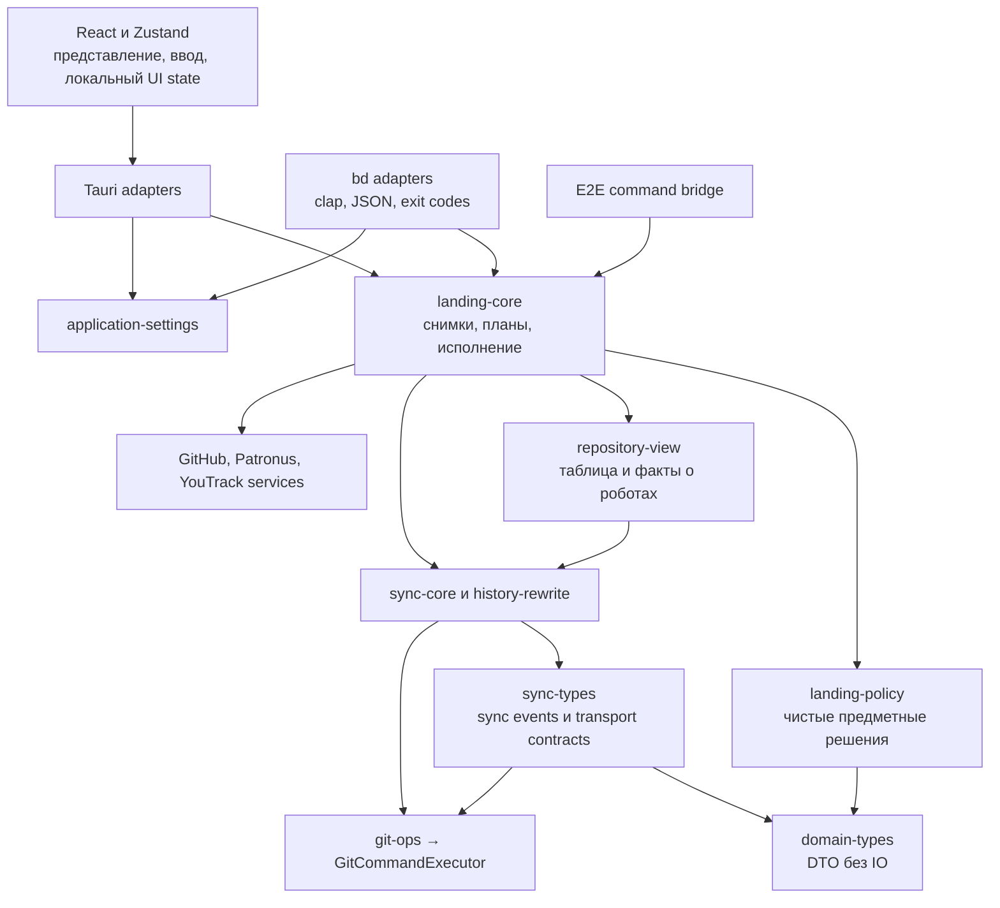

# Rust как источник предметных правил Branch Deck

**Status:** Draft

**Updated:** 2026-10-21

**Tags:** [architecture, rust, cli, tauri, landing]

## Назначение и результат

План переносит общие решения и сценарии Branch Deck в Rust, чтобы desktop и `bd` выполняли одни правила.
Результат — общий ответ на вопросы: что ветка переносит в master, какое действие допустимо, почему оно
заблокировано, что действие изменит и что фактически произошло. React отвечает за отображение и ввод,
Tauri и CLI — за адаптацию транспорта, аргументов и результатов.

План допускает новые crates и модули. Первое законченное изменение охватывает Safe Push и Dry Run;
следующие распространяют тот же подход на состояние landing, push, создание PR и запрос review,
согласованность снимков, ошибки и настройки. Каждый этап должен завершаться работающим приложением
и CLI, с удалением заменённой реализации.

Названия новых модулей и контрактов ниже — проектируемый API. Существующие design docs продолжают
описывать реализованное поведение; их меняем вместе с реализацией соответствующего этапа.

## Проблема

Нижние слои уже разделены: `GitCommandExecutor` запускает git, `git-ops` реализует операции,
`history-rewrite` и `sync-core` обеспечивают предметные ограничения, блокировки и последовательности
git-шагов. `repository-view` вычисляет общие факты о том, какие ветки роботы переносят, перенесли
и удерживают. Эту основу сохраняем.

Выше неё остаются две реализации продуктового поведения. TypeScript выбирает следующий шаг,
проверяет запуск Safe Push и выполняет несколько IPC-команд по порядку. CLI независимо строит
план и исполняет похожую последовательность. Общие DTO и общие низкоуровневые функции не гарантируют
одинаковый порядок проверок и одинаковый результат.

### Исходные точки

| Область | Текущая реализация | Что требует изменения |
| --- | --- | --- |
| Допустимость Safe Push | [safe-push-decision.ts](../../src/lib/safe-push-decision.ts), [safe_push_command.rs](../../crates/bd-remote/src/safe_push_command.rs) | Общее правило для профиля, approvals, правил GitHub, draft, target и running robots |
| Исполнение Safe Push | [safe-push-start.ts](../../src/lib/safe-push-start.ts), тот же CLI-модуль | Общий сценарий проверки target, push, отмены и старта |
| Следующее действие | [branch-next-step.ts](../../src/lib/branch-next-step.ts), [useStackNextStep.ts](../../src/hooks/useStackNextStep.ts) | Предметные решения доступны Rust и CLI; UI строит элементы меню |
| Состояние landing | [landing-node.ts](../../src/lib/landing-node.ts) | Rust определяет состояние; React выбирает цвет, иконку и текст |
| Соответствие роботов веткам | [patronus.ts](../../src/lib/patronus.ts), [patronus_start.rs](../../crates/sync-core/src/patronus_start.rs) | Одна реализация matching |
| Представление репозитория | [views.rs](../../crates/repository-view/src/views.rs), [patronus.ts store](../../src/stores/patronus.ts) | Согласованная версия таблицы и внешних фактов |
| Ошибки | [command_error.rs](../../src-tauri/src/command_error.rs), [error.rs](../../crates/bd-core/src/error.rs) | Общие типизированные отказы вместо потери деталей в IPC |
| Общие настройки | [appSettings.ts](../../src/stores/settings/appSettings.ts), [context.rs](../../crates/bd-core/src/context.rs) | Одна схема, defaults и порядок разрешения значений |
| Зависимости общих типов | [sync-types Cargo.toml](../../crates/sync-types/Cargo.toml), [sync-types lib.rs](../../crates/sync-types/src/lib.rs) | `sync-types` зависит от `git-ops`; чистая policy не должна наследовать эту зависимость |

На исходной версии `c29eff77` видны два конкретных расхождения:

1. UI отказывает в старте, когда предварительный push сбросит approvals, которые Patronus учитывает.
   CLI не вызывает `read_branch_rules`; его план может опираться на approvals, которые сам push удалит.
2. UI разрешает соответствующий запуск с профилем `skipsReview`. CLI выбирает профиль, но при
   `ReviewReadiness::Missing` проверяет явные `--without-approvals` и `--create-pull-request`,
   не учитывая выбранный профиль.

Также frontend не использует возвращаемый `tableGeneration` при принятии repository view.
Это пробел контракта согласованности; сам по себе он не доказывает конкретную воспроизведённую гонку.

## Область изменений

В план входят правила и сценарии, общие для приложения и CLI:

- Safe Push, Dry Run, restart, cancel и Push and Restart;
- push ветки, её предков и whole stack;
- создание собственного PR, retarget и request review;
- next step, landing state, связи роботов, parked/blocked/landed и причины отказа;
- получение фактов, необходимых этим решениям, их актуальность и версии;
- общие настройки и ошибки, влияющие на эти операции.

UI сохраняет выбор строк, фокус, scroll, открытие окон и поповеров, раскрытие стека, layout,
форматирование для конкретной поверхности, иконки, горячие клавиши и положение индикатора операции.
UI также может выбирать, какие данные нужны видимой части таблицы, передавая demand в Rust.

Diff renderer, группировка коммитов, алгоритмы merge/replay, формат mapping notes, object cache
и устройство lease pool не переписываются. Вызовы существующих cores и их инварианты сохраняются.
Общий код остаётся библиотекой Rust: CLI работает самостоятельно, без запущенного desktop и daemon.

## Целевая архитектура

### Crates и направление зависимостей

`repository-view` уже зависит от `sync-core`. Новый сценарий, которому нужны оба, располагается
в `landing-core`, выше них. Обратная зависимость `sync-core → repository-view` запрещена.
`landing-policy` зависит только от `domain-types` и библиотек сериализации:
никаких git, HTTP, файловой системы, Tauri, clap и глобальных stores.

Существующий `sync-types` нельзя считать таким независимым основанием: его Cargo.toml зависит
от `git-ops`, а sync events используют `Commit`, `UpdateCheck` и типы sync status из него.
Поэтому нужные policy чистые DTO переносятся в `domain-types`. `sync-types` продолжает хранить
события sync и прочие контракты и ссылается на перенесённые определения. Саму систему sync events
для этого не нужно переписывать. Наличие чистых функций проверяется также отсутствием
транзитивного пути `landing-policy → git-ops`, а не только отсутствием вызовов git в исходниках.

| Crate | Новые модули | Ответственность |
| --- | --- | --- |
| `domain-types` | `patronus`, `pull_request`, `remote`, необходимые части `stack` | Единственные определения DTO, нужных чистым правилам; serde и optional schema features, без IO |
| `landing-policy` | `facts`, `intent`, `decision`, `safe_push`, `next_step`, `landing_state`, `reason` | Чистые функции над явными фактами, порядок правил, допустимость действий |
| `landing-core` | `context`, `facts`, `snapshot`, `prepare`, `execute`, `push`, `pull_request`, `review`, `operation`, `error` | Сбор данных, общий план и исполнение сценариев, progress и частичные результаты |
| `repository-view` | расширение `branch_table`, `patronus_view`, `views`; модуль `robot_match` при необходимости | Факты таблицы, matching и результаты анализа содержимого |
| `application-settings` | `model`, `defaults`, `resolve`, `migration` | Типы и нормализация настроек, которые читают Rust и frontend |

Распределение не требует немедленно переносить все существующие файлы. Например, matching можно
сначала вызывать из существующего `sync_core::patronus_start`; важен один владелец правила.
Перенос физического файла делается отдельно, если он улучшает зависимости.

`landing-core` не зависит от `bd-core`, `bd-remote` или `src-tauri`. Контекст выполнения содержит
исполнитель git, существующие сервисы, cache и параметры репозитория, но не CLI output и не AppHandle.
`specta` и `schemars` подключаются нужным контрактам через features; frontend-типы и JSON Schema
производятся из Rust. Новые типы не дублируют уже существующие `ReviewReadiness`, `PatronusRobot`
и типы remote status: их определения перемещаются, а imports обновляются во всех потребителях.
Serde names и wire representation сохраняются; `pub use` совместимости не добавляется.
Новые types и policy crates не должны зависеть от `sync-types`, иначе вернётся транзитивная
зависимость от git. В facts policy передаётся минимальный срез данных, а не `BranchTable` или
`SyncReport` со всеми их инфраструктурными зависимостями.

### Основные контракты

| Контракт | Содержание | Ограничение |
| --- | --- | --- |
| `LandingSubject` | Ветка либо whole stack с root | Явный enum; служебная строка `stack:<root>` остаётся адаптером UI |
| `LandingIntent` | Subject, режим, выбранный профиль и явные исключения политики | От пользователя приходят намерения, не готовые `needsPush` или `canStart` |
| `LandingFacts` | Таблица, refs, remote, robots, PR, readiness, branch rules, профиль | Явно различает известное, отсутствующее, устаревшее и недоступное |
| `LandingDecision` | Допустимо, заблокировано либо нужны дополнительные факты | Отдельные типизированные причины и данные для следующего действия |
| `LandingPlan` | Что lands, какие refs pushes, PR/robot route, последствия и preconditions | Не содержит callbacks, иконок, элементов меню или текста shell-команд |
| `PlanFingerprint` | Идентичность intent и существенных входов плана | Сериализованный клиентский план не является разрешением на исполнение |
| `LandingOutcome` | Выполненные эффекты, итог, состояние неопределённого старта | Позволяет сообщить о push даже при неудачном последующем start |
| `LandingProgress` | Operation id, шаг, subject, версия; процент transfer отдельно | CLI и Tauri используют один поток семантических событий |
| `BranchLandingView` | Landing state, next action, blockers, связанные branches/PR/robots | Presentation выбирает формулировку и вид, не пересчитывает политику |

Публичные результаты используют enum с явным discriminator, а не несколько независимых boolean.
Причина несёт код и параметры: например, номер PR, target, subject и требуемое действие.
Тексты ошибок не используются для выбора последующего шага.

Правило исполнимости и рекомендация следующего действия разделены. Ветка может ждать review в
интерфейсе, но допускать старт с явно выбранным поддерживаемым исключением; эти два ответа
вычисляются из общей политики и не подменяют друг друга.

### Сохранение продуктовых правил

- Piece — ветка и предки, которые она переносит в target; whole stack включает боковые ветки.
  Straight chain использует leaf; разветвлённый stack — собственную построенную stack branch.
- PR относится к тому же набору коммитов и target, который переносит стартующий из него робот.
  PR в произвольную release-ветку не retarget-ится молча.
- Patronus остаётся источником readiness. GitHub approval, bot review и review decision сами по себе
  не превращаются в `approved` для Patronus.
- Отсутствие фактов не означает `notRequired`. Unknown/unavailable сохраняют текущие различия,
  предусмотренные spec, включая случаи старого Patronus.
- Dry Run не требует approvals и не переносит изменения в target. Если для него нужен push,
  ограничения самого push, включая воздействие на работающий робот, продолжают действовать.
- `skipsReview`, UI bypass и CLI `--without-approvals` имеют отдельный смысл. Известный профиль,
  пропускающий review, учитывается только на маршруте старта, который действительно применяет профиль.
  Comment route не получает возможности выбрать профиль.
- Сброс нужных approvals при push блокирует обычный Safe Push до повторного review. Исключения
  задаются явной общей политикой и тестами; неизвестное правило GitHub не становится `false`.
- Parked/unapplied/not built/landed и overlapping running robots проверяются Rust перед эффектами.
  Отсутствие кнопки или disabled item не заменяет проверку.
- Содержательная эквивалентность remote сохраняется: rebuild на новой baseline сам по себе не
  требует push, который бессмысленно изменил бы head PR.

## Планирование и исполнение

### Два режима чтения

`repository landing view` нужен для отображения и может использовать закэшированные факты с
признаком актуальности. `prepare_landing` собирает факты для конкретного действия, проверяет
недостающие условия и возвращает план либо причины отказа.

Read-only policy и view не запускают sync и не меняют refs. Существующий `bd safe-push --check`
сохраняет свой документированный предварительный sync; его адаптер явно выполняет этот шаг
перед общим planner. Не скрывать мутацию под названием «чтение плана».

Frontend получает последствия для подтверждения: какие ветки попадут в master, какие remote refs
изменятся, какой робот будет отменён, какой профиль применится. Нажатие горячей клавиши и форма
подтверждения остаются UI-правилами. CLI передаёт эквивалентные явные flags.
Подтверждения привязаны к последствиям плана; расширившийся landing требует нового решения.

### Последовательность общего сценария

1. Разрешить repository/worktree identity, prefix и effective settings. Использовать существующие
   helpers, не запускать git из нового адаптера.
2. Выполнить необходимый fetch target вне repository lock. Отдельно сохранить исход fetch:
   свежий target, разрешённый fallback или невозможность проверки согласно существующему spec.
3. Под repository lock выполнить требуемый sync и получить локальные facts. Сохранить witness
   существенных refs и конфигурации; освободить lock перед отдельным fetch и ожиданием пользователя.
4. Собрать PR, robots, readiness, profiles и branch rules. Повторно проверить локальный witness
   после асинхронных чтений; при изменении пересобрать план.
5. Вычислить решение чистой policy. При известном отказе не cancel-ить робот, не push-ить и
   не создавать PR/comment. Вернуть типизированный blocker и доступное исправление.
6. Перед исполнением заново собрать или проверить существенные факты и принятые последствия.
   Возвратить `PlanChanged`, если изменился состав landing, маршрут, профиль или риск.
7. Зарезервировать конфликтующие landing-ресурсы для операции. Выполнить необходимые retarget
   и повторную оценку review после изменения base; успешный retarget не доказывает сохранение approvals.
8. Отменить заменяемый робот только при явно принятом соответствующем последствии и отсутствии
   известных отказов следующих шагов. Подтверждение cancel и его фактическое состояние записать в outcome.
9. Push выполнить существующим leased/atomic механизмом, по проверенным tips и remote leases.
   Под блокировкой заново проверить локальные ограничения. Ошибка push исключает start.
10. Перед внешним start проверить актуальность PR head/base, требуемых approvals и source revision.
    Нужные сетевые чтения делать без удержания repository lock. Резервация операции остаётся активной.
11. Start выполнить через PR comment либо Patronus API, согласно плану. Repository lock во время
    robot start не удерживается, как и в текущем CLI.
12. Записать результат, обновить snapshot, завершить progress и освободить резервацию после
    установления исхода. UI получает тот же результат, который CLI сериализует в JSON.

Это не одна транзакция GitHub, git и Patronus. Между отменой, push и start возможен внешний сбой.
Сценарий обязан хранить и сообщать состоявшиеся эффекты, не обещая их автоматического отката.
Проверка непосредственно перед start уменьшает окно гонки, но не делает сторонний API атомарным.

### Preconditions и актуальность

Для исполнения проверяются как минимум:

- worktree identity, symbolic HEAD и HEAD oid;
- baseline и tips веток, участвующих в landing, включая stack branch;
- refs issue groups, stack parents и parked, когда они влияют на план;
- remote tips, на которые опираются leases;
- PR number, state, head, base, draft и актуальность readiness;
- выбранный start route, профиль и существенные effective settings;
- работающие и отменяемые роботы и пересечение переносимых коммитов.

Frontend `revision` служит корреляции ответа, но не заменяет эти preconditions.
Внешние данные имеют источник и ключ входов; длительность TTL не является гарантией актуальности.
После push/retarget нельзя переиспользовать readiness, вычисленную для изменившегося контекста.

### Конкурентные операции и неопределённый исход

Внутри desktop одинаковые старты одного intent присоединяются к одной операции. UI registry
сохраняет привязку spinner к поверхности; backend владеет допуском и временем жизни сценария.

Между desktop и отдельным CLI используется небольшой общий реестр активных landing-операций в
служебном каталоге общего git dir. Запись содержит operation id, owner, subject/source refs, фактически
переносимые ветки или commits, стадию, принятый fingerprint и уже полученные внешние идентификаторы.
Чтение и обновление реестра выполняются под существующим repository lock; запись атомарная.
Резервации проверяют и standalone push/restart/cancel, затрагивающие те же ресурсы.

Это специализированная координация landing, не универсальная очередь всех действий приложения.
Она защищает от согласованно работающих процессов Branch Deck; сторонний git по-прежнему
обнаруживается через leases, refs и повторные проверки.

Если ответ на comment/start потерян, результат — `StartUnknown` с известными идентификаторами,
а не автоматический повтор POST. Повторный запрос сначала ищет ранее созданный comment/robot.
Если API не позволяет установить исход однозначно, операция остаётся неопределённой и требует
явного разрешения после проверки внешнего состояния. TTL сам по себе не разрешает повторный start.
Смерть процесса не означает, что удалённая операция не состоялась.

Формат записи версионирован, хранит только необходимые сведения, без токенов и персональных
секретов. Отказы до внешних эффектов не требуют долговременной записи результата.
Новая служебная запись и правила её очистки добавляются в Git Operations при реализации.

## Согласованные снимки состояния

### Владение и идентичность

Rust хранит завершённую таблицу sync и факты, из которых получается landing view. Сессия desktop
держит их в памяти, CLI строит короткоживущую сессию из тех же библиотек. Disk object cache
остаётся общим кэшем по содержимому; in-memory поколения одного процесса не используются как
глобальные версии другого.

Ключ снимка включает worktree, prefix и session epoch. Common git dir используется для общей
координации, но не объединяет таблицы разных worktrees. Поколения таблицы и внешних фактов
различаются: polling robot не должен менять поколение git-таблицы.

Ответ содержит `SnapshotVersion`: epoch, table generation, facts generation и fingerprint
локальных входов. Каждое событие применения результата несёт эту идентичность. UI проверяет
версию относительно своего принятого снимка, не только номер последнего IPC-запроса.

### Публикация и потребление

- Завершённый sync публикует таблицу и её идентичность согласованно с финальным событием.
  Progress текущего sync может отображаться отдельно; промежуточные строки не разрешают mutations.
- Неудачный sync сохраняет предыдущую завершённую таблицу с состоянием ошибки/устаревания.
  Исполнение всегда проверяет актуальное состояние независимо от показанной таблицы.
- Успешный push обновляет remote facts в Rust. UI не должен возвращать backend вычисленный
  `upToDate` как авторитетный факт.
- Matching выполняет Rust из таблицы и robots. `RobotMatch` перестаёт быть входом публичной
  команды; соответствие входит в ответ.
- PR, readiness и branch rules нормализуются в Rust. UI может передавать запрос на refresh,
  но не итоговую оценку approvals.
- Уведомления и изменения view публикуются пакетно. Неизменившиеся элементы сохраняют identity
  на frontend, как сейчас; проценты transfer и elapsed time не пересчитывают весь view.
- После пропущенного события клиент получает полный snapshot. Поток событий не является
  единственным способом восстановить состояние.

Readiness остаётся demand-driven: видимые строки, header whole stack и явно запрошенные starts
имеют приоритет. Ограничение batch, одна очередь запросов и инвалидация переносятся в Rust.
Сохраняется исключение скрытых веток, ожидающих approval, чтобы новые approvals оставались новостью.
CLI не обязан делать сетевые запросы для каждой строки обычного status: локальный режим возвращает
неизвестные внешние факты; action/check запрашивает необходимые.

## Ошибки и настройки

### Предметные ошибки

В `landing-policy::reason` находятся отказы по известным фактам; в `landing-core::error` —
ошибки сбора фактов и исполнения. Они несут subject, затронутые refs/PR/robot, recovery action,
retry semantics и выполненные эффекты, когда такие есть.

Tauri переводит их в типизированный IPC result. CLI отображает их в существующие стабильные
error codes, exit codes и JSON. Вся система не сводится к одному огромному enum ошибок:
каждая область сохраняет собственные варианты, адаптер использует явное исчерпывающее отображение.
`anyhow` остаётся уместным для диагностического контекста неожиданных инфраструктурных ошибок.

Новые поля CLI добавляются совместимо, когда это возможно. Изменение значения существующего поля,
его типа или exit code требует явной миграции schema и документации. UI не парсит message.
Имена действий и короткие представления объектов могут различаться между CLI и UI; смысл решения один.

### Настройки

`application-settings` владеет схемой и defaults общих настроек: например, глобальным prefix и
`patronusNewApi`. Существующие `repository_config` и `ConfigSnapshot` сохраняют владение
`branchdeck.*`; новый слой использует их вместо повторного чтения git config по одному ключу.
Результат разрешения хранит value и source, включая текущую семантику local/global override.

Frontend хранит синхронную копию настроек, полученную через начальный injected snapshot,
и отправляет patch. Rust валидирует patch, сохраняет и публикует версию. Поля, для которых Rust
тоже задаёт поведение окна, включаются в общую схему по мере миграции. Чисто визуальное transient
состояние в эту схему не переносится.

У `settings.json` должен остаться один сериализующий writer. При миграции нельзя одновременно
оставить прежний `LazyStore` writer и добавить независимую запись файла из нового сервиса.
Сначала writer переносится в backend для всего файла, сохраняя неизвестные/UI-only ключи;
затем общие ключи получают строгую Rust-схему. UI-only схемы могут оставаться в TypeScript.

CLI использует ту же нормализацию и defaults и читает файл без desktop; запись настроек из CLI
не добавляется этим планом. Миграция сохраняет пользовательские значения, прочие ключи и текущую
семантику отсутствующих значений. Ошибка сохранения не выдаётся за успешное применение.
Новый window получает актуальный snapshot; запоздалое событие не откатывает более новую версию.

## Этапы реализации

### Этап 0 — Зафиксировать контракт и расхождения

**Цель:** иметь проверяемый список поведения до переноса.

1. Сопоставить все строки таблицы Next Step, варианты Safe Push/Dry Run, branch/whole stack и
   доступные обходы с текущими specs. Различия CLI flags и UI confirmations записать явно.
2. Добавить регрессии для сброса approvals при push и профиля `skipsReview` в Rust-тесты сценария,
   исправив каждое расхождение в том же проходящем commit.
3. Зафиксировать поведение при unavailable/unknown readiness и branch rules, draft, other base,
   parked, stack not built, robot overlap и изменении refs.
4. Зафиксировать текущие process budgets и сетевые обращения для обычной ветки и whole stack.

**Файлы:** `crates/bd-remote/src/safe_push_test.rs`, существующие TS-тесты decision и E2E next-step;
`spec/branch/patronus.spec.md`, `spec/branch/next-step.spec.md`, `spec/cli/agent-cli.spec.md`.

**Выход:** регрессии воспроизводят разные решения до исправления и проходят после него;
нет commit с заведомо красным suite. Сценарии и ожидаемые отказы описаны в specs.

### Этап 1 — Чистая политика в Rust

**Зависимость:** этап 0.

1. Добавить `domain-types` и перенести необходимые чистые DTO из `sync-types`, сохранив serde
   names и обновив imports без re-exports. Затем добавить `landing-policy`, input/result types
   и стабильные reason codes. Проверить полное дерево зависимостей обеих новых crates.
2. Перенести предметную часть `getSafePushDecision`; UI-only confirmation reasons отделить.
3. Разделить missing facts, domain refusal и техническую ошибку. Сохранить приоритет причин.
4. Подключить policy к CLI planner и к новой Tauri prepare-команде; frontend получает решение
   из Rust и оставляет только форму подтверждения и presentation.
5. TS-реализацию допустимости удалить после переключения обеих сторон. Временное сравнение
   старой и новой реализации допустимо только в тестах и не выполняет side effects.

**Проверки:** общая таблица сценариев в Rust, adapter tests совпадения семантических решений,
E2E всех поверхностей Safe Push, обновление bindings и CLI schema tests.

**Выход:** изменение правила допустимости требует правки одной Rust-функции и её тестов;
обычный frontend и CLI больше не поддерживают собственные параллельные условия допуска.

### Этап 2 — Общий planner и executor

**Зависимость:** этап 1.

1. Добавить `landing-core`, отделив context/services от clap args и `CliError`.
2. Вынести из CLI сбор landing, выбор route/profile, target check, retarget, push, cancel и start.
   Переиспользовать helpers `sync-core`, не копировать git/HTTP реализацию.
3. Ввести `prepare_landing`, `execute_landing`, plan fingerprint, progress и partial outcome.
4. Перевести `safe-push-start.ts` на один сценарный вызов; UI не дирижирует изменяющими командами.
5. Закрыть обход сценария низкоуровневыми публичными командами. Для действий над чужим PR из review
   оставить явно отдельный intent и существующие правила; не навязывать ему модель своей virtual branch.
6. Перевести E2E command bridge на тот же core. Моки заменяют GitHub/Patronus/transport,
   но не возвращают вручную нужное policy-решение.

**Проверки:** effect trace и fault injection после каждого внешнего эффекта; ошибка push не начинает
robot; отменённый robot не теряется в outcome; direct IPC не обходит parked/not built/approvals.

**Выход:** CLI и Tauri вызывают общий сценарий; исходные transport-specific последовательности удалены.

### Этап 3 — Конкурентность и изменения после подтверждения

**Зависимость:** этап 2.

1. Ввести реестр landing-операций, reserve/finalize/reconcile и версионированную запись.
2. Добавить общую admission-проверку для standalone push, restart и cancel тех же ресурсов.
3. Проверять plan witness после fetch/HTTP и перед каждым существенным эффектом.
4. Поддержать same-process join, межпроцессный busy и `PlanChanged` с новым preview.
5. Обрабатывать неизвестный результат POST без автоматического повторного старта.
6. Обновить Git Operations, Operations и CLI contract новыми состояниями и storage rules.

**Проверки:** два реальных процесса на одном репозитории; UI+CLI и CLI+CLI; overlapping piece/stack;
разные worktrees и непересекающиеся ветки; смерть процесса до/после push и потерянный ответ start.
Использовать барьеры в fake services, а не sleeps.

**Выход:** два согласованно работающих клиента не начинают конфликтующие landing-сценарии;
старое подтверждение не разрешает расширившийся landing; неизвестный start не дублируется.

### Этап 4 — Снимки и факты в Rust

**Зависимость:** этапы 1–2; окончательная интеграция с operations после этапа 3.

1. Расширить `RepositoryViews` идентичностью снимка и atomic publication завершённой таблицы.
2. Перенести robot matching в Rust и убрать `matched` из public request.
3. Перевести применение push/PR/robot результатов в backend facts; убрать обратную передачу
   вычисленного frontend `upToDate`.
4. Перенести readiness queue и invalidation, сохранив demand, batch и приоритет старта.
5. Ввести versioned snapshot/event API и явную маркировку stale; оставить progress отдельно.
6. Перевести stores на принятие снимков/дельт с восстановлением после пропущенного события.

**Проверки:** ответы старой сессии, смена проекта во время запроса, новый sync во время polling,
push без sync, failed sync, refresh readiness после PR update, разные worktrees одного common dir.
Сохранить process budgets ContentMemo и batch-boundaries.

**Выход:** UI не смешивает таблицу и domain facts разных принятых версий; matching один;
клиент восстанавливает состояние полным snapshot без повторного исполнения действий.

### Этап 5 — Next Step и состояние landing

**Зависимость:** этапы 1 и 4.

1. Перенести таблицу `getBranchNextStep` и предметную часть `getLandingNode` в `landing-policy`.
2. Применить их и к ветке, и к whole stack через общий subject; сохранить правила straight chain.
3. Добавить `BranchLandingView` в Rust snapshot. UI presenter преобразует result в MenuItem,
   label, tooltip, icon и color; callbacks создаёт только frontend.
4. Упростить `useBranchNextStep`, `useStackNextStep`, `useLandingNode` до чтения проекции
   и наложения локального presentation state.
5. Дать CLI структурированные next action/blockers через существующий check/view path;
   обычный status не заставлять запрашивать весь remote state.
6. Удалить TS-таблицы правил, повторные проверки landed/parked и ручные domain-типы.

**Проверки:** все строки Next Step, переходы whole stack, landing после merged robot по content,
новые commits после landing, unknown readiness и отсутствие Patronus. E2E проверяют эффект
каждой поверхности: row/menu/key/preview/review/stack header.

**Выход:** одно Rust-решение определяет и доступность, и смысл next action для UI и CLI.
Изменение domain rule не требует изменения hooks и menu builders.

### Этап 6 — Остальные landing-сценарии и ошибки

**Зависимость:** этапы 2–5.

1. Перевести standalone push, Create Pull Request, Request Review, Restart и Push and Restart
   на общий planner/executor там, где последовательности ещё дублируются.
2. Разделить создание собственного PR и review чужого PR явными intents; сохранить текущую
   авторизацию и возможность отдельно cancel-ить robot.
3. Использовать одни правила stack selection, parked, holds, retarget и remote equivalence.
4. Расширить structured errors IPC; сохранить явное отображение в существующий CLI JSON.
5. Удалить обойдённые transport-specific helpers и обновить import/dependency ограничения.

**Проверки:** request review push-ит нужную версию до запроса reviewers; Create PR не создаёт второй
PR другой base; retry не повторяет успешный внешний шаг; CLI schema/exit codes совместимы.

**Выход:** адаптеры парсят запрос, вызывают core и представляют результат. В них нет бизнес-порядка
нескольких writes и самостоятельного решения, какие ветки затронуть.

### Этап 7 — Общие настройки

**Зависимость:** можно реализовывать независимо после фиксации контрактов этапа 1.

1. Ввести `application-settings` с defaults, normalization и migration.
2. Перевести CLI reader общих полей с ручного `serde_json::Value` на общую модель.
3. Сериализовать все записи `settings.json` в одном backend writer, сохраняя неизвестные ключи.
4. Перевести UI на patch → typed result → versioned broadcast; убрать дублирующиеся defaults.
5. Сохранить injected snapshot, быстрый старт окон и текущий порядок config overrides.
6. Обновить Distributed Settings и settings specs в commit фактического переключения.

**Проверки:** отсутствующий/старый/частично некорректный файл, unknown fields, defaults,
быстрые правки из разных окон, late echo, save failure, restart и чтение CLI без desktop.

**Выход:** одинаковая effective configuration для CLI и desktop при одинаковых входах;
один writer файла; frontend не задаёт defaults, от которых зависит Rust-поведение.

### Этап 8 — Удаление переходного кода и закрепление границ

**Зависимость:** все предыдущие этапы.

1. Удалить старые IPC routes, policy functions, временные comparison fixtures и устаревшие поля.
2. Обновить `targets:` specs и ссылки на тесты после их переноса; сохранить отдельные E2E проверки UI.
3. Добавить целевые architecture checks: запрещённые crate dependencies, отсутствие прямого start
   в transport adapters, регистрация старых команд и raw side effects вне shared сценариев.
4. Обновить карты модулей, AGENTS Feature Index и design docs фактической архитектурой.
5. Выполнить итоговую проверку производительности и функциональных сценариев; перевести этот
   документ в Implemented только после выполнения критериев ниже.

**Выход:** переходные пути удалены; порядок действий и предметные решения имеют одного владельца.

## Матрица обязательных проверок

Одинаковые входные facts и intent должны давать одинаковые semantic result и planned effects через
CLI и Tauri. Представление текста и интерактивное подтверждение могут различаться.

| Сценарий | Обязательное ожидание |
| --- | --- |
| Approved PR, push сбрасывает нужные approvals | Обычный start отклонён до push; предложено push → повторный review |
| Missing approvals, допустимый профиль skips review | API route учитывает профиль; comment route не имитирует его выбор |
| Dry Run при missing approvals | Review не блокирует; ограничения необходимого push сохраняются |
| Draft или PR в другую base | Общие mode-specific правила; случайная base не меняется без соответствующего intent |
| Parked ветка/предок/участник stack | Нет неявного unpark и запрещённого push |
| Stack branch conflict/blocked/stale | Не push-ится устаревший ref; отказ называет причину |
| Robot переносит предка или участника whole stack | Не запускается overlapping Safe Push |
| Remote эквивалентен по content после rebase | Нет лишнего push и сброса review |
| Retarget изменил review context | Прежние approvals не считаются автоматически действующими |
| Ref/HEAD/stack/parked изменился после preview | PlanChanged либо актуальный refusal до дальнейших эффектов |
| Lease rejected | Нет blind force retry и нет robot start |
| Push успешен, start не удался | Outcome сообщает push и точную стадию отказа |
| Ответ start потерян | StartUnknown; сначала reconciliation, без повторного POST |
| Два процесса с пересекающимся landing | Один admitted, другой получает структурированный busy |
| Старый snapshot или событие другого worktree | Не применяется к текущему view |
| Failed sync | Предыдущий committed snapshot доступен как stale; выполнение перепроверяется |
| Неизвестные внешние facts | Не превращаются в разрешение или отсутствие review requirement |
| Новый window и CLI без desktop | Одни defaults и effective settings, UI имеет начальный snapshot |

Rust policy tests проверяют таблицу решений без IO. Core integration tests используют реальные
временные git-репозитории и существующие fake GitHub/Patronus. Adapter contract tests проверяют
маппинг intent/result. E2E проверяют действия пользователя и видимый эффект, а не копируют
policy-алгоритм в тестовый сервер.

При переносе тестов ссылки в specs меняются в том же commit. Новые ссылки на конкретные тесты
добавляются после создания тестов; этот Draft не объявляет несуществующие тесты реализованными.

## Проверки по этапам

Для Rust-изменений: `pnpm lint:backend`, затем `cargo nextest run --workspace`.
Во время итерации допустим запуск отдельных crates или фильтров, перед завершением этапа — весь suite.
`cargo test` не используется.

Для frontend-изменений: `pnpm lint:frontend`, `pnpm test:unit`, `pnpm e2e`.
При изменении HTML — `pnpm e2e-up` с просмотром snapshot diff. Один E2E run на checkout;
при занятом порте выбирается другой `E2E_PORT`.

Для новых/изменённых git flows: process budget tests, worktree safety и git usage scans.
Проверки должны охватывать новые crates: отсутствие raw git процесса в старых областях
недостаточно, если новый crate не включён в scan.

Для контрактов: regeneration `src/lib/bindings.ts`, проверка bindings export, CLI schema tests,
JSON fixtures и exit codes. Для любого кода — `pnpm lint:cpd`; для docs/specs/test titles —
`pnpm lint:specs`.

Изменённые платформенные ветви проверяются по [Platform Checks](../guidelines/platform-checks.md).
Изменение первого render, открытия окна или startup snapshot проверяется также по
[Real App Checks](../guidelines/real-app-checks.md).

## Производительность

Перенос в Rust не добавляет IPC на каждый hover, render или нажатие клавиши. UI синхронно читает
принятый view; явный start отдельно выполняет необходимую перепроверку.

Сохраняются ContentMemo и object cache, batch чтения git, одна очередь readiness и demand по видимым
веткам. Чистая policy не запускает процессов. Повторное вычисление того же view не должно добавлять
git/HTTP обращения; обновление прогресса одного robot не должно пересоздавать всю таблицу.

До и после этапов 4–5 сравнить process budgets, `pnpm perf:table`, число remote requests и время
prepare для cold/warm cache на ветке и whole stack. Новое обязательное чтение branch rules или
проверка witness объясняются отдельно; новые обращения на каждый ряд без batching недопустимы.

## Документация и совместимость

| Изменение | Документы, изменяемые вместе с кодом |
| --- | --- |
| Политика Safe Push и next step | [Patronus](../../spec/branch/patronus.spec.md), [Next Step](../../spec/branch/next-step.spec.md), [Whole Stack](../../spec/branch/whole-stack.spec.md), [Landing](landing.md) |
| Исполнение и координация | [Git Operations](git-operations.md), [Operations](operations.md), [Adding a Git Operation](../guidelines/adding-git-operation.md) |
| Rust view и stores | [Rendering Performance](rendering-performance.md), [E2E Architecture](e2e-testing.md), [Branch Row](../../spec/branch/branch-row.spec.md) |
| CLI контракт | [Agent CLI spec](../../spec/cli/agent-cli.spec.md), [Agent CLI guide](../guidelines/agent-cli.md), generated schema |
| Push и PR workflows | [Pull Requests](../../spec/branch/pull-requests.spec.md), [Stacked Branches](../../spec/branch/stacked-branches.spec.md), [Parked Branches](../../spec/branch/parked-branches.spec.md) |
| Настройки | [Settings](../../spec/repository/settings.spec.md), [Distributed Settings](distributed-settings.md), [Onboarding](../../spec/repository/onboarding.spec.md) |

Новый отдельный user-visible recovery workflow получает свою spec и запись Feature Index.
Изменение внутреннего расположения правил само по себе не требует нового README feature.
Документы не должны объявлять будущие этапы уже реализованными.

## Альтернативы

**Только расширять repository-view.** Это помогает чтению, но не объединяет исполнение и проверки
непосредственно перед side effects. Сценарный слой нужен отдельно.

**Перенести весь frontend state в Rust.** Выделение, фокус и layout не нужны CLI; их перенос добавит
IPC и сцепит домен с устройством интерфейса. В Rust переносится предметное состояние.

**Вызывать bd из Tauri или TS.** Это связывает UI с CLI presentation, запуском процесса и форматом
аргументов. Общая библиотека даёт переиспользование без такого транспорта.

**Сохранить две реализации и общие fixtures.** Полезно на время миграции, но новый случай вне
fixtures снова разойдётся. Финальное состояние содержит одну реализацию правил.

**Создать универсальный workflow engine или обязательный daemon.** Для этих сценариев достаточно
явных Rust-модулей и небольшого реестра landing-операций. CLI сохраняет независимый запуск.

**Сразу перестроить все crates.** Существующие git и sync слои имеют сильные инварианты и тесты.
Новые границы вводятся вокруг подтверждённого дублирования; перестройка остального не входит в план.

## Критерии завершения

- [ ] `domain-types` и `landing-policy` не зависят от git/HTTP/Tauri/clap даже транзитивно.
- [ ] Одинаковые facts и intent дают одинаковое предметное решение через UI и CLI.
- [ ] Safe Push/Dry Run и связанные landing workflows исполняются общим Rust core.
- [ ] Прямой IPC не обходит проверки, которые раньше выполнял только UI.
- [ ] Next Step, landing state и robot matching имеют по одной Rust-реализации.
- [ ] UI не возвращает backend собственные policy conclusions как авторитетные facts.
- [ ] Execution проверяет актуальное состояние и последствия после preview.
- [ ] Межпроцессная координация и неизвестный результат внешнего start имеют проверенный протокол.
- [ ] Snapshot/event версии исключают смешивание worktrees, сессий и завершённых таблиц.
- [ ] Общие ошибки типизированы; CLI JSON и exit codes сохранены или явно мигрированы.
- [ ] Общие настройки имеют одни defaults и одного writer; первый render остаётся синхронным.
- [ ] Удалены заменённые TS/CLI правила и обходные command routes.
- [ ] Specs, тестовые ссылки, bindings, design docs и карты модулей соответствуют реализации.
- [ ] Полные проверки проходят; бюджеты git/HTTP и производительность таблицы не ухудшены без причины.
