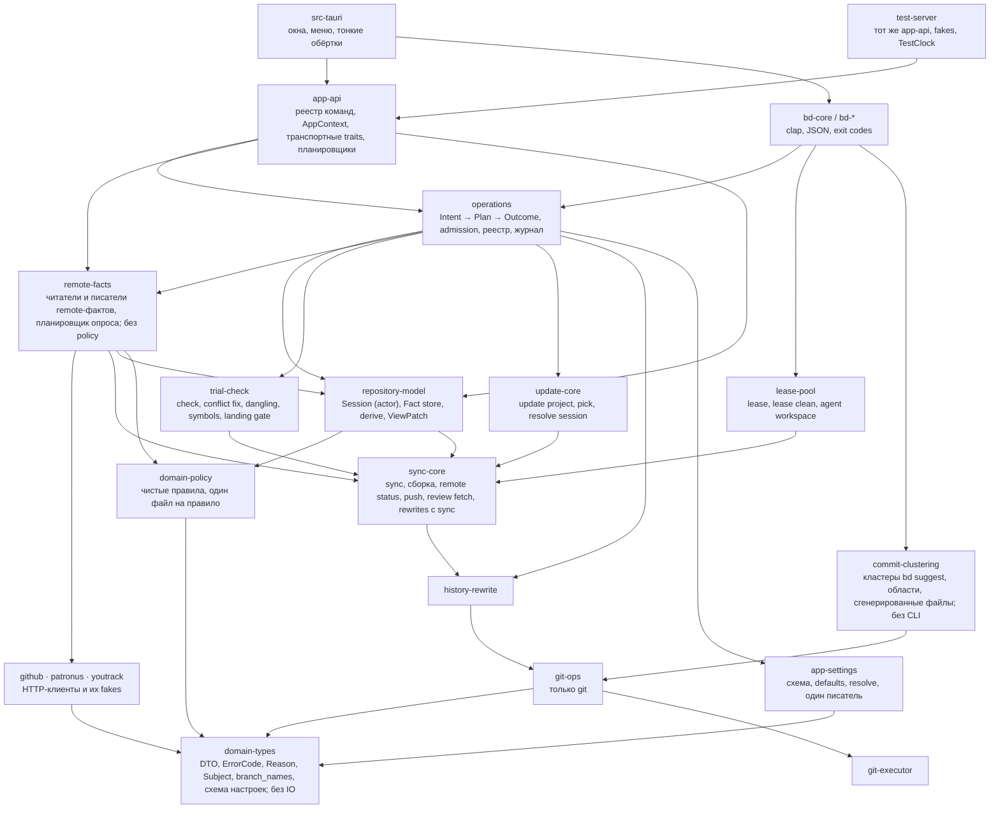
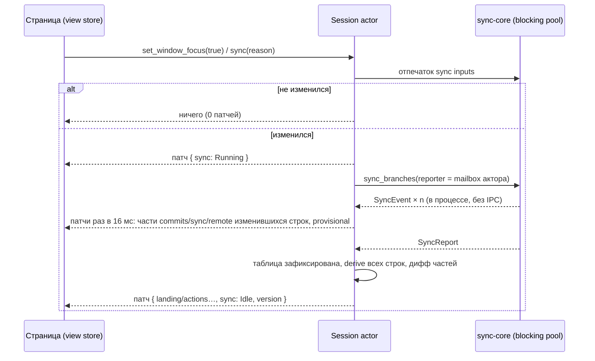

# Rust как источник предметных правил Branch Deck

**Status:** Draft

**Updated:** 2026-10-22

**Tags:** [architecture, rust, cli, tauri, landing, session, operations]

## Назначение и результат

Branch Deck сегодня принимает каждое предметное решение дважды: страница (TypeScript) решает, что ветка переносит в
master, можно ли её запустить, что нужно подтвердить и в каком порядке выполнить шаги; `bd` решает то же самое своим
кодом. Этот документ описывает переход к одному владельцу: **Rust владеет моделью репозитория, фактами о remote,
правилами над ними и исполнением каждого изменяющего действия**. Страница держит патчируемую копию модели и
представляет её; `bd` и приложение — два адаптера одной библиотеки; E2E-сервер размещает ту же библиотеку с фальшивыми
сервисами.

Результат оценивается по цели владельца: быстрое и корректное приложение с понятным кодом. Стоимость не ограничение.
Заменённый код удаляется в том же этапе, который его заменил; параллельных реализаций и слоёв совместимости нет.
Каждый этап приземляется в master отдельно и оставляет приложение и `bd` работающими.

Это вторая версия документа. Первая (`0a74afc6`) строила «landing-башню» рядом с frontend, который оставался
владельцем таблицы, фактов, опросов и реестра операций; её разбор — в [Альтернативы](#альтернативы).

## Проблема

### Что уже есть

Нижние слои разделены и остаются: `GitCommandExecutor` запускает git, `git-ops` реализует операции, `history-rewrite`
и `sync-core` держат инварианты, блокировки и последовательности git-шагов, `repository-view` хранит таблицу последнего
sync на `(repository, prefix)` и выводит одно правило для обоих клиентов (`patronus_view`). Приложение и `bd` — один
бинарник: `src-tauri/src/main.rs` передаёт `bd`/`cli` в `bd_cli::run`. Фальшивые сервисы существуют:
`crates/github/src/fake_github.rs`, `crates/patronus/src/fake_patronus.rs` (feature `fake`). Landing gate
(`sync_core::landing_gate`: `check_landing_gate` над `Subject`, `LandingRefusal` и `LandingFix` из
`domain_types::landing`, `LandingAllowances` в `domain_types::patronus`) уже решается в Rust и показывается поповером —
это образец того, как должно быть устроено всё остальное.

### Проверенные факты (master `f3bea2b9`)

Номера строк — ориентиры; этап перепроверяет их перед действием.

| Факт | Где |
| --- | --- |
| Допустимость Safe Push решается дважды | `src/lib/safe-push-decision.ts` (факты из `src/hooks/useSafePush.ts:240-345`) и `plan()` в `crates/bd-remote/src/safe_push_command.rs:860-1190` (файл 1943 строки) |
| Исполнение Safe Push оркестрируется дважды | `src/lib/safe-push-start.ts`, цикл ответа `src/stores/patronus.ts:1373-1384`; `safe_push()` в `safe_push_command.rs:415-601` |
| `bd safe-push` держит repository lock во время HTTP | lock `:431`; список роботов `:915`, `start_options` `:1042`, список PR `:1056`, readiness `:1146`, retarget `:515-526`, cancel `:531`; `drop(lock)` `:566`, вне lock — только старт (`:572-600`) |
| Push оркестрируется дважды, с разным порядком retarget | приложение retarget **до** push (`src/lib/git/push.ts:136`, `new-pull-request.ts:128`); `bd push` **после** push и lock (`push_command.rs:235-248`); `bd safe-push` до (`:507-523`) |
| Push в приложении идёт без repository lock | `src-tauri/src/commands/push.rs:21-47` проверяет только `not_built`; `bd push` держит lock |
| `start_patronus_robot` без проверок parked, landed, approvals, overlap | `src-tauri/src/commands/patronus.rs:208-249`; после `f3bea2b9` проверяет только landing gate |
| Hold ветки решается один раз, в Rust; продублированы адаптеры и hold stack branch | решение — `hold` в `repository-view/src/patronus_view.rs`; `push_holds()` (`crates/bd-remote/src/push_hold.rs:147-166`) и `getPushHold` (`src/stores/patronus.ts:677`, из `factsOf` `:264-283`) только читают его. Дважды: проверка статуса и cancel/restart держащего робота перед push (`checkPushHold`/`cancelHoldingRobot`, `src/lib/git/push.ts:249-290`; `push_locked`/`--restart-running` в `push_command.rs`) и hold stack branch (`stackBranchHoldReasonIn`, `stores/patronus.ts:468`: parked member, landed, робот стека; `push_command.rs:692`, `safe_push_command.rs:893`) |
| Таблица, факты и опросы принадлежат странице | `src/stores/branch-sync.ts` (1814 строк, per-commit `SyncEvent`, flush 16 мс); опрос — `setTimeout` в `review-requests.ts:345`, `pull-requests.ts:234`, `patronus.ts:1189,1403`, `review-readiness.ts:319`, единственный `setInterval` — `usePatronusRobotDetails.ts:60` |
| Страница отправляет выводы обратно в Rust | `RemoteFact.up_to_date` из `remoteFactsIn` (`stores/patronus.ts:511`), `GetRepositoryViewParams.matched` из `robotMatchIn` (`:491`) |
| `table_generation` — один глобальный `AtomicU32`, страница его игнорирует | `repository-view/src/views.rs:30,53`; приём по `revision` в `stores/patronus.ts:583-584` |
| `git-ops` владеет UI DTO | `Commit`, `BranchError`, `BranchSyncStatus`, `CommitSyncStatus`, `WordResolutionSummary`, `UpdateCheck`, `CommitInfo` — импорт в `sync-types/src/lib.rs:2-4`, `branch_name_suggestion.rs:3` |
| `patronus → git-ops` ради чистых имён веток | `BranchKind` и `strip_branch_namespace`, `crates/patronus/src/service.rs:7` |
| У `settings.json` уже два писателя и ручные читатели со своими defaults | `LazyStore` (`src/stores/settings/app-store.ts:65`); `restart_app` (`src-tauri/src/title_bar.rs:250-262`); `zoom.rs:35-40` (1.0), `menu.rs:156-161` (`autoSyncOnFocus` = true), `title_bar.rs:237`, `bd-core/src/context.rs:293-318` |
| Префикс ветки разрешается дважды | `computeEffectiveBranchPrefix` (`src/stores/repository.ts:107-114`) и `resolve_branch_prefix` (`sync-core/src/branch_prefix.rs:27`) |
| Неудачное чтение правил GitHub читается как «push сохраняет approvals» | `src/hooks/useDismissesStaleReviews.ts:19-26`: `forget` удаляет ответ и возвращает `false`; до следующего вопроса peek-кэш держит `false` |
| Matching роботов держится общей фикстурой, которую читают обе стороны | `src/test-support/robot-match-cases.json`: `patronus_start_test.rs:126`, `src/lib/patronus.test.ts:39`; комментарий `patronus_start.rs:49` называет файл неверно |
| Три реестра команд; 35 команд в e2e никогда не доходили до Rust (после `s0b-remote-bridge` — 4, только окна) | `collect_commands!` (112, `src-tauri/src/lib.rs`), ручные маршруты `/invoke/*` в `crates/test-server/src/lib.rs` (до s0b 77, после 108 по командам плюс `get_blob_syntax`; `browse_repository/{repo_id}` — маршрут команды `browse_repository`); `tests/e2e/setup/tauri-mocks.ts` — локальные обработчики окон и плагинов, всё остальное проксируется на сервер (`proxyToTestServer`), 405 роняет тест; `routeCommand(page, "start_patronus_robot")` был в 25 тестах, после s0b ни одного: `command_registry_test.rs` держит `PAGE_MOCKED` (4) и храповик ответов страницы в `tests/e2e` |
| Test-server переизобретал логику (снято в `s0b-remote-bridge`) | `get_branch_review_readiness` (~70 строк поверх `to_branch_readiness`), `resolve_patronus_revisions` в `tauri_command_bridge.rs`; теперь маршрут зовёт реальное ядро (`branch_review_readiness`, `prepare_robot_start`) с реальными сервисами за fakes репозитория (`remote_host.rs`) |
| Draft-правило у UI и CLI совпадает | UI `blockedByDraft = isDraft && mode !== "dryRun"` (`src/lib/patronus.ts:867`); CLI отказывает только при `pushes` (`safe_push_command.rs:919,1111`) |
| `bd status` читает Patronus | `landed_by`: `landed_branches(&PatronusFacts::read(.., read_robots(..)))` (`crates/bd-remote/src/status.rs:393-424`); список роботов с курсором `since` в object cache (`robot_list.rs:135-147`); флага `--remote` нет |

Поправки к первой версии документа: «сетевые чтения вне lock, как в CLI» — неверно, вне lock только старт; «один
писатель settings.json» — уже не так; `tableGeneration` не per-repository, а глобальный; фикстуру matching читают обе
стороны, сломан только комментарий; «push hold в трёх копиях» — решение одно (`patronus_view`), дублируются адаптеры.

### Реестр расхождений

D — одинаковый ввод даёт разный результат в приложении и в `bd`; R — правило продублировано без известного
расхождения; S — состояние с двумя владельцами. Правый столбец называет владельца после переработки.

| id | Что | Приложение / `bd` (или вторая копия) | Одно правило |
| --- | --- | --- | --- |
| D1 | Push сбрасывает approvals, которые считает Patronus | UI отказывает (`safe-push-decision.ts:161-165`); `bd` не вызывает `read_branch_rules` (его единственный вызов — `src-tauri/src/commands/pull_requests.rs:230`) | `domain-policy::review`: отказ `push_dismisses_approvals { pr }`, исправление `push_then_request_review` |
| D2 | Профиль с `skipsReview` | UI пропускает проверку approvals (`:110-112`); `bd` отказывает при `Missing`, если нет `--without-approvals`/`--create-pull-request` (`safe_push_command.rs:1149`) | `skips_approvals = mode == SafePush && route == Api && (without_approvals \|\| profile.skips_review)`; у comment-маршрута профиля нет (`:1078-1088`) |
| D3a | Порядок retarget при push | приложение до push, `bd push` после, `bd safe-push` до | `Retarget` в плане всегда **перед** `Push`; отказ GitHub на retarget собственного PR останавливает `Land`, а в `Push` только попадает в outcome |
| D3b | PR в другую базу (release-ветка) | UI блокирует Safe Push (`branch-next-step.ts:505-524` → `safe-push-decision.ts:124`); `bd` стартует через API и игнорирует PR (`:1063`, `other_base_pull_request_start` `:572`) | `OtherBase` блокирует только старт, чьи approvals считаются (Safe Push по default checks); Dry Run, старт без review и профиль `skips_review` не блокирует; молча не retarget'ит — `Retarget` предлагается как исправление; `bd` получает отказ `pull_request_other_base { number, base }` |
| D4 | Push поверх remote, который сдвинулся, но не имеет коммитов, которых нет у ветки | приложение повторяет push один раз (`push.ts:139-145`); `bd` отвечает `lease_rejected` | `domain-policy::push::over_moved_remote`: один повтор, только если `dropped_commits` пуст и у ветки есть работа; `bd` сообщает `pushed_over`; remote с чужими коммитами — `lease_rejected` у обоих |
| D5 | Request review | приложение сначала пушит (`RequestReviewForm.tsx:99-103`); `bd request-review` не пушит; кандидаты считаются дважды (`request-review.ts:29`, `request_review_command.rs:263`) | в плане `RequestReview` есть шаг `Push`, если remote отстаёт; приложение подтверждает его, `bd` отказывает `needs_push` без `--push`; одна функция кандидатов |
| D6 | Create PR | приложение: push → `wait_for_github_branch` → `create_pull_request` (`create-pull-request-context.ts:183-295`); `bd`: `safe-push --create-pull-request` с `wait_for_mirror` | один intent `CreatePullRequest` с `wait_for_mirror`; IPC `wait_for_github_branch` удаляется |
| D7 | Закрытие PR, которые перенёс слившийся робот | только TS (`landed-stack.ts:45-90`) по опросу роботов (`stores/patronus.ts:910-925`) | правило `domain-policy::landed::pull_requests_to_close`; intent `CloseLandedPullRequests` из сессии приложения; `bd` по-прежнему не закрывает (решение landing.md), но `bd robot`/`bd status` перечисляют `closes` той же функцией |
| D8 | Родитель для состава whole stack | TS `effectiveBase ?? declaredParent` (`useStackNextStep.ts:51-108`, `branch-sync.ts:355`); Rust `effective_base ?? blocked_by.parent` (`bd-core/src/stack_summary.rs:176`) | одна функция в Rust; конкретный случай расхождения — заблокированная ветка без effective base, чей объявленный родитель не равен `blocked_by.parent` — фиксируется в `s0c-scenarios`, правило выбирает владелец ([Решения владельца](#решения-которые-подтверждает-владелец)) |
| D9 | Неудачное чтение правил GitHub читается как `false` | `useDismissesStaleReviews.ts:19-26` (до следующего вопроса) | `Fact::Unavailable` никогда не превращается в разрешение; см. D1 и решение владельца о случае без токена |
| D10 | Прямой IPC обходит проверки | `start_patronus_robot`, `restart_`, `cancel_patronus_robot`, `push_branch(es)` без lock | вся допустимость — в движке операций; низкоуровневый IPC удаляется в `s9-engine-remote`; до того `s1-holes` добавляет проверки в Rust |
| R1 | Needs push, порядок push стека | `isRemoteUpToDate`, `getPushAction` (`push-summary.ts:24-62`), `needsPush`, `stackPushOrder` (`stack.ts:156-188`); `has_work_for_remote` (`push_command.rs:727`), `stack_branches_to_push` (`:674`) | `domain-policy::push::plan` |
| R2 | Hold stack branch и порядок перед push держащего робота | решение hold ветки одно (`patronus_view`); hold stack branch — TS `stackBranchHoldReasonIn` и проверки parked в `push_command.rs:692`, `safe_push_command.rs:893`; статус, cancel и restart держащего робота — `checkPushHold`/`cancelHoldingRobot` (`push.ts:249-290`) и `push_locked`/`--restart-running` | `domain-policy::holds` получает hold ветки из `patronus_view` и hold stack branch (s8); порядок «статус → cancel → push» — `operations::push` (s9); `push_hold.rs` (чтение представления для `bd push`) удаляется в s9 |
| R3 | Parked | `src/lib/parked.ts:21-63`; `sync_core::parked::parked_state` (`parked.rs:126`) | `domain-policy::parked` |
| R4 | Отказ в старте | `canStartRobot`, `isStartBlocked`, `allowsPushMode` (`src/lib/patronus.ts:520-625,823`); `BranchPatronus.start`, `is_start_blocked` (`repository_view.rs:131-158`, `patronus_start.rs:88,134`) — Rust-поля читает только `bd` | `domain-policy::land` |
| R5 | Matching роботов | `findBranchRobot` (`patronus.ts:78`); `find_branch_robot` (`patronus_start.rs:50`) | только Rust; `RobotMatch` перестаёт быть входом |
| R6 | Next step, landing node, решение Safe Push | `branch-next-step.ts` (657), `landing-node.ts` (234), `safe-push-decision.ts` (211), `useStackNextStep.ts`, `whole-stack.ts`; `plan()` в `bd` | `domain-policy::{next_step, landing_node, land}` |
| R7 | Restart, Push and Restart | `getRobotRestartAction` (`patronus.ts:425`), `runPushAndRestart` (`patronus-actions.ts:77-120`); `bd push --restart-running` | intent `RestartRobot` |
| R8 | Предпросмотр группировки коммита | `groupFor`/`parseSubject`/`findIssueKey`/`sanitizeBranchName` (`src/lib/commit.ts:114-216`, 14 потребителей); `CommitGrouper`, `sync-utils` | Rust `preview_group(message)`, debounce в inline-форме |
| R9 | Markdown тела коммита | `parseCommitBody` (`src/lib/commit-message.ts`); `commit_body_markdown` (`sync-core/src/pull_request_text.rs`) | Rust; диалог PR получает текст из `get_new_pull_request` |
| R10 | Валидация имени ветки | `useBranchNameValidation.ts`; `is_valid_branch_prefix` (`domain-types/src/branch_names.rs`), `stack_path` (`domain-types/src/stack.rs:213`) | Rust (`domain-types::branch_names`, чистая); при заметной задержке ввода — TS-проверка против Rust-оракула (фикстура, которую пишет Rust-тест) |
| R11 | Эффективный префикс ветки | см. факты | Rust; с `s6-session-table` сессия ключуется разрешённым префиксом |
| S1 | Таблица веток | страница (`branch-sync.ts`) и Rust (`RepositoryViews::keep`) | сессия в Rust |
| S2 | Факты о remote | строки страницы, результаты push, `remoteStatusUpdate` отбрасывается во время push | сессия, `Fact<T>` с порядковым номером наблюдения |
| S3 | Идущие операции | `src/stores/operations.ts` (только приложение), `pushingBranches`/`stackPushes`, `safePushStore.starting`, repository lock (между процессами, только ожидание) | реестр в Rust: in-process плюс общий файл |
| S4 | Настройки | `LazyStore`, `restart_app`, ручные читатели | `app-settings`, один писатель |
| S5 | Activity | только страница (`src/stores/activity.ts`, ключ `settings.json` главного окна); действия `bd` не видны | журнал в Rust плюс записи страницы через одного писателя |
| S6 | Список команд e2e | три реестра | один реестр (`app-api`) |

## Область изменений

Входит: всё, что решает «можно», «нужно», «что переносит», «кто держит», «какие ветки» и всё, что выполняет
последовательность эффектов (git, remote, GitHub, Patronus, YouTrack): Safe Push и Dry Run, restart и cancel, push
ветки, предков, детей и whole stack, создание PR, retarget, request review, закрытие перенесённых PR, review чужого PR,
регруппировки и остальные rewrite'ы, Update Project, sign-in, Mark Fixed; факты, их актуальность и опрос; реестр
операций; настройки; ошибки; реестр команд и E2E-сервер.

Остаётся за страницей: выбор строк, фокус, scroll, раскрытие стека, поповеры, hover, layout, какая поверхность
показывает индикатор, формулировки, иконки, клавиши. TS-функция, которая решает «можно/нужно/переносит/держит», —
дефект; с `s14-fence` её ловит lint.

Не переписываются: diff renderer, группировка (`CommitGrouper`), merge/replay, mapping notes, object cache, устройство
lease pool, инварианты git-слоя (`GitCommandExecutor`, запрет записи в working tree кроме `worktree_update.rs`,
`RefTransaction` с CAS, batching, бюджеты процессов). Они переезжают между crates вместе с тестами и исключениями
scan-тестов, не меняясь. Daemon не появляется: `bd` работает без запущенного приложения.

## Целевая архитектура

### Принципы

1. **Rust владеет каждым предметным решением и каждым многошаговым эффектом.** Страница представляет и держит
   локальное UI-состояние.
2. **Один входной протокол.** Страница отправляет **intents** (что попросил пользователь) и **demand** (что она
   показывает). Она никогда не отправляет выводы: ни `needsPush`, ни `upToDate`, ни `matched`, ни `canStart`.
3. **Факты несут свою достоверность.** `Fact<T>` различает Fresh, Stale(reason), Loading, Unavailable(reason) и
   Unknown. Ни одно правило не превращает Unknown или Unavailable в разрешение или в «не требуется».
4. **Каждый внешний эффект планируется, допускается, перепроверяется перед собой и записывается.** Откатов нет;
   outcome называет, что произошло.
5. **`bd` и приложение — два адаптера одной библиотеки.** Координация между процессами — на диске: repository lock,
   реестр операций, refs с CAS, object cache, stamp-файл. Daemon нет.
6. **Одно место для каждого правила.** Каждое правило живёт в одном файле с `//!`-заголовком, который его называет
   ([Индекс правил](#индекс-правил)); таблица индекса попадает в AGENTS.md на этапе `s8-policy`.
7. **Старый код удаляется в этапе, который его заменяет.** Единственное допустимое соседство — сравнение внутри теста,
   пока этап в работе.

### Crates и направление зависимостей

**Запрещённые рёбра** проверяет тест над `cargo metadata` (`crates/bd-cli/src/architecture_test.rs`, рядом с `process_budget_test.rs`, с
`s0a-safety-net`; первый allowlist перечисляет сегодняшние нарушения и сжимается на каждом этапе, в `s14-fence` он
пуст). Он идёт по обычным, не optional рёбрам: зависимость за feature (fake сервиса для тестов, `specta`) добавляет
тот, кто включает feature, а не сам crate; `cargo tree -p <crate>` показывает её из-за объединения features по
workspace (`.cargo/config.toml`). Правила:

- `domain-types` и `domain-policy` не достигают ничего с IO, в том числе транзитивно: ни `git-ops`, ни executor, ни
  reqwest, tokio, tauri, clap.
- `sync-core` не достигает `github`, `patronus`, `youtrack`, `file-diffs`, `code-symbols` (сегодня достигает:
  `sync-core/Cargo.toml`; `file-diffs` сам зависит от `code-symbols` без feature, `file-diffs/Cargo.toml:9`, поэтому
  уходит каждый модуль `sync-core`, который читает `file_diffs`, см. `s3-crates`).
- `patronus` не достигает `git-ops`.
- `repository-model` не достигает `remote-facts`: модель хранит значения, а не добывает их.
- Никто не зависит от `app-api` и `src-tauri`. `bd-*` — слой CLI: `bd-core` — его основа; каждый `bd-<семейство>`
  (`bd-lease`, `bd-remote`, `bd-rewrite`, `bd-update`) зависит от `bd-core` и библиотек ниже, но не от другого
  семейства; `bd-cli` собирает все семейства; dev-dependency семейства на `bd-cli` с feature `fixtures` разрешена (тестовый
  цикл, который cargo допускает). Вне слоя от `bd-*` зависит только `src-tauri`: от `bd-cli` (`bd`/`cli` и `install`)
  и от `bd-core` (`bd_command`, `Environment`). Сегодняшнее `src-tauri → bd-lease` (`agent_defaults`,
  `src-tauri/src/commands/agent_cli.rs:5`) уходит в `s3-crates`: `agent_defaults` — ядро `lease-pool`.
  `bd-clustering` — библиотека без CLI и в `s3-crates` переименовывается в `commit-clustering`.
- `bd-*` не зависят от `tauri` (сегодня не зависят; `app-settings` поэтому не использует `tauri-plugin-store`).

| Crate | Из чего | Ответственность | Удаляется или поглощается |
| --- | --- | --- | --- |
| `domain-types` | переименование `sync-types`; DTO из `git-ops::model`, `commit_list::Commit`, `UpdateCheck`, `CommitInfo`; чистые `branch_names`; `ErrorCode` из `bd-core/src/error.rs:18`; owned-форма `LandingSubject` как единственный `Subject`; данные отказов landing gate — `LandingRefusal`, `LandingFix`, `ReferenceKind` (`sync-core/src/landing_gate.rs:52,82,92`) и `StackCommit` (`check.rs:165`) | единственный дом каждого типа, пересекающего границу процесса или окна; serde, `specta` и `schemars` за features; wire-имена не меняются | `crates/sync-types`; `sync-test-utils` (59 строк) в `test-utils` |
| `domain-policy` | новый | чистые функции над явными срезами фактов: `land`, `next_step`, `landing_node`, `holds`, `push`, `parked`, `stack`, `landed`, `pull_request`, `review`, `robot_match`, `actions`, `admission`, `news`, `refresh`, `reason`; только табличные тесты | правила TS-модулей и `bd-remote` ([Реестр расхождений](#реестр-расхождений)) |
| `git-ops` | без изменений, зависит от `domain-types` | только git | DTO-модули уезжают |
| `history-rewrite` | без изменений | rewrites, stores, repository lock | — |
| `sync-core` | сужается | sync и сборка, `stack_branch`, `remote_status`, `push`/`push_lease`/`remote_command`/`transfer_progress`, `review_fetch`, `target_conflict`, `robot_commits`/`robot_landing` (содержимое), rewrites, которым нужен sync, конфигурация | HTTP-модули → `remote-facts`, проверки → `trial-check`, update → `update-core`, lease → `lease-pool` |
| `trial-check` | из `sync-core` | `check`, `conflict_fix`, `dangling_*`, `inverted_stack`, `missing_declarations`, `dependencies`, `symbol_scan`, `symbol_dependencies`, `module_roots`, `landing_gate` (~7 тыс. строк); а также всё, что читает `file_diffs`: `diff_scan`, `move_hunk` с `dangling_fix`, `declaration_checks`, проверочная половина `missing_commits` (`changed_files`, `missing_commits`; `CommitOwners`, который читает sync, остаётся в `sync-core`) | — |
| `update-core` | из `sync-core` | `update_project`, `pick`, `resolve_session`, `resolve_copies` | — |
| `lease-pool` | из `sync-core` | `lease`, `lease_clean`, `clone_dir`, `agent_workspace` и `agent_defaults` (из `bd-lease/src/workspace_command.rs`); `git_ops::lease_slot` остаётся в `git-ops` (его считает scan). Зависит от `sync-core` (`repository_config`, `uncommitted_changes`, `agent_workspace.rs:8-9`) и через него от `history-rewrite` (`repository_lock`, `lease.rs:16`); две ссылки в `update-core` (`pick::baseline_tracking_ref`, `resolve_copies::display_path`, `lease.rs:9-10`) уезжают вниз: в `git_ops::revs` и `sync-utils` | — |
| `remote-facts` | из `sync-core` | читатели: `pull_requests`, `review_requests`, `branch_rules`, `review_readiness`, `patronus_review` (`PreMergeCommitDto`, `patronus_review.rs:10`), `patronus` (список, детали, проблемы, профили); писатели: `pull_request_create`, `pull_request_writes`, `patronus_command`, start/restart/cancel; текст: `pull_request_text`, `stack_pull_request`; каждая функция возвращает типизированное значение или типизированный отказ, ни одна не решает policy; `scheduler` опроса (с s7) спрашивает `domain-policy::refresh`, когда и что читать | `bd-remote/src/patronus_facts.rs`, `robot_list.rs` (половина fetch), `pull_request_retarget.rs` |
| `repository-model` | вырастает из `repository-view` | `Session` на `SessionKey` — один actor; `Fact<T>`; инкрементальная модель таблицы на `SyncEvent`; `derive()` → `RepositoryView`; диффинг `ViewPatch` по частям; `ContentMemo`; demand | глобальный `AtomicU32`; `GetRepositoryViewParams.{matched, remote, robots, revision}` |
| `operations` | новый | `Intent`, `Plan`, `Effect`, `Outcome`; `admit`; `prepare`/`execute` по семействам (`land`, `push`, `robot`, `pull_request`, `review`, `rewrite`, `update`, `sign_in`); witness; `reconcile`; реестр `operations.json`; журнал; оборачивает существующие `*_core`, git не добавляет | оркестрация `bd-remote/src/{safe_push_command, push_command, robot_command, request_review_command, landed, status}.rs`; TS-оркестрация |
| `app-settings` | новый | типизированный `AppSettings`; `SettingsFile { known, other }` с сохранением неизвестных и UI-only ключей; defaults; `resolve_branch_prefix` с источником; единственный писатель (атомарная запись, порядок, версия) | ручные читатели; файловая половина `restart_app` |
| `app-api` | новый, в `s12-app-api`; тела `src-tauri/src/commands/*` (2,9 тыс. строк) | `AppContext` (executor, cache, sessions, services, settings, clock); реестр `api_commands!` из `async fn(ctx, params) -> Result<T, ApiError>`; транспортные traits `EventSink<T>` (Tauri `Channel`, SSE); планировщики сессий | тела команд; ручные маршруты `test-server/src/lib.rs` |
| `bd-*` | сжимаются | clap → `Intent`; `Outcome` → JSON-схема и exit codes; сводки check уезжают в `bd-core` | ребро `bd-remote → bd-rewrite` (`check_command`, `safe_push_command.rs:39`); `bd-clustering` → `commit-clustering` (библиотека; `bd-remote/src/branch_stats.rs` читает `areas`, `generated`); `safe_push_command.rs` с 1943 строк до нескольких сотен отображения |
| `test-server` | тонкий | размещает `app-api` с `FakeGitHub`/`FakePatronus`/фальшивым YouTrack за **реальными** сервисами, `TestClock`; fixture-эндпоинты пишут состояние fakes, эндпоинты счётчиков читают их журналы запросов | ручные маршруты `test-server/src/lib.rs` (109: 108 команд и `get_blob_syntax`) |
| `integration-detection-tests` | сворачивается | 4,3 тыс. строк тестов становятся `crates/branch-integration/src/*_test.rs` | crate |

### Индекс правил

Новичок находит каждое правило в одном файле. Таблица входит в AGENTS.md (Feature Index) на этапе `s8-policy`;
каждый файл начинается с `//!`, называющего правило.

| Правило | Один файл | Заменяет |
| --- | --- | --- |
| Группировка коммитов в ветки | `history-rewrite/src/commit_grouper.rs` (без изменений) | TS-клон в `src/lib/commit.ts` (R8) |
| Соответствие робота ветке и whole stack | `domain-policy/src/robot_match.rs` | `findBranchRobot`, `patronus_start.rs`, общая фикстура (R5) |
| Что робот переносит или перенёс, по содержимому | `sync-core/src/robot_landing.rs` (факт с git) | содержательная половина `patronus_view.rs` |
| Hold ветки и stack branch, отказ в старте, предок и span landing | `domain-policy/src/holds.rs`, `land.rs` | hold-правила `patronus_view.rs`, `stackBranchHoldReasonIn`, проверки parked stack branch в `push_command.rs`/`safe_push_command.rs`, `actionPushBlocker`, `canStartRobot` (R2, R4) |
| Needs push, push action, эквивалентность remote по содержимому | `domain-policy/src/push.rs` | `push-summary.ts`, `has_work_for_remote` (R1, D4) |
| Piece, предки, whole stack, порядок push, родитель | `domain-policy/src/stack.rs` | `stack.ts`, `useStackNextStep.ts`, `whole_stack_of`, `stack_branches_to_push` (D8) |
| Parked | `domain-policy/src/parked.rs` | `parked.ts`, `sync_core::parked::parked_state` (R3) |
| Допустимость Safe Push и Dry Run | `domain-policy/src/land.rs` | `safe-push-decision.ts`, `readSafePush`, решающая половина `plan()` (R6, D2, D3b) |
| Review: что считается, сброс push'ем, кандидаты | `domain-policy/src/review.rs` | `useDismissesStaleReviews.ts`, `request-review.ts`, `suggested_reviewers` (D1, D5, D9) |
| База PR, retarget, другая база | `domain-policy/src/pull_request.rs` | `branch-next-step.ts:505-524`, `push.ts:136`, `safe_push_command.rs:1069-1076` (D3a, D3b) |
| Next step ветки и whole stack | `domain-policy/src/next_step.rs` | `branch-next-step.ts`, `useStackNextStep.ts` |
| Landing node | `domain-policy/src/landing_node.rs` | `landing-node.ts` |
| Что перенесено и какие PR закрыть | `domain-policy/src/landed.rs` | `landed-stack.ts`, `landed_by` (D7) |
| Доступность каждого действия (disabled с причиной) | `domain-policy/src/actions.rs` | предметная половина `useBranchContextActions.ts` (860 строк), `getRobotActions` |
| Допуск операции (join, wait, side by side) | `domain-policy/src/admission.rs` | `getOperationBlocker` (`src/stores/operations.ts:87`) |
| Когда обновлять факт (каденция, demand, батчи) | `domain-policy/src/refresh.rs` | константы и таймеры `patronus.ts:56-72`, `pull-requests.ts`, `review-readiness.ts`, `review-requests.ts` |
| Новости (approvals пришли, робот слился или упал, запрошен review) | `domain-policy/src/news.rs` | `findApprovalNews`, новости роботов в stores |
| Порядок эффектов каждого действия | `operations/src/<family>.rs` | `safe-push-start.ts`, `git/push.ts`, `git/stack-push.ts`, `landed-stack.ts`, `create-pull-request-context.ts`, `patronus-actions.ts`; `safe_push()`, `push_locked` |
| Коды ошибок | `domain-types/src/error.rs` | `command_error.rs`, `bd-core/src/error.rs` |
| Настройки, которые читает Rust: схема и defaults | `domain-types/src/settings.rs` | `appSettings.ts` (для этих ключей), ручные читатели |
| Формулировка, иконка, цвет кода | `src/presenters/<area>.ts` | форматирующие половины TS-модулей (остаются в TS) |

## Снимки и факты

### Идентичность и версии

- `SessionKey { worktree, prefix }` — один worktree под одним разрешённым префиксом; таблица никогда не смешивает два.
  `bd` строит одноразовую сессию с тем же ключом.
- `Version { epoch, seq }`: `epoch` случаен на процесс и сессию, `seq` растёт на единицу с каждым патчем. Патч
  применяется только при `base == current`; иначе и при чужой `epoch` страница запрашивает `get_snapshot`. Потеря
  патча стоит один снимок и никогда не показывает неверное состояние. Это заменяет `revision`, глобальный
  `tableGeneration` и `syncGeneration`. Четырёхчастная версия первой редакции отвергнута: части ничего не добавляли.

### Факты

`Fact<T> { value, state, seq, observed_at, inputs }`, `FactState = Fresh | Loading | Stale(reason) |
Unavailable(reason) | Unknown`.

- `seq` — порядковый номер наблюдения из одного счётчика сессии; результат применяется, только если его `seq` новее
  сохранённого. Outcome push'а поэтому побеждает remote status sync'а, начатого до push'а, — это заменяет сброс
  `remoteStatusUpdate` в `branch-sync.ts`.
- `inputs` — хеш того, из чего факт вычислен (head и base PR для readiness; отпечаток таблицы и запись роботов для
  раздела Patronus). Факт, чьи `inputs` разошлись с моделью, становится `Stale` без TTL.
- Семейства: `remote` (tips и up-to-date по содержимому), `robots`, `robot_details` (по demand), `pull_requests`,
  `readiness` (по subject), `branch_rules` (по target), `profiles`, `review_requests`, `youtrack_issues` (по demand),
  `auth`, `settings`.
- Опрос поднят в Rust и работает на `Clock` (`SystemClock`, `TestClock` в тестах и test-server, без `sleep`):
  роботы 60 с в фокусе и 5 мин в фоне одним запросом с `since`, проблемы и детали только для роботов, чьё состояние
  изменилось или которых просит demand; PR — условный GET на фокус и после push; readiness — одна очередь по
  `READINESS_BATCH_SIZE`, упорядоченная demand'ом, со скрытыми строками, ждущими approval; review requests — как
  сегодня. Скрытый webview замедляет свои таймеры, планировщик Rust — нет; `News` приходит патчем и в скрытое окно.
- **Какие часы.** На `Clock` идут только таймеры, которые решают, что и когда спросить или признать устаревшим: каденция
  опроса, повторы и backoff, heartbeat реестра и возраст его записей (тест реестра осиротит запись сдвигом `TestClock`;
  в e2e часы стоят, поэтому ни одна запись не сиротеет). На стенных часах (`Instant`) — то, что ограничивает только
  задержку доставки: слияние патчей (16 мс) и ограниченное ожидание flock. E2E ждёт их через `data-view-version`,
  никогда через `advanceBackendClock`.
- **Опросом владеет не сессия.** Сессия (`repository-model`) хранит значения и выводит представление; читатели —
  `remote-facts`; планировщик опроса — `remote-facts::scheduler` (с `s7-session-facts`): он читает `Demand` сессии,
  вызывает читателей и применяет результат (`Session::apply(FactResult)`); его запускает хост (`src-tauri` и
  `test-server`, с `s12-app-api` — `AppContext`). Ребро идёт `remote-facts → repository-model`, обратного нет.

### Представление: снимок и патчи

`RepositoryView { version, sync: Idle | Running{step} | Failed{error}, header, order, branches, stacks, sections
(unassigned, archived, unapplied, landed, review requests), operations, facts_summary }`.

`BranchView` разрезан на части, которые меняются по разным причинам: `head` (имя, заголовок, issue, счётчики),
`commits` (только с sync), `sync` (статус, сводка конфликта без содержимого, проблема стека), `remote` (статус и
`PushAction`), `landing` (node, next step, hold, робот, PR, readiness, landed-by и `LandDecision { blockers,
confirmations }` для Safe Push и Dry Run — результат того же `land::decide`, который в s9 вызывает `prepare`),
`actions` (`Vec<ActionState { id, availability: Enabled | Running{op} | Waits{op} | Disabled{reason} }>`).
`StackView` по корню — то же для whole stack.

Инварианты:

- Часть попадает в патч, только если отличается по `PartialEq` от последней отправленной. Rust решает равенство;
  `keptView` с `JSON.stringify` (`patronus.ts:604-625`) удаляется. Страница сохраняет идентичность нетронутых
  частей, поэтому узкие селекторы `rendering-performance.md` выживают.
- **Выводить всё, диффить всё.** Каждое изменение факта пересчитывает все строки `domain-policy` и диффит части.
  Графа инвалидации нет; инкрементальный вывод появится только если бенч нарушит бюджет (≤ 2 мс на 141 строку).
- Строки идущего sync — `provisional`; каждый rewrite на них `Disabled{Syncing}`, push — `Waits` до конца sync.
- `Reason { code, params }` не несёт текста. TS форматирует его исчерпывающей таблицей `satisfies Record<ReasonCode,
  …>`, `bd` — исчерпывающим `match`; фикстура каталога (`crates/domain-policy/src/reason_catalog_test.rs`,
  `src/presenters/reasons.test.ts`, вводятся в `s8-policy`) проверяет, что у каждого кода есть оба форматирования.
- Процент передачи и прошедшее время не входят в представление: они идут каналом операции (`OperationEvent::Progress`)
  в локальный store поверхности, как сегодня `pushProgressStore`.
- Rust сливает патчи не чаще одного на 16 мс, пока sync идёт, — это заменяет flush в TS.

### Demand

`Demand { focused, visible_branches, visible_stacks, previewed, review_windows, robot_details, issues }` — единственное,
что страница сообщает о себе. Он управляет readiness, деталями роботов (вместо интервала на поповер в
`usePatronusRobotDetails.ts`), issue YouTrack и каденцией опроса. `set_demand` — debounce ≤ 4 в секунду, без ожидания.

## Планирование и исполнение операций

### Контракты

- `Subject = Branch { name } | WholeStack { root }` (`domain_types::landing`, s2) — один enum в `domain-types`,
  struct-варианты ради `tag = "kind"` на проводе; `bd safe-push`, gate и роботы `patronus_view` строят его, других
  форм «ветка или весь стек» нет; строковый `stack:<root>` исчезает.
- `Intent`: `Land { subject, mode: SafePush | DryRun, profile: Default | Id | None, without_approvals, allow:
  LandingAllowances }`, `Push { subject, scope: Alone | WithAncestors | WithChildren | UpTo{commit} | Unapplied,
  expect_remote, force, restart_running }`, `RestartRobot`, `CancelRobot`, `Retarget { pull_request }`,
  `CreatePullRequest { subject, text, draft, reviewers }`, `RequestReview { subject, reviewers, push_first }`,
  `ClosePullRequest`, `CloseLandedPullRequests { robot }`, `SubmitReview { pull_request, verdict, then_land }`,
  `Rewrite(RewriteIntent)` (Move, Rename, Restack, Unstack, Park, Unpark, Unapply, Reapply, Squash, SquashFixups,
  Reword, Amend, MoveHunk, AddIssueReference, ApplyConflictFix, DeleteArchived, DeleteUnapplied, Undo{token}),
  `UpdateProject`, `FetchBaseline`, `DismissLanded`, `SignIn(provider)`, `SignOut(provider)`, `SetIssueState`,
  `SetRepositoryConfig`, `FetchReview { pull_request }` (fetch и prune refs review), `ForgetStart { op }`.
- `Plan { intent, fingerprint, lands, effects, confirmations, blockers: Vec<Reason>, waits: Vec<FactWait>,
  alternatives }`. `PlannedEffect`: `Fetch`, `Retarget`, `CancelRobot`, `Push { refs (leases), atomic }`,
  `StartRobot { route: Api{profile} | Comment{pr}, source_ref, tip }`, `CreatePullRequest`, `RequestReviewers`,
  `ClosePullRequest`, `RefTransaction`, `WorktreeMove`, `Sync`. Отказы landing gate — `Reason::LandingRefused
  (LandingRefusal)` с его `LandingFix`; движок вызывает `check_landing_gate`, не переписывая его.
- `Outcome { op: OperationId, effects: Vec<EffectRecord { effect, status: Done | Failed(ApiError) | Unknown |
  Skipped }>, result, undo: Option<UndoToken>, version_after, stats { git processes by subcommand, http, ms } }`.
- `Confirmation`: `LandsMoreThanRow{count}`, `CancelsRobot{id}`, `NonDefaultProfile`, `ApprovalsJudgedAtStart`,
  `StackPullRequestApprovalsDontCount{pr}`, `RetargetMayDismiss{pr}`, `ForcePushDrops{commits}`,
  `PushesFirst{branches}`, `RulesUnknown{pr}`. Правило «клавиша всегда подтверждает» остаётся в TS.

### Инварианты планов

- `prepare` не меняет ни ref, ни remote, ни PR, ни робота. Его чтения фактов не имеют эффектов, кроме `Fetch`,
  который intent объявляет. `bd safe-push --check` сохраняет документированный pre-sync, который его адаптер
  выполняет до `prepare`.
- `Fingerprint` хеширует intent, tips вовлечённых refs, remote leases, номер/состояние/head/base/draft PR, `seq`
  readiness, пересекающихся роботов (id и состояние), профиль и маршрут, эффективные настройки, которые читал план.
- `execute(intent, fingerprint, accepted)` готовит план заново из текущих фактов. Расходиться может только
  `observed_at`-подобное поле; **любое** изменение readiness, состояния PR, leases, профиля или вовлечённых роботов
  ведёт к новому решению, и если решение (эффекты, `lands`, подтверждения) отличается — `PlanChanged { plan }` без
  единого эффекта. Принятое подтверждение никогда не разрешает больший landing.
- Witness читается **дважды**: дешёвый — в начале `execute`, без lock (один `for-each-ref` вовлечённых refs, PR
  number/head/base/draft, пересекающиеся роботы), он отсекает устаревший план без ожидания lock; полный — под lock,
  **до первого внешнего эффекта**. Поэтому `Retarget` и `CancelRobot` идут под lock после полного witness, как
  сегодня в `bd` (`safe_push_command.rs:431` lock, `:531` cancel): `locked` или `PlanChanged` ничего не отменяет и не
  retarget'ит. Под lock остаются только эти две записи и push; чтения фактов — до lock.
- Порядок фаз: факты и fetch (без lock) → дешёвый witness → lock → полный witness → `Retarget` → `CancelRobot` →
  leased atomic push (`over_moved_remote` один раз) → unlock → перечитать роботов и PR, проверить overlap и
  approvals для comment-маршрута → `pending_start` в реестр → старт → факты и патч → журнал. Отказ, известный из
  фактов, ничего не отменяет, не пушит и не создаёт; отказ GitHub на retarget собственного PR останавливает `Land`
  до cancel и push.

### Поток sync (приложение)

Планировщик sync (один запуск, один тихий повтор, перепроверка после цепочки: `syncChain`, `followUpRequested`,
`recheckAfterChain`, `syncIfChanged` в `branch-sync.ts:1140-1240`) переезжает в `repository-model::sync_scheduler`.
`SyncEvent` остаётся внутренним типом и больше не пересекает IPC. Неудачный sync сохраняет таблицу (`Failed{error}`),
строки не provisional. Операции, ждавшие sync, разрешаются после финального патча.

### Рендер

Окно вызывает `open_session(path)` (или получает снимок при создании) и подписывается. Под-окно (review, conflict,
Activity) подписывается на ту же сессию по пути репозитория: сессия принадлежит процессу (Tauri state), не окну, и
создаётся, если её нет; реле через главное окно (`sub-window-link.ts`, большая часть `branch-review-window.ts`)
сжимается до открытия и фокуса. **Жизнь сессии:** она живёт, пока на неё подписано хоть одно окно или идёт её
операция. Без подписчиков `Demand` пуст, и планировщик опроса этой сессии останавливается сразу (ни одного запроса
для репозитория, которого не показывает ни одно окно); через 2 мин без подписчиков и операций сессия удаляется (с
`s13-warm-start` она перед этим сохраняет последнее зафиксированное представление).
Один store на сессию (`src/model/store.ts`) применяет патчи по ключу; строка читает
`useRowPart(name, "landing")` — одну сохранённую ссылку вместо 7 подписок `useNextStepStores`. Презентеры
(`src/presenters/*.ts`, чистые) отображают `NextStep`/`LandingNode`/`Reason`/`ActionState` в подписи, иконки и
`MenuItem` с `onSelect = execute(intent, surface)`; они не читают stores и ничего не решают. Hover, меню и клавиши
не вызывают IPC.

### Safe Push (приложение; `bd` совпадает с шага 2)

1. Slot показывает `landing.next`; доступность — из `actions`. Клик, `S` или Enter в поповере.
2. `prepare(Land{…})`, один IPC. `operations::prepare` добирает через `remote-facts` и применяет к сессии факты, которых нет Fresh для этого subject (readiness, правила
   target, профили), не более одного запроса на каждый, **без** repository lock (для `bd` это изменение,
   документируется в `s9-engine-remote`). `domain-policy::land::decide` отдаёт `Plan` или блокеры; Loading-факт даёт
   `waits`, slot показывает «Checking the code-owner review…».
3. Поповер рендерит `plan.confirmations`; без подтверждений и не с клавиши старт идёт сразу.
4. `execute` по порядку фаз выше; `RunningOperation { moves }` появляется в представлении при допуске, так что узел
   уходит из Your Move при клике, на всех поверхностях и во всех окнах (`operations.md`, Moves).
5. Toast и запись Activity строятся из `Outcome` и несут `operation_id`.

### Регруппировка (Move, Unstack, Rename…)

`execute(Rewrite(…), expect)` без `prepare`: движок готовит план внутри. `expect` — не `Version` (её `seq` растёт с
каждым патчем фактов, в том числе с опросом роботов), а `TableWitness { head, store_refs }` из части `head`
представления: HEAD и tips `refs/branch-deck/{issue-groups, stack-parents, parked}`, которые читает rewrite; патч
фактов о remote его не меняет. Совпал — план из текущей таблицы. Не совпал — движок готовит план заново из текущей
таблицы и исполняет его, если его эффекты те же для того же subject (ветка на месте, тот же коммит); иначе
`PlanChanged { plan }` без эффекта. `expect_head` в `RewriteOptions` берётся из того же witness. Допуск: rewrite
ждёт любой rewrite репозитория (в процессе и между процессами); тот же rewrite того же subject присоединяется.
`*_core` с `RewriteOptions { held_lock, expect_head }` без изменений; движок последним эффектом запускает sync и
завершает операцию после его финального патча (решение 3 `operations.md`). `Outcome.undo` → toast с Undo →
`execute(Rewrite(Undo{token}))`. Тройной клик даёт один rewrite и из двух окон, и из приложения с `bd`.

### Разделение между `bd` и приложением без daemon

- Один код: `bd` строит `Session::one_shot(key)` — без планировщика и подписчиков, факты добираются по
  `needs(intent)`; те же `prepare`/`execute`, тот же pre-sync, та же JSON-схема и exit codes (`domain-types/src/error.rs`).
  `bd status` сохраняет сегодняшние чтения: локальная таблица плюс список роботов Patronus с курсором `since` в
  object cache (`robot_list.rs:135-147`) ради `landed_by` (`status.rs:393-424`); остальные внешние факты — `Unknown`;
  бюджет процессов не меняется (14 на неизменённом sync монорепозитория).
- На диске: repository lock `$GIT_COMMON_DIR/branch-deck.lock` (git-записи, без изменений); реестр
  `$GIT_COMMON_DIR/branch-deck/operations.json` с собственным `operations.lock`; CAS на refs; LMDB object cache;
  mapping notes; stamp-файл `$GIT_COMMON_DIR/branch-deck/stamp`, который `bd` касается после любой мутации
  (rewrites тоже).
- Приложение видит `bd`: `operations::registry::watch` (его запускает хост) наблюдает `operations.json` и
  `stamp` через `notify` и применяет чужие записи к сессии (новая зависимость; при отказе
  наблюдателя — перечитывание на фокус и перед каждым допуском). Чужая запись становится
  `RunningOperation { origin: OtherProcess { tool, pid } }` — строки показывают «bd: Safe Push of auth…» и ждут;
  `stamp` запускает проверку sync inputs, так что `bd group` агента виден в приложении в пределах секунды.
- Расхождение версий возможно только пока старый процесс переживает обновление: у реестра `schema: 1`, неизвестная
  схема читается как «занято, неизвестно» и не перезаписывается.

### Конкурентность

**Допуск** — одно правило, `domain-policy::admission`, для окон приложения, процессов `bd` и каждого семейства
intent'ов. Ресурсы операции: имена веток (subject, то, что она пушит или переносит, stack branch), id роботов,
номера PR. `Land` резервирует своё `lands`, поэтому второй Safe Push, который перенёс бы предка, получает `Busy` —
межпроцессная форма сегодняшнего правила overlap в `canStartRobot`.

| Идёт → новая | Тот же intent и subject | Rewrite | Remote-действие с пересечением ресурсов | Remote-действие без пересечения | Sync |
| --- | --- | --- | --- | --- | --- |
| Rewrite | join | **wait**: допущена, ждёт окончания; граница — `lock_timeout` repository lock, после неё `Busy{op}`; между процессами ту же границу даёт сам lock | run | run | новый rewrite из меню ждёт конца sync; Undo из toast допускается и ждёт в очереди за идущим rewrite, никогда не `Busy` |
| Remote-действие | join | run | wait, с той же границей | run | push и land допускаются со step `WaitingForSync` и **держат свои ресурсы**, пока ждут |

In-process реестр: его **данные** — раздел `operations` сессии (`RunningOperation { op, intent, resources, step,
origin }`, тип в `repository-model`), из которого `derive` выводит `Running{op}`/`Waits{op}`; его **писатель** —
`operations::registry`, который допускает, меняет step и применяет изменения к сессии (`Session::apply(OperationPatch)`)
и к файлу. Ребро остаётся `operations → repository-model`; никто другой состояние операций не хранит. Удаляются: допуск `src/stores/operations.ts` (`getOperationBlocker`,
`runOperation`, `findSame`), `safePushStore.starting`, `pushingBranches`/`stackPushes`. `useIndicatorClaim`/
`useSurfaceBusy` остаются локальным UI (`src/stores/indicators.ts`): TS помнит `opId → surface` из вызова `execute`.

**Файл реестра** `operations.json`: `{ schema, operations: [{ id (ULID), tool, pid, process_started_at,
heartbeat_at, host, started_at, intent, subject, resources, step, fingerprint, external: { pending_start: {
source_ref, tip, route, pr, comment_id, sent_at } } }] }`; `comment_id` — id комментария `/patronus` из ответа
GitHub на POST (для comment-маршрута, пока ответ не получен — пусто).

- Lock: read-modify-write под `operations.lock` — flock с ограниченным ожиданием, только на время файловой операции,
  никогда поперёк git или HTTP. Это **отдельный** lock от repository lock, который `bd` держит поперёк sync и push
  (`push_command.rs:218-233`); иначе допуск приложения ждал бы за долгим sync `bd`. Запись атомарна (tmp + rename),
  по образцу `leases.json` (`crates/sync-core/src/lease.rs`).
- Живость: heartbeat каждые 30 с. Запись осиротела, если heartbeat старше 5 мин **и** (тот же host: pid мёртв или
  его start time не совпадает — защита от переиспользования pid; другой host: всегда, живость непроверяема).
  Осиротевшая без `external.pending_*` отбрасывается при следующем допуске; с ним — становится `Unknown`, блокирует
  те же ресурсы до `reconcile` и **никогда** не отбрасывается автоматически, также с другого host. `reconcile`
  повторяется при каждом допуске этих ресурсов и с каждым опросом роботов. Выход, когда он не может решить (Patronus
  недоступен, токен истёк): intent `ForgetStart { op }` — действие «Forget This Start» в строке и в toast (с
  подтверждением «Patronus may still run it»; рядом Open in Patronus) и `bd operation forget <id>`; оно снимает
  запись и пишет в журнал `StartUnknown → Forgotten`. `bd safe-push` на занятых ресурсах получает `busy` с id
  держателя и подсказкой этой команды.
- Не хранит токенов и секретов; записи уходят по завершении, история — в журнале.
- Писатель только `operations::registry` (scan-тест по образцу исключений `update-ref` с точным числом); файл и
  lock — в clean-правилах `.branchdeck.toml`; раздел «Operations registry» в `git-operations.md` и жёсткое правило в
  AGENTS.md «Git Operations» (`s10-registry-journal`).

**Частичные эффекты.** Эффекты идут в порядке плана; первый отказ останавливает операцию, `Outcome` перечисляет Done,
Failed и Skipped. Неявного отката нет. Push без старта говорит так: `Push Done`, `StartRobot Failed(code)`; toast
предлагает «Start Safe Push» — новый intent, чей план уже без push.

**Потерянный ответ на старт** (timeout, разрыв после POST) даёт `StartUnknown { source_ref, tip, route }`; повторного
POST нет. `reconcile(op)`: роботы с этим source ref и revision, начатые после `sent_at`; для comment-маршрута —
ответ бота на комментарий по его `comment_id` (реакции, один условный GET, как `read_patronus_command_reply`,
`patronus_command.rs:52-67`). Если потерян сам ответ GitHub на POST комментария, `comment_id` ищется среди
комментариев PR от того же пользователя после `sent_at` с тем же телом (тело — одна из трёх статических команд
`patronus_command_body`, `:18-24`); допуск резервирует PR, так что второй такой комментарий в окне невозможен. Команда
`/patronus` не меняется: протокол Patronus не трогаем. Найдено — Done с id; доказуемо отсутствует после ответа Patronus за
то же окно — Failed, старт можно предложить снова; иначе остаётся Unknown, UI говорит «Cannot tell whether the Safe
Push started» с Open in Patronus.

**Падение между эффектами.** При следующем допуске тех же ресурсов `step` и `external` осиротевшей записи говорят,
что могло произойти; движок сначала `reconcile`, потом планирует. **Сдвиг witness под lock** (конкурентный rewrite
между чтением и witness) даёт один автоматический re-prepare; при материально другом результате — `PlanChanged`,
иначе операция продолжается. Пользователь никогда не подтверждает молча расширенный план.

## Ошибки и настройки

### Ошибки

- `ErrorCode` переезжает в `domain-types::error` с прежними serde snake_case и JsonSchema, получает specta, так что TS
  имеет тот же union.
- `ApiError { code, message, details: ErrorDetails (типизированы по коду: LeaseRejected{branches},
  TargetConflict{commits, paths}, Busy{op}, Refused{reasons}, LandingRefused{refusals}…), effects, retry }`.
- `CommandError`/`CommandErrorKind` (`src-tauri/src/command_error.rs`) удаляются; `OperationInProgress` и
  `DetachedHead` становятся кодами; `From<anyhow::Error>` даёт `internal` с `{err:#}` в `message`. Test-server
  отвечает тем же JSON (`CommandFailure` уходит).
- `bd-core` сохраняет исчерпывающее по `ErrorCode` отображение в exit codes и свой schema-тест. `notifyError`
  (`src/lib/errors.ts`) ветвится по `code`, никогда по `message` (правило `lint:arch` с `s4-errors`).
- Предметные отказы до эффектов — `Reason` в `Plan.blockers`, не ошибки; `execute` заблокированного плана —
  `ApiError{code: refused}`.

### Настройки

- `app-settings` владеет `AppSettings` для ключей, которые Rust читает или на которых должен сойтись с UI:
  `globalUserBranchPrefix`, `patronusNewApi`, `zoom`, `autoSyncOnFocus`, `systemTitleBar`. Настройки агентов
  (`branchdeck.agentLease`, `branchdeck.agentSubjectBranch`, Settings → Agents) — не ключи `settings.json`, а git
  config: ими владеет `sync-core/src/repository_config.rs` (`:32,36`; scope, отказ при worktree config и `git -c`,
  правило «Git config writes» AGENTS.md), и `app-settings` их не касается. Неизвестные и UI-only ключи (diff view, тема, recent projects, свёрнутые стеки) ходят raw JSON в
  `other`. Zod остаётся только для UI-only ключей; типы Rust-ключей приходят из bindings.
- **Один писатель.** `SettingsService` (в `app-settings`, без `tauri`; `src-tauri` даёт ему путь файла) сериализует
  записи по порядку прихода, пишет атомарно, хранит не-default форму (решение 5 `distributed-settings.md`), даёт
  каждой записи `version`. Каждое окно, главное тоже, вызывает `set_setting`; Rust валидирует Rust-ключи, сохраняет и
  рассылает `settings_changed{version, key, value, origin}`; окно применяет версию больше последней применённой, своё
  эхо узнаёт по `origin`. Это заменяет `EchoTracker`, роль главного окна (`MainStoreSync`, `SubWindowStoreSync`,
  `store-set-request`/`store-response`).
- Первый рендер остаётся синхронным: in-memory копия внедряется как `window.__TAURI_STORE__` в каждое окно при
  создании, под-окна тоже; `getStoreSnapshot` открывающего окна не передаётся.
- `restart_app` вызывает `set_setting`, потом перезапускается. `bd` читает через `app-settings` с теми же defaults и
  не пишет.
- `resolve_branch_prefix` живёт в `app-settings::resolve` с `source` (флаг CLI, конфиг репозитория, настройка
  приложения, глобальный конфиг). В `s5-settings` он вызывается в Rust на каждую команду (по ключу
  `RepositoryViews`), команды теряют параметр `branch_prefix`, `computeEffectiveBranchPrefix` удаляется; ключевание
  сессии разрешённым префиксом приходит с `s6-session-table`.

## Наблюдаемость

- `OperationId` — ULID, создаётся при допуске (уникален между процессами; `op-<ms>-<counter>` отвергнут: столкновения
  приложения и `bd` в общем реестре). Корневой span `operation{op, intent, subject, tool}` оборачивает `prepare` и
  `execute`; `run_blocking` переносит `Span::current()` в `spawn_blocking`, так что каждый git-процесс, HTTP-запрос и
  ожидание lock логируются с `op`. `bd` печатает `operation_id` в JSON (аддитивно); test-server логирует его.
- **Журнал** `operations::journal`: одна запись на завершённую операцию (id, tool, worktree, lease slot или нет, intent, subject, эффекты со
  статусами, длительность, git-процессы по `with_process_stats`, HTTP, код ошибки) в
  `$GIT_COMMON_DIR/branch-deck/journal.jsonl` под `operations.lock`, с ограничением как у Activity (200 записей,
  30 дней). Операции `bd` попадают туда же. Регрессия производительности видна в реальной работе, не только в
  бюджетных тестах.
- **Activity** становится представлением журналов: окно Activity сливает `journal.jsonl` репозиториев из списка
  recent projects (оно остаётся app-wide). Путь журнала запоминается в recent projects при открытии репозитория, так
  что открытие Activity не запускает git; журналы читаются параллельно в blocking pool, недоступный путь (снятый диск)
  пропускается после 200 мс с пометкой в окне. По умолчанию Activity показывает операции приложения и `bd` вне lease
  slot'ов; операции агентов в слотах пула (`worktree` из `leases.json`) — за фильтром «Agents», а записи только страницы (ошибки чтения, новости review requests)
  живут в журнале app data dir, куда их пишет `record_activity` через того же писателя; ключ `settings.json` главного
  окна уходит. У записи есть `operationId`; «Copy Diagnostics» копирует строки лога с этим id. Undo остаётся
  сессионным: токен в памяти, журнал помнит только что он был. Спецификация Activity меняется в
  `s10-registry-journal`.

## Этапы

Каждый этап приземляется в master отдельно и оставляет приложение и `bd` работающими; шаги внутри — 3–8 коммитов не
более ~1,5 тыс. изменённых строк каждый, каждый приземляется отдельно, пока suite зелёный. Этап удаляет то, что
заменил, и меняет спецификации, test-ссылки, `targets:` и design docs в тех же коммитах. Порядок — факты до
правил, правила до движка.

**Общая приёмка каждого этапа:** `pnpm lint:backend`, `cargo nextest run --workspace`, `pnpm lint:frontend`,
`pnpm test:unit`, `pnpm e2e`, `pnpm lint:cpd`, `pnpm lint:specs`; тест bindings, бюджеты процессов, scan-тесты;
read-only `target/debug/branch-deck cli status|check -C <fixture>` в сравнении с установленным `bd`; раздел
[Прогресс](#прогресс) соответствует master.

**Зависимости этапов.** Строка «Зависит от» каждого этапа называет его настоящие предпосылки: код, типы, crates, IPC
или контракты, которые вводит другой этап; файлы, которые другой этап переносит или переименовывает (массовый перенос —
предпосылка каждого этапа, который трогает перенесённое); поведение, которое проверяют его тесты. Граф после `s0b`:
`s0c ∥ s2` → `s1` → `s3` → `s4 ∥ s5` → `s6` → `s7` → `s8` → `s9` → `s10` → `s11` → `s12 ∥ s13` → `s14`. Бок о бок
идут три пары: `s0c` (таблица сценариев: данные, тесты и `pub(crate) fn plan`) и `s2` (переименование типов);
`s4` (тип ошибки каждой команды, `errors.ts`) и `s5` (настройки, `app-settings`, параметр `branch_prefix` девяти
команд: общие файлы только в `src-tauri/src/commands/`, строки разные); `s12` (`app-api`, тела команд, маршруты
test-server) и `s13` (сохранённое представление, старт без ожидания sync: общий только `src-tauri/src/lib.rs`).
Остальное — одна цепь: `s1` правит на месте функции, чьи сигнатуры меняет `s2` (`Subject`, gate) и чьи модули
переносит `s3`; `s6` строит сессию в `repository-model` (имя из `s3`) с ключом по префиксу, который разрешает `s5`,
и командами с ошибкой `s4`; `s7` кладёт факты в сессию `s6`; `s8` читает факты `s7`; `s9` отдаёт `plan.confirmations`
того же `decide`, что `s8`, с `ApiError` `s4` и настройками `s5`; `s10` пишет реестр операций `s9`; `s11` регистрирует
rewrites между процессами через файл `s10`; `s12` ждёт окончательной поверхности IPC `s11`; `s13` убирает стартовые
чтения, последнее из которых (`auth`) становится фактом в `s11`; `s14` — после всех. Этапы одной пары трогают в
основном разные файлы; пара приземляется в любом порядке, второй из них делает `git rebase master` и чинит импорты.

### Этап 0 — страховочная сеть

Три этапа, каждый приземляется отдельно; поведение не меняется.

#### s0a-safety-net

- **Цель:** регенерация bindings без GUI, фиксация реестра команд, baseline'ы и каркас границ.
- **Зависит от:** —
- **Объём и файлы:**
  - `UPDATE_BINDINGS=1 cargo nextest run -p branch-deck -E 'test(/the_bindings_are_what_the_export_writes/)'` пишет
    `src/lib/bindings.ts` (`src-tauri/src/bindings_test.rs`); сообщение теста называет эту команду; экспорт в `run()`
    (`src-tauri/src/lib.rs`) удаляется; строка Verification в AGENTS.md меняется.
  - Тест-реестр (`crates/test-server/src/command_registry_test.rs`, скан трёх источников как scan-тесты git): каждое
    из 111 имён `collect_commands!` либо маршрутизируется test-server (сегодня 76 имён из 77 маршрутов; 77-й —
    `get_blob_syntax`, команда сырых байт вне `collect_commands!`), либо стоит в `PAGE_MOCKED` с причиной и точным
    числом (сегодня 35: 6 обработчиков `COMMAND_HANDLERS` в `tauri-mocks.ts` — окна, меню, обновления — и 29 команд,
    которые достигают сервера только через `routeCommand` теста, иначе 405); число никогда не растёт. Четыре обёртки
    `COMMAND_HANDLERS` над маршрутом (`get_file_diffs`, `get_file_merges`, `sync_branches`, `set_repository_config`)
    считаются маршрутизированными. Прокси неизвестных команд на сервер и отказ на 405 уже есть
    (`tauri-mocks.ts:106,153-157,595`) и не пишутся заново. Сделано: число команд (`COMMAND_COUNT` = 111) тоже
    зафиксировано, а запись `PAGE_MOCKED` без команды, маршрут или обработчик без команды роняют тест;
    `install_update` и `restart_app` не вызывает ни один e2e-тест. Числа этого абзаца — на момент `s0a`; с
    `wait_landing_needs` (2bbb7090) `COMMAND_COUNT` = 112, после `s0b` `PAGE_MOCKED` = 4.
  - `architecture_test.rs` над `cargo metadata` с правилами [Crates](#crates-и-направление-зависимостей) и allowlist
    сегодняшних нарушений: `sync-types → git-ops`, `patronus → git-ops`, `sync-core → github/patronus/youtrack/
    file-diffs/code-symbols`, `bd-remote → bd-rewrite`, `src-tauri → bd-lease`. `bd-clustering` до переименования
    тест считает библиотекой, не семейством; dev-dependency на `bd-cli` с `fixtures` правила разрешают. Сделано:
    правила и allowlist — данные (`UNREACHABLE`, `ALLOWED` с этапом, который убирает запись); достижимость — по
    normal-рёбрам без записей allowlist, прямые правила (`branch-deck`, `tauri*`, слой `bd-*`) — по рёбрам любого вида;
    запись, чьего ребра нет или без которой ничего не ломается, роняет тест; `--no-deps` видит внешние crates только
    как прямые зависимости crates workspace.
  - Span на каждую команду Tauri и `bd` с `operation_id`: тип `OperationId` (ULID, `sync-utils`) пока создаётся на
    каждый вызов (корневой span `operation{op, operation_id}` в `bd_cli::run`; в приложении span
    `operation{operation_id}` на тело каждой команды, которая может упасть: `operation`, `operation_now`, один
    blocking-шаг `run_blocking`, `src-tauri/src/operation.rs`; замыкания и futures, отданные другому потоку, входят в
    span вызывающего — `sync_utils::span::in_current_span`, скан `thread_span_scan_test.rs`); с `s10` его создаёт допуск. `CommandError` несёт `operation_id`
    (аддитивно), запись Activity об ошибке — `operationId`; JSON `bd` до `s10` не меняется. Сделано: `OperationId`
    свой (ULID на `getrandom`, без нового crate); у всех 113 команд (112 `collect_commands!` и `get_blob_syntax`) есть `#[instrument]`;
    поле на проводе `operation_id` (snake_case, как поля Rust в bindings), в записи Activity — `operationId`; без
    подписчика `tracing` отдаёт `log` событие без его span'ов, поэтому приложение ставит подписчика `tracing_log`
    (строка события со всеми span'ами в `tauri_plugin_log`, строка о начале span'а, как раньше); span команды, чей
    аргумент держит коллекцию, — `skip_all` и поле-другое, иначе строка лога несла бы весь Debug (скан
    `command_scan_test.rs`); лог приложения — 10 MB и `KeepSome(3)`: файл ротируется при записи за размер, и в сессии
    тоже, остаются текущий файл и три предыдущих, а не 40 KB и `KeepOne` с удалением файла при ротации; одно описание
    ретенции — комментарий `LOG_FILE_BYTES` в `src-tauri/src/lib.rs`, версию плагина закрепляет `log_rotation_test.rs`.
  - Baseline'ы, записанные в этот документ: `pnpm perf:table` (с новыми счётчиками `tauri-mocks.ts`: события sync и
    вызовы на sync, байты IPC, IPC на hover строки, открытие меню и поповера), `pnpm perf:monorepo pin`/`measure`,
    `pnpm perf:bd-rebuild measure`, длительность nextest и e2e, размер eager JS, байты `SyncEvent` полного sync на
    `branch_table_large` (измерительный `#[ignore]`-тест test-server). Перерисованные строки (B3) в production-сборке
    не считаются (`Profiler` там пуст): `s0a` записывает аналитическое значение, счётчик на профилирующей сборке
    `perf:table` приходит в `s8` вместе с его целью. Сделано: [Baseline s0a](#baseline-s0a) и столбец «Сегодня»
    бюджетов. Выводы замеров копятся вне `tests/results`, пока идут другие замеры: Playwright (`perf:table`,
    `pnpm e2e`) очищает этот каталог, свой `outputDir`, при каждом запуске.
  - Комментарий `patronus_start.rs:49` исправлен: файл — `src/test-support/robot-match-cases.json`, его читают и
    `patronus_start_test.rs`, и `src/lib/patronus.test.ts`.
- **Удаляется:** экспорт bindings в `run()`.
- **Проверки:** suite зелёный; `bindings.ts` байт в байт; реестр-тест; baseline'ы закоммичены.
- **Критерий выхода:** bindings регенерируются headless; `PAGE_MOCKED` = 35 зафиксирован; таблица baseline'ов в
  документе заполнена.

#### s0b-remote-bridge

- **Цель:** e2e исполняет реальные Rust-пути Safe Push, Patronus, PR и sign-in за фальшивыми сервисами.
- **Зависит от:** s0a-safety-net (реестр команд `PAGE_MOCKED`, который этап снижает).
- **Объём и файлы** (шаги по семействам, каждый снижает `PAGE_MOCKED`): test-server поднимает `FakeGitHub`/
  `FakePatronus` и фальшивый YouTrack за **реальными** `GitHubService`/`PatronusService`/`YouTrackService`;
  (1) старт, restart, cancel, `post_patronus_command`, `read_patronus_command_reply`; (2) create, retarget, close PR,
  request reviewers, submit review, branch rules; (3) sign-ins GitHub и YouTrack, `set_youtrack_issue_state`.
  Fixture-эндпоинты (`/repositories/{id}/pull-requests`, `/patronus`, `/patronus-progress`, `/review-requests`,
  `/review-answers`, `crates/test-server/src/lib.rs:94-102`) пишут состояние fakes;
  новые эндпоинты читают их счётчики и журналы запросов (`start_calls`, `cancel_calls`, записанные тела PATCH/POST).
  Спецификации e2e, которые `routeCommand`'или remote-запись, утверждают журнал fake. Храповик — скан в
  `command_registry_test.rs` (четвёртый источник реестра, `tests/e2e/**/*.ts`): `routeCommand` мутирующей команды —
  ошибка, число `routeCommand` каждой читающей команды закреплено и только падает; `routeCommandError` остаётся путём
  ошибки. Ответом страницы считается и `page.route` на `/invoke/<name>`, который отвечает без `route.fetch()`.
  Исключение среди записей — push (`PUSHES_IN_PAGE`, `routePush`/`routePushBranches`): origin шаблонов — `.`, отказ
  или сдвиг remote взять неоткуда; его число тоже закреплено и только падает. R12 (переизобретения в test-server)
  удаляется из реестра расхождений.
- **Модель размещения (уточнено по коду при планировании):**
  - fakes — по одному на `TestRepository`, лениво, каждый на своём loopback-порту через общий
    `test_utils::fake_server::FakeServer` (crate `test-utils`, feature `http`; его же поднимает `remote_host.rs`
    test-server), который и запускают `start_fake` crates `github`, `patronus`, новый `fake` feature crate
    `youtrack`), сервисы `PatronusService`/`GitHubService`/`YouTrackService` — тоже на репозиторий, с данными приложения в `test_root_dir/{id}.app-data` (token files; рядом с репозиторием, как
    его `{id}.gitconfig`, не внутри рабочего дерева), без keychain, без `teamcity`; всё гасится вместе с репозиторием. Один общий слушатель невозможен: обработчики fakes держат
    `State<Arc<FakeX>>`, а префикс пути для репозитория потребовал бы Router на репозиторий.
  - Space и GitHub репозитории тестового репозитория — факты хоста, а не templates: origin шаблонов — `.`, так что
    fixture `/patronus` задаёт `SpaceRepository` (нет — `NotPatronus`), fixture `/pull-requests` пишет
    `branchdeck.githubRepository` в конфиг репозитория, который читает реальный `resolve_github_repository`.
  - fixture-эндпоинты остаются в форме DTO (`PatronusRobot`, `PullRequest`: 16 и 10 spec-файлов), test-server один раз
    переводит DTO в wire-JSON fake (`robot_json`, узлы GraphQL `search.nodes`), и round-trip тест на каждую форму
    держит верность: реальный парсер (`to_robot`, `parse_pull_requests`) возвращает DTO фикстуры. Пустой или `~N`
    `sourceRevision` разрешается hook'ом fake при ответе по полному `sourceBranch` — имён веток test-server больше
    не кодирует.
  - Машины состояний sign-in (`generation`, `pending`, start/wait/cancel/sign-out, `keep`) уезжают из
    `src-tauri/src/commands/{github,youtrack}.rs` в ядра `github::sign_in_session` и `youtrack::sign_in_session`;
    команда Tauri и маршрут test-server зовут одно ядро, у Tauri остаётся только `app.emit`; в e2e событие
    `*-auth-changed` шлёт обёртка `COMMAND_HANDLERS` над маршрутом (как `set_repository_config`). Шаг браузера
    YouTrack делает тест: URL страницы Hub, который записал `plugin:opener`, он открывает из Node, и fake Hub
    перенаправляет его со своим кодом на слушатель (`redirect_uri?code&state`), как Hub уже согласившегося
    пользователя; обмен кода проверяет PKCE. `GITHUB_OAUTH_CLIENT_ID` — параметр ядра, test-server даёт постоянный.
  - `check_for_updates`, `get_update_status`, `install_update`, `restart_app` получают маршруты (`UpdateInfo` и
    `UpdateStatus` переезжают в `sync-types`; установка и перезапуск отвечают `CommandFailure` «test server has no
    updater»): `PAGE_MOCKED` = 4, только окна. `get_review_requests` и `fetch_review_head` остаются на фикстуре
    (локальный диапазон вместо fetch, не remote-запись).
- **Удаляется:** TS-моки 31 из 35 команд `PAGE_MOCKED` (27 remote-команд и 4 команды updater и перезапуска; остаются
  4 команды окон); `get_branch_review_readiness`,
  `ownership_requirement`, `find_fixture_robot`, ручной отчёт `get_robot_failure` и `resolve_patronus_revisions` в
  `tauri_command_bridge.rs`; заглушки `get_branch_rules`, `get_github_auth_status`, `get_youtrack_auth_status`,
  `get_patronus_start_options`.
- **Проверки:** e2e Safe Push утверждает журнал fake («один старт с профилем X на `refs/heads/u/virtual/oauth`»);
  `pnpm e2e` ≤ baseline + 15 %.
- **Критерий выхода:** `PAGE_MOCKED` ≤ 5 (только page-local плагины и окна); `e2e-testing.md` описывает fakes и
  счётчики.

#### s0c-scenarios

- **Цель:** таблица сценариев фиксирует сегодняшнее поведение обеих сторон и каждое расхождение по id.
- **Зависит от:** s0b-remote-bridge (fakes, через которые Rust-тест гонит `plan()`); с `s2-types` идёт бок о бок:
  новые файлы (`cases/`, тест в `bd-remote`, Vitest) и одна строка видимости `plan`.
- **Объём и файлы:** `crates/domain-policy/cases/*.json` (crate пока только данные; Rust-тест живёт в `crates/bd-remote`,
  у которого уже есть dev-dependency на фикстуры `bd-cli`, Vitest — в `src/lib`): каждая строка
  Next Step, каждый Safe Push и Dry Run, ветка и whole stack, профиль, bypass, draft, другая база, виртуальная база,
  parked, not built, landed, overlap, неизвестная readiness, неизвестные правила, landing gate; D8 — конкретный случай
  заблокированной ветки без effective base с объявленным родителем ≠ `blocked_by.parent`. У случая ожидания `app` и
  `bd`; Vitest подаёт их в `getSafePushDecision`/`getBranchNextStep`, Rust-тест — в `plan()` `bd` (`fn plan` в
  `safe_push_command.rs:860` становится `pub(crate)`) через фикстуры `bd-cli` с fakes. D1–D10 записаны там, где `app != bd`; suite зелёный, потому что ожидания — текущие.
- **Удаляется:** ничего.
- **Проверки:** оба теста зелёные; каждый D-id встречается в таблице.
- **Критерий выхода:** таблица покрывает все строки `spec/branch/next-step.spec.md` и матрицу Safe Push.

### s1-holes

- **Цель:** закрыть известные дыры на месте, до переноса.
- **Зависит от:** s0c-scenarios (приёмка — строки D1, D2, D9 таблицы), s2-types (правит `plan()`,
  `start_patronus_robot` и вызовы gate, чьи типы — `Subject`, `ErrorCode`, пути `domain_types` — меняет s2).
- **Объём и файлы:**
  - D1, D9: `bd` читает правила через `read_branch_rules` и отказывает `push_dismisses_approvals`; неудачное чтение в
    UI — ожидание или подтверждение `RulesUnknown`, не `false` ([Решения владельца](#решения-которые-подтверждает-владелец)).
  - D2: `bd` учитывает `skips_review` выбранного профиля на API-маршруте.
  - D10: `push_branch(es)` берут repository lock и проверяют parked, landed и holds в Rust; `start_patronus_robot`,
    `restart_`, `cancel_` проверяют parked, landed, not built, overlap и отказ в старте **из таблицы `RepositoryViews`
    и списка роботов, который Rust читает сам** (один запрос), не из роботов, переданных страницей.
  - Hold ветки для этих guard'ов Rust берёт из `patronus_view` (`hold` в `RepositoryViews`), тем же путём, что
    `push_holds()` в `bd`; `push_hold.rs` не переезжает (он только читает представление и уходит в s9).
  - Спецификации и документы: `agent-cli` (код отказа D1), `patronus.spec` (неизвестные правила), `git-operations`
    (push приложения под lock), AGENTS.md «Repository lock» (push приложения — держатель lock).
- **Удаляется:** fallback `false` в `useDismissesStaleReviews.ts`.
- **Проверки:** таблица сценариев: D1, D2, D9 — `app == bd`; Rust-тест каждого guard вызывает команду напрямую с
  parked, landed и overlapped subject; бюджет процессов push приложения получает lock и ничего больше.
- **Критерий выхода:** прямой вызов `start_patronus_robot` с parked subject отказывает.

### s2-types

- **Цель:** один crate типов без IO; `git-ops` зависит от него, а не наоборот.
- **Зависит от:** — (только приземлённые s0a, s0b; идёт бок о бок с s0c-scenarios).
- **Объём и файлы:** `sync-types` → `domain-types`; DTO из `git-ops` (`model.rs`, `commit_list::Commit`,
  `update_branch::UpdateCheck`, `CommitInfo`) переезжают, `git-ops → domain-types`; чистые `branch_names`
  (`BranchKind`, `to_final_branch_name`, `strip_branch_namespace`, `is_valid_branch_prefix` из
  `git-ops/src/branch_names.rs`; `stack_path` из `history-rewrite/src/stack.rs:58`) → `domain-types`, `patronus`
  теряет `git-ops`; `ErrorCode` → `domain-types::error` (serde/schemars без изменений, добавлен specta);
  owned `Subject` из `LandingSubject`, gate принимает его; данные отказов gate (`LandingRefusal`, `LandingFix`,
  `ReferenceKind`, `StackCommit`) → `domain-types`, `landing_gate`/`check` их только строят; `sync-test-utils` → `test-utils`. `targets:` спецификаций,
  `//!`-карты crates, AGENTS.md File Structure.
- **Уточнения по коду (планирование s2):**
  - DTO тянут за собой поля своих типов: `Commit` — `NoteSource` и `NoteResolution` (`git-ops/src/notes.rs:22,30`;
    `MappingNote` и разбор нот остаются в `git-ops`); `MergeConflictInfo` — `ConflictAnalysis`, `MissingCommit`,
    `DivergenceSummary` (`conflict_analysis.rs:18-60`; функции анализа остаются); `UpdateCheck` — `UpdateKind`,
    `UpdateCommit`, `UpdateState`, `UpdateResolvedCommit` (`word_replay.rs:25`) и `AppliedUpdate`. Остальные
    `specta`-типы `git-ops` не переезжают: `CommitFiles` держит `CommitFile` из `object-cache` (LMDB, IO), а параметры
    amend, commit files и owners — аргументы функций `git-ops`, не предметные типы; feature `specta` у `git-ops`
    остаётся для них. Модули `domain-types` называют, что в них лежит (`commit`, `conflict`, `update_project`,
    `branch_names`), не `model`.
  - `stack_path` переезжает вместе со `StackSyntaxError`, `stack_of` и `leaf_of` (`stack.rs:48-85`): один синтаксис
    префикса `(parent/child)` в одном месте; `stacks_enabled` и лес остаются в `history-rewrite`.
  - `Subject` в s2 — внутренний тип: провод `LandingGateParams` (`branchName`, `stack`) не меняется, поэтому
    `bindings.ts` остаётся байт в байт; `landing_check` и `bd safe-push` строят `Subject` из своих параметров.
  - `ErrorCode` уносит `exit_code` и `retryable`; `CONFLICT_EXIT` и `CliError` остаются в `bd-core`; `domain-types`
    получает feature `schemars` (как `specta`), `bd-core` включает её.
  - `sync-test-utils` становится модулем `test_utils::sync_fixtures` (`TestReporter`, `placed_branch`); `test-utils`
    зависит от `domain-types`, цикла нет (`domain-types` без dev-dependencies).
  - Комментарии `///` переезжающих типов не меняются: specta пишет их в `bindings.ts`, schemars — в `bd schema`.
  - Сделано: модули `domain-types` — `commit`, `conflict`, `update_project`, `branch_names`, `stack`, `error`,
    `landing`; `git-ops/src/model.rs` удалён. Методы, которым нужны внутренности `git-ops`, стали его функциями:
    `update_branch::blocked_state` (был `UpdateState::blocked`) и `word_replay::resolve_note` (был
    `UpdateResolvedCommit::note`). `Subject` — `Branch { name }` и `WholeStack { root }`, не newtype-варианты: serde
    отказывает внутренне тегированному enum (`tag = "kind"`) на newtype-варианте строки; `LandingSubject` удалён,
    `LandingGateParams::subject()` строит `Subject`; `bd safe-push` держит его в `Start` вместе со stack-веткой
    ветвящегося стека, `patronus_view` строит из него `RobotOf` (`Subject::robot_of`). `architecture_test.rs`:
    `UNREACHABLE` запрещает `domain-types` достигать `git-ops`, `git-executor`, `object-cache`, `reqwest`, `tokio`,
    Tauri и `clap`, `patronus` — `git-ops` и `git-executor`; optional рёбра тест не проходит (`Dependency::optional`
    из `cargo metadata`), поэтому `test-utils` за feature `fake` (`fake_server` для `fake_patronus`) правило не
    нарушает. `cargo tree -p patronus -e normal` всё же показывает `git-executor` через это ребро: `.cargo/config.toml`
    объединяет features по workspace; с `--config 'resolver.feature-unification="selected"'` git-crates нет. Убрать
    ребро совсем — вынести `fake_server` из `test-utils`, вне s2.
- **Удаляется:** `crates/sync-types`, `crates/sync-test-utils`; записи allowlist `sync-types → git-ops`,
  `patronus → git-ops`.
- **Проверки:** `bindings.ts` байт в байт (specta не зависит от путей crates); `bd schema` без изменений;
  `cargo tree -p domain-types` без git- и IO-crates; `cargo tree -p patronus -e normal --config
  'resolver.feature-unification="selected"'` без git-crates (без `--config` виден `git-executor` за feature `fake`, см.
  выше); `architecture_test` держит оба правила.
- **Критерий выхода:** `domain-policy` может зависеть от `domain-types`, не наследуя IO.

### s3-crates

- **Цель:** `sync-core` перестаёт быть мешком; правка в движке не пересобирает sync.
- **Зависит от:** s2-types (`domain-types`, от которого зависят новые crates; allowlist без `sync-types`),
  s1-holes (переносит `branch_rules`, `patronus_view`/`RepositoryViews` и guard'ы, которые s1 правит на месте).
- **Объём и файлы** (по одному коммиту на выделение, `git mv`, затем импорты, `touch` против устаревших
  fingerprint'ов): `sync-core` → `sync-core`, `trial-check`, `update-core`, `lease-pool`, `remote-facts`;
  `repository-view` → `repository-model` (переименование, внутренности пока те же); `bd-remote` теряет `bd-rewrite`
  (`check_command`: `CheckConflict`, `CheckWarning`, `dangling_references_in`, `session_of_sync` → `bd-core`);
  `bd-clustering` → `commit-clustering` (`bd-remote` и `bd-rewrite` читают `areas`, `generated`);
  `agent_defaults` → `lease-pool`, `src-tauri` теряет `bd-lease`; `integration-detection-tests` →
  `branch-integration/src/*_test.rs`. Каждый модуль, читающий `file_diffs` (`diff_scan`, `move_hunk`, `dangling_fix`,
  `declaration_checks`, проверочная половина `missing_commits`), уходит в `trial-check`, `pick` — в `update-core`,
  `patronus_review` — в `remote-facts`; `CommitOwners` остаётся в `sync-core`. `baseline_tracking_ref` → `git_ops::revs`,
  `display_path` → `sync-utils`, чтобы `lease-pool` не зависел от `update-core`. Шаг начинается с `accio impact`
  каждого уходящего модуля; модуль, который нужен sync и читает `file_diffs`, — дефект плана, о нём сообщают до переноса.
  Обновляются: `package.json` `test-server:dev`, `.branchdeck.toml`, `adding-git-operation.md`, Feature Index, scan-тесты
  (читают весь workspace).
- **Удаляется:** `crates/repository-view`, `crates/integration-detection-tests`, `crates/bd-clustering` (как имя);
  записи allowlist `sync-core → github/patronus/youtrack/file-diffs/code-symbols`, `bd-remote → bd-rewrite`,
  `src-tauri → bd-lease`.
- **Проверки:** `cargo tree -p sync-core` без HTTP-crates, `file-diffs`, `code-symbols` и tree-sitter; `pnpm perf:bd-rebuild compare`: правка в
  `remote-facts` или `trial-check` не пересобирает `sync-core`; бюджеты процессов и `bd schema` без изменений.
- **Критерий выхода:** граф из [Crates](#crates-и-направление-зависимостей) без allowlist, кроме рёбер, которые
  появятся с новыми crates.

### s4-errors

- **Цель:** один `ErrorCode` на IPC, в `bd` и в test-server.
- **Зависит от:** s2-types (`ErrorCode` в `domain-types`, куда ложится `ApiError`), s3-crates (меняет сигнатуру
  каждой команды `src-tauri/src/commands/*` и test-server, чьи импорты s3 переписывает). Бок о бок с s5-settings.
- **Объём и файлы:** `ApiError` в `domain-types`; команды Tauri возвращают его; `errors.ts` и каждая проверка `kind`
  ветвятся по `code`; test-server отвечает тем же JSON; `e2e-testing.md` (ошибки команд), `agent-cli.md` (один реестр
  кодов). `bd` на wire не меняется.
- **Удаляется:** `src-tauri/src/command_error.rs`, `CommandFailure` в `tauri_command_bridge.rs`.
- **Проверки:** контрактный тест адаптеров (одинаковый JSON `ApiError` из Tauri и test-server для набора кодов);
  e2e путей ошибок; `lint:arch` стартует с правилом «нет чтения `error.message` для управления»; `bindings.ts`
  меняется только в типе ошибки.
- **Критерий выхода:** `grep "kind ==" src/` пуст.

### s5-settings

- **Цель:** один писатель `settings.json`, одни defaults в Rust и `bd`, префикс разрешается в Rust.
- **Зависит от:** s2-types (схема `domain-types::settings`), s3-crates (`RepositoryViews` живёт в `repository-model`,
  импорты команд). Бок о бок с s4-errors: общие только 9 файлов команд с `branch_prefix`, строки разные.
- **Объём и файлы:** `app-settings` (схема, `SettingsFile`, defaults, `resolve_branch_prefix` с источником,
  `SettingsService`); окна вызывают `set_setting` и применяют версии; снимок внедряется из Rust в каждое окно;
  `restart_app` через писателя; `bd` читает через `app-settings`; команды теряют `branch_prefix` — Rust разрешает его
  на каждую команду по ключу `RepositoryViews`. `distributed-settings.md` переписан; `settings.spec`, `onboarding.spec`.
- **Удаляется:** `MainStoreSync`, `SubWindowStoreSync`, `EchoTracker`, `store-set-request`/`store-response`,
  писатель `LazyStore` (`app-store.ts`, `sub-window-app-store.ts`, части `sync-utils.ts`); ручные читатели в
  `zoom.rs`, `menu.rs`, `title_bar.rs`, `bd-core/context.rs`; `computeEffectiveBranchPrefix`.
- **Проверки:** отсутствующий, старый, частично невалидный файл и неизвестные ключи round-trip; быстрые правки из двух
  окон и позднее эхо, которое не откатывает; ошибка сохранения показана; `bd` читает те же эффективные значения без
  приложения; Real App Check первого кадра (единственный этап, где он нужен; выполняет владелец).
- **Критерий выхода:** `grep -r "settings.json" src/ src-tauri/src crates/` показывает одного писателя.

### s6-session-table

- **Цель:** сессия в Rust владеет таблицей, sync и remote tips; страница получает снимок и патчи.
- **Зависит от:** s3-crates (`repository-model`), s5-settings (`SessionKey` по префиксу, который разрешает Rust;
  общие `branch-sync.ts`, `sync_branches.rs`, `repository.ts`), s4-errors (новые команды сессии и SSE test-server
  с `ApiError`).
- **Объём и файлы:** `repository-model::{session, state, runtime (actor), sync_scheduler, patch}`; `Version { epoch,
  seq }`; `SessionKey` по разрешённому префиксу; `open_session`, `get_snapshot`, `subscribe_view(Channel<ViewPatch>)`,
  `set_window_focus`, `sync(reason)`; канал, очередь и flush (`branch-sync.ts:1325-1508`) и applier
  `applySyncEvent` с помощниками (`:1539-1700`: `createBranchFromGroup` `:1594`, `applyBranchesGrouped` `:1660`)
  переезжают в `repository-model::table`; жизнь сессии (остановка опроса без подписчиков, удаление через 2 мин); патчи раз в 16 мс; outcome push обновляет remote tips в сессии по `seq`; под-окна
  подписываются на сессию по пути; `bd` строит ту же сессию из своего sync. Страница: `src/model/store.ts` применяет
  патчи за прежним API селекторов (`useBranchSync` держит формы, компоненты не меняются); `data-view-version` для
  ожиданий e2e; test-server размещает сессии и шлёт патчи через SSE. `rendering-performance.md` (поток патчей),
  `git-operations.md` «Repository view», `e2e-testing.md` (сессии, ожидание версии).
- **Удаляется:** `queueSyncEvent`/`flushSyncEvents`/`structureOf`/`branchTableRowsIn`/`stackDescendantsIn` и sync-chain
  в TS (большая часть 1814 строк), реле состояния таблицы в `branch-review-window.ts`/`sub-window-link.ts`, `Channel<SyncEvent>`
  к странице, глобальный `AtomicU32`, `GetRepositoryViewParams.revision`.
- **Проверки:** тесты сессии: патч чужой `epoch`, отсутствующая `base` → снимок, смена проекта посреди запроса, sync
  во время опроса, push без sync, неудачный sync сохраняет таблицу, два worktree одного common dir, последний
  подписчик ушёл (0 запросов дальше, сессия удалена по `TestClock`); B1, B2
  ([Бюджеты](#бюджеты-производительности)); `perf:table` ≤ baseline; `bd status` без изменений.
- **Критерий выхода:** страница не получает ни одного `SyncEvent`; `grep SyncEvent src/` пуст.

### s7-session-facts

- **Цель:** факты о remote, matching, опрос и demand — в сессии.
- **Зависит от:** s6-session-table (сессия, патчи, `Version`), s3-crates (`remote-facts` для планировщика).
- **Объём и файлы** (шаги: роботы и matching; PR, readiness, правила, профили, review requests; demand и `Clock`):
  `Fact<T>` с `seq` и `inputs`; `domain-policy::robot_match` (первый файл правил; кейсы `robot-match-cases.json`
  становятся его тестом); `domain-policy::refresh` с сегодняшними константами; `remote-facts::scheduler` на `Clock` (`TestClock`,
  `/clock/advance`, хелпер `advanceBackendClock` рядом с `page.clock`); `set_demand`; readiness-очередь и правило
  скрытых строк; `News` как патч; обнаружение слившихся роботов становится фактом (закрытие PR — в `s9`).
  `get_repository_view` исчезает: представление приходит патчами.
- **Удаляется:** `RobotMatch`, `RemoteFacts`, `askRepositoryView`, `remoteFactsIn`, `robotMatchIn`, `keptView`,
  таймеры `stores/patronus.ts`, `pull-requests.ts`, `review-readiness.ts`, `review-requests.ts:345`, `refresh-gate.ts`,
  `useDismissesStaleReviews.ts`, интервал `usePatronusRobotDetails.ts`, TS-половина фикстуры matching, IPC
  `get_branch_review_readiness`, `get_branch_rules`, `get_patronus_start_options`, `get_pull_requests`,
  `get_patronus_robots`, `poll_patronus_robots`, `get_repository_view`.
- **Проверки:** счётчики fakes (`patronus_list_calls`, `pull_request_calls`, `review_readiness_calls`) равны
  сегодняшним тестам политики опроса; в `src/stores` и `src/hooks` нет таймера опроса (`setTimeout`/`setInterval`
  вне UI-задержек: сегодня `review-requests.ts:345`, `pull-requests.ts:234`, `patronus.ts:1189,1403`,
  `review-readiness.ts:319`, `usePatronusRobotDetails.ts:60`), правило `lint:arch` с allowlist (`useNow.ts`); B8; e2e опросов через `advanceBackendClock`.
- **Критерий выхода:** страница не отправляет Rust ни одного вывода; `GetRepositoryViewParams` не существует.

### s8-policy

- **Цель:** правила в `domain-policy`, представление решает; хуки становятся презентерами.
- **Зависит от:** s7-session-facts (`Fact<T>` readiness, роботов, правил и PR, над которыми считает `decide`;
  `domain-policy` заведён), s0c-scenarios (таблица сценариев получает одно ожидание), s1-holes (D1, D2, D9 уже
  сошлись).
- **Объём и файлы** — один коммит на семейство, каждый переключает **обоих** потребителей (презентер и `bd`) и удаляет
  TS-правило в том же коммите: (1) remote и push action (R1, D4); (2) stack, whole stack, родитель (D8 по решению
  владельца), parked (R3); (3) holds и отказ в старте (R2, R4); (4) `land::decide`, `review`, `pull_request` (D1, D2,
  D3b, D9); (5) next step и landing node (R6); (6) `actions` и доступность; (7) `news`, `landed` (D7 правило);
  `reason` и каталог с тестами пары. `BranchView`/`StackView` несут `landing` (с `LandDecision { blockers,
  confirmations }` из `land::decide`) и `actions`; поповер Safe Push рендерит `landing.land.confirmations` — это
  замена `ConfirmReason` из `safe-push-decision.ts:73,102`, а не второе понятие: в s9 `prepare` отдаёт тот же
  `decide` над свежими фактами как `Plan.confirmations`; `src/presenters/`;
  `bd status`/`check` получают `next_step`/`blockers` (аддитивно); `targets:` и test-ссылки 15 TS-файлов
  `next-step.spec.md`, `patronus.spec.md`, `whole-stack.spec.md`, `stacked-branches.spec.md` переезжают на Rust-таблицы;
  индекс правил — в AGENTS.md.
- **Удаляется:** `branch-next-step.ts`, `landing-node.ts`, `safe-push-decision.ts`, правила `whole-stack.ts`,
  `parked.ts`, `push-summary.ts`; в `patronus.ts`: `canStartRobot`, `isStartBlocked`, `allowsPushMode`,
  `getRobotRestartAction`; в `stack.ts`: `needsPush`, `stackPushOrder`, `stackAskFirst`, `stackAncestors`; в
  `useStackNextStep.ts`: `getWholeStackMembers`, `getWholeStackRest`, `isForkingStack`; `useNextStepStores`,
  `getBranchNextStepNow` и его 5 вызовов (`useBranchNextStep.ts:299,315`, `useStackNextStep.ts:302,337`,
  `useBranchContextActions.ts:650`); `stackBranchHoldReasonIn`/`getStackBranchHoldReason` (`stores/patronus.ts:458-483`)
  и проверки parked stack branch в `push_command.rs:692`, `safe_push_command.rs:893`; TS-половина таблицы сценариев; решающая половина `plan()` в
  `safe_push_command.rs`; `stack_summary::whole_stack_of`.
- **Проверки:** таблица сценариев с одним ожиданием на случай — D3b, D4 (правило), D5 (кандидаты), D8 сходятся;
  табличные тесты покрывают каждую строку `next-step.spec.md`; e2e каждой поверхности next step и Safe Push; B3, B4,
  B6, B10; `lint:arch` запрещает новые модули правил в `src/lib`.
- **Критерий выхода:** `src/lib` не содержит функции, возвращающей «можно/нужно/переносит/держит».

### s9-engine-remote

- **Цель:** каждое remote-действие — intent через `prepare`/`execute`; in-process допуск; `bd` — адаптер.
- **Зависит от:** s8-policy (`land::decide`, `LandDecision`, `admission`; TS-правила уже удалены), s4-errors
  (`ApiError` в `EffectRecord`, `plan_changed` в `domain-types::error`), s5-settings (`operations → app-settings`:
  настройки, которые читает план).
- **Объём и файлы:** `operations` с `Land`, `Push*`, `RestartRobot`, `CancelRobot`, `Retarget`, `CreatePullRequest`
  (D6), `RequestReview` (D5), `ClosePullRequest`, `CloseLandedPullRequests` (D7), `SubmitReview`, `SetIssueState`;
  код **извлекается** из `bd-remote` (`plan`/`safe_push`/`push_locked` уже держат порядок и leases), не пишется
  заново; `prepare`/`execute`/`cancel_operation`; in-process реестр и `RunningOperation.moves`; `OperationEvent`
  (шаги, процент push); поповер Safe Push переходит с `landing.land.confirmations` (s8) на `plan.confirmations` того
  же `decide`; цикл ответа `/patronus` в движке.
  **Шаги по семействам**, каждый приземляется отдельно; IPC удаляется в шаге, который увёл его последнего вызывающего,
  `bd`-адаптер семейства переключается в том же коммите: (1) каркас движка, in-process реестр и `Land` (Safe Push и
  Dry Run, push внутри плана), уходят `safe-push-start.ts`, `landing-gate.ts`, `target-conflict.ts`,
  `stores/safe-push.ts`, IPC `start_patronus_robot`, `post_patronus_command`, `read_patronus_command_reply`,
  `check_target_conflict`, `check_landing_gate`, `bd safe-push`; (2) `RestartRobot`, `CancelRobot`, `Retarget`,
  уходят `patronus-actions.ts`, `restart_`/`cancel_patronus_robot`, `get_patronus_robot_status`,
  `retarget_pull_request`, `bd robot`; (3) `CreatePullRequest` (D6), `RequestReview` (D5), `SubmitReview`,
  `ClosePullRequest`, `CloseLandedPullRequests` (D7), каждый со своим шагом `Push`, уходят
  `create-pull-request-context.ts`, `request-review.ts`, `landed-stack.ts`, `wait_for_github_branch`,
  `create_pull_request`, `close_pull_request`, `request_pull_request_reviewers`, `submit_pull_request_review`,
  `bd request-review`; (4) `Push*` — последним, когда у `push_branch(es)` не осталось других вызывающих: уходят
  `git/push.ts`, `git/stack-push.ts`, `git/new-pull-request.ts`, `git/unapplied-push.ts`, `usePushButton.ts`,
  `push_branch`, `push_branches`, `push_hold.rs`, `bd push`; (5) `SetIssueState`.
  `bd safe-push`, `push`, `robot`, `request-review` — адаптеры с прежними флагами плюс `--push` у request-review.
  **Документированные изменения `bd`** в том же коммите: retarget до push (`spec/cli/agent-cli.spec.md` «bd push»,
  `git-operations.md` «Agent push»); HTTP-чтения вне repository lock («Agent Safe Push»); `pushed_over` (D4);
  `needs_push` без `--push` (D5); `pull_request_other_base` (D3b); `plan_changed` — новый `ErrorCode` (exit 3 и повторяемый, как
  `head_moved` и `locked`, `domain-types/src/error.rs:207,254`), потому что sync `bd` больше не держит repository lock до `execute` и rewrite другой
  сессии между `prepare` и полным witness меняет план; строка в `agent-cli.spec.md`, текст `skill_text()`
  (`crates/bd-cli/src/agent_help.rs`) и `bd schema`. Бюджеты: `a_safe_push_check` и новый
  `a_safe_push_start` в `crates/bd-cli/src/process_budget_test.rs`, HTTP-бюджеты в
  `crates/operations/src/http_budget_test.rs`, гонка «rewrite между чтением и witness» в
  `crates/operations/src/land_test.rs`. `operations.md` переписан (реестр в Rust, раздел «Outside the registry»
  удалён, индикатор — только TS), `landing.md` (bd и приложение идентичны, закрытие PR), `patronus.spec`,
  `pull-requests.spec`, «Agent push»/«Agent Safe Push»/«App stack push» в `git-operations.md` слиты в «Push and land».
- **Удаляется** (по шагам выше; здесь — сумма этапа): IPC `start_patronus_robot`, `restart_patronus_robot`, `cancel_patronus_robot`,
  `get_patronus_robot_status`, `post_patronus_command`, `read_patronus_command_reply`, `check_target_conflict`,
  `check_landing_gate`, `push_branch`, `push_branches`, `retarget_pull_request`, `create_pull_request`,
  `wait_for_github_branch`, `close_pull_request`, `request_pull_request_reviewers`, `submit_pull_request_review`,
  `set_youtrack_issue_state`; TS `safe-push-start.ts`, `landing-gate.ts`, `target-conflict.ts`, оркестрация
  `git/push.ts`, `git/stack-push.ts`, `git/new-pull-request.ts`, `git/unapplied-push.ts`, `landed-stack.ts`,
  `patronus-actions.ts`, `create-pull-request-context.ts`, `request-review.ts`, `running-move.ts`,
  `stores/safe-push.ts`, `pushingBranches`/`stackPushes`, remote-виды `getOperationBlocker`, `usePushButton.ts`,
  факты `useSafePush.ts` (остаётся презентер поповера ~100 строк); Rust: оркестрация `safe_push_command.rs`,
  `push_command.rs`, `robot_command.rs`, `request_review_command.rs`, `pull_request_retarget.rs`, `patronus_facts.rs`,
  `push_hold.rs`.
- **Проверки:** каждый шаг оставляет suite зелёным (e2e каждой поверхности его семейства); эталонные трассы эффектов на intent; инъекция отказа после каждого эффекта (неудачный push ничего не
  стартует, отменённый робот виден в outcome, lease rejection без слепого повтора); `PlanChanged` при расширении
  landing и при сдвиге witness, и `bd` отвечает `plan_changed`; `locked` и `PlanChanged` под lock ничего не отменили и не
  retarget'или (журнал fakes пуст); прямой `execute` с parked, landed, not built отказывает; HTTP и процессы ≤ baseline;
  e2e утверждает журналы fakes на каждой поверхности; `bd schema` с аддитивными полями.
- **Критерий выхода:** ни одна мутирующая remote-команда недостижима мимо `execute`; `PAGE_MOCKED` для этого семейства 0.

### s10-registry-journal

- **Цель:** допуск между процессами, сверка неизвестных стартов, журнал, Activity из журнала.
- **Зависит от:** s9-engine-remote (`operations`, in-process реестр и `Land`, чьи `pending_start` сверяет
  `reconcile`).
- **Объём и файлы:** `operations::registry` (`operations.json`, `operations.lock`, heartbeat, start time, orphan,
  `reconcile`, `StartUnknown`, `comment_id` в `pending_start`, `ForgetStart` и `bd operation forget`); stamp-файл; `notify` с fallback; сессия
  наблюдает файл, чужие операции в представлении; span через `run_blocking`; `bd` печатает `operation_id`;
  `operations::journal`; Activity из журналов recent projects плюс журнал app data для записей страницы
  (`record_activity`). `git-operations.md` «Operations registry», правило в AGENTS.md «Git Operations», `.branchdeck.toml`,
  scan-исключение писателя, `activity.spec` (фильтр «Agents», недоступный журнал), `agent-cli.spec` (`operation_id`, `busy` с держателем,
  `bd operation forget`).
- **Удаляется:** ключ Activity в `settings.json`, писатели `recordPush`/`recordRobot`/`recordRetarget`/… в
  `src/stores/activity.ts`, которые заменяет журнал.
- **Проверки:** два реальных процесса (сессия приложения в тестовом harness плюс `bd`; `bd` плюс `bd`) на
  пересекающихся и непересекающихся landing в одном worktree и в двух; барьеры в fakes, не `sleep`; kill между push и
  стартом, затем `reconcile`; потерянный ответ не повторяет POST; переиспользованный pid не считается живым; строки лога
  одной операции находятся по id.
- **Критерий выхода:** `bd safe-push` во время Safe Push приложения на том же piece получает `busy` с id держателя, и
  наоборот.

### s11-engine-rewrites

- **Цель:** rewrites, Update Project, предпросмотр группировки, валидация имён и sign-in через движок; один реестр.
- **Зависит от:** s10-registry-journal (допуск rewrite между процессами и приёмка «приложение + `bd`» идут через
  файл реестра), s9-engine-remote (движок, `Intent`, `Outcome.undo`).
- **Объём и файлы:** `Rewrite(…)` и `UpdateProject`, `FetchBaseline`, `DismissLanded` оборачивают существующие
  `*_core`; «длится до своего sync» — в движке; undo-токены; допуск rewrite в процессе и между процессами (rewrites
  `bd` регистрируются — закрывает пробел решения 4 `operations.md`); `preview_group` (R8), тело PR (R9), валидация
  имени (R10, debounce IPC; при заметной задержке — TS-проверка против оракула `src/test-support/branch-names.cases.json`,
  который пишет Rust-тест); `SignIn`/`SignOut` с `Channel<SignInEvent>` (`crates/github/src/device_flow.rs` уже есть).
  `operations.md`, `commit-row`/`branch-row` (`targets:`), `update-project.spec`, `github-sign-in.spec`, `youtrack.spec`.
- **Удаляется:** допуск `src/stores/operations.ts` (остаются claims как `src/stores/indicators.ts`), `src/lib/rewrite.ts`,
  пара park/unpark в `useParkBranch.ts:70-90`; в `commit.ts`: `groupFor`, `parseSubject`, `findIssueKey`,
  `sanitizeBranchName` (кроме чистых display-хелперов); `parseCommitBody`; правила `useBranchNameValidation`;
  последовательности `stores/youtrack.ts` и `github-auth.ts`; IPC rewrites (`move_commits_to_branch`, `rename_branch`,
  `restack_branch`, `park_branches`, `unpark_branches`, `undo_regroup`, `reword`, `squash_commits`,
  `squash_fixup_commits`, `unapply_branch`, `undo_unapply_branch`, `reapply_branch`, `undo_reapply_branch`,
  `amend_uncommitted_to_branch`, `add_issue_reference_to_commits`, `apply_conflict_fix`, `delete_archived_branch`,
  `delete_unapplied_branch`, `restore_branch_head`, `update_project`, `fetch_baseline`, `dismiss_landed`;
  `set_repository_config` (→ `SetRepositoryConfig`), `prune_review_refs` и `fetch_review_head` (→ `FetchReview`);
  sign-in GitHub и шесть команд YouTrack (`start_`, `wait_`, `cancel_youtrack_sign_in`, `sign_out_of_youtrack`,
  `save_youtrack_token` → `SignIn`/`SignOut`; `get_youtrack_auth_status` → факт `auth`)). Команды приложения, а не
  домена — `install_agent_cli`, `install_update`, `set_auto_sync_menu_checked`, окна и zoom — остаются и стоят в
  явном списке `APP_COMMANDS` теста реестра.
- **Проверки:** тройной Unstack даёт один rewrite из двух окон **и** приложение + `bd`; Undo из toast во время sync;
  бюджеты процессов каждого rewrite без изменений; регруппировка из под-окна и главного окна одновременно.
- **Критерий выхода:** `collect_commands!` не содержит ни одной мутирующей команды кроме `execute` и `APP_COMMANDS`.

### s12-app-api

- **Цель:** один реестр команд, когда IPC-поверхность окончательна (~45 команд вместо 111).
- **Зависит от:** s11-engine-rewrites (последнее удаление IPC; через него s7 — `get_repository_view` ушёл — и s4).
  Бок о бок с s13-warm-start: общий только `src-tauri/src/lib.rs`.
- **Объём и файлы:** `app-api` с `AppContext`, `api_commands!` и транспортными traits; макрос порождает обёртки
  `#[tauri::command] #[specta::specta]` и `collect_commands!` в `src-tauri`, маршруты `/invoke/<name>` с SSE в
  `test-server`, `commands.json` для `tauri-mocks.ts`; тела `src-tauri/src/commands/*` переезжают по семействам
  (чтения; сессия и операции; окна и приложение); test-server — тонкий хост `app-api` с fakes и `TestClock`.
  `e2e-testing.md` переписан.
- **Удаляется:** тела `src-tauri/src/commands/*`, ручные маршруты `test-server/src/lib.rs`, `tauri_command_bridge.rs`,
  локальные обработчики `tauri-mocks.ts` (~20), `PAGE_MOCKED` (остаётся явный типизированный список page-local плагинов).
- **Проверки:** тест реестра (список, `bindings.ts` и диспетчер test-server — одно множество); `bindings.ts` без
  изменений; e2e зелёный; `perf:bd-rebuild`: правка в `app-api` не пересобирает `sync-core`.
- **Критерий выхода:** команда объявляется в одном месте.

### s13-warm-start

- **Цель:** первый кадр с данными без ожидания sync.
- **Зависит от:** s11-engine-rewrites (статус auth — факт сессии, последнее из стартовых чтений), s8-policy
  (`Disabled{Cached}` в `actions`), s6-session-table (сессия, которую сохраняет object cache), s5-settings
  (`__TAURI_STORE__` внедряет Rust, рядом ложится `__BD_MODEL__`). Бок о бок с s12-app-api.
- **Объём и файлы:** сессия сохраняет последнее зафиксированное представление на `SessionKey` в object cache (версия
  схемы в ключе); при старте Rust открывает сессию последнего репозитория и внедряет `window.__BD_MODEL__` рядом с
  `__TAURI_STORE__`; строки помечены `Cached`, мутации `Disabled{Cached}` до первой фиксации sync. По желанию: ETag PR
  в object cache для условных запросов `bd safe-push --check` (курсор `since` списка роботов там уже есть,
  `robot_list.rs:135-147`; `bd status` его читает).
- **Удаляется:** стартовая последовательность чтений страницы (префикс, конфиг, статусы auth до первого кадра).
- **Проверки:** B7, B13; холодный старт release-приложения измеряет владелец (Real App Checks).
- **Критерий выхода:** первый кадр со строками ≤ 2 IPC.

### s14-fence

- **Цель:** ограды и завершение.
- **Зависит от:** s12-app-api, s13-warm-start (и через них все остальные: allowlist пустеет последним).
- **Объём и файлы:** allowlist архитектурного теста пуст; `lint:arch` полный (мутирующие `commands.` только в
  `src/model/intents.ts`, нет модулей правил в `src/lib`, нет `getState()` view store в презентерах); scan-тесты git
  на всех crates; `targets:` каждой спецификации; AGENTS.md: Feature Index, File Structure, индекс правил, «Never» —
  «no domain rule in TS» с lint как enforcement; финальные `perf:table`, `perf:monorepo`, e2e и nextest против
  `s0a`; статус документа → Implemented, когда отмечен каждый [критерий завершения](#критерии-завершения).
- **Удаляется:** всё, что осталось в allowlist'ах.
- **Проверки:** таблица бюджетов заполнена «до/после».
- **Критерий выхода:** все критерии завершения отмечены.

## Матрица обязательных проверок

| Уровень | Что | Где | Этапы |
| --- | --- | --- | --- |
| 1. Таблицы правил | каждая строка Next Step, матрица Safe Push (режимы, маршруты, профили, bypass, Unknown/Unavailable), holds, whole stack, порядок push, parked, retarget, допуск, news; кейсы `crates/domain-policy/cases/` как вход | `crates/domain-policy/src/*_test.rs` | s0c, s8 |
| 2. Состояние сессии | последовательности `apply`: события sync → патчи (счёт, B1/B2), идентичность (равный ответ не даёт патча), пропуск → снимок, stale vs fresh, outcome push побеждает чтение sync; бенч derive+diff (B10) | `crates/repository-model/src/state_test.rs` | s6, s7 |
| 3. Интеграция ядра | intents на реальных временных репозиториях с `FakeGitHub`/`FakePatronus` и `EffectLog` (git-процессы и HTTP по порядку): эталонные трассы, инъекция отказа после каждого эффекта, барьеры вместо `sleep`, два `execute` в одном процессе и два процесса через фикстуры `bd-cli`, kill между эффектами и `reconcile`; бюджеты процессов и HTTP на intent | `crates/operations/src/*_test.rs`, `process_budget_test.rs`, `http_budget_test.rs` | s9, s10, s11 |
| 4. Контракты адаптеров | `bd schema`, exit codes на `ErrorCode`, JSON outcome каждого intent; `the_bindings_are_what_the_export_writes`; реестр команд (служится или page-local, ratchet); одинаковый `ApiError` из Tauri и test-server; каталог `Reason` обоими форматировщиками | `crates/bd-*`, `src-tauri/src/bindings_test.rs`, `crates/app-api` | все |
| 5. E2E через реальный Rust | каждая поверхность действия нажата и эффект утверждён в журнале fake или на экране; никаких routed-ответов политики; `data-view-version`, `waitForOperation`; `advanceBackendClock`; счётчик IPC на шаг (hover ничего не спрашивает) | `tests/e2e/**` | s0b и далее |
| 6. Ограды | рёбра crates по `cargo metadata`; `lint:arch`; scan-тесты git на всём workspace; lint `routeCommand` мутирующей команды | `architecture_test.rs`, `scripts/lint-arch.mjs`, `tests/e2e` | s0a, s4, s8, s14 |
| 7. Производительность | `perf:table` со счётчиками, бенч derive, бюджеты процессов, HTTP-бюджеты из счётчиков fakes, `perf:bd-rebuild`, `perf:monorepo` | `tests/perf`, `scripts/perf` | приёмка этапов |
| 8. Платформы | `#[cfg]`-код по [Platform Checks](../guidelines/platform-checks.md): flock реестра, `notify`, пути `$GIT_COMMON_DIR` на Windows | Docker Linux, Parallels Windows | s5, s10 |

## Бюджеты производительности

Baseline'ы измерены в `s0a-safety-net` на одной машине, master и изменение по очереди ([Baseline s0a](#baseline-s0a)).
«Сегодня» — эти измерения (master; число ветки — через «/», где оно другое), кроме B3 (аналитически) и строк, которых
`s0a` не измерял (B7, B8, B10, B14, B15: из документов). «≤ base» — не хуже числа `s0a`.

| # | Метрика | Сегодня | Цель | Чем проверяется | Этап |
| --- | --- | --- | --- | --- | --- |
| B1 | IPC-сообщений странице на sync 141 строки | 432 `SyncEvent` + 8 вызовов до строк и чипов; `get_repository_view` 2 на два sync; chromium = webkit | ≤ ⌈мс sync / 16⌉ + 2 патча, 0 дополнительных вызовов | тест сессии, счётчик `perf:table` | s6 |
| B2 | IPC-байты на sync без изменений | 201 670 байт: все 432 события заново (Rust: 432 `SyncEvent`, 201 159 байт) | ≤ 1 KiB (два переключения `sync`) | тест сессии | s6 |
| B3 | Перерисованных строк на sync, изменивший одну ветку | ≥ 1 на строку (7 селекторов на строку; аналитически, счётчика в production-сборке нет) | 1 строка (+ таблица при смене порядка) | React Profiler в профилирующей сборке `perf:table` (с s8) | s8 |
| B4 | Script главного потока, первый sync 141 строки | 210 / 222 мс (task 351 / 365 мс), chromium, медиана 5 прогонов | ≤ base в s6; ≤ 170 мс (−30 %) в s8 | `perf:table` (отчёт) | s6, s8 |
| B5 | Script, sync без изменений | 49 / 36 мс (task 90 / 74 мс): разброс прогонов, не изменение | ≤ 10 мс | `perf:table` | s6 |
| B6 | IPC на hover, открытие меню, открытие поповера строки | hover 1 (`prefetch_branch_review`), меню 0, поповер 0; таймер поповера и работа на строку не считаются | 0 на hover и меню; 1 `set_demand` на поповер | счётчик IPC в e2e, точное утверждение | s7, s8 |
| B7 | IPC от старта до первого кадра со строками | много чтений | ≤ 2 (`open_session` + канал) | счётчик IPC в e2e; Real App Check владельца | s13 |
| B8 | HTTP на холостой опрос Patronus | 1 список + проблемы на каждого упавшего робота | 1 запрос; проблемы только для роботов, чьё состояние изменилось | HTTP-бюджет сессии | s7 |
| B9 | git-процессов на операцию | `an_unchanged_sync` 12 (`UNCHANGED_SYNC`), `a_safe_push_check` 42 (`SAFE_PUSH_CHECK` 34 + `TARGET_CHECK` 8, `crates/bd-cli/src/process_budget_test.rs`), его вариант со стеком 44; монорепозиторий: sync без изменений 14, полный 157 | не выше; Safe Push приложения на свежей таблице = `bd` минус его sync; один `for-each-ref` witness под lock; D1 добавляет один HTTP на target, не процесс | `process_budget_test.rs`, `perf:monorepo` | s9 |
| B10 | derive + diff всей модели, 141 строка | цепочки TS-селекторов | ≤ 2 мс в release-бенче | бенч-тест `repository-model` | s8 |
| B11 | Пересборка после правки одной строки правила | медиана, с (CPU, с): тесты владельца 1,0–2,9 (1,9–4,7), тесты `bd-cli` 2,3–3,2 (3,9–7,5), бинарь `bd` 1,0–1,8 (2,6–6,1) | правка `domain-policy` не пересобирает `sync-core`, `trial-check`, `git-ops`; правка `operations` — тоже | `perf:bd-rebuild compare`, тест рёбер | s3, s9 |
| B12 | Длительность e2e | 590 тестов, 1,6 мин по Playwright (96 / 95 с с global setup), 14 workers | ≤ base + 15 % при реальных путях за fakes | приёмка этапов | s0b и далее |
| B13 | Eager JS главного окна | 719 086 / 719 284 байт: entry 363 894 + 21 modulepreload; gzip 234 440 / 234 470 | меньше (stores, правила и оркестрация покидают бандл) | отчёт `vite build` | s13 |
| B14 | `prepare(Land)` тёплый | — | 0 git-процессов сверх сегодняшних; HTTP ≤ TS-последовательности того же клика; 0 HTTP при Fresh-фактах | HTTP-бюджет | s9 |
| B15 | Частота патчей во время sync | flush TS 16 мс | ≤ 1 на 16 мс; патч ≤ байт заменяемых `SyncEvent`; первый снимок ≤ `SyncEvent` полного sync | тест сессии | s6 |
| B16 | `cargo nextest run --workspace` | 96,9 / 95,1 с (2223 / 2241 теста) | ≤ 100 с | приёмка этапов | все |

### Baseline s0a

2026-10-22, 03:40–04:00; Apple M5 Max, 18 ядер, 128 GB, rustc 1.101.0-nightly (2026-10-09), cargo-nextest 0.9.148
(`machine.json` `perf:bd-rebuild`). master `ac9945e7` и ветка `66938306` (s0a-5, со счётчиками IPC) — по очереди в двух
слотах `bd lease`, без чужих сборок; load — среднее за 1 минуту при старте замера (у nextest и e2e его поднимают они
сами). Выводы (JSON, TSV, логи) лежали в `tests/results/s0a-baselines/` слота (git их игнорирует); числа повторены в
сообщении коммита.

| Замер | Команда | master `ac9945e7` | ветка `66938306` | load |
| --- | --- | --- | --- | --- |
| Таблица, chromium | `PERF_RUNS=5 pnpm perf:table --project=chromium` | первые строки 1073 мс; первый sync script 209,6 / task 350,6 мс; sync без изменений 48,6 / 89,8 мс; relayout 0,49 мс; `get_repository_view` 2 | 1071 мс; 221,8 / 365,1 мс; 36,3 / 74,2 мс; 0,50 мс; 2 | 2,2 / 3,1 |
| Таблица, webkit | `PERF_RUNS=5 pnpm perf:table --project=webkit` | первые строки 1403 мс; relayout 3,19 мс; более широкий текст 1,12 мс; та же ширина 0,82 мс | 1410; 3,17; 1,12; 0,82 мс | 4,1 / 3,6 |
| IPC страницы (оба движка) | счётчики `__ipcStats` в `perf:table` | счётчиков нет | первый sync 432 события, 8 вызовов; sync без изменений 201 670 байт; hover 1, меню 0, поповер 0 | — |
| `SyncEvent` на стороне Rust | `cargo nextest run -p test-server --run-ignored only -E 'test(/sync_event_bytes/)'` | теста нет | первый sync 432 события, 200 595 байт; без изменений 432, 201 159 | 16,8 |
| `bd` на монорепозитории | `pnpm perf:monorepo pin` (`~/projects/idea-1`, `86be3572..7dfac19d`), `measure --runs 3 --push IJAI-3828` | процессов: полный sync 157 (2,55 с), без изменений 14 (0,12 с), status 8, commits 13 / 11, check 77 / 30, push одной ветки 130, затем 17, push всех 16 | то же число по каждому шагу (`compare`: same), время ±2 % | 2,3 / 3,4 |
| Пересборка `bd` | `pnpm perf:bd-rebuild measure --runs 3` | медиана own / cli / bin, с: safe_push 2,9 / 2,7 / 1,2; clustering 1,0 / 3,0 / 1,6; lease 2,5 / 2,3 / 1,0; sync 1,1 / 3,2 / 1,8; CPU 1,9–7,5 с | 2,9 / 2,6 / 1,2; 1,0 / 3,0 / 1,5; 2,4 / 2,3 / 1,0; 1,1 / 3,1 / 1,7; отношение к master 0,94–1,00 (CPU 0,96–1,00) | 3,5 / 2,4–4,5 |
| Rust-тесты | `cargo nextest run --workspace` | 96,9 с, 2223 теста | 95,1 с, 2241 тест | 6,8 / 24,8 |
| E2E | `E2E_PORT=310<слот> pnpm e2e` | 590 тестов, 1,6 мин (96,1 с), 1 падение: известный flake `commit-review` «drag the divider» | 590 прошли, 1,6 мин (94,7 с) | 25,2 / 18,9 |
| Eager JS главного окна | `pnpm build`, entry и `modulepreload` в `dist/index.html` | 719 086 байт (entry 363 894 + 21 chunk 355 192), gzip 234 440 | 719 284, gzip 234 470 | — |

B3 (перерисованные строки) не измеряется: в production-сборке `Profiler` пуст; число в таблице бюджетов аналитическое,
счётчик приходит в `s8`.

## Карта документации

| Документ | Что меняется и когда |
| --- | --- |
| `operations.md` | s9: реестр в Rust, «Outside the registry» удалён (push и старт — операции, процент в своём канале), индикатор — только TS; s11: решение 4 (`bd` регистрируется), допуск rewrite между процессами; s10: `busy` с держателем |
| `landing.md` | s8: D8 правило родителя, D3b другая база; s9: `bd` и приложение идентичны по порядку эффектов, retarget до push, request review пушит с `--push`, закрытие PR (`bd` перечисляет `closes`, не закрывает); s10: реестр landing между процессами |
| `git-operations.md` | s1: push приложения под lock; s6: «Repository view» → сессия; s9: «Agent push»/«Agent Safe Push»/«App stack push» → «Push and land», HTTP вне lock; s10: «Operations registry», stamp, журнал; s11: rewrites через движок |
| `rendering-performance.md` | s6: поток патчей вместо `SyncEvent`; s8: части строки и презентеры, числа B3–B5 |
| `distributed-settings.md` | s5: переписан — один писатель в Rust, версии, `origin` |
| `e2e-testing.md` | s0a: счётчики IPC (`__ipcStats`); s0b: fakes за реальными сервисами, lint `routeCommand`; s4: `ApiError`; s6/s7: сессии, `data-view-version`, `advanceBackendClock`; s12: реестр |
| `async-patterns.md` | s0a: span `operation{operation_id}` на тело каждой команды (`operation.rs`), span вызывающего в потоках (`in_current_span`); s10: id из допуска; s6: actor сессии |
| `symbol-dependencies.md` «The gate» | s9: gate как `Reason::LandingRefused` в плане |
| `agent-cli.md`, `spec/cli/agent-cli.spec.md` | s1: код D1; s9: retarget до push, `pushed_over`, `needs_push`/`--push`, `pull_request_other_base`, HTTP вне lock, `operation_id`, `plan_changed`; s10: `busy`, `bd operation forget` |
| `spec/branch/{next-step, patronus, whole-stack, stacked-branches, safe-push-failure-prompt}.spec.md` | s8: `targets:` и test-ссылки на Rust-таблицы и презентеры; s1: неизвестные правила |
| `spec/repository/{settings, onboarding, activity, update-project, github-sign-in, youtrack}.spec.md` | s5, s10, s11 |
| AGENTS.md | s0a: Verification (bindings); s1: «Repository lock» (push приложения); s2/s3: File Structure, Feature Index; s8: индекс правил; s10: правило реестра; s14: «Never» |
| `adding-git-operation.md` | s3: новые crates; s9: слой `operations` в чеклисте |

## Альтернативы

- **Landing-башня первой редакции** (`landing-policy`, `landing-core`, `domain-types` рядом с `sync-types`): два
  владельца состояния и два реестра, связанные протоколом версий; `landing-core` вырос бы во весь домен под неверным
  именем или оставил бы соседей дублировать допуск. Отвергнута.
- **Daemon или `bd` как сервер приложения**: ломает автономный `bd`, добавляет жизненный цикл, версии и сокеты.
  Библиотека плюс lock, реестр, stamp и object cache покрывают нужное.
- **Политика как WASM на странице**: второй build pipeline, 100–300 KB eager JS, а факты всё равно из Rust. Debounce
  IPC для валидации ввода стоит < 1 мс.
- **Всё UI-состояние в Rust**: выбор, фокус и layout — не предметное состояние, и это IPC на каждую клавишу.
- **TS-политика с общими фикстурами**: фикстура matching уже существует и не удержала R4–R6 от расхождения.
- **Инкрементальный вывод с графом зависимостей**: отложен за B10; «выводить всё, диффить всё» проще и достаточно
  быстро на 141 строке.
- **Per-row IPC для производных ответов**: ломает B6 и множит сообщения; ответы несёт модель строки.
- **Реестр операций под repository lock** (предложения P2 и P3 панели): `bd` держит этот lock поперёк sync и push;
  допуск приложения ждал бы за ним. Выбран отдельный `operations.lock` по образцу `leases.lock`.
- **Файл на операцию в `operations/<id>.json`** (P2): больше файлов, та же проблема lock; один файл с ULID достаточен.
- **Scripted-порты вместо HTTP-fakes в e2e** (P3): второй слой фальши рядом с существующими `FakeGitHub`/`FakePatronus`,
  который выводит реальные `GitHubService`/`PatronusService` (backoff, dedupe, ETag) из e2e-пути. Fakes за реальными
  сервисами оставлены.
- **Один crate `session` с моделью, фактами, опросом, допуском, intents, журналом и настройками** (P3): следующий мешок,
  и `bd-* → session → tauri-plugin-store` затащил бы `tauri` в `bd`. Разделены `repository-model`, `operations`,
  `app-settings`, `app-api`.
- **`OperationId` как `op-<unix ms>-<counter>`** (P3): столкновения приложения и `bd` в общем реестре. ULID.
- **Записать правила D3/D5/D8 в спецификации в этапе 0** (P2, P3): правило без решения владельца и без общего кода
  расходится снова. Фиксируем сегодняшнее, решает владелец, применяется в s8/s9.
- **`api_commands!` и перенос тел команд в этапе 0** (первая редакция P1): 2,9 тыс. строк под поверхность, которая
  ещё изменится. Реестр-тест и прокси по умолчанию в s0a, макрос в s12.
- **Четырёхчастная `Version { epoch, table, facts, ops }`**: части ничего не добавляли к `seq`.
- **CRDT или много писателей настроек**: настройки меняются редко и по одной; один писатель с версиями достаточен.
- **Удалить `integration-detection-tests` как лишний churn**: оставить тестовый crate на 4,3 тыс. строк для crate на
  1,8 тыс. — налог на сборку без пользы; свёртка механическая и идёт в `s3-crates`.

## Решения, которые подтверждает владелец

Каждое с рекомендуемым значением по умолчанию; применяется в названном этапе, до того таблица сценариев хранит
сегодняшнее поведение.

1. **D3b, другая база.** PR в другую базу блокирует только Safe Push, чьи approvals считаются; Dry Run, старт без
   review и `skips_review` не блокирует; retarget — явное исправление. *По умолчанию: да* (s8).
2. **D4.** `bd` один раз пушит поверх сдвинутого remote, который ничего не теряет, и сообщает `pushed_over`.
   *По умолчанию: да* (s9).
3. **D5.** `bd request-review` без `--push` отказывает `needs_push`, а не пушит молча. *По умолчанию: отказ* (s9).
4. **D7.** `bd` перечисляет `closes`, но не закрывает PR. *По умолчанию: оставить решение landing.md* (s9).
5. **D8, родитель для whole stack.** Случай: заблокированная ветка без effective base, объявленный родитель X,
   `blocked_by.parent` Y. TS берёт X, `bd` — Y. *По умолчанию: объявленный родитель* — стек таков, каким его объявил
   пользователь (`refs/branch-deck/stack-parents`), а `blocked_by.parent` — деталь сборки; `bd status` меняется (s8).
6. **D1/D9 без токена GitHub.** `Unavailable(NoToken)` правил ветки у PR с approvals: отказ `cannot_check_branch_rules`
   или подтверждение `RulesUnknown { pr }` («cannot check whether the push keeps the approvals»), которое принимает
   клавиша в поповере и `--allow-unknown-rules` в `bd`. *По умолчанию: подтверждение*; `Loading` — ожидание;
   `Unknown` никогда не `false` (s1).
7. **Место журнала.** `$GIT_COMMON_DIR/branch-deck/journal.jsonl` рядом с `leases.json`, плюс журнал app data для
   записей страницы; Activity сливает журналы recent projects. *По умолчанию: так* (s10).
8. **Формулировки `Reason`.** Форматируются на каждой стороне из типизированных кодов, без общего английского в Rust;
   каталог держит обе стороны исчерпывающими. *По умолчанию: так* (s8).

## Критерии завершения

- [ ] `domain-types`/`domain-policy` не достигают ни одного IO-crate; allowlist архитектурного теста пуст.
- [ ] Таблица сценариев имеет одно ожидание на случай; D1–D10 закрыты.
- [ ] Каждый мутирующий IPC — `execute(Intent)`; прямой вызов не обходит parked, landed, not built, holds, approvals,
      overlap и landing gate.
- [ ] Одно правило допуска покрывает окна приложения, процессы `bd` и каждое семейство intent'ов; потерянный старт
      никогда не повторяется POST'ом.
- [ ] Страница отправляет только intents и demand; `matched`, `upToDate`, `canStart` и readiness не возвращаются.
- [ ] Один писатель `settings.json`; `bd` и приложение разрешают одни эффективные настройки и префикс.
- [ ] Один реестр команд; e2e исполняет реальные remote-пути за fakes; `PAGE_MOCKED` исчез.
- [ ] `operation_id` виден в tracing, JSON `bd`, журнале и Activity.
- [ ] Бюджеты B1–B16 выполнены против baseline'ов `s0a`.
- [ ] Спецификации, `targets:`, test-ссылки, design docs, AGENTS.md и bindings соответствуют коду.

## Прогресс

Состояния: «не начат», «в работе», «приземлён». Раздел соответствует master; этап меняет свою строку в коммите,
который его завершает.

| Этап | Состояние |
| --- | --- |
| s0a-safety-net | приземлён |
| s0b-remote-bridge | приземлён |
| s0c-scenarios | не начат |
| s1-holes | не начат |
| s2-types | приземлён |
| s3-crates | не начат |
| s4-errors | не начат |
| s5-settings | не начат |
| s6-session-table | не начат |
| s7-session-facts | не начат |
| s8-policy | не начат |
| s9-engine-remote | не начат |
| s10-registry-journal | не начат |
| s11-engine-rewrites | не начат |
| s12-app-api | не начат |
| s13-warm-start | не начат |
| s14-fence | не начат |

## References

- Обзоры и критика первой редакции: `/Users/develar/.claude/jobs/ce8e63f9/tmp/reviews.md` (вне репозитория).
- Сегодняшние правила: `src/lib/safe-push-decision.ts`, `src/lib/branch-next-step.ts`,
  `crates/bd-remote/src/safe_push_command.rs`, `crates/repository-view/src/patronus_view.rs`,
  `crates/sync-core/src/landing_gate.rs`.
- Связанные документы: [Landing Work into Master](landing.md), [Running Operations](operations.md),
  [Git Operations](git-operations.md), [Rendering Performance](rendering-performance.md),
  [Distributed Settings](distributed-settings.md), [E2E Testing](e2e-testing.md),
  [Design Docs Guidelines](../guidelines/design-docs.md).
