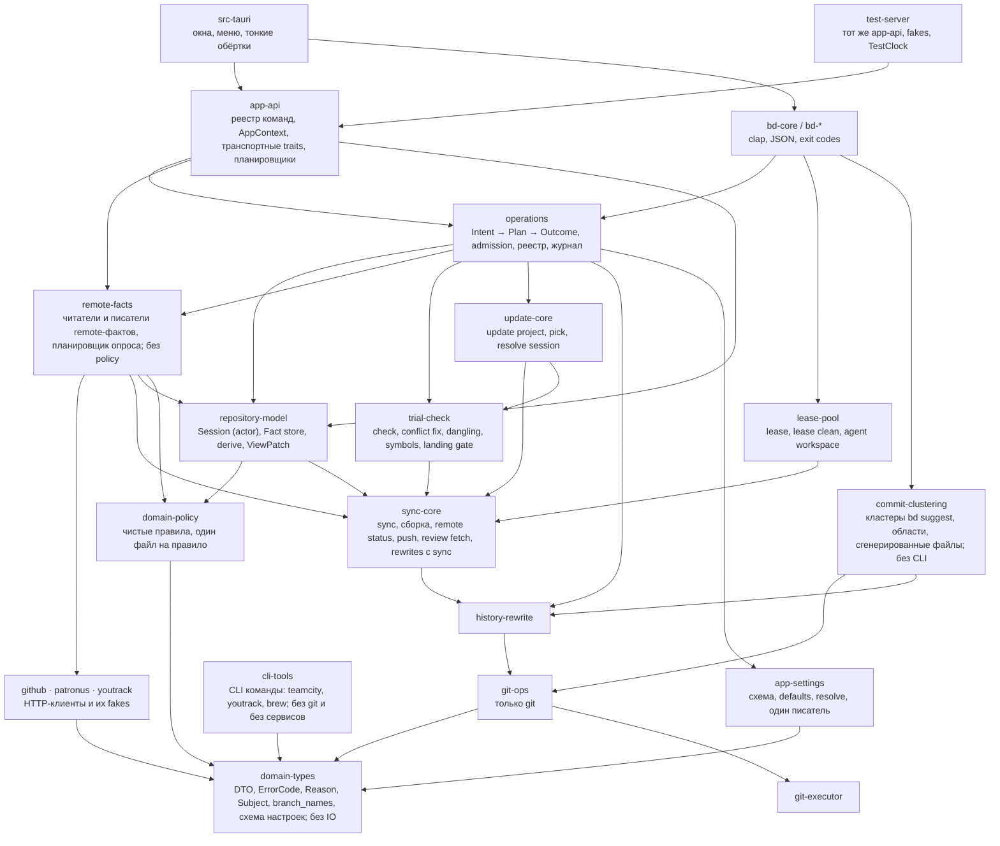
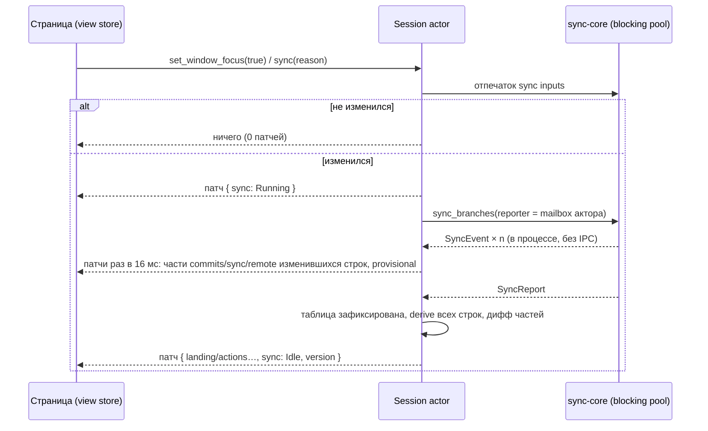

# Rust как источник предметных правил Branch Deck

**Status:** Draft

**Updated:** 2026-10-24

**Tags:** [architecture, rust, cli, tauri, landing, session, operations]

## Назначение и результат

Branch Deck сегодня принимает каждое предметное решение дважды: страница (TypeScript) решает, что ветка переносит в
master, можно ли её запустить, что нужно подтвердить и в каком порядке выполнить шаги; `bd` решает то же самое своим
кодом. Этот документ описывает переход к одному владельцу: **Rust владеет моделью репозитория, фактами о remote,
правилами над ними и исполнением каждого изменяющего действия**. Страница держит патчируемую копию модели и
представляет её; `bd` и приложение — два адаптера одной библиотеки; E2E-сервер размещает ту же библиотеку с фальшивыми
сервисами.

Результат оценивается по цели владельца: быстрое и корректное приложение с понятным кодом. Стоимость не ограничение.
Заменённый код удаляется в том же этапе, который его заменил; параллельных реализаций и слоёв совместимости нет.
Каждый этап приземляется в master отдельно и оставляет приложение и `bd` работающими.

Это вторая версия документа. Первая (`0a74afc6`) строила «landing-башню» рядом с frontend, который оставался
владельцем таблицы, фактов, опросов и реестра операций; её разбор — в [Альтернативы](#альтернативы).

## Проблема

### Что уже есть

Нижние слои разделены и остаются: `GitCommandExecutor` запускает git, `git-ops` реализует операции, `history-rewrite`
и `sync-core` держат инварианты, блокировки и последовательности git-шагов, `repository-model` хранит таблицу последнего
sync на `(repository, prefix)` и выводит одно правило для обоих клиентов (`patronus_view`). Приложение и `bd` — один
бинарник: `src-tauri/src/main.rs` передаёт `bd`/`cli` в `bd_cli::run`. Фальшивые сервисы существуют:
`crates/github/src/fake_github.rs`, `crates/patronus/src/fake_patronus.rs` (feature `fake`). Landing gate
(`trial_check::landing_gate`: `check_landing_gate` над `Subject`, `LandingRefusal` и `LandingFix` из
`domain_types::landing`, `LandingAllowances` в `domain_types::patronus`) уже решается в Rust и показывается поповером —
это образец того, как должно быть устроено всё остальное.

### Проверенные факты (master `f3bea2b9`)

Номера строк — ориентиры; этап перепроверяет их перед действием.

| Факт | Где |
| --- | --- |
| Допустимость Safe Push решается дважды | `src/lib/safe-push-decision.ts` (факты из `src/hooks/useSafePush.ts:240-345`) и `plan()` в `crates/bd-remote/src/safe_push_command.rs:860-1190` (файл 1943 строки) |
| Исполнение Safe Push оркестрируется дважды | `src/lib/safe-push-start.ts`, цикл ответа `src/stores/patronus.ts:1373-1384`; `safe_push()` в `safe_push_command.rs:415-601` |
| `bd safe-push` держит repository lock во время HTTP | lock `:431`; список роботов `:915`, `start_options` `:1042`, список PR `:1056`, readiness `:1146`, retarget `:515-526`, cancel `:531`; `drop(lock)` `:566`, вне lock — только старт (`:572-600`) |
| Push оркестрируется дважды, с разным порядком retarget | приложение retarget **до** push (`src/lib/git/push.ts:136`, `new-pull-request.ts:128`); `bd push` **после** push и lock (`push_command.rs:235-248`); `bd safe-push` до (`:507-523`) |
| Push в приложении идёт без repository lock | `src-tauri/src/commands/push.rs:21-47` проверяет только `not_built`; `bd push` держит lock |
| `start_patronus_robot` без проверок parked, landed, approvals, overlap | `src-tauri/src/commands/patronus.rs:208-249`; после `f3bea2b9` проверяет только landing gate |
| Hold ветки решается один раз, в Rust; продублированы адаптеры и hold stack branch | решение — `hold` в `repository-model/src/patronus_view.rs`; `push_holds()` (`crates/bd-remote/src/push_hold.rs:147-166`) и `getPushHold` (`src/stores/patronus.ts:677`, из `factsOf` `:264-283`) только читают его. Дважды: проверка статуса и cancel/restart держащего робота перед push (`checkPushHold`/`cancelHoldingRobot`, `src/lib/git/push.ts:249-290`; `push_locked`/`--restart-running` в `push_command.rs`) и hold stack branch (`stackBranchHoldReasonIn`, `stores/patronus.ts:468`: parked member, landed, робот стека; `push_command.rs:692`, `safe_push_command.rs:893`) |
| Таблица, факты и опросы принадлежат странице | `src/stores/branch-sync.ts` (1814 строк, per-commit `SyncEvent`, flush 16 мс); опрос — `setTimeout` в `review-requests.ts:345`, `pull-requests.ts:234`, `patronus.ts:1189,1403`, `review-readiness.ts:319`, единственный `setInterval` — `usePatronusRobotDetails.ts:60` |
| Страница отправляет выводы обратно в Rust | `RemoteFact.up_to_date` из `remoteFactsIn` (`stores/patronus.ts:511`), `GetRepositoryViewParams.matched` из `robotMatchIn` (`:491`) |
| `table_generation` — один глобальный `AtomicU32`, страница его игнорирует | `repository-model/src/views.rs:30,53`; приём по `revision` в `stores/patronus.ts:583-584` |
| `git-ops` владеет UI DTO | `Commit`, `BranchError`, `BranchSyncStatus`, `CommitSyncStatus`, `WordResolutionSummary`, `UpdateCheck`, `CommitInfo` — импорт в `sync-types/src/lib.rs:2-4`, `branch_name_suggestion.rs:3` |
| `patronus → git-ops` ради чистых имён веток | `BranchKind` и `strip_branch_namespace`, `crates/patronus/src/service.rs:7` |
| У `settings.json` уже два писателя и ручные читатели со своими defaults | `LazyStore` (`src/stores/settings/app-store.ts:65`); `restart_app` (`src-tauri/src/title_bar.rs:250-262`); `zoom.rs:35-40` (1.0), `menu.rs:156-161` (`autoSyncOnFocus` = true), `title_bar.rs:237`, `bd-core/src/context.rs:293-318` |
| Префикс ветки разрешается дважды | `computeEffectiveBranchPrefix` (`src/stores/repository.ts:107-114`) и `resolve_branch_prefix` (`sync-core/src/branch_prefix.rs:27`) |
| Неудачное чтение правил GitHub читается как «push сохраняет approvals» | `src/hooks/useDismissesStaleReviews.ts:19-26`: `forget` удаляет ответ и возвращает `false`; до следующего вопроса peek-кэш держит `false` |
| Matching роботов держится общей фикстурой, которую читают обе стороны | `src/test-support/robot-match-cases.json`: `patronus_start_test.rs:126`, `src/lib/patronus.test.ts:39`; комментарий `patronus_start.rs:49` называет файл неверно |
| Три реестра команд; 35 команд в e2e никогда не доходили до Rust (после `s0b-remote-bridge` — 4, только окна) | `collect_commands!` (112, `src-tauri/src/lib.rs`), ручные маршруты `/invoke/*` в `crates/test-server/src/lib.rs` (до s0b 77, после 108 по командам плюс `get_blob_syntax`; `browse_repository/{repo_id}` — маршрут команды `browse_repository`); `tests/e2e/setup/tauri-mocks.ts` — локальные обработчики окон и плагинов, всё остальное проксируется на сервер (`proxyToTestServer`), 405 роняет тест; `routeCommand(page, "start_patronus_robot")` был в 25 тестах, после s0b ни одного: `command_registry_test.rs` держит `PAGE_MOCKED` (4) и храповик ответов страницы в `tests/e2e` |
| Test-server переизобретал логику (снято в `s0b-remote-bridge`) | `get_branch_review_readiness` (~70 строк поверх `to_branch_readiness`), `resolve_patronus_revisions` в `tauri_command_bridge.rs`; теперь маршрут зовёт реальное ядро (`branch_review_readiness`, `prepare_robot_start`) с реальными сервисами за fakes репозитория (`remote_host.rs`) |
| Draft-правило у UI и CLI совпадает | UI `blockedByDraft = isDraft && mode !== "dryRun"` (`src/lib/patronus.ts:867`); CLI отказывает только при `pushes` (`safe_push_command.rs:919,1111`) |
| `bd status` читает Patronus | `landed_by`: `landed_branches(&PatronusFacts::read(.., read_robots(..)))` (`crates/bd-remote/src/status.rs:393-424`); список роботов с курсором `since` в object cache (`robot_list.rs:135-147`); флага `--remote` нет |

Поправки к первой версии документа: «сетевые чтения вне lock, как в CLI» — неверно, вне lock только старт; «один
писатель settings.json» — уже не так; `tableGeneration` не per-repository, а глобальный; фикстуру matching читают обе
стороны, сломан только комментарий; «push hold в трёх копиях» — решение одно (`patronus_view`), дублируются адаптеры.

### Реестр расхождений

D — одинаковый ввод даёт разный результат в приложении и в `bd`; R — правило продублировано без известного
расхождения; S — состояние с двумя владельцами. Правый столбец называет владельца после переработки.

| id | Что | Приложение / `bd` (или вторая копия) | Одно правило |
| --- | --- | --- | --- |
| D1 | Push сбрасывает approvals, которые считает Patronus | **закрыт (s1)**: UI отказывает (`safe-push-decision.ts:171-173`); `bd` не вызывал `read_branch_rules`, теперь `plan()` читает правила target одним GET там, где их читает приложение, и отказывает `push_dismisses_approvals` (`rules_check`, поле `rules`) | `domain-policy::review`: отказ `push_dismisses_approvals { pr }`, исправление `push_then_request_review` |
| D2 | Профиль с `skipsReview` | **закрыт (s1)**: UI пропускает проверку approvals (`:110-112`); `bd` отказывал при `Missing`, если нет `--without-approvals`/`--create-pull-request`, теперь пропускает её для профиля, который пропускает review, на API-маршруте (`ApprovalsSkippedBy::of`, `review.skipped_by`) | `skips_approvals = mode == SafePush && !create_pull_request && (without_approvals \|\| route == Api && profile.skips_review)`; у comment-маршрута профиля нет; `--without-approvals` у `bd` — «стартовать всё равно» на любом маршруте, как до s1 |
| D3a | Порядок retarget при push | приложение до push, `bd push` после, `bd safe-push` до | `Retarget` в плане всегда **перед** `Push`; отказ GitHub на retarget собственного PR останавливает `Land`, а в `Push` только попадает в outcome |
| D3b | PR в другую базу (release-ветка) | **закрыт (s8-policy)**: UI блокировал Safe Push строкой 5′ и при старте без review, `bd` стартовал через API и игнорировал PR (`other_base_pull_request_start`, удалён); теперь база — одно правило `domain_policy::pull_request::base_of`, старт со считающимися approvals отказывает у обеих сторон (страница — строкой 5′, `bd` — `pull_request_other_base` с retarget как следующим шагом), а старт без review и профиль `skips_review` (`domain_policy::review::skips_approvals`; у страницы шаг next step держит такой старт только причинами субъекта на любой строке — sync, сбой, нет коммитов, роботы, parked, landed, то, что идёт на строке (`subjectBlocker`; факта sync у решения нет), — никогда своими (approvals, draft, другая база), `startStepBlocker`) идут через API; `--create-pull-request` с таким PR тоже отказывает | `OtherBase` блокирует только старт, чьи approvals считаются (Safe Push по default checks); Dry Run, старт без review и профиль `skips_review` не блокирует; молча не retarget'ит — `Retarget` предлагается как исправление; `bd` получает отказ `pull_request_other_base { number, base }` |
| D4 | Push поверх remote, который сдвинулся, но не имеет коммитов, которых нет у ветки | **закрыт (s8-policy)**: приложение повторяло push один раз в TS (`push.ts`), `bd` отвечал `lease_rejected`; теперь повтор в Rust у обеих сторон: `push_guard` (lock, проверки и коммиты заново, `PushBranchesParams::over_moved`), `bd push` (новые lease) и stack branch у `bd safe-push --whole-stack`, исход называет статусы, поверх которых шёл push (`pushed_over`) | `domain-policy::push::over_moved_remote`: один повтор, только если `dropped_commits` пуст и у ветки есть работа; `bd` сообщает `pushed_over`; remote с чужими коммитами — `lease_rejected` у обоих |
| D5 | Request review | **закрыт по кандидатам (s8-policy)**: кандидаты — одно правило (`domain_policy::review::candidates`: страница читает их из `RepositoryView.openPullRequests`, `bd` спрашивает предвыбранных); остаётся до s9 push первым шагом: приложение сначала пушит (`RequestReviewForm.tsx`), `bd request-review` не пушит | в плане `RequestReview` есть шаг `Push`, если remote отстаёт; приложение подтверждает его, `bd` отказывает `needs_push` без `--push`; одна функция кандидатов |
| D6 | Create PR | приложение: push → `wait_for_github_branch` → `create_pull_request` (`create-pull-request-context.ts:183-295`); `bd`: `safe-push --create-pull-request` с `wait_for_mirror` | один intent `CreatePullRequest` с `wait_for_mirror`; IPC `wait_for_github_branch` удаляется |
| D7 | Закрытие PR, которые перенёс слившийся робот | правило одно с s8-policy (`domain_policy::landed::pull_requests_to_close`): новость слияния сессии несёт PR, которые закрывает приземление (`NewsEvent::RobotMerged.closes`, после вида Patronus этих роботов), страница закрывает их (`landed-stack.ts`, оркестрация до s9), `bd robot` перечисляет `closes` и не закрывает; до s8 решал TS (`findLandedPullRequests`) | правило `domain-policy::landed::pull_requests_to_close`; intent `CloseLandedPullRequests` из сессии приложения; `bd` по-прежнему не закрывает (решение landing.md), но `bd robot`/`bd status` перечисляют `closes` той же функцией |
| D8 | Родитель для состава whole stack | **закрыт (s8-policy)**: обе стороны читают одно правило `domain_policy::stack::whole_stack_of` по объявленному родителю (решение владельца 5): whole stack ветки — стек её корня по объявленному родителю, stack branch корня, пока стек ветвится, иначе прямая цепочка от корня, которую приземляет её последняя не parked ветка; вид кладёт его на структуру корня (`BranchStructure.wholeStack`), `bd safe-push --whole-stack` и `bd robot --whole-stack` читают то же (`bd_core::stack_summary::whole_stack`); до s8: TS `effectiveBase ?? declaredParent` (`useStackNextStep.ts`), Rust `effective_base ?? blocked_by.parent` (`stack_summary::whole_stack_of`, удалён); случай (`s0c-scenarios`): A с проблемой стека (`(A/A)`) ← B без коммитов, сохранённый родитель B → A (`bd restack`) ← C `(B/C)` — теперь C корень своего стека, а whole stack A — A один | одна функция в Rust (`domain-policy::stack`) |
| D9 | Неудачное чтение правил GitHub читается как `false` | **закрыт (s1)**: приложение читало ошибку как «approvals остаются» и стартовало, теперь `useDismissesStaleReviews` отвечает `keep` \| `dismiss` \| `unknown` с причиной (неудача не кешируется, каждый старт спрашивает снова), а `getSafePushDecision` подтверждает `rulesUnknown` (строка поповера `safe-push-rules-unknown`); `bd` отказывает `rules_unknown`, который снимает `--allow-unknown-rules` | `Fact::Unavailable` никогда не превращается в разрешение; см. D1 и решение владельца о случае без токена |
| D10 | Прямой IPC обходит проверки | **закрыт (s1)**: `start_patronus_robot`, `restart_`, `cancel_patronus_robot`, `push_branch(es)` шли без проверок и без lock; теперь push приложения читает роботов сам, берёт lock и отказывает parked, landed, hold, not built (`push_guard`), а старт, restart и cancel отказывают parked, landed, not built и overlap по таблице и роботам, которых Rust читает сам (`start_guard`) | вся допустимость — в движке операций; низкоуровневый IPC удаляется в `s9-engine-remote`; до того `s1-holes` добавляет проверки в Rust |
| D11 | PR в виртуальную базу (ветка родителя, другая ветка таблицы, приземлённая) | **закрыт (s8-policy)** по решению владельца 9: приложение отказывало в Safe Push строкой 5 и предлагало retarget отдельным шагом, `bd` делал retarget первым эффектом старта; теперь обе стороны решают `domain_policy::land::decide`, чей первый эффект — `PlannedEffect::Retarget` в target, и стартуют от этого PR (страница — `safe-push-start.ts`, `retargetForStart`; строка 5 больше не отказывает, её слот остаётся retarget до шага next step в Rust); readiness обеих спрашивается с ним (`domain_policy::pull_request::start_pull_request`: PR в target или, у ветки, в виртуальную ветку) | `Retarget` — шаг плана `Land` у обеих сторон, подтверждаемый там же, где `Push`; приложение перестаёт отказывать |
| D12 | Push поверх чужого коммита на remote (`dropped_commits` непуст) | **закрыт (s8-policy)**: решение Safe Push в приложении не читало чужие коммиты и стартовало с force push (спрашивала только кнопка push), `bd` отказывал `push_refused`; теперь обе стороны решают `domain_policy::land::decide`: отказ `Reason::DropsRemote` (страница — словами кнопки push, `bd` — `push_refused`), с `--force` у `bd` (`LandingAllowances::allow_force`) — подтверждение `ForcePushDrops` и force push | `domain-policy::push`: отказ `drops_remote_commits` у обеих сторон, подтверждение — явный шаг плана, не кнопка |
| D13 | PR слит GitHub'ом с коммитами ветки | **закрыт (s8-policy)**: приложение держало ветку (строка 1, `mergedCurrent`), `bd` читал только открытые PR и роботов и стартовал через API; теперь одно правило `domain_policy::landed::landed_state` (fetched baseline, слившиеся Safe Push, PR, слитый с её коммитами: head = tip или remote tip без отличий) — вид отдаёт `RepositoryView.landedStates`, решение старта у обеих сторон получает блокер `Reason::PullRequestMerged` (`bd` — `landed`) | `domain-policy::landed`: слитый PR с текущими коммитами — приземление у обеих сторон |
| D14 | Review без ответа: pre-check упал (`unavailable`) или репозиторий только на Space | **закрыт (s8-policy)** по решению владельца 10: приложение подтверждало строкой review (`isReviewUnjudged`, `reviewFactOf: space`), `bd` отказывал; теперь обе стороны решают `domain_policy::land::decide`: упавший pre-check — подтверждение `ReviewUnknown` (строка поповера, `--allow-unknown-review` у `bd`), merge request Space — недостающие approvals (`approvals_missing` у обеих), чтение Space одно (`domain_policy::review::review_state`) | `Fact::Unavailable` — ожидание или подтверждение, не отказ; одно чтение `space` у обеих сторон |
| D15 | Dry Run, чей push идёт в ветку, которую приземляет идущий Safe Push ветки над ней (span hold) | **закрыт (s8-policy)**: приложение отказывало (`pushHeld` из hold представления), `bd` для dry run отказывал только по последнему коммиту, пушил и стартовал; теперь обе стороны отказывают одним правилом `domain_policy::land::start_refusal`: Dry Run, который пушит, ждёт span hold своей ветки (`Reason::Held`), а hold решает `domain_policy::holds::branch_hold` | hold из `patronus_view` действует на push любого старта у обеих сторон (`domain-policy::holds`) |
| R1 | Needs push, порядок push стека | `isRemoteUpToDate`, `getPushAction` (`push-summary.ts:24-62`), `needsPush`, `stackPushOrder` (`stack.ts:156-188`); `has_work_for_remote` (`push_command.rs:727`), `stack_branches_to_push` (`:674`) | `domain-policy::push::plan` |
| R2 | Hold stack branch и порядок перед push держащего робота | **правило hold закрыто (s8-3)**: hold ветки и stack branch решает `domain_policy::holds` (`branch_hold`, `stack_branch_hold`), вид несёт `landing.hold`, `bd push` и проверки приложения читают то же; до s8: решение hold ветки одно (`patronus_view`); hold stack branch — TS `stackBranchHoldReasonIn` и проверки parked в `push_command.rs:692`, `safe_push_command.rs:914`; статус, cancel и restart держащего робота — `checkPushHold`/`cancelHoldingRobot` (`push.ts:249-290`) и `push_locked`/`--restart-running` | `domain-policy::holds` получает hold ветки из `patronus_view` и hold stack branch (s8); порядок «статус → cancel → push» — `operations::push` (s9); `push_hold.rs` (чтение представления для `bd push`) удаляется в s9 |
| R3 | Parked | `src/lib/parked.ts:21-63`; `sync_core::parked::parked_state` (`parked.rs:126`) | `domain-policy::parked` (закрыт в s8-2: правило одно, страница читает `BranchView.structure.parked`) |
| R4 | Отказ в старте | **закрыт (s8-3)**: `domain_policy::land::start_refusal` у обеих сторон, вид несёт `landing.start`/`landing.dryRun` (`Reason`); до s8: `canStartRobot`, `isStartBlocked`, `allowsPushMode` (`src/lib/patronus.ts:520-625,823`); `BranchPatronus.start`, `StackPatronus.start` (`domain-types/src/repository_view.rs`; правило одно — `repository_model::patronus_view::start_blocked`) — Rust-поля читает только `bd` | `domain-policy::land` |
| R5 | Matching роботов | `findBranchRobot` (`patronus.ts:78`); `domain_policy::robot_match` (`RobotIndex`, `match_table`; с s7-1 вместо `find_branch_robot` из `patronus_start.rs`) | только Rust; `RobotMatch` перестаёт быть входом |
| R6 | Next step, landing node, решение Safe Push | `branch-next-step.ts` (657), `landing-node.ts` (234), `safe-push-decision.ts` (211), `useStackNextStep.ts`, `whole-stack.ts`; `plan()` в `bd` | `domain-policy::{next_step, landing_node, land}` |
| R7 | Restart, Push and Restart | **правило закрыто (s8-3)**: `domain_policy::holds::restart_action` и `land::restart_refusal`, вид несёт `restarts` по id робота; оркестрация `runPushAndRestart` остаётся до intent s9; до s8: `getRobotRestartAction` (`patronus.ts:425`), `runPushAndRestart` (`patronus-actions.ts:77-120`); `bd push --restart-running` | intent `RestartRobot` |
| R8 | Предпросмотр группировки коммита | `groupFor`/`parseSubject`/`findIssueKey`/`sanitizeBranchName` (`src/lib/commit.ts:114-216`, 14 потребителей); `CommitGrouper`, `sync-utils` | Rust `preview_group(message)`, debounce в inline-форме |
| R9 | Markdown тела коммита | `parseCommitBody` (`src/lib/commit-message.ts`); `commit_body_markdown` (`remote-facts/src/pull_request_text.rs`) | Rust; диалог PR получает текст из `get_new_pull_request` |
| R10 | Валидация имени ветки | `useBranchNameValidation.ts`; `is_valid_branch_prefix` (`domain-types/src/branch_names.rs`), `stack_path` (`domain-types/src/stack.rs:213`) | Rust (`domain-types::branch_names`, чистая); при заметной задержке ввода — TS-проверка против Rust-оракула (фикстура, которую пишет Rust-тест) |
| R11 | Эффективный префикс ветки | см. факты | Rust; с `s6-session-table` сессия ключуется разрешённым префиксом |
| S1 | Таблица веток | страница (`branch-sync.ts`) и Rust (`RepositoryViews::keep`) | сессия в Rust |
| S2 | Факты о remote | строки страницы, результаты push, `remoteStatusUpdate` отбрасывается во время push | сессия, `Fact<T>` с порядковым номером наблюдения |
| S3 | Идущие операции | `src/stores/operations.ts` (только приложение), `pushingBranches`/`stackPushes`, `safePushStore.starting`, repository lock (между процессами, только ожидание) | реестр в Rust: in-process плюс общий файл |
| S4 | Настройки | `LazyStore`, `restart_app`, ручные читатели | `app-settings`, один писатель |
| S5 | Activity | только страница (`src/stores/activity.ts`, ключ `settings.json` главного окна); действия `bd` не видны | журнал в Rust плюс записи страницы через одного писателя |
| S6 | Список команд e2e | три реестра | один реестр (`app-api`) |

Тесты каждой строки D: у разыгранного случая — тесты групп его случаев ([Таблица сценариев](#таблица-сценариев)),
у записанного (`recorded`: решение ни одной стороны его не достигает) — существующие тесты, на которые указывает запись
`discrepancies.json`; тест реестра проверяет, что каждый её указатель (`path#text`, `path:line#text`) есть в файле, а у `path:line#text` — на этой строке. У D10
теста поведения нет: прямой IPC никто не проверяет, его держит только указатель.

- **D1.** Закрыт в s1-holes (`closed: "s1-holes"`, обе стороны отказывают; `rules-dismiss-not-counted` — сброс
  approvals, которых Patronus не считает: подтверждение и предупреждение `rules`):
  [@test] ../../crates/bd-remote/src/safe_push_test.rs (`a_push_that_dismisses_the_approvals_patronus_counts_refuses_the_safe_push`)
  [@test] ../../crates/bd-remote/src/scenario_test.rs (`the_discrepancy_cases_name_every_id_as_the_register_does`, `the_safe_push_review_cases_answer_alike_in_the_app_and_bd`)
- **D2.** Закрыт в s1-holes (`closed: "s1-holes"`, его бывший twin `skips-review-profile` отвечает одному ожиданию):
  [@test] ../../crates/bd-remote/src/safe_push_test.rs (`a_profile_that_skips_the_review_starts_without_the_approvals_through_the_api`)
  [@test] ../../crates/bd-remote/src/scenario_test.rs (`the_safe_push_review_cases_answer_alike_in_the_app_and_bd`)
- **D3a.** Сегодняшнее поведение закреплено:
  [@test] ../../src/lib/git/push.test.ts (`retargets a pull request into a virtual branch to the baseline before the push, and Activity records it`)
  [@test] ../../crates/bd-remote/src/safe_push_test.rs (`push_retargets_a_pull_request_into_a_virtual_branch_to_the_baseline`)
  [@test] ../../crates/bd-remote/src/safe_push_test.rs (`the_pull_requests_of_the_branch_and_of_the_parents_it_pushes_go_into_the_target_before_the_start`)
- **D3b.** Закрыт в s8-policy (`closed: "s8-policy"`, бывший twin `row-5-prime-another-base` и
  `row-5-prime-another-base-without-review` отвечают одному ожиданию): обе стороны отказывают старту со считающимися
  approvals и пропускают старт, который их не считает:
  [@test] ../../crates/domain-policy/src/pull_request_test.rs (`a_pull_request_goes_into_the_target_into_a_virtual_branch_it_leaves_or_into_another_base`)
  [@test] ../../crates/bd-remote/src/safe_push_test.rs (`a_pull_request_into_another_base_refuses_only_a_safe_push_whose_approvals_count`, `create_pull_request_retargets_the_pull_request_of_a_virtual_branch_and_refuses_one_into_another_base`)
  [@test] ../../crates/domain-policy/src/land_test.rs (`missing_approvals_refuse_unless_skipped_and_approvals_judged_at_the_start_confirm`, `the_pull_request_decides_the_route_a_draft_refuses_and_another_base_refuses_only_counted_approvals`)
  [@test] ../../src/presenters/land.test.ts (`lets a start without review wait for its profile, and confirm the one that skips the review`)
  [@test] ../../crates/bd-remote/src/scenario_test.rs (`the_next_step_row_cases_answer_alike_in_the_app_and_bd`)
- **D4.** Закрыт в s8-policy (`closed: "s8-policy"`): одно правило `domain_policy::push::over_moved_remote`, повтор
  обеих сторон в Rust, remote с чужими коммитами — `lease_rejected` у `bd` и тост у приложения:
  [@test] ../../crates/domain-policy/src/push_test.rs (`pushes_again_over_a_moved_remote_only_when_nothing_of_it_is_lost`)
  [@test] ../../crates/repository-model/src/push_guard_test.rs (`pushes_again_over_a_moved_remote_only_when_the_remote_has_no_commits_the_branch_lacks`)
  [@test] ../../crates/bd-remote/src/push_test.rs (`pushes_again_over_a_moved_remote_that_lacks_nothing_of_the_branch`, `a_moved_remote_branch_is_fetched_and_reported_and_force_replaces_it`)
- **D5.** Закрыт в s8-policy по кандидатам (`closed: "s8-policy"`): кандидаты — одно правило
  (`domain_policy::review::candidates`); push первым шагом — сегодняшнее поведение до s9:
  [@test] ../../tests/e2e/next-step/next-step.spec.ts (`should push the commits the remote lacks as the first step of Request Review…`)
  [@test] ../../crates/domain-policy/src/review_test.rs (`are_the_suggested_ones_of_the_missing_groups_one_per_group_nobody_is_asked_for_chosen_each_once`)
  [@test] ../../crates/bd-remote/src/request_review_test.rs (`asks_the_suggested_code_owner_of_the_missing_group_once`)
- **D6.** Сегодняшнее поведение закреплено:
  [@test] ../../tests/e2e/next-step/next-step.spec.ts (`should open GitHub's form of a branch not on the remote yet from its preview, after the push`)
  [@test] ../../crates/bd-remote/src/safe_push_test.rs (`the_approvals_count_in_the_pull_request_it_opens_and_the_safe_push_starts_from_it`)
- **D7.** Правило одно с s8-policy (`domain_policy::landed::pull_requests_to_close`); закрывает только приложение, `bd
  robot` перечисляет `closes` (решение владельца 4):
  [@test] ../../crates/domain-policy/src/landed_test.rs (`closes_the_pull_requests_of_the_branches_a_merged_robot_landed_whole_not_of_its_own_branch`)
  [@test] ../../crates/repository-model/src/facts_test.rs (`a_merge_waits_for_the_view_of_its_robots_and_names_the_pull_requests_its_landing_closes`)
  [@test] ../../crates/bd-remote/src/robot_test.rs (`a_merged_robot_lists_the_pull_requests_its_landing_closes_and_closes_none`)
  [@test] ../../crates/bd-remote/src/scenario_test.rs (`the_discrepancy_cases_name_every_id_as_the_register_does`)
- **D8.** Закрыт в s8-policy (`closed: "s8-policy"`): одно правило `domain_policy::stack::whole_stack_of` по объявленному
  родителю у обеих сторон, одно ожидание:
  [@test] ../../crates/bd-remote/src/scenario_test.rs (`the_whole_stack_of_a_blocked_branch_with_an_inactive_declared_parent_is_d8`)
  [@test] ../../crates/domain-policy/src/stack_test.rs (`the_whole_stack_of_a_blocked_branch_follows_its_declared_parent_not_what_blocks_it`)
- **D9.** Закрыт в s1-holes (`closed: "s1-holes"`; приложение подтверждает `rulesUnknown`, `bd` отказывает
  `rules_unknown` — асимметрия по замыслу, решение владельца 6; `rules-unknown-allowed` — подтверждение и
  `--allow-unknown-rules`, обе стороны стартуют):
  [@test] ../../crates/bd-remote/src/safe_push_test.rs (`rules_github_does_not_answer_refuse_the_safe_push_unless_allowed`)
  [@test] ../../crates/domain-policy/src/land_test.rs (`the_rules_of_a_push_into_an_approved_pull_request_refuse_confirm_or_wait`)
  [@test] ../../tests/e2e/patronus/patronus-actions.spec.ts (`should confirm a push into an approved pull request whose rules can't be read, never reading them as keeping the approvals`)
  [@test] ../../crates/bd-remote/src/scenario_test.rs (`the_discrepancy_cases_name_every_id_as_the_register_does`, `the_safe_push_review_cases_answer_alike_in_the_app_and_bd`)
- **D10.** Закрыт в s1-holes (`closed: "s1-holes"`, запись recorded: `today` называет guard'ы обеих сторон): push
  приложения — lock и отказы нет строки, parked, landed, hold, stack branch не built в Rust (`push_guard`); старт,
  restart и cancel — отказы parked, landed whole, not built и overlap по роботам, которых Rust читает сам (`start_guard`):
  [@test] ../../crates/bd-remote/src/scenario_test.rs (`the_discrepancy_cases_name_every_id_as_the_register_does`)
  [@test] ../../crates/repository-model/src/push_guard_test.rs (`a_parked_branch_and_a_branch_built_on_parked_are_refused`, `a_branch_a_merged_safe_push_landed_whole_is_refused`, `a_branch_whose_own_safe_push_runs_is_refused_until_it_is_canceled`, `a_push_while_a_holder_no_record_names_holds_the_lock_is_refused`, `a_guarded_push_runs_the_processes_of_the_core_push`)
  [@test] ../../crates/repository-model/src/push_guard_test.rs (`a_stack_branch_that_is_not_built_is_refused`, `a_branch_the_last_sync_has_no_row_of_is_refused`)
  [@test] ../../crates/test-server/src/remote_fixtures_test.rs (`a_push_into_a_branch_whose_safe_push_runs_is_refused_before_git_pushes`)
  [@test] ../../crates/repository-model/src/start_guard_test.rs (`a_parked_branch_a_branch_built_on_parked_and_a_whole_stack_with_a_parked_member_are_refused`, `a_branch_and_a_whole_stack_merged_safe_pushes_landed_whole_are_refused`, `a_branch_and_a_stack_branch_the_sync_did_not_build_are_refused`)
  [@test] ../../crates/repository-model/src/start_guard_test.rs (`a_robot_on_the_last_commit_or_one_that_lands_a_part_of_the_subject_is_refused`, `a_restart_is_a_start_its_own_robot_does_not_refuse_never_of_a_temporary_ref`, `a_cancel_of_a_robot_not_in_the_list_or_finished_is_refused`)
  [@test] ../../crates/test-server/src/remote_fixtures_test.rs (`a_start_of_a_parked_branch_is_refused_before_patronus_is_asked`)
- **D11.** Закрыт в s8-policy: три случая строки 5 отвечают обеими сторонами стартом, первый эффект которого —
  retarget (`PlannedEffect::Retarget`), правило — `domain_policy::land::decide`:
  [@test] ../../crates/bd-remote/src/scenario_test.rs (`the_next_step_row_cases_answer_alike_in_the_app_and_bd`)
  [@test] ../../crates/repository-model/src/derive_test.rs (`the_view_decides_the_default_starts_of_each_branch_and_a_read_answers_another_intent`)
  [@test] ../../src/lib/safe-push-start.test.ts (`retargets the pull request out of a virtual branch first, then pushes, then comments on the pull request (D11)`)
- **D12.** Закрыт в s8-policy: случай `remote-behind` отвечает обеими сторонами отказом (`Reason::DropsRemote`):
  [@test] ../../crates/bd-remote/src/scenario_test.rs (`the_landing_cases_answer_alike_in_the_app_and_bd`)
- **D13.** Закрыт в s8-policy (`closed: "s8-policy"`): случай `row-1-merged-pull-request` отвечает обеими сторонами
  приземлением, правило — `domain_policy::landed::landed_state`:
  [@test] ../../crates/domain-policy/src/landed_test.rs (`a_pull_request_lands_the_branch_only_merged_with_the_commits_it_has`)
  [@test] ../../crates/bd-remote/src/scenario_test.rs (`the_next_step_row_cases_answer_alike_in_the_app_and_bd`)
- **D14.** Закрыт в s8-policy: `readiness-space-required` отвечает обеими сторонами отказом, `readiness-unavailable` и
  `row-11-unavailable` — подтверждением `ReviewUnknown` (у `bd` — флагом, `asymmetry: byDesign`):
  [@test] ../../crates/bd-remote/src/scenario_test.rs (`the_safe_push_review_cases_answer_alike_in_the_app_and_bd`, `the_next_step_row_cases_answer_alike_in_the_app_and_bd`)
- **D15.** Закрыт в s8-policy: случай `dry-run-while-a-safe-push-of-a-child-lands-the-branch` отвечает обеими сторонами
  отказом, правило — `domain_policy::land::start_refusal`:
  [@test] ../../crates/bd-remote/src/scenario_test.rs (`the_landing_cases_answer_alike_in_the_app_and_bd`)
  [@test] ../../crates/domain-policy/src/land_test.rs (`a_dry_run_waits_for_the_last_commit_and_for_the_span_hold_of_the_push_it_makes`)

Реестр и документ держит тест реестра: у каждого id есть строка реестра и запись выше, а у строки, оставляющей правило
владельцу («владелец»), — нумерованный пункт в [Решениях владельца](#решения-которые-подтверждает-владелец), который
называет id.

## Область изменений

Входит: всё, что решает «можно», «нужно», «что переносит», «кто держит», «какие ветки» и всё, что выполняет
последовательность эффектов (git, remote, GitHub, Patronus, YouTrack): Safe Push и Dry Run, restart и cancel, push
ветки, предков, детей и whole stack, создание PR, retarget, request review, закрытие перенесённых PR, review чужого PR,
регруппировки и остальные rewrite'ы, Update Project, sign-in, Mark Fixed; факты, их актуальность и опрос; реестр
операций; настройки; ошибки; реестр команд и E2E-сервер.

Остаётся за страницей: выбор строк, фокус, scroll, раскрытие стека, поповеры, hover, layout, какая поверхность
показывает индикатор, формулировки, иконки, клавиши. TS-функция, которая решает «можно/нужно/переносит/держит», —
дефект; с `s14-fence` её ловит lint.

Не переписываются: diff renderer, группировка (`CommitGrouper`), merge/replay, mapping notes, object cache, устройство
lease pool, инварианты git-слоя (`GitCommandExecutor`, запрет записи в working tree кроме `worktree_update.rs`,
`RefTransaction` с CAS, batching, бюджеты процессов). Они переезжают между crates вместе с тестами и исключениями
scan-тестов, не меняясь. Daemon не появляется: `bd` работает без запущенного приложения.

## Целевая архитектура

### Принципы

1. **Rust владеет каждым предметным решением и каждым многошаговым эффектом.** Страница представляет и держит
   локальное UI-состояние.
2. **Один входной протокол.** Страница отправляет **intents** (что попросил пользователь) и **demand** (что она
   показывает). Она никогда не отправляет выводы: ни `needsPush`, ни `upToDate`, ни `matched`, ни `canStart`.
3. **Факты несут свою достоверность.** `Fact<T>` различает Fresh, Stale(reason), Loading, Unavailable(reason) и
   Unknown. Ни одно правило не превращает Unknown или Unavailable в разрешение или в «не требуется». Решение над
   фактом Loading, Unknown или Unavailable — ожидание или блок с этим фактом как причиной, никогда действие, которое
   следующий ответ заменит другим: «Safe Push», через три секунды ставший «Awaiting Review», успевал подтвердить старт
   через API, чьи approvals не считаются (монорепозиторий, 2026-10-24; [Facts without an
   answer](../../spec/branch/next-step.spec.md#facts-without-an-answer)).
4. **Каждый внешний эффект планируется, допускается, перепроверяется перед собой и записывается.** Откатов нет;
   outcome называет, что произошло.
5. **`bd` и приложение — два адаптера одной библиотеки.** Координация между процессами — на диске: repository lock,
   реестр операций, refs с CAS, object cache, stamp-файл. Daemon нет.
6. **Одно место для каждого правила.** Каждое правило живёт в одном файле с `//!`-заголовком, который его называет
   ([Индекс правил](#индекс-правил)); таблица индекса попадает в AGENTS.md на этапе `s8-policy`.
7. **Старый код удаляется в этапе, который его заменяет.** Единственное допустимое соседство — сравнение внутри теста,
   пока этап в работе.

### Crates и направление зависимостей

**Запрещённые рёбра** проверяет тест над `cargo metadata` (`crates/bd-cli/src/architecture_test.rs`, рядом с `process_budget_test.rs`, с
`s0a-safety-net`; первый allowlist перечисляет сегодняшние нарушения и сжимается на каждом этапе, в `s14-fence` он
пуст). Он идёт по обычным рёбрам; optional ребро идёт как обычное, если его включает `default` или любая feature, кроме
тестовых (`TEST_FEATURES`: `fake` сервиса, `fixtures` bd): `specta` и `schemars`, которые включают приложение и
`bd-core`, — это то, что crate есть, fake, который включает dev-dependency чужих тестов, — нет. Тестовую feature может
включить и обычное ребро (`patronus = { features = ["fake"] }` в `[dependencies]` test-server): тогда fake есть в каждой
сборке зависимого crate, поэтому обход несёт features, которые включает каждое ребро (`features` ребра и `x/f` из
включённых features crate перед ним), и идёт по optional рёбрам, которые они активируют; переименованную зависимость
(`ops = { package = "git-ops" }`) он узнаёт по имени из манифеста (`rename`), как пишут её записи features.
`cargo tree -p <crate>` показывает ребро fake из-за объединения features по workspace (`.cargo/config.toml`). Правила:

- `domain-types` и `domain-policy` не достигают ничего с IO, в том числе транзитивно: ни `git-ops`, ни executor, ни
  reqwest, tokio, tauri, clap.
- `sync-core` не достигает `github`, `patronus`, `youtrack`, `file-diffs`, `code-symbols` (`file-diffs` сам зависит от
  `code-symbols` без feature, `file-diffs/Cargo.toml:9`, поэтому каждый модуль, который читает `file_diffs`, ушёл в
  `trial-check` в `s3-3`; читатели и писатели `github`, `patronus`, `youtrack` ушли в `remote-facts` в `s3-5`).
- `remote-facts` не достигает `trial-check`, `update-core`, `lease-pool`, `file-diffs`, `code-symbols`: он добывает
  ответы GitHub и Patronus, а не проверяет и не обновляет.
- `patronus` не достигает `git-ops`.
- `cli-tools` не достигает `git-ops`, executor, `patronus`, `youtrack`, `github` и tauri: он запускает только сами CLI
  (Settings → Tools), а то, что о них знает сервис (последний релиз, токен для `youtrack`), приносит вызывающий.
- `repository-model` не достигает `remote-facts`: модель хранит значения, а не добывает их.
- Никто не зависит от `app-api` и `src-tauri`. `bd-*` — слой CLI: `bd-core` — его основа; каждый `bd-<семейство>`
  (`bd-lease`, `bd-remote`, `bd-rewrite`, `bd-update`) зависит от `bd-core` и библиотек ниже, но не от другого
  семейства; `bd-cli` собирает все семейства; dev-dependency семейства на `bd-cli` с feature `fixtures` разрешена (тестовый
  цикл, который cargo допускает). Вне слоя от `bd-*` зависит только `src-tauri`: от `bd-cli` (`bd`/`cli` и `install`)
  и от `bd-core` (`bd_command`, `Environment`). `agent_defaults` — ядро `lease-pool` (с `s3-4`), поэтому
  `src-tauri` от `bd-lease` не зависит.
  `bd-clustering` — библиотека без CLI и в `s3-crates` переименовывается в `commit-clustering`.
- `bd-*` не зависят от `tauri` (сегодня не зависят; `app-settings` поэтому не использует `tauri-plugin-store`).

| Crate | Из чего | Ответственность | Удаляется или поглощается |
| --- | --- | --- | --- |
| `domain-types` | переименование `sync-types`; DTO из `git-ops::model`, `commit_list::Commit`, `UpdateCheck`, `CommitInfo`; чистые `branch_names`; `ErrorCode` из `bd-core/src/error.rs:18`; owned-форма `LandingSubject` как единственный `Subject`; данные отказов landing gate — `LandingRefusal`, `LandingFix`, `ReferenceKind` (`sync-core/src/landing_gate.rs:52,82,92`) и `StackCommit` (`check.rs:165`) | единственный дом каждого типа, пересекающего границу процесса или окна; serde, `specta` и `schemars` за features; wire-имена не меняются | `crates/sync-types`; `sync-test-utils` (59 строк) в `test-utils` |
| `domain-policy` | новый | чистые функции над явными срезами фактов: `land`, `next_step`, `landing_node`, `holds`, `push`, `parked`, `stack`, `landed`, `pull_request`, `review`, `robot_match`, `actions`, `admission`, `news`, `refresh`, `reason`; только табличные тесты | правила TS-модулей и `bd-remote` ([Реестр расхождений](#реестр-расхождений)) |
| `git-ops` | без изменений, зависит от `domain-types` | только git; `landed_pairing` (2026-10-25, из `sync-core` и `update_resolve`): `CommitKey`, обходы коммитов по автору, сопоставление по ключу для update, `same_changes`, `pair_by_patch_id`; `autosquash_targets` (цели fixup по правилам git, из `history-rewrite`), так что check update зовёт их сам, без closure | DTO-модули уезжают |
| `history-rewrite` | без изменений | rewrites, stores, repository lock; грамматика subject (`parse_subject`, `stripped_subject`, маркеры autosquash) — в `sync_utils::commit_subject` | — |
| `sync-core` | сужается | sync и сборка, `stack_branch`, `remote_status`, `push`/`push_lease`/`remote_command`/`transfer_progress`, `review_fetch`, `target_conflict`, `robot_commits`/`robot_landing` (содержимое), rewrites, которым нужен sync, конфигурация | HTTP-модули → `remote-facts`, проверки → `trial-check`, update → `update-core`, lease → `lease-pool` |
| `trial-check` | из `sync-core` | `check`, `conflict_fix`, `dangling_*`, `inverted_stack`, `missing_declarations`, `dependencies`, `symbol_scan`, `symbol_dependencies`, `module_roots`, `landing_gate` (~7 тыс. строк); а также всё, что читает `file_diffs`: `diff_scan`, `move_hunk` с `dangling_fix`, `declaration_checks`, проверочная половина `missing_commits` (`changed_files`, `missing_commits`; `CommitOwners`, который читает sync, остаётся в `sync-core`) | — |
| `update-core` | из `sync-core` | `update_project`, `pick`, `resolve_session`, `resolve_copies` | — |
| `lease-pool` | из `sync-core` | `lease`, `lease_clean`, `clone_dir`, `agent_workspace` и `agent_defaults` (из `bd-lease/src/workspace_command.rs`); `git_ops::lease_slot` остаётся в `git-ops` (его считает scan). Зависит от `sync-core` (`repository_config`, `uncommitted_changes`, `agent_workspace.rs:8-9`) и через него от `history-rewrite` (`repository_lock`, `lease.rs:16`); две ссылки в `update-core` (`pick::baseline_tracking_ref`, `resolve_copies::display_path`, `lease.rs:9-10`) уезжают вниз: в `sync_core::baseline` (рядом с `resolve_baseline_upstream`, который он зовёт; `git-ops` не знает `detect_baseline_branch` из `history-rewrite`) и `sync-utils` | — |
| `remote-facts` | из `sync-core` | читатели: `pull_requests`, `review_requests`, `branch_rules`, `review_readiness`, `patronus_review` (`PreMergeCommitDto`, `patronus_review.rs:10`), `patronus` (список, детали, проблемы, профили), `robot_stats` (история роботов статистики Safe Push, без git и без других модулей `sync-core`); писатели: `pull_request_create`, `pull_request_writes`, `patronus_command`, start/restart/cancel; текст: `pull_request_text`, `stack_pull_request`; каждая функция возвращает типизированное значение или типизированный отказ, ни одна не решает policy; `scheduler` опроса (с s7) спрашивает `domain-policy::refresh`, когда и что читать | `bd-remote/src/patronus_facts.rs`, `robot_list.rs` (половина fetch), `pull_request_retarget.rs` |
| `cli-tools` | новый (2026-10-23) | CLI команды в Settings → Tools: поиск, версия, `auth status`, скил `teamcity`, действие строки, установка и обновление через Homebrew в `ToolEnvironment` (процесс или fakes `test_utils::fake_cli_tools`) | — |
| `repository-model` | вырастает из `repository-view` | `Session` на `SessionKey` — один actor; `Fact<T>`; инкрементальная модель таблицы на `SyncEvent`; `derive()` → `RepositoryView`; диффинг `ViewPatch` по частям; `ContentMemo`; demand | глобальный `AtomicU32`; `GetRepositoryViewParams.{matched, remote, robots, revision}` |
| `operations` | новый | `Intent`, `Plan`, `Effect`, `Outcome`; `admit`; `prepare`/`execute` по семействам (`land`, `push`, `robot`, `pull_request`, `review`, `rewrite`, `update`, `sign_in`); witness; `reconcile`; реестр `operations.json`; журнал; оборачивает существующие `*_core`, git не добавляет | оркестрация `bd-remote/src/{safe_push_command, push_command, robot_command, request_review_command, landed, status}.rs`; TS-оркестрация |
| `app-settings` | новый | типизированный `AppSettings`; `SettingsFile { app, other }` с сохранением неизвестных и UI-only ключей; defaults; `resolve_branch_prefix` с источником; единственный писатель (атомарная запись, порядок, версия) | ручные читатели; файловая половина `restart_app` |
| `app-api` | новый: в `s4-errors` только `api_error` (одна цепочка downcast типизированных ошибок ядер в `ApiError`, общая для Tauri и test-server); в `s12-app-api` тела `src-tauri/src/commands/*` (2,9 тыс. строк) | `AppContext` (executor, cache, sessions, services, settings, clock); реестр `api_commands!` из `async fn(ctx, params) -> Result<T, ApiError>`; транспортные traits `EventSink<T>` (Tauri `Channel`, SSE); планировщики сессий | тела команд; ручные маршруты `test-server/src/lib.rs` |
| `bd-*` | сжимаются | clap → `Intent`; `Outcome` → JSON-схема и exit codes; сводки check уезжают в `bd-core` | ребро `bd-remote → bd-rewrite` (`check_command`, `safe_push_command.rs:39`); `bd-clustering` → `commit-clustering` (библиотека; `bd-remote/src/branch_stats.rs` читает `areas`, `generated`); `safe_push_command.rs` с 1943 строк до нескольких сотен отображения |
| `test-server` | тонкий | размещает `app-api` с `FakeGitHub`/`FakePatronus`/фальшивым YouTrack за **реальными** сервисами, `TestClock`; fixture-эндпоинты пишут состояние fakes, эндпоинты счётчиков читают их журналы запросов | ручные маршруты `test-server/src/lib.rs` (109: 108 команд и `get_blob_syntax`) |
| `integration-detection-tests` | сворачивается | 4,3 тыс. строк тестов: те, что гоняют `sync_branches` (7 файлов из 10 и `test_helpers`), становятся `crates/sync-core/src/detection_*_test.rs`; три без sync (`archive_cleanup`, `detection_notes`, `process_budget`) — `crates/branch-integration/src/*_test.rs` (dev-dependency `branch-integration → sync-core` собрала бы `branch-integration` дважды: `DetectionStrategy` теста и `SyncOptions` — два типа) | crate |

### Индекс правил

Новичок находит каждое правило в одном файле. С `s8-policy` таблица того, что есть, — в AGENTS.md (Rule Index), эта
таблица — план с тем, что заменено; каждый файл начинается с `//!`, называющего правило.

| Правило | Один файл | Заменяет |
| --- | --- | --- |
| Группировка коммитов в ветки | `history-rewrite/src/commit_grouper.rs` (без изменений) | TS-клон в `src/lib/commit.ts` (R8) |
| Соответствие робота ветке и whole stack | `domain-policy/src/robot_match.rs` | `findBranchRobot`, `patronus_start.rs`, общая фикстура (R5) |
| Статистика Safe Push: что считается, robots per merge, медиана людей, часы старта | `domain-policy/src/robot_stats.rs` (из `remote-facts/src/robot_stats_aggregate.rs`, чистый, импортирует только `domain-types`) | — |
| Что робот переносит или перенёс, по содержимому | `sync-core/src/robot_landing.rs` (факт с git) | содержательная половина `patronus_view.rs` |
| Hold ветки и stack branch, отказ в старте, push действия, restart | `domain-policy/src/holds.rs`, `land.rs`, слова — `reasons.rs` (`Reason`), раскладка в вид — `repository-model/src/derive.rs` (`decide_landing`, s8-3) | hold-правила `patronus_view.rs`, `stackBranchHoldReasonIn`, проверки parked stack branch в `push_command.rs`/`safe_push_command.rs`, `actionPushBlocker`, `canStartRobot`, `getRobotRestartAction` (R2, R4, R7) |
| Needs push, push action, эквивалентность remote по содержимому, повтор поверх сдвинутого remote | `domain-policy/src/push.rs` (s8-1) | `push-summary.ts`, `stack.ts::needsPush`, `pushesOverMovedRemote`, `has_work_for_remote`, `RemoteSummary::has_work` (R1, D4) |
| Piece, предки, whole stack, порядок push, родитель | `domain-policy/src/stack.rs` (`whole_stack_of`, `whole_stack_members`, `whole_stack_rest`), `push.rs` (`push_plan`, `branch_push`, `stack_branch_along`), раскладка в вид — `repository-model/src/derive.rs` (`BranchStructure.wholeStack`, `StackLanding.rest`, `push_view` → `RepositoryView.pushes`, s8-4) | `stack.ts` (`stackAncestors`, `stackPushOrder`, `buttonStackPushOrder`, `stackChildrenPushOrder`, `stackAskFirst`, `offersPushWithChildren`), `useStackNextStep.ts` (`getWholeStackMembers`, `getWholeStackRest`, `isForkingStack`), `whole-stack.ts` (`getStackBranchBlocker`, `getStackBranchAlong`), `takesStackBranchAlong`, `stack_summary::whole_stack_of`, решение `stack_branches_to_push` (D8) |
| Parked | `domain-policy/src/parked.rs` | `parked.ts`, `sync_core::parked::parked_state` (R3) |
| Допустимость Safe Push и Dry Run | `domain-policy/src/land.rs` | `safe-push-decision.ts`, `readSafePush`, решающая половина `plan()` (R6, D2, D3b) |
| Review: что считается, сброс push'ем, кандидаты | `domain-policy/src/review.rs` | `useDismissesStaleReviews.ts`, `request-review.ts`, `suggested_reviewers` (D1, D5, D9) |
| База PR, retarget, другая база | `domain-policy/src/pull_request.rs` | `branch-next-step.ts:505-524`, `push.ts:136`, `safe_push_command.rs:1090-1097` (D3a, D3b) |
| Next step ветки и whole stack | `domain-policy/src/next_step.rs` (s8-9), раскладка в вид — `repository-model/src/derive.rs` (`next_steps` → `RepositoryView.nextSteps`), слова `bd` — `bd-core/src/next_step_summary.rs` | `branch-next-step.ts` и сборка фактов `useStackNextStep.ts` удалены (s8-10): страница читает `nextSteps` (`useRowPart(name, "landing")`), слова — `src/presenters/next-step.ts` |
| Landing node | `domain-policy/src/landing_node.rs` (s8-9) | `landing-node.ts` удалён (s8-10): узел — `view.node`, слова и наложение идущего хода — `src/presenters/landing-node.ts` |
| Что перенесено и какие PR закрыть | `domain-policy/src/landed.rs` | `landed-stack.ts`, `landed_by` (D7) |
| Доступность каждого действия (disabled с причиной) | `domain-policy/src/actions.rs` (s8-12), раскладка в вид — `repository-model/src/action_view.rs` (`RepositoryView.actions`), слова — `src/presenters/actions.ts` | предметная половина `useBranchContextActions.ts` (860 строк), `getRobotActions`; палитра ⌘K показывает действия ветки в фокусе из того же строителя меню (`spec/repository/command-palette.spec.md`) |
| Допуск операции (join, wait, side by side) | `domain-policy/src/admission.rs` | `getOperationBlocker` (`src/stores/operations.ts:87`) |
| Когда обновлять факт (каденция, demand, батчи) | `domain-policy/src/refresh.rs` | константы и таймеры `patronus.ts:56-72`, `pull-requests.ts`, `review-readiness.ts`, `review-requests.ts` |
| PR, с которого стартует Safe Push; пришли ли approvals; ждёт ли subject approvals; у каких показанных subject спрашивать readiness | `domain-policy/src/readiness.rs` (s7; `wanted` — s8-9) | `findApprovalNews`, правило `getPullRequestStart` для readiness сессии (страница держит своё до s8) |
| Какой работающий Safe Push несёт недостающее объявление | `domain-policy/src/landing_needs.rs` (s7) | `name_landing_robots` в `sync-core` |
| Новости (approvals пришли, робот слился или упал, запрошен review), каждая с ключом события своего объекта | `domain-policy/src/news.rs` | переходы аппликаторов фактов сессии (s7: `News` вида, `readiness::approval_news`); ключи `toastKeys` (`src/lib/event-toast.ts`) |
| Порядок эффектов каждого действия | `operations/src/<family>.rs` | `safe-push-start.ts`, `git/push.ts`, `git/stack-push.ts`, `landed-stack.ts`, `create-pull-request-context.ts`, `patronus-actions.ts`; `safe_push()`, `push_locked` |
| Коды ошибок | `domain-types/src/error.rs` | `command_error.rs`, `bd-core/src/error.rs` |
| Настройки, которые читает Rust: схема и defaults | `domain-types/src/settings.rs` (создаёт s5) | `appSettings.ts` (для этих ключей), ручные читатели |
| Формулировка, иконка, цвет кода | `src/presenters/<area>.ts` | форматирующие половины TS-модулей (остаются в TS) |

## Снимки и факты

### Идентичность и версии

- `SessionKey { worktree, prefix }` — один worktree под одним разрешённым префиксом; таблица никогда не смешивает два.
  `bd` строит одноразовую сессию с тем же ключом.
- `Version { epoch, seq }`: `epoch` случаен на процесс и сессию, `seq` растёт на единицу с каждым патчем. Патч
  применяется только при `base == current`; иначе и при чужой `epoch` страница запрашивает `get_snapshot`. Потеря
  патча стоит один снимок и никогда не показывает неверное состояние. Это заменяет `revision`, глобальный
  `tableGeneration` и `syncGeneration`. Четырёхчастная версия первой редакции отвергнута: части ничего не добавляли.

### Факты

`Fact<T> { value, state, seq, observed_at, inputs }`, `FactState = Fresh | Loading | Stale(reason) |
Unavailable(reason) | Unknown`.

- `seq` — порядковый номер наблюдения из одного счётчика сессии; результат применяется, только если его `seq` новее
  сохранённого. Outcome push'а поэтому побеждает remote status sync'а, начатого до push'а, — это заменяет сброс
  `remoteStatusUpdate` в `branch-sync.ts`.
- `inputs` — хеш того, из чего факт вычислен (head и base PR для readiness; отпечаток таблицы и запись роботов для
  раздела Patronus). Факт, чьи `inputs` разошлись с моделью, становится `Stale` без TTL.
- Семейства: `remote` (tips и up-to-date по содержимому), `robots`, `robot_details` (по demand), `pull_requests`,
  `readiness` (по subject), `branch_rules` (по target), `profiles`, `review_requests`, `youtrack_issues` (по demand),
  `auth`, `settings`.
- Опрос поднят в Rust и работает на `Clock` (`SystemClock`, `TestClock` в тестах и test-server, без `sleep`):
  роботы 60 с в фокусе и 5 мин в фоне одним запросом с `since`, проблемы и детали только для роботов, чьё состояние
  изменилось или которых просит demand; PR — условный GET на фокус и после push; readiness — одна очередь по
  `READINESS_BATCH_SIZE`, упорядоченная demand'ом, со скрытыми строками, ждущими approval; review requests — как
  сегодня. Скрытый webview замедляет свои таймеры, планировщик Rust — нет; `News` приходит патчем и в скрытое окно.
- **Какие часы.** На `Clock` идут только таймеры, которые решают, что и когда спросить или признать устаревшим: каденция
  опроса, повторы и backoff, heartbeat реестра и возраст его записей (тест реестра осиротит запись сдвигом `TestClock`;
  в e2e часы стоят, поэтому ни одна запись не сиротеет). На стенных часах (`Instant`) — то, что ограничивает только
  задержку доставки: слияние патчей (16 мс) и ограниченное ожидание flock. E2E ждёт их через `data-view-version`,
  никогда через `advanceBackendClock`.
- **Опросом владеет не сессия.** Сессия (`repository-model`) хранит значения и выводит представление; читатели —
  `remote-facts`; планировщик опроса — `remote-facts::scheduler` (с `s7-session-facts`): он читает `Demand` сессии,
  вызывает читателей и применяет результат (`Session::apply(FactResult)`); его запускает хост (`src-tauri` и
  `test-server`, с `s12-app-api` — `AppContext`). Ребро идёт `remote-facts → repository-model`, обратного нет.

### Представление: снимок и патчи

`RepositoryView { version, sync: Idle | Running{step} | Failed{error}, header, order, branches, stacks, sections
(unassigned, archived, unapplied, landed, review requests), operations, facts_summary }`.

`BranchView` разрезан на части, которые меняются по разным причинам: `head` (имя, заголовок, issue, счётчики),
`commits` (только с sync), `sync` (статус, сводка конфликта без содержимого, проблема стека), `remote` (статус и
`PushAction`), `landing` (node, next step, hold, робот, PR, readiness, landed-by и `LandDecision { blockers,
confirmations }` для Safe Push и Dry Run — результат того же `land::decide`, который в s9 вызывает `prepare`),
`actions` (`Vec<ActionState { id, availability: Enabled | Running{op} | Waits{op} | Disabled{reason} }>`).
`StackView` по корню — то же для whole stack.

Инварианты:

- Часть попадает в патч, только если отличается по `PartialEq` от последней отправленной. Rust решает равенство;
  `keptView` с `JSON.stringify` (`patronus.ts:604-625`) удаляется. Страница сохраняет идентичность нетронутых
  частей, поэтому узкие селекторы `rendering-performance.md` выживают.
- **Выводить всё, диффить всё.** Каждое изменение факта пересчитывает все строки `domain-policy` и диффит части.
  Графа инвалидации нет; инкрементальный вывод появится только если бенч нарушит бюджет (≤ 2 мс на 141 строку).
- Строки идущего sync — `provisional`; каждый rewrite на них `Disabled{Syncing}`, push — `Waits` до конца sync.
- `Reason { code, params }` не несёт текста. TS форматирует его исчерпывающей таблицей `satisfies Record<ReasonCode,
  …>`, `bd` — исчерпывающим `match`; фикстура каталога (`crates/domain-policy/src/reason_catalog_test.rs`,
  `src/presenters/reasons.test.ts`, вводятся в `s8-policy`) проверяет, что у каждого кода есть оба форматирования.
- Процент передачи и прошедшее время не входят в представление: они идут каналом операции (`OperationEvent::Progress`)
  в локальный store поверхности, как сегодня `pushProgressStore`.
- Rust сливает патчи не чаще одного на 16 мс, пока sync идёт, — это заменяет flush в TS.
- **Поздний факт не двигает раскладку.** Часть, чей факт ещё `Loading` (чип PR, шаг, Your Turn, счёт moves
  заголовка, вторая строка шапки острова стека), занимает место, которое займёт ответ: треки столбцов и острова
  над таблицей держат ширины и высоты последнего установившегося кадра репозитория (`settledLayout` в `repositoryState`, сегодня `useSettledLayout`),
  счёт moves — место одной цифры, полоса — всегда; после первого ответа каждого факта раскладка следует содержимому и
  сохраняется для следующего старта. Строка, столбец и контрол заголовка не уходят из-под указателя ни при ответе
  Patronus, ни GitHub, ни review requests.

### Demand

`Demand { focused, online, visible_branches, visible_stacks, needed, robot_details, watched_robots }`
(`domain_types::session`, s7) — единственное, что страница сообщает о себе. Он управляет readiness (`needed` сразу
отдельным вызовом, показанные раньше скрытых), деталями роботов (`robot_details`: читаются, пока их показывает
поверхность, вместо интервала на поповер), опросом роботов без ветки (`watched_robots`) и каденцией опроса (фокус,
offline); сессия держит demand каждой подписки и спрашивает по объединению. Части приходят со своими потребителями:
`issues` (YouTrack) и `robot_stats` (вид Landing: пока он виден, `remote-facts` читает статистику, сейчас это
`get_robot_stats` при показе и фокусе окна); `previewed` и `review_windows` плана s7 удалены в s7-8, их не читал ни
один факт. `set_demand` — ≤ 4 в секунду и только изменение, без ожидания ([Session
facts](git-operations.md#session-facts)).

## Планирование и исполнение операций

### Контракты

- `Subject = Branch { name } | WholeStack { root }` (`domain_types::landing`, s2) — один enum в `domain-types`,
  struct-варианты ради `tag = "kind"` на проводе; внутри процесса это единственная форма «ветка или весь стек»: её
  строят `bd safe-push` (`Start`), gate, `patronus_view` (`RobotSpanFacts`, `RobotOf` через `Subject::robot_of`),
  `LandedBranch` и `PushHold` bd; слова «auth» / «the whole auth stack» даёт только `Subject::words`, предложение
  вставляет их (`the_words_of_a_whole_stack_come_only_from_subject_words` в `landing_test.rs` ищет формат по всем
  исходникам); «свой робот» — `Subject::is_branch` (`LandedBranch::is_own`, `PushHold::is_own`,
  `LandingRefusal::words`). Формы провода остаются до своих этапов: `RobotOf { branch, whole_stack }` (`RobotOf::subject`
  читает его обратно), `whole_stack: bool` в `RobotArgs`, `GetBranchReviewParams`, `StackPushBranch`,
  `LandedBySummary`, `stack_root` в `PatronusRobot`, `RobotLandingRequest`, `GetRobotCommitMapParams` — их заменяет
  `Intent { subject }` в `s9-engine-remote`. `WholeStack::{Chain, Forking}` в `safe_push_command.rs` — не субъект, а
  ветка, с которой стартует весь стек (последняя ветка цепочки или stack-ветка); строковый `stack:<root>` исчезает.
- `Intent`: `Land { subject, mode: SafePush | DryRun, profile: Default | Id | None, without_approvals, allow:
  LandingAllowances }`, `Push { subject, scope: Alone | WithAncestors | WithChildren | UpTo{commit} | Unapplied,
  expect_remote, force, restart_running }`, `RestartRobot`, `CancelRobot`, `Retarget { pull_request }`,
  `CreatePullRequest { subject, text, draft, reviewers }`, `RequestReview { subject, reviewers, push_first }`,
  `ClosePullRequest`, `CloseLandedPullRequests { robot }`, `SubmitReview { pull_request, verdict, then_land }`,
  `Rewrite(RewriteIntent)` (Move, Rename, Restack, Unstack, Park, Unpark, Unapply, Reapply, Squash, SquashFixups,
  Reword, Amend, MoveHunk, AddIssueReference, ApplyConflictFix, DeleteArchived, DeleteUnapplied, Undo{token}),
  `UpdateProject`, `FetchBaseline`, `DismissLanded`, `SignIn(provider)`, `SignOut(provider)`, `SetIssueState`,
  `SetRepositoryConfig`, `FetchReview { pull_request }` (fetch и prune refs review), `ForgetStart { op }`.
- `Plan { intent, fingerprint, lands, effects, confirmations, blockers: Vec<Reason>, waits: Vec<FactWait>,
  alternatives }`. `PlannedEffect`: `Fetch`, `Retarget`, `CancelRobot`, `Push { refs (leases), atomic }`,
  `StartRobot { route: Api{profile} | Comment{pr}, source_ref, tip }`, `CreatePullRequest`, `RequestReviewers`,
  `ClosePullRequest`, `RefTransaction`, `WorktreeMove`, `Sync`. Отказы landing gate — `Reason::LandingRefused
  (LandingRefusal)` с его `LandingFix`; движок вызывает `check_landing_gate`, не переписывая его.
- `Outcome { op: OperationId, effects: Vec<EffectRecord { effect, status: Done | Failed(ApiError) | Unknown |
  Skipped }>, result, undo: Option<UndoToken>, version_after, stats { git processes by subcommand, http, ms } }`.
- `Confirmation`: `LandsMoreThanRow{count}`, `CancelsRobot{id}`, `NonDefaultProfile`, `ApprovalsJudgedAtStart`,
  `StackPullRequestApprovalsDontCount{pr}`, `RetargetMayDismiss{pr}`, `ForcePushDrops{commits}`,
  `PushesFirst{branches}`, `RulesUnknown{pr}`. Правило «клавиша всегда подтверждает» остаётся в TS.

### Инварианты планов

- `prepare` не меняет ни ref, ни remote, ни PR, ни робота. Его чтения фактов не имеют эффектов, кроме `Fetch`,
  который intent объявляет. `bd safe-push --check` сохраняет документированный pre-sync, который его адаптер
  выполняет до `prepare`.
- `Fingerprint` хеширует intent, tips вовлечённых refs, remote leases, номер/состояние/head/base/draft PR, `seq`
  readiness, пересекающихся роботов (id и состояние), профиль и маршрут, эффективные настройки, которые читал план.
- `execute(intent, fingerprint, accepted)` готовит план заново из текущих фактов. Расходиться может только
  `observed_at`-подобное поле; **любое** изменение readiness, состояния PR, leases, профиля или вовлечённых роботов
  ведёт к новому решению, и если решение (эффекты, `lands`, подтверждения) отличается — `PlanChanged { plan }` без
  единого эффекта (дешёвый witness или полный под lock; поздний witness перед стартом — ниже). Принятое подтверждение
  никогда не разрешает больший landing.
- Witness читается **дважды**: дешёвый — в начале `execute`, без lock (один `for-each-ref` вовлечённых refs, PR
  number/head/base/draft, пересекающиеся роботы), он отсекает устаревший план без ожидания lock; полный — под lock,
  **до первого внешнего эффекта**; под lock — только он и заморозка tips и leases, которые пушит план
  ([Конкурентность, повторы и скорость](#конкурентность-повторы-и-скорость), п. 1–2). `locked` или `PlanChanged`
  первого дешёвого или полного witness ничего не отменяет и не retarget'ит, потому что эффекты идут только после
  полного witness. `Retarget`, `CancelRobot` и push идут после unlock: push несёт замороженные oids и leases, rewrite
  между unlock и push не меняет того, что пушится. Чтения фактов — до lock.
- **Поздний witness** (дешёвый, после push, до старта) ловит rewrite между unlock и стартом: virtual ветка ушла с
  запушенного oid. Его `PlanChanged` приходит, когда `Retarget`, `CancelRobot` и push уже сделаны, и их не
  откатывает: cancel должен идти до push (push hold отказывает ветке под работающим роботом,
  [App stack push](git-operations.md#app-stack-push)). `Outcome` честно перечисляет `Retarget Done`,
  `CancelRobot Done { robot }`, `Push Done`, `StartRobot Skipped(PlanChanged)`; toast «Cannot start Safe Push of
  auth» с причиной «auth changed after the push; Safe Push #812 was canceled» предлагает «Start Safe Push» — новый
  intent из новой таблицы, чей план уже без cancel и push, — и Open in Patronus отменённого робота. Окно — от unlock
  до второго `for-each-ref`, сетевой push включительно; робот не теряется молча. Тест — rewrite на барьере
  pre-receive fifo в `crates/operations/src/land_test.rs` (s9).
- Порядок фаз: факты и fetch (без lock, параллельно) → дешёвый witness → lock → полный witness и заморозка → unlock →
  `Retarget` → `CancelRobot` (робот, уже закончившийся, — `AlreadyFinished`, не ошибка) → leased atomic push
  замороженных oids (`over_moved_remote` один раз) → дешёвый witness → перечитать роботов и PR, проверить overlap и
  approvals для comment-маршрута → `pending_start` в реестр → старт → факты и патч → журнал. Отказ, известный из
  фактов, ничего не отменяет, не пушит и не создаёт; отказ GitHub на retarget собственного PR останавливает `Land`
  до cancel и push.

### Поток sync (приложение)

Планировщик sync (один запуск, один тихий повтор, перепроверка после цепочки: `syncChain`, `followUpRequested`,
`recheckAfterChain`, `syncIfChanged` в `branch-sync.ts:1140-1240`) переезжает в `repository-model::sync_scheduler`.
`SyncEvent` остаётся внутренним типом и больше не пересекает IPC. Неудачный sync сохраняет таблицу (`Failed{error}`),
строки не provisional; отложенный git-ом (rebase в процессе, detached HEAD) тоже сохраняет её и говорит, чего ждёт
(`Deferred{error}`). Планировщик помнит, что прочитал последний закончившийся запуск и чем он кончился: фокус с теми же
входами отвечает его ошибкой без запуска, `Open` и `Manual` запускают снова. Операции, ждавшие sync, разрешаются после финального патча.

### Рендер

Окно подписывается (`subscribe_view(path)`: подписка открывает сессию и отвечает её снимком). Под-окно (review, conflict,
Activity) подписывается на ту же сессию по пути репозитория: сессия принадлежит процессу (Tauri state), не окну, и
создаётся, если её нет; реле через главное окно (`sub-window-link.ts`, большая часть `branch-review-window.ts`)
сжимается до открытия и фокуса. **Жизнь сессии:** она живёт, пока на неё подписано хоть одно окно или идёт её
операция. Без подписчиков `Demand` пуст, и планировщик опроса этой сессии останавливается сразу (ни одного запроса
для репозитория, которого не показывает ни одно окно); через 2 мин без подписчиков и операций сессия удаляется (с
`s13-warm-start` она перед этим сохраняет последнее зафиксированное представление).
Один store на сессию (`src/model/store.ts`) применяет патчи по ключу; строка читает
`useRowPart(name, "landing")` — одну сохранённую ссылку вместо 7 подписок `useNextStepStores`. Презентеры
(`src/presenters/*.ts`, чистые) отображают `NextStep`/`LandingNode`/`Reason`/`ActionState` в подписи, иконки и
`MenuItem` с `onSelect = execute(intent, surface)`; они не читают stores и ничего не решают. Hover, меню и клавиши
не вызывают IPC.

### Safe Push (приложение; `bd` совпадает с шага 2)

1. Slot показывает `landing.next`; доступность — из `actions`. Клик, `S` или Enter в поповере.
2. `prepare(Land{…})`, один IPC. `operations::prepare` добирает через `remote-facts` и применяет к сессии факты, которых нет Fresh для этого subject (readiness, правила
   target, профили), не более одного запроса на каждый, **без** repository lock (для `bd` это изменение,
   документируется в `s9-engine-remote`). `domain-policy::land::decide` отдаёт `Plan` или блокеры; Loading-факт даёт
   `waits`, slot показывает «Checking the code-owner review…».
3. Поповер рендерит `plan.confirmations`; без подтверждений и не с клавиши старт идёт сразу.
4. `execute` по порядку фаз выше; `RunningOperation { moves }` появляется в представлении при допуске, так что узел
   уходит из Your Move при клике, на всех поверхностях и во всех окнах (`operations.md`, Moves).
5. Toast и запись Activity строятся из `Outcome` и несут `operation_id`. Toast — следующее состояние события
   объекта: открытый toast того же ключа (робота subject'а, его approvals) обновляется на месте, второго нет
   ([s9](#s9-engine-remote), «Toast из `Outcome`»).

### Регруппировка (Move, Unstack, Rename…)

`execute(Rewrite(…), expect)` без `prepare`: движок готовит план внутри. `expect` — не `Version` (её `seq` растёт с
каждым патчем фактов, в том числе с опросом роботов), а `TableWitness { head, store_refs }` из части `head`
представления: HEAD и tips `refs/branch-deck/{issue-groups, stack-parents, parked}`, которые читает rewrite; патч
фактов о remote его не меняет. Совпал — план из текущей таблицы. Не совпал — движок готовит план заново из текущей
таблицы и исполняет его, если его эффекты те же для того же subject (ветка на месте, тот же коммит); иначе
`PlanChanged { plan }` без эффекта. `expect_head` в `RewriteOptions` берётся из того же witness. Допуск: rewrite
ждёт любой rewrite репозитория (в процессе и между процессами); тот же rewrite того же subject присоединяется.
`*_core` с `RewriteOptions { held_lock, expect_head }` без изменений; движок последним эффектом запускает sync и
завершает операцию после его финального патча (решение 3 `operations.md`). `Outcome.undo` → toast с Undo →
`execute(Rewrite(Undo{token}))`. Тройной клик даёт один rewrite и из двух окон, и из приложения с `bd`.

### Разделение между `bd` и приложением без daemon

- Один код: `bd` строит `Session::one_shot(key)` — без планировщика и подписчиков, факты добираются по
  `needs(intent)`; те же `prepare`/`execute`, тот же pre-sync, та же JSON-схема и exit codes (`domain-types/src/error.rs`).
  `bd status` сохраняет сегодняшние чтения: локальная таблица плюс список роботов Patronus с курсором `since` в
  object cache (`robot_list.rs:135-147`) ради `landed_by` (`status.rs:393-424`); остальные внешние факты — `Unknown`;
  бюджет процессов не меняется (14 на неизменённом sync монорепозитория).
- На диске: repository lock `$GIT_COMMON_DIR/branch-deck.lock` (git-записи; только критические секции,
  [Конкурентность, повторы и скорость](#конкурентность-повторы-и-скорость)); реестр
  `$GIT_COMMON_DIR/branch-deck/operations.json` с собственным `operations.lock`; `fetch.lock` с pid держателя в
  `$GIT_COMMON_DIR/branch-deck/` (fetch baseline, s10); CAS на refs; LMDB object cache;
  mapping notes; stamp-файл `$GIT_COMMON_DIR/branch-deck/stamp`, который `bd` касается после любой мутации
  (rewrites тоже).
- Приложение видит `bd`: `operations::registry::watch` (его запускает хост) наблюдает `operations.json` и
  `stamp` через `notify` и применяет чужие записи к сессии (новая зависимость; при отказе
  наблюдателя — перечитывание на фокус и перед каждым допуском). Чужая запись становится
  `RunningOperation { origin: OtherProcess { tool, pid } }` — строки показывают «bd: Safe Push of auth…» и ждут;
  `stamp` запускает проверку sync inputs, так что `bd group` агента виден в приложении в пределах секунды.
- Расхождение версий возможно только пока старый процесс переживает обновление: у реестра `schema: 1`, неизвестная
  схема читается как «занято, неизвестно» и не перезаписывается.

### Конкурентность

**Допуск** — одно правило, `domain-policy::admission`, для окон приложения, процессов `bd` и каждого семейства
intent'ов. Ресурсы операции: имена веток (subject, то, что она пушит или переносит, stack branch), id роботов,
номера PR. `Land` резервирует своё `lands`, поэтому второй Safe Push, который перенёс бы предка, в том же процессе
встаёт в очередь (`WaitingFor{op}`) и перерешается после первого, а из другого процесса получает `Busy { holder }`
(п. 5 [инвариантов](#инварианты)) — межпроцессная форма сегодняшнего правила overlap в `canStartRobot`.

| Идёт → новая | Тот же intent и subject | Rewrite | Remote-действие с пересечением ресурсов | Remote-действие без пересечения | Sync |
| --- | --- | --- | --- | --- | --- |
| Rewrite | join | **wait**: допущена, ждёт в FIFO окончания; в процессе без границы и без `Busy`; между процессами — пока держатель жив ([Ожидание lock](#конкурентность-повторы-и-скорость)) | run | run | допускается сразу с `TableWitness` (sync приложения не пишет HEAD); Undo из toast допускается и ждёт в очереди за идущим rewrite, никогда не `Busy` |
| Remote-действие | join в процессе; из другого процесса — `Busy { holder }` | run | wait в очереди по ресурсу (PR — по полю); ресурс другого процесса — `Busy { holder }` | run | push и land допускаются со step `WaitingForSync` и **держат свои ресурсы**, пока ждут tip своего subject'а в зафиксированной таблице, не конца цепочки sync |

In-process реестр: его **данные** — раздел `operations` сессии (`RunningOperation { id, intent, resources, step,
origin, moves }`, тип в `domain_types::operation`, потому что вид несёт его окнам; хранит его `TableState`), из которого
`derive` выводит `Running{op}`/`Waits{op}`; его **писатель** — `operations::registry`, который допускает, меняет step и
применяет изменения к сессии на её actor (`Sessions::apply_with` с `TableState::apply_operation(OperationPatch)`: допуск
и запись — одно изменение) и к файлу (s10). Ребро остаётся `operations → repository-model`; никто другой состояние операций не хранит. Удаляются: допуск `src/stores/operations.ts` (`getOperationBlocker`,
`runOperation`, `findSame`), `safePushStore.starting`, `pushingBranches`/`stackPushes`. `useIndicatorClaim`/
`useSurfaceBusy` остаются локальным UI (`src/stores/indicators.ts`): TS помнит `opId → surface` из вызова `execute`.

**Файл реестра** `operations.json`: `{ schema, operations: [{ id (ULID), tool, pid, process_started_at,
heartbeat_at, host, started_at, intent, subject, resources, step, fingerprint, external: { pending_start: {
source_ref, tip, route, pr, comment_id, sent_at } } }] }`; `comment_id` — id комментария `/patronus` из ответа
GitHub на POST (для comment-маршрута, пока ответ не получен — пусто).

- Lock: read-modify-write под `operations.lock` — flock с ограниченным ожиданием, только на время файловой операции,
  никогда поперёк git или HTTP. Это **отдельный** lock от repository lock, который `bd` сегодня держит поперёк sync и push
  (`push_command.rs:218-233`); иначе допуск приложения ждал бы за долгим sync `bd`. Запись атомарна (tmp + rename),
  по образцу `leases.json` (`crates/lease-pool/src/lease.rs`).
- Живость: heartbeat каждые 30 с. Запись осиротела, если heartbeat старше 5 мин **и** (тот же host: pid мёртв или
  его start time не совпадает — защита от переиспользования pid; другой host: всегда, живость непроверяема).
  Осиротевшая без `external.pending_*` отбрасывается при следующем допуске; с ним — становится `Unknown`, блокирует
  те же ресурсы до `reconcile` и **никогда** не отбрасывается автоматически, также с другого host. `reconcile`
  повторяется при каждом допуске этих ресурсов и с каждым опросом роботов. Выход, когда он не может решить (Patronus
  недоступен, токен истёк): intent `ForgetStart { op }` — действие «Forget This Start» в строке и в toast (с
  подтверждением «Patronus may still run it»; рядом Open in Patronus) и `bd operation forget <id>`; оно снимает
  запись и пишет в журнал `StartUnknown → Forgotten`. `bd safe-push` на занятых ресурсах получает `busy` с id
  держателя и подсказкой этой команды.
- Не хранит токенов и секретов; записи уходят по завершении, история — в журнале.
- Писатель только `operations::registry` (scan-тест по образцу исключений `update-ref` с точным числом); файл, его lock
  и `fetch.lock` — в clean-правилах `.branchdeck.toml`; раздел «Operations registry» в `git-operations.md` и жёсткое
  правило в AGENTS.md «Git Operations» (`s10-registry-journal`).

**Частичные эффекты.** Эффекты идут в порядке плана; первый отказ останавливает операцию, `Outcome` перечисляет Done,
Failed и Skipped. Неявного отката нет. Push без старта говорит так: `Push Done`, `StartRobot Failed(code)`; toast
предлагает «Start Safe Push» — новый intent, чей план уже без push.

**Потерянный ответ на старт** (timeout, разрыв после POST) даёт `StartUnknown { source_ref, tip, route }`; повторного
POST нет. `reconcile(op)`: роботы с этим source ref и revision, начатые после `sent_at`; для comment-маршрута —
ответ бота на комментарий по его `comment_id` (реакции, один условный GET, как `read_patronus_command_reply`,
`patronus_command.rs:52-67`). Если потерян сам ответ GitHub на POST комментария, `comment_id` ищется среди
комментариев PR от того же пользователя после `sent_at` с тем же телом (тело — одна из трёх статических команд
`patronus_command_body`, `:18-24`); допуск резервирует PR, так что второй такой комментарий в окне невозможен. Команда
`/patronus` не меняется: протокол Patronus не трогаем. Найдено — Done с id; доказуемо отсутствует после ответа Patronus за
то же окно — Failed, старт можно предложить снова; иначе остаётся Unknown, UI говорит «Cannot tell whether the Safe
Push started» с Open in Patronus.

**Падение между эффектами.** При следующем допуске тех же ресурсов `step` и `external` осиротевшей записи говорят,
что могло произойти; движок сначала `reconcile`, потом планирует. **Сдвиг witness под lock** (конкурентный rewrite
между чтением и witness) даёт один автоматический re-prepare; при материально другом результате — `PlanChanged`,
иначе операция продолжается. Пользователь никогда не подтверждает молча расширенный план.

## Конкурентность, повторы и скорость

Регрессия 2026-10-23: после `s1-holes` push приложения держал repository lock поперёк сетевого push
(`push_guard.rs:250`), и второй Safe Push того же приложения ждал 10 с и падал с «`branch-deck` (pid …) holds the
repository». Аудит всех функций в тот же день нашёл тот же класс ошибок в `bd`, Update Project, допуске страницы,
фактах о remote, настройках и окне review. Правила владельца ниже — инварианты каждого этапа;
[Инварианты планов](#инварианты-планов) и [Конкурентность](#конкурентность) приведены с ними в согласие, а
исключение до этапа названо там, где оно действует (п. 1). Раздел меняет `operations.md` (решение 3, ожидание и
блокировка rewrites во время sync) и AGENTS.md «Repository lock» (кто и что держит под lock): что и в каком этапе —
в [Карте документации](#карта-документации). Приоритет — скорость: операция не ждёт того, от чего не зависит её
результат.

### Инварианты

1. **Короткая критическая секция.** Repository lock (`$GIT_COMMON_DIR/branch-deck.lock`) держится только на
   проверки, полный witness, заморозку точных oids и remote leases и CAS-запись (ref transaction, `read-tree -m -u`,
   запись store-ref). Всё, что считается на замороженных oids — merge-tree, `replay`, resolve by words, trial session
   landing gate, поиск первого конфликта, landing report `bd pick`, отчёт landed, — идёт до lock или после него. Тест
   «lock span» каждого ядра утверждает подкоманды, которые стартуют между lock и unlock. **Исключение до s11:** ядра
   rewrites считают под lock, как сегодня (Update Project с `fix/locks-io` — только witness, локальные изменения и
   move; поиск первого конфликта сессии `bd update` — под lock до s11), и sync внутри remote-intent'а `bd push`/`bd safe-push`
   (s9) идёт под lock со своим merge-tree; s11 снимает и то и другое. `bd sync` и sync после rewrite `bd` идут без
   lock с `fix/locks-io` (CAS как у приложения).
   До s11 lock span этих путей утверждает исключение как есть, и ни один этап до s11 не добавляет под lock новых
   вычислений.
2. **Ничего поперёк сети или ожидания пользователя.** Ни repository lock, ни слот операции, ни async mutex
   (`TokenChain.state`, auth YouTrack) не держится поперёк `git push`/`fetch`, HTTP GitHub, Patronus и YouTrack,
   процесса-источника токена или диалога. Push безопасен без lock: refspec несёт замороженный oid
   (`<oid>:refs/heads/<ref>`), remote защищает `--force-with-lease=<ref>:<lease>`. Повторные чтения одного источника
   объединяет single-flight, не mutex.
3. **Конфликт — по ресурсу, не по репозиторию** ([Ресурсы](#ресурсы)). Операции над разными ветками, refs, PR,
   роботами и worktree идут параллельно; сериализуются (очередь) или объединяются (join) только операции, которые
   пишут один ресурс. PR делится по полям: создание, base, reviewers, состояние.
4. **Операции одного процесса не отказывают друг другу.** Перед файловым lock стоит in-process FIFO: процесс ждёт
   свою же короткую секцию в очереди; `locked`/`Busy` называет только другой процесс, с держателем (tool, команда,
   pid, сколько держит). Ни одна операция не падает из-за предыдущей операции своего процесса или её sync.
5. **Повтор объединяется или встаёт в очередь, никогда не ошибка** — внутри одного процесса, из любого его окна. Тот
   же intent с тем же subject и параметрами — join: оба вызывающих получают один `Outcome`. Пересекающийся intent —
   очередь со step `WaitingFor{op}`, видимым на поверхности («Waits for Moving 1 commit to auth»), без toast-отказа;
   в свою очередь он перерешается (re-resolve по `CommitKey` и `TableWitness`) и исполняется, если subject и эффект те
   же, иначе `PlanChanged`. Undo всегда встаёт в очередь; запись Activity помечается undone, а toast закрывается
   только после `Ok` undo. **Между процессами** (s10) join невозможен — `Outcome` другого процесса не доходит до
   вызывающего: ресурс реестра, который держит другой процесс (робот и его `lands`, PR, remote ref — держатся на время
   сети), отвечает `Busy { holder }` с id, tool и pid держателя (`bd` — `busy`, приложение — «Cannot start Safe Push of
   auth» с держателем «bd: Safe Push of auth…»); это не ошибка своего процесса по п. 4. Короткую секцию
   repository lock другого процесса операция ждёт ([Ожидание lock](#конкурентность-повторы-и-скорость)).
6. **Поздний ответ не применяется к другому репозиторию, ветке или subject.** Intent фиксирует `SessionKey` (путь и
   префикс), baseline и subject при допуске и передаёт их каждому шагу; ни один шаг не читает выбранный проект после
   `await`. Ответ, чей ключ или поколение уже не текущие, применяется к своей сессии или отбрасывается. Факты
   упорядочены `seq`: старое чтение (sync, поиск PR, чтение конфига) не перезаписывает более новую запись (outcome
   push, retarget, reviewers, close, запись конфига).
7. **Своя запись — не вход.** Outcome обновляет известные sync inputs (remote tips после push), поэтому фокус после
   своего push sync не запускает; его запускает только запись другого писателя. Удаление ref, который sync только
   перечисляет (archived, unapplied), — патч сессии, не sync.
8. **Кэш не роняет операцию.** Проигранный CAS notes ref (mapping, detection) — один повтор от нового tip, затем
   предупреждение, sync завершается. Проигранный CAS virtual ветки — один тихий повтор sync, строка `Syncing`, не
   `Error`.
9. **Снимок — точные oids.** Каждая фаза операции работает на oids, замороженных в её начале (`RepoFacts.head`,
   `baseline_commit`), никогда на имени (`baseline..HEAD`).
10. **Бюджет на действие.** У каждого действия, его повтора и пары «два подряд» есть бюджет git-процессов по
    подкомандам, HTTP по endpoint и IPC на шаг ([Бюджеты конкурентности](#бюджеты-конкурентности)); одно действие
    читает каждый факт не более одного раза (один список роботов и одна trial session на старт).
11. **Без фиксированных таймаутов на состояние.** Ожидание идёт за событием или состоянием (загрузка префикса, ответ
    бота), никогда за `setTimeout`, который под нагрузкой роняет операцию.
12. **У каждой защиты есть тест пути**, который её повторяет или комбинирует: повтор, два подряд, во время sync, два
    окна, `bd` рядом с приложением ([Пути конкурентности](#пути-конкурентности)). Барьеры в fakes (pre-receive hook на
    fifo, fake Patronus, удержание маршрута test-server), не `sleep`.

**Ожидание lock.** В процессе — очередь без предела: секции коротки по п. 1. Между процессами приложение ждёт, пока
держатель жив (`LockHolder` с pid и start time), показывает его step'ом («Waiting for `bd push` of auth, pid 4242,
12 s») и даёт отмену; `bd` сохраняет ограниченное ожидание (`lock_timeout`, `locked`, exit 3). Следующий шаг после
замеров lock span — lock на worktree (HEAD, индекс, файлы) плюс CAS на общих refs, чтобы leases на разных ветках не
ждали друг друга (`s11-engine-rewrites`).

### Ресурсы

| Ресурс | Кто пишет | Цель: защита записи | Сегодня |
| --- | --- | --- | --- |
| `{prefix}/virtual/<b>`, `stack/<root>`, conflict refs | sync приложения и `bd` | CAS в одной транзакции; проигрыш — тихий повтор sync | приложение без lock; `bd sync` под lock всего sync |
| HEAD, индекс и файлы worktree | rewrites, apply Update Project, `bd pick`, unapply/reapply и их undo | repository lock на witness, транзакцию и move (`commit_while`) | lock common dir на всю операцию |
| store refs (`issue-groups`, `stack-parents`, `parked`) | regroup под lock; drop'ы sync | CAS; drop sync — `try_lock` без ожидания, занято — пропуск; regroup перечитывает снимок один раз, если новый коммит store — только drop | drop sync — `try_lock` (`fix/sync-lease`); перечитывание regroup — нет |
| remote ref ветки, stack, unapplied | push приложения и `bd` | lease на замороженный remote tip; в процессе — join по ref | repository lock поперёк push |
| tracking ref baseline | fetch Update Project и Fetch, `bd update` | `fetch.lock` с pid в `$GIT_COMMON_DIR/branch-deck/`: второй fetch ждёт первый и берёт его результат | два transfer; второй может упасть на `cannot lock ref` |
| notes refs | sync, detection, resolve | `from <ref>^0` и один повтор; sync не падает | отказ всего sync |
| PR: создание, base, reviewers, состояние | Create PR, Retarget, Request Review, Close, Close Landed | по полю; создание — join через REST `pulls?head=` | один ресурс `pr:<n>` на все поля, отказ |
| робот и его `lands` | Land, Restart, Cancel | резерв `lands` при допуске (в процессе с s9, между процессами с s10); cancel заменяемого робота идемпотентен | check-then-act без резерва |
| `.git/config` | Settings → Repository, `bd describe` | mutex на common dir в процессе вокруг read-check-write; отказ `config.lock` — повтор с backoff ≈ 1 с | две записи гоняются за `config.lock` |
| `settings.json` | `SettingsService` | один писатель, tmp + rename, патч по полю, версия | два писателя, `fs::write` без rename |
| слот пула lease | `bd lease get`, `return`, `clean` | `Returning`/`cleaning` под pool lock с CAS по lease id | сделано (`fix/sync-lease`) |
| токен GitHub, auth YouTrack | цепочка токена, refresh Hub | single-flight на источник и на refresh; состояние под коротким std mutex | async mutex поперёк процессов и HTTP |

### По областям

«live» — исправление, которое не ждёт этапа ([Исправления вне этапов](#исправления-вне-этапов)); этап сохраняет его
поведение и убирает временную форму.

| Область | Сегодня | Цель | Этап |
| --- | --- | --- | --- |
| Push приложения (Push, with Children, Up to Here, unapplied) | lock поперёк сетевого push, fetch после отказа и статусов (`push_guard.rs:250`): второй push, rewrite, Update Project и `bd` ждут 10 с и падают; полный список роботов до любой работы git, ещё один на re-push над сдвинувшимся remote (`push.ts:142`), три на Push and Restart; unapplied push — список и полный sync (`unapplied-push.ts:49`) | lock — проверки и заморозка; push без lock на замороженных oids; разные ветки параллельно, та же — join; список роботов параллельно с подготовкой, ноль для unapplied; re-push — в Rust, одна операция; outcome — патч статуса | live (`fix/app-push-queue`), s6, s9 |
| Push и sync | push ждёт всю цепочку sync с detection, update check и follow-ups (`push.ts:116`, `stack-push.ts:212`, `patronus.ts:670`); не ждёт идущего rewrite (`getRunningRewrite` читает только `useCommitDrag.ts`); ветка помечена pushing до ожидания, и новый remote status sync теряется (`branch-sync.ts:1468`) | push ждёт только свой ресурс: tip subject'а в зафиксированной таблице (фиксация до detection и update check); идущий rewrite — `WaitingForSync`, порядок из новой таблицы; ожидание — не pushing; outcome и статусы sync по `seq` | s6, s9; ожидание rewrite — live |
| Safe Push приложения | 4 шага читают репозиторий заново (`safe-push-start.ts:67-88`): смена проекта шлёт старт в другой; 3–4 полных списка роботов и две trial session на старт; landing и target check друг за другом; замена закончившегося робота падает на cancel (`start_guard.rs:136`) | `Land` замораживает `SessionKey`, baseline и subject; `prepare` читает факты параллельно по `needs(intent)`: один список, одна trial session (из `landing_needs` при равных inputs); cancel заменяемого — `AlreadyFinished`, не ошибка | live (ключ, cancel), s9 |
| Comment-маршрут старта | `post_patronus_command` без guards parked, landed, not built, overlap, gate (`src-tauri/src/commands/patronus.rs:471`); ответ бота матчится на прежнего робота того же PR, принятый старт без робота за минуту — ошибка (`patronus.ts:1460`), `bd` — то же (`safe_push_command.rs:1840`) | `RemoteActions::start_from_pull_request` за теми же guards; матч по mode, tip и «не известный до POST», самый новый; принятый без робота — Started, поиск в опросе | live, s9, s10 (`comment_id`) |
| Пересекающиеся старты | ветка и родитель, ветка и весь стек, приложение и `bd`: check-then-act (`start_guard.rs:283`), два робота | резерв `lands`: в процессе тот же subject — join, пересечение — очередь; между процессами — `Busy { holder }` | s9 (в процессе), s10 (между процессами) |
| `bd push`, `bd safe-push` | lock поперёк sync, HTTP (роботы, PR, правила, readiness, start options, YouTrack), trial, retarget, cancel, push, restart (`safe_push_command.rs:501-590`, `push_command.rs:221-236`); target fetch до sync на том же потоке | под lock — sync, проверки, заморозка; HTTP до lock и параллельно с sync; trial и target на замороженных oids; retarget, cancel, push, restart после unlock; перед стартом дешёвый witness | push-часть — live вместе с push приложения; s9 |
| `bd sync`, sync после rewrite `bd` | lock на весь sync (`sync_command.rs:378`, `rewrite.rs:159-164`), хотя sync приложения того же lock не берёт | sync без repository lock, CAS как у приложения; rewrite отпускает lock после транзакции | s11 (можно раньше) |
| Sync приложения | обход `baseline..HEAD` по имени (`commit_list.rs:35`); проигранный CAS notes роняет sync (`sync.rs:828`, `detector.rs:171`); проигранный CAS ветки — `Error` без повтора (`branch_processor.rs:435`); отпечаток без remote `stack/` и `unapplied/` (`sync_inputs.rs:31`); `.idea/vcs.xml` запускает sync, а issue config из кэша на час (`repository_state.rs:71`); таймаут префикса 5 с (`branch-sync.ts:1313`); один `syncChain` на окно: смена репозитория ждёт старый sync (`useSyncOnOpen.ts:25`) | oids `RepoFacts`; notes — повтор и предупреждение; `SyncReport.retry` — один тихий повтор; отпечаток — все `refs/remotes/*/{prefix}/`; кэш issue config по stamp файла; префикс в Rust; планировщик на сессию, поздние события по epoch | live (oids, notes, отпечаток, vcs.xml), s5, s6 |
| Rewrites (Move, Unstack, Rename, Park, Reword, Squash, Amend, Unapply…) | отказ во время любого sync, фокуса тоже (`branch-drop.ts:52`, `useBranchContextActions.ts:387-401`, `useRewordCommit.ts:70`); rewrite во время rewrite или его sync — отказ (`operations.ts:149`); операция длится всю цепочку sync (`rewrite.ts:38`); `rev-parse --git-common-dir` на каждый lock и повторные `rev-parse`/`symbolic-ref` под lock; drop store-line sync роняет regroup (`store_lines.rs:264`) | допуск сразу с `TableWitness`; rewrite → rewrite — FIFO с re-resolve; операция кончается с запуском sync, который её обслуживает; common dir из сессии, чтения одной фазы — один процесс; drop sync — `try_lock` | очередь — live-стопгап в TS; s7, s11 |
| Undo из toast и Activity | отказ или `locked` поглощает Undo: toast закрыт, запись undone (`activity.ts:154`, `command.ts:33`); undo regroup и park — в репозитории, выбранном при клике (`useParkBranch.ts:70`, `useStackActions.ts:105`); undo park без CAS | очередь; undone после `Ok`; токен несёт репозиторий; undo park — токен с CAS на `refs/branch-deck/parked` | live (результат, захват), s11 |
| Update Project и Fetch | слот rewrite страницы на весь fetch (`update-project.ts:144-165`): rewrites и Undo отказаны; ⌘T во время rewrite — отказ, во время Fetch — молча потерян (`:169`); check (replay, resolve, landed candidates, binary search) и landed report под lock (`update_project.rs:199-234`); `LOCKED_MESSAGE` теряет держателя и сделанный fetch; toast «Update Project» обновляет выбранный репозиторий (`safe-push-start.ts:74`, `patronus.ts:1023`); параллельные fetch без join (`baseline.rs:114`) | fetch — `FetchBaseline` на tracking ref, не rewrite; ⌘T во время fetch присоединяется (update без fetch), во время rewrite — в очередь; prepare вне lock на замороженных oids, под lock — witness и apply, отчёт после unlock; `Busy{holder}` и «Retry Without Fetch»; toast несёт свой репозиторий; `fetch.lock` | live (слот, toast, join, повтор fetch), s4, s10, s11 |
| `bd pick`, `bd update --continue` | landing report под lock (`pick.rs:163`); check (fork point, replay, dry runs) под lock; `--continue --dry-run` берёт lock (`resolve_session.rs:318`) | landing после unlock; check до lock, под lock witness и move; dry run без lock | live |
| PR-действия | Create PR и Request Review читают `currentKey()` после push (`pull-requests.ts:371,294`); Close Landed читает ветки и PR выбранного проекта и может закрыть чужой PR (`landed-stack.ts:74`); Retarget и Request Review отказывают друг другу (`operations.ts:93`); повтор Create при отставании поиска — ошибка (`pull_request_create.rs:285`); поздний поиск перезаписывает оптимистичные retarget, close и reviewers (`pull-requests.ts:190`) | ключ замораживается при клике; ресурсы по полю PR; Create — join через REST; факты PR с `seq`, retarget запускает refresh | live (ключ, REST), s7, s9 |
| Факты Patronus | `/problems` каждого работающего робота на каждом конце sync и фокусе (`patronus.ts:1119-1124`); `loadReviewProblems` — IPC на робота; `failingInFlight` один на все репозитории | `/problems` только после ответа списка или опроса, по ключу; одна команда на пачку | live, s7 |
| Readiness | один глобальный batch из 8 последовательных pre-check (`review-readiness.ts:156,232`, `review_readiness.rs:123`); demand ждёт batch, Safe Push сдаётся через 20 с (`useSafePush.ts:60`) | demand — отдельный вызов сразу; batch параллельно (≤ 4); попадания кэша до очереди; in-flight по репозиторию | стопгап в TS — live; s7 |
| GitHub: токен и лимиты | `TokenChain.state` — async mutex поперёк `gh`, `security`, `git credential fill` (до 10 с), до fast path `accepted`, без dedupe (`token.rs:125`); rate limit учитывает только Your Turn (`review-requests.ts:319`); без `read:org` два GraphQL-поиска на каждое обновление (`pull_requests.rs:97`) | single-flight на источник, короткий std mutex, отрицательный кэш с TTL; `retry_at` на токен в `GitHubService`; scope запоминается до смены токена | live, s7 |
| YouTrack | auth mutex поперёк refresh Hub, до 25 с (`youtrack/src/service.rs:165`): статус, sign-in и sign-out ждут | snapshot под lock, refresh single-flight, `status()` не ждёт | live, сделано (`fix/sync-lease`) |
| Настройки | `settings.json` переписывается целиком после каждого sync без rename (`branch-sync.ts:1359`, plugin store `fs::write`); `bd` читает обрезанный файл и молча берёт другой префикс (`bd-core/src/context.rs:293`); под-окно пишет весь объект и откатывает поле главного (`app-store.ts:174`); изменение во время загрузки под-окна потеряно (`window_management.rs:226`); выход в 500 мс теряет запись | один писатель tmp + rename; патч по полю с версией; рассылка сразу, debounce только диска; flush на `ExitRequested`; `sub_window_loaded` отдаёт изменения с внедрённой версии; летучие поля sync — вне `settings.json` | s5 |
| Settings → Repository | две записи `.git/config` параллельно — отказ `config.lock` (`repository_config.rs:475`); старый ответ поверх нового (`RepositoryPage.tsx:113`) | mutex на common dir, повтор lock, ответы по порядку | live; s12 (тело команды) |
| Окно review | range review — два `diff-tree -M --numstat` параллельно (`file-diffs/src/service.rs:509`); prefetch соседей по заголовкам, cores-1 потоков на поток (`CommitReview.tsx:117`); Find — ⌈blobs/64⌉ параллельных `cat-file` (`blob-texts.ts:87`); подсветка шлёт текст в каждом вызове (`backend-syntax.ts:154`); повтор ⌘B — две file view, поздний ответ в другом коммите (`useSymbolNavigation.ts:75`); accio убит через 5 с, под нагрузкой ответ индекса теряется, отмены нет (`accio.rs`); имя объявления выделяется не больше 10 кадров, под нагрузкой не выделяется (`DiffView.tsx`); refresh uncommitted во время чтения теряется, ключ без репозитория (`file-stream.ts:71`) | один кэш списка range с join; соседи после `complete` или с низким приоритетом в общем пуле, join пары; блобы последовательно; текст один раз; одна навигация в полёте с поколением; accio без срока, пока работает, статус у имени, Escape и Cancel убивают поиск окна (`cancel_symbol_search`); выделение имени при отрисовке его строки с текстом; trailing refresh, ключ с путём | live |
| Lease pool | повтор `bd lease return` или `clean --free` чистит слот, уже выданный другому (`lease.rs:992`); `worktree prune` соседнего get может удалить admin dir клона (`lease.rs:673`) | `Returning`/`cleaning` под pool lock; `worktree add --lock`, `unlock` после swap | live |
| Смена репозитория | результаты push, старт, PR-действия, toast и Activity применяются по имени к новому репозиторию (`push.ts:206`, `activity.ts:120`); `pushingBranches` по имени блокирует push одноимённой ветки | всё по `SessionKey`; состояние операций — в сессии | live (захват), s6, s9, s12 |
| Async-команды Tauri | `get_robot_stats` открывал object cache (`rev-parse`, LMDB) на потоке tokio (`patronus.rs:126`); сделано (`fix/remote-perf`): открытие в `run_blocking`, scan-тест `an_async_command_opens_the_object_cache_off_the_async_workers` | блокирующее — только в `run_blocking`, scan-тест | live (object cache), s12 |

### Бюджеты конкурентности

Дополняют [B1–B16](#бюджеты-производительности); считаются через `with_process_stats`, счётчики fakes и
`__ipcStats`.

| # | Действие | Сегодня | Цель | Чем проверяется | Этап |
| --- | --- | --- | --- | --- | --- |
| C1 | процессы под repository lock на push приложения | вся операция, `git push` тоже | заморозка (`for-each-ref`), больше ничего | lock span в `push_guard_test.rs` | live, s9 |
| C2 | старт Safe Push из поповера | 3 полных списка (`a_start_from_the_popover_asks_three_full_lists`), 2 trial session | 1 список, 1 trial session | `remote_fixtures_test.rs`, HTTP-бюджет | s9 |
| C3 | push только unapplied | 1 список, 1 полный sync | 0 списков, 0 sync | HTTP-бюджет, `data-sync-count` | s6, s9 |
| C4 | фокус после своего push | полный sync | 0 sync | e2e `data-sync-count` | s7 (из s6) |
| C5 | конец sync или фокус при N работающих роботах | N запросов `/problems` | 0 без нового ответа списка | `patronus.test.ts` | live, s7 |
| C6 | 5 одновременных первых запросов GitHub одного репозитория | до 5 `gh auth token` подряд | 1 | `crates/github` `service_test.rs` | live |
| C7 | открытие range review | 2 `diff-tree` | 1 | process-бюджет `file-diffs` | live |
| C8 | Find в review на 2000 блобов | ~32 `cat-file --batch` параллельно | ≤ 1 в полёте | `blob-texts.test.ts` | live |
| C9 | lock rewrite приложения | +1 `rev-parse --git-common-dir`; unapply — 10 `rev-parse` | 0 на lock; 1 `rev-parse` на фазу | `crates/sync-core/src/process_budget_test.rs` | s7, s11 |
| C10 | demand readiness при batch в полёте | до 8 pre-check перед своим | ≤ 1 | `scheduler_test.rs` (`asks_a_demanded_branch_at_once_in_its_own_call_while_the_batch_is_in_flight`), HTTP-бюджет | s7 |
| C11 | процессы под lock в Update Project | весь check, replay, landed report | `rev-parse`, `status`/`diff-index`, `update-ref`, `read-tree` | lock span в `update_project_test.rs` | s11 |
| C12 | удаление archived или unapplied ветки | полный sync | 0 sync | e2e `data-sync-count` | s6 |
| C13 | обновление PR токеном без `read:org` | 2 GraphQL на каждое | 1 после первого | `pull_requests_test.rs` | live |
| C14 | rewrite из меню во время sync | отказ | 1 rewrite, `data-sync-count` +1 за rewrite | e2e с удержанием sync | s11 |

### Исправления вне этапов

Ошибки, которые не ждут своего этапа (LIVE аудита 2026-10-23), исправляются сейчас, каждая своим коммитом со своим
тестом пути; этап, который владеет областью, сохраняет поведение и убирает временную форму.

- **Lock:** push приложения отпускает lock до сети (`fix/app-push-queue`; `git-operations.md` инвариант 8, «App stack
  push» и AGENTS.md «Repository lock» в том же коммите), с ним push-часть `bd push` и `bd safe-push`; landing
  `bd pick` после unlock; `bd update --continue --dry-run` без lock (AGENTS.md «Repository lock»: `--continue` и
  `--abort` держат lock, dry run — нет; `bd pick` держит его на move обоих worktree, не на отчёт); повтор fetch на
  `cannot lock ref`. Сделано (`fix/locks-io`): `--continue --dry-run` без lock
  (`a_dry_run_of_continue_answers_while_another_process_holds_the_lock`); landing `bd pick` — после move и unlock, с
  замороженного head (`the_landing_of_a_pick_is_read_after_the_lock`); `bd sync` и `--sync` rewrite `bd` (после
  unlock) — без lock (`a_rewrite_beside_a_running_sync_does_not_wait_for_it`,
  `the_sync_of_a_rewrite_runs_after_the_lock`), раньше s11; check Update Project (replay, resolve by words, landed
  candidates) — до lock на замороженных HEAD и upstream, под lock — witness (сдвиг — один re-prepare под lock),
  `blocking_paths` и move, notes resolve by words, счёт `rev-list` и landed report — после unlock (C11;
  `the_check_of_an_update_runs_before_the_lock`,
  `a_regroup_during_the_replay_of_an_update_is_done_and_the_update_checks_again`), re-prepare под lock — снова шаг
  `Checking` (`the_check_again_after_the_wait_for_the_lock_is_the_check_step`); запись `landed.json` после unlock — под
  своим `landed.lock`, и поздняя запись update, чей HEAD уже сдвинут, только добавляет отчёт
  (`a_late_record_of_an_update_keeps_the_record_of_the_update_after_it`); законченная resolve session удаляет свои копии
  до unlock; toast `locked` Update Project
  называет держателя из его записи (с s4 — `ErrorDetails::Locked { holder }` и `describeError` в `errors.ts`; `Busy { holder }` — s10). Сделано (`fix/pick-lock-span`, жалоба
  2026-10-23: `bd pick --follow` держал lock 48 с на idea-1, Safe Push приложения получил `locked`): check `bd pick`
  (fork point, replay, dry runs обоих worktree на копиях индекса) — до lock; check, который ничего не двигает, — ответ
  без lock; под lock — метки прерванных move, witness (ветка, оба HEAD, upstream), локальные изменения по путям move
  (по содержимому путей, точный dry run — только если они что-то нашли) и move обоих worktree
  (`the_check_of_a_pick_runs_before_the_lock`, `another_writer_takes_the_lock_while_a_pick_replays`); сдвиг witness —
  check снова без lock, после двух — под lock
  (`a_commit_on_the_target_during_the_replay_of_a_pick_is_kept_and_the_pick_checks_again`,
  `a_target_that_moves_during_every_check_is_checked_under_the_lock_at_last`). На APFS-копии idea-1 (load average 36–57) lock span
  115 с → 59 и 15 с (два замера), процессов под lock 49 → 30: под lock остались два `read-tree -m -u` (около 7 с CPU
  каждый, 5–37 с wall при этой нагрузке) и около 3 с witness и локальных изменений. Сделано (`fix/remote-perf`):
  повтор fetch на `cannot lock ref` (`a_fetch_beside_another_fetch_of_the_tracking_ref_succeeds`), до `fetch.lock` s10.
- **Push и sync (стопгап до s6):** ожидание push — не pushing для статусов sync: push, который ждёт sync, получает его
  remote status и шлёт поверх нового tip один раз (`setBranchPushWaiting`, `fix/sync-lease`; `applies the remote status
  of a sync that a push of the branch waits for: the push sends over it after the wait`; путь `pushBranch` с настоящей
  таблицей — `pushes once, over the remote tip that the fetch of the sync it waited for brought`); порядок по `seq` — s6.
- **Очередь в TS до s11:** `runOperation` ставит rewrite в очередь вместо `onBlocked`; Undo помечается выполненным
  после `Ok`; слот Update Project — только apply (`fetch_baseline`, затем `update_project` без fetch); ⌘T во время
  Fetch присоединяется; push ждёт идущий rewrite. `operations.md` в том же коммите: «Conflicts», «Items» и
  «Rewrites» — rewrite, который должен ждать, встаёт в очередь со step на поверхности, его пункт не отключается и info
  toast «Cannot undo the move» не приходит; Undo помечается выполненным после `Ok`. Решение 3 и блокировка rewrites
  во время sync (`whileSyncing` поверх `actions` в `src/presenters/actions.ts`) остаются до s11.
- **Захват репозитория:** Safe Push start, toast «Update Project», Create PR и Request Review, Close Landed, undo
  park и regroup, результаты push по (репозиторий, ветка). Сделано (`fix/remote-perf`): повтор Create при отставании
  поиска находит PR через REST `pulls?head=<owner>:<branch>&state=open` и отвечает `created: false`
  (`a_pull_request_that_already_exists_is_found_and_left_as_it_is`). Сделано (`fix/remote-perf`): ответ обновления PR,
  начатого до записи приложения (retarget, close, reviewers), её не перезаписывает (`writeSeq` в
  `pull-requests.ts`), retarget запускает обновление; факты PR с `seq` в сессии — s7.
- **Старт:** comment-маршрут за guards; матч ответа бота с этим комментарием; cancel закончившегося заменяемого
  робота. Сделано (`fix/patronus-start`): `check_start_from_pull_request` перед комментарием в обоих хостах;
  `findCommentRobot` / `comment_robot` — mode, «не известный до POST», самый новый, принятый без робота — Started с
  поиском в фоне, до него слот «Starting…» (слот своего репозитория, переживает переключение) и повтор того же PR
  и mode присоединяется (`lateCommentStarts`, в реестре `pending_start` s9); минута ответа бота — от комментария, не от
  проверок перед ним; сверка по tip и `comment_id` остаётся s10; `CancelCheck::AlreadyFinished` для `replaced`.
- **Sync:** точные oids, notes без отказа, отпечаток всех remote refs префикса, кэш issue config по stamp. Сделано
  (`fix/settings-config`): кэш issue config по stamp `.idea/vcs.xml`, того же, что хэширует отпечаток
  (`issue_config_follows_a_rewrite_of_vcs_xml`). Сделано
  (`fix/sync-lease`): обход коммитов — `<baseline_commit>..<head>` из `RepoFacts`, не по именам
  (`a_fetch_and_a_commit_during_a_sync_change_nothing_of_what_it_groups`); проигранный CAS notes ref sync и detection —
  один повтор от нового tip, затем предупреждение (`write_cache_notes`,
  `a_sync_that_loses_the_notes_ref_to_another_writer_writes_again_and_finishes`); отпечаток — все
  `refs/remotes/*/{prefix}/**`, с `stack/` и `unapplied/` (`changes_with_what_a_sync_reads_and_not_with_what_it_writes`);
  drop store-line sync — `try_lock` без ожидания, занято — пропуск до следующего sync
  (`a_sync_leaves_the_stack_parents_to_a_regroup_that_holds_the_lock`).
- **Настройки до s5:** `bd` перечитывает непарсимый `settings.json` до 200 мс (запись плагина на месте), так что чтение
  рядом с записью приложения берёт префикс приложения (`the_prefix_of_the_app_is_read_while_the_app_rewrites_its_settings_file`);
  `lib.rs` внедряет `{}` вместо непарсимого файла (`stored_settings`); sync ждал загрузку префикса без 5-секундного
  таймаута. Сделано (`fix/settings-config`); один писатель tmp + rename, летучие поля вне файла, явный источник
  fallback в JSON и префикс в Rust остаются s5. В s5-6 ожидание исчезло вместе с параметром: sync называет только
  репозиторий (`is Rust's: the sync names only the repository and waits for no load of the page`). Под-окно шлёт поля,
  которые изменило (`fields` у `store-set-request`), главное окно берёт только их, обновление не откатывает поля
  неотвеченных записей, а под-окно, начав слушать, спрашивает снимок (`store-snapshot-request`): изменение во время
  загрузки не теряется (`should keep the Activity panel the main window opened when a review window hides its sidebar
  right after`); `set_setting` в Rust и версии остаются s5.
- **Факты и сервисы:** `/problems` после ответа; single-flight токена GitHub и refresh YouTrack; scope `read:org`;
  записи `.git/config`. Single-flight токена GitHub сделан (`fix/remote-perf`): источник-процесс один раз на всех
  спрашивающих, ответ (и отсутствие токена) хранится `SOURCE_TTL` 30 с, состояние цепочки — короткий `std` mutex
  (`five_first_requests_at_once_run_gh_once`, `an_accepted_repository_answers_while_the_credential_of_another_is_read`).
  `retry_at` на токен в `GitHubService` сделан (`fix/remote-perf`): листинг (PR, Your Turn) с токеном под rate limit
  не спрашивает GitHub до сброса, запись пользователя идёт (`after_a_rate_limit_no_listing_is_asked_before_its_retry_at`).
  Scope `read:org` сделан (`fix/remote-perf`): отказ `INSUFFICIENT_SCOPES` запоминается на токен, следующее обновление —
  один поиск без команд (C13, `a_token_without_read_org_is_asked_again_without_teams`). Стопгап readiness в TS сделан
  (`fix/remote-perf`): demand и recheck — отдельный вызов сразу, batch в полёте — по репозиторию (C10,
  `asks a demanded branch at once in its own call while the background batch is in flight`); ответ вызова, начатого
  раньше показанного, отбрасывается, а его pre-check не перезаписывает в кэше ответ, сохранённый после начала
  (`keeps the answer of Check Approvals Again when the background batch asked before it answers later`,
  `a_background_answer_after_a_recheck_beside_it_keeps_the_answer_of_the_recheck`); параллельный batch в Rust
  и попадания кэша до очереди — s7. Записи `.git/config` сделаны (`fix/settings-config`): mutex на файл в процессе, повтор
  `config.lock` чужого процесса до секунды, ответы перекрывающихся записей — только своё поле, затем чтение заново
  (`two_writes_at_once_both_succeed`, `ConfigWrites`). `/problems` после ответа сделано (`fix/patronus-start`: `loadRobotFacts` в задаче списка и
  опроса, `failingInFlight` по ключу); одна команда на пачку `loadReviewProblems` — s7.
  Refresh YouTrack сделан (`fix/sync-lease`): состояние auth — короткий `std` mutex, refresh — single-flight
  (`renewal`) и для отказа: ждавшие поиски берут его `Expired` или сбой, не повторяя запрос к Hub
  (`the_lookups_that_wait_for_a_refused_renewal_answer_the_expired_sign_in_without_asking_again`), поколение `forget`
  отбрасывает поздний ответ Hub; `status()` синхронный и не ждёт
  (`a_renewal_held_at_the_hub_leaves_the_status_free_and_is_shared_by_the_lookups`,
  `a_sign_out_during_a_renewal_keeps_nothing_of_the_answer`). Sign-in и sign-out кладут токен в состояние до записи
  файла (`replace_stored`, новое поколение), записи файла идут по одной под `store`: поиск во время записи не читает
  старый токен из файла и не обновляет его (`a_lookup_during_the_removal_of_a_sign_out_renews_nothing`,
  `a_lookup_during_the_write_of_a_sign_in_sends_the_new_token`).
- **Окно review:** кэш списка range, prefetch после `complete`, блобы по одному запросу в полёте, текст подсветки
  один раз, поколение навигации, trailing refresh uncommitted с путём в ключе. Сделано (`fix/remote-perf`): один кэш
  списка range у `get_range_files` и `FileDiffs::stream` (C7, `the_list_and_the_diffs_of_a_range_run_one_diff_tree`);
  блобы — один фоновый `get_blob_texts` в полёте (Find, read-ahead), тексты на экране — сразу, мимо этой очереди (C8,
  `reads the batches of a large Find one after another, at most one call in flight`, `reads the shown texts at once,
  also the ones a Find still queues, while a background call hangs`); текст подсветки — один раз (`sends the text of a blob once: later pages go without it, and a Missing
  answer brings it back once`); поколение навигации (`NavigationGate`, `should open one file for a name clicked twice
  before the answer, so one Back returns to the review`); prefetch соседей — после конца потока показанного
  (`whenFileDiffsEnded`, `tells the end of a subject's read only once its stream ended: the neighbours of a review are
  read after it`); join пары в Rust не нужен: соседи находят общие пары в кэше.
- **Lease pool:** `Returning`/`cleaning`, `worktree add --lock`. Сделано (`fix/sync-lease`): return резервирует слот
  (`returning` под pool lock с CAS по lease id) до первого действия, повтор return ждёт идущий и отвечает `joined`,
  обогнанный return тоже `joined`, clean — маркер `cleaning`
  (`a_return_that_a_retry_overtook_answers_joined_and_leaves_the_next_lease_of_the_slot_alone`,
  `a_return_retried_while_the_first_acts_on_the_slot_waits_for_it_and_answers_joined`,
  `a_slot_that_clean_cleans_is_reserved_against_a_get`); новый слот клоном — `worktree add --lock`, `unlock` после swap
  (`a_prune_while_a_cloned_slot_is_away_keeps_its_registration_until_the_unlock`).

### Пути конкурентности

Каждая строка [По областям](#по-областям) получает пять путей в этапе, который её доставляет (live — в коммите
исправления):

| Путь | Что утверждает | Как |
| --- | --- | --- |
| Повтор | второй клик, клавиша или вызов того же intent даёт один эффект и один `Outcome` у обоих | счётчики fakes (старты, push в журнале remote, POST PR), e2e тройного нажатия |
| Два подряд | второе действие на другом ресурсе завершается, пока первое держит сеть; на том же ресурсе — исполняется после первого, без toast-отказа | pre-receive hook на fifo, удержание маршрута test-server, барьер fake Patronus и GitHub |
| Во время sync | действие во время sync (фокус, follow-up) допускается, `data-sync-count` растёт не больше чем на 1 за действие | удержание маршрута sync test-server |
| Два окна | действие из под-окна и из главного окна, смена репозитория посреди операции: эффект только в своём репозитории | e2e с двумя фикстурными репозиториями, журналы fakes по репозиторию |
| `bd` рядом | `bd` в другом процессе (и в другом слоте lease) во время операции приложения и наоборот: обе завершаются, `locked` — только при настоящем пересечении секций | фикстуры `bd-cli`, `LockSpan` с метками времени |

## Ошибки и настройки

### Ошибки

- `ErrorCode` переезжает в `domain-types::error` с прежними serde snake_case и JsonSchema, получает specta, так что TS
  имеет тот же union.
- `ApiError { code, message, details: Option<ErrorDetails>, retry, operation_id }` в `domain-types::error`
  (`operation_id` — ключ записи Activity к строкам лога, как было у `CommandError`). `ErrorDetails` — enum с
  `tag = "type"`, типизирован по данным кода: `Conflict { commits, paths }` (target/hunk/stack/reapply/drop),
  `Paths { paths }` (`uncommitted_overlap`), `Branches { branches }` (`lease_rejected`), `Blocks { blocks }`,
  `Locked { holder: Option<LockHolderInfo { tool: Bd | App, command, pid, held_for }> }`; код без данных — `details:
  null`. Позже: `Refused{reasons}` и `LandingRefused{refusals}` с `Plan` (s9), `Busy { op, holder }` с реестром
  (s10) — код `busy` появляется вместе со своим производителем. `effects` (`EffectRecord`) — с s9.
- `retry: No | Same | AfterReread` — один `ErrorCode::retry()`; `retryable` bd (`retry != No`) и его wire не меняются.
  `locked` и `network_error` — `Same`, `head_moved`/`*_moved` — `AfterReread`, остальное `No`.
- Новые коды реестра: `internal` (ошибка без кода: `{err:#}` в `message`, exit 5; `bd` для нетипизированной ошибки
  печатает `git_error`, как сегодня) и `canceled` (пользователь прервал: sign-in, review fetch, действие CLI tool,
  ожидание lock; exit 4, `retry: No`). До s4 пять мест читали `message === "canceled"`; теперь отмена — тип:
  `LockWaitCanceled`, `SignInError::Canceled`, `DeviceFlowError::Canceled`, `ActionError::Canceled`,
  `StoppedCommand::Cancelled` (`is_canceled` в `crates/app-api/src/api_error.rs`).
- Одна цепочка downcast: `app_api::api_error(anyhow::Error) -> ApiError` (`crates/app-api/src/api_error.rs`) в
  новом crate `app-api` (в s4 только этот модуль; s12 наполняет его телами команд), от которого зависят только
  `branch-deck` и `test-server` (`architecture_test.rs` в `bd-cli`). Код у самого типа — `RegroupError::code()` и
  `SyncDeferred::code()`, а также `ParkError::code()`, `GuardRefusal::code()`, `UnapplyRefusal::code()` и
  `ReapplyRefusal::code()`: их вызывают и мапперы команд `bd` (`park_error`, `unapply_error`, `reapply_error`,
  `update_command::core_error`), и `classify` `app-api`. Ошибки с одним кодом (`HeadMoved`, `RefLocked`,
  `MoveBlocked`, `FetchFailed`, …) обе стороны находят downcast'ом; `RepositoryLocked` → `locked` с держателем
  (`ErrorDetails::Locked`) — только `app-api`; lock-файл git (`RefLocked`) — `locked` без `details`, так что
  страница показывает его слова (путь и «удалите файл, когда git не работает»), а не «другая операция Branch Deck».
  Код ошибки отмены — одно правило `ErrorCode::in_undo` (сдвинутый ref → `undo_stale`, `retry: No`; план токена →
  `invalid_arguments`): `bd undo` (`undo_core_error`, `undo_command.rs`) и команды отмены приложения
  (`app_api::api_error::undo_error`: `undo_regroup`, `undo_unapply_branch`, `undo_reapply_branch`,
  `restore_branch_head` — отмена squash и squash fixups, чей сдвинутый branch — типизированный `HeadMoved`). Что обе стороны
  отвечают один код на каждую ошибку, проверяет одна таблица ошибок с их кодами `update_core::error_cases` (feature
  `fixtures`): на ней тестируются мапперы `bd` (`bd-update/src/error_code_test.rs`, `bd-rewrite/src/park_error_test.rs`)
  и `api_error` (`app-api/src/api_error_test.rs`), потому что `app-api` недоступен crate'ам `bd` (без кода: `git_error`
  в `bd`, `internal` в приложении). Ошибки только
  `bd` (`ResolveError`, `PickRefusal`, `LeaseRefusal`, `MoveHunkError`) — только там, приложение отвечает на них
  `internal`. Контракт адаптеров — фикстура
  `crates/app-api/fixtures/api_errors.json` на случаи `app_api::api_error::contract_cases`
  (`src-tauri/src/api_error_contract_test.rs`, `crates/test-server/src/api_error_contract_test.rs`).
- `CommandError`/`CommandErrorKind` (`src-tauri/src/command_error.rs`) удалены; `OperationInProgress` и
  `DetachedHead` становятся кодами. Test-server отвечает тем же JSON (`CommandFailure` уходит:
  `Rejection { Error(ApiError) | Panicked }` в `tauri_command_bridge.rs`, потому что `IntoResponse` для `ApiError`
  вне `domain-types` не реализовать; 500 только для паники команды). Блокирующий шаг обоих адаптеров принимает
  `E: app_api::api_error::IntoApiError` (ошибка ядра через `api_error`, строка — `internal`): `From` чужой ошибки
  в `ApiError` вне `domain-types` тоже не написать.
- `bd-core` сохраняет исчерпывающее по `ErrorCode` отображение в exit codes и свой schema-тест. `notifyError`
  (`src/lib/errors.ts`) ветвится по `code`, никогда по `message` (правило `lint:arch` с `s4-errors`:
  `scripts/lint-arch.mjs`, `pnpm lint:arch`).
- Предметные отказы до эффектов — `Reason` в `Plan.blockers`, не ошибки; `execute` заблокированного плана —
  `ApiError{code: refused}`.

### Настройки

- Схема `AppSettings` для ключей, которые Rust читает или на которых должен сойтись с UI (`globalUserBranchPrefix`,
  `patronusNewApi`, `zoom`, `autoSyncOnFocus`, `systemTitleBar`; serde, specta, defaults в `impl Default`), и типы
  префикса `GitBranchPrefix` (из `sync-core/src/branch_prefix.rs`) и `ResolvedBranchPrefix { prefix, source }` лежат в
  `domain-types::settings` — wire-типы, которые пересекают окно и процесс; `s2-types` этот модуль не создал, его
  создаёт `s5-settings`. `app-settings` владеет файлом (`SettingsFile`), писателем и `resolve`. Настройки агентов
  (`branchdeck.agentLease`, `branchdeck.agentSubjectBranch`, Settings → Agents) — не ключи `settings.json`, а git
  config: ими владеет `sync-core/src/repository_config.rs` (`:32,36`; scope, отказ при worktree config и `git -c`,
  правило «Git config writes» AGENTS.md), и `app-settings` их не касается. Неизвестные и UI-only ключи (diff view, тема, recent projects, свёрнутые стеки) ходят raw JSON в
  `other`. Zod остаётся только для UI-only ключей; типы Rust-ключей приходят из bindings.
- **Один писатель.** `SettingsService` (в `app-settings`, без `tauri`; `src-tauri` даёт ему путь файла) сериализует
  записи по порядку прихода, пишет атомарно, хранит не-default форму (решение 5 `distributed-settings.md`), даёт
  каждой записи `version`. Каждое окно, главное тоже, вызывает `set_setting`; Rust валидирует Rust-ключи, сохраняет и
  рассылает `settings_changed{version, key, value, origin}`; окно применяет версию больше последней применённой, своё
  эхо узнаёт по `origin`. Это заменяет `EchoTracker`, роль главного окна (`MainStoreSync`, `SubWindowStoreSync`,
  `store-set-request`/`store-response`). Патч — `SettingsPatch::Fields{key, fields}` (поля ключа, `null` удаляет поле)
  или `Value{key, value}` (весь ключ, `null` удаляет ключ); `SettingsChange.value` — весь ключ после патча, а
  `appSettings` в окна идёт в полной форме (`AppSettings::to_full`: каждое поле Rust с его default), так что defaults
  этих полей страница берёт из Rust; на диск — только не-default. `set` отвечает сразу; диск пишет один поток не позже
  500 мс после первой несохранённой правки; неудачная запись оставляет значение в памяти, повторяется следующей
  правкой или `flush` и сообщается `on_save_error` раз на серию неудач. `changes_since(version)` даёт последнее
  изменение каждого ключа после версии снимка (для `sub_window_loaded`).
- Первый рендер остаётся синхронным: in-memory копия внедряется как `window.__TAURI_STORE__` в каждое окно при
  создании, под-окна тоже; `getStoreSnapshot` открывающего окна не передаётся. `__TAURI_STORE__` остаётся объектом
  значений по ключам (его читают шесть помощников e2e), версия копии ложится рядом — `window.__TAURI_STORE_VERSION__`.
  Летучие поля sync (`lastSyncTime`, `lastBranchCount`, `updateTimings`, `lastFetchTime`, `landedHiddenUntil`) живут в `repository-state.json` того же app
  data dir, который пишет тот же `SettingsService` (вторая `SettingsFile`, ключ → файл по таблице), так что
  `settings.json` переписывает только пользователь.
- `restart_app` вызывает `set_setting`, потом перезапускается. `bd` читает через `app-settings` с теми же defaults и
  не пишет.
- `resolve_branch_prefix` живёт в `app-settings::resolve` с `source` (флаг CLI, конфиг репозитория, настройка
  приложения, глобальный конфиг). В `s5-settings` он вызывается в Rust на каждую команду (по ключу
  `RepositoryViews`), команды теряют параметр `branch_prefix` (и Patronus-команды — `new_api`: `patronusNewApi` Rust
  читает сам), `computeEffectiveBranchPrefix` удаляется; ключевание сессии разрешённым префиксом приходит с
  `s6-session-table`. Команда не платит git-процессом за префикс: `BranchPrefixes` (state `src-tauri`, в test-server
  тот же тип) держит `GitBranchPrefix` по пути репозитория и обновляется каждым чтением git config — командой
  `resolve_branch_prefix` (бывшая `get_branch_prefix_from_git_config`, страница зовёт её при открытии и на фокус),
  `ConfigSnapshot` каждого sync — и записью Settings → Repository; страница получает `ResolvedBranchPrefix` и
  показывает им имена веток, не решая ничего.

## Наблюдаемость

- `OperationId` — ULID, создаётся при допуске (уникален между процессами; `op-<ms>-<counter>` отвергнут: столкновения
  приложения и `bd` в общем реестре). Корневой span `operation{op, intent, subject, tool}` оборачивает `prepare` и
  `execute`; `run_blocking` переносит `Span::current()` в `spawn_blocking`, так что каждый git-процесс, HTTP-запрос и
  ожидание lock логируются с `op`. `bd` печатает `operation_id` в JSON (аддитивно); test-server логирует его.
- **Журнал** `operations::journal`: одна запись на завершённую операцию (id, tool, worktree, lease slot или нет, intent, subject, эффекты со
  статусами, длительность, git-процессы по `with_process_stats`, HTTP, код ошибки) в
  `$GIT_COMMON_DIR/branch-deck/journal.jsonl` под `operations.lock`, с ограничением как у Activity (200 записей,
  30 дней). Операции `bd` попадают туда же. Регрессия производительности видна в реальной работе, не только в
  бюджетных тестах.
- **Activity** становится представлением журналов: окно Activity сливает `journal.jsonl` репозиториев из списка
  recent projects (оно остаётся app-wide). Путь журнала запоминается в recent projects при открытии репозитория, так
  что открытие Activity не запускает git; журналы читаются параллельно в blocking pool, недоступный путь (снятый диск)
  пропускается после 200 мс с пометкой в окне. По умолчанию Activity показывает операции приложения и `bd` вне lease
  slot'ов; операции агентов в слотах пула (`worktree` из `leases.json`) — за фильтром «Agents», а записи только страницы (ошибки чтения, новости review requests)
  живут в журнале app data dir, куда их пишет `record_activity` через того же писателя; ключ `settings.json` главного
  окна уходит. У записи есть `operationId`; «Copy Diagnostics» копирует строки лога с этим id. Undo остаётся
  сессионным: токен в памяти, журнал помнит только что он был. Спецификация Activity меняется в
  `s10-registry-journal`.

## Этапы

Каждый этап приземляется в master отдельно и оставляет приложение и `bd` работающими; шаги внутри — 3–8 коммитов не
более ~1,5 тыс. изменённых строк каждый, каждый приземляется отдельно, пока suite зелёный. Этап удаляет то, что
заменил, и меняет спецификации, test-ссылки, `targets:` и design docs в тех же коммитах. Порядок — факты до
правил, правила до движка.

**Общая приёмка каждого этапа:** `pnpm lint:backend`, `cargo nextest run --workspace`, `pnpm lint:frontend`,
`pnpm test:unit`, `pnpm e2e`, `pnpm lint:cpd`, `pnpm lint:specs`; тест bindings, бюджеты процессов, scan-тесты;
read-only `target/debug/branch-deck cli status|check -C <fixture>` в сравнении с установленным `bd`; раздел
[Прогресс](#прогресс) соответствует master.

**Зависимости этапов.** Строка «Зависит от» каждого этапа называет его настоящие предпосылки: код, типы, crates, IPC
или контракты, которые вводит другой этап; файлы, которые другой этап переносит или переименовывает (массовый перенос —
предпосылка каждого этапа, который трогает перенесённое); поведение, которое проверяют его тесты. Граф после `s0b`:
`s0c ∥ s2` → `s1` → `s3` → `s4 ∥ s5` → `s6` → `s7` → `s8` → `s9` → `s10` → `s11` → `s12 ∥ s13` → `s14`. Бок о бок
идут три пары: `s0c` (таблица сценариев: данные и тесты, Rust-тест гонит сам `safe_push()` с `--check`) и `s2` (переименование типов);
`s4` (тип ошибки каждой команды, `errors.ts`) и `s5` (настройки, `app-settings`, параметр `branch_prefix` девяти
команд: общие файлы только в `src-tauri/src/commands/`, строки разные); `s12` (`app-api`, тела команд, маршруты
test-server) и `s13` (сохранённое представление, старт без ожидания sync: общий только `src-tauri/src/lib.rs`).
Остальное — одна цепь: `s1` правит на месте функции, чьи сигнатуры меняет `s2` (`Subject`, gate) и чьи модули
переносит `s3`; `s6` строит сессию в `repository-model` (имя из `s3`) с ключом по префиксу, который разрешает `s5`,
и командами с ошибкой `s4`; `s7` кладёт факты в сессию `s6`; `s8` читает факты `s7`; `s9` отдаёт `plan.confirmations`
того же `decide`, что `s8`, с `ApiError` `s4` и настройками `s5`; `s10` пишет реестр операций `s9`; `s11` регистрирует
rewrites между процессами через файл `s10`; `s12` ждёт окончательной поверхности IPC `s11`; `s13` убирает стартовые
чтения, последнее из которых (`auth`) становится фактом в `s11`; `s14` — после всех. Этапы одной пары трогают в
основном разные файлы; пара приземляется в любом порядке, второй из них делает `git rebase master` и чинит импорты.

### Этап 0 — страховочная сеть

Три этапа, каждый приземляется отдельно; поведение не меняется.

#### s0a-safety-net

- **Цель:** регенерация bindings без GUI, фиксация реестра команд, baseline'ы и каркас границ.
- **Зависит от:** —
- **Объём и файлы:**
  - `UPDATE_BINDINGS=1 cargo nextest run -p branch-deck -E 'test(/the_bindings_are_what_the_export_writes/)'` пишет
    `src/lib/bindings.ts` (`src-tauri/src/bindings_test.rs`); сообщение теста называет эту команду; экспорт в `run()`
    (`src-tauri/src/lib.rs`) удаляется; строка Verification в AGENTS.md меняется.
  - Тест-реестр (`crates/test-server/src/command_registry_test.rs`, скан трёх источников как scan-тесты git): каждое
    из 111 имён `collect_commands!` либо маршрутизируется test-server (сегодня 76 имён из 77 маршрутов; 77-й —
    `get_blob_syntax`, команда сырых байт вне `collect_commands!`), либо стоит в `PAGE_MOCKED` с причиной и точным
    числом (сегодня 35: 6 обработчиков `COMMAND_HANDLERS` в `tauri-mocks.ts` — окна, меню, обновления — и 29 команд,
    которые достигают сервера только через `routeCommand` теста, иначе 405); число никогда не растёт. Четыре обёртки
    `COMMAND_HANDLERS` над маршрутом (`get_file_diffs`, `get_file_merges`, `sync_branches`, `set_repository_config`)
    считаются маршрутизированными. Прокси неизвестных команд на сервер и отказ на 405 уже есть
    (`tauri-mocks.ts:106,153-157,595`) и не пишутся заново. Сделано: число команд (`COMMAND_COUNT` = 111) тоже
    зафиксировано, а запись `PAGE_MOCKED` без команды, маршрут или обработчик без команды роняют тест;
    `install_update` и `restart_app` не вызывает ни один e2e-тест. Числа этого абзаца — на момент `s0a`; с
    `wait_landing_needs` (2bbb7090) `COMMAND_COUNT` = 112, после `s0b` `PAGE_MOCKED` = 4.
  - `architecture_test.rs` над `cargo metadata` с правилами [Crates](#crates-и-направление-зависимостей) и allowlist
    сегодняшних нарушений: `sync-types → git-ops`, `patronus → git-ops`, `sync-core → github/patronus/youtrack/
    file-diffs/code-symbols`, `bd-remote → bd-rewrite`, `src-tauri → bd-lease`. `bd-clustering` до переименования
    тест считает библиотекой, не семейством; dev-dependency на `bd-cli` с `fixtures` правила разрешают. Сделано:
    правила и allowlist — данные (`UNREACHABLE`, `ALLOWED` с этапом, который убирает запись); достижимость — по
    normal-рёбрам без записей allowlist, прямые правила (`branch-deck`, `tauri*`, слой `bd-*`) — по рёбрам любого вида;
    запись, чьего ребра нет или без которой ничего не ломается, роняет тест; `--no-deps` видит внешние crates только
    как прямые зависимости crates workspace.
  - Span на каждую команду Tauri и `bd` с `operation_id`: тип `OperationId` (ULID, `sync-utils`) пока создаётся на
    каждый вызов (корневой span `operation{op, operation_id}` в `bd_cli::run`; в приложении span
    `operation{operation_id}` на тело каждой команды, которая может упасть: `operation`, `operation_now`, один
    blocking-шаг `run_blocking`, `src-tauri/src/operation.rs`; замыкания и futures, отданные другому потоку, входят в
    span вызывающего — `sync_utils::span::in_current_span`, скан `thread_span_scan_test.rs`); с `s10` его создаёт допуск. `CommandError` (с s4 — `ApiError`) несёт `operation_id`
    (аддитивно), запись Activity об ошибке — `operationId`; JSON `bd` до `s10` не меняется. Сделано: `OperationId`
    свой (ULID на `getrandom`, без нового crate); у всех 113 команд (112 `collect_commands!` и `get_blob_syntax`) есть `#[instrument]`;
    поле на проводе `operation_id` (snake_case, как поля Rust в bindings), в записи Activity — `operationId`; без
    подписчика `tracing` отдаёт `log` событие без его span'ов, поэтому приложение ставит подписчика `tracing_log`
    (строка события со всеми span'ами в `tauri_plugin_log`, строка о начале span'а, как раньше); span команды, чей
    аргумент держит коллекцию, — `skip_all` и поле-другое, иначе строка лога несла бы весь Debug (скан
    `command_scan_test.rs`); лог приложения — 10 MB и `KeepSome(3)`: файл ротируется при записи за размер, и в сессии
    тоже, остаются текущий файл и три предыдущих, а не 40 KB и `KeepOne` с удалением файла при ротации; одно описание
    ретенции — комментарий `LOG_FILE_BYTES` в `src-tauri/src/lib.rs`, версию плагина закрепляет `log_rotation_test.rs`.
  - Baseline'ы, записанные в этот документ: `pnpm perf:table` (с новыми счётчиками `tauri-mocks.ts`: события sync и
    вызовы на sync, байты IPC, IPC на hover строки, открытие меню и поповера), `pnpm perf:monorepo pin`/`measure`,
    `pnpm perf:bd-rebuild measure`, длительность nextest и e2e, размер eager JS, байты `SyncEvent` полного sync на
    `branch_table_large` (измерительный `#[ignore]`-тест test-server). Перерисованные строки (B3) в production-сборке
    не считаются (`Profiler` там пуст): `s0a` записывает аналитическое значение, счётчик на профилирующей сборке
    `perf:table` приходит в `s8` вместе с его целью. Сделано: [Baseline s0a](#baseline-s0a) и столбец «Сегодня»
    бюджетов. Выводы замеров копятся вне `tests/results`, пока идут другие замеры: Playwright (`perf:table`,
    `pnpm e2e`) очищает этот каталог, свой `outputDir`, при каждом запуске.
  - Комментарий `patronus_start.rs:49` исправлен: файл — `src/test-support/robot-match-cases.json`, его читают и
    `patronus_start_test.rs`, и `src/lib/patronus.test.ts`.
- **Удаляется:** экспорт bindings в `run()`.
- **Проверки:** suite зелёный; `bindings.ts` байт в байт; реестр-тест; baseline'ы закоммичены.
- **Критерий выхода:** bindings регенерируются headless; `PAGE_MOCKED` = 35 зафиксирован; таблица baseline'ов в
  документе заполнена.

#### s0b-remote-bridge

- **Цель:** e2e исполняет реальные Rust-пути Safe Push, Patronus, PR и sign-in за фальшивыми сервисами.
- **Зависит от:** s0a-safety-net (реестр команд `PAGE_MOCKED`, который этап снижает).
- **Объём и файлы** (шаги по семействам, каждый снижает `PAGE_MOCKED`): test-server поднимает `FakeGitHub`/
  `FakePatronus` и фальшивый YouTrack за **реальными** `GitHubService`/`PatronusService`/`YouTrackService`;
  (1) старт, restart, cancel, `post_patronus_command`, `read_patronus_command_reply`; (2) create, retarget, close PR,
  request reviewers, submit review, branch rules; (3) sign-ins GitHub и YouTrack, `set_youtrack_issue_state`.
  Fixture-эндпоинты (`/repositories/{id}/pull-requests`, `/patronus`, `/patronus-progress`, `/review-requests`,
  `/review-answers`, `crates/test-server/src/lib.rs:94-102`) пишут состояние fakes;
  новые эндпоинты читают их счётчики и журналы запросов (`start_calls`, `cancel_calls`, записанные тела PATCH/POST).
  Спецификации e2e, которые `routeCommand`'или remote-запись, утверждают журнал fake. Храповик — скан в
  `command_registry_test.rs` (четвёртый источник реестра, `tests/e2e/**/*.ts`): `routeCommand` мутирующей команды —
  ошибка, число `routeCommand` каждой читающей команды закреплено и только падает; `routeCommandError` остаётся путём
  ошибки. Ответом страницы считается и `page.route` на `/invoke/<name>`, который отвечает без `route.fetch()`.
  Push был исключением среди записей (`PUSHES_IN_PAGE`, `routePush`/`routePushBranches`): origin шаблонов был `.`,
  отказ или сдвиг remote взять было неоткуда. С s9-1 origin шаблонов — bare `.git/upstream.git`; с s9-2 каждый push
  e2e идёт в него через ядро сервера, `PUSHES_IN_PAGE` и `POST /sessions/pushed-in-page` удалены, push — обычная запись
  `MUTATING`, а спеки утверждают refs remote и журнал принятых им push (`remotePushes`). R12 (переизобретения в test-server)
  удаляется из реестра расхождений.
- **Модель размещения (уточнено по коду при планировании):**
  - fakes — по одному на `TestRepository`, лениво, каждый на своём loopback-порту через общий
    `test_utils::fake_server::FakeServer` (crate `test-utils`, feature `http`; его же поднимает `remote_host.rs`
    test-server), который и запускают `start_fake` crates `github`, `patronus`, новый `fake` feature crate
    `youtrack`), сервисы `PatronusService`/`GitHubService`/`YouTrackService` — тоже на репозиторий, с данными приложения в `test_root_dir/{id}.app-data` (token files; рядом с репозиторием, как
    его `{id}.gitconfig`, не внутри рабочего дерева), без keychain, без `teamcity`; всё гасится вместе с репозиторием. Один общий слушатель невозможен: обработчики fakes держат
    `State<Arc<FakeX>>`, а префикс пути для репозитория потребовал бы Router на репозиторий.
  - Space и GitHub репозитории тестового репозитория — факты хоста, а не templates: origin шаблонов — `.`, так что
    fixture `/patronus` задаёт `SpaceRepository` (нет — `NotPatronus`), fixture `/pull-requests` пишет
    `branchdeck.githubRepository` в конфиг репозитория, который читает реальный `resolve_github_repository`.
  - fixture-эндпоинты остаются в форме DTO (`PatronusRobot`, `PullRequest`: 16 и 10 spec-файлов), test-server один раз
    переводит DTO в wire-JSON fake (`robot_json`, узлы GraphQL `search.nodes`), и round-trip тест на каждую форму
    держит верность: реальный парсер (`to_robot`, `parse_pull_requests`) возвращает DTO фикстуры. Пустой или `~N`
    `sourceRevision` разрешается hook'ом fake при ответе по полному `sourceBranch` — имён веток test-server больше
    не кодирует.
  - Машины состояний sign-in (`generation`, `pending`, start/wait/cancel/sign-out, `keep`) уезжают из
    `src-tauri/src/commands/{github,youtrack}.rs` в ядра `github::sign_in_session` и `youtrack::sign_in_session`;
    команда Tauri и маршрут test-server зовут одно ядро, у Tauri остаётся только `app.emit`; в e2e событие
    `*-auth-changed` шлёт обёртка `COMMAND_HANDLERS` над маршрутом (как `set_repository_config`). Шаг браузера
    YouTrack делает тест: URL страницы Hub, который записал `plugin:opener`, он открывает из Node, и fake Hub
    перенаправляет его со своим кодом на слушатель (`redirect_uri?code&state`), как Hub уже согласившегося
    пользователя; обмен кода проверяет PKCE. `GITHUB_OAUTH_CLIENT_ID` — параметр ядра, test-server даёт постоянный.
  - `check_for_updates`, `get_update_status`, `install_update`, `restart_app` получают маршруты (`UpdateInfo` и
    `UpdateStatus` переезжают в `sync-types`; установка и перезапуск отвечают `CommandFailure` «test server has no
    updater»): `PAGE_MOCKED` = 4, только окна. `get_review_requests` и `fetch_review_head` остаются на фикстуре
    (локальный диапазон вместо fetch, не remote-запись).
- **Удаляется:** TS-моки 31 из 35 команд `PAGE_MOCKED` (27 remote-команд и 4 команды updater и перезапуска; остаются
  4 команды окон); `get_branch_review_readiness`,
  `ownership_requirement`, `find_fixture_robot`, ручной отчёт `get_robot_failure` и `resolve_patronus_revisions` в
  `tauri_command_bridge.rs`; заглушки `get_branch_rules`, `get_github_auth_status`, `get_youtrack_auth_status`,
  `get_patronus_start_options`.
- **Проверки:** e2e Safe Push утверждает журнал fake («один старт с профилем X на `refs/heads/u/virtual/oauth`»);
  `pnpm e2e` ≤ baseline + 15 %.
- **Критерий выхода:** `PAGE_MOCKED` ≤ 5 (только page-local плагины и окна); `e2e-testing.md` описывает fakes и
  счётчики.

#### s0c-scenarios

- **Цель:** таблица сценариев фиксирует сегодняшнее поведение обеих сторон и каждое расхождение по id.
- **Зависит от:** s0b-remote-bridge (fakes, через которые Rust-тест гонит `plan()`); с `s2-types` идёт бок о бок:
  новые файлы (`cases/`, тест в `bd-remote`, Vitest) и одна строка видимости `plan`.
- **Объём и файлы:** `crates/domain-policy/cases/*.json` (crate пока только данные; Rust-тест живёт в `crates/bd-remote`,
  у которого уже есть dev-dependency на фикстуры `bd-cli`, Vitest — в `src/lib`): каждая строка
  Next Step, каждый Safe Push и Dry Run, ветка и whole stack, профиль, bypass, draft, другая база, виртуальная база,
  parked, not built, landed, overlap, неизвестная readiness, неизвестные правила, landing gate; D8 — конкретный случай
  заблокированной ветки без effective base с объявленным родителем ≠ `blocked_by.parent`. У случая ожидания `app` и
  `bd`; Vitest заполняет сторы и спрашивает читателей приложения (`getBranchNextStep`, `getStackNextStep`,
  `readSafePush`), Rust-тест гонит сам `safe_push()` с `--check` через фикстуры `bd-cli` с fakes и пишет для Vitest
  факты, которые у приложения считает Rust (`cases/facts/<id>.json`: tips, роботы, `patronus_view`, readiness), так
  что TS-адаптер не копирует ни одного правила Rust. D1–D15 записаны там, где `app != bd`; suite зелёный, потому что
  ожидания — текущие.
- **Удаляется:** ничего.
- **Проверки:** оба теста зелёные; каждый D-id встречается в таблице ([Таблица сценариев](#таблица-сценариев)), в
  реестре документа, в списке тестов и, где правило за владельцем, в его решениях (тест реестра).
  Разыграны D1 и D9 (в реестре), D2, D3b, D11–D15 (их `twins` в группах `review`, `next-step-rows` и `landing`), D8 —
  своей парой тестов. D3a, D4–D7 и D10 только записаны с указателями: ни `plan()`, ни решение Safe Push их сегодня не достигают —
  порядок retarget и push, повтор push поверх remote, push перед request review, ожидание mirror, закрытие PR и прямой
  IPC живут в исполнении, а не в решении. Их закрывает `s9-engine-remote`, где они становятся шагами плана (D10
  до того частично — проверки `s1-holes`).
- **Критерий выхода:** таблица покрывает все строки `spec/branch/next-step.spec.md` и матрицу Safe Push.

### s1-holes

- **Цель:** закрыть известные дыры на месте, до переноса.
- **Зависит от:** s0c-scenarios (приёмка — строки D1, D2, D9 таблицы), s2-types (правит `plan()`,
  `start_patronus_robot` и вызовы gate, чьи типы — `Subject`, `ErrorCode`, пути `domain_types` — меняет s2).
- **Объём и файлы:**
  - D1, D9: `bd` читает правила через `read_branch_rules` и отказывает `push_dismisses_approvals`; неудачное чтение в
    UI — ожидание или подтверждение `RulesUnknown`, не `false` ([Решения владельца](#решения-которые-подтверждает-владелец)).
  - D2: `bd` учитывает `skips_review` выбранного профиля на API-маршруте.
  - D10: `push_branch(es)` берут repository lock и проверяют parked, landed и holds в Rust; `start_patronus_robot`,
    `restart_`, `cancel_` проверяют parked, landed, not built, overlap и отказ в старте **из таблицы `RepositoryViews`
    и списка роботов, который Rust читает сам** (один запрос), не из роботов, переданных страницей.
  - Hold ветки для этих guard'ов Rust берёт из `patronus_view` (`hold` в `RepositoryViews`), тем же путём, что
    `push_holds()` в `bd`; `push_hold.rs` не переезжает (он только читает представление и уходит в s9).
  - Спецификации и документы: `agent-cli` (код отказа D1), `patronus.spec` (неизвестные правила), `git-operations`
    (push приложения под lock), AGENTS.md «Repository lock» (push приложения — держатель lock).
- **Уточнения по коду (планирование s1):**
  - D1/D9 в `bd`: правила читаются в `plan()` только там, где их читает приложение (`readStartBasics`): Safe Push,
    не dry run, `push_needed`, PR, с которого стартует робот, имеет approval. `dismiss` при readiness `approved` —
    отказ `push_dismisses_approvals` (exit 4, исправление `bd push`, затем `bd request-review`); `dismiss` при другой
    readiness — предупреждение в `rules`; неудачное чтение — отказ `rules_unknown` (exit 4), который снимает
    `--allow-unknown-rules` (решение владельца 6: приложение подтверждает `rulesUnknown`, `bd` — флагом, как
    `--allow-missing`). Один GET правил, тем же `read_branch_rules`. Сделано (`rules_check`, поле `rules` вывода
    `{dismiss_stale_reviews_on_push: bool | null, message}`); fake GitHub фикстур `bd` отвечает правилам `master`
    `[]` («keep»), `given.rules` сценария — `dismiss` (правило `pull_request`), `unknown` (500), `loading` = `keep`.
  - D9 в приложении (s1-3): `useDismissesStaleReviews` отвечает `keep` | `dismiss` | `{ kind: "unknown", reason }`;
    неудача не кешируется (следующее чтение спрашивает снова), и каждый старт (`requestSafePush`) забывает пришедшую
    неудачу (`forgetUnknownRules`), так что ждёт нового ответа. `DismissFact.dismisses` — этот ответ или `null`
    (ожидание). `getSafePushDecision`: `dismiss` при `approved` — отказ, как раньше; `unknown` у PR с approval —
    подтверждение `rulesUnknown` при любой readiness, как `rules_unknown` у `bd`; строка поповера
    `safe-push-rules-unknown`. Request Review предупреждает только о `dismiss`. «`app == bd`» для D9 — по классу у
    `rules-unknown-allowed` (подтверждение и `--allow-unknown-rules`); без флага запись реестра несёт `asymmetry`
    `byDesign`, как `--allow-missing`.
  - D2: `skips_approvals = pushes && !create_pull_request && (without_approvals || pull_request.is_none() &&
    profile.skips_review == Some(true))` над выбранным профилем (`--profile` или профиль последнего робота;
    `ApprovalsSkippedBy::of` в `safe_push_command.rs`); `--without-approvals` и со стартом из PR остаётся «стартовать
    всё равно», как до s1. `review.skipped_by` (`profile` | `without_approvals`) говорит агенту, почему
    `readiness: missing` не отказ.
  - D10, факты remote: `BranchTable` получает `remote: RemoteFacts` из sync'а (tips из `SyncReport::remote_tips`,
    `up_to_date` из `RemoteStatusUpdate`, которые sync излучает; `remote_of` из `bd-remote/patronus_facts.rs`
    переезжает в `repository-view` одной функцией для обеих сторон). Guard'ы строят `patronus_view` из таблицы,
    её remote-фактов и роботов, которых Rust читает сам; `GetRepositoryViewParams.remote` страницы остаётся до s7.
    Сделано (s1-4): `BranchTable::remote` и `remote_facts` в `branch_table.rs`; `has_work_for_remote` — в
    `sync_core::remote_status`; статусы собирает `RemoteStatusCollector` (там же), обёртка репортёра у
    `sync_branches` приложения и маршрута test-server (с s6 — у `GitSessionHost` сессии), у `bd` —
    `SyncOutput::remote_statuses` (с s6 — статусы его `TableState`); `PatronusFacts::read`
    берёт `table.remote`, отдельного параметра нет.
  - D10, push: `push_branch(es)` приложения и маршруты test-server идут через одну последовательность `repository-view`
    (`RemoteActions::push_branches`): список роботов (один запрос в фоновом режиме, best effort как `bd push`: не на Space, без токена,
    без ответа или пока запросы в backoff — без hold'ов; до lock'а: сетевой запрос под lock'ом не выполняется), затем в
    блокирующем шаге lock (`lock_repository_in` на `git_common_dir`, который знает хост: в приложении из
    `RepositoryStateCache`, ни одного git-процесса), затем отказы в словах `bd push`: нет строки в таблице, parked (сама
    или built on), landed whole (`HoldKind::Landed`), hold своего или span-робота, hold stack branch, stack branch не
    `built`; unapplied ветка — только lock. Робот, которого страница отменила перед Push and Restart, — `Canceling` и
    не держит.
    Сделано (s1-5): `repository_view::push_guard` — `RemoteActions::push_branches` / `push_branch` (роботы, затем
    `push_guarded`: lock, `guard_facts`, `check_push`, затем `push_branches` ядра; `sync_core::push::push_branch` удалён:
    одна ветка — stack из неё одной, `as_stack`/`of_stack`); `RepositoryViews::guard_facts` строит представление через memo видов;
    `BranchTable::parked` несёт заметки (для `Parked::reason`). Слова hold'ов (`landed_words`, `every_branch_landed`,
    `own_hold_words`, `span_hold_words`, `stack_hold_words`) переехали из `bd-remote` в `push_guard`, `bd` их вызывает;
    свой hold приложение называет своим средством («restart it on the current branch»), `bd` — `--restart-running`.
    Роботов приложение читает `PatronusService::robots_for_checks` (полный список, запрошенный сейчас, никогда не из
    кеша страницы: робот, которого IDE или `bd` запустили после списка страницы, должен держать; фоновый запрос: backoff и
    отклонённый токен — без запроса). Кешированный полный список (`FULL_LIST_REUSE` 10 с) служит только спискам страницы;
    start, restart, cancel и poll, увидевший изменение, сбрасывают его и список в полёте (поколение `forget_full_lists`).
    Занятый lock: «Nothing was pushed: <держатель | another Branch Deck operation> holds the repository; try
    again when it is done». Проверка landing gate поповера (`check_landing_gate`) берёт landed-коммиты из того же
    представления на роботах Rust (`start_guard::check_landing`), а не от страницы (`getLandedCommits` удалён,
    `LandingGateParams.landed_commits` удалён). Запись D10 реестра: push обеих сторон закрыт, старт/restart/cancel — нет.
  - D10, роботы: `start_patronus_robot` читает роботов сам (ошибка списка — ошибка старта, как в `bd safe-push`),
    строит факты и отказывает в parked, landed whole, not built (stack branch не `built`), `start`/`dry_run` refusal
    представления (overlap, last commit, ancestor), затем gate и target (`prepare_robot_start`). `landed_commits`
    уходит из `StartPatronusRobotParams`: gate берёт их из представления (`landed_commits(&view)`), страница их больше
    не передаёт (`LandingGateParams` для `check_landing_gate` страницы — пока да). `restart_` находит робота в списке
    (чужой или temporary ref — отказ), применяет те же проверки к его subject, исключая его самого из `LastCommit`;
    `cancel_` отказывает роботу не из списка и не активному. Слова отказов — `start_refusal_text`, который переезжает
    из `bd-remote/patronus_facts.rs` в `repository-view`.
    Сделано (s1-6): `repository_view::start_guard` — `check_start`, `check_restart`, `check_cancel` и вся
    последовательность обеих сторон (`start_robot`, `restart_robot`, `cancel_robot` и `check_landing` поповера — методы
    одного `repository_view::actions::RemoteActions` с сервисом, Space-репозиторием, git и видами, которого каждый хост
    строит одним `RemoteActions::new`; не на Space — отказ действия словами `NOT_ON_SPACE`); роботов читает `PatronusService::robots_for_action` (полный список; ответ не
    `available` — ошибка действия словами неудачного действия). Отказы: parked (сама, built on, член whole stack),
    landed whole (`HoldKind::Landed`, у whole stack — каждый член), not built (`not_built`, stack branch не `built`:
    слова `stack_not_built_words` и `stack_conflict_words`, которые зовёт и `bd`), затем `start`/`dry_run` вида
    (`branch_start_refusal`, `stack_start_refusal` в `patronus_view` — одна цепочка для вида и для restart без своего
    робота). Restart субъекта без строки таблицы не проверяется (Patronus перезапускает на remote-ветке, как разрешает
    spec). `prepare_robot_start` берёт `landed_commits` параметром (`landed_commits(&view)`); lock старт не берёт.
  - Закрытое расхождение в реестре: запись получает `closed: "<этап>"` и остаётся ключом id (тест реестра требует
    запись каждого id); у exercised-записи стороны одного класса без `today.why`, у recorded `today` называет, где
    каждая сторона делает это теперь. Правило «D1–D15 закрыты» s8 — все записи с `closed`.
- **Удаляется:** fallback `false` в `useDismissesStaleReviews.ts`; `remote_of` в `bd-remote`; `landed_commits` в
  `StartPatronusRobotParams`.
- **Проверки:** таблица сценариев: D1, D2, D9 — `app == bd`; Rust-тест каждого guard вызывает команду напрямую с
  parked, landed и overlapped subject; бюджет процессов push приложения получает lock и ничего больше.
- **Критерий выхода:** прямой вызов `start_patronus_robot` с parked subject отказывает.
- **Сделано:** все четыре дыры закрыты на месте, записи D1, D2, D9 и D10 реестра несут `closed: "s1-holes"`.
  - `bd`: правила target читает `plan()` (`rules_check` в `crates/bd-remote/src/safe_push_command.rs`, один GET
    `read_branch_rules`; отказы `push_dismisses_approvals` и `rules_unknown`, флаг `--allow-unknown-rules`, поле
    `rules`); профиль, пропускающий review, на API-маршруте — `ApprovalsSkippedBy::of` и `review.skipped_by`.
  - Приложение: `useDismissesStaleReviews` отвечает `keep` | `dismiss` | `unknown` и не кеширует неудачу
    (`forgetUnknownRules` перед каждым стартом); `getSafePushDecision` подтверждает `rulesUnknown`.
  - Таблица: `BranchTable.remote` (`remote_facts` в `crates/repository-model/src/branch_table.rs`) из статусов, которые
    собирает `RemoteStatusCollector` (`crates/sync-core/src/remote_status.rs`), — одни remote-факты обеих сторон.
  - Guard'ы приложения в Rust: `crates/repository-model/src/actions.rs` (`RemoteActions`: на чём работают push, landing
    check и действия с роботом обеих сторон), `crates/repository-model/src/push_guard.rs` (роботы, lock, затем нет строки,
    parked, landed whole, hold и stack branch не built — `push_branch(es)` и маршруты test-server) и
    `crates/repository-model/src/start_guard.rs` (`check_start`,
    `check_restart`, `check_cancel` и последовательности `start_robot`, `restart_robot`, `cancel_robot` по таблице
    `RepositoryViews` и роботам, которых читает `PatronusService::robots_for_action`; `check_landing` поповера читает
    их тем же `robots_for_action`: список, которого Patronus не дал, — ошибка проверки («Not checked whether …»), а не
    пустой landed, который отказал бы старту, чью нужду смёрженный Safe Push уже приземлил. Старт из поповера стоит три
    полных списка — landing check, push, старт; четвёртый — отмена заменяемого робота — число закреплено тестом
    `a_start_from_the_popover_asks_three_full_lists`).
  - Удалено: fallback `false` в `useDismissesStaleReviews.ts`; `remote_of` в `bd-remote/patronus_facts.rs` (его место —
    `BranchTable.remote`); поле `landed_commits` в `StartPatronusRobotParams` (gate берёт `landed_commits(&view)`);
    слова отказов и hold'ов в `bd-remote` (`start_refusal_text`, `landed_words` и соседи живут в guard'ах, `bd` их
    вызывает).
  - Приёмка этапа пройдена в lease: `pnpm lint:backend`, `cargo nextest run --workspace`, `pnpm lint:frontend`,
    `pnpm test:unit`, `pnpm e2e`, `pnpm lint:cpd`, `pnpm lint:specs`; `cli status` отладочной сборки и установленного
    `bd` на одной фикстуре отвечают одним и тем же JSON (`schema` 2), не создав ни одного ref.

### s2-types

- **Цель:** один crate типов без IO; `git-ops` зависит от него, а не наоборот.
- **Зависит от:** — (только приземлённые s0a, s0b; идёт бок о бок с s0c-scenarios).
- **Объём и файлы:** `sync-types` → `domain-types`; DTO из `git-ops` (`model.rs`, `commit_list::Commit`,
  `update_branch::UpdateCheck`, `CommitInfo`) переезжают, `git-ops → domain-types`; чистые `branch_names`
  (`BranchKind`, `to_final_branch_name`, `strip_branch_namespace`, `is_valid_branch_prefix` из
  `git-ops/src/branch_names.rs`; `stack_path` из `history-rewrite/src/stack.rs:58`) → `domain-types`, `patronus`
  теряет `git-ops`; `ErrorCode` → `domain-types::error` (serde/schemars без изменений, добавлен specta);
  owned `Subject` из `LandingSubject`, gate принимает его; данные отказов gate (`LandingRefusal`, `LandingFix`,
  `ReferenceKind`, `StackCommit`) → `domain-types`, `landing_gate`/`check` их только строят; `sync-test-utils` → `test-utils`. `targets:` спецификаций,
  `//!`-карты crates, AGENTS.md File Structure.
- **Уточнения по коду (планирование s2):**
  - DTO тянут за собой поля своих типов: `Commit` — `NoteSource` и `NoteResolution` (`git-ops/src/notes.rs:22,30`;
    `MappingNote` и разбор нот остаются в `git-ops`); `MergeConflictInfo` — `ConflictAnalysis`, `MissingCommit`,
    `DivergenceSummary` (`conflict_analysis.rs:18-60`; функции анализа остаются); `UpdateCheck` — `UpdateKind`,
    `UpdateCommit`, `UpdateState`, `UpdateResolvedCommit` (`word_replay.rs:25`) и `AppliedUpdate`. Остальные
    `specta`-типы `git-ops` не переезжают: `CommitFiles` держит `CommitFile` из `object-cache` (LMDB, IO), а параметры
    amend, commit files и owners — аргументы функций `git-ops`, не предметные типы; feature `specta` у `git-ops`
    остаётся для них. Модули `domain-types` называют, что в них лежит (`commit`, `conflict`, `update_project`,
    `branch_names`), не `model`.
  - `stack_path` переезжает вместе со `StackSyntaxError`, `stack_of` и `leaf_of` (`stack.rs:48-85`): один синтаксис
    префикса `(parent/child)` в одном месте; `stacks_enabled` и лес остаются в `history-rewrite`.
  - `Subject` в s2 — внутренний тип: провод `LandingGateParams` (`branchName`, `stack`) не меняется, поэтому
    `bindings.ts` остаётся байт в байт; `landing_check` и `bd safe-push` строят `Subject` из своих параметров.
  - `ErrorCode` уносит `exit_code` и `retryable`; `CONFLICT_EXIT` и `CliError` остаются в `bd-core`; `domain-types`
    получает feature `schemars` (как `specta`), `bd-core` включает её.
  - `sync-test-utils` становится модулем `test_utils::sync_fixtures` (`TestReporter`, `placed_branch`); `test-utils`
    зависит от `domain-types`, цикла нет (`domain-types` без dev-dependencies).
  - Комментарии `///` переезжающих типов не меняются: specta пишет их в `bindings.ts`, schemars — в `bd schema`.
  - Сделано: модули `domain-types` — `commit`, `conflict`, `update_project`, `branch_names`, `stack`, `error`,
    `landing`; `git-ops/src/model.rs` удалён. Методы, которым нужны внутренности `git-ops`, стали его функциями:
    `update_branch::blocked_state` (был `UpdateState::blocked`) и `word_replay::resolve_note` (был
    `UpdateResolvedCommit::note`). `Subject` — `Branch { name }` и `WholeStack { root }`, не newtype-варианты: serde
    отказывает внутренне тегированному enum (`tag = "kind"`) на newtype-варианте строки; `LandingSubject` удалён,
    `LandingGateParams::subject()` строит `Subject`; `bd safe-push` строит его из `Start = Branch(name) |
    WholeStack(&StackBranchUpdate)` (один enum: субъект и ветка старта не расходятся), `patronus_view` держит его в
    `RobotSpanFacts` и строит из него `RobotOf` (`Subject::robot_of(robot_id)`), `LandedBranch` и `PushHold` bd держат
    его вместо пары `by: String, whole_stack: bool`; `RobotSource` из `patronus_start` удалён, `find_robot` и
    `is_push_into_robot_risky` берут `&Subject`; слова «the whole auth stack» даёт только `Subject::words`, и
    scan-тест `the_words_of_a_whole_stack_come_only_from_subject_words` не пускает формат в другое место (пять
    предложений `bd safe-push`, `bd push` и `bd robot` вставляют `words()`); «свой робот» — `Subject::is_branch`.
    `architecture_test.rs`: `UNREACHABLE` запрещает `domain-types` достигать `git-ops`, `git-executor`,
    `object-cache`, `reqwest`, `tokio`, Tauri и `clap`, `patronus` — `git-ops` и `git-executor`; optional ребро тест
    проходит как обычное, если его включает `default` или feature вне `TEST_FEATURES` (`fake`, `fixtures`) — по
    `packages[].features` из `cargo metadata` (`dep:x`, `x/f`, цепочки features, `rename` зависимости), — или
    тестовая feature, которую включило обычное ребро обхода (`features` ребра, `x/f` включённых features), поэтому
    `test-utils` за feature `fake` (`fake_server` для `fake_patronus`) правило не нарушает, а `default = ["fake"]`,
    optional `git-ops` за `schemars` или `github = { features = ["fake"] }` в `[dependencies]` patronus нарушили бы. `cargo tree -p patronus -e normal` всё же показывает `git-executor` через ребро fake:
    `.cargo/config.toml` объединяет features по workspace; с `--config 'resolver.feature-unification="selected"'`
    git-crates нет. Убрать ребро совсем — вынести `fake_server` из `test-utils`, вне s2.
- **Удаляется:** `crates/sync-types`, `crates/sync-test-utils`; записи allowlist `sync-types → git-ops`,
  `patronus → git-ops`.
- **Проверки:** `bindings.ts` байт в байт (specta не зависит от путей crates); `bd schema` без изменений;
  `cargo tree -p domain-types` без git- и IO-crates; `cargo tree -p patronus -e normal --config
  'resolver.feature-unification="selected"'` без git-crates (без `--config` виден `git-executor` за feature `fake`, см.
  выше); `architecture_test` держит оба правила.
- **Критерий выхода:** `domain-policy` может зависеть от `domain-types`, не наследуя IO.

### s3-crates

- **Цель:** `sync-core` перестаёт быть мешком; правка в движке не пересобирает sync.
- **Зависит от:** s2-types (`domain-types`, от которого зависят новые crates; allowlist без `sync-types`),
  s1-holes (переносит `branch_rules`, `patronus_view`/`RepositoryViews` и guard'ы, которые s1 правит на месте).
- **Объём и файлы** (по одному коммиту на выделение, `git mv`, затем импорты, `touch` против устаревших
  fingerprint'ов): `sync-core` → `sync-core`, `trial-check`, `update-core`, `lease-pool`, `remote-facts`;
  `repository-view` → `repository-model` (переименование, внутренности пока те же); `bd-remote` теряет `bd-rewrite`
  (`check_command`: `CheckConflict`, `CheckWarning`, `dangling_references_in`, `session_of_sync` → `bd-core`);
  `bd-clustering` → `commit-clustering` (`bd-remote` и `bd-rewrite` читают `areas`, `generated`);
  `agent_defaults` → `lease-pool`, `src-tauri` теряет `bd-lease`; `integration-detection-tests` →
  `sync-core/src/detection_*_test.rs` и `branch-integration/src/*_test.rs`. Каждый модуль, читающий `file_diffs`
  (`diff_scan`, `move_hunk`, `dangling_fix`, `declaration_checks`, проверочная половина `missing_commits`), уходит в `trial-check`, `pick` — в `update-core`,
  `patronus_review` — в `remote-facts`; `CommitOwners` остаётся в `sync-core`. `baseline_tracking_ref` → `sync_core::baseline`,
  `display_path` → `sync-utils`, чтобы `lease-pool` не зависел от `update-core`. Шаг начинается с `accio impact`
  каждого уходящего модуля; модуль, который нужен sync и читает `file_diffs`, — дефект плана, о нём сообщают до переноса.
  Обновляются: `package.json` `test-server:dev`, `.branchdeck.toml`, `adding-git-operation.md`, Feature Index, scan-тесты
  (читают весь workspace).
- **Уточнения по коду (планирование s3, master `6bad27e8`):**
  - Линии разреза внутри `sync-core` режутся до первого выделения, одним коммитом: `GitHubRepository`,
    `GitHubRepositorySource`, `GITHUB_REPOSITORY_CONFIG`, `resolve_github_repository*`, `detect_github_repository_source`,
    `parse_github_repository`, `parse_space_mirror` (`pull_requests.rs:82,208-335`, без HTTP; их читают
    `config_snapshot`, `repository_config`, `review_fetch`) → `sync-core/src/github_repository.rs`; `SYMBOLS_CONFIG_KEY`
    и `SymbolMode` (`symbol_scan.rs:25,31`) → `config_snapshot`; `update_project.rs` делится: `BaselineUpstream`,
    `TrackedUpstream`, `resolve_baseline_upstream`, `baseline_upstream_of`, `modified_time`, `fetch_baseline`,
    `BaselineCheck`, `check_baseline_update*`, `KnownBaseline`, `check_known_baseline_update` (их читают `sync`,
    `repo_facts`, `grouping`, `patronus`, `baseline_fetch`) → `sync-core/src/baseline.rs`, а `update_project_core`,
    `update_and_resolve`, `record_landed_update`, `undo_update_core` уезжают в `update-core`; `UndoBlocked`
    (`update_project.rs:562`, его делят `unapply_branch` и undo update/pick) → `git_ops::update_branch`;
    `CommitOwners` (`missing_commits.rs`, читают `sync` и `branch_processor`) → `sync-core/src/commit_owners.rs`;
    `get_stack_independence` и `StackIndependenceParams` (`stack_operations.rs:39,79`, trial build) → `trial-check`
    вместе с `check`, `rename_branch`, `restack_branch`, `undo_regroup` остаются; `prepare_robot_start` и
    `RobotStartBranches` (`patronus.rs:62-100`, единственный вызов — `start_guard.rs`) → `repository-model::start_guard`,
    остальной `patronus.rs` (`SpaceRepository`, review commits) остаётся в `sync-core`; `pick::baseline_tracking_ref` →
    `sync_core::baseline`, `resolve_copies::display_path` → `sync_utils::paths`; `branch_processor`, `cache_memo` и
    `conflict_chain` становятся `pub mod` (`check` гоняет сборку ветки: `build_branch`, `BranchSyncContext` с
    `ChainMemo`, `CacheMemo`, `seeded_tree_cache`). Сделано в `s3-1`.
  - Рёбра сверх графа, которые даёт код: `update-core → trial-check` — постоянное (граф выше исправлен): `pick`
    проверяет зависимости того, что переносит, рёбрами по строкам (`compute_dependencies` над `diff_scan`,
    `pick.rs:243`), это trial check; `repository-model → trial-check` — до s7 (`landing_needs` считает
    `RepositoryViews`, `prepare_robot_start` зовёт gate), запись `ALLOWED` с `removed_in: s7-session-facts`;
    `repository-model → patronus` (HTTP-клиент в `RemoteActions`, `actions.rs`) — до s9, запись `ALLOWED`. Новые правила
    `UNREACHABLE`: `trial-check`, `update-core`, `lease-pool` не достигают `github`, `patronus`, `youtrack`;
    `lease-pool` и `remote-facts` не достигают `trial-check`, `update-core`, `file-diffs`, `code-symbols`;
    `repository-model` не достигает `remote-facts`, `update-core`, `lease-pool`.
  - `branch_rules` — читатель GitHub, уезжает в `remote-facts` (таблица crates), не в `repository-model`: модель
    хранит значения. `robot_stats_aggregate` едет в `remote-facts` рядом с `robot_stats` до s8.
  - Порядок выделений: `update-core` раньше `trial-check` (`pick` в `update-core` читает `dependencies` и `diff_scan`
    ещё из `sync-core`, после выделения `trial-check` — из него); `lease-pool` и `remote-facts` — после линий разреза, в
    любом порядке; переименования и слой `bd` — после.
  - `agent_defaults` теряет `Environment` (`bd-core`): принимает `Option<&GitCommandExecutor>`, `bd workspace` передаёт
    `counted_git(environment).ok()`, приложение — свой executor.
  - Тест `sync-core`, который читает уезжающий модуль, едет с ним (`word_resolve_sync_test` читает `check_plan`);
    ссылки спецификаций на тесты — относительные пути, каждый перенос правит их (`pnpm lint:specs`).
  - `scripts/perf/bd-rebuild.mjs` получает правки `remote` (`pull_requests.rs`, `list_pull_requests`), `check`
    (`check.rs`, `check_plan`), `update` (`update_project.rs`, `update_project_core`), `lease_pool` (`lease.rs`,
    `pool_dir`): файл ищется по имени в `crates/*/src/`, поэтому одна правка измеряется до и после переноса; `before`
    снимается до первого выделения, `after` — в последнем шаге, `compare` попадает в строку «Сделано».
  - `.branchdeck.toml` не называет crate'ов и не меняется.
  - `update-core` выделен в `s3-2`: `update_project`, `pick`, `resolve_session`, `resolve_copies` с их тестами;
    `landed_test` едет с ними (он гоняет update через фикстуру `update_project_test`, `landed` остаётся в `sync-core`),
    `an_update` — в `update-core/src/process_budget_test.rs`; счётчики процессов обоих тестов бюджета —
    `test_utils::process_budget`.
  - `trial-check` выделен в `s3-3`: `check`, `conflict_fix`, `dangling_*`, `declaration_checks` (дочерний модуль
    `symbol_dependencies`), `dependencies`, `diff_scan`, `inverted_stack`, `landing_gate`, `missing_commits`,
    `missing_declarations`, `module_roots`, `move_hunk`, `symbol_scan`, `symbol_dependencies` с их тестами и
    `word_resolve_sync_test`; `accio impact` не нашёл модуля, который нужен sync и читает `file_diffs`
    (`uncommitted_changes` называет `file_diffs` только в комментарии). Тесты бюджета проверок — в
    `trial-check/src/process_budget_test.rs`; общие фикстуры (`repo_on_origin`, `alpha_and_beta_on_origin`,
    `empty_cache`) — `test_utils::process_budget`, `baseline_repo` — `test_utils::git_test_utils`, планы
    перегруппировки (`plan`, `issue_group_plan`) — `history_rewrite::test_commit`. `cargo tree -p sync-core -e normal`
    больше не показывает `file-diffs`, `code-symbols` и tree-sitter (`text-diff` остаётся через `git-ops`).
  - `lease-pool` выделен в `s3-4`: `lease`, `lease_clean`, `clone_dir`, `agent_workspace` с их тестами;
    `AgentDefaults` и `agent_defaults(Option<&GitCommandExecutor>)` — из `bd-lease/src/workspace_command.rs` в
    `agent_workspace` (`JsonSchema` за feature `schemars`, который включает `bd-cli` для схемы `bd install`);
    `bd install` передаёт `counted_git(environment).ok().as_ref()`, приложение (`install_agent_cli`) — свой executor
    из `State`. `toml` и `libc` уехали из `sync-core`, `uuid` остался (соль `robot_stats`). Allowlist
    `src-tauri → bd-lease` удалён; `lease-pool` не достигает `github`, `patronus`, `youtrack`, `trial-check`,
    `update-core`, `file-diffs`, `code-symbols` (пока `sync-core → github/patronus/youtrack` в allowlist, достижимость
    через них не считается).
  - `remote-facts` выделен в `s3-5`: `pull_requests`, `pull_request_create`, `pull_request_text`,
    `pull_request_writes`, `stack_pull_request`, `review_requests`, `branch_rules`, `review_readiness`,
    `patronus_review`, `patronus_command`, `robot_stats`, `robot_stats_aggregate` с их тестами; тесты
    `read_review_inputs` — из `patronus_test` в `patronus_review_test`, бюджеты текста нового pull request — в
    `remote-facts/src/process_budget_test.rs`; `pull_requests_test` получил свои помощники вместо помощников
    `github_repository_test`. В `sync-core` остались `patronus` (Space-репозиторий и коммиты ревью), `patronus_start`,
    `robot_commits`, `robot_landing`, `target_conflict`, `review_fetch`, push, `remote_status`, `issue_navigation`,
    `github_repository` (без HTTP); `github`, `patronus`, `youtrack` и `uuid` ушли из его манифеста, записи allowlist
    `sync-core → github/patronus/youtrack` удалены, и правило `sync-core` действует без исключений.
  - `repository-view` переименован в `repository-model` в `s3-6` (`git mv`, внутренности те же; `//!` crate'а говорит,
    что он вырастает в модель). Правило `repository-model` в `architecture_test.rs` запрещает `trial-check`,
    `remote-facts`, `update-core`, `lease-pool`, `patronus`, `github`, `youtrack`; разрешены `→ trial-check` до
    `s7-session-facts` и `→ patronus` (`PatronusService` в `RemoteActions`) до `s9-engine-remote`; `github` и `youtrack`
    он не достигает. Ссылки спецификаций, документов и реестра расхождений (`discrepancies.json`) идут на
    `crates/repository-model/`; имя view в API (`get_repository_view`, `domain_types::repository_view`) осталось.
  - `bd-clustering` переименован в `commit-clustering` в `s3-7`; сводки проверки (`CheckWarning`, `CheckConflict`,
    `dangling_references_in`, `session_of_sync`, `FixProver`) — в `bd-core/src/check_summary.rs`, `bd-remote` больше
    не зависит от `bd-rewrite` (цена: правка `trial-check` пересобирает и `bd-core`). `integration-detection-tests`
    растворён в `s3-8`: восемь тестов sync — `sync-core/src/detection_*_test.rs`, `archive_cleanup`,
    `detection_notes` и бюджет процессов — `branch-integration/src/*_test.rs`; 78 тестов до и после, имена те же.
  - Сделано: crates этапа (строк `wc -l` кода без `*_test.rs` / тестов): `sync-core` 11625 / 14508 (было 27702 / 23169
    на `4004222e`), `trial-check` 8874 / 6858, `remote-facts` 3730 / 2982, `lease-pool` 2169 / 378,
    `commit-clustering` 1874 / 867, `repository-model` 1813 / 1231, `update-core` 1727 / 1494. `architecture_test.rs`
    держит `UNREACHABLE`: `sync-core` ↛ `github`, `patronus`, `youtrack`, `file-diffs`, `code-symbols`;
    `update-core`, `trial-check` ↛ HTTP-crates; `lease-pool` ↛ HTTP-crates, `trial-check`, `update-core`, `file-diffs`,
    `code-symbols`; `remote-facts` ↛ `trial-check`, `update-core`, `lease-pool`, `file-diffs`, `code-symbols`;
    `repository-model` ↛ `trial-check`, `remote-facts`, `update-core`, `lease-pool`, HTTP-crates; в `ALLOWED` остались
    только `repository-model → trial-check` (s7) и `repository-model → patronus` (s9), слой `bd` — по префиксу
    `bd-`. `cargo tree -p sync-core -e normal` прямых зависимостей: `branch-integration`, `domain-types`,
    `git-executor`, `git-ops`, `history-rewrite`, `object-cache`, `sync-utils` и внешние без HTTP; `grep -E
    'github|patronus|youtrack|reqwest|file-diffs|code-symbols|tree-sitter'` по дереву пуст. `pnpm perf:bd-rebuild
    compare` (3 прогона, медианы стены own / cli / bin, секунды, до → после; владелец правки после — новый crate):
    `remote` 4.5 / 6.6 / 5.9 → 2.0 / 3.5 / 1.9, `check` 4.4 / 8.9 / 14.3 → 3.6 / 3.9 / 2.5, `update` 32.3 / 8.8 /
    4.9 → 1.7 / 2.9 / 1.5, `lease_pool` 3.7 / 4.6 / 3.0 → 1.1 / 2.8 / 1.3; `sync` 1.1 / 3.3 / 2.0 → 1.1 / 3.4 / 1.6 и
    `safe_push` 4.0 / 2.8 / 2.0 → 3.2 / 3.0 / 1.3 не изменились (CPU-медианы: `remote` bin 14.7 → 6.3, `update` bin
    11.2 → 3.5, `lease_pool` bin 9.4 → 3.3, `check` bin 13.4 → 9.0). По `--timings` первого прогона правка
    `list_pull_requests` пересобирает `remote-facts`, `bd-remote`, `bd-cli` (было: `sync-core`, `repository-view` и все
    `bd-*`), `update_project_core` — `update-core`, `bd-update`, `bd-cli`, `pool_dir` — `lease-pool`, `bd-lease`,
    `bd-cli`; правка `check_plan` — `trial-check` и то, что от него зависит (`update-core`, `repository-model`, все
    `bd-*`), но не `sync-core`. `bindings.ts` и `bd schema` отличаются от master только строками комментариев, которые
    называют переехавшие модули (`trial_check::landing_gate`, `remote_facts::review_readiness`,
    `crates/trial-check/src/check.rs`): типы и команды те же; `cargo nextest run --workspace` — 2372 теста, все
    зелёные.
- **Удаляется:** `crates/repository-view`, `crates/integration-detection-tests`, `crates/bd-clustering` (как имя);
  записи allowlist `sync-core → github/patronus/youtrack/file-diffs/code-symbols`, `bd-remote → bd-rewrite`,
  `src-tauri → bd-lease`.
- **Проверки:** `cargo tree -p sync-core` без HTTP-crates, `file-diffs`, `code-symbols` и tree-sitter; `pnpm perf:bd-rebuild compare`: правка в
  `remote-facts` или `trial-check` не пересобирает `sync-core`; бюджеты процессов и `bd schema` без изменений.
- **Критерий выхода:** граф из [Crates](#crates-и-направление-зависимостей) без allowlist, кроме рёбер, которые
  появятся с новыми crates.

### s4-errors

- **Цель:** один `ErrorCode` на IPC, в `bd` и в test-server.
- **Зависит от:** s2-types (`ErrorCode` в `domain-types`, куда ложится `ApiError`), s3-crates (меняет сигнатуру
  каждой команды `src-tauri/src/commands/*` и test-server, чьи импорты s3 переписывает). Бок о бок с s5-settings.
- **Объём и файлы:** `ApiError` в `domain-types`; команды Tauri возвращают его; `errors.ts` и каждая проверка `kind`
  ветвятся по `code`; test-server отвечает тем же JSON; `e2e-testing.md` (ошибки команд), `agent-cli.md` (один реестр
  кодов). `bd` на wire не меняется. **Конкурентность:** `locked` несёт держателя из `RepositoryLocked.holder`
  (`repository_lock.rs`, `LockHolder`) на IPC как `ErrorDetails::Locked { holder }` (`Busy { holder }` — с реестром
  s10); toast говорит «`bd push auth` (pid 4242) has held the repository for 40 s» (`describeError` в `errors.ts`) без
  пути lock-файла; `retry` отличает повторяемый `locked` (`Same`) от `head_moved` (`AfterReread`); у Update Project
  после завершённого fetch (шаг fetch в `UpdateProgress` пройден) — действие «Retry Without Fetch». Ожидание lock с
  отменой (`LockWaitCanceled`) приземлилось отдельно (`fix/lock-wait-everywhere`, `1d7ef573`); s4 дал ему код
  `canceled` (`isLockWaitCanceled` в `src/lib/lock-wait.ts`).
- **Удаляется:** `src-tauri/src/command_error.rs`, `CommandFailure` в `tauri_command_bridge.rs`; `LOCKED_MESSAGE`,
  `locked_message` и `app_error` в `crates/update-core/src/update_project.rs` (слова о держателе — у `errors.ts` по
  `details.holder`); чтения `message === "canceled"` в `review-fetch.ts`, `youtrack.ts`, `cli-tools.ts`,
  `github-auth.ts`.
- **Проверки:** контрактный тест адаптеров (одинаковый JSON `ApiError` из Tauri и test-server для набора кодов);
  e2e путей ошибок; `lint:arch` стартует с правилом «нет чтения `error.message` для управления»; `bindings.ts`
  меняется только в типе ошибки; `update_takes_the_repository_lock_after_the_fetch_and_says_it_waits` утверждает и
  держателя; unit-тест `errors.ts` на toast с держателем; путь «`bd` рядом»: `bd push` держит lock, Update Project
  показывает его команду и pid (e2e `should name the holder of the repository lock and retry the update without a
  fetch`, ошибка `locked` с держателем через `routeCommandError`).
- **Критерий выхода:** ни `CommandErrorKind`, ни чтения `kind` у ошибки: `accio references CommandErrorKind` пуст,
  `accio locate 'error\.kind' --mode regex --scope src/ --scope tests/` пуст (`kind ==` у размеченных union —
  `NextStep`, строки diff — остаётся); `pnpm lint:arch` зелёный.

### s5-settings

- **Цель:** один писатель `settings.json`, одни defaults в Rust и `bd`, префикс разрешается в Rust.
- **Зависит от:** s2-types (`domain-types` как дом wire-типов; модуль `settings` в нём создаёт сам s5), s3-crates
  (`RepositoryViews` живёт в `repository-model`, импорты команд). Бок о бок с s4-errors: общие только 9 файлов команд с
  `branch_prefix`, строки разные.
- **Объём и файлы:** `app-settings` (схема, `SettingsFile`, defaults, `resolve_branch_prefix` с источником,
  `SettingsService`); окна вызывают `set_setting` и применяют версии; снимок внедряется из Rust в каждое окно;
  `restart_app` через писателя; `bd` читает через `app-settings`; команды теряют `branch_prefix` — Rust разрешает его
  на каждую команду по ключу `RepositoryViews`. `distributed-settings.md` переписан; `settings.spec`, `onboarding.spec`.
  **Конкурентность:** `set_setting` принимает патч поля (`{key, field, value}`), а не весь объект ключа, и Rust
  применяет его к своей копии; рассылка сразу, debounce — только записи на диск; flush ожидающей записи на
  `RunEvent::ExitRequested`; `sub_window_loaded` возвращает версию и ключи, изменённые после внедрённой копии, и
  страница применяет их до первого ready; летучие поля каждого sync (`lastSyncTime`, `updateTimings`,
  `lastBranchCount`) уходят из `settings.json` в app data, так что sync не переписывает файл, который читает `bd`;
  `lib.rs` внедряет `{}` вместо непарсимого файла; ожидание префикса в sync исчезает вместе с параметром.
- **Удаляется:** `MainStoreSync`, `SubWindowStoreSync`, `EchoTracker`, `store-set-request`/`store-response`,
  писатель `LazyStore` (`app-store.ts`, `sub-window-app-store.ts`, части `sync-utils.ts`); ручные читатели в
  `zoom.rs`, `menu.rs`, `title_bar.rs`, `bd-core/context.rs`; `computeEffectiveBranchPrefix`; ожидание загрузки
  префикса в `runSync` (`branch-sync.ts`, таймаут снят в `fix/settings-config`); параметр `store_cache` у `open_sub_window` и `SubWindowUpdate`.
- **Проверки:** отсутствующий, старый, частично невалидный файл и неизвестные ключи round-trip; быстрые правки из двух
  окон и позднее эхо, которое не откатывает — **два поля одного ключа** (`activityPanel` из главного, `reviewSidebar`
  из review); ошибка сохранения показана; `bd` читает те же эффективные значения без приложения; путь «`bd` рядом»:
  поток пишет через `SettingsService` в цикле, `bd` читает префикс в цикле и всегда получает его (fallback — только
  явный, с источником в JSON); изменение zoom во время загрузки под-окна видно в нём; выход через 100 мс после
  правки её сохраняет; повреждённый файл даёт парсимый init script; Real App Check первого кадра (единственный этап,
  где он нужен; выполняет владелец).
- **Критерий выхода:** `grep -r "settings.json" src/ src-tauri/src crates/` показывает одного писателя.
- **Итог (приземлён):** всё из «Удаляется» удалено: `git grep` по `MainStoreSync`, `SubWindowStoreSync`,
  `EchoTracker`, `store-set-request`, `store-snapshot`, `LazyStore`, `store_cache`, `read_app_branch_prefix`,
  `computeEffectiveBranchPrefix` вне этого документа пуст; zoom окна, меню и заголовок берут значения из `AppSettings`
  писателя (`zoom.rs` получает уровень от строителя окна), `bd-core/context.rs` — `SettingsFile::load` (`app_settings_of`). `grep -r settings.json` показывает одного
  писателя (`SettingsService` в `crates/app-settings/src/service.rs`, открытый в `src-tauri/src/settings.rs` и в
  `TestRepository::store` e2e-сервера), остальное — комментарии, имя файла (`SETTINGS_FILE_NAME`) и тесты. Сверх
  плана: летучие поля sync — ключ `repositoryState` в `repository-state.json` того же писателя (ключ → файл, одна
  версия; загрузчик переносит их из `recentProjects` старого файла); `sub_window_loaded` отдаёт изменения после
  версии сборки окна, главное окно догоняет `get_settings_changes`. `unapply_branch`, `reapply_branch` и
  `find_conflict_fix` тоже без `branch_prefix`: ядро получает префикс отдельным аргументом (`bd` — свой из контекста,
  команда — из `PrefixInputs`). `lastFetchTime` и `landedHiddenUntil` — в `repositoryState`. Defaults Rust-полей
  `appSettings` страница берёт из bindings (`APP_SETTINGS_DEFAULTS`, тип `AppSettings`). Real App Check первого кадра (единственный этап, где он нужен) агенты не выполняли:
  он ждёт владельца.

### s6-session-table

- **Цель:** сессия в Rust владеет таблицей, sync и remote tips; страница получает снимок и патчи.
- **Зависит от:** s3-crates (`repository-model`), s5-settings (`SessionKey` по префиксу, который разрешает Rust;
  общие `branch-sync.ts`, `sync_branches.rs`, `repository.ts`), s4-errors (новые команды сессии и SSE test-server
  с `ApiError`).
- **Объём и файлы:** `repository-model::{session, state, runtime (actor), sync_scheduler, patch}`; `Version { epoch,
  seq }`; `SessionKey` по разрешённому префиксу; `open_session`, `get_snapshot`, `subscribe_view(Channel<ViewPatch>)`,
  `set_window_focus`, `sync(reason)`; канал, очередь и flush (`branch-sync.ts:1325-1508`) и applier
  `applySyncEvent` с помощниками (`:1539-1700`: `createBranchFromGroup` `:1594`, `applyBranchesGrouped` `:1660`)
  переезжают в `repository-model::table`; жизнь сессии (остановка опроса без подписчиков, удаление через 2 мин); патчи раз в 16 мс; outcome push обновляет remote tips в сессии по `seq`; под-окна
  подписываются на сессию по пути; `bd` строит ту же сессию из своего sync. Страница: `src/model/store.ts` применяет
  патчи за прежним API селекторов (`useBranchSync` держит формы, компоненты не меняются); `data-view-version` для
  ожиданий e2e; test-server размещает сессии и шлёт патчи через SSE. `rendering-performance.md` (поток патчей),
  `git-operations.md` «Repository view», `e2e-testing.md` (сессии, ожидание версии).
  **Конкурентность:** планировщик — один на сессию: смена репозитория не ждёт sync старого, его поздние события
  отбрасываются по `epoch`; `sync(reason)` возвращает билет запуска, который обслуживает вызывающего, и ожидающий
  ждёт этот запуск, а не всю цепочку с follow-ups; таблица фиксируется патчем до detection и update check (они —
  отдельные патчи), так что tip subject'а известен push'у раньше; `SyncReport.retry` (любой `MovedElsewhere`) — один
  тихий повтор, строка `Syncing`; outcome push обновляет remote tips **и** известные sync inputs (своя запись — не
  вход); remote status упорядочен `seq`: статус sync старше outcome push его не заменяет, а ожидание sync — не
  «pushing»; удаление archived или unapplied ветки отвечает патчем; состояние push и старта (`pushingBranches`,
  `stackPushes`, `safePushStore.starting`) ключуется сессией, результат другой сессии к этой не применяется.
- **Удаляется:** `queueSyncEvent`/`flushSyncEvents`/`structureOf`/`branchTableRowsIn`/`stackDescendantsIn` и sync-chain
  в TS (большая часть 1814 строк), реле состояния таблицы в `branch-review-window.ts`/`sub-window-link.ts`, `Channel<SyncEvent>`
  к странице, глобальный `AtomicU32`, `GetRepositoryViewParams.revision`; ранний выход `useSyncOnOpen.ts:25-27` при
  идущем sync; `void syncBranches(…)` после удаления (`ArchivedBranchTableCard.tsx:181`,
  `UnappliedBranchTableCard.tsx:172`); сброс `remoteStatusUpdate` по `isBranchPushing` (`branch-sync.ts:1465-1470`).
- **Проверки:** тесты сессии: патч чужой `epoch`, отсутствующая `base` → снимок, смена проекта посреди запроса, sync
  во время опроса, push без sync, неудачный sync сохраняет таблицу, два worktree одного common dir, последний
  подписчик ушёл (0 запросов дальше, сессия удалена по `TestClock`); пути: выбор B при идущем sync A запускает sync B
  до ответа A, поздние события A не доходят до B; push во время sync, принёсшего новый remote tip, пушит один раз с
  этим tip; фокус после своего push — 0 sync (C4); удаление archived — 0 sync (C12); CAS-проигрыш `bd sync` рядом —
  один повтор, строка `Synced`; результат push в A после смены на B не трогает одноимённую ветку B; B1, B2
  ([Бюджеты](#бюджеты-производительности)); `perf:table` ≤ baseline; `bd status` без изменений.
- **Критерий выхода:** страница не получает ни одного `SyncEvent`; `grep SyncEvent src/` пуст.
- **Уточнения планировщика (2026-10-24, по коду master `38ed2dd2`):**
  - Имя снимка: пока `get_repository_view` жив (его удаляет s7), снимок сессии и его части живут в
    `domain_types::session` под именем `TableView { version, sync, header, order, branches, stacks, sections }` с
    `BranchView { head, commits, sync, copies, remote }`; s7 добавляет `landing` и `facts_summary` и переименовывает тип в
    `RepositoryView`, когда старый `RepositoryView` (`repository_view.rs`) исчезает вместе с командой.
  - Части (s6-1, по замеру на `branch_table_large`): копии коммитов (`copies`: hash, статус, ошибка, resolved) — своя
    часть, иначе каждое `BranchStatusUpdate` пересылало бы их снова, и патчи первого sync были бы больше его событий;
    `commitCount` выводит страница из `commits`; `BaselineStatus` лежит в `sections.landed` вместе с landing и landed
    (одно событие); `SyncStep` — `Grouping | Building | Detection`: detection и update check идут рядом со сборкой, и
    ни одно событие не говорит, что осталось; `Version` — два `u32` (число в TypeScript, `u64` specta не экспортирует).
  - `SyncReport.retry` в коде нет: s6 вводит его в `sync-core`, выводя из `BranchMove::MovedElsewhere`
    (`branch_processor.rs:435`, `stack_branch.rs:555`); событие `BranchStatusUpdate { Error }` для `bd` не меняется.
  - `Clock` в коде нет: s6 вводит минимальный `sync_utils::clock::{Clock, SystemClock, TestClock}` для жизни сессии
    (остановка без подписчиков, удаление через 2 мин); s7 расширяет его на опрос (`/clock/advance`).
  - Реле под-окон (`sub-window-link.ts`, `branch-review-window.ts`): в s6 к подписке на сессию переезжают только части
    таблицы (`tips`, `baselineBranch`, `stackCommits`, коммиты веток); `items`, `menus` и `commitMenus` остаются в
    реле до s8, потому что их строят правила TS, которые s8 переносит.
  - `statusText` — презентация страницы: Rust шлёт `status` и проблему стека, applier `src/model/store.ts` выводит
    текст. Пометок раскрытия (`autoExpandRequested`, `autoScrollRequested`, `SyncOptions` с `autoExpand`) больше нет:
    в master их никто не читал, и s6 удалил их вместе с цепочкой sync в TS.
  - Удаление archived и unapplied ветки (C12) и push unapplied (C3) отвечают патчем сессии: команда применяет
    результат к сессии (`Session::apply`), страница после неё sync не зовёт.
  - Хосты (s6-3): `sync` отвечает `SyncAnswer { outcome, version }` — версию вида после последнего патча своего
    запуска: патч и ответ идут разными путями, и окно ждёт патч этой версии; `subscribe_view` отвечает
    `ViewSubscription { id, view }` (вид в момент подписки, атомарно с ней), патч может прийти раньше ответа;
    `unsubscribe_view` — по `id`; `get_snapshot` закрытой сессии — `null`. Канал Tauri ушедшей страницы не падает на
    `send`, поэтому подписки окна снимаются на `Destroyed` и на каждой загрузке его страницы; приложение подметает
    сессии раз в 30 с. Test-server закрывает сессии репозитория при его удалении (`Sessions::close_worktree`), иначе
    поток `subscribe_view` держал бы репозиторий до `DELETE_WAIT`.
  - Префикс сессии (ревью s6): запуск сверяет ключ с префиксом конфига, который он прочёл
    (`SessionEnvironment::run_setup`); другой префикс (`git config` в терминале) — `prefix_changed`, ничего не собрано,
    таблица как была. Страница на этот код и на смену префикса открывает сессию нового префикса и синхронизирует её как
    открытый репозиторий (`useSyncOnOpen`); собственный Sync пользователя в репозитории, который ещё не
    синхронизировался (его такая синхронизация не обслуживает), страница просит ещё раз, уже у сессии нового префикса.
    Подписка окна держится за страницу, которая её просила (`WindowSubscriptions`): ответ после перезагрузки или
    закрытия снимает её. Актор, упавший в панике (debug; release падает целиком), открывается заново в новой эпохе:
    `sweep` и следующий вызов убирают мёртвую запись; подписчики ушли вместе с актором, и окно подписывается заново,
    когда ответ его запроса назовёт эпоху, отличную от эпохи его вида, а открытая сейчас сессия (`get_snapshot`) этой
    эпохи тоже не имеет (`whenServedViewAt`); если имеет, ответ — от сессии, которую окно оставило (поздний ответ
    прежнего префикса), и окно его отбрасывает, подписку не трогая. Новая подписка считает запросы, ещё летящие по
    старой, и Sync занят, пока они не ответят. Время патчей
    (≤ 1 на 16 мс, конец сборки сразу) закреплено тестом сессии на остановленных часах tokio.
  - Порядок remote status в s6 (s6-6, по коду): порядок — собственный счёт записей сессии, не `seq` факта (его вводит
    s7): `TableState` нумерует каждую запись вне sync, а запуск помнит номер своего старта. Push сообщает сессии своё
    начало и свой исход (`Sessions::push` вокруг guarded push в `push_branch`, `push_branches` приложения и
    test-server, под ключом, который push разрешил сам; `RunningPush` шлёт конец и тогда, когда future команды
    сброшен): пока push субъекта идёт (`RemoteSubject`: ветка, stack branch целого стека, unapplied), статус sync для
    него откладывается и показывается, только если push не удался; исход записывается в часть remote, запуск, начатый
    раньше записи, её не заменяет, а неудачный или отложенный запуск восстанавливает таблицу вместе с ней. Так же
    удаление archived и unapplied ветки (`remove_archived`, `remove_unapplied`): запуск, который перечислил её до
    удаления, её не возвращает. Команда отвечает `ViewAnswer { outcome, version }` (удаление — `Option<Version>`), и
    страница ждёт патч этой версии (`whenSessionViewAt`). Push, который только ждёт sync, — не «идёт»: статус sync к
    нему применяется, и он пушит поверх него. `setBranchRemoteStatus`, `setStackBranchRemoteStatus`, `isBranchSending`
    и `setBranchPushWaiting` удалены; `pushingBranches`/`stackPushes` — состояние спиннера по пути репозитория до s9.
    Push, на который в e2e отвечает страница (`routePush`), отдаёт исход сессии через `POST /sessions/pushed-in-page`
    (удалён в s9-2: каждый push e2e идёт в remote репозитория).
    C4 (фокус после своего push — 0 sync) s6-6 не делает: отпечаток входов (`sync_inputs_fingerprint`) включает
    remote-ветки префикса, и свой push их двигает; путь — отпечаток по частям (хэш остального и remote-ветки префикса
    списком), в котором сессия заменяет то, что записал её push, без процесса git.
  - Фокус окна: страница зовёт `set_window_focus(path, focused)` на фокус и на потерю фокуса; `autoSyncOnFocus`
    читает хост (`SessionHost::syncs_on_focus`, настройка писателя s5), страница её не проверяет. `sync(reason:
    focus)` остаётся для ⌘R во время sync (`syncIfChanged`).
  - E2E: `rewriteNextSyncEvents`/`rewriteNextRemoteStatus` (перезапись потока `sync_branches` в странице) заменяются
    фикстурой test-server `POST /repositories/{id}/sync-overrides` (remote status веток и стеков, issue links;
    действует на следующий запуск sync), которую применяет обёртка репортёра хоста сессии; патчи остаются настоящими,
    число ответов страницы на чтения только падает.
  - `bd`: таблица `Session::one_shot` в s6 — это `TableState`, которым `bd sync` сворачивает события своего sync
    (`bd-core::sync_command`, ребро `bd-core → repository-model`, библиотека для семейств уже); сводка читает вид, а
    не второй раз события; факты one_shot — s7. JSON `bd sync`/`bd status` не меняется.
    Сделано (s6-8): `TableReporter` применяет каждое событие к `TableState` сразу (`begin_sync`, `apply`,
    `finish_sync`); `summarize` читает из таблицы статусы, ошибки и конфликты, копии, разрешённые словами, remote
    status, archived, unassigned, baseline с landing и landed и stack branches; из отчёта — tips, базы стека и
    `baseline`. Два факта таблицы — не части вида: порядок stack branches, объявленный группировкой
    (`TableState::stacks`; вид держит их по корню, а `stacks` `bd sync` идут в порядке sync), и коммиты, которые ветка
    оставила без копии (`blocked_commits` из `CommitsBlocked`; строки их не отмечают). `CollectingReporter` с
    `Vec<SyncEvent>` и разбор событий в `summarize` удалены; процессов git не прибавилось.
  - Итог (s6-9, по коду): из списка «Удаляется» остались `structureOf`, `branchTableRowsIn` и `stackDescendantsIn`
    (`branch-sync.ts`): они раскладывают строки по дереву стеков и parked (`collectParkedStates` из `parked.ts`), то
    есть по правилам, которые переносит s8, и уходят вместе с ними; `items` и `menus` реле под-окон — тоже s8 (см.
    выше). C4 не сделан (см. s6-6) и переходит в s7, где remote tips становятся фактом сессии. `branch-sync.ts` —
    1168 строк вместо 1921 (push, строки, поиск), applier — `src/model/store.ts` (733) и `src/model/patch.ts` (74).
    Мёртвый `batchTimer` (`src/lib/batch-timer.ts`, flush TS для скрытого окна) удалён: патчи сливает часы сессии в
    Rust, страница применяет каждый при доставке (требование `title-bar.spec.md`). Критерий выхода выполнен:
    `grep -rn SyncEvent src/` пуст (последним был doc comment `LandedSection` в `bindings.ts`).
    `perf:table` по очереди с master `abaec1e3` (его события потоком): первый sync — меньше script и примерно тот же
    task, sync без изменений — вдвое меньше script ([Rendering Performance](rendering-performance.md)); `bd status` и
    `bd sync` (два sync и status на копиях одного репозитория) — тот же JSON, что у установленного `bd`.

### s7-session-facts

- **Цель:** факты о remote, matching, опрос и demand — в сессии.
- **Зависит от:** s6-session-table (сессия, патчи, `Version`), s3-crates (`remote-facts` для планировщика).
- **Объём и файлы** (шаги: роботы и matching; PR, readiness, правила, профили, review requests; demand и `Clock`):
  `Fact<T>` с `seq` и `inputs`; `domain-policy::robot_match` (первый файл правил; кейсы `robot-match-cases.json`
  становятся его тестом); `domain-policy::refresh` с сегодняшними константами; `remote-facts::scheduler` на `Clock` (`TestClock`,
  `/clock/advance`, хелпер `advanceBackendClock` рядом с `page.clock`); `set_demand`; readiness-очередь и правило
  скрытых строк; `News` как патч; обнаружение слившихся роботов становится фактом (закрытие PR — в `s9`).
  `get_repository_view` исчезает: представление приходит патчами.
  **Конкурентность:** `Fact<T>` с `seq` упорядочивает записи и чтения: ответ, чей запрос начался до записи (retarget,
  reviewers, close), сохраняет записанные поля; retarget запускает обновление PR, как другие записи; readiness —
  очередь сессии с приоритетами (demand > shown > hidden-awaiting): demand уходит сразу отдельным вызовом, batch
  спрашивает параллельно (≤ 4, `buffer_unordered`), попадания кэша отвечают до очереди, кэш LMDB — в blocking pool;
  `/problems` только для роботов, чьё состояние изменил ответ списка или опроса; rate limit GitHub — факт сессии
  (`retry_at` на токен в `GitHubService`, записи тоже получают отказ с причиной), и `domain-policy::refresh` не
  спрашивает до `retry_at`; токен и scope (`read:org`) — факт `auth`, чтения источников — single-flight; сессия
  знает `git_common_dir` и передаёт его в `RewriteOptions` и `UpdateOptions`, так что lock не стартует `rev-parse`.
  Факты репозитория одной операции уже читаются один раз на её входе и передаются вниз (`RepoFacts` sync,
  `ConfigSnapshot`, `read_baseline` для fetch и Update Project, каталоги репозитория — на executor операции,
  `with_dirs_of`, без `rev-parse` у guards и lock; сессия проверки и `bd move-hunk` берут базу, её коммит, HEAD и
  вершины веток из одного листинга, `read_listed_baseline`, а сессия после sync — из `SyncReport`; правило «Batch» в
  git-operations.md); сессия становится их владельцем, и операция берёт их у неё. Rewrites в `history-rewrite`
  (regroup, squash, park) пока читают базу через `detect_baseline_branch`: листинг живёт в `sync-core`, и сессия
  отдаст им его.
- **Факт без ответа** (правило приложения с 2026-10-24, `fix/first-frame-truth`): каждое семейство — `Loading` с
  открытия сессии и смены репозитория до первого ответа, сегодня это `isPatronusPending` (Patronus не ответил или вид
  роботов первого ответа списка не посчитан), `isPullRequestsLoading`, `isRobotProblemsPending` и readiness без
  записи (`src/stores/patronus.ts`, `pull-requests.ts`, `review-readiness.ts`); неудача — `Unavailable(reason)`,
  никогда вечный `Loading` и никогда «нет»: неудачный листинг PR — `Unavailable`, не пустой список. Вид роботов после
  первого ответа при смене роботов — `Stale`, и строки его не ждут (иначе каждый опрос мигал бы строками).
- **Удаляется:** `RobotMatch`, `RemoteFacts`, `askRepositoryView`, `remoteFactsIn`, `robotMatchIn`, `keptView`,
  таймеры `stores/patronus.ts`, `pull-requests.ts`, `review-readiness.ts`, `review-requests.ts:345`, `refresh-gate.ts`,
  `useDismissesStaleReviews.ts`, интервал `usePatronusRobotDetails.ts`, TS-половина фикстуры matching, IPC
  `get_branch_review_readiness`, `get_branch_rules`, `get_patronus_start_options`, `get_pull_requests`,
  `get_patronus_robots`, `poll_patronus_robots`, `get_repository_view`.
- **Проверки:** счётчики fakes (`patronus_list_calls`, `pull_request_calls`, `review_readiness_calls`) равны
  сегодняшним тестам политики опроса; в `src/stores` и `src/hooks` нет таймера опроса (`setTimeout`/`setInterval`
  вне UI-задержек: сегодня `review-requests.ts:345`, `pull-requests.ts:234`, `patronus.ts:1189,1403`,
  `review-readiness.ts:319`, `usePatronusRobotDetails.ts:60`), правило `lint:arch` с allowlist (`useNow.ts`); B8; e2e опросов через `advanceBackendClock`;
  C5, C9 (lock без `rev-parse`), C10; пути: поздний поиск PR после retarget, reviewers и close не откатывает их;
  demand во время batch отвечает после не более одного pre-check; смена репозитория во время batch не ждёт его;
  после ответа rate limit ни один запрос до `retry_at` (счётчик fake GitHub), ручное обновление спрашивает; ответ
  `INSUFFICIENT_SCOPES` запомнен: два обновления — 3 GraphQL, не 4; C4 (из s6): отпечаток входов по частям — хэш
  остального и remote-ветки префикса списком, в котором сессия заменяет то, что записал её push, без процесса git.
- **Критерий выхода:** страница не отправляет Rust ни одного вывода; `GetRepositoryViewParams` не существует.
- **Уточнения планировщика (2026-10-25, по коду master `259ca45f`; шаги s7-1…s7-8, каждый с итогом по коду):**
  - Ребро `repository-model → trial-check` снимает этот этап (запись `ALLOWED` в `architecture_test.rs`): landing needs
    считает хост через `SessionEnvironment::landing_needs` (`trial_check::landing_gate::landing_needs_of` в blocking pool),
    актор хранит их фактом с `inputs` (baseline, tips, landed) и применяет по `seq`; landing check поповера и старта идёт
    через `LandingGate` (trait в `repository-model` только над `domain-types`, реализация хостов), `KeptChecks` переезжает
    в `trial-check`, чистое `name_landing_robots` — в `domain-policy::landing_needs`. `RepositoryViews` (`views.rs`)
    удаляется целиком: `BranchTable` последнего sync и `ContentMemo` держит актор (`SessionHost::run` отвечает отчётом и
    таблицей), guards читают их у `Sessions::table`; `wait_landing_needs` и `landing_generation` исчезают вместе с
    `get_repository_view` (s7-4), снимок переименовывается в `RepositoryView` там же.
  - `Clock` остаётся в `sync-utils` без tokio (`app-settings` и `cli-tools` зависят от него и не достигают tokio):
    `Clock::until(at) -> Wait { Elapsed | Wall(Duration) | Signal(TestWait) }`, `TestWait` — std `Waker`, которых будит
    `advance`; ожидание `sleep_until` — хелпер `repository_model::runtime` на tokio, им ждёт планировщик.
  - Планировщик: `Sessions::events()` — один поток событий сессий (open/close, focus, demand, таблица зафиксирована, push
    закончен, `refresh(family, reason, subject)`), задача на сессию, чтения через `FactSources` (trait в `remote-facts`;
    реализации в src-tauri и test-server, вторая считает сегодняшние счётчики `patronus_list_calls`, `pull_request_calls`,
    `review_readiness_calls`, так что хелперы e2e не меняются), применение `Sessions::apply_facts(key, seq, FactResult)`;
    `seq` берётся в начале наблюдения (`Sessions::begin`), и им же упорядочен remote part (счётчик записей s6-6 уходит).
    Новые IPC: `set_demand` и `refresh_facts { family, reason: manual | after_write, subject?, recheck? }` (кнопка
    обновления, Check Approvals Again, список после комментария до s9). Удаляются сверх списка этапа `get_review_requests`,
    `get_patronus_robot_details`, `get_patronus_robot_problems`; `COMMAND_COUNT` 127 → 117.
  - s7-2 (по коду): `seq` — один счётчик сессии (`repository_model::facts::Sequence`, в `TableState`): запуск sync
    берёт номер при старте, запись (исход push, удаление archived и unapplied) — когда применяется, а не когда началась:
    чтение, начатое во время записи, могло прочитать до неё; счётчик записей s6-6 удалён. `Fact<T>`/`FactState` —
    в `domain_types::session`, `FactRecord` (правило факта без ответа, `inputs`, `FactTiming` для `refresh`) — в
    `facts.rs`; первый факт `FactStore` — таблица последнего успешного sync с `ContentMemo` (`Sessions::table`,
    `SessionHost::run` отвечает `SyncedTable`). C4 сделан: `read_sync_inputs` отвечает `SyncInputs { rest,
    remote_refs }`, конец push кладёт `refs/remotes/origin/<имя>` в известные входы (`SyncScheduler::pushed`, и в то,
    что прочли идущие проверка или запуск); push, на который ответила страница e2e (`pushed-in-page`, до s9-2),
    писал только таблицу. s7-2b: `Clock::until -> Wait { Elapsed | Wall | Signal(TestWait) }` (std `Waker`, без tokio),
    `repository_model::runtime::sleep_until`; `Demand` (+`needed`: нужное сейчас — поповер Safe Push, диалог PR, раньше
    показанного) приходит `set_demand { subscription, demand }`: сессия держит demand каждой подписки (окна) и
    спрашивает по их объединению, demand уходит с подпиской; фокус фактов — из demand, `Message::Focus` и поле
    `focused` актора удалены, `set_window_focus` только спрашивает sync. Страница: `src/model/demand.ts` (части со
    счётчиком, ≤ 4/с, повтор на новую подписку); фокус и online проведены, вызовы `show`/`need`/`preview`/
    `robotDetails` переезжают со своими семействами (s7-6, s7-7). `POST /clock/advance { ms }` + sweep,
    `advanceBackendClock(ms)`; `COMMAND_COUNT` 128.
  - s7-3a (по коду): планировщик `remote_facts::scheduler` (задача на сессию поверх `Sessions::events`, решения
    `domain_policy::refresh`, ожидание `sleep_until`, чтения `FactSources`, применение через порт `FactsPort` =
    `Sessions::begin`/`apply_facts`) ведёт список и опрос роботов; `RobotsFact` хранит у каждого робота номер записавшего
    его наблюдения (список, начатый до старта или опроса, их не откатывает), часть `facts.robots` вида — по id, патч несёт
    только изменённых. Робот старта, рестарта и отмены попадает в сессию из команды (`Sessions::write_robot`), watched-
    роботы — через `Demand.watched_robots`, фокус опроса — `set_window_focus` (`SessionEventKind::Focus`) и demand. Первый
    список — после первой зафиксированной таблицы наблюдаемой сессии (как раньше после sync), не на открытии: фикстура
    теста, выставленная до sync, читается им. `refresh_facts` отвечает версией после патча своего чтения (кнопка
    обновления, список после 👍 комментария: `AfterWrite` → `RefreshReason::Demand`, который `robots_list_due` теперь
    пропускает и повторяет после списка в полёте). Страница: `applyRobotsFacts` через `onSessionFacts` главного окна;
    удалены `get_patronus_robots`, `poll_patronus_robots`, ворота и таймеры списка и опроса, `COMMAND_COUNT` 127.
    s7-3b: после каждого ответа списка или опроса планировщик спрашивает failing работающих роботов, не известных
    failing (одним чтением, как сегодня: вариант A по B8 — без него предупреждение «A required check failed» пришло бы
    только когда робот уже упал), и problems упавших роботов таблицы (по одному чтению на робота, `robot_problems_due`);
    смена таблицы спрашивает problems только у вновь сопоставленного упавшего робота. `AppliedFacts` (ответ
    `apply_facts`) несёт digest, по которому решается «после ответа». Переходы — `News { id, event: robotMerged |
    robotFailed { needsReview } }`, последние 32 в виде, патч несёт новые; failure ждёт problems (или их отказ), робот
    без чтения problems — сразу. `RobotCanceled` не введён: странице нечего с ним делать. Check Approvals Again —
    `refresh_facts { family: robotProblems }`. Удалены `get_patronus_failing_robots`, `get_patronus_robot_problems`,
    `findMergedRobots`/`findFailedRobots`, 15-секундное ожидание problems, `COMMAND_COUNT` 125.
  - s7-4 (по коду): вид Patronus выводит сессия: `facts::derive_patronus` (matching `domain_policy::robot_match`,
    `robotId` у `BranchPatronus` и `StackPatronus`, затем `patronus_view`) — после зафиксированной таблицы, ответа или
    записи роботов и конца push, только при смене входов (`patronus_inputs`: номер ответа таблицы, remote-ветки сессии
    `session_remote` — статус из `TableState`, который пишет push, поверх таблицы; поля роботов), одно выведение за
    раз в blocking pool, применяется по `seq`; часть `patronus` вида (`PatronusPart { state, landingNeeds, view }`,
    патч `PatronusChange` по ключам веток и стеков) — `Loading` до первого ответа Patronus и первого вида, `Stale` пока
    выводится новый, `Unavailable` при ошибке без прежнего вида; ответ Patronus выводит упавший вид снова. Landing needs
    — факт сессии с входами (`landing_inputs`), считает хост (`SessionEnvironment::landing_needs`:
    `trial_check::landing_gate::landing_needs_of`; E2E-сервер держит репозиторий на время счёта, его удаление ждёт),
    по одному, новейшие желаемые входы следом; ошибка — `Unavailable`. Landing check старта и поповера —
    `repository_model::landing::LandingGate` (один метод `check`; `LandingGateParams`, `LandingCheck`,
    `LandingRefused` переехали в `domain_types::landing`), хосты — `AppLandingGate` и `TestLandingGate` поверх
    `trial_check::landing_gate::KeptChecks`; `name_landing_robots` — `domain_policy::landing_needs`. Guards читают
    `Sessions::table` (таблица, memo и remote сессии); `views.rs`, `get_repository_view`, `wait_landing_needs`,
    `RobotMatch`, `GetRepositoryViewParams`, `WaitLandingNeedsParams` удалены, `TableView` → `RepositoryView`,
    `COMMAND_COUNT` 123; ребро `repository-model → trial-check` снято. Страница: `askRepositoryView`,
    `watchRepositoryView`, `findBranchRobot`/`findStackRobot` и их тесты удалены, кейсы matching —
    `crates/domain-policy/src/robot_match_cases.json` (в `cases/` их читали бы сценарии); читатели берут `robotId`
    вида (`useBranchRobot`, `useRowRobots` для обзора).
  - s7-5 (по коду): pull requests — факт сессии (`repository_model::pull_request_facts::PullRequestsFact`, часть
    `facts.pullRequests` по ветке и корню стека, патч несёт только изменённые). Список — `refresh::pull_requests_due`
    (зафиксированная таблица раз в минуту, фокус после двух минут, push, который запушил, — `SessionEventKind::PushEnded`
    с вершинами, — и запись приложения — `PullRequestWritten` — всегда, кнопка обновления; во время списка push и кнопка
    повторяют после него; вне GitHub и до `retry_at` rate limit — только кнопка), и ещё один через 5 с на часах сессии,
    если GitHub показал старую вершину запушенной ветки. Записи (retarget, close, reviewers, create) команды обоих хостов
    кладут в сессию (`Sessions::write_pull_request`), номер — когда запись применяется (как у push и робота: список,
    начатый во время записи, мог прочитать до неё), список с номером старше сохраняет записанное; retarget, reviewers и
    create спрашивают список снова, close — нет (сегодня страница не спрашивала, закрытия при merge дали бы списки);
    созданный PR держится до списка, который его покажет, не дольше 5 минут; команды отвечают версией вида после патча.
    Правила (`facts.rules` по base) читаются раз за сессию для base открытых PR с approve (пустой base — цель baseline,
    `branch_names::baseline_on_remote`), `Unavailable` — снова по `refresh_facts { branchRules, afterWrite }`, который шлёт
    старт, и кнопкой. Профили (`facts.profiles`) — один факт на сессию (цель baseline таблицы, `TableCommitted {
    baseline }`), спрашиваются поповером и кликом (`refresh_facts { profiles, afterWrite }`) по `profiles_due` или при
    смене baseline; default по последнему роботу — страница (`withLastRobotProfile`: профиль, названный ответом, иначе
    из его details, один раз). Удалены IPC `get_pull_requests`, `get_branch_rules`, `get_patronus_start_options`,
    `GetPatronusStartOptionsParams`, `useDismissesStaleReviews.ts`, `mergePullRequests`, `recheckTimer`, `writeSeq`,
    `refreshPullRequestsAfterPush(es)`, кэш профилей страницы; `COMMAND_COUNT` 120. `refresh-gate.ts` остаётся до s7-7:
    им пользуется `review-requests.ts`. E2E: правила и профили держит и роняет fake (`branchRules`, `profiles` в
    `holdRemoteAnswers`), новый старт приложения — `closeSessions`.
  - s7-6 (по коду): readiness — факт сессии (`repository_model::readiness_facts::ReadinessFact`, часть `facts.readiness`
    по subject: ветка или `stack:<root>`). Ask строит актор из вида, как его видит страница (вершина — копия новейшего
    коммита, стек — только `Built`; старт — `domain_policy::pull_request::start_pull_request` с GitHub-репозиторием из
    ответа Patronus), ожидаемые inputs (хэш ask и числа перепроверок) ставятся перед каждым патчем, так что патч с новой
    вершиной несёт `Stale`; Check Approvals Again — новые inputs (`refresh_facts { readiness, manual, subject }` через
    актор). Планировщик (`scheduler_readiness.rs`): `needed` и перепроверки — сразу, каждый своим вызовом; очередь —
    показанные, затем скрытые с ожиданием approvals той же вершины и старта, ≤ 4 одновременно (счётчик цикла событий
    вместо `buffer_unordered`), перед ней одно чтение сохранённых ответов (`kept_review_readiness`, кэш LMDB в blocking
    pool); `unavailable` — снова через 5 минут на часах сессии; Patronus не отвечает репозиторию — ничего не
    спрашивается, нужные subject — `Unavailable`. Ответ — по `seq`; пришедшие approvals — `News::ApprovalsArrived`
    (`domain_policy::readiness::approval_news`, с s8 — `news::approval_news`). Страница: аппликатор `applyReadinessFacts`, demand и показ — в
    `src/model/demand.ts` (страница шлёт показанные subject, чей шаг ждёт readiness, как `visibleBranches`/
    `visibleStacks` до s8); 20-секундная сдача клика удалена (каждый факт отвечает). Удалены IPC
    `get_branch_review_readiness`, `GetBranchReviewReadinessParams`, маршрут и ответ в странице
    (`routeReviewRequirement`; Space merge request — фикстура `mergeRequest` fake), `scan`, батч в 8, `findApprovalNews`;
    `COMMAND_COUNT` 119.
  - s7-7 (по коду): детали робота — факт сессии по demand (`facts.robotDetails` по id, `FactStore::robot_details`):
    `Loading` с demand, снимаются вместе с ним, поздний ответ отбрасывается; планировщик (`scheduler_details.rs`)
    читает их сразу, при смене статуса и раз в 61 с у работающего робота (`robot_details_due`,
    `RUNNING_DETAILS_REFRESH`), ответ деталей кладёт на робота то, чего не называет список
    (`RobotsFact::details_answer`: профиль, failing у работающего). Гонку нашёл e2e: ответ, применённый до смены demand,
    нёс старый digest и перетирал новый — `SessionEventKind::Robots { digest, version }`, digest ответа берётся только
    из более новой версии. Общий `TestClock` делал e2e нестабильными (`advanceBackendClock` одного теста двигал опросы
    всех), поэтому часы — у каждой сессии свои (`SessionClocks`: `OneClock` приложения, `WorktreeClocks` test-server),
    маршрут `POST /repositories/{id}/clock/advance` и хелпер `repo.advanceBackendClock(ms)`; глобальный
    `/clock/advance` и хелпер `wait-helpers.ts` удалены; таймеры планировщика молчат, пока сессию никто не смотрит.
    Review requests — факт сессии (`facts.reviewRequests`, `review_request_facts::ReviewRequestsFact`: сортировка,
    отказ после ответа — `Stale`, без токена и вне GitHub — сброс, `NewsEvent::ReviewRequested` по `(number,
    requestedAt)`, первый ответ после подписки без news); планировщик (`scheduler_review_requests.rs`):
    `review_requests_due`, опрос через `review_requests_poll_delay` после ответа, rate limit, offline из demand,
    «открыт на GitHub» — `AfterWrite`, за ним фокус; пока subject ждёт approvals (`domain_policy::readiness::
    awaits_approval`), каждый опрос спрашивает и PR. Страница: `src/stores/robot-details.ts` (`readRobotDetails` —
    demand до ответа), `useRobotDetails`, `applyReviewRequestsFacts`; ограда `poll-timer` в `scripts/lint-arch.mjs` (15
    записей ALLOWLIST с причинами: `useNow`, циклы старта `stores/patronus.ts` до s9, чтение CLI `setup.ts`, задержки
    UI); B6 — e2e `patronus.spec.ts` (hover — один `prefetch_branch_review`, меню — ничего, поповер — один
    `set_demand`). Удалены IPC `get_review_requests`, `get_patronus_robot_details`, `GetReviewRequestsParams`,
    `usePatronusRobotDetails.ts`, `robot-progress.ts`, `markRobotFailing`, `rememberRobotProfile`, `refresh-gate.ts`,
    таймеры и ворота `review-requests.ts` (`pollTimer`, `retryAt`, `refreshOnFocus`, `MIN_SYNC_GAP_MS`, …),
    `findNewRequests`, `sortReviewRequests`; `COMMAND_COUNT` 117.
  - `News` в s7 — переходы, которые знают аппликаторы фактов (робот слился, упал, отменён; approvals пришли; новые review
    requests), часть `news` вида с растущими id; страница показывает их как сегодня (toast, OS-уведомление, закрытие PR
    `landed-stack.ts` до s9); правило `domain-policy::news` — s8. Семейство `auth` — s11 (как в «Зависимостях этапов»):
    в s7 планировщик спрашивает `retry_at` и scope у `GitHubService` (сделаны live). `youtrack_issues` и `robot_stats` в
    `Demand` появляются с их потребителями, не здесь. `profiles` — факт на target (список профилей); выбор default по
    последнему роботу и правило «чей шаг ждёт readiness» (`wantedOf`) остаются странице до s8 (страница шлёт такие строки
    в `Demand.visible_branches`).
  - Итог (s7-8, по коду): критерий выхода выполнен: `GetRepositoryViewParams`, `getRepositoryView`, `askRepositoryView`,
    `robotMatchIn`, `remoteFactsIn`, `keptView`, `RobotMatch`, `get_repository_view` и `wait_landing_needs` не
    встречаются в `src`, `src-tauri` и `crates`; страница не отправляет Rust ни одного вывода (только `Demand`, нажатия
    и `refresh_facts`), `setTimeout`/`setInterval` в `src/stores` и `src/hooks` — только записи ALLOWLIST `poll-timer`.
    Последние остатки удалены: `RemoteFact`/`RemoteFacts` больше не пересекают границу процесса и переехали из
    `domain_types::repository_view` в `repository_model::branch_table` без serde; части `previewed` и `review_windows`
    у `Demand` (их не читал ни один факт: они придут со своими потребителями, как `issues` и `robot_stats`);
    `isPushingRobot` и экспорт четырёх внутренних помощников `src/lib/patronus.ts`; имена удалённых команд в doc
    comments. «Repository view» в `git-operations.md` стал «Session facts» (семейства, кто читает и пишет, `seq`,
    планировщик и его часы, demand, landing needs через хост, guards на таблице сессии). `perf:table` по очереди с
    master `20d2b938` на Mac Studio, обе стороны ждут, пока ни один шаг строки не ждёт факта (`waitForStepFacts`:
    landing needs приходят патчем вида Patronus в 28 KB после строк и чипов, и быстрый первый sync отдавал его sync без
    изменений): три тура при load 15, медианы script / task — первый sync 558 / 1158 мс против 616 / 1408, sync без
    изменений 51 / 133 против 51 / 124 мс ([Rendering Performance](rendering-performance.md)); первый sync вызывает
    только `sync` (на master 11–12 команд), sync без изменений — 25,3–25,7 KB, B6 — hover 1, меню 0, поповер 1
    (`set_demand`); счётчики `perf:table` не считают таймеров приложения (`withoutAppTimers`, как e2e B6). Приёмка на
    Studio: nextest 2800 тестов за 232,8 с, e2e 695 тестов за 2,7 мин (16 workers; baseline B12 и B16 сняты на
    другой машине), `cli status` и `cli check` — тот же JSON, что у установленного `bd`. Остаётся странице до s8:
    правило «чей шаг ждёт readiness» (`wantedOf`: страница шлёт такие строки в `Demand.visible_branches` и
    `visible_stacks`), default профиля по последнему роботу (`withLastRobotProfile`), правило news
    (`domain-policy::news`), `structureOf`/`branchTableRowsIn`/`stackDescendantsIn` и реле `items`/`menus` (из s6). s9:
    ожидание ответа `/patronus` и позднего робота старта (циклы `stores/patronus.ts`, `pending_start`), закрытие PR
    слившегося стека (`landed-stack.ts`), факты `bd` через `needs(intent)` (сегодня `bd status` и `bd safe-push` читают
    свои: `robot_list.rs`, `PatronusFacts::read`). s11: семейство `auth` и C9 «0 `rev-parse` на lock» (каталоги
    операции из сессии; сегодня rewrites и Update Project идут командами мимо сессии, `with_dirs_of` читает каталоги
    один раз на операцию).

### s8-policy

- **Цель:** правила в `domain-policy`, представление решает; хуки становятся презентерами.
- **Зависит от:** s7-session-facts (`Fact<T>` readiness, роботов, правил и PR, над которыми считает `decide`;
  `domain-policy` заведён), s0c-scenarios (таблица сценариев получает одно ожидание), s1-holes (D1, D2, D9 уже
  сошлись).
- **Объём и файлы** — один коммит на семейство, каждый переключает **обоих** потребителей (презентер и `bd`) и удаляет
  TS-правило в том же коммите: (1) remote и push action (R1, D4, D12: отказ `drops_remote_commits` у обеих сторон); (2) stack, whole stack, родитель
  (D8 по решению владельца), parked (R3); (3) holds и отказ в старте (R2, R4, D15: hold из `patronus_view` держит push
  любого старта, Dry Run тоже); (4) `land::decide`, `review`, `pull_request` (D1, D2, D3b, D9, D11 и D14 по решению
  владельца); (5) next step и landing node (R6); (6) `actions` и доступность; (7) `news`, `landed` (D7 правило, D13:
  слитый PR с текущими коммитами — приземление);
  `reason` и каталог с тестами пары. `BranchView`/`StackView` несут `landing` (с `LandDecision { blockers,
  confirmations }` из `land::decide`) и `actions`; поповер Safe Push рендерит `landing.land.confirmations` — это
  замена `ConfirmReason` из `safe-push-decision.ts:73,102`, а не второе понятие: в s9 `prepare` отдаёт тот же
  `decide` над свежими фактами как `Plan.confirmations`; `src/presenters/`;
  `bd status`/`check` получают `next_step`/`blockers` (аддитивно); `targets:` и test-ссылки 15 TS-файлов
  `next-step.spec.md`, `patronus.spec.md`, `whole-stack.spec.md`, `stacked-branches.spec.md` переезжают на Rust-таблицы;
  индекс правил — в AGENTS.md. **Конкурентность:** `domain-policy::admission` решает по ресурсам
  [таблицы](#ресурсы) (ref, поле PR, робот и его `lands`, tracking ref, worktree), не по репозиторию; ответ —
  `Run | Join{op} | Queue{op} | Busy{holder}`, где `Busy` только для держателя в другом процессе; `actions` получает
  `Queued{op}` («Update after Unstacking auth»), а не `Disabled` за идущей операцией или sync.
- **Факт без ответа — правило `domain-policy`.** Решение next step, landing node и `LandDecision` над фактом
  `Loading`, `Unknown` или `Unavailable` даёт строку 0 (`NextStep::Pending { fact }`): ожидание с фактом как причиной,
  `actions` каждой поверхности `Disabled{Pending(fact)}`, узел ждёт и не считается ходом; Dry Run ждёт только Patronus;
  причина ветки (строка 1, робот предка, блок, parked, операция) и известная landing need (строка 1′) перекрывают
  её. Landing needs — такой же факт: `Loading`, пока фоновая проверка sync'а не ответила для представления, которое
  читают строки («Checking what JIRA-456 needs to land…»). Замерено 2026-10-24: на монорепозитории они приходят через
  0.2 s после строк с тёплым кэшем и через 0.7–1.2 s с холодным (9 веток), в e2e-фикстурах через 0.1–0.2 s, поэтому
  Safe Push их ждёт, а не предлагает старт, который gate откажет после нажатия. Неудачный ответ — не «нет»:
  `Unavailable` PR оставляет PR неизвестным (строки 5–10 не применяются, Safe Push подтверждается и называет
  причину), а временная неудача после листинга (ошибка, rate limit) — `Stale` последнего листинга, по которому шаги и
  решают. `Unavailable` Patronus (CLI Safe Push не залогинен, Patronus отвечает ошибкой) и `Unavailable` problems
  упавшего робота — тоже строка 0, но действие шага — то, что помогает: «Copy Login Command», «Refresh Patronus»,
  либо restart и промпты для агента `Disabled` с причиной неудачи, которую Check Approvals Again спрашивает заново;
  старты каждой поверхности `Disabled` с той же причиной. Ошибка Patronus после списка — `Stale` этого списка, как у
  GitHub; неудачный вид роботов поверх прежнего — `Stale` прежнего (holds, landing ancestors и needs остаются), без
  прежнего — `Unavailable` («Patronus didn't tell what its robots hold and land»), и тот же неудачный вход не
  спрашивается снова от собственного изменения store (раньше это был бесконечный цикл запросов). GitHub signed out или
  failing оставляет строку 7 возможной: старт без review остаётся выбором пользователя. Apply Fix, кнопка Push футера
  превью и заголовка окна обзора, секции PR и робота превью, группы «Needs approval» окна обзора и YouTrack ждут того
  же факта или держат место, не решая по «ничего». `Stale` readiness
  сохраняет шаг и его подпись, действие — `Disabled{Pending(readiness)}`, тихий шаг остаётся. Табличные тесты s8
  покрывают каждую строку `next-step.spec.md` с каждым входным фактом не `Fresh` (`Loading`, `Stale`, `Unavailable`,
  `Unknown`): ни один вход не отвечает действием, которое тот же вход с `Fresh` заменил бы другим. Rust-версия держит
  зелёными: `tests/e2e/next-step/facts-without-answer.spec.ts` (`should wait with Checking… for the pull requests and
  the approvals, S and the menu saying why, then start the Safe Push they allow`, `should never offer Create Pull
  Request… before GitHub lists the pull requests, say a failed listing, and keep the last listing through a failed
  refresh`),
  `tests/e2e/repository/header.spec.ts` (`should keep its controls in place when Patronus answers after the sync`),
  `tests/e2e/branch-row-layout/late-facts.spec.ts` (`should keep the rows and the columns where the last start left
  them while Your Turn, the pull requests and the approvals come back`, `should keep the second header line of a stack
  island in its place while the pull requests come back`), те же `facts-without-answer.spec.ts` (`should offer the
  login instead of a Safe Push while the Safe Push CLI is not logged in, and a refresh while Patronus fails`, `should
  restart a failed Safe Push and copy its prompt only once Patronus tells why it failed, and say a failed answer`),
  `tests/e2e/next-step/landing-needs.spec.ts` (`should check what a branch needs to land before it offers its Safe
  Push, S and the popover waiting for the answer`) и кейс `row-11-not-asked-yet` таблицы сценариев (`asymmetry:
  byDesign`: `bd` спрашивает readiness до плана).
- **Новость — состояние события объекта.** `domain-policy::news` отдаёт каждую новость с ключом события её объекта
  (`NewsKey`), тем же, что сегодня `toastKeys` страницы (`src/lib/event-toast.ts`): робот; роботы subject'а в одном
  режиме push (рестарт и новый старт — более новый робот того же ключа); слияние в baseline репозитория, которое
  приносит его Update Project; update репозитория; push ветки; approvals subject'а; PR другого автора (запрос review,
  review, Safe Push его); запросы review нескольких PR одного ответа; задача YouTrack. Более позднее состояние того же ключа заменяет
  прежнее, а не объявляется вторым: падение робота, о котором уже сказал «A required check of auth failed», — тот же
  toast, пока он открыт, и только запись Activity, когда его нет; старт subject'а занимает место toast'а его
  approvals. Новость не несёт действий: их считает `actions` над текущими фактами на каждом рендере, так что
  кнопка toast'а — действие текущего состояния объекта, не того, в котором он показан
  ([One toast per event](../guidelines/ux-writing.md#one-toast-per-event)). Какой toast открыт, знает окно, не
  сессия: правило ключа — в `news`, замена на месте — в презентере.
- **Удаляется:** `branch-next-step.ts`, `landing-node.ts`, `safe-push-decision.ts`, правила `whole-stack.ts`,
  `parked.ts`, `push-summary.ts`; в `patronus.ts`: `canStartRobot`, `isStartBlocked`, `allowsPushMode`,
  `getRobotRestartAction`; в `stack.ts`: `needsPush`, `stackPushOrder`, `stackAskFirst`, `stackAncestors`; в
  `useStackNextStep.ts`: `getWholeStackMembers`, `getWholeStackRest`, `isForkingStack`; `useNextStepStores`,
  `getBranchNextStepNow` и его 5 вызовов (`useBranchNextStep.ts:299,315`, `useStackNextStep.ts:302,337`,
  `useBranchContextActions.ts:650`); `stackBranchHoldReasonIn`/`getStackBranchHoldReason` (`stores/patronus.ts:458-483`)
  и проверки parked stack branch в `push_command.rs:692`, `safe_push_command.rs:914`; TS-половина таблицы сценариев
  (`scenario-case.ts`, `scenario-facts.ts`, `scenario-cases.test.ts`) и то, что служило только ей: `cases/facts/*.json`,
  `Situation::facts`, `assert_facts_kept`, `no_facts_file_is_of_a_case_that_is_gone`, `UPDATE_SCENARIO_FACTS` и его
  упоминание в AGENTS.md; решающая половина `plan()` в `safe_push_command.rs`; `stack_summary::whole_stack_of`; из s6 —
  `structureOf`, `branchTableRowsIn`, `stackDescendantsIn` (`branch-sync.ts`): раскладку строк по стекам и parked
  присылает вид.
- **Проверки:** таблица сценариев с одним ожиданием на случай — D3b, D4 (правило), D5 (кандидаты), D8, D11, D12
  (правило), D13, D14, D15 сходятся;
  табличные тесты покрывают каждую строку `next-step.spec.md`; e2e каждой поверхности next step и Safe Push; B3, B4,
  B6, B10; `lint:arch` запрещает новые модули правил в `src/lib`; табличный тест `admission` на каждую пару (идущая,
  новая): тот же intent — join, Undo за rewrite — queue, Retarget и Request Review одного PR — run, rewrite во время
  sync — run, push на другой ветке во время push — run, операция своего процесса — никогда `Busy`.
- **Критерий выхода:** `src/lib` не содержит функции, возвращающей «можно/нужно/переносит/держит».
- **Уточнения плана (2026-10-25, планировщик s8):**
  1. Вход правил — `domain_policy::facts::Repository<'a>`: заимствованные части `RepositoryView` (`domain-types`), без
     копий. Единственный конструктор — `repository_model::derive` из `TableState` и `FactStore`; `bd` кладёт свои ответы
     (роботы, PR, readiness, правила, профили, landing gate, target check) в тот же `FactStore` как `Fresh` и выводит
     той же функцией, так что у обеих сторон один вход и одна функция; `plan()` оставляет себе чтения, решает
     `land::decide`.
  2. `ActionState` в s8 — `Enabled | Disabled { reason }` (`reason` включает `Pending(fact)`); `Running{op}`,
     `Waits{op}` и `Queued{op}` появляются вместе с разделом `operations` сессии (s9 для remote, s10 реестр); до тех пор
     страница накладывает `src/stores/operations.ts` на представленные пункты как локальное состояние UI.
  3. `domain-policy::admission` и его табличный тест — в s9-engine-remote, где у правила первый вызов; в s8 без
     потребителя это мёртвый код.
  4. `landing.land` вида — решения двух default-intent'ов (Safe Push с default-профилем, Dry Run). Выбор профиля и
     «без review» в поповере решает read-IPC `decide_land(intent)` над фактами сессии тем же `land::decide`
     (test-server — тот же маршрут); в s9 его заменяет `prepare`.
  5. Семейство может занять два соседних коммита (правило и `bd`, затем приложение), когда один коммит превысил бы
     ~1.5k строк; в конце семейства TS-правила нет.
  6. D4: `bd` сообщает `pushed_over` уже в s8, в семействе push: один повтор живёт в Rust-последовательности push обеих
     сторон (`push_guard::push_branches`, `push_command`) одной функцией `push::over_moved_remote`.
  7. D11 в s8: правило `pull_request::base_of`; retarget как первый эффект старта приложения выполняет
     `safe-push-start.ts` (как `push.ts` перед push) до движка s9; строка 5 перестаёт отказывать.
  8. Раскладка строк: вид отдаёт `structure` ветки (объявленный родитель — D8, дети, предки по effective base, потомки,
     parked, секция) и порядок таблицы; строки секций — порядок, разделённый по `structure.section` (`rowsOf`
     страницы: вторым списком тех же имён провод платил бы бюджет B15), lanes остаются презентацией (`stack-lanes.ts`).
  9. Действие push (шаг s8-1) — поле `RemoteStatusUpdate::action` (`PushAction { Create | Push | Force { drops,
     replaces } | UpToDate }`), а не только `BranchRemote.action`: статус доходит до страницы пятью путями (строка,
     stack-ветка, unapplied-ветка, исход push, `pushed_over`), и единственный производитель (`sync_core::remote_status`)
     ставит ответ `domain_policy::push::action`, единственный переписчик (сервер e2e: overrides и push страницы)
     выводит его заново из чисел; тест страницы задаёт действие явно (`CREATE`, `PUSH`, `forcePush`), не правилом.
  10. Whole stack и порядок push (шаг s8-4): обёртки `RepositoryView.stacks: StackView` нет — whole stack лежит на
     структуре корня (`BranchStructure.wholeStack`: `forking { notBuilt }` или `chain { leaf }`, рядом с
     `stackParked` из s8-2), что приземляет его Safe Push — на `StackLanding.rest` (рядом с hold и стартами из s8-3).
     Порядки push — `RepositoryView.pushes` по ветке (`BranchPush`: `stack`, `action`, `button`, `children`; что пушит
     старт — эффект `Push` его решения, шаг 12, а не порядок вида: `BranchPush.start` удалён):
     их выводит `View::diff` над таблицей, holds вида Patronus и PR whole stack, а не вид Patronus (тот выводится только
     после ответа Patronus, push работает и без него); во время sync порядок не пересчитывается (патч конца sync несёт
     его), список, равный структуре, не шлётся — бюджет патчей 141 ветки держится. `bd push --with-children` берёт
     детей по объявленному родителю (что покрывает `push_plan(WithChildren)`) и отказывает там, где страница
     оставляет ветку её строке (спецификация `bd`). Push Up to Here (`push-up-to.ts`) остаётся странице до шага,
     который переведёт его на `push_plan`.
  11. PR и review (шаг s8-5): открытый PR каждого субъекта — `RepositoryView.openPullRequests` по ключу субъекта (ветка,
     `stack:<root>`; `PullRequestView { number, base, draft, candidates }`), а не `landing.pull_request`: факты — GitHub
     (база, draft) и Patronus (кандидаты), так что его выводит `View::diff` (`derive::open_pull_requests_view`), как
     `pushes`, а не вид Patronus; части `review` в виде нет, пока её не читает next step (шаг 9). `review_state`
     возвращает, где считаются недостающие approvals (`CountsIn`: PR старта, новый PR, merge request Space, неизвестный
     GitHub-репозиторий), — это и есть одно чтение репозитория только на Space (D14); решение (подтверждение
     `ReviewUnknown`) — шаги 6–7. D3b закрыт поведением уже здесь (решение владельца 1); D11 — правило, поведение — шаг 7.
  12. `land::decide` (шаг s8-6, правило и `bd`): вход — `LandFacts` (субъект как его собирает `repository_model::derive::
     LandingFacts::branch_subject`/`stack_subject` — цепочка с remote, holds и landed, `replaces`, parked; факты remote
     как `Fact<T>` сессии: профили, листинг PR, readiness, правила, landing gate, конфликт с target), ответ —
     `LandDecision { blockers: Vec<Reason>, confirmations, waits, effects, lands, pull_request, approvals_skipped_by }`
     (типы в `domain_types::landing`, на проводе с шага 7). Блокеры — `Reason` с новыми кодами `parked`, `unprotected`,
     `draft`, `otherBase`, `approvalsMissing`, `dismissesApprovals`, `landingRefused`, `targetConflict` («не
     синхронизирована» — прежний `cantPush`); у страницы есть только слова этих кодов (форматтер исчерпывающий по кодам
     bindings), решения страница не меняет до шага 7. `LandingAllowances` контракта получил `allow_force`,
     `allow_unknown_rules`, `allow_unknown_review`, `cancel_running`; `land::unaccepted` — какие подтверждения `bd`
     принимает флагом. `bd`: сначала `table_blocker` (не синхронизирована, parked) — ошибка до Patronus и GitHub, как
     раньше; затем `decide` с непрочитанными readiness и правилами — его `waits` говорят, что читать, — и `decide` ещё раз;
     `refusals` — блокеры по порядку, затем непринятые подтверждения с флагом; эффекты — retarget (D11), cancel, push,
     маршрут старта. Удалены решающая половина `plan()` (`branch_landing`, `stack_landing`, вставка `landed`, правило
     `risky_robot`, выбор профиля, проверки draft, другой базы, approvals и правил), `sync_core::patronus_start::
     is_push_into_robot_risky` и `allows_push_mode` (их место — `replaces` вида и `land::allows_mode`). Поведение `bd`
     изменилось там, где правило приложения другое: Dry Run, который пушит в ветку под своим Safe Push, отказывает
     `Held` (spec patronus: «a dry run doesn't replace the Safe Push»), `--cancel-running` его не снимает; push старта
     идёт до первого held предка (порядок `push_plan`), а не через него; canceling-робот больше не «рискованный».
     Список веток push старта — одна функция `domain_policy::push::start_push` (Push Stack строки: до ближайшего held
     предка, мимо приземлённого — слившимся Safe Push целиком или целиком в fetched baseline, `push::kept`, — с
     предками, что спрашивают сначала, которых `drops` отказывает): её читают `decide` (эффект `Push`),
     `LandingFacts::start_pushes` (вход `start_refusal`) и цепочка `push_blocker` (гейт старта приложения в
     `pushForAction`), все над одним landing report — `BranchTable::in_baseline`, которое таблица sync'а берёт из
     `BaselineStatus` (`RemoteStatusCollector` сессии, `landed_section` у `bd`); его же, а не landing section состояния
     таблицы, которую идущий sync двигает посреди событий, читает push строк (`push_view`); приложение пушит ветки
     эффекта (`pushForAction` с `branches`), `bd safe-push` — их же, каждую отдельно (`push_locked` с `alone`), его `remotes`
     называют только их. Повтор поверх сдвинутого remote (D4) — и у `bd safe-push --whole-stack` (`push_stack_branch`). D12 у
     `bd`: `--force`; D14 у `bd`: `review_unknown` и `--allow-unknown-review`. Закрытие D11, D12, D14 — шаг 7.
  13. Решение старта в приложении (шаг s8-7): решения default-intent'ов — `RepositoryView.lands` по ключу субъекта
     (ветка, `stack:<root>`; `LandDecisions { safePush, dryRun }`), а не `landing.land` в виде Patronus: факты решения —
     профили, листинг PR, readiness, правила и landing needs, так что его выводит `View::diff` (`derive::lands_of` над
     `LandSources`), как `pushes` и `openPullRequests`; только пока стоит вид Patronus и не во время sync. Read-IPC
     `decide_land(Land) → LandAnswer { decision, profiles: LandProfiles }` (тот же `land_answer` над фактами сессии,
     test-server — тот же маршрут, без lock и эффектов): поповер и старт с выбранным профилем или без review.
     `land::offered_profiles` заменяет `allowsPushMode`, `withLastRobotProfile` и фильтр `getBypassProfiles`: у старта
     без approvals — ещё emergency-профили, а default — только пропускающий review, так что «choose» — состояние
     презентера. Страница — `presentLand` (`src/presenters/land.ts`): причина шага next step первой (до шага 10),
     неудачное чтение — отказ с причиной, блокеры (кроме `landingRefused`, его снимает Start Anyway), ожидания, choose,
     строки подтверждений; `approvalsMissing` открывает поповер, чья строка review называет approvals и где они
     считаются. `safe-push-start.ts` выполняет `effects` по порядку: retarget (D11), push с cancel заменяемого робота
     или один cancel, старт. D11: правило PR, с которого стартует робот, одно (`pull_request::start_pull_request`: PR в
     target или, у ветки, в виртуальную ветку, `start_base`, `starts_from`); readiness сессии и `approved_bases`
     (правила target для PR виртуальной ветки) спрашиваются по нему; строка 5 больше не отказывает, её слот остаётся
     retarget до шага 10. Таблица сценариев: факты несут `land` (решение сессии над фактами случая), колонка
     `app.decision` — `presentLand` этого решения; D11, D12, D14 закрыты.
  14. Действия (шаг s8-12): `RepositoryView.actions` по ключу субъекта (ветка, `stack:<root>`, `robot:<id>`; обёртки
     `BranchView.actions`/`StackView.actions` нет, как у `nextSteps`) — `Vec<ActionState { id: ActionId, availability }>`
     (`domain_types::actions`), решает `domain_policy::actions` (`branch_actions`, `stack_actions`, `robot_actions`;
     вывод — `repository_model::action_view::actions_of`) над next step того же патча, `pushes`, `lands`, открытыми PR,
     `landedStates` и фактами; выводится каждым патчем, во время sync тоже. Причина — `ActionBlocker` (`Rule{Reason}`,
     `Step{StepBlocker}` — слова шага, `Pending{fact}`, `Syncing`, `SyncFailed`, `NothingBeyond`, …); каталог
     `crates/domain-policy/actions.json` (каждый id и пример каждой причины) читает `src/presenters/actions.test.ts`.
     Sync таблицы не отключает rewrites в Rust: иначе каждый resync слал бы действия каждой строки; страница
     накладывает его (`whileSyncing`) вместе с операциями (`operationItem`) и идущим push — до `Queued{op}` s10.
     Присутствие по данным только страницы остаётся ей: «Squash N Fixups…» (план autosquash), «Ungroup» (префикс),
     «Close Pull Request #12…» осиротевшего PR whole stack (память `landed-stacks`, s9). Палитра ⌘K показывает действия
     ветки в фокусе из того же строителя меню; drop-цели drag читают те же действия. `lint:arch` ограждает правила:
     удалённые модули не возвращаются, экспорт `can…`/`needs…`/`allows…`/`…Blocker`/`…Decision`/`is…Blocked` в
     `src/lib`/`src/hooks` — только записью `ALLOWLIST` (`needsRobotAttention` до s9, `commitReviewBlocker` выделения).
     `bd` ничего не получает (действия `bd` — intents s9).

### s9-engine-remote

- **Цель:** каждое remote-действие — intent через `prepare`/`execute`; in-process допуск; `bd` — адаптер.
- **Зависит от:** s8-policy (`land::decide`, `LandDecision`, `admission`; TS-правила уже удалены), s4-errors
  (`ApiError` в `EffectRecord`, `plan_changed` в `domain-types::error`), s5-settings (`operations → app-settings`:
  настройки, которые читает план).
- **Объём и файлы:** `operations` с `Land`, `Push*`, `RestartRobot`, `CancelRobot`, `Retarget`, `CreatePullRequest`
  (D6), `RequestReview` (D5), `ClosePullRequest`, `CloseLandedPullRequests` (D7), `SubmitReview`, `SetIssueState`;
  код **извлекается** из `bd-remote` (`plan`/`safe_push`/`push_locked` уже держат порядок и leases), не пишется
  заново; `prepare`/`execute`/`cancel_operation`; in-process реестр и `RunningOperation.moves`; `OperationEvent`
  (шаги, процент push); поповер Safe Push переходит с `landing.land.confirmations` (s8) на `plan.confirmations` того
  же `decide`; цикл ответа `/patronus` в движке.
  **Шаги по семействам**, каждый приземляется отдельно; IPC удаляется в шаге, который увёл его последнего вызывающего,
  `bd`-адаптер семейства переключается в том же коммите: (1) каркас движка, in-process реестр и `Land` (Safe Push и
  Dry Run, push внутри плана), уходят `safe-push-start.ts`, `landing-gate.ts`, `target-conflict.ts`,
  `stores/safe-push.ts`, IPC `start_patronus_robot`, `post_patronus_command`, `read_patronus_command_reply`,
  `check_target_conflict`, `check_landing_gate`, `bd safe-push`; (2) `RestartRobot`, `CancelRobot`, `Retarget`,
  уходят `patronus-actions.ts`, `restart_`/`cancel_patronus_robot`, `get_patronus_robot_status`,
  `retarget_pull_request`, `bd robot`; (3) `CreatePullRequest` (D6), `RequestReview` (D5), `SubmitReview`,
  `ClosePullRequest`, `CloseLandedPullRequests` (D7), каждый со своим шагом `Push`, уходят
  `create-pull-request-context.ts`, `request-review.ts`, `landed-stack.ts`, `wait_for_github_branch`,
  `create_pull_request`, `close_pull_request`, `request_pull_request_reviewers`, `submit_pull_request_review`,
  `bd request-review`; (4) `Push*` — последним, когда у `push_branch(es)` не осталось других вызывающих: уходят
  `git/push.ts`, `git/stack-push.ts`, `git/new-pull-request.ts`, `git/unapplied-push.ts`, `usePushButton.ts`,
  `push_branch`, `push_branches`, `push_hold.rs`, `bd push`; (5) `SetIssueState`.
  **Порядок приземления (уточнено при планировании, 2026-10-26):** (0) до движка — реальный remote в e2e: origin
  шаблонов становится bare `.git/upstream.git` (как у `behind_upstream`), fixture-маршруты держат push в pre-receive
  hook у gate fake-remote хоста (held answer `push`), отказывают ему или сдвигают remote-ветку, спеки утверждают refs
  remote и журналы fakes вместо ответа страницы (s9-1: Safe Push-спеки, `PUSHES_IN_PAGE` 53/53; s9-2: остальные, с
  журналом принятых remote push — `post-receive` hook, `remotePushes`, — и `fetchInTerminal`); `PUSHES_IN_PAGE` и
  `pushed_in_page` удалены в s9-2 — иначе push внутри `execute(Land)` в e2e ответить было бы нечем.
  Ядро push (`push_guarded` + `push_locked` → `operations::push`: допуск по ref, lock на проверки и заморозку, сеть
  после unlock) извлекается **до** `Land`, потому что `Land` пушит внутри плана; тела `push_branch(es)` и `bd push`
  зовут его сразу, а сами IPC push уходят последними, как в (4). `Land` приземляется двумя коммитами: движок
  (`execute(Land)`, его тесты, `bd safe-push` и test-server как вызывающие), затем переключение приложения с удалением
  пяти IPC и TS-оркестрации в одном коммите. `bd` читает факты через `Session::one_shot` и `needs(intent)`
  (`remote_facts::service_sources::ServiceFactSources`, одна реализация `FactSources` для приложения и `bd`) до движка.
  `bd safe-push`, `push`, `robot`, `request-review` — адаптеры с прежними флагами плюс `--push` у request-review.
  **Конкурентность** ([раздел](#конкурентность-повторы-и-скорость)): lock каждого remote-intent'а — sync, проверки,
  полный witness и заморозка oids и leases, затем unlock (sync `bd` с его merge-tree остаётся под lock — названное
  исключение из п. 1 [инвариантов](#инварианты) до s11, его lock span утверждает это явно); HTTP-чтения `prepare`
  (роботы, PR, правила, readiness, start options, тексты YouTrack) идут до lock и параллельно с sync, target fetch — на
  своём потоке; trial session и target check — на замороженных oids вне lock; `Retarget`, `CancelRobot`, push и
  restart — после unlock; перед стартом дешёвый witness (virtual ветка ушла с запушенного oid — `PlanChanged`, старта
  нет; `Outcome` и toast называют отменённого робота и предлагают «Start Safe Push»,
  [Инварианты планов](#инварианты-планов)). Один старт читает каждый факт один раз (C2): список роботов, замороженный
  при допуске, служит landing check, push guard, старту и cancel; результат gate ключуется `landing_inputs` и
  переиспользует фоновые `landing_needs`. In-process допуск резервирует ресурсы до первого `await`: push одной ветки —
  join по ref, разных — параллельно; `Land` резервирует `lands`; повтор Push, Safe Push, Request Review или Create PR
  присоединяется к идущему push и пушит только то, чего remote ещё нет, — без выдуманной причины «The remote branch …
  changed». Push ждёт идущий rewrite репозитория (`WaitingForSync`) и tip subject'а, не конец цепочки sync. Cancel
  заменяемого робота, уже закончившегося, — `AlreadyFinished`. Push только unapplied не читает роботов (C3); re-push над
  сдвинувшимся remote без коммитов, которых ветке нет (`pushesOverMovedRemote`), — шаг плана, не второй IPC. Каждый
  intent несёт `SessionKey`; `CloseLandedPullRequests` планируется из сессии репозитория робота. `CreatePullRequest` на
  422 «already exists» находит PR через REST `pulls?head=` и отвечает `created: false`. Ресурсы PR — по полю.
  **Документированные изменения `bd`** в том же коммите: retarget до push (`spec/cli/agent-cli.spec.md` «bd push»,
  `git-operations.md` «Agent push»); HTTP-чтения, trial, retarget, cancel, сетевой push и restart вне repository lock
  («Agent Safe Push», «Agent push»; AGENTS.md «Repository lock»: `bd push` и `bd safe-push` держат lock только на
  sync и заморозку); `pushed_over` (D4);
  `needs_push` без `--push` (D5); `pull_request_other_base` (D3b); `drops_remote_commits` — подтверждение явным шагом
  плана, не кнопкой (D12); `Retarget` — шаг `Land` до `Push` (D11); `plan_changed` — новый `ErrorCode` (exit 3 и повторяемый, как
  `head_moved` и `locked`, `domain-types/src/error.rs:207,254`), потому что sync `bd` больше не держит repository lock до `execute` и rewrite другой
  сессии между `prepare` и полным witness меняет план; строка в `agent-cli.spec.md`, текст `skill_text()`
  (`crates/bd-cli/src/agent_help.rs`) и `bd schema`. Бюджеты: `a_safe_push_check` и новый
  `a_safe_push_start` в `crates/bd-cli/src/process_budget_test.rs`, HTTP-бюджеты в
  `crates/operations/src/http_budget_test.rs`, гонка «rewrite между чтением и witness» в
  `crates/operations/src/land_test.rs`. `operations.md` переписан (реестр в Rust, раздел «Outside the registry»
  удалён, индикатор — только TS), `landing.md` (bd и приложение идентичны, закрытие PR), `patronus.spec`,
  `pull-requests.spec`, «Agent push»/«Agent Safe Push»/«App stack push» в `git-operations.md` слиты в «Push and land».
- **Toast из `Outcome` — следующее состояние события.** `Outcome` несёт ключ события своего объекта (`NewsKey` s8).
  Outcome того же ключа, что открытый toast новости или прежнего outcome, обновляет этот toast на месте, а не
  добавляет второй, и действия toast'а считаются из текущего состояния (`actions` представления после патча
  outcome), никогда не переносятся из прежнего: `RestartRobot` и `CancelRobot` — на месте toast'а упавшего или
  работающего робота («Safe Push restarted», «Safe Push is canceling»), `Land` — на месте toast'а approvals своего
  subject'а и прежнего робота, `Push` — на месте прежнего push'а ветки, `SubmitReview` — на месте запроса review, а
  старт его `then_land` — на месте approve, `SetIssueState` и его undo — один toast задачи. Так же `UpdateProject`
  (в движке с s11): отчёт о приземлении для ветки слившегося робота — следующее состояние toast'а слияния: «auth
  merged into master» с Update Project — «Updating…», пока update идёт с любой поверхности (toast, заголовок, ⌘T), —
  «auth landed in origin/master, squashed» / «Updated master: rebased 104 commits» без Update Project; несколько
  слияний — один toast update'а на месте новейшего. Состояние, которое не новость само по себе (приземление, которое
  sync нашёл после `bd update` или IDE), только заменяет открытый toast своего ключа и ничего не показывает без
  него. Toast, чей объект исчез (ветка удалена, ни один запрос review больше не ждёт), закрывается; toast объекта
  другого репозитория, чем показывает главное окно, теряет действия над его веткой (ветка того же имени там — другая
  ветка): слияние предлагает Fetch вместо Update Project, approvals — без старта, робот — без шага ветки, remote,
  который сдвинулся, — без push. Activity хранит запись каждого состояния
  ([One toast per event](../guidelines/ux-writing.md#one-toast-per-event)). Rust-версия держит зелёными:
  `tests/e2e/update-project/landing-toast.spec.ts` (`should turn the toast of a merge into what the update landed, in
  place, when its Update Project is pressed`, `should turn the toast of a merge into what the update landed, in
  place, when the update starts from the header`, `should say in the toast of a merge what a sync found landed after
  an update outside the app`), `tests/e2e/patronus/patronus.spec.ts` (`should restart from the toast a Safe Push
  whose builds never started`), `tests/e2e/landing/landing-overview.spec.ts` (`should count a running Safe Push whose
  required check failed as a move, show it failing and cancel it from the toast`),
  `tests/e2e/next-step/next-step.spec.ts` (`should turn the toast of the approval into the start of the branch, in
  place, when the row starts it`), `tests/e2e/outgoing/outgoing.spec.ts` (`should tell a later push of the branch in
  the toast of the first, in place: one toast per branch`), `tests/e2e/youtrack/issue-popover.spec.ts` (`should show
  the issue of a key on hover, mark it fixed, and undo it from the toast`),
  `tests/e2e/patronus/patronus-actions.spec.ts` (`should refuse the click with the push alone in its toast`); пока
  механизм в TS — и `src/lib/event-toast.test.ts`, `src/lib/landing-toast.test.ts`.
- **Удаляется** (по шагам выше; здесь — сумма этапа): IPC `start_patronus_robot`, `restart_patronus_robot`, `cancel_patronus_robot`,
  `get_patronus_robot_status`, `post_patronus_command`, `read_patronus_command_reply`, `check_target_conflict`,
  `check_landing_gate`, `push_branch`, `push_branches`, `retarget_pull_request`, `create_pull_request`,
  `wait_for_github_branch`, `close_pull_request`, `request_pull_request_reviewers`, `submit_pull_request_review`,
  `set_youtrack_issue_state`; TS `safe-push-start.ts`, `landing-gate.ts`, `target-conflict.ts`, оркестрация
  `git/push.ts`, `git/stack-push.ts`, `git/new-pull-request.ts`, `git/unapplied-push.ts`, `landed-stack.ts`,
  `patronus-actions.ts`, `create-pull-request-context.ts`, `request-review.ts`, `running-move.ts`,
  `stores/safe-push.ts`, `pushingBranches`/`stackPushes`, remote-виды `getOperationBlocker`, `usePushButton.ts`,
  факты `useSafePush.ts` (остаётся презентер поповера ~100 строк); Rust: оркестрация `safe_push_command.rs`,
  `push_command.rs`, `robot_command.rs`, `request_review_command.rs`, `pull_request_retarget.rs`, `patronus_facts.rs`,
  `push_hold.rs`; ранние выходы без причины `isBranchPushing` (`push.ts:109`), `isStackPushing` (`stack-push.ts:125`)
  и запасная причина `pushForAction` (`push.ts:399`); чтения `currentKey()` и `getSelectedProject()` после `await` в
  `pull-requests.ts`, `landed-stack.ts`, `safe-push-start.ts`, `patronus.ts` (`startPatronusRobot`, `tellMerge`).
- **Проверки (конкурентность):** lock span каждого remote-intent'а (C1); барьерные пути: push A держится на
  pre-receive fifo — push B, `squash_commits_core` с default `RewriteOptions` и `bd sync` завершаются, после
  освобождения у A на remote замороженный oid; `bd safe-push` держится на списке fake Patronus — rewrite в другом
  процессе и push приложения другой ветки проходят без `locked`; два Safe Push разных веток подряд — оба стартуют;
  S на ребёнке, затем S на родителе во время «Starting…» — один робот; Push ребёнка, затем Safe Push сразу — один
  push и старт; Move из A во время target check Safe Push ребёнка — запушенная A без перенесённого коммита; смена
  репозитория посреди Safe Push, Create PR, Request Review и Close Landed — эффекты только в исходном репозитории
  (журналы fakes); заменяемый робот закончился до cancel — «Safe Push started»; повтор Create PR при отстающем поиске
  — `created: false`; Retarget во время Request Review того же PR — PATCH base до POST reviewers, без отказа; rewrite
  на барьере push заменяющего Safe Push — поздний `PlanChanged`: `CancelRobot Done`, `Push Done`,
  `StartRobot Skipped`, toast с «Start Safe Push», и этот старт запускает одного робота; C2, C3.
- **Проверки:** каждый шаг оставляет suite зелёным (e2e каждой поверхности его семейства); эталонные трассы эффектов на intent; инъекция отказа после каждого эффекта (неудачный push ничего не
  стартует, отменённый робот виден в outcome, lease rejection без слепого повтора); `PlanChanged` при расширении
  landing и при сдвиге witness, и `bd` отвечает `plan_changed`; `locked` и `PlanChanged` под lock ничего не отменили и не
  retarget'или (журнал fakes пуст); прямой `execute` с parked, landed, not built отказывает; HTTP и процессы ≤ baseline;
  e2e утверждает журналы fakes на каждой поверхности; `bd schema` с аддитивными полями; B4, оставшийся от s8 (−5 %
  вместо −30 %: первый sync `perf:table` script 498 мс против 522 мс master): сначала профиль первого sync (что из
  script — презентеры строк, аппликатор патча, store'ы оркестрации, которые s9 удаляет), затем −30 % к master на том же
  замере Mac Studio (≤ 365 мс при 522 мс).
- **Критерий выхода:** ни одна мутирующая remote-команда недостижима мимо `execute` (scan-тест: записи Patronus, GitHub,
  YouTrack и `push_leased` зовутся только из `crates/operations`); `PAGE_MOCKED` для этого семейства 0 и `PUSHES_IN_PAGE`
  0 (push в e2e доходит до bare origin тест-сервера; сделано в s9-2, список удалён); B4 достигнут или его разрыв назван с владельцем следующего этапа.

### s10-registry-journal

- **Цель:** допуск между процессами, сверка неизвестных стартов, журнал, Activity из журнала.
- **Зависит от:** s9-engine-remote (`operations`, in-process реестр и `Land`, чьи `pending_start` сверяет
  `reconcile`).
- **Объём и файлы:** `operations::registry` (`operations.json`, `operations.lock`, heartbeat, start time, orphan,
  `reconcile`, `StartUnknown`, `comment_id` в `pending_start`, `ForgetStart` и `bd operation forget`); stamp-файл; `notify` с fallback; сессия
  наблюдает файл, чужие операции в представлении; span через `run_blocking`; `bd` печатает `operation_id`;
  `operations::journal`; Activity из журналов recent projects плюс журнал app data для записей страницы
  (`record_activity`). `git-operations.md` «Operations registry», правило в AGENTS.md «Git Operations»,
  `.branchdeck.toml` (`operations.json`, `operations.lock`, `fetch.lock` с мёртвым pid),
  scan-исключение писателя, `activity.spec` (фильтр «Agents», недоступный журнал), `agent-cli.spec` (`operation_id`, `busy` с держателем,
  `bd operation forget`). **Конкурентность:** in-process FIFO перед файловым repository lock (операции процесса ждут
  друг друга в очереди, `locked` называет только другой процесс); ожидание lock между процессами — пока держатель жив,
  step `WaitingForLock{holder}` с отменой (приложение), ограниченное `lock_timeout` (`bd`); `FetchBaseline` —
  объединяемая запись реестра на tracking ref (`fetch.lock` с pid): второй fetch любого процесса ждёт первый и берёт
  его результат, прогресс «Fetching (bd update)…»; резерв `lands` старта виден между процессами; запись реестра несёт
  `SessionKey`, так что запись чужого репозитория того же common dir ресурсов этого не держит.
- **Удаляется:** ключ Activity в `settings.json`, писатели `recordPush`/`recordRobot`/`recordRetarget`/… в
  `src/stores/activity.ts`, которые заменяет журнал; запись по умолчанию в выбранный репозиторий
  (`activity.ts:120`): запись журнала несёт репозиторий операции.
- **Проверки:** два реальных процесса (сессия приложения в тестовом harness плюс `bd`; `bd` плюс `bd`) на
  пересекающихся и непересекающихся landing в одном worktree и в двух; барьеры в fakes, не `sleep`; kill между push и
  стартом, затем `reconcile`; потерянный ответ не повторяет POST; переиспользованный pid не считается живым; строки лога
  одной операции находятся по id; пути: два fetch baseline из двух процессов (приложение и `bd update`) против
  медленного remote — один transfer, оба успешны; rewrite приложения за коротким push своего же процесса — в очереди,
  не `locked`; `bd` держит lock дольше `lock_timeout` — приложение ждёт и показывает держателя, отмена снимает
  ожидание.
- **Критерий выхода:** `bd safe-push` во время Safe Push приложения на том же piece получает `busy` с id держателя, и
  наоборот.

### s11-engine-rewrites

- **Цель:** rewrites, Update Project, предпросмотр группировки, валидация имён и sign-in через движок; один реестр.
- **Зависит от:** s10-registry-journal (допуск rewrite между процессами и приёмка «приложение + `bd`» идут через
  файл реестра), s9-engine-remote (движок, `Intent`, `Outcome.undo`).
- **Объём и файлы:** `Rewrite(…)` и `UpdateProject`, `FetchBaseline`, `DismissLanded` оборачивают существующие
  `*_core`; `Outcome` `UpdateProject` — следующее состояние toast'а слияния его репозитория (правило «Toast из
  `Outcome`» [s9](#s9-engine-remote)); «длится до своего sync» — в движке; undo-токены; допуск rewrite в процессе и между процессами (rewrites
  `bd` регистрируются — закрывает пробел решения 4 `operations.md`); `preview_group` (R8), тело PR (R9), валидация
  имени (R10, debounce IPC; при заметной задержке — TS-проверка против оракула `src/test-support/branch-names.cases.json`,
  который пишет Rust-тест); `SignIn`/`SignOut` с `Channel<SignInEvent>` (`crates/github/src/device_flow.rs` уже есть).
  `operations.md`: решение 3 «a rewrite lasts until its sync ends» заменяется «операция кончается с запуском sync,
  который её обслуживает», «Conflicts» — rewrite во время sync допускается сразу (`whileSyncing` и «Wait for
  the sync to finish» уходят, C14), решение 4. AGENTS.md «Repository lock»: rewrite и Update Project берут lock после
  prepare на замороженных oids, под lock — только witness, CAS-запись и move («before it reads anything» уходит);
  `bd sync` и sync после rewrite `bd` уходят из списка держателей; «The app's sync never takes it» становится «a
  sync never waits for it» — drop'ы store-line только `try_lock` (и «Who writes the refs of Branch Deck» для
  store refs). `commit-row`/`branch-row` (`targets:`), `update-project.spec`, `github-sign-in.spec`, `youtrack.spec`.
  **Конкурентность:** rewrite во время sync допускается сразу (sync приложения не пишет HEAD; `expect_head` — из
  `TableWitness`); rewrite за rewrite — FIFO с re-resolve по `CommitKey`, `PlanChanged` только при другом эффекте;
  операция кончается с запуском sync, который её обслуживает, и её resync складывается в идущую цепочку одним
  follow-up; Undo — очередь, undone после `Ok`, токен несёт репозиторий; undo park — токен с CAS на
  `refs/branch-deck/parked`. `UpdateProject`: фаза fetch — `FetchBaseline` (remote-вид, ресурс tracking ref), не
  rewrite; prepare (replay, resolve by words, landed candidates, поиск первого конфликта `bd update`) — до lock на
  замороженных HEAD и upstream, под lock — witness (сдвиг — один re-prepare), `blocking_paths`, apply или запись
  session ref; отчёт apply (`MovedUpdate::report`) и `record_landed_update` — после unlock; ⌘T во время fetch присоединяется, во время rewrite — в очередь.
  `bd sync` и sync после rewrite `bd` — без repository lock, CAS как у приложения (снимает исключение до s11 из п. 1
  [инвариантов](#инварианты), также для sync внутри `bd push`/`bd safe-push`); `bd pick` считает landing после unlock.
  Drop'ы store-line sync — `try_lock` без ожидания (занято — пропуск до следующего sync), regroup один раз перечитывает
  снимок поверх drop-коммита. `RewriteOptions { git_common_dir }` — `lock_repository_in` без процесса;
  повторные `rev-parse`/`symbolic-ref` одной фазы — один `rev-parse --verify` всех ревизий. Lock на worktree плюс CAS
  на общих refs — последний шаг этапа, если замер lock span после остальных шагов показывает ожидание leases.
- **Удаляется:** допуск `src/stores/operations.ts` (остаются claims как `src/stores/indicators.ts`), `src/lib/rewrite.ts`,
  пара park/unpark в `useParkBranch.ts:70-90`; в `commit.ts`: `groupFor`, `parseSubject`, `findIssueKey`,
  `sanitizeBranchName` (кроме чистых display-хелперов); `parseCommitBody`; правила `useBranchNameValidation`;
  последовательности `stores/youtrack.ts` и `github-auth.ts`; IPC rewrites (`move_commits_to_branch`, `rename_branch`,
  `restack_branch`, `park_branches`, `unpark_branches`, `undo_regroup`, `reword`, `squash_commits`,
  `squash_fixup_commits`, `unapply_branch`, `undo_unapply_branch`, `reapply_branch`, `undo_reapply_branch`,
  `amend_uncommitted_to_branch`, `add_issue_reference_to_commits`, `apply_conflict_fix`, `delete_archived_branch`,
  `delete_unapplied_branch`, `restore_branch_head`, `update_project`, `fetch_baseline`, `dismiss_landed`;
  `set_repository_config` (→ `SetRepositoryConfig`), `prune_review_refs` и `fetch_review_head` (→ `FetchReview`);
  sign-in GitHub и шесть команд YouTrack (`start_`, `wait_`, `cancel_youtrack_sign_in`, `sign_out_of_youtrack`,
  `save_youtrack_token` → `SignIn`/`SignOut`; `get_youtrack_auth_status` → факт `auth`)). Команды приложения, а не
  домена — `install_agent_cli`, `install_update`, `set_auto_sync_menu_checked`, окна и zoom — остаются и стоят в
  явном списке `APP_COMMANDS` теста реестра. Уходят и гейты `isSyncing` и «Wait for the sync to finish» (`branch-drop.ts:38-70,
  139`, `useBranchContextActions.ts:307,324,387-401`, `useRewordCommit.ts:69-76`); `UPDATE_OPERATION` с `kind:
  "rewrite"` на весь fetch (`update-project.ts:144-165`) и молчаливый выход `startRunning` (`:169`); пометка undone до
  результата (`activity.ts:154-163`) и закрытие toast до undo (`command.ts:33-38`); чтение выбранного проекта при
  клике Undo (`useParkBranch.ts:70-100`, `useStackActions.ts:105`); `rev-parse --git-common-dir` в
  `lock_repository_with` для путей приложения.
- **Проверки:** тройной Unstack даёт один rewrite из двух окон **и** приложение + `bd`; Undo из toast во время sync;
  бюджеты процессов каждого rewrite без изменений; регруппировка из под-окна и главного окна одновременно.
  **Пути конкурентности:** Move A, затем перетаскивание B во время resync A — оба применены, `data-sync-count` +2 не
  больше, без toast-отказа; Unstack во время удержанного sync фокуса — исполнен после, без info toast (C14); два
  перетаскивания подряд в разные ветки с первой командой на барьере — оба на месте; Undo A во время rewrite B —
  исполнен после B; Undo, получивший `locked`, остаётся в toast и Activity; ⌘T во время Unstack — обновление после
  него; Unstack во время удержанного fetch Update Project — завершается до конца update; ⌘T во время Fetch из toast —
  одно обновление без второго fetch; Undo park после смены репозитория — второй репозиторий не тронут; drop-коммит
  stack-parents между снимком и транзакцией — restack проходит; `bd sync` на барьере рядом с `squash_commits_core` —
  squash проходит менее чем за 1 с; regroup во время replay Update Project — проходит; lock span Update Project (C11)
  и `bd pick` (без `log`/`diff-tree` landing под lock); бюджеты C9 понижены в `process_budget_test.rs`.
- **Критерий выхода:** `collect_commands!` не содержит ни одной мутирующей команды кроме `execute` и `APP_COMMANDS`.

### s12-app-api

- **Цель:** один реестр команд, когда IPC-поверхность окончательна (~45 команд вместо 111).
- **Зависит от:** s11-engine-rewrites (последнее удаление IPC; через него s7 — `get_repository_view` ушёл — и s4).
  Бок о бок с s13-warm-start: общий только `src-tauri/src/lib.rs`.
- **Объём и файлы:** `app-api` с `AppContext`, `api_commands!` и транспортными traits; макрос порождает обёртки
  `#[tauri::command] #[specta::specta]` и `collect_commands!` в `src-tauri`, маршруты `/invoke/<name>` с SSE в
  `test-server`, `commands.json` для `tauri-mocks.ts`; тела `src-tauri/src/commands/*` переезжают по семействам
  (чтения; сессия и операции; окна и приложение); test-server — тонкий хост `app-api` с fakes и `TestClock`.
  `e2e-testing.md` переписан. **Конкурентность:** `api_commands!` требует `SessionKey` у каждой команды сессии и
  intent'а по типу (команда не читает «выбранный» репозиторий); блокирующие вызовы (`object_cache`, `git_common_dir`,
  `github_repository`) — только внутри `run_blocking` (object cache уже проверяет scan-тест команд); записи
  `SetRepositoryConfig` сериализуются на common dir в теле команды, ответы несут `seq`.
- **Удаляется:** тела `src-tauri/src/commands/*`, ручные маршруты `test-server/src/lib.rs`, `tauri_command_bridge.rs`,
  локальные обработчики `tauri-mocks.ts` (~20), `PAGE_MOCKED` (остаётся явный типизированный список page-local плагинов).
- **Проверки:** тест реестра (список, `bindings.ts` и диспетчер test-server — одно множество); `bindings.ts` без
  изменений; e2e зелёный; `perf:bd-rebuild`: правка в `app-api` не пересобирает `sync-core`; `command_scan_test`:
  нет `object_cache(` в async-теле вне `run_blocking(`; две записи конфига разных ключей из двух потоков 50 раз —
  обе всегда успешны; ответы конфига в обратном порядке оставляют на странице новый.
- **Критерий выхода:** команда объявляется в одном месте.

### s13-warm-start

- **Цель:** первый кадр с данными без ожидания sync.
- **Зависит от:** s11-engine-rewrites (статус auth — факт сессии, последнее из стартовых чтений), s8-policy
  (`Disabled{Cached}` в `actions`), s6-session-table (сессия, которую сохраняет object cache), s5-settings
  (`__TAURI_STORE__` внедряет Rust, рядом ложится `__BD_MODEL__`). Бок о бок с s12-app-api.
- **Объём и файлы:** сессия сохраняет последнее зафиксированное представление на `SessionKey` в object cache (версия
  схемы в ключе); при старте Rust открывает сессию последнего репозитория и внедряет `window.__BD_MODEL__` рядом с
  `__TAURI_STORE__`; строки помечены `Cached`, мутации `Disabled{Cached}` до первой фиксации sync. По желанию: ETag PR
  в object cache для условных запросов `bd safe-push --check` (курсор `since` списка роботов там уже есть,
  `robot_list.rs:135-147`; `bd status` его читает). **Конкурентность:** нажатие на кэшированном кадре не теряется:
  intent допускается со step `WaitingForSync`, держит ресурсы и исполняется после первой фиксации с re-resolve по
  `CommitKey`; `Disabled{Cached}` — подпись «Waits for the first sync», не отказ; первый sync старта и фокус окна —
  один запуск планировщика.
- **Уже сделано (2026-10-24, `fix(startup)`):** главное окно строится скрытым и показывается на своём первом кадре с
  содержимым, как под-окно (`SubWindowState`, `show_when_settled`, `sub_window_ready`): строка заголовка с первыми
  строками sync или состояние без строк; бюджет 1 с после того, как страница зафиксировала свою оболочку
  (`sub_window_drawn`: строка заголовка и загружающаяся таблица `BranchTableLoading`), затем показывается оболочка;
  срок загрузки (3 с после постройки) действует, только пока страница не загрузилась. Окно выходит на экран, когда
  webview представил страницу такой, какая она есть (`show_window`, на macOS `_doAfterNextPresentationUpdate:`), так
  что первый кадр несёт содержимое, а не слои прошлого кадра. s13 не меняет показ: она делает так, что этот первый кадр несёт кэшированные строки
  (`__BD_MODEL__`), и `markWindowContentReady` в `BranchCreator` срабатывает на них, не дожидаясь sync.
- **Кэш помечен.** Кэшированный кадр несёт факты как `Cached`, не `Fresh`: шаги и узлы из кэша видны, их действия
  `Disabled{Cached}` до свежего ответа своего факта, счёт moves заголовка из кэша не берётся (никакой цифры, которую
  свежий ответ уберёт). Раскладка кадра — его строки; `settledLayout` (ширины треков, высота Your Turn и вторые
  строки островов стека, сегодня `useSettledLayout`) остаётся для репозитория без кэша и после смены схемы, и поздний факт не двигает ни строку, ни
  столбец, ни контрол заголовка ([Представление](#представление-снимок-и-патчи)).
- **Удаляется:** стартовая последовательность чтений страницы (префикс, конфиг, статусы auth до первого кадра).
- **Проверки:** B7, B13; холодный старт release-приложения измеряет владелец (Real App Checks); путь: Unstack на
  кэшированном кадре с удержанным первым sync — исполнен после его фиксации; фокус во время первого sync — без второго
  запуска.
- **Критерий выхода:** первый кадр со строками ≤ 2 IPC.

### s14-fence

- **Цель:** ограды и завершение.
- **Зависит от:** s12-app-api, s13-warm-start (и через них все остальные: allowlist пустеет последним).
- **Объём и файлы:** allowlist архитектурного теста пуст; `lint:arch` полный (мутирующие `commands.` только в
  `src/model/intents.ts`, нет модулей правил в `src/lib`, нет `getState()` view store в презентерах); scan-тесты git
  на всех crates; `targets:` каждой спецификации; AGENTS.md: Feature Index, File Structure, индекс правил, «Never» —
  «no domain rule in TS» с lint как enforcement; финальные `perf:table`, `perf:monorepo`, e2e и nextest против
  `s0a`; статус документа → Implemented, когда отмечен каждый [критерий завершения](#критерии-завершения).
  **Конкурентность:** scan-тест «ничего поперёк сети»: ни `tokio::sync::Mutex`/`RwLock`-guard, ни guard repository
  lock не живёт через `.await` HTTP или через `push`/`fetch` (по образцу scan-тестов git); lock span всех ядер в
  одной таблице; `lint:arch`: ни один модуль `src/` не читает выбранный проект после `await` в intent'е.
- **Удаляется:** всё, что осталось в allowlist'ах.
- **Проверки:** таблица бюджетов заполнена «до/после», C1–C14 тоже; каждая строка
  [По областям](#по-областям) имеет пять [путей](#пути-конкурентности).
- **Критерий выхода:** все критерии завершения отмечены.

## Матрица обязательных проверок

| Уровень | Что | Где | Этапы |
| --- | --- | --- | --- |
| 1. Таблицы правил | каждая строка Next Step, матрица Safe Push (режимы, маршруты, профили, bypass, Unknown/Unavailable), holds, whole stack, порядок push, parked, retarget, допуск, news; кейсы `crates/domain-policy/cases/` как вход ([Таблица сценариев](#таблица-сценариев)) | `crates/bd-remote/src/scenario_test.rs` (с s8-13 одно ожидание обеих сторон) и `crates/domain-policy/src/*_test.rs` | s0c, s8 |
| 2. Состояние сессии | последовательности `apply`: события sync → патчи (счёт, B1/B2), идентичность (равный ответ не даёт патча), пропуск → снимок, stale vs fresh, outcome push побеждает чтение sync; бенч derive+diff (B10) | `crates/repository-model/src/state_test.rs` | s6, s7 |
| 3. Интеграция ядра | intents на реальных временных репозиториях с `FakeGitHub`/`FakePatronus` и `EffectLog` (git-процессы и HTTP по порядку): эталонные трассы, инъекция отказа после каждого эффекта, барьеры вместо `sleep`, два `execute` в одном процессе и два процесса через фикстуры `bd-cli`, kill между эффектами и `reconcile`; бюджеты процессов и HTTP на intent | `crates/operations/src/*_test.rs`, `process_budget_test.rs`, `http_budget_test.rs` | s9, s10, s11 |
| 4. Контракты адаптеров | `bd schema`, exit codes на `ErrorCode`, JSON outcome каждого intent; `the_bindings_are_what_the_export_writes`; реестр команд (служится или page-local, ratchet); одинаковый `ApiError` из Tauri и test-server; каталог `Reason` обоими форматировщиками | `crates/bd-*`, `src-tauri/src/bindings_test.rs`, `crates/app-api` | все |
| 5. E2E через реальный Rust | каждая поверхность действия нажата и эффект утверждён в журнале fake или на экране; никаких routed-ответов политики; `data-view-version`, `waitForOperation`; `advanceBackendClock`; счётчик IPC на шаг (hover ничего не спрашивает) | `tests/e2e/**` | s0b и далее |
| 6. Ограды | рёбра crates по `cargo metadata`; `lint:arch`; scan-тесты git на всём workspace; lint `routeCommand` мутирующей команды | `architecture_test.rs`, `scripts/lint-arch.mjs`, `tests/e2e` | s0a, s4, s8, s14 |
| 7. Производительность | `perf:table` со счётчиками, бенч derive, бюджеты процессов, HTTP-бюджеты из счётчиков fakes, `perf:bd-rebuild`, `perf:monorepo` | `tests/perf`, `scripts/perf` | приёмка этапов |
| 8. Платформы | `#[cfg]`-код по [Platform Checks](../guidelines/platform-checks.md): flock реестра, `notify`, пути `$GIT_COMMON_DIR` на Windows | Docker Linux, Parallels Windows | s5, s10 |
| 9. Пути конкурентности | повтор, два подряд, во время sync, два окна, `bd` рядом на каждую строку [По областям](#по-областям); lock span каждого ядра; бюджеты C1–C14 | `*_test.rs` с барьерами в fakes, фикстуры `bd-cli`, `tests/e2e/**` с удержанием маршрутов | live, s4–s14 |

### Таблица сценариев

Вход строки 1 матрицы. Случаи лежат в `crates/domain-policy/cases/*.json` (только данные; формат и словарь `given` —
`README.md` там же): `safe-push.json` (группы `modes-and-routes`, `profiles`, `review`), `next-step.json`
(`next-step-rows`, `stack-and-whole-stack`), `landing.json` (`landing`) и `discrepancies.json` — реестр (`discrepancies`:
одна запись на каждый id D1–D15).

- **Поля случая:** `id`, `group`, `title`, `spec` (требования; строка таблицы Next Step —
  `spec/branch/next-step.spec.md#the-table:<row>`), `given` (закрытый словарь фактов) и одно ожидание `expect`: `step`
  (подмножество next step субъекта: строка, вид, блокер каждого старта — у правила код его `Reason`) и `land`
  (подмножество решения старта `domain_policy::land::decide`: коды блокеров, виды подтверждений и ожидаемых фактов,
  маршрут `api`/`api:<профиль>`/`comment:<n>`/`createPullRequest`, push, retarget, cancel, что приземляется); `null` —
  у стороны его нет. Ответ `bd` иначе — только `bd` рядом с `asymmetry` (`byDesign`, `why` называет спецификацию):
  его `step`, `land` или ошибка команды, которая отказывает раньше решения (то, что отказывает одна таблица; цель без
  защиты Patronus; репозиторий не на Space; аргументы). У записи реестра — `discrepancy` (её id), `kind` (`exercised` или
  `recorded`), `today` (указатели `path#text` и `path:line#text`) и `closed: "<этап>"`; вне реестра `discrepancy` нет:
  у случая одно ожидание.
- **Один тест на обе стороны** (`crates/bd-remote/src/scenario_test.rs`): Rust `Given` с `#[serde(deny_unknown_fields)]`,
  один репозиторий фикстур `bd-cli` с fake Patronus и fake GitHub на случай. Сторона приложения — таблица его sync
  (`TableState`, `SyncOutput.table`) и `FactStore` сессии, заполненный так, как его заполняет хост
  (`FactSources`): роботы, проблемы упавших, вид Patronus с landing needs, детали робота субъекта (профиль), PR, правила
  баз одобренных PR, профили target, readiness, о которой спрашивает `ReadinessFact::update`; затем
  `repository_model::derive` (`next_steps_of`, `land_answer_of`); `sync: running` — её следующий sync после группировки.
  Сторона `bd` — сам `safe_push()` с `--check` (решение и шаг, о которых говорят его слова, `SafePushOutput.decision`,
  `.step`), затем `bd safe-push` без `--check`: стартует (маршрут, cancel), когда ничто не отказывает и флаги принимают
  каждое подтверждение (`land::unaccepted`), иначе отказывает. Флаги случая — intent обеих сторон (`Land.allow`): Start
  Anyway и строка заменяемого робота в popover — те же допуски.
- **Имена тестов фиксированы:** по тесту на группу (`the_<…>_cases_answer_alike_in_the_app_and_bd`), реестр —
  `the_discrepancy_cases_name_every_id_as_the_register_does` (каждый id раз, указатели `today` разрешаются, закрытая
  запись названа строкой «закрыт» этапа), форма — `the_cases_are_well_formed_and_name_every_row_of_the_next_step_table`
  (id, группы, каждая строка таблицы Next Step названа случаем), D8 —
  `the_whole_stack_of_a_blocked_branch_with_an_inactive_declared_parent_is_d8`. Новая группа приходит со своим тестом в
  том же коммите; спецификации и реестр ссылаются на эти имена.
- **Ожидания — сегодняшние**, не желаемые: изменение правила `domain-policy`, вывода `repository_model::derive`,
  чтений `bd` или `plan()` меняет затронутые случаи в том же коммите, diff рецензируется как код. Проверка: `cargo
  nextest run -p bd-remote -E 'test(/scenario/)'`.
- **s8-policy свёл два столбца в один** (s8-13): TS-адаптер (`scenario-case.ts`, `scenario-facts.ts`,
  `scenario-cases.test.ts`), `cases/facts/*.json`, `Situation::facts`, `assert_facts_kept`, `filed_facts`,
  `no_facts_file_is_of_a_case_that_is_gone` и `UPDATE_SCENARIO_FACTS` удалены; `--check` читает проблемы упавшего робота
  субъекта, как сессия, так что строки 2 и 3 `bd` называет так же.

## Бюджеты производительности

Baseline'ы измерены в `s0a-safety-net` на одной машине, master и изменение по очереди ([Baseline s0a](#baseline-s0a)).
«Сегодня» — эти измерения (master; число ветки — через «/», где оно другое), кроме B3 (аналитически) и строк, которых
`s0a` не измерял (B7, B8, B10, B14, B15: из документов). «≤ base» — не хуже числа `s0a`.

| # | Метрика | Сегодня | Цель | Чем проверяется | Этап |
| --- | --- | --- | --- | --- | --- |
| B1 | IPC-сообщений странице на sync 141 строки | 432 `SyncEvent` + 8 вызовов до строк и чипов; `get_repository_view` 2 на два sync; chromium = webkit | ≤ ⌈мс sync / 16⌉ + 2 патча, 0 дополнительных вызовов | тест сессии, счётчик `perf:table` | s6 |
| B2 | IPC-байты на sync без изменений | 201 670 байт: все 432 события заново (Rust: 432 `SyncEvent`, 201 159 байт) | ≤ 1 KiB (два переключения `sync`) | тест сессии | s6 |
| B3 | Перерисованных строк на sync, изменивший одну ветку | ≥ 1 на строку (7 селекторов на строку; аналитически, счётчика в production-сборке нет) | 1 строка (+ таблица при смене порядка) | React Profiler в профилирующей сборке `perf:table` (с s8) | s8 |
| B4 | Script главного потока, первый sync 141 строки | 210 / 222 мс (task 351 / 365 мс), chromium, медиана 5 прогонов | ≤ base в s6; ≤ 170 мс (−30 %) в s8, не достигнут (−5 %) — в s9 | `perf:table` (отчёт) | s6, s8, s9 |
| B5 | Script, sync без изменений | 49 / 36 мс (task 90 / 74 мс): разброс прогонов, не изменение | ≤ 10 мс | `perf:table` | s6 |
| B6 | IPC на hover, открытие меню, открытие поповера строки | hover 1 (`prefetch_branch_review`), меню 0, поповер 0; таймер поповера и работа на строку не считаются | 0 на hover и меню; 1 `set_demand` на поповер | счётчик IPC в e2e, точное утверждение | s7, s8 |
| B7 | IPC от старта до первого кадра со строками | много чтений | ≤ 2 (`subscribe_view` + канал) | счётчик IPC в e2e; Real App Check владельца | s13 |
| B8 | HTTP на холостой опрос Patronus | 1 список + проблемы на каждого упавшего робота | 1 запрос; проблемы только для роботов, чьё состояние изменилось | HTTP-бюджет сессии | s7 |
| B9 | git-процессов на операцию | `an_unchanged_sync` 12 (`UNCHANGED_SYNC`), `a_safe_push_check` 42 (`SAFE_PUSH_CHECK` 34 + `TARGET_CHECK` 8, `crates/bd-cli/src/process_budget_test.rs`), его вариант со стеком 44; монорепозиторий: sync без изменений 14, полный 157 | не выше; Safe Push приложения на свежей таблице = `bd` минус его sync; один `for-each-ref` witness под lock; D1 добавляет один HTTP на target, не процесс | `process_budget_test.rs`, `perf:monorepo` | s9 |
| B10 | derive + diff всей модели, 141 строка | цепочки TS-селекторов | ≤ 2 мс в release-бенче | бенч-тест `repository-model` | s8 |
| B11 | Пересборка после правки одной строки правила | медиана, с (CPU, с): тесты владельца 1,0–2,9 (1,9–4,7), тесты `bd-cli` 2,3–3,2 (3,9–7,5), бинарь `bd` 1,0–1,8 (2,6–6,1) | правка `domain-policy` не пересобирает `sync-core`, `trial-check`, `git-ops`; правка `operations` — тоже | `perf:bd-rebuild compare`, тест рёбер | s3, s9 |
| B12 | Длительность e2e | 590 тестов, 1,6 мин по Playwright (96 / 95 с с global setup), 14 workers | ≤ base + 15 % при реальных путях за fakes | приёмка этапов | s0b и далее |
| B13 | Eager JS главного окна | 719 086 / 719 284 байт: entry 363 894 + 21 modulepreload; gzip 234 440 / 234 470 | меньше (stores, правила и оркестрация покидают бандл) | отчёт `vite build` | s13 |
| B14 | `prepare(Land)` тёплый | — | 0 git-процессов сверх сегодняшних; HTTP ≤ TS-последовательности того же клика; 0 HTTP при Fresh-фактах | HTTP-бюджет | s9 |
| B15 | Частота патчей во время sync | flush TS 16 мс | ≤ 1 на 16 мс; патч ≤ байт заменяемых `SyncEvent`; первый снимок ≤ `SyncEvent` полного sync | тест сессии | s6 |
| B16 | `cargo nextest run --workspace` | 96,9 / 95,1 с (2223 / 2241 теста) | ≤ 100 с | приёмка этапов | все |

### Baseline s0a

2026-10-22, 03:40–04:00; Apple M5 Max, 18 ядер, 128 GB, rustc 1.101.0-nightly (2026-10-09), cargo-nextest 0.9.148
(`machine.json` `perf:bd-rebuild`). master `ac9945e7` и ветка `66938306` (s0a-5, со счётчиками IPC) — по очереди в двух
слотах `bd lease`, без чужих сборок; load — среднее за 1 минуту при старте замера (у nextest и e2e его поднимают они
сами). Выводы (JSON, TSV, логи) лежали в `tests/results/s0a-baselines/` слота (git их игнорирует); числа повторены в
сообщении коммита.

| Замер | Команда | master `ac9945e7` | ветка `66938306` | load |
| --- | --- | --- | --- | --- |
| Таблица, chromium | `PERF_RUNS=5 pnpm perf:table --project=chromium` | первые строки 1073 мс; первый sync script 209,6 / task 350,6 мс; sync без изменений 48,6 / 89,8 мс; relayout 0,49 мс; `get_repository_view` 2 | 1071 мс; 221,8 / 365,1 мс; 36,3 / 74,2 мс; 0,50 мс; 2 | 2,2 / 3,1 |
| Таблица, webkit | `PERF_RUNS=5 pnpm perf:table --project=webkit` | первые строки 1403 мс; relayout 3,19 мс; более широкий текст 1,12 мс; та же ширина 0,82 мс | 1410; 3,17; 1,12; 0,82 мс | 4,1 / 3,6 |
| IPC страницы (оба движка) | счётчики `__ipcStats` в `perf:table` | счётчиков нет | первый sync 432 события, 8 вызовов; sync без изменений 201 670 байт; hover 1, меню 0, поповер 0 | — |
| `SyncEvent` на стороне Rust | `cargo nextest run -p test-server --run-ignored only -E 'test(/sync_event_bytes/)'` | теста нет | первый sync 432 события, 200 595 байт; без изменений 432, 201 159 | 16,8 |
| `bd` на монорепозитории | `pnpm perf:monorepo pin` (`~/projects/idea-1`, `86be3572..7dfac19d`), `measure --runs 3 --push IJAI-3828` | процессов: полный sync 157 (2,55 с), без изменений 14 (0,12 с), status 8, commits 13 / 11, check 77 / 30, push одной ветки 130, затем 17, push всех 16 | то же число по каждому шагу (`compare`: same), время ±2 % | 2,3 / 3,4 |
| Пересборка `bd` | `pnpm perf:bd-rebuild measure --runs 3` | медиана own / cli / bin, с: safe_push 2,9 / 2,7 / 1,2; clustering 1,0 / 3,0 / 1,6; lease 2,5 / 2,3 / 1,0; sync 1,1 / 3,2 / 1,8; CPU 1,9–7,5 с | 2,9 / 2,6 / 1,2; 1,0 / 3,0 / 1,5; 2,4 / 2,3 / 1,0; 1,1 / 3,1 / 1,7; отношение к master 0,94–1,00 (CPU 0,96–1,00) | 3,5 / 2,4–4,5 |
| Rust-тесты | `cargo nextest run --workspace` | 96,9 с, 2223 теста | 95,1 с, 2241 тест | 6,8 / 24,8 |
| E2E | `E2E_PORT=310<слот> pnpm e2e` | 590 тестов, 1,6 мин (96,1 с), 1 падение: известный flake `commit-review` «drag the divider» | 590 прошли, 1,6 мин (94,7 с) | 25,2 / 18,9 |
| Eager JS главного окна | `pnpm build`, entry и `modulepreload` в `dist/index.html` | 719 086 байт (entry 363 894 + 21 chunk 355 192), gzip 234 440 | 719 284, gzip 234 470 | — |

B3 (перерисованные строки) не измеряется: в production-сборке `Profiler` пуст; число в таблице бюджетов аналитическое,
счётчик приходит в `s8`.

## Карта документации

| Документ | Что меняется и когда |
| --- | --- |
| `operations.md` | live («Очередь в TS до s11»): «Conflicts», «Items», «Rewrites» — ожидающий rewrite встаёт в очередь со step на поверхности вместо отключённого пункта и info toast, Undo выполнен после `Ok`; s9: реестр в Rust, «Outside the registry» удалён (push и старт — операции, процент в своём канале), индикатор — только TS; s10: `busy` с держателем между процессами; s11: решение 3 (операция кончается с запуском своего sync), rewrite во время sync допускается сразу (`getRewriteBlocker` уходит, C14), решение 4 (`bd` регистрируется), допуск rewrite между процессами |
| `landing.md` | s8: D8 правило родителя, D3b другая база, D11 retarget как шаг плана, D13 слитый PR — приземление; s9: `bd` и приложение идентичны по порядку эффектов, retarget до push, request review пушит с `--push`, закрытие PR (`bd` перечисляет `closes`, не закрывает); s10: реестр landing между процессами |
| `git-operations.md` | s1: push приложения под lock; live: push приложения отпускает lock до сети (инвариант 8); s9 и s11: lock только на критическую секцию; s6: «Repository view» → сессия; s7: «Repository view» → «Session facts» (семейства, `seq`, планировщик и часы, demand); s9: «Agent push»/«Agent Safe Push»/«App stack push» → «Push and land», HTTP вне lock; s10: «Operations registry», stamp, журнал, `fetch.lock` (join fetch baseline между процессами); s11: rewrites через движок |
| `rendering-performance.md` | s6: поток патчей вместо `SyncEvent`; s7: факты патчами, IPC строки (B6); s8: части строки и презентеры, числа B3–B5 |
| `remote-status.md` | s7: remote status в сессии (`seq`, исход push, `session_remote` вида Patronus) |
| `distributed-settings.md` | s5: переписан — один писатель в Rust, версии, `origin` |
| `e2e-testing.md` | s0a: счётчики IPC (`__ipcStats`); s0b: fakes за реальными сервисами, lint `routeCommand`; s4: `ApiError`; s6/s7: сессии, `data-view-version`, чтения фактов через fakes со счётчиками, часы на репозиторий (`repo.advanceBackendClock`); s12: реестр |
| `async-patterns.md` | s0a: span `operation{operation_id}` на тело каждой команды (`operation.rs`), span вызывающего в потоках (`in_current_span`); s10: id из допуска; s6: actor сессии |
| `symbol-dependencies.md` «The gate» | s9: gate как `Reason::LandingRefused` в плане |
| `agent-cli.md`, `spec/cli/agent-cli.spec.md` | s1: код D1; s9: retarget до push, `pushed_over`, `needs_push`/`--push`, `pull_request_other_base`, HTTP вне lock, `operation_id`, `plan_changed`; s10: `busy`, `bd operation forget` |
| `spec/branch/{next-step, patronus, whole-stack, stacked-branches, safe-push-failure-prompt}.spec.md` | s8: `targets:` и test-ссылки на Rust-таблицы и презентеры; s1: неизвестные правила |
| `spec/repository/{settings, onboarding, activity, update-project, github-sign-in, youtrack}.spec.md` | s5, s10, s11 |
| AGENTS.md | s0a: Verification (bindings); s1: «Repository lock» (push приложения); live: «Repository lock» — push приложения отпускает lock до сети, `bd pick` считает landing после unlock, `bd update --continue --dry-run` без lock; s2/s3: File Structure, Feature Index; s8: индекс правил; s9: «Repository lock» — `bd push` и `bd safe-push` держат lock только на sync и заморозку; s10: правило реестра; s11: «Repository lock» — prepare rewrites и Update Project до lock, `bd sync` и sync после rewrite `bd` без lock, drop'ы store-line sync — `try_lock` («The app's sync never takes it» → «a sync never waits for it»); s14: «Never» |
| `adding-git-operation.md` | s3: новые crates; s9: слой `operations` в чеклисте |

## Альтернативы

- **Landing-башня первой редакции** (`landing-policy`, `landing-core`, `domain-types` рядом с `sync-types`): два
  владельца состояния и два реестра, связанные протоколом версий; `landing-core` вырос бы во весь домен под неверным
  именем или оставил бы соседей дублировать допуск. Отвергнута.
- **Daemon или `bd` как сервер приложения**: ломает автономный `bd`, добавляет жизненный цикл, версии и сокеты.
  Библиотека плюс lock, реестр, stamp и object cache покрывают нужное.
- **Политика как WASM на странице**: второй build pipeline, 100–300 KB eager JS, а факты всё равно из Rust. Debounce
  IPC для валидации ввода стоит < 1 мс.
- **Всё UI-состояние в Rust**: выбор, фокус и layout — не предметное состояние, и это IPC на каждую клавишу.
- **TS-политика с общими фикстурами**: фикстура matching уже существует и не удержала R4–R6 от расхождения.
- **Инкрементальный вывод с графом зависимостей**: отложен за B10; «выводить всё, диффить всё» проще и достаточно
  быстро на 141 строке.
- **Per-row IPC для производных ответов**: ломает B6 и множит сообщения; ответы несёт модель строки.
- **Реестр операций под repository lock** (предложения P2 и P3 панели): `bd` держит этот lock поперёк sync и push;
  допуск приложения ждал бы за ним. Выбран отдельный `operations.lock` по образцу `leases.lock`.
- **Файл на операцию в `operations/<id>.json`** (P2): больше файлов, та же проблема lock; один файл с ULID достаточен.
- **Scripted-порты вместо HTTP-fakes в e2e** (P3): второй слой фальши рядом с существующими `FakeGitHub`/`FakePatronus`,
  который выводит реальные `GitHubService`/`PatronusService` (backoff, dedupe, ETag) из e2e-пути. Fakes за реальными
  сервисами оставлены.
- **Один crate `session` с моделью, фактами, опросом, допуском, intents, журналом и настройками** (P3): следующий мешок,
  и `bd-* → session → tauri-plugin-store` затащил бы `tauri` в `bd`. Разделены `repository-model`, `operations`,
  `app-settings`, `app-api`.
- **`OperationId` как `op-<unix ms>-<counter>`** (P3): столкновения приложения и `bd` в общем реестре. ULID.
- **Записать правила D3/D5/D8 в спецификации в этапе 0** (P2, P3): правило без решения владельца и без общего кода
  расходится снова. Фиксируем сегодняшнее, решает владелец, применяется в s8/s9.
- **`api_commands!` и перенос тел команд в этапе 0** (первая редакция P1): 2,9 тыс. строк под поверхность, которая
  ещё изменится. Реестр-тест и прокси по умолчанию в s0a, макрос в s12.
- **Четырёхчастная `Version { epoch, table, facts, ops }`**: части ничего не добавляли к `seq`.
- **CRDT или много писателей настроек**: настройки меняются редко и по одной; один писатель с версиями достаточен.
- **Удалить `integration-detection-tests` как лишний churn**: оставить тестовый crate на 4,3 тыс. строк для crate на
  1,8 тыс. — налог на сборку без пользы; свёртка механическая и идёт в `s3-crates`.

## Решения, которые подтверждает владелец

Каждое с рекомендуемым значением по умолчанию; применяется в названном этапе, до того таблица сценариев хранит
сегодняшнее поведение.

1. **D3b, другая база.** PR в другую базу блокирует только Safe Push, чьи approvals считаются; Dry Run, старт без
   review и `skips_review` не блокирует; retarget — явное исправление. *По умолчанию: да* (s8).
2. **D4.** `bd` один раз пушит поверх сдвинутого remote, который ничего не теряет, и сообщает `pushed_over`.
   *По умолчанию: да* (s9).
3. **D5.** `bd request-review` без `--push` отказывает `needs_push`, а не пушит молча. *По умолчанию: отказ* (s9).
4. **D7.** `bd` перечисляет `closes`, но не закрывает PR. *По умолчанию: оставить решение landing.md* (s9).
5. **D8, родитель для whole stack.** Случай: заблокированная ветка без effective base, объявленный родитель X,
   `blocked_by.parent` Y. TS берёт X, `bd` — Y. *По умолчанию: объявленный родитель* — стек таков, каким его объявил
   пользователь (`refs/branch-deck/stack-parents`), а `blocked_by.parent` — деталь сборки; `bd status` меняется (s8).
6. **D1/D9 без токена GitHub.** `Unavailable(NoToken)` правил ветки у PR с approvals: отказ `cannot_check_branch_rules`
   или подтверждение `RulesUnknown { pr }` («cannot check whether the push keeps the approvals»), которое принимает
   клавиша в поповере и `--allow-unknown-rules` в `bd`. *По умолчанию: подтверждение*; `Loading` — ожидание;
   `Unknown` никогда не `false` (s1).
7. **Место журнала.** `$GIT_COMMON_DIR/branch-deck/journal.jsonl` рядом с `leases.json`, плюс журнал app data для
   записей страницы; Activity сливает журналы recent projects. *По умолчанию: так* (s10).
8. **Формулировки `Reason`.** Форматируются на каждой стороне из типизированных кодов, без общего английского в Rust;
   каталог держит обе стороны исчерпывающими. *По умолчанию: так* (s8).
9. **D11, PR в виртуальную базу.** `Retarget` в target — шаг плана `Land`, подтверждаемый там же, где `Push`, у обеих
   сторон; приложение перестаёт отказывать строкой 5 и перестаёт предлагать retarget отдельным шагом. *По умолчанию:
   шаг плана* — PR виртуальной ветки всегда идёт в master ([Landing](landing.md)), и `bd` уже делает так (s8, правило;
   s9, шаг).
10. **D14, review без ответа.** `Fact::Unavailable` readiness (pre-check упал) — подтверждение `ReviewUnknown`
    («cannot check the approvals»), которое принимает клавиша в поповере и `--allow-unknown-review` в `bd`, никогда
    отказ `approvals_missing`; репозиторий только на Space читается одной функцией у обеих сторон: требование merge
    request — `Missing` с его ссылкой. *По умолчанию: подтверждение* (s8).

## Критерии завершения

- [ ] `domain-types`/`domain-policy` не достигают ни одного IO-crate; allowlist архитектурного теста пуст.
- [ ] Таблица сценариев имеет одно ожидание на случай; D1–D15 закрыты.
- [ ] Каждый мутирующий IPC — `execute(Intent)`; прямой вызов не обходит parked, landed, not built, holds, approvals,
      overlap и landing gate.
- [ ] Одно правило допуска покрывает окна приложения, процессы `bd` и каждое семейство intent'ов; потерянный старт
      никогда не повторяется POST'ом.
- [ ] Ни один lock и ни один mutex не держится поперёк сети или ожидания пользователя; операции одного процесса
      не отказывают друг другу; у каждой строки [По областям](#по-областям) пять путей конкурентности.
- [ ] Страница отправляет только intents и demand; `matched`, `upToDate`, `canStart` и readiness не возвращаются.
- [ ] Один писатель `settings.json`; `bd` и приложение разрешают одни эффективные настройки и префикс.
- [ ] Один реестр команд; e2e исполняет реальные remote-пути за fakes; `PAGE_MOCKED` исчез.
- [ ] `operation_id` виден в tracing, JSON `bd`, журнале и Activity.
- [ ] Бюджеты B1–B16 выполнены против baseline'ов `s0a`.
- [ ] Спецификации, `targets:`, test-ссылки, design docs, AGENTS.md и bindings соответствуют коду.

## Прогресс

Состояния: «не начат», «в работе», «приземлён». Раздел соответствует master; этап меняет свою строку в коммите,
который его завершает.

| Этап | Состояние |
| --- | --- |
| s0a-safety-net | приземлён |
| s0b-remote-bridge | приземлён |
| s0c-scenarios | приземлён |
| s1-holes | приземлён |
| s2-types | приземлён |
| s3-crates | приземлён |
| s4-errors | приземлён |
| s5-settings | приземлён: один писатель `SettingsService` (`app-settings`) для `settings.json` и `repository-state.json`, окна шлют патчи через `set_setting` и применяют версии, снимок в init script каждого окна, `restart_app` и выход через писателя, `bd` читает через `app-settings`; префикс разрешает Rust на каждую команду (`BranchPrefixes`, `PrefixInputs`) у семейств sync, Patronus, push, pull request, обзора ветки, независимости стека, unapply, reapply и поиска исправления конфликта; `lastFetchTime` и `landedHiddenUntil` — в `repositoryState`; defaults Rust-полей `appSettings` страница берёт из bindings. Осталось: Real App Check первого кадра ждёт владельца (агенты его не выполняли) |
| s6-session-table | приземлён: `TableState` (`repository-model::table`, `state`, `patch`) сворачивает события sync в части вида (`TableView`: у ветки head, commits, sync, copies, remote; стеки по корню; секции) и шлёт `ViewPatch { base, next, changes }` только изменившихся частей не чаще раза в 16 мс, `Version { epoch, seq }`, чужая эпоха или пропуск — снимок; сессии процесса (`session.rs`, актор `runtime.rs`, `SyncScheduler`) по `SessionKey` (worktree и префикс, разрешённый Rust): билеты `sync(reason)`, повтор по `SyncReport.retry`, отложенный и неудачный sync сохраняют таблицу, без подписчиков ничего не запускается, удаление через 2 мин по `Clock`; хосты — команды `get_snapshot`, `subscribe_view` (она же открывает сессию; отдельный `open_session` удалён: страница его не звала), `unsubscribe_view`, `set_window_focus`, `sync` приложения и маршруты test-server (патчи через SSE); страница — `src/model/store.ts` применяет вид и патчи за прежними селекторами, `data-view-version`; `sync_branches`, `Channel<SyncEvent>`, очередь, flush и applier TS, глобальный `AtomicU32`, `GetRepositoryViewParams.revision` и `batchTimer` удалены; фикстура `sync-overrides` вместо перезаписи потока в странице; outcome push и удаление archived и unapplied ветки — патч сессии без sync после (C3, C12); фокус — `set_window_focus`, `autoSyncOnFocus` читает Rust; окно review подписано на сессию своего репозитория (tips, baseline, stack commits); `bd sync` сворачивает события тем же `TableState`, JSON `bd sync` и `bd status` прежний. Остаётся: s8 — `structureOf`, `branchTableRowsIn`, `stackDescendantsIn` и `items`/`menus` реле под-окон (их строят правила TS); s9 — факты `one_shot` у `bd` (`needs(intent)` движка). Факты сессии, `Demand` и C4 приземлил s7 |
| s7-session-facts | приземлён: факты remote — факты сессии (`Fact<T>` с `seq` и состоянием факта без ответа, `FactStore`, патчи `facts` по ключам): роботы (список, опрос, failing, problems, детали по demand), вид Patronus и landing needs, которые выводит сессия (matching — `domain_policy::robot_match`, landing needs считает хост), pull requests с правилами баз и профилями, readiness (очередь по demand, ≤ 4), review requests; переходы — `News` вида; один счётчик `seq` упорядочивает чтения и записи команд (старт, retarget, reviewers, push); планировщик `remote_facts::scheduler` по `domain_policy::refresh` на часах сессии (`Clock::until` без tokio, `TestClock` на worktree в test-server, `POST /repositories/{id}/clock/advance`); `set_demand` и `refresh_facts`; C4 (входы sync по частям, push пишет свою remote-ветку); страница — аппликаторы патчей без таймера опроса (`poll-timer` в `lint:arch`) и без единого вывода для Rust; удалены `get_repository_view`, `wait_landing_needs`, десять IPC чтения фактов, `RobotMatch`, `GetRepositoryViewParams`, `askRepositoryView`, `views.rs`, `refresh-gate.ts`, `useDismissesStaleReviews.ts`, `usePatronusRobotDetails.ts`, matching и таймеры страницы; ребро `repository-model → trial-check` снято; `COMMAND_COUNT` 117. Остаётся: s8 — правило «чей шаг ждёт readiness» (`wantedOf`), default профиля по последнему роботу, `domain-policy::news`; s9 — ожидание ответа `/patronus` и позднего робота старта (циклы `stores/patronus.ts`), закрытие PR слившегося стека (`landed-stack.ts`), факты `bd` через `needs(intent)`; s11 — семейство `auth`, C9 «0 на lock» |
| s8-policy | приземлён: семейство push (s8-1) — `domain_policy::push` (`action`, `needs_push`, `drops_remote_commits`, `replaces_older_versions`, `over_moved_remote`), действие на `RemoteStatusUpdate::action`, повтор поверх сдвинутого remote в Rust у обеих сторон (D4 закрыт), TS-правила `push-summary.ts`, `stack.ts::needsPush`, `pushesOverMovedRemote` и `has_work_for_remote` удалены; структура и parked (s8-2) — `domain_policy::facts::Repository` (вход правил: вид сессии или сгруппированные ветки), `domain_policy::stack` (объявленный родитель D8, дети, потомки, предки по effective base, main line) и `domain_policy::parked` (`parked_state` по цепочке сборки, `whole_stack_parked`); вид несёт `BranchView.structure` (с секцией; строки секций страница делит из `order` по ней, `RepositoryView.rows` удалён: копия `order` съела запас B15), её ставит `repository_model::derive` раз на группировку (корень стека — ещё с его stack-веткой), патч несёт структуру ветки только при изменении; `bd` (`status`, `push`, `safe-push`, `robot`) и проверки приложения читают те же правила; удалены `sync_core::parked::parked_state`, `branch_table::stack_ancestors`, TS `collectParkedStates`, `wholeStackParkedState`, `structureOf`, `stackParentIn`, `buildParentIn`, `stackDescendantsIn`, `stackMainLineIn` (раскладка строк, глубина и lanes — презентация `layoutOf`/`stack-lanes.ts`); holds и отказ в старте (s8-3) — `domain_policy::holds` (`branch_hold`, `stack_branch_hold`, `push_blocker`, `restart_action`, предикаты робота вместо `sync_core::patronus_start::is_robot_active`/`is_pushing_robot`), `domain_policy::land` (`start_refusal`: blocked, последний коммит, descendant, ancestor; Dry Run, который пушит, ждёт span hold — D15 закрыт; `restart_refusal`), `domain_types::reason::Reason` (коды с фактами, каталог `crates/domain-policy/reasons.json`, слова страницы `src/presenters/reasons.ts`, `bd` — `start_refusal_text`); `patronus_view` оставляет факты, `derive::decide_landing` пишет в вид `BranchPatronus.landing`, `StackPatronus.landing` и `PatronusView.restarts`; `bd safe-push`, `bd push` (stack branch) и проверки приложения решают теми же функциями; удалены `branch_start_refusal`, `stack_start_refusal`, `StartRefusal`, `start_blocked`, `hold_robot_id`, `PushHolds::stack_hold_reason`, TS `canStartRobot`, `canStartStackRobot`, `isStartBlocked`, `getRobotRestartAction`, `stackBranchHoldReasonIn`/`getStackBranchHoldReason`/`useStackBranchHoldReason`, `actionPushBlocker`, `isHeldBy`; whole stack и порядок push (s8-4, правило, вид и `bd`) — `domain_policy::stack::whole_stack_of` по объявленному родителю (D8 закрыт: stack branch корня, пока стек ветвится, иначе прямая цепочка до последней не parked ветки), `whole_stack_members` (main line первой), `whole_stack_rest`; `domain_policy::push::push_plan` (`PushScope::WithAncestors`/`WithChildren`, `Verdict` каждой ветки: цепочка предков кончается на ближайшем held, landed и не собранные пропускаются, просящие подтверждения ждут его), `branch_push` (вид `RepositoryView.pushes`: Push Stack, push кнопки и действия выше ближайшего просящего подтверждения, старт, заменяющий робота, Push with Children; список, равный структуре, не шлётся; во время sync не пересчитывается, патч его конца несёт порядок) и `stack_branch_along`; вид несёт `BranchStructure.wholeStack` корня и `StackLanding.rest`; `bd safe-push --whole-stack`, `bd robot --whole-stack` (`bd_core::stack_summary::whole_stack`), `bd push --with-children` (дети по объявленному родителю) и его stack branch читают те же правила; удалён `stack_summary::whole_stack_of`; страница читает вид (`pushOrdersIn`: `stack`, `action`, `button`, `start`, `children`; `getWholeStack`, `getStackNotBuilt`, `wholeStackRestOf`), удалены TS `stackAncestors`, `stackPushOrder`, `buttonStackPushOrder`, `stackChildrenPushOrder`, `stackAskFirst`, `offersPushWithChildren`, `getWholeStackMembers`, `getWholeStackRest`, `isForkingStack`, `getStackBranchBlocker`, `getStackBranchAlong`, `takesStackBranchAlong` и TS-половина D8 в `scenario-cases.test.ts`; Push Up to Here (`push-up-to.ts`) пока решает по `structure.ancestors`; решение старта (s8-6, правило и `bd`) — `domain_policy::land::decide` (блокеры как `Reason`, подтверждения, ожидания фактов, эффекты retarget → cancel → push → старт; `default_profile`, `allows_mode`, `table_blocker`, `unaccepted`), вход собирает `LandingFacts::branch_subject`/`stack_subject`; `bd safe-push` решает только им (`--force` — D12, `--allow-unknown-review` — D14 у `bd`), удалены решающая половина `plan()`, `is_push_into_robot_risky`, `allows_push_mode`; решение старта в приложении (s8-7) — вид несёт решения default-intent'ов (`RepositoryView.lands`, `derive::lands_of`), read-IPC `decide_land` отвечает другой intent с профилями (`LandProfiles`, `land::offered_profiles`), страница презентует (`presentLand`) и выполняет `effects` (`safe-push-start.ts`: retarget, push, cancel, старт); D11 (retarget первым эффектом, одно правило PR старта и readiness), D12 (`DropsRemote` у обеих), D14 (`ReviewUnknown` — подтверждение, Space — `approvalsMissing`) закрыты; удалены `safe-push-decision.ts` (+тест), `allowsPushMode`, `withLastRobotProfile`, `getBypassProfiles`, `getStartPush`, `getPullRequestStart`, `isPullRequestIntoTarget`, `startOptionsOf` и сборка `SafePushFacts`; landed и news (s8-8) — `domain_policy::landed` (`landed_state`: fetched baseline → слившиеся Safe Push → PR, слитый с коммитами ветки, D13 закрыт; `landed_reason` — блокер старта у обеих сторон, новые коды `landedIn`, `pullRequestMerged`; `pull_requests_to_close` — D7 одно правило), вид несёт `RepositoryView.landedStates` (`derive::landed_states_of`, как `lands`), `domain_policy::news` (`robot_finished`, `approval_news` из `readiness`, `review_requested`), новость слияния ждёт вид Patronus своих роботов и несёт `closes`; `bd safe-push` отказывает `landed` и по baseline и PR, `bd robot` перечисляет `closes`; удалены TS `findLandedPullRequests`, `holdsNothingMore` (+тест), `formatLandedState`, `mergedCurrent`, `getLandedIn` и ожидание вида в `tellMerge`. `bd status` (`landed_by`) читает тот же факт вида, без листинга PR и без отчёта sync; next step в Rust (s8-9) — `domain_policy::next_step` (вся таблица: строки 0, 1, 1′, 2, 3, 5, 5′, 6, 7–10, 8′, 10′, 11; факт без свежего ответа — строка 0 или ответ о сбое, `PatronusStanding`/`Listing`/`Needs` из `FactState`; блокеры `StepBlocker` — `Reason` правил или собственная причина шага) и `domain_policy::landing_node`, вид несёт `RepositoryView.nextSteps` (`derive::next_steps`, на каждый патч, sync ветки — строка 1), `readiness::wanted` — сессия спрашивает readiness только у показанных subject, чей шаг его ждёт; `bd status` (ветки и `stacks[]`) и `bd safe-push --check` печатают `next_step`; страница пока читает свой TS (шаги 10, 11 переводят её на вид; `busy`, `RunningMove`, идущий push — наложения страницы до s10); страница на виде (s8-10) — строка, меню, клавиши, превью, окно review, старт и узел читают `nextSteps` (`useRowPart(name, "landing")` — одна сохранённая ссылка; `useStepInputs` — узкие селекторы того, что словам нужно рядом: target, идущая операция и старт, робот рестарта, PR строки 9), презентеры `presentNextStep` (`src/presenters/next-step.ts`) и `presentLandingNode` (`src/presenters/landing-node.ts`) ничего не решают; whole stack и узел переведены в том же шаге (без TS-правила им нечего было звать); провод `NextStep.lands` и `NextStep.unlisted` — слова «Safe Push · 3» и подсказки GitHub без сторов; `Demand` шлёт показанные subject как видимые (`wanted` фильтрует в Rust), удалены `branch-next-step.ts`, `landing-node.ts` (+тесты), `test-next-step-facts.ts`, `useStackNextStep.test.ts`, `getNextStepFacts`, `pendingFactOf`, `unavailableFactOf`, `busyFact`, `getBranchNextStepNow`, `getBranchNextStepOf`, `useNextStepStores`, `nextStepSources`, `stackFactsOf`, `readinessKeysNeedingAnswer`, `watchReviewReadiness`, `setReadinessShown`; факты таблицы сценариев несут `nextSteps` сессии, и каждый `app.step` отвечает правилом Rust со словами презентера; стек и узел (s8-11) — узел строки и шапки острова — её часть вида (`useRowPart(key, "landing")`, `useLandingNode`, `useStackLandingNode`), слова — `presentLandingNode`, вид идущего хода без слов — `presentNodeKind` (фильтры, состояния стека, обзор считают виды, `getNodeKindNow`); побочный стек «тих» по `action` вида; удалены `summarizePushState` (+тесты), `PushSummary`, `PushSkip`, `OutgoingBranch`, `useStartStep`, кэш узлов `cachedNode` и сборка `StepInputs` всего шага на каждый узел; действия (s8-12) — `domain_policy::actions` (`branch_actions`, `stack_actions`, `robot_actions`: каждое действие ветки, whole stack и робота `Enabled` или `Disabled` с причиной `ActionBlocker`), вид несёт `RepositoryView.actions` по ключу субъекта (`action_view::actions_of`, каждым патчем, во время sync тоже), каталог `crates/domain-policy/actions.json`; страница презентует пункты по `id` (`src/presenters/actions.ts`: «⋯», строка, превью, окно review, палитра ⌘K), sync и идущие операции накладывает сама (`whileSyncing`, `operationItem`); `lint:arch` ограждает правила (`rule-module`: удалённые модули правил, экспорт `can…`/`needs…`/`allows…`/`…Blocker`/`…Decision`/`is…Blocked` в `src/lib` и `src/hooks`); удалены `getSafePushBlocker`, `getPushBlocker`, `describePushWithChildrenBlocker`, `canPushNow`, `canCreatePullRequest`, `canCancelRobot`, `hasRobotFailurePrompt`, `getRobotActions`, `getGatedRobotActions`, `isPatronusOffered`; таблица сценариев (s8-13) — одно ожидание случая (`expect { step, land }`), обе стороны отвечают ему в одном тесте: приложение — `repository_model::derive` над `TableState` sync'а и `FactStore`, заполненным как хостом сессии, `bd` — решение и шаг `safe_push()` с `--check`, затем старт; `bd` иначе — только `asymmetry` с `bd`; D5 закрыт по кандидатам; `--check` читает проблемы упавшего робота субъекта; удалены TS-адаптер (`scenario-case.ts`, `scenario-facts.ts`, `scenario-cases.test.ts`), `cases/facts/*.json`, `Situation::facts`, `assert_facts_kept`, `UPDATE_SCENARIO_FACTS`; документация и приёмка (s8-14) — индекс правил в AGENTS.md (Rule Index: правило → один файл, его ответ в виде и в `bd`), строки Verification для `domain-policy` и каталогов, «The landing of a session» в `git-operations.md` (вывод `structure`, `pushes`, `lands`, `nextSteps`, `actions`, `decide_land`, `bd` теми же функциями), «App stack push» — порядок из `pushes`, в `landing.md` D8 (объявленный родитель), D3b, D11 (retarget — первый эффект старта), D13, D7, в `rendering-performance.md` части строки (`useRowPart(name, "landing")`, патчи по ключам субъектов), `targets:` спецификаций `spec/branch` сверены с правилами; замеры (Mac Studio, load 3–7,5, медианы трёх туров против master `21e7e183`): `perf:table` первый sync script / task 498 / 988 мс против 522 / 1059 мс, sync без изменений 47 / 112 против 45 / 128 мс — B4 (−30 % script) не достигнут: −5 %, разрыв переходит в s9-engine-remote (его проверки, владелец — исполнитель s9: профиль первого sync `perf:table` до правки, затем −30 % script к master на том же замере, ≤ 365 мс при 522 мс); B10 — вывод всех частей 141 строки 1,7 мс в release (flush 0,6 мс), в бюджете. Критерий выхода: `pnpm lint:arch` зелёный; правила, что остались странице, перечислены ниже. Остаётся: s9 — `domain-policy::admission`, intents и `prepare` (его заменой становится `decide_land`), оркестрация `landed-stack.ts` (закрытие PR по `pull_requests_to_close`), `bd request-review --push` (D5: push перед запросом), Push Up to Here (`pushUpToPlan` и `offersPushUpTo` в `src/lib/push-up-to.ts` решают по структуре, не `push_plan`), состояние кнопки push (`getPushButtonState`, `isLandingPushAvailable` в `usePushButton.ts`), `needs*RobotAttention` (`ALLOWLIST` до обзора роботов в виде), предикаты роботов страницы (`isRobotActive`, `isHoldingRobot`), D3a, D6, D7 (закрытие); s10 — `Running`/`Waits`/`Queued` в `actions` вместо наложений страницы (`whileSyncing`, `operationItem`, `RunningMove`), `operations.ts` (`getOperationBlocker`) |
| s9-engine-remote | в работе: реальный remote в e2e (s9-1, s9-2: bare origin шаблонов, журнал принятых push, `PUSHES_IN_PAGE` и `pushed_in_page` удалены); каркас движка (s9-3): `domain_types::operation` (`Intent` семейств s9, `Plan`, `Fingerprint`, `Outcome`, `OperationEvent`, `RunningOperation` с `moves`, `Resource`, `Admission`), `ErrorCode::PlanChanged` (exit 3, `after_reread`), правило `domain_policy::admission`, crate `operations` (`registry` — писатель раздела `operations` вида на actor сессии, FIFO-очередь, join; рамка `engine::run`; `witness`), страница кладёт ходы операций сессии поверх узлов; семейства ещё не переехали |
| s10-registry-journal | не начат |
| s11-engine-rewrites | не начат |
| s12-app-api | не начат |
| s13-warm-start | не начат |
| s14-fence | не начат |

## References

- Обзоры и критика первой редакции: `/Users/develar/.claude/jobs/ce8e63f9/tmp/reviews.md` (вне репозитория).
- Сегодняшние правила: `src/lib/safe-push-decision.ts`, `src/lib/branch-next-step.ts`,
  `crates/bd-remote/src/safe_push_command.rs`, `crates/repository-model/src/patronus_view.rs`,
  `crates/trial-check/src/landing_gate.rs`.
- Связанные документы: [Landing Work into Master](landing.md), [Running Operations](operations.md),
  [Git Operations](git-operations.md), [Rendering Performance](rendering-performance.md),
  [Distributed Settings](distributed-settings.md), [E2E Testing](e2e-testing.md),
  [Design Docs Guidelines](../guidelines/design-docs.md).
