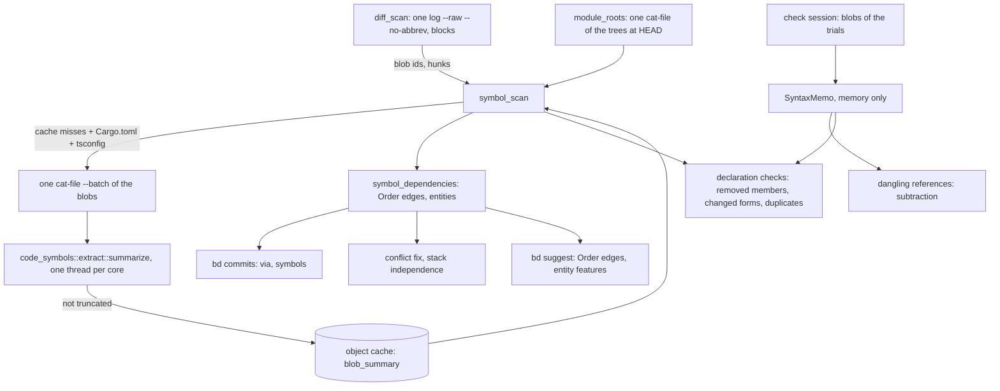

# Symbol Dependencies

**Status:** Implemented (`branchdeck.symbols on` by default)
**Updated:** 2026-10-18
**Tags:** [dependencies, tree-sitter, bd, check, suggest, conflict-fix]

## Problem

Branch Deck decides that commits belong together, or that one branch must stack on another, from text: a commit
depends on an older one when its hunks touch the lines that commit added (`dependencies.rs`), clusters are scored by
issue keys, scopes and shared paths (`bd suggest`), and the dangling-reference check finds the uses of a removed
declaration by per-language regular expressions. git's three-way merge is the only exact oracle, and it sees lines,
not names: a commit that calls a function another commit added in another file merges cleanly into a branch without
it, and the branch fails only when it is compiled.

The regular expressions also see too much. Regrouping 217 commits of the IntelliJ checkout (2026-10-17), the check
reported a Rust `pub(crate) use …::ControlOwner` as the removal of `ControlOwner` (four false uses), a word in a KDoc
comment as a use of a removed member, and a local `val turnId` as a use of a private property of another class. The
false references became repair edges of `bd suggest`, closed a cycle, and stacked a branch on the wrong parent; a
proposed `bd move-hunk` would have broken a branch.

## Solution Overview

`crates/code-symbols` summarizes one source file on tree-sitter (Kotlin, Java, Rust, TypeScript and JavaScript): its
package, its imports (Rust `use` and `pub use`, Kotlin aliases, TypeScript imports and re-exports), its declarations
with their containers and reach, and its references, without comments, strings (but with interpolations), locally
bound names, labels and keys. Of Kotlin and Java it also holds the parameter types of each function, whether a member
overrides and whether a subtype may override it, the supertypes of each type and the constructors of each class, per
`override` member one reference to the member it overrides in each supertype of the class around it, and per call,
`new` and constructor invocation of a supertype the shape of its arguments (named, spread, a text, a number, a
boolean, a lambda or another expression) and whether a Kotlin lambda, an object expression or an anonymous class
around it may bring a receiver of its own. A summary depends only on the bytes of the blob, so it is cached by blob id.

Two consumers use the summaries. The dangling-reference check keeps finding candidate lines and only subtracts the
ones the tree places in a comment, a string or a local scope, the name of an `override` member, and the names an
import still binds; beside it, the checks of a branch's tree (decision 15) find by the summaries alone the uses of an
instance member a branch removes, the uses a branch's change of a form may break (`suspend`, a new parameter, a
narrower reach) and a declaration a branch adds that its tree already has. `symbol_dependencies` adds edges of a new class, `Order`, to the line dependencies: a commit uses a
declaration another commit of the range adds or gives a new form, with evidence that the use means it. Of a Kotlin or
Java type a declaration is each overload and each constructor, so an override, a call that its arguments select and a
use that only a new form accepts (a wider reach, `open`, a default, a new or renamed parameter, a type made public)
need the commit of that overload or form.

## Design

### Architecture

### Key Decisions

1. **Decision**: an edge by symbols is of its own class, `Order`, not a line dependency.
   **Rationale**: a line dependency means the two commits can't be cherry-picked apart without a conflict, and a
   trial build refutes a wrong one. A symbol dependency means the later commit doesn't compile without the earlier
   one; a stack or the order of two Safe Pushes satisfies it, and `merge-tree` can never refute it. Joining units by
   it would fuse every issue that uses a shared helper into one branch.

2. **Decision**: the index is the declarations the range adds or changes, not the repository.
   **Rationale**: only those can make one commit of the range need another, and they are a few hundred even in a
   monorepo of 1.4 million files; no build, no language server and no index of the tree is needed. A member key a
   commit changes brings the overloads its file had before the range along (decision 7).

3. **Decision**: a use links only with evidence: an import or alias, a qualified name, the same file, the same Rust
   module, a wildcard import or the same package and module for a type, an override in a subtype whose supertype
   resolves (`override`, decision 8), a call in a subclass of a member its supertype has (`inherited`, decision 12), a
   use on a receiver of the member's type (`receiver`, decision 13), or a Java use through the class of a Kotlin file
   (`facade`, decision 14). In the same file a name that a type other than the declaration's own qualifies
   (`Registry.register(id)` in a `register` of the file) means that type's member, not the file's; a type by its
   capital, the convention of every language here, unless the file declares a value of that name (`DEFAULT.register(id)`
   of a `val DEFAULT`, an `INSTANCE`, an enum constant). A name in capitals that the file only imports counts as a type
   (`JBUI`, or a constant): an import doesn't say which it is. A Kotlin extension of the file is a use only by a bare
   name, `this`, `super` or its receiver's type (`AirAuthoredScope::openGlobalPrompt`), of every key, one the range adds
   too (`on_unknown_receiver`): a call on a local, an expression or another name (`prompt.openGlobalPrompt()` on a
   `val prompt = AirComposerInIdeDriver(…)` beside a `fun AirAuthoredScope.openGlobalPrompt()`) is none. A private
   member is a use only where the compiler lets the file see it (`private_scope`): in Java the whole top-level class,
   nested classes included, for a qualified use (`Inner.helper()`), but its own type for a bare name, `this.name` or
   `super.name`, which outside it mean a member of the class around it, an inherited one or a static import; in Kotlin
   its own type, and the class around a companion for the companion's (`private const val TAG`). A static member is
   named by the path of its type (`static_paths`): in full (`a.b.Owner.create()`), or from its head, which an import
   binds (an alias, a nested type: `import a.b.Owner.Factory` and `Factory.create()`) or, without an import of its name,
   the same package does when the file declares nothing of it. A member of a Kotlin companion without a name of its own
   is a member of the class around it too (`Owner.create()` beside `Owner.Companion.create()`), from Java only a
   `@JvmStatic` function or a `const val` (`Owner.create()`, `import static a.b.Owner.create`), and Java calls a
   function of a Kotlin object through its `INSTANCE` (`Registry.INSTANCE.register()`), by the top-level object itself
   only a `@JvmStatic` one (`Registry.register()`). A companion with a name of its own is named only by its path
   (`Owner.Factory.create()` of a `companion object Factory`).
   **Rationale**: a Kotlin call without a qualifier may mean an implicit receiver's member, an extension or a function
   of the package; only a compiler knows. The JVM has the members of a companion as instance methods of its class, and
   on the class around it only a `@JvmStatic` method or a `const` (or `@JvmField`, which the summary doesn't read)
   field, so Java's `Owner.plain()` of any other doesn't compile. The summary doesn't tell a companion with a name of
   its own from a nested object (decision 10), whose members the class around it doesn't have, and a nested type is no
   name of its package: `Nested.create()` in another file of it means a type the file imports or, in Java, inherits. A
   nested type of the head's name that a class around the use inherits from a supertype
   (`class B : Base() { fun f() = Owner.create() }` beside a `Base.Owner`) takes the name first, which the file doesn't
   show: a limit. Java has a property of an object or a companion by its getter, and the summary doesn't read
   `@JvmField`, so a Java use of a property by its name links to none. A call of an extension on a value means a member
   of the value's type first, since a member always wins over an extension, and only a compiler knows that type: the
   summary drops locals and has no types of expressions. A bare name or `this` keeps the evidence of the file, as for
   every declaration of it (`with(scope) { openGlobalPrompt() }`, another extension of the receiver). A wrong hard edge
   costs more than a missed one, which the trial build and `--build` still catch.

4. **Decision**: the line search of the dangling-reference check subtracts by the tree and adds nothing; what the lines
   can't find (an instance member, a changed form, a second declaration) the checks of decision 15 find by the trees
   alone, with the evidence of the edges.
   **Rationale**: its recall comes from matching names in any position (a Kotlin extension call, a Java accessor); the
   tree is good at saying what is not a use (a comment, a string, a local), and bad at saying everything that is. A name
   that is everywhere (`cleanup` of an instance member) has no candidate lines worth reading, only uses that resolve.

5. **Decision**: a table-driven walk of the tree, not tree-sitter queries.
   **Rationale**: shadowing needs a walk of the scopes anyway, the shipped `tags.scm` files are too thin, and a test
   checks every node kind of the tables against the grammar, so a grammar upgrade can't silently break a rule.

6. **Decision**: `tree-sitter-kotlin-sg`, and one TSX grammar for TypeScript and JavaScript.
   **Rationale**: the maintained Kotlin grammar (the fwcd main, republished by ast-grep); `-ng` is dormant and parses
   far worse, and both export the same C symbol. TSX parses TypeScript and JavaScript but `<T>expr` casts, which make
   a file degraded and send it back to the lines; one grammar less is about 1 MB of binary. The highlighting of the
   diffs (`code_symbols::highlight`, [Diff View](diff-view.md#syntax-highlighting)) reads `.ts`, `.mts` and `.cts` by
   the TypeScript grammar of the same crate: a generic arrow or a cast there is an error under TSX, and a colour that
   changes at it is visible.

7. **Decision**: the key (namespace, containers and name) of a JVM type or a member of one holds entries, not one
   declaration. An entry is one declaration of the key, an overload of a member or a constructor of a type (decision
   11); its identity is the kind, the extension receiver and the parameter types (the last names of each type, `?`
   kept, and the dimensions of an array, a vararg counted as one). Its origin is the baseline, or the commit that
   created it or changed its form (decision 10), with the entries that commit removed as its predecessors: one removed
   and one added is the same entry in a new form, and a change of its body alone keeps its origin. A use that tells the
   entries apart (an override, decision 8; a call by its arguments, decision 9; an import of a member of a type without
   a supertype but `Any` or `Object`, decision 10) looks at the entries that accept it at its commit; for each, the
   latest step back along its predecessors at which no form before accepted the use and the form after did is the step
   it needs (`steps_of`). A step needs its own commit and, back along the forms of its entry, those of the steps whose
   form it changed, to the one that created the entry (`lineage`). The use links to the newest commit before its own
   that every entry it may mean needs: none (the baseline), or two entries that need no commit in common, is no edge.
   Entries get steps only on clean sides. On any other commit the key is only present or absent: a side is degraded, a
   declaration of the key is in a parse error (`in_error`), two declarations of one side are the same entry
   (`stamp(java.sql.Date)` beside `stamp(java.util.Date)`, two constructors too), or one side knows the type's
   constructors and the other doesn't. A top-level function or property, as every key of Rust and TypeScript, is only
   present or absent, with the entries of each file of the range that adds it, which follow their declarations: a
   commit that edits or renames the file gives them the declarations of their key there, and one that moves the
   declaration to another file those of that file, each entry with its origin to a declaration of its identity, else
   to one of an identity none of them has (a changed signature); a declaration left over is as old as the oldest of
   them, and an entry left over keeps its form there. Where the parser can't read those declarations (a degraded file,
   a parse error in the declaration or one that swallows it), the entries keep their forms and origins in the file the
   commit renames or moves them to, until a commit reads it again. A removal drops the entries of its file (of a type
   or a member the whole key, the functions of its name aside).
   **Rationale**: a new overload of a name its type already declares, `buttons(paneId: String)` beside
   `buttons(window: Window)`, is the declaration an override needs (the Safe Push of IJAI-4074 that failed on
   2026-10-17), but a key of the name alone sees it on both sides of the file, so it is neither added nor looked up.
   Only a JVM type and its members have entries: all their overloads, and all the constructors of the type, are in the
   file of the type, which the commit that changes them changes too, as a package has one type of a name. A top-level
   function may have overloads in files the range doesn't change, so a call of an overload that two files of the range
   add is ambiguous, and the removal of an overload of the baseline keeps those that other files of the range add. A
   move must not change that: one origin for all the entries a commit moves into one file would make the call of
   either an edge to the commit of the first. An entry left on a path that no longer declares its key outlives the
   removal from its new file, and a later call of the name would link to the commit of a function that is gone.
   "Accepts" errs on purpose toward accepting where a wrong match only adds an origin (decision 8 says where for an
   override): a form that accepts a use it in fact rejects takes the step further back, or keeps an old overload a
   candidate, toward no edge, while a wrong rejection makes one. A new form changes a declaration that a commit before
   it made, so a step needs that commit too: `Registry.place(id)` that `place(id: String)` and
   `place(id: Int, flag: Boolean)` of one commit accept, the second once a later commit gives `flag` a default, needs
   the first commit whichever it means, and `Registry.place(flag = true)`, which only the default its own commit gives
   `id` accepts, needs the commit that added `flag`. A declaration the parser recovered around, or a degraded file, may
   be misread, and a misread form would look new; twins can't be matched across the sides. The entries keep their forms
   then, but a type loses the constructors the range gave it, which may miss what the commit gave them (a parameter
   that comes with the parse error), and takes any call with its own steps; an overload of a member keeps its entries,
   as a use of an overload that such a commit adds may not need the commit that added another. A use that its own
   commit's declarations may mean is no edge either: without that rule, a use that a type of its own commit shadows
   would link to a wildcard import. A bare name outside the type of a member its own commit adds or changes is no use
   of that member, though: only an implicit receiver, which the file doesn't show, makes it one, and counting it would
   cost the edge of the function of that name the file imports.

8. **Decision**: a Kotlin `override` or Java `@Override` member is a use, `override`, of the member it overrides in a
   supertype of the class around it: a subclass, an object expression, an anonymous class, an enum entry's body.
   **Rationale**: an override of nothing doesn't compile, so a resolved supertype is evidence as strong as `Type.member`
   with a resolved type. The member must be an instance member a subtype may override (`open`, `abstract` or of an
   interface, never `final` or private) with the same receiver and parameter types, must not be one every class has from
   `Any` or `Object` (`equals`, `hashCode`, `toString`, `clone`, `finalize`), and must override nothing itself: an
   override of an override compiles without the commit that adds it, because the supertype of its type has the member.
   Where the member's type has no supertypes, the override must mean one of its members, each overload of which is an
   entry, so the parameter types match generously (a type parameter fits any type, two types of the same last names are
   the same): a wrong match only adds an origin, which costs an edge and never adds one. Where it has supertypes, whose
   members are unknown, only the same form counts: every type known, each name resolved by its file's imports, its own
   types or its package to the same type. Two names neither file resolves are the same when equal only in one package,
   or when they are of the common default imports (`String`, `int`, `StringBuilder`, `IllegalStateException`, Kotlin's
   `HashMap`; a list of the types a project rarely names anew, so `Module` or `Result` is left out): in two packages
   each may mean a type of its own package or of a wildcard import, also when both files have the same wildcard import,
   so such a name is unknown and the override is no edge. The supertype resolves by the same file, its full path, an
   import (an alias, a nested type) or the same package in the same module without a type of that name in the file,
   never by a wildcard import, and its path must be the containers of the member. A type of the name nested in a
   declaration around the override (`Outer.Base` inside `Outer`) may be the one it means, and so may, in Java, a member
   type that a class around the overriding class inherits: no edge. Kotlin also reaches the nested classes of a
   supertype by their names; that is left out, because an object expression in a class with supertypes is everywhere and
   such a shadow is rare. A class with several supertypes, a function type among them, is no edge: its member may come
   from any, and the members of a type outside the range are unknown. Nor is an override of a Java method whose class
   has supertypes: that method may itself override one without `@Override`. An override in a one-line object expression,
   which the grammar reads as a call with a trailing lambda, or in a declaration the grammar misread overrides nothing
   of the class around it. An override that an earlier commit removed is a removed use: the commit that then removes the
   member it overrides depends on that one (`removes_after`).

9. **Decision**: a call of a member is judged by its arguments where they tell the overloads apart (`accepts_call`).
   An entry accepts a call whose positional arguments fill its parameters in order (a vararg, the last, the rest),
   whose named ones fill parameters of their names, whose last lambda fills the last parameter or its place, and whose
   parameters left have a default or are a vararg; a text, a number or a boolean fits no parameter of another of these
   families (`String` and `CharSequence`, the number types and `Number`, `Boolean`) and no class, interface, object or
   enum that the member's file declares and doesn't shadow by an import of its name. A spread, a named argument before
   a positional one, a vararg before the last parameter and an entry without a signature (a type, a property) accept
   any call. The arguments tell the overloads apart only of a type without a supertype but `Any` or `Object`
   (`all_entries`), not for a name every class has (`toString`), and not for a bare name that an import brings in when
   its file shows something that may take it first (`import_decides`): an enclosed call (in a Kotlin lambda or
   anonymous function, an object expression, an anonymous class or a local declaration, which the summary marks), a
   declaration of its name in the file, another import that may bring the name (a second one of it, a wildcard
   import, in Kotlin a function of the default imports), or a type or a Kotlin extension around it with a supertype or
   a receiver of its own. A use that tells no overloads apart (a type, a value, a call of a type with a supertype)
   needs the oldest step of the entries that accept it: for a function the commit that added the key, and none when
   one entry is of the baseline; for a value or a type the step whose reach let it in (decision 10). In the file of a
   key of the baseline a use means it only where it can mean only a member of its type (`means_its_type`): a bare
   name, `this` or `super` whose innermost type is that type, not in an enclosed call nor in a Kotlin member extension
   (a function, or an accessor of a property, with a receiver of its own), and in Kotlin without a function or value
   of its name in the receivers further out (a type around it, the companion of one) or at the top level of the file,
   without a supertype of any of these receivers, and without a function of another file that the file may bring in
   by the name: an import of the name, a wildcard import, or a function of the default imports
   (`is_default_function`, the common ones: `error`, `require`, `println`, `listOf`, `let`). A top-level type of the
   baseline is meant in its file by a bare name, not in an enclosed call, that no other declaration of the file has (a
   factory beside it) and, in Kotlin, no import may bring. A key the range adds keeps the same file as evidence
   anywhere in it (a bare call in an extension of its type at the top level).
   **Rationale**: only a literal judges a type, and only against a family no compiler converts it across (Java widens
   an `int` to a `double`, so a number fits every number type) or a class of the member's file, which a literal never
   is: `buttons("x")` selects `buttons(paneId: String)`, not `buttons(window: Window)` with `Window` of the same file.
   A supertype may declare overloads that the range doesn't show (`Base.buttons(Long)` takes `buttons(1)`), and every
   class has those of `Any` or `Object`, so such a call needs only the key: the call of a name with an overload of the
   baseline is no edge, and a call of a name whose overloads two commits of the range add needs the first. Where the
   arguments decide, a call that the overloads of two commits both accept is no edge, where the key alone would link it
   to the first. Once a call can select a new overload of a key of the baseline, a use in its file that means a member
   of another receiver would link to it, `list.add(0, item)` of a `MutableList` beside a new `Lanes.add(index, item)`,
   and so would `buildList { add(0, item) }` in the type, whose lambda's receiver is the list, an `add(0, item)` in an
   object expression or a Java double-brace initializer that extends `ArrayList`, or in a member extension
   `fun MutableList<String>.fill()` of the type, whose extension receiver comes before the type, or a `foo(1)` in a
   Kotlin inner class whose old `foo(x: String)` rejects it, which Kotlin then gives to the outer class's
   `foo(x: Int)`. Past the receivers Kotlin falls back to the top level: the functions the file declares or imports by
   name, those of its package, of its wildcard imports and of the default imports, so `error("boom")` beside an old
   member `error(code: Int)` is `kotlin.error`, and `add(0, "x")` in a file with `import q.add` is that one. So such
   a key takes a use of its file only where nothing can come before its type: no receiver the summary doesn't show (an
   enclosed call, a member extension) and no other declaration of the name, import or supertype that the call falls
   back to. The same holds for a bare name an import brings in: a method `add(int)` the class inherits from `Base`
   comes before `import static p.Util.add` (JLS 6.4.1), a member of a Kotlin implicit receiver before an import, and
   Java weighs every static import of a name together (`import static p.Util.add` shadows the `add` of
   `import static q.Other.*` only for the same signature, so `Other.add(int)` takes `add(1)`), while Kotlin falls back
   from the import to the wildcard and the default imports. A wildcard import counts in either language, as the
   summary doesn't mark a static one. What the range doesn't show stays a limit: an extension of the member's type
   declared elsewhere (`fun Registry.register(id: Int)`) takes a call that the old member overloads reject, and so does
   a top-level function of the package in another file for a bare name, or a function of the default imports that the
   list leaves out, so such a call links to a new overload it doesn't need.

10. **Decision**: the form of an entry is the names of its parameters, their defaults and varargs, its reach, whether a
    subtype may override it and whether it is `@JvmStatic` (`same_form`); a commit that keeps the identity of an entry
    and changes its form makes a step of it, with the old form as its predecessor. An older form is judged by the
    attributes of its form as they were and by the rest as the entry is now (`older_form`): whether it is static and
    whether it overrides; an older form whose type had supertypes then and has none now, or the other way round,
    accepts. It is never stricter than the compiler (`Site.older`): a private one reaches the class around a nested
    Kotlin object or class, and in Java the whole top-level class for a bare name too; an `internal` one reaches a file
    whose module no build file tells. An older form judges a use only where nothing the range doesn't show may take it
    instead: a call that its arguments judge (decision 9), an override, an import of a member of a type without a
    supertype but `Any` or `Object`, which links only when all its entries need one commit, and a use of a value or a
    type; any other use of a function needs only the key. Top-level functions and properties have no forms.
    **Rationale**: a changed form is an addition for the uses that didn't compile before, as the incremental builds of
    IntelliJ count it (`KotlinMeta` of the JPS dependency graph lists visibility, modality, parameter names and defaults
    among what changes the API of a source): `private fun helper()` made `@VisibleForTesting internal` for a test of
    another file, `fun` made `open` for an override, a default for a call that leaves the argument out, a Java array
    made a vararg for a call that passes the elements, a renamed parameter for a call by its new name, `@JvmStatic` for
    a Java call of a member of a companion by the class around it (`Owner.create()`); the other uses compile with the
    older form and need no commit. An older form's rejection is what makes the edge, so it must follow the compiler or
    be more generous. The summary doesn't tell a companion with a name of its own from a nested object or class, whose
    private members the class around doesn't see: the current form of such a member is of its own type (decision 3), but
    an older form reaches the class around it too. A Java older form reaches the whole top-level class for a bare name
    too, which the current form reaches only by a qualifier, and an `internal` older form a file whose module
    `module_roots` doesn't know, as the compiler may see one module. The form leaves out what rejects a use that
    compiles all the same: `Outer.Inner` names an inner class as a type, which no qualified use of an instance member
    resolves, so an inner class made a public nested one is judged by its reach, and an override of an override compiles
    without the member; an override judges a member by the supertypes of its type, and a Java method may override
    without `@Override`. A use of a function that its arguments don't judge (a call of a type with a supertype, of a
    name of `Any`, or of a bare name an import brings in that its file may take first, an import of a member of a type
    with a supertype) may mean an overload the range doesn't show while the member of its name is private
    (`Base.helper(id: Any)` takes `Panes.helper("x")`), so only the key decides it. An import of a member of a type
    without one names all its overloads, the entries, and compiles only when one of them is visible (JLS 7.5.3 for
    `import static`; Kotlin rejects an import of a private member of an object). A value or a type hides the
    declarations of its name in the supertypes, so the step decides its use. What the range doesn't show stays a limit
    here too: an extension `fun Panes.helper(id: String)` or `val Panes.size` of another file takes the use while the
    member is private (Kotlin prefers an extension it can see to a member it can't), so the use links to the commit that
    widens the member. Other files of the package may declare overloads of a top-level function, or a private property
    of its name (a private one is of its file), that the range doesn't show, so a changed form of one is no addition of
    its key.

11. **Decision**: the key of a JVM type holds the type itself and an entry per constructor, the implicit `()` included
    (`with_constructors`). A call of the type, a Kotlin constructor invocation of a supertype, Java's `new` and the
    `this(…)` and `super(…)` of a constructor included, means a constructor; a type position, an import and any other
    use mean the type itself, whose origin a constructor doesn't change (`takes`). A constructor's form is its
    parameters, its reach and the reach of its type, which a call needs both of. The arguments tell the constructors
    apart also of a type with supertypes (`constructors_tell_apart`): of Java's `new` where its file declares nothing
    else of the name (a nested type of it), and of a Kotlin call of a bare name where its file declares nothing else of
    the name and no other import (a wildcard beside the import of the type) may bring one (`names_only_its_type`); else
    the call needs the key, its older forms accepting as a function's. The type itself takes the call too, with its own
    steps, where its file declares an `invoke` of its companion that accepts the arguments (`invokes`), where it has no
    constructors (an interface, an object, an enum) and where a parse error in the class makes them unknown. A top-level
    function or property of the name of a type, a factory beside its class, shares the key as entries of its own kind
    (`KeyState`), only present or absent per file, also in the file of the type: a commit that adds, changes or removes
    one of the two kinds keeps the other's entries. A factory takes no type position, and a call only when its
    parameters accept it, judged by the arguments that tell the constructors apart: a call that a constructor and the
    factory accept needs what both need, and one that only the factory accepts its commit. The type stands for each
    factory that the use sees, with the factory's commit (`sees_function`): by an import, its qualified name or its
    file, or as one of the package in the use's module that its reach lets in; never a private one of another file, one
    of another module or language, nor any for a Java `new`. A use through a wildcard import needs the type as it came,
    its oldest step, never a constructor or a form of a type of the baseline. Two constructors that the summary can't
    tell apart (`Stamp(java.util.Date)` beside `Stamp(java.sql.Date)`, `Box(value: T)` beside `Box(list: List<T>)`) are
    twins as overloads are, and only the canonical constructor of a record, compact or declared again with its
    components, replaces the one of its header. A constructor that a later commit on clean sides finds after an unclean
    one (decision 7) is as old as the type (`oldest_step`). Java sees an `internal` Kotlin type and its constructors
    from any module, and an `internal` constructor reaches a file or a use of no known module as its type does.
    `this(…)` calls the class around the constructor; Java's `super(…)` the type of `extends`, none without it; Kotlin's
    `super(…)` the supertype of a class without a primary constructor only where it is the class's one supertype and is
    named without arguments or a delegate (`: Base`).
    **Rationale**: a new parameter, a new constructor or an explicit one in place of the implicit `()` is what a call
    needs that only that form accepts (the test of IJAI-4074, `object : ToolWindowManagerImpl(project, isNewUi = false,
    isEdtRequired = false, …)`, needs the commit that adds `isEdtRequired`). A Kotlin implicit `()` is public whatever
    its class, so only the type's reach makes `Lane()` of an `internal class Lane` made public a step. Constructors are
    not inherited, so no supertype declares more of them, which the overloads of a member can't say. Java's `new` means
    a constructor of the type its name resolves to, while a Kotlin call of a type falls back from its constructors to
    the functions of its name (a factory `fun Lane(id: Int, flag: Boolean)`); a constructor invocation of a supertype
    doesn't, but the summary doesn't tell it from a call. A member of a receiver of the name (a capitalized function, a
    nested class of a supertype) is left out, as decision 8 leaves out the nested classes of a supertype: a type and a
    function are rarely named alike but for a factory, which is top-level. The summary ties an `invoke` of the companion
    to no commit of its own, so the type stands for it. A function of the name in a file of the package that the range
    doesn't change, which needs no import, and an `invoke` of the companion declared in another file may take such a
    call too: a limit. No evidence links a factory of another file of the package, so the type stands for one the range
    adds, which keeps the edge of a call of a new type that no constructor accepts; one that the use can't see (a
    `private fun Lane(name: String)` of another file, a factory of a fixtures module of the same package) would make a
    call that a constructor accepts ambiguous. A type of the baseline that the range doesn't change is no entry, so a
    call that only such a factory accepts is no edge: a limit. A wildcard import brings a type only where no type of its
    name in the package of the use takes the name first, which another file of that package may declare (`q.Pane` beside
    `import p.*`). The JVM has an `internal` Kotlin type and its constructors public under their own names, so their
    `internal` older forms reject no Java use; an `internal` constructor of a file or a use of no known module reaches
    it as its type does, where an `internal` member wouldn't, since the type takes no call for it. A delegation call
    names no type: `this` is the class around it, and Java's `extends` names one class among the interfaces, but the
    summary doesn't tell a Kotlin class from an interface, so beside a second supertype `super(…)` may call either, and
    with an interface only it calls `Any()`; with one supertype a wrong match only adds the type's commits, which the
    supertype's own reference in the header already brings.

12. **Decision**: a call in a subclass, by a bare name, `this.name` or `super.name`, of a member its supertype has is a
    use of it, `inherited` (`inherited`), when the class has exactly one supertype, which is not `Any` or `Object` and
    resolves to the type of the member as an override's does (`supertype_resolves`, decision 8). The member must be an
    instance function that overrides nothing, no extension (a member extension of the supertype takes no bare call of a
    plain member), not one every class has (`ROOT_MEMBERS`), and of a type without supertypes, in Kotlin as in Java.
    Nothing else of the file may take the name: the call is not enclosed (a lambda, an object expression, an anonymous
    class, a local declaration) nor in a member extension, the file declares nothing of the name (a member of the class,
    of a class or companion around it, a function of the file), no import may bring it (`imports_of_function`, a
    wildcard import and Kotlin's default imports included), and no receiver further out (`receivers`: a class around it,
    a companion) has a supertype of its own. The arguments tell its overloads apart (`calls_tell_apart`), as for a
    qualified call (decision 9). A type of the supertype's name nested in a declaration around the use wins over its
    import (`nested_shadows`), for an override too, and in Java the class around the override or call is the innermost
    type, so an override in an anonymous class of the supertype inside a subclass is one (`scope_may_shadow`).
    **Rationale**: a bare call in a class means a member of the class first, its inherited ones included, and a class of
    one resolved supertype inherits that supertype's members; this is the same evidence as an override's. A member of
    the supertype's own supertype is no member the range shows on that path, and an override, or a Java method that may
    be one, compiles the call with the member of the type above: no commit is needed. What may take the name before the
    inherited member, or took it before the member came, makes the edge false: a member or a function of the file, an
    import (Java's inherited method shadows a static import, JLS 6.4.1, but the call compiled with the import before the
    commit), a receiver of a lambda or of a member extension, and a receiver further out whose supertypes the file
    doesn't show: Java compiled the call through `Outer.this` before the member came (JLS 15.12.1), and Kotlin falls
    back to the outer receivers when the members of the class reject a call. A supertype of the member's type may have
    an overload of the name that the range doesn't show (`Disposable.fresh(Int)` takes `fresh(1)`), in Kotlin as a Java
    method may override without `@Override`, and the rule gained no link on the measured range either way: no edge for
    such a member. A function of the package in another file, which Kotlin falls back to past the receivers, a call
    where no `this` exists (the argument of a supertype initializer, `class Sub : Base(open(1))`, a default of a
    primary-constructor parameter) and a Kotlin `context(…)` receiver, which the summary doesn't read, stay a limit.

13. **Decision**: a use of an instance member on a receiver of its type is a use of it, `receiver` (`through_receiver`).
    The summary knows the type of a receiver (`Reference::receiver_type`) that a name is in full (`m.foo()`, `m?.foo()`,
    `m!!.foo()`): a parameter, a local or a typed lambda parameter by its declared type, without type arguments, else by
    the type its initializer constructs (a call of a capitalized name, Kotlin's `Manager(…)`, Java's `new Manager(…)`
    without a body, `var` included); and a property or field of a class around the use (`m`, `this.m`, by its
    `Declaration::value_type`), not in an enclosed use, the innermost class first, not past a class with a supertype, a
    nested class that isn't inner, a companion or an extension function or property of another receiver, and only of the
    innermost class, with no extension between, for `this.m`. A parameter of a primary constructor has its type in the
    initializers of the class only (`init`, a property initializer), not in a function or an accessor, where its name
    means a property. A type parameter, a function type, a vararg, a delegate, a destructuring declaration and any other
    expression give none, and so does a name that its scope or function casts (Kotlin `is`, `!is`, `as`, a `when`
    subject with an `is` branch, Java `instanceof` and casts; not `in`). The type resolves to the member's type as a
    supertype does (`supertype_resolves`). The bare call or `this.name()` in an extension function, not enclosed, means
    a member of its extension receiver when nothing else of the file may take the name, no receiver further out has
    supertypes and the member's type has none (`implicit_receiver`). The member must override nothing and not be one
    every class has; a Java one only of a type without supertypes; a Kotlin one of a type with supertypes needs only its
    key, and none then with a declaration of the name in the file, an import that may bring it, or a call that the
    entry's parameters reject (an overload of the supertype may take it). A type that a constructor call gave
    (`Reference::receiver_constructed`) gives no evidence where its file declares an `invoke` of its companion or a
    top-level function of its name; a declared type keeps it. An extension of the receiver's type of the name that the
    use sees (its package, an import of its name, a wildcard import of its package) makes the use no evidence
    (`sees_extension`). In the file of the member a use on a receiver of another type is no use of it
    (`of_another_receiver`), unless that type is a subtype of the file whose supertype names the member's type.
    **Rationale**: a member call on a value means a member of the value's static type first, and that type is what a
    parameter, a local or a property declares; the round 3 measurement found every use of a changed form on such a
    receiver. Only a compiler infers the type of an expression, and a smart cast narrows a name to a subtype whose
    members the range doesn't show, so the summary keeps no type for either; a capitalized call may be a factory of
    another type, which the file of the type may show (`constructed_otherwise`). A property of the name inherited from a
    supertype, a nested class or a companion of the class around the use take the name before a property further out. A
    member the receiver's type inherits is no member of that type on the path the range shows; an override compiles the
    use with the member it overrides. A Kotlin extension on a typed receiver is not linked by its receiver: a member of
    the type takes the call first (decision 3), and only a file of the type in the range would show that member. The
    bare calls in the extension functions of the generated test bodies (`step`, `call` of `AirAuthoredScope`) mean the
    members of their receiver as a `this.` would. A same-file use whose receiver has another type means that type's
    member: `migration.awaitMigrated()` beside the class's own `awaitMigrated`. The summary judges the arguments of a
    call generously (decision 7), so a member may seem to accept a call that an extension of its type takes
    (`chat.send(claim, key, text)` beside a member `send(text: String, …)` and a
    `fun AirAgentChatInIdeDriver.send(session, key, text)` of the package, false links of the first measurement); an
    extension in a file the range doesn't change stays a limit, as for a qualified call (decision 9). Limits: Kotlin
    narrows a `var` by an assignment and a name by a contract (`requireNotNull`, `check(m is Sub)` in a called function)
    beyond the casts the summary reads, and a `this is Sub` in an extension function narrows its implicit receiver,
    which `implicit_receiver` doesn't check.

14. **Decision**: Java and Kotlin name each other's declarations as the JVM does: a Java call of an accessor of a Kotlin
    property is a use of the property (`m.getSize()`, `m.setLabel(text)`, `m.isReady()` of `isReady`), a Kotlin property
    access on a receiver is a use of a Java getter (`m.count` of `getCount()`), each by the rules of its receiver,
    inheritance or static path (decisions 3, 12 and 13: `Owner.getSize()` of a `@JvmStatic` property of a companion,
    `Owner.Companion.getCount()`, `Registry.INSTANCE.getName()`, `UtilKt.getName()` of a top-level property), and a Java
    use of a top-level Kotlin function, `const` or `@JvmField` property through the class of its file is `facade`
    (`through_facade`): `UtilKt.helper()` with the class imported or of the package, `a.UtilKt.helper()`, or a bare
    `helper()` that `import static a.UtilKt.helper` or `a.UtilKt.*` brings in where the file shows nothing that comes
    first (`import_decides`). The class is the file's `@file:JvmName`, else its name with a capital and `Kt`, and `_`
    before a digit (`_1utilKt` of `1util.kt`); a script (`.kts`) has none (`facade_of`). The keys stay the declarations'
    own: a use looks its accessor names up (`accessor_names`) only when its own name finds nothing, and an accessor
    matches only a property that has it (`accessor_fits`): not an extension property, a `@JvmField` or `const` one,
    which Java sees as a field of its name (of the class around a companion only), nor one that `@get:JvmName` or
    `@set:JvmName` renames, nor a private one or an `internal` member, whose accessors Java names by a mangled name (an
    `internal` top-level one keeps its name), nor one beside a function of the accessor's name; a getter with no
    argument, a setter with one of a `var` whose setter Java sees (not `private set`); on the Kotlin side a Java
    instance method without parameters beside no field of the property's name, which Kotlin reads first. The `is` names
    are the property's own (`isReady()` of `isReady`, `setReady(…)` of it, never `getIsReady()`), as Kotlin names only a
    property that starts with `is` and a capital so (`issue` has `getIssue()`), and a direct Java call of a Kotlin
    property by its own name passes the same checks of a getter (`java_sees`). A Java use of a declaration that
    `@JvmName` renames, or that `@JvmSynthetic` hides, is none, and Java reads a Kotlin property as a field only where
    it has one (`@JvmField`, `lateinit`); a `@JvmMultifileClass` file shares the facade its `@file:JvmName` names.
    **Rationale**: Java sees a Kotlin property only through its accessors and a top-level declaration only through the
    class of its file, and Kotlin sees a Java getter as a property, so without these names a Java use of Kotlin code
    links to nothing. The name of an accessor is the property's with a capital and `get`, `set` (`is` for a property
    named `isX`), so it tells the property apart, but a renamed accessor (`@JvmName`) or a field (`@JvmField`, `const`)
    has no accessor of that name: such a use is of something else. Limits: a renamed accessor by its new name, and a
    Kotlin write `m.name = v` of a Java setter, which the summary doesn't tell from a read, are not linked.

15. **Decision**: the checks of a branch's tree by the summaries (`declaration_checks.rs`) report what the branch
    removes, changes or declares again, with the oracle of the dangling-reference check: HEAD compiles, and the
    branch's tree differs from it only in the paths of the other branches' commits. A use there that HEAD's tree lacks
    may not compile, and `fixed_by` is the commit outside the branch, older or newer, whose change of the path removes
    it; a proven one is a dangling reference of its own `kind`, repaired by the same edge in `bd suggest`. Three kinds,
    each counted per path like the lines (more such uses in the branch's tree than in HEAD's):
    - `removed`: an instance or static member of a JVM type, or an enum entry, that a commit removes with all its
      overloads and whose key (its type and name) no commit of the tree declares again, used where a use resolves to
      it (a receiver of its type, `this`, an override, an inherited call, its static path; in its own file only inside
      its type). The lines search the top-level declarations, and a use by a bare name of an instance member is no
      evidence.
    - `changed`: a Kotlin or Java function, property or constant whose header (`Declaration::header`), parameters
      (their names, defaults, varargs and types with `?`), reach, modality, `@JvmStatic`, `@JvmField` or `@JvmName` a
      commit changes, a type whose constructors it changes, or a key of which it removes an overload while another
      stays, its name kept. A use counts where the old form takes it (it resolves, and its call fits, `accepts_call`)
      and no declaration of the key in the branch's tree does by the same rules; of those that take it, the header
      decides as a token diff (`header_fit`): a changed extension receiver breaks it, an added `suspend` breaks it
      outside a coroutine (`Reference::coroutine`: a non-suspend function, an initializer, an accessor, the lambda of
      `sequence`, Java) and fits it inside one (a `suspend` function, the lambda of `runBlocking`, `launch`, `async`,
      `withContext`, `coroutineScope`, `flow`, …), `var` for `val`, `const`, `operator`, `infix`, an explicit type of a
      property and Java's `throws` fit, and anything else (a return type, nullability, type parameters, `suspend` in
      the lambda of another function) may break it: such a reference is `possible`, a warning with its `fixed_by` and
      no repair edge. A use the branch's own commits wrote is written against the new form: the lines of their hunks,
      followed through the later ones, where they lead from the base to the branch's blob, else their added lines by
      their text; an import compiles with any form. Rust and TypeScript have no signature, so their parameter lists,
      defaults included, are in the header, and their forms are not judged.
    - `duplicate`: a JVM type, or a Kotlin top-level function or property (its parameter types told apart), that a
      commit adds while the branch's tree has a second declaration of the key in another file of the same package and
      module, or twice in one file, that HEAD's tree lacks: a move whose deletion is in another branch.
    **Rationale**: the Safe Push of IJAI-4185 failed on `ledger.cleanup()` in a test that HEAD no longer has, because
    a commit of another branch deleted it, while the branch made `cleanup` suspend: no line dependency, no edge (the
    form of decision 10 has no `suspend`, and `removes_after` needs the whole key gone), no dangling reference (only a
    removed declaration was searched, and no instance member). A proven reference fails `bd check`, refuses a Safe
    Push and adds a repair edge, so it is one only where the summary sees the break: a call the new parameters reject
    (a literal of another family, `fits_literal`), a call only a removed overload took, a suspend call outside a
    coroutine, an extension called on its old receiver. The header leaves out what no use depends on (the body,
    annotations, comments, `inline`, `final`, `synchronized`) and what the summary judges itself (the reach, the
    overriding, the parameters of a signature). A changed return type breaks only a use that needs the old one, which
    the summary has no types for, and a lambda of a function the range doesn't show may be a suspend one (a
    `suspend () -> Unit` parameter): those are for the user to judge. The resolution of decision 13 makes an instance
    member searchable at all: `cleanup` by its name alone is everywhere. A wrong report costs a repair edge, so
    `accepts_call` errs toward fitting, and an old form that rejects a use counts it nowhere (the summary misjudges
    it); a member removed from one type and added to another is still removed, as a use on the old type's receiver
    doesn't find it there. Limits: a changed parameter type that an argument other than a literal doesn't show
    (`foo(x)`) fits; a type's header (`abstract`, `sealed`, its supertypes) is not compared; a use on the baseline after
    the base is not searched; a coroutine builder the list leaves out makes its lambda unknown, a possible reference;
    Rust and TypeScript have no `changed` and no duplicates (a `#[cfg]` pair and the overload signatures of TypeScript
    declare a name twice on purpose).

16. **Decision**: the line search of the dangling-reference check scopes a Rust item by the syntax of a use and by the
    crates, and a Kotlin top-level function by its receiver. A Rust name after a single `.` is a field or a method,
    never an item (`..` is a range), a rule of the lines that holds with the symbols off. With `branchdeck.symbols on`
    the module roots know the crate of each path of the commits (`ModuleRoots::read_crate_of`, the nearest
    `Cargo.toml`; a module a commit deletes, which HEAD lacks, is in the crate of its nearest directory HEAD has) and
    `SymbolInput::crates` its name: a `pub(crate)`, `pub(super)` or `pub(in …)` item is searched in
    its own crate only, `pub(self)` as a private one, and a file of another crate uses a `pub` item only through its
    crate (`Reached`): a path that starts with the crate's name or with a name a `use` of the crate binds, or a bare
    name where such a `use` names the item or a glob. A Kotlin top-level function that is no extension (no receiver
    in `KOTLIN_FUN`) counts, by the syntax trees, no call on an expression: an empty `qualifier`. Each reference names
    its declaration (`declared_in`: the file and the line before `removed_by`), read in the same `cat-file`.
    **Rationale**: a `bd check` of the IntelliJ checkout (2026-10-19) reported `.collect()` of an iterator in a test of
    `avl-vm` as a use of a `fn collect` another branch removed from `avl-guest`: the whole word matched, and nothing
    else said what the name was. A free function is never called on a receiver, and a crate sees another's items only
    through its name, which the `use` trees show without a resolver; the crates are the module roots the summaries
    read already, so the rule costs no process. The dot rule is Rust's only: `com.x.f()` in the JVM languages and
    `pkg.f()` in Go are calls of `f`, and Kotlin's receiver is told by the tree, where an expression has an empty
    qualifier, not by the text. A Rust qualifier in the summary doesn't tell `self.collect()` from `module::collect`
    (both have segments), so the dot rule is of the text. Limits: a crate renamed in `Cargo.toml` (`package = …`) and
    `extern crate … as …` are not followed; without the symbols, or for a path of no known crate (Bazel without a
    `Cargo.toml`, the baseline after the base), every file of the language is searched, the dot rule kept.

17. **Decision**: the body of a Rust macro in item position (in a file, a module or an impl, never in a function)
    declares the `pub` items at its top level by their tokens: `pub`, its `(…)`, the modifiers and the keyword
    (`enum`, `struct`, `union`, `trait`, `type`, `fn`, `const`, `static`, `mod`; `static ref` of `lazy_static!`), the
    name, up to the `;` or the `{…}` body, with the doc comments and attributes above, and the variants of an enum by
    the names at the start of its body and after each `,`. The header of a function, a value or a constant is its
    tokens up to the body or the `=`, as decision 15 compares it.
    **Rationale**: the IntelliJ checkout's `avl-trace` declares its vocabularies by `vocabulary! { pub enum
    StillEncoding { Lossless = "lossless", … } }`, and tree-sitter reads a macro's body as a token tree, so the enum was
    no declaration: a commit of `avl-guest` that imports `StillEncoding` linked only by `Stills`, the struct outside the
    macro (2026-10-21). A macro may expand to anything, but one that takes a `pub enum E` declares `E` in the common
    macros of that shape (`bitflags!`, `lazy_static!`, `thread_local!`, the vocabularies), and only a `pub` item is used
    from another file, which an edge needs; a private item of a macro would only stand for a name its own file uses. A
    macro in a function body declares locals, which decision 2 leaves out. Limits: the fields of a struct and an item
    nested in another token tree stay tokens; a macro that renames what it takes (`paste!`) or expands a `pub` item into
    something else misleads; the variants of an enum whose body the macro's own syntax shapes (`A => "a"`) are found
    only where a name starts the body or follows a `,`.

18. **Decision**: a Rust instance member, a field or a method with `self`, is a use of it in another file through its
    owner type, as a static member is (`Type::new()`): a field of a struct expression or a struct pattern
    (`Manifest { stills }`, `let Manifest { stills, .. } = …`, the shorthand qualified by the struct too) and
    `Type::method(&x)`, the path of the type resolved through the imports and the crates. A member on a value
    (`manifest.stills`, `self.stills`) and one through `Self` resolve nowhere.
    **Rationale**: the same commit of `avl-guest` builds `Manifest { …, stills: Stills { encoding }, … }`, and the
    summary had `Manifest.stills` since fields are declared, but `resolve_rust` resolved no instance member: the field
    another commit added to `Manifest` was no edge. A struct expression, a struct pattern and a path call name the type
    in the syntax; a value's type needs a compiler, and the Rust summary keeps none (no `value_type`, decision 13 is of
    Kotlin and Java), and `Self` means the type only in its own impl, the same file. The checks of decision 15 resolve
    the same way, so a removed field or method used by its type in another file is found there too.

### Implementation Notes

- `crates/code-symbols`: `summarize`, `FileSummary`, `extractor_version` (the rules and the grammars' node types);
  `Spec::jvm` of Kotlin and Java (`JvmHooks`, the `JvmFields` of a declaration): the signatures, `overrides`,
  `overridable`, `jvm_static`, `jvm_field`, `jvm_name`, `lateinit` and the `setter` of a `var`, the `@file:JvmName`
  (`FileSummary::jvm_name`), the `value_type` of a property and whether a constructor call gave it
  (`JvmHooks::value_type`), the supertypes, and the `Role::Override` references with their `Shape::Override`, and the
  constructors of a class (`JvmHooks::constructors` of its header, `Walk::add_constructor` of its body, the implicit
  `()` by `JvmHooks::implicit_constructor` when the walk is done); `Spec::call_shape` of Kotlin and Java: the arguments
  of a call, for the `Shape::Call` on the reference of its callee, `enclosed` by the depth of the stack of supertypes
  (`Walk::enclosed`), of `this(…)` and `super(…)` on the type they call (`Walk::emit_constructor_call`), and of a `new`
  and a Kotlin constructor invocation of a supertype on the type (`Walk::give_call`, before an object expression or an
  anonymous class pushes its supertypes). Rust (`rust_lang.rs`): the items of the body of a macro in item position
  (`macro_items`, `macro_item`, `enum_variants`; `Walk::add_token_declaration` with a `TokenItem`, `Walk::tokens_header`,
  decision 17), and a field of a struct expression or pattern as a reference qualified by the struct (`field`, the
  shorthand by `emit_text` beside its local).
- `crates/sync-core/src/symbol_scan.rs`: the mode (`branchdeck.symbols`), the summaries through the cache, the crate
  names and the TypeScript aliases.
- `crates/sync-core/src/module_roots.rs`: the nearest directory with a build file (Kotlin `internal`, Rust crates,
  TypeScript packages).
- `crates/sync-core/src/symbol_dependencies.rs`: the `Order` edges with their evidence, what a use needs
  (`resolve_use`; a Rust member, static or instance, through its owner type in `resolve_rust`, decision 18), the entries of a member key and their origins (`member_entries` by `same_entry` and `same_form`,
  `steps_of` and `lineage`, the older forms judged by `older_form` with `Site.older`, those of a function only for a use
  that tells its overloads apart), the keys only present or absent (`KeyState::present`, which follow their files by
  `kept_entries` and `follow_entries`, with `Entry::file` where the parser can't read them), the constructors of a type
  key (`with_constructors`, `Site.constructor`; `takes` for what a use means, `invokes`, `constructor_reaches`,
  `constructors_tell_apart` with `names_only_its_type`, `knows_constructors`, `has_twins` and the constructors that an
  unclean commit drops in `compute_symbol_dependencies`, `oldest_step` for one it finds again, a use through a wildcard
  import by `Evidence::StarImport`), the functions of the name of a type beside it (`KeyState::present`, which stand in
  for the type in a call the use sees, `sees_function`), the overrides (`resolve_override`, `override_fits`,
  `has_supertypes`, `supertype_resolves`, `scope_may_shadow`, `nested_shadows`), the inherited calls (`inherited`), the
  accessors and the facade of the other JVM language (`accessor_names`, `accessor_fits`, `java_sees`, `boolean_name`,
  `through_facade`, `facade_of`), the receivers (`through_receiver`, `implicit_receiver`, `constructed_otherwise`,
  `of_another_receiver`), the calls (`all_entries`, `calls_tell_apart`, `accepts_call`, `fits_literal`,
  `inherits_unseen`, `import_decides`), the paths of a static member (`static_paths`), the same-file rule
  (`names_another_type`, `on_unknown_receiver`, `private_scope`, and `of_baseline` with `means_its_type` for a key of
  the baseline; `receivers` and `imports_of_function` with `is_default_function` for both), the removals that need the
  removal of the uses, the entities each commit changes.
- `crates/sync-core/src/dangling_references.rs`: `SyntaxMemo` and the subtraction; the name of an `override` member
  and a call on an expression of a function without a receiver are no use (`on_syntax`); the Rust scope of decision 16
  (`Search::names_it`, `Search::reached`, `RustScope`, `rust_scope`, `path_head`) and `DeclaredIn`; `DanglingKind`, and `TreeSearch`, which runs the declaration searches on the same
  `diff-tree` and `cat-file` (`branch_file`, the summaries of the commits' blobs before `SyntaxMemo`, `fixed_by`).
- `crates/sync-core/src/declaration_checks.rs`, a child module of `symbol_dependencies` (decision 15):
  `searches_of` (the declarations on the changed lines of a branch's commits, `changed_form`, `constructor_forms`,
  `push_duplicates`), `DeclarationSearch::in_tree`, `uses` (`resolved`, `fit` with `header_fit`, `calls`),
  `removes_use` and `needs_new_form` for `fixed_by` and `mutual`; `TreeSearch::written_lines` of
  `dangling_references.rs` for the uses the branch wrote; `crates/code-symbols/src/extract.rs`: `Walk::header` by
  `Spec::header`, and `Reference::coroutine` by `Spec::coroutine` (`coroutine` and `COROUTINE_BUILDERS` of
  `kotlin.rs`).
- `crates/sync-core/src/dependencies.rs`: `with_symbols` merges the edges into the line dependencies (`Dependency::lines`,
  `symbols`) for `bd commits`.
- `crates/sync-core/src/check.rs`: `CheckSession::symbol_graph`, read once per session with `on`, for the conflict fix
  (`dependents_in`, `movable`), `missing_declarations` (`crates/sync-core/src/missing_declarations.rs`) and
  `stack_independence` (`Builds.uses`).
- `crates/bd-clustering/src/clustering.rs`: `ClusterInput.symbol_dependencies`, an order of the clusters, never a join;
  `crates/bd-rewrite/src/suggest.rs`: the `symbol_dependency` warning.

## Alternatives Considered

- **SCIP, rust-analyzer, Kythe, scip-java**: exact names. Why not: each needs a build of the user's project (a Gradle
  or Bazel model, minutes to hours on a monorepo) that Branch Deck can't run or wait for.
- **GitHub stack-graphs**: name resolution on tree-sitter. Why not: archived in 2025 and never had Kotlin.
- **sem-core**: entity diffs and an impact graph in Rust. Why not: its API breaks every few releases, and it resolves
  neither Kotlin nor Java imports.
- **Regular expressions per language** (as before): Why not: they can't tell a comment, a string or a local from a use.
- **The entities two commits change as features of P** (the functions and types around their hunks): Why not: in the
  IDF-weighted Jaccard of `bd suggest` a shared function adds 0.1–0.2 to P, short of the threshold, and commits of
  one function already share its file. `bd commits --symbol-stats` still counts the pairs (`entity_pairs`).
- **More checks of a branch's tree beside those of decision 15** (`unimplemented_member`, `non_exhaustive_when`):
  the branch's tree has a class that doesn't override an abstract member of its one supertype while HEAD does, or a
  `when` over an enum without `else` that lacks a branch HEAD has for an entry the tree declares. The oracle is the
  dangling check's: HEAD builds, the branch's tree is compared with HEAD, and `bd suggest` repairs it with the same
  edge.
  Why not now: on `86be3572..7dfac19d` 13 commits add 50 abstract members and 8 commits add 15 enum entries; on the
  real pair `f0596b09` 4 commits add 5 members and 4 commits add 7 entries. Every override and every `when` branch
  is in the commit of its member or entry, so neither check fires on a branch of the current grouping or of the
  plan of `bd suggest`.

## Measurements

Round 1, 2026-10-17, release build, a machine at a load average of 30–60 (wall times are noisy; the CPU times agree):

| Range | Commits | Blobs (MiB) | Read cold / warm | Parse | Graph | Edges by lines / symbols / both / symbols only |
|---|---|---|---|---|---|---|
| IntelliJ checkout, the IJAI air work | 225 | 2647 (52.6: Kotlin 1827, Rust 629, TS 169, Java 22) | 4.8 s / 0.15–0.29 s | 0.64 s | 0.56–0.61 s | 891 / 738 / 454 / 284 |
| branch-deck, its last 200 commits | 200 | 3453 (33.8: Rust 1261, TS 2183) | 1.06 s / 0.37 s | 0.41 s | 0.69 s | 1286 / 654 / 529 / 125 |

- No file of either range is degraded or cut by the budget; 45 error bytes in one Kotlin file of branch-deck.
- The symbols-only edges of the IntelliJ range by evidence: same file 177, removal after the removal of the uses 38,
  import 48, qualified 11, type of the same package and module 10. A read of the sample found each a real compile
  dependency: an import of what the older commit adds, a registry line that names an object the older commit declares
  in the same file, a removal of `AirJourneySuites` after the commits that moved the suites off it.
- Peak memory: `bd commits --brief` alone takes 530 MB on the IntelliJ checkout (the mapped object cache); the scan adds
  about 160 MB cold and nothing warm.
- The dangling-reference check on the IntelliJ range at 7dfac19d: by the lines 6 confirmed references (`ControlOwner`
  four times behind a `pub(crate) use`, `scenarios` in a KDoc, the local `turnId`) and two inverted stacks without a
  fix; with the subtraction none, and no other reference changed. The current IntelliJ grouping (28 branches) and
  branch-deck's 200 commits: the same references either way.
- Precision of the edges by symbols only (the IntelliJ range at 7dfac19d, 246 without the removals): for 101 the name
  occurs nowhere in the scope before the commit that adds it (`git grep -w` at its parent), so the use can mean only
  that declaration; a read of 40 of the other 145 (the name occurs in a `BUILD.bazel`, an `.iml`, another crate's
  file, or is an import whose path names the adding module) found no false one either: 141 of 141, a Wilson lower
  bound of 0.97. No compiler checked them.
- Round 2, `bd suggest` on the same range: with the symbols on and off the same plan, `check.ok`, no repair round;
  the edges by symbols are all satisfied by the stacks the lines already make. Warm, the symbols add 0.5–0.7 s of
  CPU (+20–28 %).
- Binary: the four grammars add 9.4 MiB to the app (Kotlin 6.2, TSX 2.0, Rust 1.6, Java 0.9; the app is 24.3 MB, was
  15.0); the user accepted it.
- Round 3, 2026-10-17–18, release build, one bullet per step: the entries of a key and the `override` evidence
  (decisions 7 and 8), the call shapes, the forms and the constructors (decisions 9, 10 and 11):
  - The repro of the IJAI-4074 failure: an override of a new overload, of a new name, through an import and in the same
    file each make exactly one edge by symbols; a call of an overload added in the same file was still none in this
    build, before calls carried their arguments (decision 9 now links it). On the kept
    override-overload case `bd check` is `ok` with one `missing_declarations` (`buttons`, evidence `override`, the
    override of the new `paneId` overload), stacks on or off; `bd suggest` with stacks off keeps the plan and warns
    `symbol_dependency` ("Safe Push ABC-1 first, or turn on stacked branches"), with `branchdeck.stacks true` it stacks
    XYZ-2 on ABC-1, and the check of that plan is `ok`.
  - The IntelliJ range at 1d7255a6 (60 commits on 596ffa8e): 0 edges by symbols, as before; the file-overlap edges, the
    `bd commits` and `--brief` output, `bd check` (`ok`, 16 branches, no `missing_declarations`, no dangling
    reference) and the `bd suggest` plan are the same as the old build's. The range has no edge by symbols to compare,
    so it says little about precision.
  - Of its overrides 120 (reference, entry) pairs reach `resolve_override`, 9 distinct references pass the kind, the
    overridability and the reach; one is skipped for its class of 5 supertypes. A read of each found its missing edge right:
    the member is of the baseline or of the overriding commit (`getButtonManager` of `ToolWindowUnregisterTest`, after
    the user's fixup, overrides only the overload of the baseline: the precision the fix needs, on the real case); the
    skip loses nothing.
  - The changed `extractor_version` invalidates the cached summaries: the first run parses all 429 again (0.62 s read,
    0.61 s parse, on a heavily loaded machine); warm 429 cached, graph 11–14 ms (was 90); entities 937 and pairs 19
    unchanged.
  - The IntelliJ range 86be3572..7dfac19d (217 commits, the air work of round 1), without the cache (the extractor
    versions differ), against bd 0.17.0; each new and each lost link (from, to, name, file of the use) read in the
    commits. With the override entries (decision 8): 3601 links by symbols (was 3604), 728 edges by symbols (445 both,
    283 symbols only; was 732: 448, 284). The 60 new links are all right: 45 `override`, among them
    `getButtonManager(paneId)` of IJAI-4074 on IJPL-257337, the one new symbols-only edge and the failure of
    2026-10-17; 14 top-level names that several files of a package or module declare, of which a key held one site,
    the last file's (a Rust key has no crate name, so `testing::run_stream` of one crate hid another's); one
    `LaneIdentity::new` that `names_another_type` tells from the file's `Stream::new`. Of the 63 lost, 45 were false:
    31 a name its own commit declares too (a split, a rename, a move), which the rule before dropped and linked to
    another member of the file, and 14 by `names_another_type` (`Vec::new`, `Box::new` to the file's `fn new`;
    `Script::default()`, which removes the two false symbols-only edges of `default`). 18 were right, each in an edge
    that keeps 2–40 other links: a module or function of another commit beside a field or method of the name that its
    own commit adds (`registry::start`, `use super::services::codex`).
  - The same range with the call shapes (decision 9, 2026-10-17): 3596 links, 729 edges (446 both, 283 symbols only).
    Against 0.17.0 the same 60 new links; against the build before 4 more, all right: `lane`, `codex` and `call` (a bare
    name outside the type of a member its own commit adds is no use of it) and `agents`, a removal after the removal of
    `document.agents`, which the read above judged false. Lost against the build before 9, all false: 7 calls whose own
    commit changes the signature of a private function and calls the new form, which the arguments tell from the older
    commit's (`runProgram`, `executeAuthored`), and 2 `findings.run(…)` of a type of their own commit. Against 0.17.0 53
    of the 68 lost were false; the 15 right ones are each in an edge that keeps 6–40 other links. The edges against
    0.17.0: one right symbols-only edge more, the two false ones fewer, 3 by lines only instead of both (their lost
    links false), 1 both instead of lines; the same `units`. New links right: 60 of 60, and 4 of 4.
  - `bd check` on that range is byte for byte the same in all three builds (today's `refs/branch-deck/*` break the
    grouping of the clone: 16 conflicts, 15 blocked, IJAI-4074 among them, so no `missing_declarations` is reached).
    `bd suggest` differs from 0.17.0's in one place, the same in both builds: `air-lane-document` stacks on
    IJPL-257337 ("because a branch above needs both"), by the right edge of IJAI-4074, though the whole stack now
    waits on a platform branch for one test commit; `check.ok`. At a low load the three builds take the same time:
    about 1.4 s wall, 130 ms read, 350–380 ms parse, 410–460 ms graph.
  - With the call shapes each of the five repro cases makes exactly one edge by symbols: the call of an overload added
    in the same file links with `same_file`, and `bd check` reports it as the override case. On the real pair (the
    IntelliJ checkout at f0596b09) `bd check` names IJAI-4074's `getButtonManager` (evidence `override`, declared in
    IJPL-257337), the one edge by symbols of 18 in `bd commits --brief`; both outputs byte for byte those of the build
    before.
  - The same range with the forms (decision 10, 2026-10-18): the links, 3596, and the edges, 1143 (729 by symbols: 446
    both, 283 symbols only), are byte for byte those of the call shapes, so no new or lost link to read. Of the steps of
    its entries 12 keep their identity and change their form (the reach 6, parameter names 3, `open` 3, no default or
    vararg), besides 56 that replace one entry by one of other parameters (the call shapes' path); every use of the 12
    is in the commit that makes the change, in the same file, or through a typed receiver, so the range has no use
    across commits that only the new form accepts, and no new edge is what it should give. `bd check` (7 ok, 16
    conflicts, 15 blocked) and `bd suggest` (35 clusters, `check.ok`, no repair round) are byte for byte the same; the
    five repro cases make one edge by symbols each, and on the real pair `bd check` names the same `getButtonManager`.
    At a load average of 27–31, without the cache, interleaved with the build before (the minimum of 6 runs): 688 ms
    read, 412 ms parse, 523 ms graph, against 678, 376 and 488; the graph about 7 % slower, within the noise.
  - The same range with the constructors (decision 11, 2026-10-18): 3574 links, 3564 by (from, to, name, file of the
    use) (the forms 3586, 0.17.0 3595); 1150 edges (were 1143), 735 by symbols: 445 both, 290 symbols only (were 729:
    446, 283). Of the entries 473 constructors get a step: 365 of 361 new types, 108 of 91 types of the baseline, of
    which 104 replace one constructor by another and 4 keep their identity and change their form (3 by the reach of
    the type), none added beside the old ones; only two take new links across commits. The 38 new links are all right:
    37 `AirAuthoredScope(bridges, request, flagKeys = …, agentKeys = …, stepBudgetMs = …)` on e20b1f88, which adds
    `agentKeys` (35 in `AirAuthoredBodies.generated.kt`, 2 `runHostJourney` calls), and one
    `AgentHostSettingsApiImpl(publication = …, runtimePolicy = …, …)` on 95e34960, which adds the four parameters of a
    class that had none. They make 7 new symbols-only edges, each right, and turn one edge from both to lines only, as
    its commit now needs e20b1f88, which needs the old target. Of the 60 lost links 36 moved to the later constructor
    step that needs the old target (35 `AirAuthoredScope` from a4bf2a2d to e20b1f88, one `AgentHostSettingsApiImpl`),
    23 need a form or a reach that their own commit adds (new parameters of a constructor it calls, an interface it
    makes public for another module), and one was false: a call of a private function its own commit deletes and
    declares again in another file. Every pair of a lost link keeps its edge, so no order is lost. `bd check` (7 ok,
    16 conflicts, 15 blocked) and `bd suggest` (35 clusters, `check.ok`, no repair round) are byte for byte those of
    the forms; the five repro cases make one edge by symbols each; on the real pair `bd check` and `bd commits
    --brief` are byte for byte the same (in that clone the baseline's `ToolWindowManagerImpl` has `isEdtRequired`
    already). The cache of the summaries grows by 1.3 % (410 KB for 2573); without it 618 ms read, 387 ms parse,
    436 ms graph, parse and graph within the noise of the build before.
  - The final review (2026-10-18): moves keep each entry's origin, a factory or a Kotlin extension needs a visible,
    bare use or one qualified by its receiver's type (decision 3, `on_unknown_receiver`). The same range: 3632 links
    by (from, to, name, file of the use) (154 new and 117 lost against 0.17.0); 737 edges by symbols, 291 symbols
    only. Against the same build without the rule 0 new and 15 lost links (same file 11, removal after the removal of the uses
    4). Two were false, the two `openGlobalPrompt` links to 3975ae73, calls on a value that the baseline member
    `AirComposerInIdeDriver.openGlobalPrompt` takes: one false symbols-only edge goes, the other edge keeps
    `awaitMakeDefault` and other links. The 13 others were right, each read at its use and declaration, with no member
    of the name on the receiver's type: 9 calls on a local, a lambda parameter or an expression (`toEnumOrNull`,
    `writeLaunch`, `withLegacyValues`), 4 removals after removed uses on a local (`activateNativeSessionWindow`,
    `changeCounter`). Each of their pairs keeps its edge; one turns from both to lines only. The 6 callable
    references qualified by the extension's receiver type (`AirAcpAgentFixture::toInstall`,
    `SettingsState::withLegacyValues`) stay. New links against 0.17.0 right: 154 of 154 (37 `AirAuthoredScope` with
    `agentKeys =` on e20b1f88, the `AgentHostSettingsApiImpl` call on 95e34960, 116 judged in the steps above). The
    rule trades 13 right links for 2 false ones and no right edge; suppressing a call on a value only when a member of
    the name is known would keep the 13, but only for members of files the range changes. `bd check` and
    `bd suggest` are byte for byte those of the constructors, `--brief` differs only in the two edges; the five repro
    cases make one edge by symbols each; on the real pair `bd check` names the same `getButtonManager`, and on the
    clone `bd commits`, `--brief`, `bd check` and `bd suggest` are byte for byte the baseline's.
- Round 4, 2026-10-18, one bullet per step, each step's release build against the build before it:
  - The checks of a branch's tree (see Alternatives Considered): a throwaway tree-sitter scan of both sides of 1411
    Kotlin and Java file changes on `86be3572..7dfac19d` and 188 on the real pair found 0 overrides and 0 `when`
    branches outside the commit of their member or entry, and no `is` branch of the 23 new sealed subtypes is outside
    its commit either.
  - The members of a companion through the class around it, Java's `INSTANCE` and `@JvmStatic` (decision 3,
    `static_paths`): the IntelliJ range 86be3572..7dfac19d has 3647 links by (from, to, name, file of the use), 15 new
    and none lost; the edges are the same, 1151 (737 by symbols, 291 symbols only). Each new link was read at its use
    and its declaration, and each is right: a Kotlin call of a member of a companion through its class, imported or of
    the same package, which the commit adds: `getInstance` 8 (`AgentHostSettingsApi` on 34a34ec6,
    `AirAcpControlService` on 40744a15, `AirUiTraceAttachmentQueue` on 0a763208), `file` 2 (`AcpControlLaunchFile`,
    `AirLaneServicesFile`), the `const val WHEEL_INTERVAL_MS`, and `AirComposerAcpLaunch.complete` 4, whose commit
    1c4c867a moves the class to the package the uses import. Each is in an edge the import of its class already
    makes, so `bd commits --brief`, `bd check` and `bd suggest` are byte for byte those of the build before. The range
    adds no Java use of a companion or an `INSTANCE`. The five repro cases make one edge by symbols each; on the real
    pair `bd check` names the same `getButtonManager`, byte for byte. At a load average of 35–43, with the object
    cache off on that machine (no System V semaphore set was left, a leak a023d008 fixes), so both builds parse all
    2573 blobs, the minimum of 4 interleaved runs is 317 ms read, 612 ms parse, 1372 ms graph, against 156, 597 and
    1990: within the noise. The review's fixes (a top-level object names a function for Java only when it is
    `@JvmStatic`, Kotlin names no type nested in a companion by the class around it, `@JvmStatic()`) change no link,
    edge or output of the range.
  - `this(…)` and `super(…)` as calls of a constructor (decision 11), against the build of the step before: the range
    adds 11 Kotlin `: this(…)` delegations, no Kotlin `super(…)` and no Java one. 3648 links, one new and none lost;
    the edges are the same. The new one is right by the lineage of decision 7: `this(coroutineScope, source,
    legacyInput)` in `AgentHostSettingsStateImpl`, whose own commit 0997e182 adds `legacyInput` to the primary
    constructor that 95e34960 gave `firstPullRetryDelay`, links to 95e34960, in the edge the lines of that file
    already make. `bd commits --brief`, `bd check` and `bd suggest` are byte for byte those of the build before; the
    five repro cases make one edge by symbols each, and on the real pair `bd check` names the same
    `getButtonManager`. At a load average of 38–57 the wall times say nothing (graph 0.9–10 s for either build); the
    CPU of `bd commits --brief` is 7.5–8.0 s, against 7.3–7.6 s, both parsing all 2573 blobs.
  - A call in a subclass of a member its one supertype has (decision 12, `inherited`), against the build before: no new
    link and none lost, and `bd commits --brief`, `bd check` and `bd suggest` are byte for byte the same, as on the real
    pair. A probe of the rule on the range: the bare calls of an instance function the range adds or changes, not
    enclosed and in another file than the function, make 3190 (use, key) pairs in 166 files; in 71 files the file
    declares the name and in 15 an import may bring it, and every other one is in an extension function (80 files:
    `step`, `scenario` and `call` of `AirAuthoredScope` in the generated bodies, a receiver's member, which decision 12
    doesn't link) or at the top level. No call in a class reaches the supertype, so the range has nothing for the rule
    to link. The five repro cases make one edge by symbols each. The review's fixes (no edge for a member of a type with
    supertypes in Kotlin either, the receivers further out in Java too, no member extension, a nested type of the name
    before an import), measured after the receivers of decision 13, change no link, edge or output of the range.
  - The receivers of a type (decision 13, `receiver`), against the build before: the range has 4015 links, 379 new and
    12 lost; 1165 edges, 755 by symbols and 305 symbols only (were 1151, 737, 291), 14 new edges, all symbols only, and
    4 lines-only edges now both. Every link of the 18 new or changed edges was read (19), and a random sample of 76 of
    the 360 other new links: all right, 95 of 95, a Wilson lower bound of 0.95 for the sample. They are calls on a
    parameter, a constructed local or a property of their type (`prompt.setDraft(…)` on an `AirComposerInIdeDriver`
    parameter, `scope.metric(…)` on a property `scope: AirAuthoredScope`, `migration.awaitMigrated()` on a
    `LegacySettingsMigration`), bare calls in the extension functions of the generated bodies (`step`, `call`, `note`,
    `agent` of `AirAuthoredScope`, `assertAndCapture` of `AirDynamicSession`), and removals after the removal of uses on
    such receivers (`scope.step` of `AirJourneyScope`, which 3fbb6f08 removes). The 12 lost were false: same-file uses
    on a receiver of another type (`ledger.own(…)` on an `AcpOwnershipLedger` beside the file's own `own`,
    `identity.threadId` beside a `SessionHandle.threadId`), 8 of them now linked to the right declaration
    (`of_another_receiver`). The first build linked `chat.send(claim, key, text)` to the member `send(text: String, …)`
    of `AirAgentChatInIdeDriver`, which the arguments seemed to fit, while an extension
    `AirAgentChatInIdeDriver.send(session, key, text)` of the package takes the call; such links are none now
    (`sees_extension`), which took 5 links and 3 symbols-only edges. `bd check` and `bd suggest` are byte for byte those
    of the build before, as is `bd check` on the real pair; the five repro cases make one edge by symbols each. At a
    load average of 105–115 the CPU of `bd commits --brief` is 8.7 s against 8.4 s, both parsing all 2573 blobs. The
    review's fixes (no property behind an extension receiver, a primary-constructor parameter only in initializers, no
    destructured type, `in` no cast, a constructed type only for the factory rule, a call no key entry accepts, a
    same-file subtype) change no link, edge or output of the range.
  - The checks of a branch's tree by the summaries (decision 15), against master: on the real case (idea-1 at
    1b037aff, 33 commits, IJAI-4185 not stacked on IJAI-4182) `bd check` reports the one `changed_declaration`
    `cleanup` at `AcpJourneyLifecycleTest.kt:199`, `removed_by` c372cb86, `fixed_by` aa0fb473, and nothing else, where
    master says ok; `bd suggest` stacks IJAI-4185 on IJAI-4182 (`IJAI-4182/IJAI-4185`) with `check.ok`. On
    `86be3572..7dfac19d` `bd check` of the current grouping, of it with every branch unstacked, and of the plan of
    `bd suggest` (37 branches built) report nothing new, and the plan of `bd suggest` is the master's; on the real
    pair `f0596b09` `bd check` is byte for byte the master's. The first build reported 4 false duplicates in
    air-lane-document: a declaration added in a file that another branch deletes later (`userModeDefaults`,
    `AirLaneJourneySuiteDocument`), which the tree declares once; a duplicate needs two declarations now. The CPU of
    `bd suggest` on the range was +5–6 s (10.5 → 16 s) until the searches took the declarations on the changed lines
    only, looked uses up by name (`references_to`), read the summaries of the commits' blobs before parsing a tree's,
    and read a blob only where its summary names a search (or is unknown) and, for a duplicate, in its module; then
    10.3–11.0 s against 10.4–10.9 s, and `bd check` 9.3–10.2 s against 8.9–9.1 s, at a load average of 40–60. The
    processes are the same: the searches run on the `diff-tree` and the `cat-file` of the check. The review's fixes (a
    proven `changed` only where the summary sees the break, else `possible`; `Reference::coroutine`; the types of the
    parameters; a removed overload judged by those left; the keys, not the names, of what the tree adds; a removed
    member's use that the file imports otherwise is none; the lines of the branch's hunks; the summaries shared with
    the sessions of a rewrite; the added keys once per commit) keep the real case a proven `cleanup` with `fixed_by`
    aa0fb473 (both uses at lines 199 and 216 are outside a coroutine, 199 in the lambda of `assertThrows`, which makes
    it unknown) and the stack of `bd suggest`; the range and the pair report nothing new and plan as master. The keys
    first made `dynamicAgentOptions` of `AcpDynamicFakeAgentUiTest.kt` a false removed member of IJAI-4012 in the plan of
    `bd suggest`: eaf5d15d moves a member extension to the top level of another file and imports it there, which the
    rule of imports now answers. `bd suggest` 10.5–12.1 s CPU against 10.0–11.5 s, `bd check` 9.2–10.4 s against
    8.8–9.8 s (load average 27–37, the object cache off, so every run parses all 2573 blobs; the coroutine context
    costs 40 ms of that parse).
  - The accessors and the facade (decision 14, `facade`), against the build before: no link, edge or output changes, as
    on the real pair, and the five repro cases make one edge by symbols each. The range adds 249 lines of Java, two of
    them a call of an accessor or a facade: `variable.getKey()` of a `Map.Entry` and
    `PluginInfoDetectorKt.getPluginInfoByDescriptor(plugin)`, a top-level function of a file the range doesn't change,
    so neither has a declaration of the range to mean. The review's fixes (no Java use of a `@JvmName` or
    `@JvmSynthetic` declaration, no `getIsReady()`, a setter only of a `var` with a visible setter, no accessor of an
    `internal` member, a Java field read only of `@JvmField` and `lateinit`, the checks of a getter for a direct call,
    `_` before a digit and no facade of a script) change no link, edge or output of the range.

### The gate

| Measure | Threshold | Measured |
|---|---|---|
| Precision of the edges by symbols only | ≥ 0.95 | 141 / 141 (by `git grep` and reading, no compiler) |
| `bd suggest` plan with them | not worse | the same plan, `check.ok`, no repair round |
| Degraded Kotlin files | ≤ 3 % | 0 of 1827 |
| Symbol phase, warm | ≤ 0.3 s | 0.15 s read + 0.5 s graph |
| `bd suggest` slowdown, warm | ≤ 25 % | +20–28 % CPU |
| Peak memory | ≤ +250 MB | +160 MB cold, nothing warm |
| Binary | accepted by the user | +9.4 MiB |

The two times miss their thresholds, and the measured range gains nothing in `bd suggest`; the user chose `on` as the
default anyway (2026-10-17): the precision holds, no plan got worse, and the cost is a fraction of a second warm. `on`
adds the conflict fix by the edges, `missing_declarations` of `bd check`, the `symbol_dependency` warnings and the
stacking of `bd suggest`, and the uses the Safe Push popover warns of before the unstack of a stacked branch.
`git config branchdeck.symbols report` keeps only what decides nothing (`bd commits` names the edges, the
dangling-reference check subtracts by the trees); `off` reads no summary.

## References

- [Git Operations](git-operations.md): "Symbol summaries", "Dangling references (check)"
- [Symbol Dependencies spec](../../spec/commit/symbol-dependencies.spec.md)
