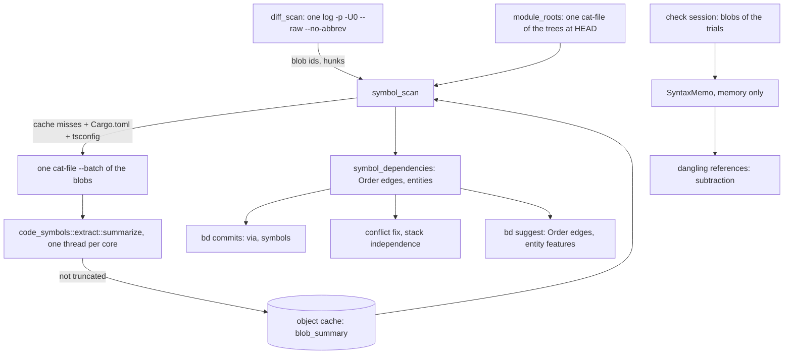

# Symbol Dependencies

**Status:** Implemented (`branchdeck.symbols on` by default)
**Updated:** 2026-10-17
**Tags:** [dependencies, tree-sitter, bd, check, suggest, conflict-fix]

## Problem

Branch Deck decides that commits belong together, or that one branch must stack on another, from text: a commit
depends on an older one when its hunks touch the lines that commit added (`dependencies.rs`), clusters are scored by
issue keys, scopes and shared paths (`bd suggest`), and the dangling-reference check finds the uses of a removed
declaration by per-language regular expressions. git's three-way merge is the only exact oracle, and it sees lines,
not names: a commit that calls a function another commit added in another file merges cleanly into a branch without
it, and the branch fails only when it is compiled.

The regular expressions also see too much. Regrouping 217 commits of the IntelliJ checkout (2026-10-17), the check
reported a Rust `pub(crate) use …::ControlOwner` as the removal of `ControlOwner` (four false uses), a word in a KDoc
comment as a use of a removed member, and a local `val turnId` as a use of a private property of another class. The
false references became repair edges of `bd suggest`, closed a cycle, and stacked a branch on the wrong parent; a
proposed `bd move-hunk` would have broken a branch.

## Solution Overview

`crates/code-symbols` summarizes one source file on tree-sitter (Kotlin, Java, Rust, TypeScript and JavaScript): its
package, its imports (Rust `use` and `pub use`, Kotlin aliases, TypeScript imports and re-exports), its declarations
with their containers and reach, and its references, without comments, strings (but with interpolations), locally
bound names, labels and keys. Of Kotlin and Java it also holds the parameter types of each function, whether a member
overrides and whether a subtype may override it, the supertypes of each type, and per `override` member one reference
to the member it overrides in each supertype of the class around it. A summary depends only on the bytes of the blob,
so it is cached by blob id.

Two consumers use the summaries. The dangling-reference check keeps finding candidate lines as before and only
subtracts the ones the tree places in a comment, a string or a local scope, or whose name an import still binds, and
the line of an `override` member. And
`symbol_dependencies` adds edges of a new class, `Order`, to the line dependencies: a commit that uses a name another
commit of the range adds, with evidence that the use means that declaration, or overrides a member another commit
adds, also a new overload of a name its type had.

## Design

### Architecture

### Key Decisions

1. **Decision**: an edge by symbols is of its own class, `Order`, not a line dependency.
   **Rationale**: a line dependency means the two commits can't be cherry-picked apart without a conflict, and a
   trial build refutes a wrong one. A symbol dependency means the later commit doesn't compile without the earlier
   one; a stack or the order of two Safe Pushes satisfies it, and `merge-tree` can never refute it. Joining units by
   it would fuse every issue that uses a shared helper into one branch.

2. **Decision**: the index is the declarations the range adds or changes, not the repository.
   **Rationale**: only those can make one commit of the range need another, and they are a few hundred even in a
   monorepo of 1.4 million files; no build, no language server and no index of the tree is needed. A member key a
   commit changes brings the overloads its file had before the range along (decision 7).

3. **Decision**: a use links only with evidence: an import or alias, a qualified name, the same file, the same Rust
   module, a wildcard import or the same package and module for a type, or an override in a subtype whose supertype
   resolves (`override`, decision 8). In the same file a name that a type other than the declaration's own qualifies
   (`Registry.register(id)` in a `register` of the file) means that type's member, not the file's; a type by its
   capital, the convention of every language here.
   **Rationale**: a Kotlin call without a qualifier may mean an implicit receiver's member, an extension or a function
   of the package; only a compiler knows. A wrong hard edge costs more than a missed one, which the trial build and
   `--build` still catch.

4. **Decision**: the dangling-reference check subtracts by the tree and adds nothing.
   **Rationale**: its recall comes from matching names in any position (a Kotlin extension call, a Java accessor); the
   tree is good at saying what is not a use (a comment, a string, a local), and bad at saying everything that is.

5. **Decision**: a table-driven walk of the tree, not tree-sitter queries.
   **Rationale**: shadowing needs a walk of the scopes anyway, the shipped `tags.scm` files are too thin, and a test
   checks every node kind of the tables against the grammar, so a grammar upgrade can't silently break a rule.

6. **Decision**: `tree-sitter-kotlin-sg`, and one TSX grammar for TypeScript and JavaScript.
   **Rationale**: the maintained Kotlin grammar (the fwcd main, republished by ast-grep); `-ng` is dormant and parses
   far worse, and both export the same C symbol. TSX parses TypeScript and JavaScript but `<T>expr` casts, which make
   a file degraded and send it back to the lines; one grammar less is about 1 MB of binary.

7. **Decision**: a key (namespace, containers and name) holds entries, not one declaration. An entry is one
   declaration of the key, its identity the kind, the extension receiver and the parameter types (the last names of
   each type, `?` kept, and the dimensions of an array, a vararg counted as one). Its origin is the baseline, or the
   commit that created it or changed its form, with the entries that commit removed as its predecessors: one removed
   and one added is the same entry in a new form. A use with a shape (an override) looks at the entries that accept it
   at its commit; for each, the latest step back along its predecessors at which no form before accepted the use and
   the form after did names the commit it needs. It links only when that is one older commit for all of them: the
   baseline, its own commit or two commits are no edge. A use without a shape (a call, a type, an import) needs the
   key: the commit that added it, the oldest origin of the entries that accept it, and none when one is of the
   baseline.
   **Rationale**: a new overload of a name its type already declares, `buttons(paneId: String)` beside
   `buttons(window: Window)`, is the declaration an override needs (the Safe Push of IJAI-4074 that failed on
   2026-10-17), but a key of name only found it on both sides of the file, so it was neither added nor looked up.
   "Accepts" errs on purpose toward accepting where a wrong match only adds an origin (decision 8 says where). A call
   carries no shape of its arguments yet, so it can't tell the overloads of a type apart, and it needs the key as
   before the entries: the call of a name with an overload of the baseline is no edge, and a call of a name whose
   overloads two commits of the range add needs the first. Only the members of a JVM type: all their overloads are in
   the file of the type, which the commit that changes them changes too. A top-level function may have overloads in
   files the range doesn't change, so its key, as every key of Rust and TypeScript, is only present or absent; each
   file of the range that adds it holds its own entries, so a call of an overload that two files add is ambiguous, and
   a removal drops the entries of its file (the whole key of a member). Entries change only on clean sides: a
   declaration the parser recovered around (`in_error`) or a degraded file may be misread, and a misread form would
   look new; nor do they change when two declarations of one side are the same entry (`stamp(java.sql.Date)` beside
   `stamp(java.util.Date)`), which can't be matched across the sides. A use its own commit's declarations may mean is
   no edge either: the rule before dropped them and linked a use that a type of its own commit shadows to a wildcard
   import.

8. **Decision**: a Kotlin `override` or Java `@Override` member is a use, `override`, of the member it overrides in a
   supertype of the class around it: a subclass, an object expression, an anonymous class, an enum entry's body.
   **Rationale**: an override of nothing doesn't compile, so a resolved supertype is evidence as strong as
   `Type.member` with a resolved type. The member must be an instance member a subtype may override (`open`,
   `abstract` or of an interface, never `final` or private) with the same receiver and parameter types, must not be
   one every class has from `Any` or `Object` (`equals`, `hashCode`, `toString`, `clone`, `finalize`), and must
   override nothing itself: an override of an override compiles without the commit that adds it, because the
   supertype of its type has the member. Where the member's type has no supertypes, the override must mean one of its
   members, each overload of which is an entry, so the parameter types match generously (a type parameter fits any
   type, two types of the same last names are the same): a wrong match only adds an origin, which costs an edge and
   never adds one. Where it has supertypes, whose members are unknown, only the same form counts: every type known,
   each name resolved by its file's imports, its own types or its package to the same type (two names neither file
   resolves, `String`, are the same when equal). The supertype resolves by the same file, its full path, an import
   (an alias, a nested type) or the same package in the same module without a type of that name in the file, never by
   a wildcard import, and its path must be the containers of the member. A type of the name nested in a declaration
   around the override (`Outer.Base` inside `Outer`) may be the one it means, and so may, in Java, a member type that
   a class around the overriding class inherits: no edge. Kotlin also reaches the nested classes of a supertype by
   their names; that is left out, because an object expression in a class with supertypes is everywhere and such a
   shadow is rare. A class with several supertypes, a function type among them, is no edge: its member may come from
   any, and the members of a type outside the range are unknown. Nor is a Java method of a class with supertypes,
   which may override one without `@Override`. An override in a one-line object expression, which the grammar reads
   as a call with a trailing lambda, or in a declaration the grammar misread overrides nothing of the class around
   it. An override that an earlier commit removed is a removed use: the commit that then removes the member it
   overrides depends on that one (`removes_after`).

### Implementation Notes

- `crates/code-symbols`: `summarize`, `FileSummary`, `extractor_version` (the rules and the grammars' node types);
  `Spec::inheritance` of Kotlin and Java: the signatures, `overrides` and `overridable`, the supertypes, and the
  `Role::Override` references with their `Shape::Override`.
- `crates/sync-core/src/symbol_scan.rs`: the mode (`branchdeck.symbols`), the summaries through the cache, the crate
  names and the TypeScript aliases.
- `crates/sync-core/src/module_roots.rs`: the nearest directory with a build file (Kotlin `internal`, Rust crates,
  TypeScript packages).
- `crates/sync-core/src/symbol_dependencies.rs`: the `Order` edges with their evidence, the entries of a member key
  and their origins (`member_entries`, `origins_of`), the overrides (`resolve_override`, `fits`, `scope_may_shadow`),
  the same-file rule (`names_another_type`), the removals that need the removal of the uses, the entities each commit
  changes.
- `crates/sync-core/src/dangling_references.rs`: `SyntaxMemo` and the subtraction; an `override` line is no use
  (`on_syntax`).
- `crates/sync-core/src/dependencies.rs`: `with_symbols` merges the edges into the line dependencies (`Dependency::lines`,
  `symbols`) for `bd commits`.
- `crates/sync-core/src/check.rs`: `CheckSession::symbol_graph`, read once per session with `on`, for the conflict fix
  (`dependents_in`, `movable`), `missing_declarations` (`crates/sync-core/src/missing_declarations.rs`) and
  `stack_independence` (`Builds.uses`).
- `crates/bd-cli/src/clustering.rs`: `ClusterInput.symbol_dependencies`, an order of the clusters, never a join;
  `crates/bd-cli/src/suggest.rs`: the `symbol_dependency` warning.

## Alternatives Considered

- **SCIP, rust-analyzer, Kythe, scip-java**: exact names. Why not: each needs a build of the user's project (a Gradle
  or Bazel model, minutes to hours on a monorepo) that Branch Deck can't run or wait for.
- **GitHub stack-graphs**: name resolution on tree-sitter. Why not: archived in 2025 and never had Kotlin.
- **sem-core**: entity diffs and an impact graph in Rust. Why not: its API breaks every few releases, and it resolves
  neither Kotlin nor Java imports.
- **Regular expressions per language** (as before): Why not: they can't tell a comment, a string or a local from a use.
- **The entities two commits change as features of P** (the functions and types around their hunks): Why not: in the
  IDF-weighted Jaccard of `bd suggest` a shared function adds 0.1–0.2 to P, short of the threshold, and commits of
  one function already share its file. `bd commits --symbol-stats` still counts the pairs (`entity_pairs`).

## Measurements

Round 1, 2026-10-17, release build, a machine at a load average of 30–60 (wall times are noisy; the CPU times agree):

| Range | Commits | Blobs (MiB) | Read cold / warm | Parse | Graph | Edges by lines / symbols / both / symbols only |
|---|---|---|---|---|---|---|
| IntelliJ checkout, the IJAI air work | 225 | 2647 (52.6: Kotlin 1827, Rust 629, TS 169, Java 22) | 4.8 s / 0.15–0.29 s | 0.64 s | 0.56–0.61 s | 891 / 738 / 454 / 284 |
| branch-deck, its last 200 commits | 200 | 3453 (33.8: Rust 1261, TS 2183) | 1.06 s / 0.37 s | 0.41 s | 0.69 s | 1286 / 654 / 529 / 125 |

- No file of either range is degraded or cut by the budget; 45 error bytes in one Kotlin file of branch-deck.
- The symbols-only edges of the IntelliJ range by evidence: same file 177, removal after the removal of the uses 38,
  import 48, qualified 11, type of the same package and module 10. A read of the sample found each a real compile
  dependency: an import of what the older commit adds, a registry line that names an object the older commit declares
  in the same file, a removal of `AirJourneySuites` after the commits that moved the suites off it.
- Peak memory: `bd commits --brief` alone takes 530 MB on the IntelliJ checkout (the mapped object cache); the scan adds
  about 160 MB cold and nothing warm.
- The dangling-reference check on the IntelliJ range at 7dfac19d: by the lines 6 confirmed references (`ControlOwner`
  four times behind a `pub(crate) use`, `scenarios` in a KDoc, the local `turnId`) and two inverted stacks without a
  fix; with the subtraction none, and no other reference changed. The current IntelliJ grouping (28 branches) and
  branch-deck's 200 commits: the same references either way.
- Precision of the edges by symbols only (the IntelliJ range at 7dfac19d, 246 without the removals): for 101 the name
  occurs nowhere in the scope before the commit that adds it (`git grep -w` at its parent), so the use can mean only
  that declaration; a read of 40 of the other 145 (the name occurs in a `BUILD.bazel`, an `.iml`, another crate's
  file, or is an import whose path names the adding module) found no false one either: 141 of 141, a Wilson lower
  bound of 0.97. No compiler checked them.
- Round 2, `bd suggest` on the same range: with the symbols on and off the same plan, `check.ok`, no repair round;
  the edges by symbols are all satisfied by the stacks the lines already make. Warm, the symbols add 0.5–0.7 s of
  CPU (+20–28 %).
- Binary: the four grammars add 9.4 MiB to the app (Kotlin 6.2, TSX 2.0, Rust 1.6, Java 0.9; the app is 24.3 MB, was
  15.0); the user accepted it.
- Round 3, 2026-10-17, the overload entries and the `override` evidence (decisions 7 and 8), release build, a heavily
  loaded machine:
  - The repro of the IJAI-4074 failure: an override of a new overload, of a new name, through an import and in the same
    file each make exactly one edge by symbols; a call of an overload added in the same file is still none. On the kept
    override-overload case `bd check` is `ok` with one `missing_declarations` (`buttons`, evidence `override`, the
    override of the new `paneId` overload), stacks on or off; `bd suggest` with stacks off keeps the plan and warns
    `symbol_dependency` ("Safe Push ABC-1 first, or turn on stacked branches"), with `branchdeck.stacks true` it stacks
    XYZ-2 on ABC-1, and the check of that plan is `ok`.
  - The IntelliJ range at 1d7255a6 (60 commits on 596ffa8e): 0 edges by symbols, as before; the file-overlap edges, the
    `bd commits` and `--brief` output, `bd check` (`ok`, 16 branches, no `missing_declarations`, no dangling
    reference) and the `bd suggest` plan are the same as the old build's. The range has no edge by symbols to compare,
    so it says little about precision.
  - Of its overrides 120 (reference, entry) pairs reach `resolve_override`, 9 distinct references pass the kind, the
    overridability and the reach; one is skipped for its class of 5 supertypes. A read of each found its missing edge right:
    the member is of the baseline or of the overriding commit (`getButtonManager` of `ToolWindowUnregisterTest`, after
    the user's fixup, overrides only the overload of the baseline: the precision the fix needs, on the real case); the
    skip loses nothing.
  - The changed `extractor_version` invalidates the cached summaries: the first run parses all 429 again (0.62 s read,
    0.61 s parse); warm 429 cached, graph 11–14 ms (was 90); entities 937 and pairs 19 unchanged.

### The gate

| Measure | Threshold | Measured |
|---|---|---|
| Precision of the edges by symbols only | ≥ 0.95 | 141 / 141 (by `git grep` and reading, no compiler) |
| `bd suggest` plan with them | not worse | the same plan, `check.ok`, no repair round |
| Degraded Kotlin files | ≤ 3 % | 0 of 1827 |
| Symbol phase, warm | ≤ 0.3 s | 0.15 s read + 0.5 s graph |
| `bd suggest` slowdown, warm | ≤ 25 % | +20–28 % CPU |
| Peak memory | ≤ +250 MB | +160 MB cold, nothing warm |
| Binary | accepted by the user | +9.4 MiB |

The two times miss their thresholds, and the measured range gains nothing in `bd suggest`; the user chose `on` as the
default anyway (2026-10-17): the precision holds, no plan got worse, and the cost is a fraction of a second warm. `on`
adds the conflict fix by the edges, `missing_declarations` of `bd check`, the `symbol_dependency` warnings and the
stacking of `bd suggest`, and the uses of the Safe Push lead. `git config branchdeck.symbols report` keeps only what
decides nothing (`bd commits` names the edges, the dangling-reference check subtracts by the trees); `off` reads no
summary.

## References

- [Git Operations](git-operations.md): "Symbol summaries", "Dangling references (check)"
- [Symbol Dependencies spec](../../spec/commit/symbol-dependencies.spec.md)
