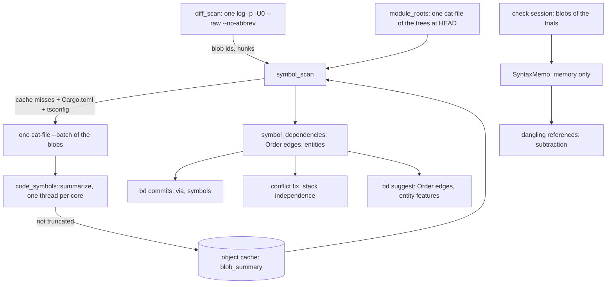

# Symbol Dependencies

**Status:** Draft
**Updated:** 2026-10-17
**Tags:** [dependencies, tree-sitter, bd, check, suggest, conflict-fix]

## Problem

Branch Deck decides that commits belong together, or that one branch must stack on another, from text: a commit
depends on an older one when its hunks touch the lines that commit added (`dependencies.rs`), clusters are scored by
issue keys, scopes and shared paths (`bd suggest`), and the dangling-reference check finds the uses of a removed
declaration by per-language regular expressions. git's three-way merge is the only exact oracle, and it sees lines,
not names: a commit that calls a function another commit added in another file merges cleanly into a branch without
it, and the branch fails only when it is compiled.

The regular expressions also see too much. Regrouping 217 commits of the IntelliJ checkout (2026-10-17), the check
reported a Rust `pub(crate) use …::ControlOwner` as the removal of `ControlOwner` (four false uses), a word in a KDoc
comment as a use of a removed member, and a local `val turnId` as a use of a private property of another class. The
false references became repair edges of `bd suggest`, closed a cycle, and stacked a branch on the wrong parent; a
proposed `bd move-hunk` would have broken a branch.

## Solution Overview

`crates/code-symbols` summarizes one source file on tree-sitter (Kotlin, Java, Rust, TypeScript and JavaScript): its
package, its imports (Rust `use` and `pub use`, Kotlin aliases, TypeScript imports and re-exports), its declarations
with their containers and reach, and its references, without comments, strings (but with interpolations), locally
bound names, labels and keys. A summary depends only on the bytes of the blob, so it is cached by blob id.

Two consumers use the summaries. The dangling-reference check keeps finding candidate lines as before and only
subtracts the ones the tree places in a comment, a string or a local scope, or whose name an import still binds. And
`symbol_dependencies` adds edges of a new class, `Order`, to the line dependencies: a commit that uses a name another
commit of the range adds, with evidence that the use means that declaration.

## Design

### Architecture

### Key Decisions

1. **Decision**: an edge by symbols is of its own class, `Order`, not a line dependency.
   **Rationale**: a line dependency means the two commits can't be cherry-picked apart without a conflict, and a
   trial build refutes a wrong one. A symbol dependency means the later commit doesn't compile without the earlier
   one; a stack or the order of two Safe Pushes satisfies it, and `merge-tree` can never refute it. Joining units by
   it would fuse every issue that uses a shared helper into one branch.

2. **Decision**: the index is the declarations the range adds, not the repository.
   **Rationale**: only those can make one commit of the range need another, and they are a few hundred even in a
   monorepo of 1.4 million files; no build, no language server and no index of the tree is needed.

3. **Decision**: a use links only with evidence: an import or alias, a qualified name, the same file, the same Rust
   module, a wildcard import or the same package and module for a type.
   **Rationale**: a Kotlin call without a qualifier may mean an implicit receiver's member, an extension or a function
   of the package; only a compiler knows. A wrong hard edge costs more than a missed one, which the trial build and
   `--build` still catch.

4. **Decision**: the dangling-reference check subtracts by the tree and adds nothing.
   **Rationale**: its recall comes from matching names in any position (a Kotlin extension call, a Java accessor); the
   tree is good at saying what is not a use (a comment, a string, a local), and bad at saying everything that is.

5. **Decision**: a table-driven walk of the tree, not tree-sitter queries.
   **Rationale**: shadowing needs a walk of the scopes anyway, the shipped `tags.scm` files are too thin, and a test
   checks every node kind of the tables against the grammar, so a grammar upgrade can't silently break a rule.

6. **Decision**: `tree-sitter-kotlin-sg`, and one TSX grammar for TypeScript and JavaScript.
   **Rationale**: the maintained Kotlin grammar (the fwcd main, republished by ast-grep); `-ng` is dormant and parses
   far worse, and both export the same C symbol. TSX parses TypeScript and JavaScript but `<T>expr` casts, which make
   a file degraded and send it back to the lines; one grammar less is about 1 MB of binary.

### Implementation Notes

- `crates/code-symbols`: `summarize`, `FileSummary`, `extractor_version` (the rules and the grammars' node types).
- `crates/sync-core/src/symbol_scan.rs`: the mode (`branchdeck.symbols`), the summaries through the cache, the crate
  names and the TypeScript aliases.
- `crates/sync-core/src/module_roots.rs`: the nearest directory with a build file (Kotlin `internal`, Rust crates,
  TypeScript packages).
- `crates/sync-core/src/symbol_dependencies.rs`: the `Order` edges with their evidence, the removals that need the
  removal of the uses, the entities each commit changes.
- `crates/sync-core/src/dangling_references.rs`: `SyntaxMemo` and the subtraction.

## Alternatives Considered

- **SCIP, rust-analyzer, Kythe, scip-java**: exact names. Why not: each needs a build of the user's project (a Gradle
  or Bazel model, minutes to hours on a monorepo) that Branch Deck can't run or wait for.
- **GitHub stack-graphs**: name resolution on tree-sitter. Why not: archived in 2025 and never had Kotlin.
- **sem-core**: entity diffs and an impact graph in Rust. Why not: its API breaks every few releases, and it resolves
  neither Kotlin nor Java imports.
- **Regular expressions per language** (as before): Why not: they can't tell a comment, a string or a local from a use.

## Measurements

Round 1, 2026-10-17, release build, a machine at a load average of 30–60 (wall times are noisy; the CPU times agree):

| Range | Commits | Blobs (MiB) | Read cold / warm | Parse | Graph | Edges by lines / symbols / both / symbols only |
|---|---|---|---|---|---|---|
| IntelliJ checkout, the IJAI air work | 225 | 2647 (52.6: Kotlin 1827, Rust 629, TS 169, Java 22) | 4.8 s / 0.15–0.29 s | 0.64 s | 0.56–0.61 s | 891 / 738 / 454 / 284 |
| branch-deck, its last 200 commits | 200 | 3453 (33.8: Rust 1261, TS 2183) | 1.06 s / 0.37 s | 0.41 s | 0.69 s | 1286 / 654 / 529 / 125 |

- No file of either range is degraded or cut by the budget; 45 error bytes in one Kotlin file of branch-deck.
- The symbols-only edges of the IntelliJ range by evidence: same file 177, removal after the removal of the uses 38,
  import 48, qualified 11, type of the same package and module 10. A read of the sample found each a real compile
  dependency: an import of what the older commit adds, a registry line that names an object the older commit declares
  in the same file, a removal of `AirJourneySuites` after the commits that moved the suites off it.
- Peak memory: `bd commits --brief` alone takes 530 MB on the IntelliJ checkout (the mapped object cache); the scan adds
  about 160 MB cold and nothing warm.
- The dangling-reference check on the IntelliJ range at 7dfac19d: by the lines 6 confirmed references (`ControlOwner`
  four times behind a `pub(crate) use`, `scenarios` in a KDoc, the local `turnId`) and two inverted stacks without a
  fix; with the subtraction none, and no other reference changed. The current IntelliJ grouping (28 branches) and
  branch-deck's 200 commits: the same references either way.
- Binary: the four grammars add 9.4 MiB to the app (Kotlin 6.2, TSX 2.0, Rust 1.6, Java 0.9; the app is 24.3 MB, was
  15.0); the user accepted it.

## References

- [Git Operations](git-operations.md): "Symbol summaries", "Dangling references (check)"
- [Symbol Dependencies spec](../../spec/commit/symbol-dependencies.spec.md)
