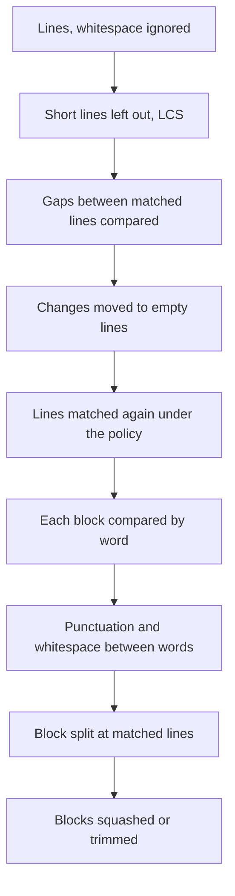

# Text Diff Engine

**Status:** Implemented (the crate and its model; the app does not call it yet)
**Updated:** 2026-10-18
**Tags:** [diff, comparison, intellij, port]

## Problem

Branch Deck shows the hunks of `git diff-tree -p`: Myers with default options, and a word diff that pairs line i of
a block with line i. The IntelliJ diff gives better results. It matches lines that differ only in whitespace first,
it does not let short lines anchor a match, and it compares words over a whole block of changed lines.

## Solution Overview

The crate `crates/text-diff` is a port of the two-way comparison of IntelliJ Platform to Rust. The license of the
crate is Apache-2.0, as the license of the source. `crates/text-diff/NOTICE` credits JetBrains. Each ported file
names its Kotlin or Java source in its first comment.

The port keeps the structure of the source: one module for each source file, with the same algorithm steps. A later
change of the source can then be compared with the port.

The entry point is `provider::compare_lines_inner(old, new, policy, highlight, &deadline)`. It returns the changed
blocks of lines (`LineFragment`) with their line ranges, their UTF-16 offsets and the changes inside them. An empty
list of inner changes marks a block that changed only in what the policy ignores; a view draws it pale.

The app takes the model of `model::diff_texts(old, new, policy, &budget)`: a `TextDiff` with typed blocks, sent as
JSON. The views take the texts by blob id and build the context, the hunks and the expansion from the blocks. No
patch text carries a diff that the app shows.

## Design

### Pipeline

`by_line.rs` does the steps A to E. `manager.rs` calls `by_word.rs` for each changed block (F to H), and
`provider.rs` squashes and trims the blocks (I), as a diff view of IntelliJ does.

### Module Map

| Module | Source (`community/platform/util/diff/src/com/intellij/`) |
|---|---|
| `lcs/diff.rs` | `util/diff/Diff.kt`, `LCSBuilder.kt`, `DiffConfig.kt`, `FilesTooBigForDiffException.kt` |
| `lcs/myers.rs` | `util/diff/MyersLCS.kt` |
| `lcs/patience.rs` | `util/diff/PatienceIntLCS.kt` |
| `lcs/unique_lcs.rs` | `util/diff/UniqueLCS.kt` |
| `lcs/reindexer.rs` | `util/diff/Reindexer.kt` |
| `lcs/enumerator.rs` | `diff/util/Enumerator.kt` |
| `lcs/window.rs` | Branch Deck's own: the two sequence parts that an LCS compares |
| `iterables/diff_iterable.rs` | `diff/comparison/iterables/*DiffIterable*.kt`, `ChangeDiffIterableBase.kt` |
| `iterables/diff_iterable_util.rs` | `diff/comparison/iterables/DiffIterableUtil.kt` |
| `range.rs`, `side.rs` | `diff/util/Range.kt`, `diff/util/Side.kt` |
| `fragments.rs` | `diff/fragments/DiffFragment*.kt`, `LineFragment*.kt` |
| `line_offsets.rs` | `diff/tools/util/text/LineOffsets*.kt`, `diff/util/DiffRangeUtil.kt` |
| `policy.rs` | `diff/comparison/ComparisonPolicy.kt`; `IgnorePolicy.java`, `HighlightPolicy.java` of `diff-impl` |
| `cancellation.rs` | `diff/comparison/CancellationChecker.kt`, `DiffTooBigException.kt` |
| `comparison_util.rs` | `diff/comparison/ComparisonUtil.kt`, the string helpers of `StringsKmp.kt` |
| `trim_util.rs` | `diff/comparison/TrimUtil.kt` |
| `character_utils.rs` | `diff/comparison/CharacterUtils.kt`, on the Unicode data of `icu_properties` |
| `change_corrector.rs` | `diff/comparison/ChangeCorrector.kt` |
| `chunk_optimizer.rs` | `diff/comparison/ChunkOptimizer.kt` |
| `by_line.rs` | `diff/comparison/ByLineRt.kt` |
| `by_word.rs` | `diff/comparison/ByWordRt.kt` |
| `by_char.rs` | `diff/comparison/ByCharRt.kt` |
| `line_fragment_splitter.rs` | `diff/comparison/LineFragmentSplitter.kt` |
| `manager.rs` | `diff-impl/.../comparison/ComparisonManagerImpl.java`, the two-way half |
| `provider.rs` | `diff-impl/.../tools/util/text/TwosideTextDiffProviderBase.java`, `SimpleTextDiffProvider.java` |
| `text.rs` | Branch Deck's own: `Utf16Text`, the UTF-16 code units of a text and its lines |
| `merge_range.rs` | `util/MergeRange.kt`, `util/ThreeSide.kt`, `fragments/MergeLineFragment*.kt`, `MergeWordFragment*.kt` |
| `comparison_merge_util.rs` | `diff/comparison/ComparisonMergeUtil.kt` |
| `merge_conflict_type.rs` | `diff/util/MergeConflictType.kt`, `MergeConflictResolutionStrategy.kt` |
| `merge_range_util.rs` | `diff/util/MergeRangeUtil.kt` |
| `merge_resolve_util.rs` | `diff/comparison/MergeResolveUtil.kt` |
| `model.rs` | Branch Deck's own: `TextDiff`, the model of the views, and `diff_texts` |
| `inline.rs` | Branch Deck's own: the inline pairs and the dropped ranges of a block |

### Model

`model::diff_texts` compares two texts by word and builds a `TextDiff` straight from the blocks of the comparison
(`provider::compare_for_view`). The types derive serde (camelCase) and, with the `specta` feature, `specta::Type`.

- **Lines.** `\n`, `\r\n` and a lone `\r` each end a line, as IntelliJ splits a document (`SourceText`). A text
  has one line more than it has line ends: `"a\n"` is `a` and an empty line. A view that splits the text at
  `/\r\n|\r|\n/` gets the same lines. Line ends compare as equal.
- **Blocks.** `DiffBlock` has 0-based line ranges, the end exclusive, in order and without overlap. The lines between
  two blocks are equal under the policy, and as many on both sides. Two adjacent blocks stay two blocks: the
  comparison splits a run where `LineFragmentSplitter` splits it.
- **Kinds.** `Changed` is a change. `WhitespaceOnly` is a block whose inner changes are an empty list: its lines are
  equal under the policy (a whitespace change, a blank line under `Ignore`). It is drawn pale, and it stays a change
  that counts and that the change navigation stops at, as IntelliJ draws it (`SimpleDiffChangeUi.createHighlighter`:
  `withIgnored` for a block with inner changes, also an empty list; every change counts in its status). `Ignored` is
  only a block that `IgnoreBlankLines` cuts off the ends of a run of adjoining blocks, which IntelliJ drops
  (`ComparisonManagerImpl.processBlocks` with `trim`, only for `IGNORE_WHITESPACES_CHUNKS`). A view draws it as
  unchanged, it does not count, and the change navigation skips it. It stays in the model because its two sides can
  have other line counts, which a view must align. Under `Trim` a blank line stays `Changed`: its line end differs
  (`ComparisonUtil.equalsTrimWhitespaces` compares line by line).
- **Ranges.** `old_ranges` and `new_ranges` hold one list for each line of the block: `[start, end, ...]` in UTF-16
  units inside the line, never the line end. They are empty for an `Ignored` and a `WhitespaceOnly` block, for a
  block without similar parts, and for a block whose ranges are dropped.
- **Inline pairs.** `inline_pairs` is set when both sides have the same number of lines and each pair is similar:
  less than `SIMILAR_PAIR_MAX_CHANGED` (1/3) of its chars changed, with at most `SIMILAR_PAIR_MAX_RANGES` (4) ranges
  in each line. A `WhitespaceOnly` block of n to n lines has inline pairs.
- **Dropped ranges.** When at least `DROP_RANGES_MIN_CHANGED` (2/3) of the chars of a block changed, the ranges are
  noise and are dropped. The three thresholds come from the inline diff of Space and are to be tuned on real commits.
- **Line ends.** When the line ends of the files differ (`lf`, `crlf`, `cr`, `mixed`), `line_ends` names them for a
  notice, as Space's `lineEndingDiff`, and `only` says that nothing else differs.
- **Final line end.** When only one text ends with a line end, `final_newline` says which, for the notice "Newline at
  end of file added" or "removed". The change itself is a `WhitespaceOnly` block on the empty last line. An added or
  a deleted file (an empty side) has none.
- **Counts.** `additions` and `deletions` count the lines of the blocks that are not `Ignored`. The empty line after a
  final line end does not count, so the counts are git's, except for a change of the final line end alone.
- **Budget.** A side over `MAX_INNER_LINES` (20,000) or `MAX_INNER_BYTES` (1 MiB), or an inner comparison out of
  time (`DiffBudget::inner`), gives `line_level_only`: the comparison runs again by line, and the blocks stay exact.
  When the line comparison runs out of time too (`DiffBudget::lines`), the diff is one block of both whole texts.
  `old_scopes` and `new_scopes` stay empty here: the file-diffs service fills them ([Git Operations](git-operations.md),
  "File diffs").
- **Proof.** A property test checks, under every policy and with and without inner ranges, that the blocks partition
  both texts, that the lines between them are equal under `Default`, that each range is inside its line, and that the
  counts are the lines of the blocks.

### Merge

The three-way part of the source is ported too, and `merge_model::merge_texts` builds the model of the conflict view
from it.

- **Three-way comparison.** `manager::compare_lines_three(left, base, right, policy)` compares each side with the base
  by line (`by_line::compare_three`, the steps of a two-way comparison on each pair) and joins the two comparisons into
  `MergeRange`s (`comparison_merge_util::build_simple`): a block wherever a side differs from the base. Its lines are
  0-based on each side, the end exclusive.
- **Merge.** `manager::merge_lines` is the same, but under `Trim` and `Ignore` a run of lines that differs only in what
  the policy ignores stays a block of its own (`build_merge`), outside the conflicts, as the merge view of IntelliJ
  shows it. `merge_lines_within_range` merges a part of the texts, `merge_lines_additions` the lines two texts share.
- **Words.** `by_word::compare_three` gives the word blocks inside a block of lines, in offsets of the three texts,
  with the whitespace correctors of the merge.
- **Types.** `merge_range_util::get_line_merge_type` gives the `MergeConflictType` of a block: inserted, deleted,
  modified or conflict, which side changed it, and whether it can be resolved: by the side that changed (`Default`),
  or by its words (`Text`). `get_line_three_way_diff_type` is the same for a three-way comparison, and
  `get_line_left_to_right_three_side_diff_type` the type for a left-to-right view through the base.
- **Resolve.** `comparison_merge_util::try_resolve_conflict` merges a conflict when the changes of the two sides do not
  overlap at the word level (`merge_resolve_util::try_resolve`, the default policy first, then ignoring whitespace).
  The greedy resolve (`try_greedy_resolve`) applies deletions and insertions of both sides; the source keeps it off
  (`USE_GREEDY_MERGE_MAGIC_RESOLVE`), and so does the port.
- **Model.** `merge_texts(left, base, right, policy, &budget)` gives a `TextMerge`: left is ours (the target as built),
  base is stage 1, right is theirs (the commit being picked), as in IntelliJ. Each `MergeBlock` has the lines of each
  side, its kind, `leftChanged` and `rightChanged`, `ignored` (below; only under `Ignore`), its resolution (`default`: the
  side that changed; `text`: by words, with `resolvedText`; none: the user decides) and the word ranges of each line of
  each side. `conflicts` and `unresolved` count the conflicts; `conflicts > 0` with `unresolved == 0` is a conflict of
  git that its words resolve. `lineEnds` and `finalNewline` name the sides when they differ. `budget.inner` bounds the
  words and the resolves of a file (after it, `lineLevelOnly` and no resolve by words), `budget.lines` the line merge
  (after it, one block). A property test checks that the blocks partition the three texts.
- **Ignored blocks of a merge.** IntelliJ's merge viewer drops no block under any policy. It offers `Default`, `Trim`
  and `Ignore`, and `IgnoreBlankLines` merges here as `Ignore`, with nothing cut off. Every block is a change that a
  side applies and the navigation stops at. The merge keeps a block equal under the policy, so that a side can still
  apply it (`MergeRangeUtil.getMergeType` picks the changed side by the true equality). `ignored` is IntelliJ's
  shortcut in `DiffUtil.compareThreesideInner`: under `Ignore`, the changed sides of the block are equal ignoring
  whitespace, with an unchanged or an empty side as "" (a blank line added or removed). IntelliJ gives such a block
  empty inner lists and paints it pale without words (`DiffViewerHighlighters.createHighlighter`, `withIgnored`).
  Any other block with word ranges, also an empty list per line, is painted pale too, the changed words in the full
  colour. An insertion or a deletion without the shortcut has no word ranges and is painted in the full colour.
- **Proof.** The tests of `LineComparisonMergeUtilTest`, `CharComparisonMergeUtilTest`, `WordMergeComparisonUtilTest`
  and `MergeResolveUtilTest` are ported as they are. The merge parts of `ComparisonUtilAutoTest` are property tests on
  three generated texts (the source passes the base as the right text too), and they also take the type of each block.

### Policies

| `WhitespacePolicy` | `IgnorePolicy` | Comparison | Blocks |
|---|---|---|---|
| `Default` | `DEFAULT` | every char counts | squashed |
| `Trim` | `TRIM_WHITESPACES` | whitespace at the line ends does not count | squashed |
| `Ignore` | `IGNORE_WHITESPACES` | no whitespace counts | squashed |
| `IgnoreBlankLines` | `IGNORE_WHITESPACES_CHUNKS` | no whitespace counts | squashed, whitespace-only blocks at the ends of a run cut off |

`HighlightPolicy` sets the inner changes: `ByLine` (none), `ByWord` (the default), `ByWordSplit` (words, the blocks
not squashed) and `ByChar`.

### Key Decisions

1. **Decision**: The LCS keeps the order of the source. Myers runs with a threshold of the edit distance. Patience
   diff runs when Myers gives up, and it gives up when the unique elements do not halve the problem.
   **Rationale**: The ported tests then check the same results.

2. **Decision**: A `Vec<Change>` replaces the linked list of `Diff.Change`. The bit sets are owned values.
   **Rationale**: Rust has no shared mutable references. The results do not change.

3. **Decision**: The crate works on UTF-16 code units (`Utf16Text`), as the source does.
   **Rationale**: The offsets of a result then match the ported tests one to one, and JavaScript reads them without a
   conversion. The comparison decodes code points where the source decodes them.

4. **Decision**: One struct, `DiffIterable`, holds the changed ranges. Each wrapper of the source (inverted,
   expanded, a part of another one) is a constructor that computes its ranges at once.
   **Rationale**: Rust has no cheap chain of virtual iterators. The ranges are the same.

5. **Decision**: A `Deadline` replaces the progress indicator. It fails a comparison with `DeadlineExceeded`. The LCS
   fails with `TooManyChanges` when it gives up, as `DiffTooBigException`. A block whose words fail with
   `TooManyChanges` keeps no inner changes; after `MAX_BAD_LINES` (3) such blocks, the next blocks are not compared
   by word. `DeadlineExceeded` stops the whole comparison.
   **Rationale**: Branch Deck has no indicator, but it needs a time budget for each file. A caller then falls back to
   a cheaper diff.

6. **Decision**: The comparison sees each `\r\n` and each lone `\r` as `\n` (`SourceText`), as IntelliJ converts the
   line separators of a document, which never holds a `\r`.
   **Rationale**: A change of line ends alone is then no change of content, and the ranges never hold a `\r`. No
   patch needs git's lines, so the lines are IntelliJ's.

7. **Decision**: Well-maintained crates replace the infrastructure of the source. The algorithm code stays a port.
   **Rationale**: Less code to keep, and each crate is tested by many more users. See "Dependencies".

### Dependencies

| Crate | Replaces | Difference |
|---|---|---|
| `fixedbitset` 0.5.7 | `BitSet.kt` | None. A set does not grow by itself: the LCS sizes its sets for the sequences; the ignored ranges grow before a write. |
| `rustc-hash` 2.1.3 | the hash maps of `Enumerator.kt` and `UniqueLCS.kt` | None. FxHash is faster for integer keys. |
| `icu_properties` 2.3.0 (ICU4X) | the range tables of `CharacterUtils.kt` and Kotlin's `CharCategory` | Unicode 17 instead of 16, see below. |
| `proptest` 1.12.0 (tests only) | the unseeded `java.util.Random` of the auto tests | A failure shrinks to a minimal case and is saved in `proptest-regressions/`. |

`icu_properties` gives `Alphabetic`, `Ideographic`, `Script` (Hiragana, Katakana, Thai, Javanese) and the general
category `Nd`. It was already in the dependency tree of the app. `Alphabetic` is the letter categories, `Nl` and
`Other_Alphabetic`, which is what the source checks. It also holds `Other_Lowercase` and `Other_Uppercase`, whose
chars are letters or `Other_Alphabetic` too. A check of all code points against the tables of the source found
differences only in chars that Unicode 17 added. All of them are outside the BMP, where `isContinuousScript` returns
`true` before it reads a property. The one change of behaviour: the ten Tolong Siki digits (U+11DE0..U+11DE9) are
digits now, so they join a word instead of being a word of their own.

Not used: `memchr` searches bytes, and the texts are UTF-16 code units. `smallvec` for the inner changes would need a
benchmark that shows a gain first. `unicode-script` and `unicode-general-category` cover only a part of the
properties; `icu_properties` has all of them. The LCS stays the port of the source, because its choice between equal
solutions decides the results of the ported tests. An experiment put `imara-diff` 0.2.0 behind `build_changes`:
with `Myers`, `MyersMinimal` or `Histogram`, 3 of the 146 tests fail (two char tests and one word test of the
algorithm-specific and non-deterministic cases). `Histogram` is about 10 times faster on two unrelated texts of
20,000 lines, but it finds 40 changed blocks there where the port finds 490.

### Budgets

- The deadline is checked when each comparison step starts, as in the source. One LCS does not check it. Myers gives
  up above an edit distance of `max(20000 + 10·√N, 20000)`, and patience diff gives up when the unique lines do not
  halve the problem.
- Timings of a release build: 3,000 lines with 15 changed blocks take about 1 ms. 20,000 lines with 3,000 random
  edits take about 6 ms. Two unrelated texts of 20,000 lines take about 115 ms. The FxHash maps cut the last case from
  about 1.2 s with the std hash maps. `DiffBudget` sets the time budget, and the caller the size limits of a file.

### Tests

The tests of the source are ported to `*_test.rs` files beside the modules. The random tests of the source are
property tests with a fixed seed (`proptest_config` in `src/test_support.rs`). The test builder of `ComparisonUtilTestBase.kt` is
`src/comparison_util_test_base.rs`: `("x_y" - "x_z")` becomes `text("x_y", "x_z")`. The ranges of the explicit
blocks of `ComparisonUtilAutoTest` come from `compare_lines` instead of the VCS line status, which is not ported.

## Left Out

- `MergeImportUtil.kt`: it finds the import block of a file through the PSI (`ImportBlockRangeProvider`). Its text
  part is three `merge_lines_within_range` calls, which are ported.
- `LangSpecificMergeConflictResolver` (the `Semantic` resolution): it needs a language model.
- `IgnorePolicy.FORMATTING` and `IGNORE_LANGUAGE_SPECIFIC_CHANGES`: they need a language model. The comparison with
  ignored ranges that the second one uses is ported (`compare_lines_with_ignored_ranges`).
- `HighlightPolicy.DO_NOT_HIGHLIGHT`: a caller that does not want a comparison does not call one.
- The registry switch `diff.by.word.deprioritize.line.differences`: it is off by default. The function it selects,
  `compare_lines_word_first`, is ported.
- `Diff.splitLines`, `translateLine` and `linesDiff`: the comparison does not use them.
- The `USE_PATIENCE_ALG` switch: it is off in the source.
- `DiffTreeTest`: it tests the tree diff, which is not ported.
