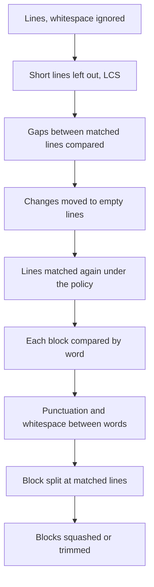

# Text Diff Engine

**Status:** Implemented (the engine of every diff and merge the app shows)
**Updated:** 2026-11-13
**Tags:** [diff, comparison, intellij, port]

## Problem

Branch Deck shows the hunks of `git diff-tree -p`: Myers with default options, and a word diff that pairs line i of
a block with line i. The IntelliJ diff gives better results. It matches lines that differ only in whitespace first,
it does not let short lines anchor a match, and it compares words over a whole block of changed lines.

## Solution Overview

The crate `crates/line-diff` is a port of the two-way comparison of IntelliJ Platform to Rust. The license of the
crate is Apache-2.0, as the license of the source. `crates/line-diff/NOTICE` credits JetBrains. Each ported file
names its Kotlin or Java source in its first comment. It is a pure function of the texts, without the bindings of the
app (no `specta`), so another reader of code can take it as it is: the model of a view (`model`), the lines a change
moved (`moves`, `moves_across`) and the blocks applied to bytes (`apply`) are in it too.

`crates/text-diff` is the wire model of the app over it, Branch Deck's own: the types that `src/lib/bindings.ts`
describes (`specta::Type`) and the `file_diff` store keeps (`text_diff::model`: `TextDiff` with its scopes and its
blocks of the imports alone, the marks, `WhitespacePolicy`, `LineEndKind`), and the merge of three texts for the
conflict view with its result on bytes (`merge_model`, `compose`). The values are those of `line-diff`
(`line_diff::model::LineDiff`, its blocks, runs and moves) and of `diff-marks` (`diff_marks::model::DiffMarks`):
each type of the wire model maps to its value and back (`From`, field by field, so a field the value gains fails
the build until the wire model describes it), so a change of `line-diff` or `diff-marks`, a word of its
documentation too, changes no field, no name and no word of the bindings. The file-diffs service compares and marks
on the values and answers the wire model; it maps a cached diff back to the values for the pass over the files of a
subject.

The port keeps the structure of the source: one module for each source file, with the same algorithm steps. A later
change of the source can then be compared with the port.

The entry point is `provider::compare_lines_inner(old, new, policy, highlight, &deadline)`. It returns the changed
blocks of lines (`LineFragment`) with their line ranges, their UTF-16 offsets and the changes inside them. An empty
list of inner changes marks a block that changed only in what the policy ignores; a view draws it pale.

The app takes the model of `model::diff_texts(old, new, policy, &budget)`: a `LineDiff` with typed blocks, sent as
JSON in the wire model (`text_diff::model::TextDiff`). The views take the texts by blob id and build the context,
the hunks and the expansion from the blocks. No patch text carries a diff that the app shows.

## Design

### Pipeline

`by_line.rs` does the steps A to E. `manager.rs` calls `by_word.rs` for each changed block (F to H), and
`provider.rs` squashes and trims the blocks (I), as a diff view of IntelliJ does.

### Module Map

| Module | Source (`community/platform/util/diff/src/com/intellij/`) |
|---|---|
| `lcs/diff.rs` | `util/diff/Diff.kt`, `LCSBuilder.kt`, `DiffConfig.kt`, `FilesTooBigForDiffException.kt`; Branch Deck's own: `build_changes_ints_within`, the changes within a number of edits |
| `lcs/myers.rs` | `util/diff/MyersLCS.kt` |
| `lcs/patience.rs` | `util/diff/PatienceIntLCS.kt` |
| `lcs/unique_lcs.rs` | `util/diff/UniqueLCS.kt` |
| `lcs/reindexer.rs` | `util/diff/Reindexer.kt` |
| `lcs/enumerator.rs` | `diff/util/Enumerator.kt` |
| `lcs/window.rs` | Branch Deck's own: the two sequence parts that an LCS compares |
| `iterables/diff_iterable.rs` | `diff/comparison/iterables/*DiffIterable*.kt`, `ChangeDiffIterableBase.kt` |
| `iterables/diff_iterable_util.rs` | `diff/comparison/iterables/DiffIterableUtil.kt` |
| `range.rs`, `side.rs` | `diff/util/Range.kt`, `diff/util/Side.kt` |
| `fragments.rs` | `diff/fragments/DiffFragment*.kt`, `LineFragment*.kt` |
| `line_offsets.rs` | `diff/tools/util/text/LineOffsets*.kt`, `diff/util/DiffRangeUtil.kt` |
| `policy.rs` | `diff/comparison/ComparisonPolicy.kt`; `IgnorePolicy.java`, `HighlightPolicy.java` of `diff-impl` |
| `cancellation.rs` | `diff/comparison/CancellationChecker.kt`, `DiffTooBigException.kt` |
| `comparison_util.rs` | `diff/comparison/ComparisonUtil.kt`, the string helpers of `StringsKmp.kt` |
| `trim_util.rs` | `diff/comparison/TrimUtil.kt` |
| `character_utils.rs` | `diff/comparison/CharacterUtils.kt`, on the Unicode data of `icu_properties` |
| `change_corrector.rs` | `diff/comparison/ChangeCorrector.kt` |
| `chunk_optimizer.rs` | `diff/comparison/ChunkOptimizer.kt` |
| `by_line.rs` | `diff/comparison/ByLineRt.kt` |
| `by_word.rs` | `diff/comparison/ByWordRt.kt` |
| `by_char.rs` | `diff/comparison/ByCharRt.kt` |
| `line_fragment_splitter.rs` | `diff/comparison/LineFragmentSplitter.kt` |
| `manager.rs` | `diff-impl/.../comparison/ComparisonManagerImpl.java`, the two-way half |
| `provider.rs` | `diff-impl/.../tools/util/text/TwosideTextDiffProviderBase.java`, `SimpleTextDiffProvider.java` |
| `text.rs` | Branch Deck's own: `Utf16Text`, the UTF-16 code units of a text and its lines |
| `last_line.rs` | Branch Deck's own: the last line of a text, paired only with its like (Key Decision 8) |
| `merge_range.rs` | `util/MergeRange.kt`, `util/ThreeSide.kt`, `fragments/MergeLineFragment*.kt`, `MergeWordFragment*.kt` |
| `comparison_merge_util.rs` | `diff/comparison/ComparisonMergeUtil.kt` |
| `merge_conflict_type.rs` | `diff/util/MergeConflictType.kt`, `MergeConflictResolutionStrategy.kt` |
| `merge_range_util.rs` | `diff/util/MergeRangeUtil.kt` |
| `merge_resolve_util.rs` | `diff/comparison/MergeResolveUtil.kt` |
| `model.rs` | Branch Deck's own: `LineDiff`, the model of the views, `diff_texts`, the runs and the moves of the marks (`LineRun`, `LineMove`) and where the reading of each block starts (`starts_of`) |
| `inline.rs` | Branch Deck's own: the inline pairs and the dropped ranges of a block, the rule of a similar pair |
| `moves.rs` | Branch Deck's own: the lines a change moved within a file (`find_moves`) |
| `moves_across.rs` | Branch Deck's own: what a pair leaves to the other files of its subject (`left_rows`) and the lines a change moved between two files (`find_moves_across`) |
| `apply.rs` | Branch Deck's own: blocks applied to bytes, the lines of a text with their ends, the ids of the blocks |
| `text_lines.rs` | Branch Deck's own: the lines of a text as the diffs count them, and the lines of git and of a syntax summary among them (`TextLines::of_git`) |

### Model

`model::diff_texts` compares two texts by word and builds a `LineDiff` straight from the blocks of the comparison
(`provider::compare_for_view`). The app sends and keeps it as `text_diff::model::TextDiff`, its own types with
`specta::Type` for the bindings, mapped to these field by field (Solution Overview).

- **Lines.** `\n`, `\r\n` and a lone `\r` each end a line, as IntelliJ splits a document (`SourceText`). A text
  has one line more than it has line ends: `"a\n"` is `a` and an empty line. A view that splits the text at
  `/\r\n|\r|\n/` gets the same lines. Line ends compare as equal.
- **Blocks.** `DiffBlock` has 0-based line ranges, the end exclusive, in order and without overlap. The lines between
  two blocks are equal under the policy, and as many on both sides. Two adjacent blocks stay two blocks: the
  comparison splits a run where `LineFragmentSplitter` splits it.
- **Kinds.** `Changed` is a change. `WhitespaceOnly` is a block whose inner changes are an empty list: its lines are
  equal under the policy (a whitespace change, a blank line under `Ignore`). It is drawn pale, and it stays a change
  that counts and that the change navigation stops at, as IntelliJ draws it (`SimpleDiffChangeUi.createHighlighter`:
  `withIgnored` for a block with inner changes, also an empty list; every change counts in its status). `Ignored` is
  only a block that `IgnoreBlankLines` cuts off the ends of a run of adjoining blocks, which IntelliJ drops
  (`ComparisonManagerImpl.processBlocks` with `trim`, only for `IGNORE_WHITESPACES_CHUNKS`). A view draws it as
  unchanged, it does not count, and the change navigation skips it. It stays in the model because its two sides can
  have other line counts, which a view must align. Under `Trim` a blank line stays `Changed`: its line end differs
  (`ComparisonUtil.equalsTrimWhitespaces` compares line by line).
- **Ranges.** `old_ranges` and `new_ranges` hold one list for each line of the block: `[start, end, kind, ...]` in
  UTF-16 units inside the line, never the line end. `kind` is the `RangeKind` of the inner change, as IntelliJ's
  `DiffUtil.getDiffType` types a fragment: 0 inserted (its old side is empty), 1 deleted (its new side is empty), 2
  modified. The empty side of an inserted or a deleted change is a marker, `start == end`, in the first line that
  holds its offset; a view draws it as IntelliJ's `DiffEmptyHighlighterRenderer`, a bar 2 px wide. The lists are
  empty for an `Ignored` and a `WhitespaceOnly` block, for a block without similar parts, and for a block whose
  ranges are dropped. The ranges of a merge keep the untyped form: a merge block has one kind.
- **Inline pairs.** `inline_pairs` is set when both sides have the same number of lines, each pair is similar (less
  than `SIMILAR_PAIR_MAX_CHANGED` (1/3) of its chars changed, with at most `SIMILAR_PAIR_MAX_RANGES` (4) ranges in
  each line), and the pairs align (`pairs_align`). The inner changes are of the text of the whole block, so a change
  may take a line end with it, or have its sides in lines apart: a call wrapped again, whose argument goes up a line.
  Under `Ignore` a line end may also move without a change. The pairs align when each change lies within line i of
  both sides for one i, and what a pair holds between its changes is the same text on both sides but for whitespace
  (the same text under `Default`). Then line i of both sides has as many ranges, of the same kinds, in the same
  order, and one row shows all of both lines; a block whose pairs do not align is drawn line by line, as in Unified,
  with its ranges. A `WhitespaceOnly` block of n to n lines has inline pairs under the same rule.
- **Dropped ranges.** When at least `DROP_RANGES_MIN_CHANGED` (2/3) of the chars of a block changed, the ranges are
  noise and are dropped. The three thresholds come from the inline diff of Space and are to be tuned on real commits.
- **Line ends.** When the line ends of the files differ (`lf`, `crlf`, `cr`, `mixed`), `line_ends` names them for a
  notice, as Space's `lineEndingDiff`, and `only` says that nothing else differs.
- **Final line end.** When only one text ends with a line end, `final_newline` says which, for the notice "Newline at
  end of file added" or "removed". The change itself is a `WhitespaceOnly` block on the empty last line. An added or
  a deleted file (an empty side) has none.
- **Counts.** `additions` and `deletions` count the lines of the blocks that are not `Ignored`. The empty line after a
  final line end does not count, and the comparison pairs it with no line but the empty last line of the other text
  (Key Decision 8), so the lines of all the blocks differ by the lines the file grew by, as git's counts do. The counts
  themselves are git's where the comparison aligns the lines as git does; they are more where it matches an important
  line before a closing brace or a blank line (a call moved into the function above: +3 −3, git +1 −1), and a change of
  the final line end alone counts nothing, where git counts the last line removed and added.
- **Budget.** A side over `MAX_INNER_LINES` (20,000) or `MAX_INNER_BYTES` (1 MiB), or an inner comparison out of
  time (`DiffBudget::inner`), gives `line_level_only`: the comparison runs again by line, and the blocks stay exact.
  When the line comparison runs out of time too (`DiffBudget::lines`), the diff is one block of both whole texts.
  `diff_texts_in` says whether a deadline ran out (`BudgetedDiff::out_of_time`), which a side over a limit or a
  comparison of too many changes is not: a caller keeps such a diff out of its stores. The views pass their budgets,
  a scan `DiffBudget::NONE`, bounded by the work alone.
  `old_scopes`, `new_scopes` and `import_blocks` stay empty here: the file-diffs service fills them from the summaries
  of the texts, by the lines of the diffs ([Git Operations](git-operations.md), "File diffs").
- **Marks.** `marks` (`DiffMarks`, [Quiet Changes](../../openspec/specs/commit/quiet-changes/spec.md)) says what a
  reader may pass and what a view labels, and changes no block: `runs`, rows of lines inside one block that changed
  in one way alone (`LineRun`: formatting, comments, a renamed name; `quiet` when the run provably changes no
  behaviour), `moves` (`LineMove`: the lines that moved within the file, [Moves](#moves)) and `renames` (`Rename`:
  the two names of a binding the change renamed, whether it is bound inside a body, its places on both sides as
  flat `[line, start, end]`, place `i` of the old text beside place `i` of the new one, and `declared`, the numbers
  of the places that declare it), and `starts`. The comparison knows no grammar, so it fills `starts` alone; the
  file-diffs service fills the runs and the renames from the tokens and the bindings of the texts
  ([Diff View](diff-view.md#marks)), then the moves from their lines. `subject` (`SubjectMarks`) is what the other
  files of a subject say of the file, filled by the pass over them and `null` in the diff of a pair alone, which
  is what a cache keeps: `movedOut` and `movedIn` (`FileMove`: the lines of this file, the other file by its index
  among the files of the subject, and its first line there; of a declaration the index says moved whole its name and
  the lines of the other end, `declaration`, absent for a row of the same lines; [Moves between files](#moves-between-files)), `declared`
  (the proof of each rename of `renames` that is not local, `RenameProof`), `used` (the names another file of the
  subject declares, each a `Rename` without a declaration with the file and the line of the declaration and its
  proof) and `confirmed` (the runs, by their numbers, that the index proved). Boxed and optional in the bindings:
  nearly every diff in memory has none.
- **Starts.** `starts` is flat `[block, side, line]` for each block with something to read, the one source of where
  a reader stops (`starts_of`): the quiet runs cut a block into parts, and the reading starts at the first part with
  a line to read, at its first new line (side 1), at its first old line that no move took (side 0) when it has no
  new one. The old lines of a move, with the blank lines that left with it, are read where they stand now, so they
  are nothing to read where they left. An
  `Ignored` block and a block without a line to read have no entry. A diff without runs and moves has an entry for
  every block that is not `Ignored`: the stops of the change navigation as they were.
- **Proof.** A property test checks, under every policy and with and without inner ranges, that the blocks partition
  both texts, that the lines between them are equal under `Default`, that each range is inside its line, and that the
  counts are the lines of the blocks. Another checks `starts` against any blocks with any runs and moves, line by
  line.

### Moves

`moves::find_moves(old, new, blocks, runs, policy, indentation_matters)` names the lines a change moved within a
file ([Quiet Changes](../../openspec/specs/commit/quiet-changes/spec.md), "Moves"): rows of lines that one block
deletes and another block adds. Branch Deck's own, with no dependency on another crate of the workspace: whether the
indent of a line has a meaning comes in as a `bool`, beside the whitespace policy the blocks were made under. A move
changes no block and is never quiet: where lines stand is behaviour.

- **The lines a move may take** are those of the blocks that are a change (`Changed`) and in no run. A run already
  says what became of its lines at their place, and a pale block is equal to itself under its policy. So the service
  reads the runs first, and a line is in a run or in a move, never in both.
- **The key of a line** is its text without the spaces and tabs at its ends, the whitespace of the comparison; the
  whitespace inside it counts (`a b` is not `ab`), under every policy. A blank line pairs with any blank line. The
  whitespace at the ends of a line is no part of its key, and is not lost: see "The whitespace at the ends of a
  line" below.
- **The lines of a text** are the ones the comparison counts (Key Decision 8): the empty line after its last line
  end, and the one line of an empty text, is no line of a move. Where only one text ends with a line end, the block
  at the end of the texts holds that line, and a search that read it as a blank line paired it with a deleted blank
  line, or counted it as a blank line that left with a move: a move of one line more than its text has, and a
  deleted blank line without a stop.
- **A pair** of an old and a new line is exact (the same key), blank, edited or apart. Edited: similar by word
  (`inline::is_similar_pair` of the comparison by word of the two keys, the rule of a row of the Inline view: less
  than a third of the characters changed, at most four ranges a line). So a line with a word that is another word is
  apart, and one with a changed argument is edited. The comparison by word is what a pair costs (some 2 µs), so it
  is made only where it matters: two lines that may be similar (by their lengths and their characters) are an
  unread pair, a chain grows through it, and it is read when a row may be a move with it edited. The lines of two
  functions that are alike (the next `handle` of a class) are such pairs all along, in rows that are no move
  whatever they are: read at once, they cost a file with three moved functions as much as its comparison.
- **A chain** grows from a pair of the same key in two blocks, line by line both ways along the two blocks, for as
  long as the pairs are not apart. **A move** is the longest row of a chain that starts and ends with an exact pair
  and whose edited pairs are at most a third of its pairs that are not blank (`MAX_EDITED_LINES`; an exact pair
  counts 1, an edited one -2, and the longest row whose count is not negative is found in one pass), with the blank
  pairs beside it; then the same of what is left of the chain before it and after it. It counts when its exact lines
  that stand once hold `MIN_MOVE_CHARS` (24) characters that are no whitespace: one long line is a move, a `}` and a
  `return` are not.
- **A line that stands once** has a key no other line a move may take has on its side, the old one and the new one
  (`Finder::once`). Lines that stand twice pair with either of their likes: the same statement of three tests that
  were wrapped into a block is found "moved" from each test to each, and no length tells such a row from a move.
  On real commits 641 of 1,712 moves were such rows ([Diff View](diff-view.md#measured-on-real-history)). They
  still belong to a move a line of its own tells: the function that moved takes its `}` with it.
- **What is left of a row is read again**, and that is work. A move of at least half of its row leaves half of it
  at most, so such rows cost twice their pairs. A row of many short moves does not: a list of YAML whose items
  moved and were indented again by other columns a level, or a list of calls with an edited line in each, is one
  chain whose longest row is a line or two, and read again for each of them a chain of n lines cost n² / 10 pairs
  that no limit counted (65,000 lines: seconds, before the content of the file). Such a row (more than
  `SHORT_ROW` pairs, its longest move less than half of it) is read once for all its moves
  (`Finder::many_moves`): each exact pair is asked how far a move that starts with it reaches (`Reach`: the counts
  before the pairs and a tree of the highest count of each stretch, so the question costs the logarithm of the
  row), the starts go into a heap by their reach, and the longest is taken, of as long ones the first. A move
  taken and a pair found apart only cut the reach of the starts before them, which are asked again as they come
  up, so the moves are those of the row read again for each: a property test compares the two.
- **A line a move rewrote** (`rewritten_lines(old, new, moves)`) is an edited line whose two texts differ in a
  character that is no whitespace. An edited line of another kind (its indent, the whitespace after its text, the
  spaces between its words) and an exact line read as the same line at another place. The pass over the files of a
  subject asks which is which for the uses of a renamed name ([Diff View](diff-view.md), "What the index proves"),
  and it has no text: a pair leaves the answer beside its diff (`Leftovers::rewritten`).
- **The two ends in two blocks.** A pair of lines of one block starts no chain: the comparison shows such lines as
  one change, with no line between them that stays, and a move there would cross nothing. Two functions that change
  places and are indented are one such block.
- **One to one, the longest first.** The moves found go into a heap: the longest, then the fewest edited lines, then
  the first by its new and its old lines. A move that shares a line with a taken one is cut to its rows that are
  still free, which are asked again as rows of a chain. The answer is a function of the texts, the blocks, the runs,
  the policy and whether the indentation has a meaning.
- **The shift.** What a move did to the indent of its lines is a text, not a number of columns: the same whitespace
  added to the indent of each line, or taken from it, at one end of the indent (at its start, as a block put under
  another parent gets it, or before the text of the line). `indent` is its columns. A tab that became a space of the
  same width is no shift, and two lines that gained two columns, one of spaces and one of tabs, did not move alike:
  compared by their number of columns, the lines of a recipe of a Makefile whose tabs became spaces were an exact
  move. A shift of all the lines alike is no edit in any file: a move puts lines under another parent whatever their
  indent, and the move says the shift.
- **The whitespace at the ends of a line** follows the policy of the diff. Under the policy that counts every
  character, a line whose indent is another text and did not move by the shift, or whose whitespace after its text
  is another, is an edited line with that whitespace as a range (`[0, indent, kind]` on both sides, and a range at
  the end of the line; inserted where the old line has none, deleted where the new one has none): the text of a raw
  string indented by eight more columns and a line of Markdown that lost its two last spaces are changes a plain
  block shows as ranges, and the Inline view shows the old lines of a move once. A blank line too. Where the
  indentation has no meaning, such a line is still an exact line of the search: it counts in no third, ends no
  move, and its move stays one move. Under `Trim`, `Ignore` and `IgnoreBlankLines` the diff itself leaves that
  whitespace out, and so does a move, where the indentation has a meaning too.
- **Where the indentation has a meaning** (Python, YAML, a Makefile, Starlark; under the policy that counts every
  character), a chain has the shift of the pair that started it (a pair whose indents are no shift of each other
  starts none), and a line whose indent did not move by it changed its nesting: an edited line of the third, so
  more than a third of such lines are no move. Its indent is its first range when it is another text. A line that
  stayed at its indent while its move shifted (a statement left at the first column, but also the text of a string
  there) is such a line with no character changed: an edited line without a range. Elsewhere the shift is the one
  most of the exact lines agree on, the first of them among as many.
- **The edited lines** of a move are named by their place in it (`LineMove::edited`): the lines similar by word, the
  lines at another nesting, and the lines whose whitespace at an end is a range. `old_ranges` and `new_ranges` say
  what to draw of each: the changes of the two keys by word (`by_word::compare`, every character counted), in the
  offsets of their lines, typed as the ranges of a block, between the range of the indent and the one of the
  whitespace that ends the line. The two lines of a pair have as many ranges of the same kinds, each a text that is
  another on the other side, and the text between them is the same: no range is empty on both sides, which is why
  a line that only stayed at its indent has none.
- **The blank lines that moved with a move.** The comparison deletes a function with the blank line before it and
  adds it with the blank line after it as readily as the other way round, so the two blank lines are no pair of the
  row. Blank lines beside the old lines of a move, in their block, and as many beside its new lines at its other
  end left with it: the move counts them (`blanks_before`: before its old lines and after its new ones;
  `blanks_after` the other way round; `LineMove::old_lines` and `new_lines` are its lines with them). They are no
  entry of `moves` of their own, which a view would have to tell from a move by reading its lines. Without them the
  block the function left would keep a deleted blank line to read, a stop for nothing. A blank line the other block
  has no pair for stays a deleted or an added line; under the policy that counts every character, so does one of
  another whitespace than the blank line at the other end.
- **Limits by work** ([Budgets](#budgets)): a side with more than `MAX_MOVE_LINES` (65,536) lines a move may take has
  no moves. A key that more than `MAX_KEY_CANDIDATES` (16) such new lines have starts no chain, and is found as a
  line of a chain another line started. An exact pair is read in one chain (`seen`), so the search reads some tens of
  pairs a line whatever the lines repeat; `MAX_MOVE_WORK` (262,144 pairs for the search, as many lines for the
  choice) is the bound that needs no such argument, and ends the search with the moves found until then. Every read
  of a pair counts: as its chain grows, again each time what is left of its row is read for the next move, and each
  start asked for its reach. It is set
  by the file a search costs most in, every line sixteen times on each side and no two in a row on both, where each
  pair of two lines of a key is a chain of its own: some tens of milliseconds at the limit
  ([Diff View](diff-view.md#marks) has the numbers), where the first limit, sixteen times as high, let one file cost
  seconds before its content. Two lines of other keys are first asked two questions that cost a pass over them and
  no allocation (a line changes at least what it is longer by, and keeps at most the code units the other has too);
  that pass is work too, a pair more for each 64 code units of the two lines, so lines of 500 characters cost a
  search no more time than short ones. At most `MAX_COMPARED_PAIRS` (2,048) pairs of lines of at most
  `MAX_PAIR_UNITS` (512) code units are compared by word, and the chains grow through at most `MAX_UNREAD_PAIRS`
  (16,384) pairs they leave unread: a list of lines that are alike, sorted another way, makes every row of the two
  blocks one such chain, which without the limit used up the work of the search before the lines after the list
  were asked. Past either number a pair of other keys is apart.

### Moves between files

`moves_across` names the lines a change moved from one file to another
([Quiet Changes](../../openspec/specs/commit/quiet-changes/spec.md), "Subject"). It has two halves, because the
files of a subject are put together when their texts are gone (the service keeps the diff of a pair of blobs, and a
subject of cached pairs reads no blob):

- **What a pair leaves** (`left_rows(old, new, blocks, runs, moves, indented)`), made where the texts are: the lines of the
  blocks that are a change and that no mark took, neither a run nor a move within the file, as rows of lines that
  follow each other in one block. A line is kept as the hash of the key of a move within a file (its text without
  the spaces and tabs at its ends; 0 for a blank line) with the number of its characters that are no whitespace. A
  row keeps no blank line at its ends and is kept only when it can hold a move between files by itself. The hash
  is written out in the module (FNV-1a and the finalizer of SplitMix64), not taken from a crate or the standard
  library: the hashes of two pairs are compared whenever they were made, by whichever build, so it changes only
  with the version of the diffs.
- **Where the indentation has a meaning** (`indented`: Python, YAML, Starlark; what a move within a file is told
  too) the indent of a line is part of its key: a line at another depth is another line. A function that another
  file holds with its `return` inside an `if` is three lines of a move and one deleted and one added line, and a
  block that stands whole at another depth is no move between files. A move within a file says such a line is
  edited and by how many columns its lines were shifted (`LineMove::indent`); a move between files has no words
  for either, and says "the same lines" only where they are. A blank line has no depth and pairs with any.
- **The search** (`find_moves_across(files)`), a function of the rows alone: a row of the same keys, line by line,
  on the old side of one file and on the new side of another. Exact lines only (at the same depth where the
  indentation has a meaning): a label on two files must not guess, so an edited line ends the row (a function whose one line changed on the way is the lines before it and
  after it, where each is enough). Blank lines inside the row are lines of it. It counts from `MIN_ACROSS_LINES`
  (2) lines that are not blank and `MIN_ACROSS_CHARS` (48) characters that are no whitespace, twice what a move
  within a file needs and never one line: the same boilerplate stands in many files of a change.
- **One to one, the longest first**: the longest row, then the one with more characters, then the first by its new
  and by its old lines, the files in their order; a row that shares a line with a taken one is cut to its parts that
  are still free, which are asked again. Lines that match two places are a move to the first, and the other place
  is plain added lines.
- **Two files.** Lines that left a file and stand again in it are the moves of its pair, found first and with the
  rule of a move within a file; the search between files never pairs two sides of one file. So what a pair marked
  comes first: two lines that the pair of a file took for a move within it (a `return` and a brace that a deleted
  function and an added one share) are no lines of a move between files, and a function that left the file is
  then two moves around them.
- **Limits by work**: the files are taken in their order, and a file whose rows do not fit into `MAX_ACROSS_LINES`
  (262,144) lines beside those of the files before it takes no part; a key that more than `MAX_KEY_CANDIDATES`
  (16) new lines have starts no row; the search reads `MAX_ACROSS_WORK` (4,194,304) pairs of lines. `AcrossWork`
  says what was left out, which the service logs.

A move between files is a label and nothing else: never quiet, no line of it hidden, no stop taken
(`SubjectMarks::moved_out`, `moved_in` of the two files).

### Merge

The three-way part of the source is ported too (`line-diff`), and `text_diff::merge_model::merge_texts` builds the
model of the conflict view from it.

- **Three-way comparison.** `manager::compare_lines_three(left, base, right, policy)` compares each side with the base
  by line (`by_line::compare_three`, the steps of a two-way comparison on each pair) and joins the two comparisons into
  `MergeRange`s (`comparison_merge_util::build_simple`): a block wherever a side differs from the base. Its lines are
  0-based on each side, the end exclusive.
- **Merge.** `manager::merge_lines` is the same, but under `Trim` and `Ignore` a run of lines that differs only in what
  the policy ignores stays a block of its own (`build_merge`), outside the conflicts, as the merge view of IntelliJ
  shows it. `merge_lines_within_range` merges a part of the texts, `merge_lines_additions` the lines two texts share.
  `merge_content_lines` merges three whole texts with the last line of each paired only with the last line of the base
  of its kind (`by_line::merge_whole_texts`, Key Decision 8): what `merge_texts` takes.
- **Words.** `by_word::compare_three` gives the word blocks inside a block of lines, in offsets of the three texts,
  with the whitespace correctors of the merge.
- **Types.** `merge_range_util::get_line_merge_type` gives the `MergeConflictType` of a block: inserted, deleted,
  modified or conflict, which side changed it, and whether it can be resolved: by the side that changed (`Default`),
  or by its words (`Text`). `get_line_three_way_diff_type` is the same for a three-way comparison, and
  `get_line_left_to_right_three_side_diff_type` the type for a left-to-right view through the base.
- **Resolve.** `comparison_merge_util::try_resolve_conflict` merges a conflict when the changes of the two sides do not
  overlap at the word level (`merge_resolve_util::try_resolve`, the default policy first, then ignoring whitespace).
  The greedy resolve (`try_greedy_resolve`) applies deletions and insertions of both sides; the source keeps it off
  (`USE_GREEDY_MERGE_MAGIC_RESOLVE`), and so does the port. `merge_texts` takes the default policy alone
  (`try_resolve_by_default`, Key Decision 9).
- **Model.** `merge_texts(left, base, right, policy, &budget)` gives a `TextMerge`: left is ours (the target as built),
  base is stage 1, right is theirs (the commit being picked), as in IntelliJ. Each `MergeBlock` has the lines of each
  side, its kind, `leftChanged` and `rightChanged`, `ignored` (below; only under `Ignore`), its resolution (`default`: the
  side that changed; `text`: by words, with `resolvedText`; none: the user decides) and the word ranges of each line of
  each side. `conflicts` and `unresolved` count the conflicts; `conflicts > 0` with `unresolved == 0` is a conflict of
  git that its words resolve. `lineEnds` and `finalNewline` name the sides when they differ. `budget.inner` bounds the
  words and the resolves of a file (after it, `lineLevelOnly` and no resolve by words), `budget.lines` the line merge
  (after it, one block). A property test checks that the blocks partition the three texts, and that the
  last line of a text outside the blocks pairs only with the last line of the base of its kind.
- **Ignored blocks of a merge.** IntelliJ's merge viewer drops no block under any policy. It offers `Default`, `Trim`
  and `Ignore`, and `IgnoreBlankLines` merges here as `Ignore`, with nothing cut off. Every block is a change that a
  side applies and the navigation stops at. The merge keeps a block equal under the policy, so that a side can still
  apply it (`MergeRangeUtil.getMergeType` picks the changed side by the true equality). `ignored` is IntelliJ's
  shortcut in `DiffUtil.compareThreesideInner`: under `Ignore`, the changed sides of the block are equal ignoring
  whitespace, with an unchanged or an empty side as "" (a blank line added or removed). IntelliJ gives such a block
  empty inner lists and paints it pale without words (`DiffViewerHighlighters.createHighlighter`, `withIgnored`).
  Any other block with word ranges, also an empty list per line, is painted pale too, the changed words in the full
  colour. An insertion or a deletion without the shortcut has no word ranges and is painted in the full colour.
- **Result.** `text_diff::compose::compose_merge(left, base, right, &merge)` builds the result of a merge on the bytes of the three
  texts, as IntelliJ's merge viewer does when it applies every change: the base, each block replaced by the lines of
  the side that changed it or by `resolvedText`, and the base of a conflict that does not resolve. Each line keeps its
  own end, and the lines of `resolvedText` take the one end of the lines of their block. The result is `exact` when
  every block resolves and no line end is lost: the merge takes lines that differ only in their ends as equal, so a
  side that ends such a line otherwise, or a resolved block whose lines end in more than one way, makes it inexact. A
  block that reaches the end of the base decides how the line before it ends, as in `apply_blocks`; a resolve by
  words that leaves nothing at the end is inexact, as the end of the line before it is not known, unless no line is
  before it: then the result is the empty text. Property tests check that a change of one side gives that side, and
  that a merge that resolves, without a `\r`, is exact. They do not ask a side merged again with the result to give
  the result, or to resolve: the side and the result each align with the base on their own, so the same change can
  stand in other blocks (a repeated line matched elsewhere, a change joined with its neighbour), and `git merge-file`
  conflicts on such a merge too (`word_resolve_test` of git-ops).
- **Proof.** The tests of `LineComparisonMergeUtilTest`, `CharComparisonMergeUtilTest`, `WordMergeComparisonUtilTest`
  and `MergeResolveUtilTest` are ported as they are. The merge parts of `ComparisonUtilAutoTest` are property tests on
  three generated texts (the source passes the base as the right text too), and they also take the type of each block.

### Policies

| `WhitespacePolicy` | `IgnorePolicy` | Comparison | Blocks |
|---|---|---|---|
| `Default` | `DEFAULT` | every char counts | squashed |
| `Trim` | `TRIM_WHITESPACES` | whitespace at the line ends does not count | squashed |
| `Ignore` | `IGNORE_WHITESPACES` | no whitespace counts | squashed |
| `IgnoreBlankLines` | `IGNORE_WHITESPACES_CHUNKS` | no whitespace counts | squashed, whitespace-only blocks at the ends of a run cut off |

`HighlightPolicy` sets the inner changes: `ByLine` (none), `ByWord` (the default), `ByWordSplit` (words, the blocks
not squashed) and `ByChar`.

### Key Decisions

1. **Decision**: The LCS keeps the order of the source. Myers runs with a threshold of the edit distance. Patience
   diff runs when Myers gives up, and it gives up when the unique elements do not halve the problem.
   **Rationale**: The ported tests then check the same results.

2. **Decision**: A `Vec<Change>` replaces the linked list of `Diff.Change`. The bit sets are owned values.
   **Rationale**: Rust has no shared mutable references. The results do not change.

3. **Decision**: The crate works on UTF-16 code units (`Utf16Text`), as the source does.
   **Rationale**: The offsets of a result then match the ported tests one to one, and JavaScript reads them without a
   conversion. The comparison decodes code points where the source decodes them.

4. **Decision**: One struct, `DiffIterable`, holds the changed ranges. Each wrapper of the source (inverted,
   expanded, a part of another one) is a constructor that computes its ranges at once.
   **Rationale**: Rust has no cheap chain of virtual iterators. The ranges are the same.

5. **Decision**: A `Deadline` replaces the progress indicator. It fails a comparison with `DeadlineExceeded`. The LCS
   fails with `TooManyChanges` when it gives up, as `DiffTooBigException`. A block whose words fail with
   `TooManyChanges` keeps no inner changes; after `MAX_BAD_LINES` (3) such blocks, the next blocks are not compared
   by word. `DeadlineExceeded` stops the whole comparison.
   **Rationale**: Branch Deck has no indicator, but a view needs a time budget for each file. A caller then falls
   back to a cheaper diff. A scan passes no deadline: its blocks are kept per commit, and must not depend on the load
   (`TooManyChanges` and the size limits still bound it).

6. **Decision**: The comparison sees each `\r\n` and each lone `\r` as `\n` (`SourceText`), as IntelliJ converts the
   line separators of a document, which never holds a `\r`.
   **Rationale**: A change of line ends alone is then no change of content, and the ranges never hold a `\r`. No
   patch needs git's lines, so the lines are IntelliJ's.

7. **Decision**: Well-maintained crates replace the infrastructure of the source. The algorithm code stays a port.
   **Rationale**: Less code to keep, and each crate is tested by many more users. See "Dependencies".

8. **Decision**: The comparison of a view (`provider::compare_for_view`) leaves the empty last line of each text out of
   the comparison of lines: the line after a final line end, and the one line of an empty text (`last_line.rs`). Two
   empty last lines pair with each other; when only one text has one, it is the change of the final line end, a change
   of its own or the end of the change that reaches the ends of both texts. The merge (`merge_texts`) leaves the last
   line of each text out of each comparison of a side with the base, whatever its kind, and pairs it only with the last
   line of the base of its kind: an empty last line with an empty last line, a line without an end with an equal line
   without an end (`with_last_lines`); then it joins the two comparisons as the source does.
   **Rationale**: IntelliJ compares every line of a document and takes line ends as equal, so the empty last line can
   pair with a blank line of the other text, and a line without an end with the same line with one; git has no empty
   last line, and a line without an end is another line for it. In a diff, `"x\n"` to `"x\n\n"` then adds the new empty
   last line, which does not count, instead of the blank line: an added file with a blank line counted a line fewer
   than git. In a merge, an insertion at the end of a side then stands after the empty last line of the base instead of
   before it: a blank line that one side adds at the end and a line that the other adds there merged without a
   conflict, where `git merge-file` stops, and the resolve by words committed it; a final line end that one side removes
   beside a change of the last line by the other merged too. On 30,000 random merges, 729 merged without a conflict
   where git conflicts, 62 after the empty last line paired only with its like, all with a line without an end; none
   with both rules. The conflicts at the end of a file are git's now, and a clean merge there is git's result
   (`word_resolve_test` of git-ops runs `git merge-file` on the cases). The view keeps a change of the final line end
   alone a change of the empty last line, with its notice. The ported functions of `manager.rs` keep the lines of the
   source, and so do their tests.

9. **Decision**: The resolve by words of `merge_texts`, which the conflict view proposes and a sync commits
   (`word_resolve` of git-ops), takes the default policy alone (`merge_resolve_util::try_resolve_by_default`); the
   ported `try_resolve` keeps its second step, which ignores whitespace, and so do its tests.
   **Rationale**: that step takes line ends as whitespace too, so it joins two lines into one that no side has: of
   35,610 resolves of 1M random merges, 24,402 took it and 3,346 wrote such a line (`b\nb` and `a b\n\n` of `b` into
   `ab\nb`), none of the default policy. On real history, 4,000 commits of a large monorepo each copied without the
   latest earlier commit of its files, 2,365 files conflicted in git: the default policy resolves 383, and the second
   step 16 more, 4 of them by code lines joined into one (`releaseOnFailure = true;try {`), others by prose wrapped
   anew or a line of whitespace for two lines. IntelliJ offers that step only behind a button of its merge viewer, whose
   result the user reads; a sync commits it unread.

### Dependencies

| Crate | Replaces | Difference |
|---|---|---|
| `fixedbitset` 0.5.7 | `BitSet.kt` | None. A set does not grow by itself: the LCS sizes its sets for the sequences; the ignored ranges grow before a write. |
| `rustc-hash` 2.1.3 | the hash maps of `Enumerator.kt` and `UniqueLCS.kt` | None. FxHash is faster for integer keys. |
| `icu_properties` 2.3.0 (ICU4X) | the range tables of `CharacterUtils.kt` and Kotlin's `CharCategory` | Unicode 17 instead of 16, see below. |
| `proptest` 1.12.0 (tests only) | the unseeded `java.util.Random` of the auto tests | A failure shrinks to a minimal case and is saved in `proptest-regressions/`. |

`icu_properties` gives `Alphabetic`, `Ideographic`, `Script` (Hiragana, Katakana, Thai, Javanese) and the general
category `Nd`. It was already in the dependency tree of the app. `Alphabetic` is the letter categories, `Nl` and
`Other_Alphabetic`, which is what the source checks. It also holds `Other_Lowercase` and `Other_Uppercase`, whose
chars are letters or `Other_Alphabetic` too. A check of all code points against the tables of the source found
differences only in chars that Unicode 17 added. All of them are outside the BMP, where `isContinuousScript` returns
`true` before it reads a property. The one change of behaviour: the ten Tolong Siki digits (U+11DE0..U+11DE9) are
digits now, so they join a word instead of being a word of their own.

Not used: `memchr` searches bytes, and the texts are UTF-16 code units. `smallvec` for the inner changes would need a
benchmark that shows a gain first. `unicode-script` and `unicode-general-category` cover only a part of the
properties; `icu_properties` has all of them. The LCS stays the port of the source, because its choice between equal
solutions decides the results of the ported tests. An experiment put `imara-diff` 0.2.0 behind `build_changes`:
with `Myers`, `MyersMinimal` or `Histogram`, 3 of the 146 tests fail (two char tests and one word test of the
algorithm-specific and non-deterministic cases). `Histogram` is about 10 times faster on two unrelated texts of
20,000 lines, but it finds 40 changed blocks there where the port finds 490.

### Budgets

- The deadline is checked when each comparison step starts, as in the source. One LCS does not check it. Myers gives
  up above an edit distance of `max(20000 + 10·√N, 20000)`, and patience diff gives up when the unique lines do not
  halve the problem.
- `lcs::diff::build_changes_ints_within(a, b, max_edits)` is for sequences that are mostly the same (the tokens of a
  block, for the marks): Myers alone, which gives up above `max_edits`, with no patience diff after it. Its work is
  bound by the length of the sequences and the square of `max_edits`, whatever they hold: a limit by work, where the
  thresholds of `build_changes_ints` let two unrelated sequences of 10,000 elements each run to their end.
- The moves of a diff have no time limit either: the lines, the keys and the pairs of [Moves](#moves).
- Timings of a release build: 3,000 lines with 15 changed blocks take about 1 ms. 20,000 lines with 3,000 random
  edits take about 6 ms. Two unrelated texts of 20,000 lines take about 115 ms. The FxHash maps cut the last case from
  about 1.2 s with the std hash maps. `DiffBudget` sets the time budget, and the caller the size limits of a file.

### Tests

The tests of the source are ported to `*_test.rs` files beside the modules. The random tests of the source are
property tests with a fixed seed (`proptest_config` in `src/test_support.rs`). The test builder of `ComparisonUtilTestBase.kt` is
`src/comparison_util_test_base.rs`: `("x_y" - "x_z")` becomes `text("x_y", "x_z")`. `moves_test.rs` is a table of
moves through the comparison itself (the shapes it keeps and the ones it merges into one block), and three
properties: the moves of any two texts, and of lines that moved with a few changes, are moves (of lines their text
counts), and the moves of a chain are the same read once for all of them or again for each. The ranges of the explicit
blocks of `ComparisonUtilAutoTest` come from `compare_lines` instead of the VCS line status, which is not ported.

## Left Out

- `MergeImportUtil.kt`: it finds the import block of a file through the PSI (`ImportBlockRangeProvider`). Its text
  part is three `merge_lines_within_range` calls, which are ported.
- `LangSpecificMergeConflictResolver` (the `Semantic` resolution): it needs a language model.
- `IgnorePolicy.FORMATTING` and `IGNORE_LANGUAGE_SPECIFIC_CHANGES`: they need a language model. The comparison with
  ignored ranges that the second one uses is ported (`compare_lines_with_ignored_ranges`).
- `HighlightPolicy.DO_NOT_HIGHLIGHT`: a caller that does not want a comparison does not call one.
- The registry switch `diff.by.word.deprioritize.line.differences`: it is off by default. The function it selects,
  `compare_lines_word_first`, is ported.
- `Diff.splitLines`, `translateLine` and `linesDiff`: the comparison does not use them.
- The `USE_PATIENCE_ALG` switch: it is off in the source.
- `DiffTreeTest`: it tests the tree diff, which is not ported.
