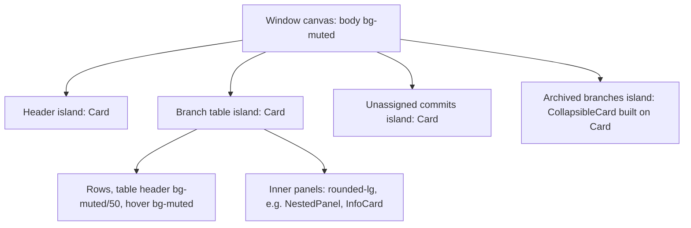

# UI Theme: Islands Layering and the Radius Scale

**Status:** Implemented  
**Updated:** 2026-10-14  
**Tags:** [ui, theme, shadcn, tailwind, radius]

## Problem

Branch Deck runs inside a JetBrains-centric workflow, and the stock shadcn Rhea preset looked foreign next to IntelliJ.
The preset had two problems:

- **Corners too round.** At `--radius: 0.625rem`, cards were 24px, popovers 22px, and buttons, inputs and badges 18px.
- **No shared container style.** The main window mixed three container styles:
  - shadcn `Card`;
  - a hand-rolled `CollapsibleCard` (`rounded-lg ring-1 ring-border`, no shadow);
  - a raw `rounded-lg border bg-muted` header.

  The archived branches block visibly differed from the table above it.

The goal is the look and feel of the IntelliJ Islands Light and Dark themes while staying on stock shadcn components, so a
later `npx shadcn@latest add --overwrite` keeps working.

## Solution Overview

**Coherence over copying.** We take the proportions and the layering of Islands and express them only through shadcn
tokens. We do not copy IntelliJ pixel values into individual components. Every radius comes from one token, and every
top-level block is the same `Card`.

## Design

### Layering

- **Window canvas.** `body` is `bg-muted` (base layer of `src/index.css`), the Islands main window.
- **Islands.** Every top-level block on the canvas is a stock `Card` (`bg-card`, `ring-foreground/5`, `shadow-sm`).
  Examples are the header, the tables, the collapsible sections, alerts and the sub-window context cards.
- **Dark mode.** The same tokens give cards (0.205) darker than the canvas (0.269), which is what Islands Dark does. There
  are no `dark:` overrides.
- **White fields.** `--background` stays white, so outline buttons and white bordered fields (`bg-background`) still read
  inside a card.

### Radius scale

The Rhea preset derives all radii from `--radius` through the multipliers in the `@theme inline` block of
`src/index.css`. `--radius` is `0.25rem`:

| Utility | Multiplier | Value | Used by | Islands counterpart |
| --- | --- | --- | --- | --- |
| `rounded-4xl`, capped at 24px | 2.6× | 10.4px | `Card`, `Dialog` | `Island.arc` 20, a 10px radius |
| `rounded-3xl` | 2.2× | 8.8px | `Popover` | popup |
| `rounded-2xl` | 1.8× | 7.2px | button, input, select, badge, status chip, toast, menu | `Button.arc` 8, a 4px radius |
| `rounded-xl` | 1.4× | 5.6px | menu items, tooltip | `Banner.arc` 12, a 6px radius |
| `rounded-lg` | 1× | 4px | `kbd`, inner panels in app code | `Component.arc` 8, a 4px radius |

Rows are the shadcn utilities. Islands arcs are diameters, so an arc of 20 is a 10px radius.

### Key Decisions

1. **Decision**: Change one token, `--radius`, and never radius classes in `src/components/ui/*`.
   **Rationale**: The scale stays proportional across all components and survives `shadcn add --overwrite`. The
   `// local customisation` list in the ui files does not grow.

2. **Decision**: Accept controls at about 7px instead of the 4px of IntelliJ buttons.
   **Rationale**: Matching IntelliJ exactly would need per-component overrides. A consistent scale matters more than
   pixel parity.

3. **Decision**: The canvas is `bg-muted`, not a changed `--background`.
   **Rationale**: Changing `--background` would turn outline buttons and fields inside cards grey. `bg-muted` is an
   existing semantic token, so no new colour is needed.

4. **Decision**: Keep the stock `Card` ring and shadow.
   **Rationale**: The Islands border has the island colour, so it is invisible. On screenshots, the faint `ring-foreground/5`
   reads as a soft edge, not a line, and it keeps islands distinct in dark mode where a shadow alone is too weak.

### Rules for UI changes

- **A new top-level block is a `Card`**:
  - use `gap-0 py-0` with your own padding, `p-4 sm:px-6` for a header row, as in `UnassignedCommitListCard`;
  - for a collapsible section, use `CollapsibleCard`;
  - never put a `bg-muted` or `bg-background` div directly on the canvas, because it vanishes into or clashes with the
    window.
- **Don't recolour a top-level `Card` or `Alert`** with `bg-muted`. A `bg-muted` override makes the island invisible on the
  canvas.
- **Nested panels inside a card** use `rounded-lg` (4px): `InfoCard`, code boxes, diff frames and warning boxes.
  `rounded-xl` is the most they get. They must stay visibly less round than the 10px island around them.
  - A section with a header inside an island (the conflict viewer and the amend preview in the expanded row) is a
    `NestedPanel` (`src/components/shared/NestedPanel.tsx`): `rounded-lg border border-border bg-card`, without the ring
    and the shadow of a `Card`, its optional header a `SectionCardHeader` row. Never a `Card` inside a `Card`.
  - A section shown both in the row and as a sub-window page is a `SectionPanel`: a `NestedPanel` in the row, a `Card`
    island on the page (`island`).
- **Never hardcode a radius** (`rounded-[12px]`, `rounded-md` on a card). To change the overall feel, change `--radius`
  and check every component.
- **Colours** use semantic tokens only, as in the Code Style section of `AGENTS.md`.
- **A colour means one thing** (statuses, chips, badges, callouts, their icons):
  - `info`: already in the baseline: merged, landed, integrated;
  - `success`: approved, passed, clean;
  - `warning`: attention without a failure: blocked, outdated, a push that drops remote commits;
  - `destructive`: a failure or a conflict;
  - `primary`: the user's actions and selection: push, Sync, the folder icons, a selected or drop-target row;
  - neutral (a `secondary` badge, muted text): a count or a routine state, such as the `SectionCardHeader` count.
- **A note inside a form, a popover or a panel is a `Callout`** (`src/components/shared/Callout.tsx`), never a
  hand-rolled tinted box:
  - `tone` is `info`, `success`, `warning` or `destructive`; the box is `rounded-lg border-<tone>/20 bg-<tone>/10 p-3`;
  - a `size-4` lead icon (the tone's icon, or `icon` for a concept such as `FileDiffIcon`), the `title` in the tone's
    colour, muted details as children; a one-sentence callout passes only the `title`.
- **The state of a whole block is an `Alert`**: the repository path error, a branch that failed to sync or is blocked,
  the empty window. Its `destructive` variant is tinted like `success`, `warning` and `info`; call sites add no colour
  overrides.
- **Code inside a sentence is an `InlineCode`** (`src/components/shared/InlineCode.tsx`, the chip of `LinkedText`). A
  command on its own line is a `pre` block, `rounded-lg bg-muted px-3 py-2 font-mono text-xs`.
- **Help next to a section title is a `HelpPopover`** (`src/components/shared/HelpPopover.tsx`):
  - the trigger is an `InfoIcon` (`size-3.5`, `cursor-help`) button, so never inside another button: `CollapsibleCard`
    takes it as `actions`, outside its toggle;
  - the popup is `w-80 p-3 text-xs`, with `HelpSection` heads (muted `font-medium`, sentence case) and `HelpList`
    (`list-disc marker:text-muted-foreground`); a trigger of its own (the AI toggle) uses `HelpPopoverContent`.
- **A dialog is a `PreviewDialogFrame`** (`src/components/shared/PreviewDialogFrame.tsx`): a header with a visible
  `text-base` title, a body that alone scrolls, a footer of key hints and `xs` buttons. `width` is `sm` for a picker,
  `md` for a question or a help text, `lg` (default) for a preview. Escape is a key hint (`Esc Back`, `Esc Close`), not a
  button.
- **Type sizes** come from the scale: `text-sm` for text, `text-xs` for meta lines, and `text-message`
  (`--text-message` in `src/index.css`, 13px on a 20px line) for commit messages. No arbitrary sizes (`text-[13px]`,
  `text-[10px]`).
- **Live counters are `tabular-nums`** ("Pushing 45%", the fetch percent, "syncing 3/10", download bytes, "3 / 12"), so
  the text does not jitter while it counts. A hash inside a sentence is in the monospace font (`InlineCode plain`).
- **Icons, one per concept** (lucide):
  - `CopyIcon` copies, `Settings2Icon` opens settings, `ExternalLinkIcon` opens the browser, `AppWindowIcon` opens a
    Branch Deck window;
  - `CircleXIcon` is an error, `TriangleAlertIcon` a warning or a conflict, in the colour of its tone;
  - `GitMergeIcon` means merged and nothing else; a commit (the merge base, the merged-by line) is
    `GitCommitHorizontalIcon`;
  - message and title icons are `size-4`, the help icon `size-3.5`.
- **An icon-only button has a `Tooltip`** and an `aria-label`; a label repeated on every row names its object
  ("Expand feature-auth"). Text is a `Tooltip`, rich content a `Popover`; never a native `title`.
- **States**:
  - empty: one muted `text-sm` line where the content would be ("No commits found"), no icon; only the empty window
    is an `Alert`;
  - loading: an inline `Spinner` (`size-4`) and "Loading …" in a muted `text-sm` line, never a centred spinner in a
    tall box;
  - copy: through `copyText` (`src/lib/clipboard.ts`); a copy button says "Copied" in place (`CopyButton`), a menu
    item copies without a toast.
- **Anything that opens on hover or click is a button**: a help icon, a hash or a time with a popover, the AI toggle.
  Base UI triggers render a `button` by default; never a `span` trigger with `nativeButton={false}`, which the keyboard
  cannot reach.
- **Focus ring**: `outline-none focus-visible:ring-3 focus-visible:ring-ring/30` with a radius (`rounded-sm` on inline
  text, `rounded-lg` on a row or a header), as the shadcn controls draw it.
- **`data-state` is Base UI's open/closed vocabulary** (set by hand where E2E reads it); the domain state of a component
  is `data-status` (`data-status="upToDate"` on Update Project, `data-status="force"` on an outgoing row).
- **`Spinner` has no fixed size**: inside a `Button` it is `data-icon="inline-start"` and the button sizes it, like any
  icon; a standalone spinner passes `size-4` (`size-3` in `text-xs`). Never `LoaderCircleIcon animate-spin`.
- **Spacing**:
  - islands in the main window are separated by `gap-6` (`BranchCreator`), and so are the islands of a sub-window
    page, in a `Container` with `py-4` (`ConflictWindowPage`);
  - `IndexPage` has `py-4`, so the header island does not touch the title bar.

### Verification

Every visual change gets before and after screenshots in light and dark:

- build `dist/` and start `test-server`;
- write a throwaway Playwright spec with `deviceScaleFactor: 2`, `colorScheme` set to both, and the fixtures
  `setupRepo("archived_branches" | "unassigned" | "conflict_branches")`;
- check that nothing vanishes on the canvas and that nested panels stay less round than the islands.

Class changes also change the HTML snapshots. Run `pnpm e2e-up`, then review that the snapshot diff only touches classes.

## Alternatives Considered

- **Copy IntelliJ values per component** (4px buttons, 10px cards):
  - Why not: it means per-component overrides in `src/components/ui/*`, which are lost on every `--overwrite`, and the
    proportions drift apart over time.
- **Switch to the Nova style** (`base-nova`, like the JetBrains genui renderer):
  - Why not: Rhea was chosen for its compact density and Inter, and the radius token alone reaches the target.
- **shadcn preset radius "small"** (~0.45rem):
  - Why not: it still gives 19px cards and 13px controls, far rounder than Islands.

## References

- Tokens and scale: `src/index.css` (`--radius`, the `@theme inline` radius multipliers, `body` in the base layer).
- Islands containers:
  - `src/components/ui/card.tsx`;
  - `src/components/shared/CollapsibleCard.tsx`;
  - `src/components/shared/NestedPanel.tsx`;
  - `src/components/shared/Callout.tsx`, `src/components/shared/HelpPopover.tsx`, `src/components/shared/InlineCode.tsx`,
    `src/components/shared/PreviewDialogFrame.tsx`;
  - `src/components/repository/ConfigurationHeader.tsx`;
  - `src/components/branch/BranchCreator.tsx`.
- IntelliJ Islands theme: `community/platform/platform-resources/src/themes/islands/ManyIslandsLight.theme.json` and
  `ManyIslandsDark.theme.json` in the IntelliJ monorepo (`Island.arc`, `Button.arc`, `Component.arc`, `Banner.arc`,
  `main-window-bg`, `tool-window-bg`).
- JetBrains genui, the IntelliJ theme mapped to shadcn tokens:
  `plugins/air/frontend/genui/jcef/web-bundle/src/host/style-variables.ts` and `src/catalog/styles/catalog.css`.
- Related docs: [e2e-testing.md](e2e-testing.md) for the snapshot workflow.
