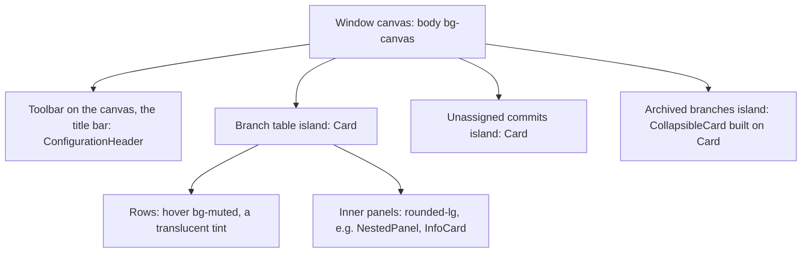

# UI Theme: Islands Layering, Palette and the Radius Scale

**Status:** Implemented  
**Updated:** 2026-10-15  
**Tags:** [ui, theme, shadcn, tailwind, radius, palette]

## Problem

Branch Deck runs inside a JetBrains-centric workflow, and the stock shadcn Rhea preset looked foreign next to IntelliJ.
The preset had two problems:

- **Corners too round.** At `--radius: 0.625rem`, cards were 24px, popovers 22px, and buttons, inputs and badges 18px.
- **No shared container style.** The main window mixed three container styles:
  - shadcn `Card`;
  - a hand-rolled `CollapsibleCard` (`rounded-lg ring-1 ring-border`, no shadow);
  - a raw `rounded-lg border bg-muted` header.

  The archived branches block visibly differed from the table above it.

The first pass fixed both but kept the shadcn colours, and the window still read as a web page next to the IDE:

- **Achromatic greys.** The neutrals had chroma 0. The canvas `#F5F5F5` was so close to white that the islands needed a
  shadow, and the dark text was near-white.
- **A green accent everywhere.** Primary was Tailwind green-500, with white text on it at 2.2:1. It coloured every push
  label, every folder icon and the selection, and it was the hue of `success`, so a selected commit read as "passed".
- **Dark popovers in the island colour**, so a menu over a table was told apart only by its ring.

The goal is the look and feel of the IntelliJ Islands Light and Dark themes while staying on stock shadcn components, so a
later `npx shadcn@latest add --overwrite` keeps working. No shadcn preset or tweakcn theme comes close. The nearest stock
base colour, `zinc`, has the lightness and chroma of the IntelliJ greys, but its hue is 286, not about 265.

## Solution Overview

**Coherence over copying.** We take the proportions, the layering and the colours of Islands and express them only
through shadcn tokens. We do not copy IntelliJ pixel values into individual components. Every radius comes from one
token, every colour is an IntelliJ value in `src/index.css`, and every top-level block is the same `Card`.

## Design

### Layering

- **Window canvas.** `body` is `bg-canvas` (base layer of `src/index.css`), the IntelliJ `MainWindow.background`.
- **Toolbar.** The one block on the canvas that is not an island: `ConfigurationHeader`, 40px high, is the title bar
  of the main window, as the IntelliJ main toolbar lies on the main window background
  ([Title Bar](../../spec/repository/title-bar.spec.md)). The islands scroll under it in their own container.
- **Islands.** Every other top-level block on the canvas is a `Card` (`bg-card`, `ring-foreground/5`, no shadow).
  Examples are the tables, the collapsible sections, alerts and the sub-window context cards.
- **Dark mode.** The same tokens give islands (`#191A1C`) darker than the canvas (`#26282C`), which is what Islands Dark
  does. Popovers (`#26282C`) are lighter than the island under them. There are no `dark:` overrides.
- **White fields.** `--background` stays white (the island colour in dark), so outline buttons and bordered fields
  (`bg-background border-input`) read as fields on an island and on the canvas.

### Palette

`src/index.css` holds the IntelliJ Islands values (`ManyIslandsLight.theme.json`, `ManyIslandsDark.theme.json`), each
with its IntelliJ key in a comment:

| Token | Light | Dark | IntelliJ key |
| --- | --- | --- | --- |
| `--canvas` | `#E9EAEE` | `#26282C` | `MainWindow.background` |
| `--card`, `--background` | `#FFFFFF` | `#191A1C` | `ToolWindow.background`, the island |
| `--popover` | `#FFFFFF` | `#26282C` | `Popup.background` |
| `--foreground` | `#000000` | `#D1D3D9` | text-default |
| `--muted-foreground` | `#5F6269` | `#9FA2A8` | muted text |
| `--border` | `#E9EAEE` | `#33353B` | `*.separatorColor` |
| `--input` | `#D1D3D9` | `#40434A` | `Component.borderColor` |
| `--primary` | `#3871E1` | `#71A1FE` | `Button.default`; the dark-theme link |
| `--success` | `#338555` | `#6DB083` | success text |
| `--warning` | `#A56906` | `#D59637` | warning text |
| `--destructive` | `#C54E58` | `#F57E84` | error text |
| `--info` | `#8250DF` | `#AB7DF8` | none: GitHub's merged violet |

- **`muted`, `secondary` and `accent`** are one translucent tint of the foreground, 5% in light and 7% in dark
  (`--bd-tint`), as the IntelliJ hovers are (`#00000008` on a list, `#00000012` on a toolbar) and as the JetBrains genui
  mapping does. One hover then reads on a white island and on the canvas.
- **The accent** is one token, `--primary` in `src/index.css`, with no choice in the app: `Button.default` `#3871E1`
  of ManyIslandsLight in light (white text), the dark-theme link `#71A1FE` in dark (dark text). `--ring` follows it.
- Contrast on the island: `primary` 4.6:1 with white text, the status colours 4.5:1 and more, muted text 6.1:1
  (light) and 6.8:1 (dark).

### Radius scale

The Rhea preset derives all radii from `--radius` through the multipliers in the `@theme inline` block of
`src/index.css`. `--radius` is `0.25rem`:

| Utility | Multiplier | Value | Used by | Islands counterpart |
| --- | --- | --- | --- | --- |
| `rounded-4xl`, capped at 24px | 2.6× | 10.4px | `Card`, `Dialog` | `Island.arc` 20, a 10px radius |
| `rounded-3xl` | 2.2× | 8.8px | `Popover` | popup |
| `rounded-2xl` | 1.8× | 7.2px | button, input, select, badge, status chip, toast, menu | `Button.arc` 8, a 4px radius |
| `rounded-xl` | 1.4× | 5.6px | menu items, tooltip | `Banner.arc` 12, a 6px radius |
| `rounded-lg` | 1× | 4px | `kbd`, inner panels in app code | `Component.arc` 8, a 4px radius |

Rows are the shadcn utilities. Islands arcs are diameters, so an arc of 20 is a 10px radius.

### Diffs

A diff ([Diff View](diff-view.md)) renders in the light DOM with the classes of
`src/components/diff/diff-view.css`, on the tokens of `src/index.css`:

- the background is `--card`: our tokens already switch with the scheme;
- added and deleted lines are `--success` and `--destructive`, line numbers `--muted-foreground`, the folds the
  `--bd-tint` of the foreground. A merge colours its blocks as IntelliJ: inserted `--success`, deleted
  `--muted-foreground`, modified `--primary`, conflict `--destructive`;
- the code is JetBrains Mono at 13px without ligatures; the row height comes from the font metrics and the zoom: the
  size of the IntelliJ editor and of the UI text beside it, at the cost of about 8% of the columns of a split view.

The syntax colours are the IntelliJ editor schemes: the `--syntax-*` tokens of `src/index.css`, by the roles of
`src/lib/diff/islands-themes.ts`.

### Key Decisions

1. **Decision**: Change one token, `--radius`, and never radius classes in `src/components/ui/*`.
   **Rationale**: The scale stays proportional across all components and survives `shadcn add --overwrite`. The
   `// local customisation` list in the ui files does not grow.

2. **Decision**: Accept controls at about 7px instead of the 4px of IntelliJ buttons.
   **Rationale**: Matching IntelliJ exactly would need per-component overrides. A consistent scale matters more than
   pixel parity.

3. **Decision**: The canvas is its own token, `--canvas`, and `muted` is a translucent tint.
   **Rationale**: The IntelliJ canvas is darker than any hover on an island. A solid `muted` equal to the canvas would
   make every ghost hover on the canvas invisible and every row hover heavy. Changing `--background` instead would turn
   the fields grey.

4. **Decision**: No `Card` shadow, only the ring (`card.tsx` is locally customised).
   **Rationale**: Islands has no shadow; an island stands out by the contrast of `#E9EAEE` and white. The faint
   `ring-foreground/5` reads as a soft edge, not a line, and it keeps islands distinct in dark mode.

5. **Decision**: The exact IntelliJ greys, not a stock base colour.
   **Rationale**: `zinc` is close in lightness and chroma but warmer (hue 286 instead of 265); next to the IDE the
   difference shows. The values are tokens either way, so the ui files don't change.

6. **Decision**: The IntelliJ blue is the one primary, and `info` is violet.
   **Rationale**: One accent as in Islands, readable with white text, and no longer the hue of `success`. Blue would
   have collided with the old blue `info` (merged, landed), so `info` takes the violet GitHub uses for merged.

### Rules for UI changes

- **A new top-level block is a `Card`**:
  - use `gap-0 py-0` with your own padding, `px-4 py-2.5 sm:px-6` for a header row (40px, an IntelliJ tool window
    header), as in `UnassignedCommitListCard`;
  - for a collapsible section, use `CollapsibleCard`;
  - never put a `bg-muted` or `bg-background` div directly on the canvas, because it vanishes into or clashes with the
    window.
- **Every window's top row is its title bar** (`WindowTitleBar`, [Title Bar](../../spec/repository/title-bar.spec.md)),
  on the canvas, never an island: on the left where the user is (the repository, the stack, the list and the commit,
  the request), on the right the view of the window (Unified/Inline/Split) and the actions on its object (`ActionButton`). A
  sub-window is a `WindowPage`: the row, the islands, the footer with the position and the keys only. A preview dialog
  keeps its actions in its footer. A review is a window, never a dialog: a review is a task of minutes beside the
  branch table, a dialog would cover it; a preview is a glance (Quick Look), a dialog. The Unified/Inline/Split toggle is in
  the title bar of the window whose diffs it switches.
- **Window buttons** are the platform's, never a generic set: Windows' caption buttons (46×40, Segoe Fluent), GNOME's
  and KDE's as IntelliJ draws them (a 47×40 cell, its icons; the `window-button-*` tokens of `src/index.css` are their
  colours, the one exception to the semantic palette), in the order and on the sides of the desktop's layout; they dim
  in an inactive window. A Linux window is rounded as the desktop's are (12px GNOME, 8px KDE): GTK draws the shadow
  around that radius, the page clips its canvas to it (`data-window-rounded`), square when maximized, tiled or
  fullscreen.
- **A file is the same object everywhere**: its row gives the width to its name (no hover-only button reserving room,
  the owner in the hover), and its actions are one builder (`fileMenuItems`) behind the right click of every row and
  header that shows a file (one menu each, never around a diff), and ⌘C on a focused row.
- **Don't recolour a top-level `Card` or `Alert`** with `bg-muted`. A `bg-muted` override makes the island invisible on the
  canvas.
- **Nested panels inside a card** use `rounded-lg` (4px): `InfoCard`, code boxes, diff frames and warning boxes.
  `rounded-xl` is the most they get. They must stay visibly less round than the 10px island around them.
  - A section with a header inside an island (the conflict viewer and the amend preview in the expanded row) is a
    `NestedPanel` (`src/components/shared/NestedPanel.tsx`): `rounded-lg border border-border bg-card`, without the ring
    and the shadow of a `Card`, its optional header a `SectionCardHeader` row. Never a `Card` inside a `Card`.
  - A section shown both in the row and as a sub-window page is a `SectionPanel`: a `NestedPanel` in the row, a `Card`
    island on the page (`island`).
- **Never hardcode a radius** (`rounded-[12px]`, `rounded-md` on a card). To change the overall feel, change `--radius`
  and check every component.
- **Colours** use semantic tokens only, as in the Code Style section of `AGENTS.md`.
- **A colour means one thing** (statuses, chips, badges, callouts, their icons):
  - `info` (violet): already in the baseline: merged, landed, integrated;
  - `success`: approved, passed, clean;
  - `warning`: attention without a failure: blocked, outdated, a push that drops remote commits;
  - `destructive`: a failure or a conflict;
  - `primary` (blue): the user's actions and selection: Sync, the icon of a routine push, a selected or drop-target row.
    An action that repeats on every row colours only its icon, so a fully coloured label means "look here"; the folder
    icons are neutral;
  - neutral (a `secondary` badge, muted text): a count or a routine state, such as the `SectionCardHeader` count.
- **A note inside a form, a popover or a panel is a `Callout`** (`src/components/shared/Callout.tsx`), never a
  hand-rolled tinted box:
  - `tone` is `info`, `success`, `warning` or `destructive`; the box is `rounded-lg border-<tone>/20 bg-<tone>/10 p-3`;
  - a `size-4` lead icon (the tone's icon, or `icon` for a concept such as `FileDiffIcon`), the `title` in the tone's
    colour, muted details as children; a one-sentence callout passes only the `title`.
- **The state of a whole block is an `Alert`**: the repository path error, a branch that failed to sync or is blocked,
  the empty window. Its `destructive` variant is tinted like `success`, `warning` and `info`; call sites add no colour
  overrides.
- **Code inside a sentence is an `InlineCode`** (`src/components/shared/InlineCode.tsx`, the chip of `LinkedText`), at
  the size of its text: JetBrains Mono has the x-height and cap height of Inter (0.55 and 0.73 em), so the same size is
  the same height, and a smaller one only shrinks the code. A command on its own line is a `pre` block,
  `rounded-lg bg-muted px-3 py-2 font-mono`, one step below its text (`text-xs` below `text-sm`).
- **Help of a section is a `HelpPopover` right after its title** (`src/components/shared/HelpPopover.tsx`), as the
  context help of IntelliJ: after the title, its count and note, never among the actions, where it reads as one more
  command and its popup hangs over the card edge:
  - the trigger is an `InfoIcon` (`size-3.5`, `cursor-help`) button, so never inside another button:
    `SectionCardHeader` and `CollapsibleCard` take it as `help`; `CollapsibleCard` keeps it outside its toggle, whose
    `::after` covers the rest of the row (one button, one tab stop, the whole row toggles);
  - the popup is `w-80 p-3 text-xs`, `align="start"`; it starts with a `PopoverTitle` (`text-sm`, the section's name
    as its title reads: "Archived Branches") and an optional muted `PopoverDescription` line, then 1–3 short
    paragraphs; `HelpSection` (a `PopoverSectionTitle` head) only for a second kind of content, `HelpList` for a list,
    `HelpKeys` for keys (a `dl` grid, `KbdGroup` beside the label, "Click" as text, modifiers from `@/lib/platform`);
  - a trigger of its own (the AI toggle) uses `HelpPopoverContent` with the same title; a failure titles it in
    `destructive`.
- **A popover is one anatomy**: a `PopoverTitle` (`text-sm`), the sections under a `PopoverSectionTitle` (muted
  `text-xs font-medium`: help, the Activity days, the Robots groups), a footer after `border-t border-border pt-3`.
- **A collapsible card leads with its chevron** (`ChevronRightIcon`, turning 90° open), as every disclosure of the
  app (the stack chip, the file rows, the groups of a form); `CollapsibleCard` draws it, its callers don't.
- **A dialog is a `PreviewDialogFrame`** (`src/components/shared/PreviewDialogFrame.tsx`): a header with a visible
  `text-base` title, a body that alone scrolls, a footer of key hints and `xs` buttons. `width` is `sm` for a picker,
  `md` for a question or a help text, `form` for a form with a text field and several actions (the pull request),
  `lg` (default) for a preview. Its one column is the dialog's width (`minmax(0,1fr)`), so no row widens it past the
  card; a footer that doesn't fit wraps, a text `start` beside the actions first. Escape is a key hint (`Esc Close`),
  not a button.
- **A form below a row is an `InlineForm`** (`src/components/shared/InlineForm.tsx`, `InlineInputDialog` for one input):
  - a visible `text-sm font-medium` title and, only where it adds something, a muted description;
  - the content is at most `max-w-3xl`, an input `max-w-md`; Cancel and the submit are `xs` buttons, the submit of a
    delete `destructive`;
  - a confirmation without an input passes `focusSubmit`, so Enter confirms;
  - the action runs through `withRowProcessing` (it toasts the outcome, an error through `notifyError` with its
    `errorTitle`) or `withRowProgress` (the action toasts, e.g. with Undo) in `src/stores/inline-row-action.ts`: the
    progress row while it runs, the form again with its input after a failure of a form with an input
    (`keepFormOnError`, `keepFormOnFailure`);
  - closing gives the focus back to the opener, or to the row (`BranchContextMenuRow` is focusable).
- **Type sizes** come from the scale in `src/index.css`, one role per step. No arbitrary sizes (`text-[13px]`,
  `text-[10px]`, `text-[0.875em]`):
  - `text-xs` (12/16px): meta lines, column headers, key hints, help popovers;
  - `text-sm` (13/20px, the IntelliJ UI font size): rows, controls, labels, short text, the commit subjects of the
    lists and the hash popover body;
  - `text-md` (14/22px): reading text, the commit bodies of the commit and branch previews (`CommitMessageBody
    size="reading"`), at most `max-w-prose` wide (65ch, about 80 characters). 13px suits a row label, not paragraphs
    a user reads;
  - `text-base` (16/24px): dialog titles, also the subject in the commit preview header, the branch name in the
    branch preview header and the title of a pull request in its review (`font-medium`, as the subject of a commit
    preview); a commit as the heading of what follows it (`CommitHeading`: a commit of the branch preview, the commit
    above its diffs in a review) is `text-md`, never smaller than its body. Island titles are `text-sm font-semibold` (`SectionCardHeader`). The one exception is the Welcome card title,
    `text-base font-semibold`: it greets once, above an otherwise empty window, so it is the size of a dialog title,
    never `text-lg`.
  - A custom step takes a t-shirt name (`text-md`): `cn` (tailwind-merge) merges any other `text-*` class as a colour
    and drops it next to `text-foreground` (`src/lib/type-scale.test.ts`). A size outside the scale is a `bd-` utility
    (`bd-window-control-glyph`, the 10px Windows caption glyph; `bd-avatar-initials`, the initials in a 20px avatar
    circle).
- **Fonts**: Inter for text, JetBrains Mono for `font-mono` (hashes, paths, code), with `calt` off so `->` stays two
  characters; `body` is `antialiased`. JetBrains Mono, not the system `ui-monospace`: it is the same on every platform,
  matches Inter's metrics (SF Mono is 4% lower and exists only on macOS), and is the font of the IntelliJ editor the
  code comes from.
- **Density** is the IntelliJ list density:
  - a branch row is 36px: every cell of the branch tables has the vertical padding `--bd-cell-y` (6px), which the lanes
    of the graph and the family guide span (`StackLanes`, `FamilyGuide`);
  - the dividers of the branch table group its rows: full width between the top-level units (a stack, a lone branch,
    an issue family), from the tree (`--bd-tree-x`) inside one, so a long stack reads as one block and still has a
    line per row to follow across (`bd-branch-rows`, a 1px cell background: a collapsed border can't start inside a
    row). The archived table and the lists inside a row keep `divide-y`;
  - a two-line commit row is 50px (`bd-padding-list-item`, `py-1.5`, the subject 2px above the meta line);
  - island header rows are 40px; the table header is `text-xs font-medium text-muted-foreground` without a fill;
  - the name cell starts its lane column at 1.25rem, so a lane-0 node lines up with the header text; every other cell
    keeps `px-6` or `px-4`.
- **Motion**: an expanded branch row and an open `CollapsibleCard` fade their content in (`animate-in fade-in-0
  duration-150`, opacity only, so nothing a test measures moves). Under `prefers-reduced-motion` the enter and exit
  animations and the transitions are off; the progress indicators (`animate-spin`, `animate-carousel`,
  `animate-robot-ring` of a running Patronus robot, `animate-pulse`) keep running.
- **Live counters are `tabular-nums`** ("Pushing 45%", the fetch percent, "syncing 3/10", download bytes, "3 / 12", the
  time of a running robot "18m · ~22m left"), so
  the text does not jitter while it counts. A hash inside a sentence is in the monospace font (`InlineCode plain`).
- **Icons, one per concept** (lucide):
  - `UserCheckIcon` is a review the user is asked for (the Your Turn card, its Activity entry, the Review item);
  - `CopyIcon` copies, `SettingsIcon` opens Settings (the menu item, ☰, the toolbar, "Notification Settings…", the
    hints that open a page), `ExternalLinkIcon` opens the browser, `AppWindowIcon` opens a Branch Deck window;
  - `CircleXIcon` is an error, `TriangleAlertIcon` a warning or a conflict, in the colour of its tone;
  - `GitMergeIcon` means merged and nothing else; a commit (the merge base, the merged-by line) is
    `GitCommitHorizontalIcon`;
  - message and title icons are `size-4`, the help icon `size-3.5`.
- **A `Tooltip` is not hoverable** (`disableHoverablePopup` in `src/components/ui/tooltip.tsx`): it closes when the
  pointer leaves its trigger and lets clicks through, as IntelliJ tooltips do. In the dense rows the tooltip of a
  button can open over the form of the row above; a hoverable one stayed open there and swallowed the click.
- **An icon-only button has a `Tooltip`** and an `aria-label`; a label repeated on every row names its object
  ("Expand feature-auth"). Text is a `Tooltip`, rich content a `Popover`; never a native `title`.
- **States**:
  - empty: one muted `text-sm` line where the content would be ("No commits found"), no icon; only the empty window
    is an `Alert`;
  - loading: an inline `Spinner` (`size-4`) and "Loading …" in a muted `text-sm` line, never a centred spinner in a
    tall box;
  - copy: through `copyText` (`src/lib/clipboard.ts`); a copy button says "Copied" in place (`CopyButton`, a labelled
    button in its label: "Copy Prompt for Agent"), a menu item copies without a toast.
- **Toasts** show above an open dialog (the viewport is `z-[60]`, the dialog overlay `z-50`) and their text is
  selectable; what they say is in [UX Writing](../guidelines/ux-writing.md).
- **Anything that opens on hover or click is a button**: a help icon, a hash or a time with a popover, the AI toggle.
  Base UI triggers render a `button` by default; never a `span` trigger with `nativeButton={false}`, which the keyboard
  cannot reach.
- **Focus ring**: `outline-none focus-visible:ring-3 focus-visible:ring-ring/30` with a radius (`rounded-sm` on inline
  text, `rounded-lg` on a row or a header), as the shadcn controls draw it.
- **`data-state` is Base UI's open/closed vocabulary** (set by hand where E2E reads it); the domain state of a component
  is `data-status` (`data-status="upToDate"` on Update Project, `data-status="force"` on an outgoing row).
- **One busy indicator per operation**: the control that started it shows the spinner and the progress (Update
  "Updating 42%" with its bar for all its steps, "Pushing 45%" on the Safe Push of the slot, the island header's push of
  its stack, also of its stack branch alone, "Pushing the whole stack 45%"), the header Sync every sync, also the one an applied update waits for as its last step; the other controls of it are disabled without one, and no text beside them repeats it ("Syncing…" next to
  the spinning Sync). A row the operation works on shows its own part (the branch a stack push pushes now, a branch
  the sync rebuilds), never the whole of it again.
- **`Spinner` has no fixed size**: inside a `Button` it is `data-icon="inline-start"` and the button sizes it, like any
  icon; a standalone spinner passes `size-4` (`size-3` in `text-xs`). Never `LoaderCircleIcon animate-spin`.
- **Type hierarchy**: weight marks titles and names, never content, so the names stand out in a long list:
  - `font-semibold`: a card title (`SectionCardHeader`, the Landed header);
  - `font-medium`: a name, the identity of a row (the branch name in `BranchNameCell`, an issue key, a landed
    branch), the name of a file above its diff, and a commit subject only where it is a title (the commit preview
    header, `CommitHeading`);
  - regular `text-foreground`: content, the commit subject of every list (`CommitSubject` in `CommitHeader`), as the
    IntelliJ Git log shows subjects;
  - `text-xs text-muted-foreground`: meta (the commit meta line, the subject next to a branch name, column headers).
- **Two text colours**: `text-foreground` for text (a commit body too) and `text-muted-foreground` for what is secondary
  (meta, directories, hashes, section labels, a label inside a message); no opacity steps between them
  (`text-foreground/85`). Islands has one secondary grey (`text-secondary`, #73767C); ours is its `text-muted`
  (#5F6269 light, #9FA2A8 dark), which keeps a 12px line readable on the dark card.
- **One look per role** in the commit and review windows (the previews, the reviews of a commit, a branch and a pull
  request, the conflict windows, the uncommitted changes):
  - a changed file is a `FilePathLabel`: the status letter, the name in the colour of its status, "← old" of a rename,
    then the directory muted in the same size, cut at its start, as IntelliJ lists a change; the header of a file above
    its diff adds `font-medium`, a tree row leaves the directory to the rows above and puts the letter in the slot of a
    folder icon;
  - the status colours are the VCS colours of IntelliJ: added `success`, deleted muted and struck through, the rest
    `primary`, the one use of `primary` that is neither an action nor a selection; a file says its status once (no badge
    beside the letter);
  - a commit as the heading of what follows it is a `CommitHeading` (above); a state with a commit in it ("“X” does not
    apply cleanly onto master", `ConflictCommitContext`) is a title of a state, `text-sm font-medium` as an
    `AlertTitle`;
  - the head of a section inside an island ("Files 4", "Commits 4", a branch of a stack in the commit column) is a
    `SectionLabel`, muted `text-xs font-medium` with its count, as `PopoverSectionTitle`;
  - line counts are coloured (`text-success`, `text-destructive`) for one file wherever it is listed and for a commit
    or a pull request where it is the heading (the preview headers, `CommitHeading`, the chips of a pull request); a
    row of a list and a sum (a directory, a section) keeps them muted;
  - the time of a commit is absolute: the meta line says it with the committer time on hover (`TimeWithPopover`), a
    one-line list (the commits of a pull request, the stack island) says it short (`formatCompactTimestamp`: "Today
    2:32 PM", "Yesterday", "Oct 3"); only the age of an event is relative ("waiting 2 days", "landed 2 hours ago");
  - a hash is `font-mono` and muted, in a window title too (`WindowTitle` part `{ text, mono: true }`);
  - every sub-window title is a `WindowTitle` in `text-sm`, the last part in the foreground ("Your Turn › 2 of 5").
- **Spacing**:
  - islands are 8px apart and 8px from the window edges, as the 6px Islands gap on the spacing scale: `gap-2` in
    `BranchCreator` and `WindowPage`, a full-width `Container` with `px-2` (`pb-2` under the toolbar of the main
    window), `px-2 pb-2` under the row of a sub-window;
  - islands take the full window width, as IntelliJ tool windows do.

### Verification

Every visual change gets before and after screenshots in light and dark:

- build `dist/` and start `test-server`;
- write a throwaway Playwright spec with `deviceScaleFactor: 2`, `colorScheme` set to both, and the fixtures
  `setupRepo("archived_branches" | "unassigned" | "conflict_branches")`;
- check that nothing vanishes on the canvas and that nested panels stay less round than the islands.

Class changes also change the HTML snapshots. Run `pnpm e2e-up`, then review that the snapshot diff only touches classes.

## Alternatives Considered

- **Copy IntelliJ values per component** (4px buttons, 10px cards):
  - Why not: it means per-component overrides in `src/components/ui/*`, which are lost on every `--overwrite`, and the
    proportions drift apart over time.
- **Switch to the Nova style** (`base-nova`, like the JetBrains genui renderer):
  - Why not: Rhea was chosen for its compact density and Inter, and the radius token alone reaches the target.
- **shadcn preset radius "small"** (~0.45rem):
  - Why not: it still gives 19px cards and 13px controls, far rounder than Islands.
- **Stock `zinc` base colour** (`baseColor: zinc`):
  - Why not: warmer than the IntelliJ greys (hue 286 instead of 265), and hand-written tokens cost nothing more.
- **Keep the green accent and use it less**:
  - Why not: green stays the hue of `success`, and white on it stays below AA.
- **A choice of accent palettes** (the former "Theme…" dialog, inherited from Nuxt UI: the IntelliJ blue and the
  Tailwind palettes):
  - Why not: the contrast of the tokens is checked for one accent, as Islands has one; a picked palette could fall
    below AA or take the hue of a status colour (green `success`, violet `info`).

## References

- Tokens and scale: `src/index.css` (`--radius`, the `@theme inline` radius multipliers, the palette, `body` in the base
  layer).
- Islands containers:
  - `src/components/ui/card.tsx`;
  - `src/components/shared/CollapsibleCard.tsx`;
  - `src/components/shared/NestedPanel.tsx`;
  - `src/components/shared/Callout.tsx`, `src/components/shared/HelpPopover.tsx`, `src/components/shared/InlineCode.tsx`,
    `src/components/shared/PreviewDialogFrame.tsx`;
  - `src/components/repository/ConfigurationHeader.tsx`;
  - `src/components/branch/BranchCreator.tsx`.
- IntelliJ Islands theme: `community/platform/platform-resources/src/themes/islands/ManyIslandsLight.theme.json` and
  `ManyIslandsDark.theme.json` in the IntelliJ monorepo (`Island.arc`, `Button.arc`, `Component.arc`, `Banner.arc`,
  `main-window-bg`, `tool-window-bg`, the `gray-*` and `blue-*` palette).
- JetBrains genui, the IntelliJ theme mapped to shadcn tokens:
  `plugins/air/frontend/genui/jcef/web-bundle/src/host/style-variables.ts` and `src/catalog/styles/catalog.css`.
- Related docs: [e2e-testing.md](e2e-testing.md) for the snapshot workflow.
