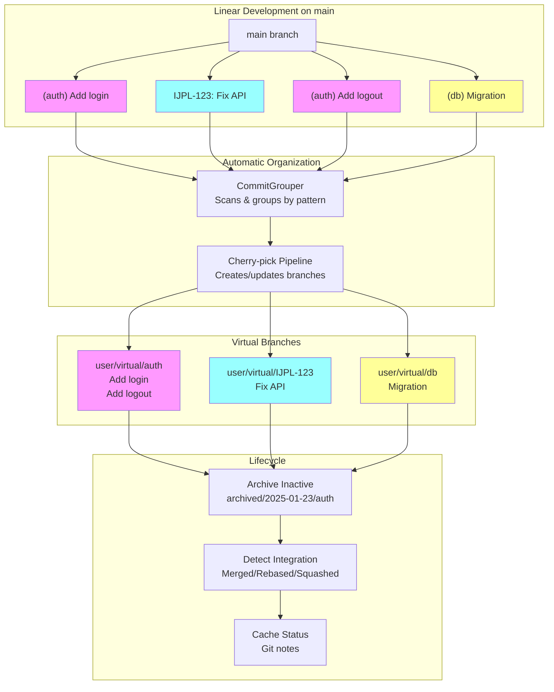

# Virtual Branches Architecture

**Status:** Implemented  
**Updated:** 2026-10-14  
**Tags:** [architecture, git, workflow]

## Problem

Modern development workflows suffer from branch management chaos:
- Developers work on multiple features simultaneously but struggle to organize commits
- Traditional branches require constant switching and rebasing
- Commit history becomes tangled with interleaved changes
- No automatic way to group related commits into logical units

Branch Deck solves this by enabling linear development on main while automatically organizing commits into virtual branches based on commit message patterns.

## Solution Overview

Branch Deck watches your commits for grouping patterns (like `(feature-auth)` prefixes or `IJPL-123` issue keys) and automatically cherry-picks related commits into dedicated virtual branches. This allows developers to work linearly on main while maintaining clean, organized virtual branches for review and integration.

The system handles the entire lifecycle: creating virtual branches, archiving inactive ones, detecting when branches are integrated back into main, and cleaning up completed work.

## Design

### Architecture

### Key Decisions

1. **Decision**: Use commit message patterns for grouping
   **Rationale**: Zero friction - developers just commit normally with a prefix, no tool commands needed
   
2. **Decision**: Cherry-pick commits to virtual branches instead of rebasing
   **Rationale**: Preserves original commits on main, allows clean history on virtual branches

3. **Decision**: Archive by date (`archived/YYYY-MM-DD/branch-name`)
   **Rationale**: Natural organization, easy cleanup of old branches, clear timeline

### Grouping Rules

`CommitGrouper` reads the subject line (`parse_subject` in `crates/sync-core/src/commit_grouper.rs`) and the issue
groups:

1. A leading autosquash marker (`fixup!`, `squash!`, `amend!`) is skipped, so a fixup stays in the branch of its target.
2. An explicit `(name)` prefix at the very start wins. The name is sanitized into a Git ref name (`mockito 5.19` →
   `mockito-5.19`); the virtual branch commit drops the prefix.
3. Otherwise the issue key at the start (after an optional `[category]` and `type(scope):`) decides. Its issue group
   (below) names the branch; without one the key itself does, e.g. `ABC-123: Fix` → `ABC-123`. The commit message is
   kept as is.
4. Anything else is unassigned.

So `(lexer) ABC-123: Add lexer` belongs to `lexer`, and its pushed message is `ABC-123: Add lexer`. A prefix branch
whose commits all carry one issue key belongs to that issue (`issue_key` of `GroupedBranchInfo`): the branch table
nests it under the issue. `groupFor` in `src/lib/commit.ts` mirrors the rule for the editor's warning.

A regrouping by prefix is a message rewrite: `move_commits_to_branch` (`crates/sync-core/src/move_commits.rs`) sets
or removes the prefix of many commits in one rewrite. The UI uses it to move commits, split an issue, rename a branch
and ungroup one; an undo restores the previous messages with `reword_commits`. See
[Move Commits](../../spec/branch/move-commits.spec.md). The issue groups are the one grouping state outside the
messages.

### Issue Groups

An issue group puts the commits of several issue keys into one branch without a rewrite, so that the subjects keep
the rule "issue id plus one sentence". The store is the ref `refs/branch-deck/issue-groups`: a commit whose tree holds
one file of sorted `KEY<TAB>name` lines (`crates/sync-core/src/issue_groups.rs`). Each key has one name, and a name is
a branch name without `/`. A line that is not valid is a reported problem and is never used.

`GroupingInputs` (`commit_grouper.rs`) carries the stack setting and the map to every place that groups: the sync,
`group_commits_ahead_of_baseline`, the regroup and the check, the fixup plan, the landed commits and the update check.
`read_grouping_inputs` reads both in one phase. The rule order is prefix, issue group, issue key, unassigned. A branch
that the map fills, without a prefix commit, has the origin `IssueGroup`; a single-key group nests under its issue in
the branch table. The `branchesGrouped` event carries the map, so `groupFor` in `src/lib/commit.ts` and "Move Back to …"
see it too.

Only a regroup writes the map: a plan's `issue_groups` and `ungroup_issues`, and a rename, which renames the entries
of the old name. It writes under the repository lock and in the ref transaction that moves HEAD, with
compare-and-swap on both refs (see [Git Operations](git-operations.md)). A sync never writes it. A key that groups no
commit is reported by `bd status` as stale and dropped by the next write. An issue group can be a stack parent, but it
can't be restacked. See [Issue Groups](../../spec/branch/issue-groups.spec.md).

### Stacked Branches

With `git config branchdeck.stacks true`, a `/` in a prefix stacks branches: `(auth/login) Add form` belongs to `login`,
whose virtual branch is built on `auth`'s (`crates/sync-core/src/stack.rs`). The ref is the leaf,
`user/virtual/login`, so no level is a ref directory of another. The grouper records every declared edge with its
commits; `StackForest` holds the declared parents, the problems (conflicting parents, cycles, `(a/a)`, leaves that
differ in case, empty levels) and a parents-first order. `place_branches` decides where each branch goes: on its active
parent, on the nearest active ancestor of an integrated parent, on the baseline, or nowhere (`blocked_by`). A parent
without commits is integrated by the detection note of its branch. When that branch is still its virtual branch,
which this sync archives, and has no note, `empty_parent_states` detects it first (`detect_pending_branches`) and
writes the note, so the first sync after the parent's merge moves the child and the archiving reports the parent from
the note. The sync sends the result as `GroupedBranchInfo.stack` and schedules the branches by dependency. Without the setting a `/` is
part of a flat name, as before. See [Stacked Branches](../../spec/branch/stacked-branches.spec.md).

In the UI, `branchTableRowsIn` (`src/stores/branch-sync.ts`) turns the stacks into a tree of typed rows with a depth;
issue families come from the stack roots. `groupFor` (`src/lib/commit.ts`) mirrors `stack_path` for the commit editor
and Move to…. The branch menu restacks and renames over `rename_branch` and `restack_branch`
(`crates/sync-core/src/stack_operations.rs`, wrapping the regroup cores), which rewrite prefixes in one history rewrite.

### Implementation Notes

- **Commit Grouping**: `CommitGrouper` scans commits and extracts patterns (see `crates/sync-core/src/commit_grouper.rs`)
- **Branch Materialization**: Cherry-picks grouped commits onto baseline (see `crates/git-ops/src/cherry_pick.rs`)
- **Integration Detection**: Parallel strategies for merge/rebase/squash detection (see `crates/branch-integration/`)
- **Async Boundaries**: Tauri commands use `spawn_blocking` for git operations (see `src-tauri/src/commands/`)

## Alternatives Considered

- **GitButler (Recommended for Most Users)**:
  - GitButler provides a more comprehensive solution for branch management with virtual branches
  - Branch Deck exists specifically as a workaround for GitButler's [performance](https://github.com/gitbutlerapp/gitbutler/issues/3235) [issues](https://github.com/gitbutlerapp/gitbutler/issues/9018) on large repositories
  - Why Branch Deck instead: Only when working with very large codebases where GitButler performance degrades
  - Consider GitButler first unless you have a large repository with performance constraints

## Performance Considerations

- **Constraint**: Must handle repositories with 10,000+ branches
- **Solution**: Batch operations, parallel detection, git notes caching
- **Measurement**: Sync completes in <2s for typical 100-branch repository

Key optimizations:
- Native Git CLI via direct command execution - no libgit2 or reimplementation overhead
- Object-only Git plumbing (cherry-mark, `merge-tree --write-tree`, one `fast-import` stream for the notes of a sync),
  never the working tree: see [Git Operations](git-operations.md) for the rules and the Git 2.54 minimum
- Parallel processing of independent operations across multiple CPU cores
- Efficient caching with git notes to avoid redundant computations
- Result: Can sync hundreds of commits into virtual branches in seconds, even on large monorepos

## References

- Implementation: `crates/sync-core/`, `src-tauri/src/commands/`
- Tests: `crates/integration-detection-tests/`
- Related docs: 
  - [integration-detection.md](integration-detection.md) - Detection strategies
  - [distributed-settings.md](distributed-settings.md) - Settings synchronization
  - [async-patterns.md](async-patterns.md) - Async/sync boundaries