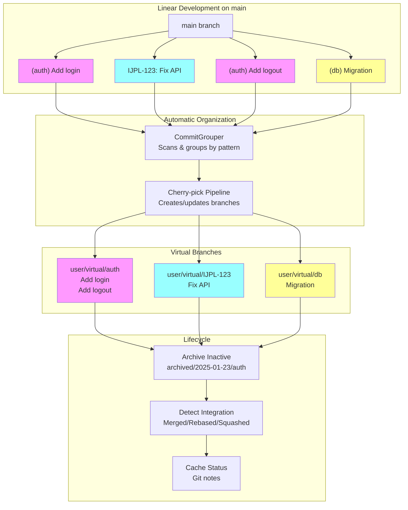

# Virtual Branches Architecture

**Status:** Implemented  
**Updated:** 2026-10-18  
**Tags:** [architecture, git, workflow]

## Problem

Modern development workflows suffer from branch management chaos:
- Developers work on multiple features simultaneously but struggle to organize commits
- Traditional branches require constant switching and rebasing
- Commit history becomes tangled with interleaved changes
- No automatic way to group related commits into logical units

Branch Deck solves this by enabling linear development on main while automatically organizing commits into virtual branches based on commit message patterns.

## Solution Overview

Branch Deck watches your commits for grouping patterns (like `(feature-auth)` prefixes or `IJPL-123` issue keys) and automatically copies related commits into dedicated virtual branches (a cherry-pick as trees: one
`merge-tree --stdin` and one `fast-import` per branch, never `git cherry-pick` or the working tree). This allows developers to work linearly on main while maintaining clean, organized virtual branches for review and integration.

The system handles the entire lifecycle: creating virtual branches, archiving inactive ones, detecting when branches are integrated back into main, and cleaning up completed work.

## Design

### Architecture

### Key Decisions

1. **Decision**: Use commit message patterns for grouping
   **Rationale**: Zero friction - developers just commit normally with a prefix, no tool commands needed
   
2. **Decision**: Cherry-pick commits to virtual branches instead of rebasing
   **Rationale**: Preserves original commits on main, allows clean history on virtual branches

3. **Decision**: Archive by date (`archived/YYYY-MM-DD/branch-name`)
   **Rationale**: Natural organization, easy cleanup of old branches, clear timeline

### Grouping Rules

`CommitGrouper` reads the subject line (`parse_subject` in `crates/history-rewrite/src/commit_grouper.rs`) and the issue
groups:

1. A leading autosquash marker (`fixup!`, `squash!`, `amend!`) is skipped, so a fixup stays in the branch of its target.
2. An explicit `(name)` prefix at the very start wins. The name is sanitized into a Git ref name (`mockito 5.19` →
   `mockito-5.19`); the virtual branch commit drops the prefix. A prefix that is an issue key (its leaf with stacked
   branches) keeps the key in the virtual branch commit, where rule 3 reads one, unless the subject has a key of its
   own: `(IJPL-1) docs plugins: audit` is pushed as `IJPL-1 docs plugins: audit`, `(IJPL-1) [plugins] audit` as
   `[plugins] IJPL-1 audit` (`stripped_subject` in `crates/history-rewrite/src/commit_grouper.rs`). A move of a commit
   without a key into the branch of an issue writes that prefix, and the commit that lands still names its issue.
3. Otherwise the issue key at the start (after an optional `[category]` and `type(scope):`) decides. Its issue group
   (below) names the branch; without one the key itself does, e.g. `ABC-123: Fix` → `ABC-123`. The commit message is
   kept as is.
4. Anything else is unassigned.

So `(lexer) ABC-123: Add lexer` belongs to `lexer`, and its pushed message is `ABC-123: Add lexer`. A prefix branch
whose commits all carry one issue key belongs to that issue (`issue_key` of `GroupedBranchInfo`): the branch table
nests it under the issue. `groupFor` in `src/lib/commit.ts` mirrors the rule for the editor's warning.

A move makes the smallest change that puts the commits where they go (`move_commits_to_branch`,
`crates/history-rewrite/src/move_plan.rs`). A branch is what ships together, and the user decides it per issue: the whole of
an issue moves by the issue groups below, without a rewrite, so the next commit of the issue follows it, also into a
stacked branch. Only a part of an issue and a commit without a key get the prefix, in one message rewrite; a prefix
that the key makes redundant goes. The UI uses it to move commits and whole branches, split an issue, combine issues, rename a
branch and ungroup one; an undo moves HEAD and the issue groups back in one transaction (`undo_regroup`). See
[Move Commits](../../spec/branch/move-commits.spec.md). The issue groups and the stack parents are the grouping state
outside the messages.

### Issue Groups

An issue group puts the commits of several issue keys into one branch without a rewrite, so that the subjects keep
the rule "issue id plus one sentence". The store is the ref `refs/branch-deck/issue-groups`: a commit whose tree holds
one file of sorted `KEY<TAB>name` lines (`crates/history-rewrite/src/issue_groups.rs`). Each key has one name, and a name is
a branch name without `/`. A line that is not valid is a reported problem and is never used.

`GroupingInputs` (`commit_grouper.rs`) carries the stack setting, the map and the stack parents to every place that
groups: the sync, `group_commits_ahead_of_baseline`, the regroup and the check, the fixup plan, the landed commits and
the update check. `read_grouping_inputs` (`snapshot.rs`) reads them in one phase. The rule order is prefix, issue group, issue key, unassigned. A branch
that the map fills, without a prefix commit, has the origin `IssueGroup`; a single-key group nests under its issue in
the branch table. The `branchesGrouped` event carries the map, so `groupFor` in `src/lib/commit.ts` and "Move Back to …"
see it too.

Only a regroup writes the map: a plan's `issue_groups` and `ungroup_issues`, and a rename, which renames the entries
of the old name. It writes under the repository lock and in the ref transaction that moves HEAD, with
compare-and-swap on both refs (see [Git Operations](git-operations.md)). A sync never writes it. The ref is shared by
every branch and worktree, so a write changes only the keys it names. A key that groups no commit on this HEAD is
`idle` in `bd status`, because it may group the commits of another branch; only `ungroup_issues` removes it. An issue
group can be a stack parent, and it is stacked by the stack parents below, without a rewrite. See
[Issue Groups](../../spec/branch/issue-groups.spec.md).

### Stack Parents

A stack parent puts a branch on its parent without a parent level in its prefix. The store is the ref
`refs/branch-deck/stack-parents`, one file of sorted `child<TAB>parent` lines of branch names
(`crates/history-rewrite/src/stack_parents.rs`), read and written as the issue groups. A branch whose prefixes declare no
parent, a bare `(login)`, an issue branch or an issue group, takes its parent from it (`parent_source: store`); a parent
level in a prefix still declares the parent, and a line that disagrees with it is the problem "commits declare
different parents". `StackDeclarations::into_forest` walks the chain of lines up from every branch with commits, so a
stored parent without commits is passed like a declared one; the lines that no chain reaches are idle, they may stack
a branch of another worktree. A plan path `auth/login`, Stack On, Unstack, `bd restack` and `bd unstack` write the map
and rewrite only the commits whose prefix declares another parent; a sync drops the line of a branch once its archived
branch is integrated. See [Stack Parents](../../spec/branch/stack-parents.spec.md).

### Stacked Branches

With `git config branchdeck.stacks true`, a `/` in a prefix stacks branches: `(auth/login) Add form` belongs to `login`,
whose virtual branch is built on `auth`'s (`crates/history-rewrite/src/stack.rs`). The ref is the leaf,
`user/virtual/login`, so no level is a ref directory of another. The grouper records every declared edge with its
commits; `StackForest` holds the declared parents, the problems (conflicting parents, cycles, `(a/a)`, leaves that
differ in case, empty levels) and a parents-first order. `place_branches` decides where each branch goes: on its active
parent, on the nearest active ancestor of a parent without commits, on the baseline, or nowhere (`blocked_by`: a parent
with a problem, a conflict, a failure or a block). A parent without commits never blocks: the local history is linear
on the baseline, so the child's commits can be picked onto the branch below like those of any flat branch, and
`pr_base_changed` tells the UI (the row's "on master" and the alert of the expanded row) that the branch is not built
on its declared parent; its pull request goes into the baseline as every one ([Landing](landing.md)). Restacking a
branch is the user's (Unstack). How the parent stands (`Integrated`, `Unapplied`, `Missing`) is a label: integrated
by the detection note of its branch. When that branch is still its virtual branch, which this sync archives, and has
no note that holds for the current baseline, `empty_parent_states` detects it first (`detect_pending_branches`) and
writes the note, so the first sync after the parent's merge labels it landed and the archiving reports the parent
from the note. The sync sends the result as `GroupedBranchInfo.stack` and schedules the branches by dependency. Without the setting a `/` is
part of a flat name, as before. See [Stacked Branches](../../spec/branch/stacked-branches.spec.md).

In the UI, `branchTableRowsIn` (`src/stores/branch-sync.ts`) turns the stacks into a tree of typed rows with a depth;
issue families come from the stack roots. `groupFor` (`src/lib/commit.ts`) mirrors `stack_path` for the commit editor
and Move to…, with the stack parents of the `branchesGrouped` event. The branch menu restacks and renames over
`rename_branch` and `restack_branch` (`crates/sync-core/src/stack_operations.rs`, wrapping the regroup cores), which
write the stack parents and rewrite only the prefixes that need it, in one ref transaction.

### Stack Branches

A stack that forks (a branch of it with two children or more) is also one more virtual branch,
`user/stack/<root>`: every commit of its branches in the order of the local history, on the base of the sync, as a
flat virtual branch of those commits. It is what a Safe Push of the whole stack lands in one robot, its own pull request
into master ([Landing Work into Master](landing.md)); a straight chain has none, its leaf is the whole stack. The sync
plans it from the grouping (`plan_stack_branches`, `crates/sync-core/src/stack_branch.rs`), builds it beside the
branches in one `CommitChain` and moves its ref once every member is built; it writes no mapping notes and sends one
`StackBranchUpdate` (state, tip, remote status) instead of the events of a branch row. The build is remembered by a
hash of the base and the original commit ids (`StackBuilds`, the object cache), so an unchanged stack costs no git
process. A stack branch whose stack no longer forks is deleted unless it is on the remote; one not rebuilt keeps its
tip and is never pushed. See "Stack branch" in [Git Operations](git-operations.md) and
[Whole Stack](../../spec/branch/whole-stack.spec.md).

### Line Dependencies

`bd commits` (its `units`) and `bd suggest` keep together the commits that `compute_dependencies`
(`crates/sync-core/src/dependencies.rs`, the rules in its header) links by lines: a newer commit depends on an older
one when one of its blocks replaces or deletes a line the older one added, or lies next to one. The blocks are those of
the diff views under `Default` (`file_diffs::blocks`). The adjacency
rule stays, by a measurement of 2026-10-18 on the last 200 commits of this repository and on 217 commits of an
IntelliJ checkout: of 731 and 860 line edges, 239 and 203 rest on adjacency only, and none of them is false. The
oracle replays the commits between the two onto the parent of the older one, without it and without the commits that
conflict without it, then merges the newer one with `merge-tree`: 83 and 55 conflict because of the older commit
itself (merge-ort conflicts on adjacent changes too), 153 and 148 because they need commits that need it, 3 and 0 are
inconclusive. The one false edge of both ranges came from the diff algorithm: bd then cut its hunks with git's myers,
merge-ort with histogram, and in a large rewrite myers gave the older commit a line that histogram keeps unchanged.
Without it no `units` and no `bd suggest` plan change. The measurement used the `-U0` hunks of git. On the last 300
commits of both repositories, 6 of 1,496 and 2 of 388 edges of the blocks are not edges of those hunks, and 6 and 1
edges of the hunks are not edges of the blocks.

### Implementation Notes

- **Commit Grouping**: `CommitGrouper` scans commits and extracts patterns (see `crates/history-rewrite/src/commit_grouper.rs`)
- **Branch Materialization**: Cherry-picks grouped commits onto baseline as trees, in one `CommitChain` per branch (see
  `crates/git-ops/src/cherry_pick.rs`, `crates/git-ops/src/commit_chain.rs`)
- **Integration Detection**: Parallel strategies for merge/rebase/squash detection (see `crates/branch-integration/`)
- **Async Boundaries**: Tauri commands use `spawn_blocking` for git operations (see `src-tauri/src/commands/`)

## Alternatives Considered

- **GitButler (Recommended for Most Users)**:
  - GitButler provides a more comprehensive solution for branch management with virtual branches
  - Branch Deck exists specifically as a workaround for GitButler's [performance](https://github.com/gitbutlerapp/gitbutler/issues/3235) [issues](https://github.com/gitbutlerapp/gitbutler/issues/9018) on large repositories
  - Why Branch Deck instead: Only when working with very large codebases where GitButler performance degrades
  - Consider GitButler first unless you have a large repository with performance constraints

## Performance Considerations

- **Constraint**: Must handle repositories with 10,000+ branches
- **Solution**: Batch operations, parallel detection, git notes caching
- **Measurement**: Sync completes in <2s for typical 100-branch repository

Key optimizations:
- Native Git CLI via direct command execution - no libgit2 or reimplementation overhead
- Object-only Git plumbing (cherry-mark, `merge-tree --write-tree`, one `fast-import` stream for the notes of a sync),
  never the working tree: see [Git Operations](git-operations.md) for the rules and the Git 2.54 minimum
- Parallel processing of independent operations across multiple CPU cores
- Efficient caching with git notes to avoid redundant computations
- Result: Can sync hundreds of commits into virtual branches in seconds, even on large monorepos

## References

- Implementation: `crates/sync-core/`, `src-tauri/src/commands/`
- Tests: `crates/integration-detection-tests/`
- Related docs: 
  - [integration-detection.md](integration-detection.md) - Detection strategies
  - [distributed-settings.md](distributed-settings.md) - Settings synchronization
  - [async-patterns.md](async-patterns.md) - Async/sync boundaries